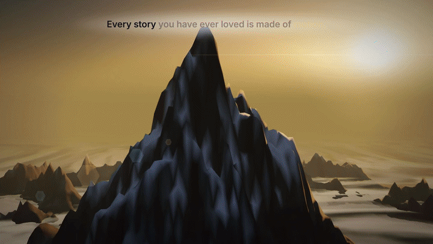
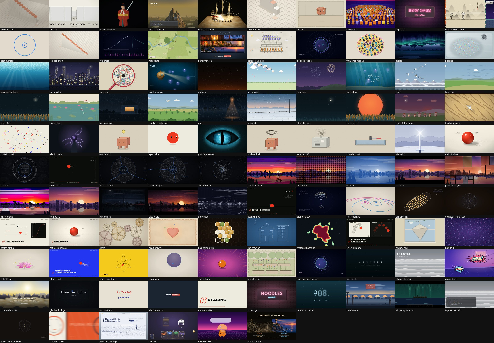

<div align="center">

# Opus Motion Library

**424 motion graphics you can drop into videos, websites and apps — by name, with your own words, colours and images.**

Titles · transitions · weather · characters · data · HUDs · image looks · real 3D — for Remotion, React, plain HTML and native apps.<br/>
Built so an AI agent can pick, mix and ship them for you.

[](LICENSE)
[](https://github.com/GovinduSasanka/opus-motion-library/releases)
[](https://www.remotion.dev)
[](https://react.dev)
[](https://github.com/GovinduSasanka/opus-motion-library/stargazers)

[**Live gallery**](https://govindusasanka.github.io/opus-motion-library/) ·
[**Watch the 8-minute showreel**](https://github.com/GovinduSasanka/opus-motion-library/releases/tag/v1.1.0) ·
[**Quickstart**](#quickstart) ·
[**For AI agents**](AGENTS.md)



</div>

---

## Why

Good motion design is slow to make and hard to reuse. Every motion here is a **pure function of time** with **JSON
props**: give it your text, palette and pictures and it renders the same way every time, at **16:9, 1:1 or 9:16**, in a
**video**, on a **web page**, or as an **exported clip** for an app.

- **424 motions, 97 transitions, 148 styles, 33 recipes**: from a sonar ping, an origami crane and a deep-sea dive to iso bar charts,
  chat bubbles, glitch looks and a terrain that builds itself in real 3D.
- **Mix anything**: stack a backdrop, a subject, type and an accent in one shot (`layers`), with blend modes.
- **Use it anywhere**: Remotion video · `<MotionPlayer>` / `<MotionBackground>` in React or Next.js ·
  `<opus-motion>` custom element for any HTML site · `mp4` / `webm`-with-alpha / ProRes 4444 / GIF exports for
  iOS, Android, Flutter, Keynote and video editors.
- **AI-agent ready**: paste the repo into any project and tell Claude, Codex or Cursor *"pick motions from this library"*
  — [`AGENTS.md`](AGENTS.md) and `mgl suggest` tell it what to choose, how to mix it and how to wire it into that stack.
- **Narrated films from a storyboard**: local text-to-speech, word-synced captions placed clear of on-screen text,
  cuts on the beat, loudness mastering — no cloud services.
- **Deterministic and resolution independent**: seeded randomness, sizes in frame units, no timers.



## Quickstart

```bash
git clone https://github.com/GovinduSasanka/opus-motion-library.git
cd opus-motion-library && npm install
node cli/gen-registry.mjs

node cli/mgl.mjs list                                          # all 424 motions
node cli/mgl.mjs suggest "dark hero for a launch with stats"   # what should I use?
node cli/mgl.mjs render stamp-slam --props '{"lines":["HELLO","2026"],"keyword":"LAUNCH"}' --format portrait
npm run studio                                                 # browse everything in Remotion Studio
```

### In a React / Next.js site

```bash
npm run build:lib            # in the library folder, once
```

```tsx
import {MotionBackground, MotionPlayer} from 'opus-motion-library/web';

<MotionBackground recipe="hero-aurora-night">
  <h1>Ship faster</h1>          {/* real HTML text on top of a live motion */}
</MotionBackground>

<MotionPlayer motion="number-counter" props={{keyframes: [[0, 0], [60, 48210]], label: 'USERS'}} playOnView />
```

### In any HTML page (WordPress, Vue, Svelte, Webflow…)

```html
<script src="opus-motion.element.js"></script>
<opus-motion motion="aurora" props='{"pixelSize":0}' background loop></opus-motion>
```

### In a Remotion project, or as files for an app

```bash
node cli/mgl.mjs add depth-descent stamp-slam --to ../my-video/src     # copies only the source you need
node cli/mgl.mjs export confetti-burst --as webm-alpha                 # transparent overlay for apps / editors
```

Full guides: [`docs/INTEGRATION.md`](docs/INTEGRATION.md) (every stack, step by step) ·
[`docs/CHOOSING.md`](docs/CHOOSING.md) (intent → motions) · [`docs/CATALOG.md`](docs/CATALOG.md) (every prop).

## Use it from your AI agent

Copy or link this repo into your project and say:

> *Use the Opus Motion Library in `./opus-motion-library` to add an animated hero, a stats section and a success state.*

The agent reads [`AGENTS.md`](AGENTS.md) (also [`CLAUDE.md`](CLAUDE.md)), runs `mgl suggest` with your brief, prefers a
tested **recipe**, layers backdrop + subject + type + accent, swaps in your copy and brand colours, and picks the right
integration path for your stack. A Claude Code skill ships in [`.claude/skills/opus-motion`](.claude/skills/opus-motion/SKILL.md).

## Use from AI agents (MCP)

The library runs as a [Model Context Protocol](https://modelcontextprotocol.io) server, so Claude Code, Claude Desktop,
Cursor, Windsurf and Codex can search motions and styles, preview a still, render an MP4, export a clip and copy source
into your project as tools.

```bash
claude mcp add opus-motion -- node /absolute/path/to/motion_graphics_library/mcp/server.mjs
```

Claude Code already picks up [`.mcp.json`](.mcp.json) when you open the library folder. For Claude Desktop and other
clients, add this to their MCP config:

```json
{"mcpServers": {"opus-motion": {"command": "node", "args": ["/absolute/path/to/motion_graphics_library/mcp/server.mjs"]}}}
```

Run `npm install` once first; rendering also needs FFmpeg on PATH. The tools (`search_motions`, `preview`, `render`,
`export`, `add_to_project`, `get_motion`, `list_styles`, `get_style`, `list_recipes`, `get_recipe`, `integration_guide`)
are described in [`AGENTS.md`](AGENTS.md).

## Mix motions

```jsonc
{"layers": [
  {"motion": "city-skyline", "props": {"pullback": false}},
  {"motion": "rain", "props": {"background": "transparent"}},
  {"motion": "blur-in-title", "from": 12, "props": {"title": "AFTER HOURS", "backdrop": "none", "background": "transparent"}},
  {"motion": "film-look", "props": {"overlay": true}}
]}
```

Use it as a scene in a video spec, `node cli/mgl.mjs render mix --props '{"layers":[…]}'`, or `<MotionMix layers={…} />` on
the web. Nineteen ready mixes live in [`recipes/`](recipes) — `node cli/mgl.mjs recipes`.

## Restyle anything

Every motion, mix and composed video takes a **style**: one id that changes the whole look (a woodcut print, a
risograph, a blueprint, neon noir, anime cel) while the motion's code and props stay the same.

```bash
node cli/mgl.mjs render box-bot --style cel-boil
node cli/mgl.mjs still ken-burns --style ukiyoe --out out/ukiyoe.png
```

```tsx
<MotionPlayer motion="city-skyline" look="paper-lantern" />   // web players; <opus-motion look="…"> works too
```

In a Compose spec, put `"style"` on the whole video, on one scene or on one layer. The full style catalogue, with what
each look is for, is in [`docs/STYLES.md`](docs/STYLES.md).

## Make a narrated video

```jsonc
// storyboards/my-story.json
{
  "name": "my-story",
  "voice": {"speaker": "Ryan", "style": "warm documentary narrator"},
  "music": {"snap": true},
  "captionStyle": {"variant": "premium"},
  "scenes": [
    {"motion": "sonar-ping", "say": "Every motion starts with a single *dot.*", "transition": {"type": "iris"}, "tag": true},
    {"motion": "handwrite-on", "props": {"lines": [{"text": "hello"}]}, "say": "And a pen that writes its name."}
  ]
}
```

```bash
node cli/direct.mjs storyboards/my-story.json
```

Voice comes from local Qwen3-TTS, Whisper aligns every word so captions light up as they are spoken, rendered stills of
each scene decide where captions and index tags sit (never on a motion's own text), cuts snap to the music's beats, and
the mix is mastered to −16 LUFS. The showreel is built this way: `python storyboards/build-demo.py && node cli/direct.mjs storyboards/demo.json`.

## Motion catalogue

<!-- catalogue:start -->
<details open><summary><b>Type</b> (46)</summary>

| preview | motion | what it does |
|---|---|---|
|  | **`atomic-orbit-title`**<br/>Atomic orbit title (retro toon)  | A 1950s atomic-age TV title in fat cream block caps with a thick ink outline and a hard magenta offset shadow, wrapped by a tilted cyan orbit that threads behind the top of the letters and in front of the bottom, a small object flying round it and twinkling four-point stars; pops in on twos. |
|  | **`blob-to-wordmark`**<br/>Blob to wordmark  | A row of coloured beads gathers and fuses into a capsule, erupts into a crown of spikes and morphs into a glossy liquid wordmark; thin liquid bridges join the letters and snap one after another, a glint sweeps across, a drip forms under one letter, falls and ripples the floor, and a tagline fades in. |
|  | **`blur-in-title`**<br/>Blur-in title card `overlay` `your image` | Wide-tracked title whose letters sharpen out of a blur with a random stagger, tagline and rule below, then blur-swap to a second title. |
|  | **`bouncing-ball-singalong`**<br/>Bouncing-ball singalong `your image` | Lyrics or a slogan on a period cinema title card: a white ball hops from word to word on the beat along parabolic arcs, squashing as it lands, and every word lights up (outline to solid) the moment the ball touches it. |
|  | **`bulb-marquee-sign`**<br/>Bulb marquee sign  | Any word becomes a theatre marquee of evenly spaced warm bulbs on gold channel letters; letters ignite one per beat with a flash overshoot, then a chase runs across the sign and a tracked gold subtitle rises. |
|  | **`carved-plaque`**<br/>Carved plaque (shadow-theatre title)  | A dark hide plaque with the title cut out so the letters glow with the lamp light behind; carved border with a meander band and cloud-scroll corner roundels, a vermilion seal with a cut glyph, carried on two thin rods, pressed on to enter and lifted off to exit. |
|  | **`chapter-header`**<br/>Chapter header `overlay` `your image` | Numbered chapter/stage header that steps through titles: tracked title + segmented progress bar, era badge card, or vertical location tag. |
|  | **`chrome-80s-title`**<br/>Chrome 80s title  | Heavy italic title in a sky-to-sunset chrome gradient with a white horizon line, dark outline plus neon outline glowing through; flickers on, a light bar sweeps the letters, a star glint pops, katakana line above, red year below. |
|  | **`chrome-title-slam`**<br/>Chrome title slam  | An extruded 80s chrome logotype slams in from huge scale, flashes the frame white and shakes: sky-to-sunset split face with a bright horizon line, dark outline, neon edge, stacked purple extrusion, bevel slivers and reflection lines; then a diagonal glint sweeps across and a four-point star pops. |
|  | **`comic-burst`**<br/>Comic SFX burst `overlay` `your image` | Comic onomatopoeia (BONK! POP!) in a jagged halftone starburst that springs in after an impact frame, wobbles and boils, with speed lines and a shockwave ring. |
|  | **`deco-title-bar`**<br/>Art deco title bar  | An art-deco title card unfolding from a centre point: hairline → stepped lacquer bar with double gold keyline → title rises in Limelight gold → wings with speed lines, over a stepped arch and a 72-ray sunburst, with a diamond year badge and a specular sheen across the gold. |
|  | **`diagonal-assemble-title`**<br/>Diagonal assemble title (shatter into title)  | The previous scene slices into 23 strips along a 30-degree cut that slide off alternately; the title letters then fly in along the same diagonal from alternating sides, spinning and landing one per sixteenth note, the title sitting split along the cut until the halves close with a click. |
|  | **`diagonal-band-title`**<br/>Diagonal band title `your image` | Constructivist title package on warm paper: an archive-footage window slams down, a red girder band slams in along a −18° axis with a decaying shake, a huge Oswald number stamps digit by digit (one per eighth note) with its unit in red, and a caps line rides on the band; everything printed in one ink, one red. |
|  | **`end-card-credits`**<br/>End card credits `overlay` `your image` | Bottom scrim fades in over a drifting landscape; headline, mono stat lines and a credit stagger in with a blur fade-up, then fade to black. |
|  | **`flipbook-riffle-outro`**<br/>Flipbook riffle outro `your image` | A hand-drawn end card (scalloped red title plate, flame mascot, sparkles) pulls back in three drawings to become the top sheet of an animation-paper stack on a peg bar on a desk; a red pencil writes and circles the drawing count, a cartoon thumb lifts the corner and riffles back through earlier drawings on ones, then settles on the top sheet and the mascot winks. |
|  | **`glyph-fractal-push`**<br/>Glyph fractal push  | A big word on a phosphor terminal holds, then the camera pushes on an exponential curve into one glyph until you see it is made of lines of smaller text (names, logs, headlines); outside the glyph the text is barely visible. |
|  | **`glyph-orbit-logo`**<br/>Glyph-orbit logo build `overlay` `your image` | Glyphs fly in and orbit a ring, then resolve into a typed mono logotype (scrambled letter fragments, blue dot becomes the i tittle); a frame draws around it and tagline lines type below. |
|  | **`halftone-exhibit-numeral`**<br/>Halftone exhibit numeral `your image` | A giant rounded numeral bleeds off the right edge in flat yellow overprinted with an orange Ben-Day halftone clipped to the glyph, rising in with a back-ease behind a boiling evidence tag, while a misregistered slab headline drops letter by letter and a navy caption pill pops — all on mottled archive paper. |
|  | **`hanazi-caption`**<br/>Hanazi caption `your image` | A fat rounded variety-show caption made of five stacked layers (offset extrusion, coloured outer stroke, white stroke, gradient fill, top gloss) pops in character by character on a damped spring with a slight drop and rotation, then wiggles, bobs and breathes before popping out; a small handwritten aside and sparkles ride along. |
|  | **`handwrite-on`**<br/>Handwrite-on title  | Text written glyph by glyph with a pen: outline strokes on, ink fill follows; optional fast un-write. |
|  | **`intertitle-card`**<br/>Intertitle card (silent-film)  | A full-frame black painted silent-film card with an Art-Deco border whose ornament follows the emotion (narration, shout, tender, title), set in small-caps and italic serifs, with weave, flicker, scratches, dust and a hair of print damage. |
|  | **`iso-ground-title`**<br/>Iso ground title  | A bold extruded wordmark that belongs to an isometric world: letters drop one by one onto the iso floor plane (16th-note stagger) with a contact shadow, a small bounce and a lean, a hairline rule draws under them, a tagline and a mono stats line type on flat on the plane, and a cyan floor ping closes it. |
|  | **`kinetic-captions`**<br/>Kinetic word captions `overlay` | Word-by-word pop-in captions; *starred* words sit on a solid highlight box. |
|  | **`kinetic-type-slam`**<br/>Kinetic type slam (phrases)  | Huge 2-4 word phrases land one word per beat: each word rises through its own mask with a 1.25→1 (or 0.6→1) scale punch, they stack (or justify full-width, or swap in place), one accent word takes the brand colour, then the whole line is shoved off the top by the next phrase while the camera creeps in. |
|  | **`knife-cut`**<br/>Knife cut (strike a row out)  | A thin red rule shoots across a list row in three frames, then the row collapses vertically to its own midline and is gone; the rows below re-flow into the freed space nearest first and the running total counts down. Precise Swiss deletion. |
|  | **`letters-become-image`**<br/>Letters become image `your image` | A typed sentence on a phosphor terminal breaks apart: its letters fly as particles into the cells of a picture made only of those letters, landing bottom-to-top with a flash on each landing while the source letters dim. |
|  | **`logo-assemble`**<br/>Logo assemble (wireframe, shards lock in) `your image` | The logo draws on as a triangle wireframe, then faceted shards fly in from depth (or scatter) with a stagger, overshoot about 2 % and lock into place; a soft thud (camera punch, glow and ring) and a diagonal light sweep follow, then a tracked tagline. Works from a word or from an image / SVG logo. |
|  | **`marquee-ticker`**<br/>Marquee ticker  | Endless horizontal bands of big uppercase text (solid, outline or pill-logo style) scrolling seamlessly with star/dot/arrow separators — one band, or several tilted and crossing in opposite directions — wiping in staggered. |
|  | **`mask-rise-title`**<br/>Mask-rise title `overlay` `your image` | Editorial title whose letters rise out of baseline masks with motion blur; chapter variant rolls a red italic numeral and types a subtitle, stack variant builds an end-card headline. |
|  | **`neon-sign`**<br/>Neon sign ignite  | Dark plum plate on a brick wall; rounded neon lettering strikes on letter by letter with flicker, then hums, with one faulty letter stuttering and glow spilling onto the wall. |
|  | **`news-strap`**<br/>News strap (broadcast lower third) `overlay` | Persistent broadcast lower third: lemon category tab on a paper strap with a lemon left bar, ink headline + olive caps sub-line, ink end block with the channel name, offset drop shadow and a mono source line; content changes flip vertically and the tab flashes on a new category. Overlay-capable (backdrop "none"). |
|  | **`newsreel-ident`**<br/>Newsreel ident (searchlights & globe)  | Late-1920s newsreel opener: searchlight beams snap on with a flash and sweep from the bottom corners, a 36-wedge sunburst turns slowly, a shaded wireframe globe grows and spins, the channel name lands in Art-Deco silver lettering with a big overshoot over a spaced subtitle, and an iris closes on the globe. |
|  | **`number-counter`**<br/>Number counter `overlay` `your image` | Huge thin-mono counter that ticks or odometer-rolls through dwell keyframes, with unit, label and derived readouts (pressure, light, temperature, percent). |
|  | **`paper-strip-title`**<br/>Paper strip title (scroll unroll + seal) `overlay` | Vertical columns of brush calligraphy on cut gold-paper strips unroll from their anchor edge one per beat — the strip is uncovered, glyphs never squash — each casting a soft shadow, then a small red seal stamps beside the last column; a horizontal serif mode unrolls lines the same way. |
|  | **`pixel-logo-drop`**<br/>Pixel logo drop  | A chunky gold pixel-glyph logo falls with gravity, lands on a white flash frame, squashes and rebounds in 2-frame steps with a screen shake, puffs dithered dust and sparks, gets a diagonal shine sweep and corner glints; a red ribbon unfolds under it, types a subtitle and PRESS START blinks. |
|  | **`ransom-note-type`**<br/>Ransom-note type  | Each letter sits on its own scrap of paper (newsprint, red, black, white) with a different typeface, slightly rotated and jittered, slapped onto kraft one by one; then a diagonal black band with condensed caps, a torn masthead strip and a speech scrap slap in. |
|  | **`rundown-board`**<br/>Rundown board (today in this video) `overlay` | News rundown: a date block (huge numerals, lemon month, mono week, title) pushes up out of masks while ink story rows with lemon number blocks flip open one per beat with a light sweep; the first row pulses; in recap a lemon tick disc pops onto each row. |
|  | **`scene-tag`**<br/>Scene index tag `overlay` | Small glass pill in a corner with an index number, a hairline and a name; slides in, holds, fades. Transparent overlay. |
|  | **`slice-assemble-glyph`**<br/>Slice-assemble glyph  | On black, a big word cut into 8–10 horizontal slices of different heights flies in from both sides at different speeds (some overshoot or sit misaligned like a glitch) and locks into place; a mono caption decodes under it and a red dot pops on at its top-right. |
|  | **`stamp-slam`**<br/>Stamp slam + keyword pop `overlay` `your image` | A rotated vermilion label slams down from 1.3x like a rubber stamp over the scene (the serif title blurs away), then a huge keyword punches in. |
|  | **`sting-bug`**<br/>News sting → channel bug `overlay` | Broadcast sting: lemon slashes zip across a dark studio, a sheared lemon name plate slams in with overshoot as its letters drop in, an ellipse ring and a shake land the hit, the wordmark and mono dateline open from the centre, a glint sweeps, then the plate flies to the corner and stays as the channel bug. |
|  | **`story-caption-box`**<br/>Story caption box `overlay` `your image` | Double-ruled black narrative caption box under a letterboxed scene (RPG-style typing), or a yellow comic time-stamp plate ("7:00 AM  RISE AND SHINE"). |
|  | **`type-architecture`**<br/>Type architecture (credits as a set)  | One line of credits fills the frame as a set: letters stand as black cut-paper pillars, words ride as train carriages on wheels (or colonnade bays) on a flat red ground with telegraph wires behind, while a silhouette agent runs the rooftops, leaps the word gaps and ducks behind the line; the camera opens wide, trucks with the chase and pulls back. |
|  | **`type-marquee-field`**<br/>Type marquee field  | A heavy grotesk word rises letter by letter from a baseline mask (a red dot replaces one letter), then outline and solid rows of the word fill the frame, marquee-scrolling in alternating directions while the whole field rolls ≈ −8° and pushes in. |
|  | **`typewriter-code`**<br/>Typewriter code window `overlay` `your image` | macOS-style code editor or terminal window that types syntax-coloured code with a block cursor; the panel grows upward line by line. |
|  | **`typewriter-signature`**<br/>Typewriter signature `overlay` | Small lowercase credit typed into a corner two frames per character, no cursor; optional glyph-scramble dissolve out. |

</details>

<details><summary><b>Transitions</b> (2)</summary>

| preview | motion | what it does |
|---|---|---|
|  | **`match-cut`**<br/>Match cut (shape continues)  | A record button in an app screen becomes a sun in a sunrise scene at exactly the same position and size: the shape is held 3 frames across the cut (scaled 1 -> 1.6 first), then scene B opens through a clip-path that grows from that shape to the full frame while the sun drifts to its rest position. |
|  | **`transition-reel`**<br/>Transition reel  | Every scene transition in the library, one after another, between contrasting labelled colour panels. |

</details>

<details><summary><b>Shapes & line art</b> (41)</summary>

| preview | motion | what it does |
|---|---|---|
|  | **`atom-model`**<br/>Atom / molecule model  | Bohr atom with a jiggling nucleus of shaded protons and neutrons and electron shells on tilted 3D orbit rings (60 / 0 / -60 deg) that pass behind and in front, electrons with glowing trails; or a rotating ball-and-stick molecule (water, methane, CO2, ammonia, benzene) with CPK colours. |
|  | **`bouncing-ball`**<br/>Bouncing ball (squash, anticipation, crack, hop)  | A red ball over a dark dev-HUD: gravity bounces with velocity stretch and 1-frame squash, or a charge-gauge launch, an exaggerated ground-cracking drop, or beat hops that write notes on a staff. |
|  | **`branch-grow`**<br/>Branching growth (dendrites / tree / network)  | A glowing recursive branching structure draws itself level by level from the trunk in a navy HUD void, gold dots pop at every tip, signal pulses run root to tips, and a binary-tree diagram counts the doubling. |
|  | **`brush-paint-in`**<br/>Watercolour brush paint-in  | Any path set (a plant sprig by default) paints itself in stroke by stroke: each stroke is a translucent variable-width ribbon with thin bristle tracks that break into dashes and end early (dry-brush flying white), overlaps darken, and the finished painting sways gently. |
|  | **`burin-engrave-hatch`**<br/>Burin engrave hatch  | Any SVG shape becomes a copperplate engraving that cuts itself in order on laid paper: swelling outline runs, then parallel hatch lines whose width follows a lit distance-field tone, a crossing family in the half-tones, a lozenge family in the darks and a hatched cast shadow; roman capitals are cut glyph by glyph below. |
|  | **`call-response`**<br/>Call & response (two spheres)  | Blue and pink glossy spheres take turns pinging rings, flash a colour-swap halo, the paper tilts into a perspective floor, sparkles ride the ring crossings and a lotus blooms between them. |
|  | **`cel-shade-crescent`**<br/>Cel shade crescent  | Flat shapes become 80s anime cels: a hard shadow crescent, a hard highlight crescent, a saturated neon rim and a coloured outline are built up step by step, then the light swings round and the crescents re-cut. |
|  | **`cell-division`**<br/>Cell division doubling  | Glossy gold nuclei bud and split inside an egg outline, doubling every few frames up to 256, while a corner binary tree grows one level per doubling. |
|  | **`comet-pulse-guide`**<br/>Comet pulse guide `overlay` | Light pulses travel a dark channel (spiral, ring, wave, circuit trace or your own path) as comets — narrow white-hot head, long exponential tail, hue drifting from accent A to B with age; near-zero idle glow, pulses fired on a beat pattern, up to 8 alive, optional wrap. Overlay-capable with background: transparent. |
|  | **`compass-construct`**<br/>Compass geometry construct  | A drafting compass sweeps a circle and the six Seed-of-Life petals, a ruler draws the hexagon with a bright tip, nodes glint, then the construction spins and implodes to a point. |
|  | **`crayon-hatch-fill`**<br/>Crayon hatch fill  | A hand-drawn bar chart on toothy paper: indigo crayon outlines draw on, then each bar is coloured in with back-and-forth zig-zag wax strokes that overshoot the line row by row; the hero bar gets a cross-hatch, values are hand-lettered, lines boil at 12 fps. |
|  | **`dash-flow-field`**<br/>Dash flow field `3D` | A grid of rounded cream dashes on ultramarine turns to follow a vector field around a wandering red dot — circling it (vortex), pointing at it (radial), circling again — while rings of longer lime dashes ripple outward and dashes near the dot shrink to dots. |
|  | **`easing-graph`**<br/>Easing graph + compare tracks  | A linear black ball and an eased red ball race along two tracks with per-frame spacing ticks, while a dark graph-editor panel drags its bezier handles from linear to an S-curve and prints cubic-bezier(...). |
|  | **`exploded-view-balloons`**<br/>Exploded view with balloons  | A drawn blueprint assembly comes apart part by part, one per beat; each part trails a leader line and a numbered balloon, a parts list fills in on the side, then the parts click back together and the balloons fade. |
|  | **`flat-to-3d-sphere`**<br/>Flat disc to 3D sphere  | A flat red disc gains a wireframe, a perspective floor grid and gradient 3D shading with specular and cast shadow, leader-line callouts (highlight, terminator, core shadow…) type in, then it renders back flat. |
|  | **`gears`**<br/>Meshing gears  | Procedural hatched cog wheels pop in and mesh, counter-rotating at the correct tooth ratios; coloured-pencil gears on paper or white line-art gears on black. |
|  | **`grid-beat-construct`**<br/>Grid beat construct  | A cream sheet rules its module grid from the centre outward; Bauhaus primitives (disc, bar, triangle, square, semicircle, quarter-disc) land, slide, flip, scale and rotate in one per beat, each preceded by a crosshair target; the finished composition then turns upright in a clock-escapement of 7.5 degree ticks and locks into a poster with title, subtitle and folio. |
|  | **`heart-draw-fill`**<br/>Icon draw, fill & glow (heart)  | On warm sketch paper a pencil draws a red heart outline (or star / check / bolt), the hatched fill fades in, 4-point sparkles twinkle around it and a soft warm glow pulses while it hovers. |
|  | **`hex-comb-build`**<br/>Hex comb build  | Cream wax hexagon edges grow segment by segment with node balls and compass-circle previews, cells fill with honey colours, wax caps spiral shut and the comb tilts into extruded prisms. |
|  | **`ink-brush-stroke`**<br/>Ink brush stroke `overlay` | Sumi brushstrokes paint themselves on rice paper: a wet loaded body with a darker contour side, bristle tracks that break into flying white at the dry tail, soft edge bleed; presets for a decisive swoosh, an underline, an ensō circle and a bamboo sprig, or pass your own paths. |
|  | **`line-draw-on`**<br/>Line-art draw-on  | Line art constructs itself stroke by stroke with a pen nib riding each tip, then groups of lines recolour to a highlight; defaults to a blueprint building elevation. |
|  | **`metaball-heatmap`**<br/>Metaball heat-map / goo  | A liquid splat spreads and oozes, rendered as heat-map contour bands (maroon core to mint rim) on a starfield; or gooey dark blobs merge and swell with an RGB-split rim. |
|  | **`motif-grid-pattern`**<br/>Motif grid pattern (identity backdrop) `overlay` | Brandable identity backdrop: square cells of big discs, half-discs and 14 small geometric motifs in five tones of one hue; whole rows slide against each other, breathe and jump a quarter cell on the beat, with a faint diagonal light sweep. One prop swaps the whole colour. |
|  | **`nib-follow-camera`**<br/>One-line drawing, nib-follow camera `overlay` | A single continuous ink line draws a whole scene with real pen dynamics — thin on fast travels, fat and pooled at slow corners, a soaked bleed, one red accent stretch, a soft pen shadow at the nib — while the camera glides after the drawing point with lag and anticipation and pulls back at the end to reveal the whole picture. |
|  | **`oblique-extrude-drawing`**<br/>Oblique extrude drawing  | On cyanotype blueprint paper, a flat line elevation draws on in drafting order, then turns into a thick oblique drawing as the depth animates 0 → 0.5 with hidden lines vanishing correctly; parts explode along the depth axis with hand-lettered labels, a dimension and a title block. |
|  | **`one-line-journey`**<br/>One-line journey  | A single gold line with a glowing pen tip travels through a chain of figures (seed, plant, building, skyline, wave, ring) as one continuous path; a virtual camera rides the tip zoomed in and pulls back as the drawing grows, older parts dim to ~35 %, the clock breathes on each figure, and the finished drawing relights under a tracked title. |
|  | **`onion-skin-arc`**<br/>Onion-skin arc (straight ahead vs pose to pose)  | Two panels compare animation methods: ghost circles drawn frame by frame along a wandering path vs keys, a breakdown and eased in-betweens filling an arc; or (mode drop) a bowling ball, ball and balloon fall the same height in different frame counts. |
|  | **`origami-fold`**<br/>Origami fold sequence (paper crane)  | A paper sheet in front of a sunny window: crease lines draw on, the sheet folds in snappy 2-3 frame flap rotations (excess strip falls away, pre-creases, diamond, 3/4 tilt, kite and narrowing folds, neck, tail, head) into a crane that flaps its wings; reversible (unfold). |
|  | **`pair-field`**<br/>Pair field zoom-out  | Dark violet field of hundreds of cyan+pink dot pairs pinging small rings; the camera pulls out 2.5x from a hero pair. |
|  | **`papercut-rosette`**<br/>Papercut rosette (fold · cut · unfold) `overlay` | A square of red paper folds three times in snappy flaps down to a wedge, scissors trim a scalloped edge and cut saw-tooth bands, crescents, slits and coins out as holes, then the wedge unfolds in three quick snaps into an 8-fold round window flower that blooms with a warm flash, turns slowly and sheds fluttering red scraps. |
|  | **`petal-bloom`**<br/>Petal bloom (lotus / radial)  | Layered petals unfold radially with spring overshoot into a lotus, or dense rings of spike petals sweep round a seed disk into a sunflower / fur ball. |
|  | **`ribbon-trail`**<br/>Ribbon follow-through trail  | A red ball swoops across a blue field trailing five lagging pastel ribbons; when it stops the ribbons whip past and settle hanging with a damped swing (or, style neon, two orbiting dots draw looping neon tube trails). |
|  | **`rose-curve-trace`**<br/>Rose-curve pendulum trace  | A red ball swings on a dotted pendulum string tracing petal loops; the outlines complete into a flower that fills pink, then zooms past camera and its colour becomes the background. |
|  | **`scissor-cut`**<br/>Scissor cut `your image` | A dashed "cut along the line" guide draws across an image, a pair of scissors travels it snipping five times, then the cut piece separates: it lifts away, flips over or falls, revealing a coloured panel beneath. |
|  | **`shape-morph-chain`**<br/>Shape morph chain  | A solid flat icon (mug, sun, paper plane, pin, heart, star) morphs into the next through a circle, rotating and stretching on the way; its sub-parts (steam, rays, wing folds, highlights) morph in lockstep through constant-count slots, and the field colour changes with each shape. Any SVG outline can be fed in. |
|  | **`sketch-shade-in`**<br/>Sketch shade-in  | Everyday objects drawn as bare black ink lines on a book page; an ink sun icon switches on and the shading arrives in a few tenths of a second — white clay fills, pen cross-hatching on the shadow sides and soft cast shadows — then the light drifts so the shadows swing. |
|  | **`sonar-ping`**<br/>Sonar ping + echo window `your image` `loops` | Glossy dot on paper emits sonar rings; echo arcs return and pop open a circular picture window. |
|  | **`speed-lines`**<br/>Manga speed lines + impact frame  | Manga focus lines converge on a subject over a halftone comic backdrop, re-randomised every render frame on twos; at the hit the frame flips for two render frames into a yellow / violet two-tone impact print with a giant comic word, then red lines fade out and calm lines return. |
|  | **`sprout-grow`**<br/>Sprout grow row  | Pencil-sketch planters on a park lawn: stems rise one after another, leaf pairs pop and flower heads (sunflower, blossom, tulip) scale in with overshoot, then sway with twinkling sparkles inside a torn-paper frame. |
|  | **`swimmers-converge`**<br/>Swimmers converge + shockwave + fusion  | Small glowing agents with wavy sine tails swim in along dotted S-curves and stop around a glowing cell; one gets through with a flash and an expo shockwave ring, the rest fade, then two aster dots drift together and fuse in a starburst. |
|  | **`toon-cel-shape`**<br/>Toon cel shapes (mid-century print) `overlay` | Mid-century limited-animation card: flat icon fills printed off-register and re-jittering on twos, broken pressure-varying ink lines that write themselves on, dry-brush tooth, a starburst behind each icon and a two-plate slab title. |

</details>

<details><summary><b>Effects & accents</b> (49)</summary>

| preview | motion | what it does |
|---|---|---|
|  | **`backlit-cutout`**<br/>Backlit paper cut-out (holes are light) `overlay` | In a dark paper night scene a hanging cut-out — a rosette window flower, a lantern or a word — lights up from behind: the paper glows deep red, every cut hole burns warm white with a two-level bloom and soft rays, and the hole pattern is projected across the ground as squashed light, with a candle flicker. |
|  | **`beam-clash`**<br/>Beam clash  | Two fighters fire white-core energy beams in their own colours that meet mid-frame in a jittering four-point star flare spraying spark streaks, with a blurred reflection on the glossy neon floor, a "DEAD EVEN!" pop and a white-out bloom at the end. |
|  | **`beat-punch-zoom`**<br/>Beat punch zoom `your image` | Music-synced camera kick: the whole frame punches a few percent toward a chosen point on every accent (ticks, hits, slams at different amplitudes, summed and capped) and relaxes in ~5 frames. Demo: a candy sunburst stage where a toy star squashes on each slam with a star-ring-lines burst; or feed any image with src. |
|  | **`circuit-traces`**<br/>Circuit traces `overlay` | A faint glowing PCB pattern — thin traces with 45° bends ending in round pads — draws itself over the ground (flat or squashed onto the iso plane), then breathes at low opacity under the scene. |
|  | **`confetti-burst`**<br/>Confetti burst `overlay` | Flat circles, rings, squares and capsules explode radially from a point with drag, gravity, spin and 3D flutter; fill mode tiles the whole frame (video17). Overlay-ready: background "transparent". |
|  | **`copper-proof-pull`**<br/>Copper proof pull  | ECU of polished warm copper with hairline scratches and a blurred four-pane window reflection: a burin cuts glinting grooves (dark trough, bright burr) with a curling swarf ribbon while the camera pulls back over the mirrored plate; then a paper sheet sweeps across with a curled edge and the image is revealed printed true, with an engraved title. |
|  | **`crayon-wax-shader`**<br/>Crayon wax shader `your image` | Wax-crayon-on-toothy-paper look as a layer: a picture-book garden (sun, cloud, flowers, grass) is outlined, coloured lightly so the wax only catches the paper tooth, then coloured over hard until near-solid; embossed paper, fibre grooves, 12 fps boil. With src, any picture is coloured in by big zig-zag strokes through the same filter. |
|  | **`cyanotype-water-bloom`**<br/>Cyanotype water bloom  | Water drops fall onto a cyanotype blueprint and bloom into deeper, more saturated blue stains with pale tide-line rims; the white line work inside each stain goes soft, and a drop on the signature makes the ink bleed. |
|  | **`data-view-flash`**<br/>Data view flash  | Beat-synced 1–5-frame "data" flashes: the painterly army close-up cuts to the same units as flat glyphs on near-black noise (with an occasional RGB-split frame) and straight back, hiding each faction change inside a flash. |
|  | **`drop-splash-crown`**<br/>Drop splash crown  | A glossy drop falls stretched onto a polished floor, squashes into a lens and throws a crown of tapered tendrils; the tips bead up and pinch off as secondary droplets that fly and land as small beads or melt into the puddle while the stubs recoil, all mirrored in the floor; a second smaller drop lands in the puddle. |
|  | **`electric-arcs`**<br/>Electric arcs `overlay` | Jagged white-core lightning arcs with violet glow, re-randomised every 1-2 frames with drop-outs and brightness flashes, radiating from a plasma orb, jumping between two electrodes or crawling around an object. Overlay-ready: background "transparent". |
|  | **`emote-pop`**<br/>Emote pop `overlay` | Doodle reaction icons (! ? lightbulb hearts sweat-drop music notes) pop in over a point in 1-2 frames, boil, bob and fade, chained one after another above a box-bot. Overlay-ready: background "transparent". |
|  | **`eraser-rewind`**<br/>Eraser rewind (undo wipe)  | A charcoal felt eraser slides along a zig-zag path at constant speed and wipes a wide band of hand-drawn ink, leaving a faint ghost; then a corrected line is written in. Reads as "undo / rewind time" or a clean whiteboard wipe. |
|  | **`explosion-burst`**<br/>Explosion burst  | Two-frame flash, a fireball that swells in 12 frames and then rolls while cooling yellow to red to soot with turbulent edges, rising smoke puffs, a shockwave ring that outruns the frame in about 10 frames, glowing debris with streaks, drifting embers and a decaying camera shake; or a cartoon version with a spiky flash, scalloped ink-outlined clouds, chunky debris on twos and optional comic text. |
|  | **`eyes-blink`**<br/>Eyes blink & look `overlay` | A pair of cartoon eyes on a red ball blinks, darts between look targets and switches to happy ^ ^ arcs with a squash hop; watching variant fills dark negative space with staggered glowing green eye pairs. Overlay-ready: background "transparent". |
|  | **`fire-flames`**<br/>Fire flames (cartoon / real / lava) `overlay` | A fire bed that licks upward with 6-10 Hz flicker and 15 % height variance: flat layered red / orange / yellow tongues (cartoon), soft additive gradient layers with heat glow and embers (real), or dark crust with pulsing glowing cracks and gooey rising lava blobs. Overlay-capable. |
|  | **`focus-desaturate`**<br/>Focus desaturate `your image` | At the key moment the whole scene greys toward warm cream (mix with luma and #E9DFCB) while one subject keeps full colour and gets a dashed ring and label. Default scene is a flat isometric town with one red-roofed house as the subject; with src it greys an image except a kept circle. |
|  | **`frame-blend-timelapse`**<br/>Frame-blend time-lapse `your image` | A keyed speed ramp (1x to 70x and a hard brake to 0.3x) integrated to source time, each frame an average of blended sub-frames: headlights become continuous lines, clouds turn to water, the sky runs through the day, then everything snaps sharp. |
|  | **`frame-breakout`**<br/>Frame breakout `your image` | A framed woodblock-style print sits on a tan mount; the red koi inside grows, leaps and pushes out past the top border while the rest of the picture stays clipped to the frame — the camera tilts up into the mount and widens to follow, holds the almost-frozen crest outside the frame, then falls toward the lens with a camera push and small roll, bursts into foam that fills the screen and fades to bare paper. Clip is bound left/right/bottom but open on the break edge. |
|  | **`freeze-frame-brackets`**<br/>Freeze-frame brackets `your image` | The footage stops dead with a white flash, a small punch-in and colour draining to 45 %; yellow corner brackets close in on the subject and a timecode chip with a red pause mark slides in top-right. |
|  | **`giant-eye-reveal`**<br/>Giant eye reveal `overlay` `your image` | In darkness a huge reptilian eye opens from a cyan slit through an almond lid mask, with a glowing fibrous iris, contracting slit pupil and lit scales; ends with an exponential push into the pupil (or an eyelid close). Overlay-ready: background "transparent". |
|  | **`glass-crack-mend`**<br/>Glass crack and mend (re-leading) `your image` | A leaded stained-glass pane takes a blow: nine white-hot jagged cracks race out from the impact in a quarter second with a flash and a 2-frame shake, then groups of glass slide along the leads into a new arrangement, one group per beat with a weld spark, and the cracks turn into dark mending lead lines. |
|  | **`grease-pencil-mark`**<br/>Grease pencil marks `overlay` | Hand-made telestration: a warm-white grease pencil draws a wobbly overshooting ring around a detail, quick arrows with barbs, crosses and soft-lead underlines — each stroke doubled by a thinner offset pass so it reads waxy; optionally freezes an image with a short jolt first. Transparent overlay by default. |
|  | **`impact-frame`**<br/>Impact frame (flash, shake, punch) `overlay` | On each hit: one inverted frame, one white frame, a decaying camera shake, a 1.06 to 1 zoom punch, a chromatic RGB split and a burst of speed lines with a shock ring; the default scene slams one giant word per hit (READY / SET / GO) on a new colour with an anticipation ring closing before every beat. |
|  | **`ink-blot-stop`**<br/>Ink blot (pen stop) `overlay` | Where the pen stops, ink soaks into the paper as a growing teardrop: the tip stays at the nib, the belly sags downward, the rim is irregular with a darker tide line; several blots with their own timing and optional handwritten words. Transparent overlay by default. |
|  | **`ink-brush-boil`**<br/>Ink brush boil  | A doodle (light bulb, mug, star, heart or your own strokes) inks itself on warm paper with real brush lines — tapered ends, pressure wobble, heavier on the shadow side — then flat fills drop in off-register, a hatched shadow scratches in, a hand-lettered caption writes on, and every line keeps breathing (re-drawn each exposure). |
|  | **`long-exposure-trails`**<br/>Long-exposure trails `overlay` `your image` | Dusk city with a road bending to the horizon: moving lights leave long glowing streaks like a long-exposure photograph — warm white headlights streaming toward the viewer and red tail-lights streaming away, each trail a tapered additive-glow line that fades toward its tail and grows with perspective, plus a brighter hero car. Overlay-capable: set background transparent (or give a src plate) and your own light paths. |
|  | **`loupe-magnify`**<br/>Loupe magnify (light table) `your image` | A black-rimmed magnifier with a bevel highlight and clear acrylic skirt drops onto a document on a backlit light table, reads a line at 2.5× with colour fringing at the rim, glides to the key figure (underlined and ringed in the signal colour), then the camera pushes through the lens. |
|  | **`magnifier-loupe`**<br/>Magnifier reading loupe `overlay` `your image` | A thin round glass lens wanders across textbook text like a reading cursor, magnifying it 1.6× with a slight barrel bulge, a prismatic orange/magenta rim fringe with tinted ghost text, a white edge highlight and a small magnifier icon; it follows its path with a soft critically damped lag. Works over any `src` image, or as glass only over host content (backdrop "none"). |
|  | **`marker-ring-arrow`**<br/>Marker ring and arrow `overlay` | Broadcast-telestrator annotations drawn live without a freeze: glowing fluorescent marker arrows (solid for what happened, dashed with an open chevron for what was intended), a perspective ring with rotating dashes, a translucent dashed area, and a comet with a fading tapered trail behind a moving point — every stroke has a dark outline, colour glow, colour core and white highlight. Overlay-capable: set background to transparent and scene to none. |
|  | **`palette-reink`**<br/>Palette re-ink (squeegee recolour)  | A finished screen-print poster of a lake under mountains is pulled again: a wide tilted squeegee crosses the sheet in about a third of a second and behind it every ink has changed (noon, golden hour, dusk), geometry identical; the big number swaps with the palette. |
|  | **`physics-pile`**<br/>Physics pile (falling, stacking shapes)  | Colourful circles, rounded boxes and triangles (or letter tiles from a word) drop in one after another, bounce, tumble, stack and settle in a box, bowl or on the floor; a deterministic pre-simulated 2D rigid-body sim at 120 Hz sampled per frame, with small impact marks and exported collision frames for sound effects. |
|  | **`portal-glow`**<br/>Portal glow  | A golden ring between paper-stone ruins with a four-point star at its centre, slowly rotating light rays, a pulsing glow, a shimmering basin pool, winking glints and rising motes, ending in a warm white-out bloom. |
|  | **`practical-light-shadow-jump`**<br/>Practical light shadow jump  | A cold, dim room with two figures beside an unlit lantern. On the switch-on beat the light ignites (0 to 1 in ~.3 s with a flicker overshoot), the glow blooms, the figures turn toward it and their shadows swing out across the floor from their feet while the mood flips from cold blue to warm. Source can be lantern, lamp or screen. |
|  | **`registration-snap`**<br/>Registration snap (loose print layers clamp)  | A crane down a screen-print: the ink layers hang loose as separate paper sheets with paper-white gaps, thickness shadows and depth parallax, then clamp into perfect register on one loud hit (2-frame shake and flash) before the key facts print in. |
|  | **`scribble-ball`**<br/>Scribble ball `overlay` | A boiling tangle of open ink loops, regenerated every 2 frames, floats over an upset box-bot linked by a red steam squiggle; storm variant swaps in a boiling doodle cloud with a lightning scribble and rain. Overlay-ready: background "transparent". |
|  | **`sdf-liquid-shade`**<br/>SDF liquid shade  | Coloured metaballs orbit and fuse into thick glossy jelly: smooth necks that blend their colours, dome-shaped diffuse shading from a key light, a hard specular highlight, a broad softbox sheen, a saturated translucent rim and a fading floor reflection. |
|  | **`smear-frame`**<br/>Smear frame `overlay` | Hand-animation smears: a red ink ball (or the flame mascot, or a star) holds on twos, anticipates, then whips to its next spot in one stretched dry-brush smear drawing followed by one "multiples" drawing of overlapping copies, landing with squash, trailing speed lines and an impact star on the slam. |
|  | **`smoke-puffs`**<br/>Smoke puffs `overlay` | Clusters of open doodle ink circles (or soft blurred circles) rise from a vent, grow and fade, then shrink away when fixed; flash mode fires a 2-frame muzzle flash and a forward-drifting smoke puff. Overlay-ready: background "transparent". |
|  | **`sparkle-burst`**<br/>Sparkle burst `overlay` | Four-point doodle sparkles burst from a contact point and twinkle out (tool-tap repair), or gold stars fly out of a jittering scuffle cloud, or twinkle around a cheering character. Overlay-ready: background "transparent". |
|  | **`star-glint`**<br/>Star glint flare `overlay` | A six-spike specular "ting" with soft bloom flashes on a blade tip, shimmers through a hold and slowly decays; can slide along an edge, or fire as a quick 4-point twinkle. Overlay-ready: background "transparent". |
|  | **`sticker-cutout`**<br/>Sticker cut-out (die-cut border) `overlay` | Paper-sticker finish for any subject: a thick rounded off-white die-cut border, a thin grey cardboard edge peeking out below, paper grain and a soft cut-out-shaped shadow; icons, words and transparent images slap down one by one with a back-ease and sway gently. |
|  | **`swirl-portal`**<br/>Swirl portal (goo-rim toon hole) `overlay` `your image` | A vertical oval hole in the world with a lumpy thickly outlined goo rim, five spiral arms in two alternating tints rotating inside, a pale hot core, orbiting sparks, drips off the bottom and flat rings of glow; pops open with an overshoot and boils on threes. |
|  | **`tape-stutter`**<br/>Tape stutter  | The picture behaves like worn tape: it steps down to 15 fps while tracking, jolts two or three frames backwards, drags at 15 fps into the drop and winds down at half speed; a cassette demo with a source-time curve and OSD makes each skipped frame visible. |
|  | **`theatre-gate`**<br/>Theatre gate (framed film print) `your image` | Frames any picture or motion as a film being shown: a 4:3 print in a rounded aperture with a soft dark rim, flanked by deep red-brown velvet drapes lit by the screen spill and footlights, with curtains that part at the start and close at the end. |
|  | **`vhs-crt-pass`**<br/>VHS CRT pass `overlay` `your image` | Soft VHS-on-CRT playback over a night scene: smeared chroma with the red shifted right, scanlines, RGB grille, phosphor glow, dark corners, noise, a power-on opening and tracking-noise tears. |
|  | **`wash-bloom-colour`**<br/>Wash bloom colour  | A copperplate print of a pear is cut in black line, then transparent watercolour blooms region by region from where the brush touched — ragged wet front, spill past the line, off-register, darker tide-line, backruns and granulation — multiplied under the ink, with an engraved title and a script note. |
|  | **`wax-resist-reveal`**<br/>Wax resist reveal  | Crayon picture-book page (hills, lighthouse, moon) drawn on toothy paper; a broad ultramarine watercolour wash sweeps across with bristle streaks and a dark wet front, and hundreds of white-wax stars plus a hidden hand-lettered message appear exactly where it passes, each uncovered star glinting. |
|  | **`mix`**<br/>Mix (layer motions together)  | Stacks any motions in one frame: backdrop + subject + text + accent, each with its own timing, opacity and blend mode. Per-layer extras: knock-out halo, beat breathe (squash/stretch on the beat) and stop-motion stepping / boil. |

</details>

<details><summary><b>Worlds & weather</b> (39)</summary>

| preview | motion | what it does |
|---|---|---|
|  | **`aurora`**<br/>Aurora curtain `overlay` | Undulating teal-green aurora curtains shimmer over a navy starry sky, snowy mountains and an icy sea, with an optional pixel-art (pixelate + dither) look. Overlay-capable. |
|  | **`bubbles`**<br/>Iridescent bubbles `overlay` | A packed foam of soap bubbles on a steel sink: rotating rainbow thin-film rims, jiggle, occasional pops and re-growth; "rising" mode sends bubbles up through deep water. Overlay-capable. |
|  | **`caustics-godrays`**<br/>Caustics & god-rays `overlay` | Underwater: a rippling caustic web at the surface, swaying light shafts and drifting motes; "pool" = full-frame scrolling caustic texture; "beam" = warm window light shaft with dust. Overlay-capable. |
|  | **`city-skyline`**<br/>City skyline (window flicker, dusk to night)  | Seeded procedural city: three depth rows of buildings with setbacks, water tanks, antennas and window grids that flicker on and off; the sky goes from dusk to night as more windows light up, with traffic on the street and an optional aerial crane pull-back from one window to the whole skyline. Sketch style gives the hatched pencil-on-paper look. |
|  | **`conveyor-flow`**<br/>Conveyor flow  | Storybook workshop doors swing open and identical products (cassettes, boxes, cards or your image) roll out one after another on a wooden perspective belt toward the lower right, growing with depth at an even spacing while slats scroll and rollers turn. |
|  | **`curl-flow`**<br/>Curl-flow swirl `overlay` | Hundreds of coloured ribbons stream through a turbulent curl-noise vortex around a dark spiky pupil, inside a red magnifier lens on cream paper (or full-frame). Overlay-capable. |
|  | **`depth-descent`**<br/>Deep-sea depth descent `your image` | Underwater descent infographic: a bobbing brass bathysphere hangs on its cable while the world scrolls up past it — surface god-rays, a fish school, glowing jellyfish, a trench wall and the seafloor — the water darkens with depth, marine snow drifts, the headlamp beam rises as light falls, a depth counter with pressure/light/temperature counts top-left, a log-scale depth ruler with landmark ticks scrolls on the right and zone titles blur in letter by letter. |
|  | **`embers`**<br/>Embers & gold flecks `overlay` `loops` | Golden additive sparks rising and twinkling over a fire glow; "motes" = slow soft glowing ember dots, "gold" = spinning Klimt gold flecks with sparkle pulses. Overlay-capable. |
|  | **`falling-petals`**<br/>Falling petals / leaves / papers `overlay` | Petals (or autumn leaves, or paper sheets) sway, spin and flip in 3D as they fall in three depth layers past a blossom branch over a soft meadow. Overlay-capable. |
|  | **`fireworks`**<br/>Fireworks `overlay` | Staggered fireworks over a night city: a faint launch streak climbs, a white flash ball holds for a few frames, then a peony of sparks expands with an ease-out-cubic, droops under gravity, fades from the core out and twinkles away, while a warm global light pulse briefly lifts the whole scene. |
|  | **`fish-school`**<br/>Fish school + jellyfish  | Underwater scene: a loose school of fish sweeps across the frame along an eased Bézier S-curve, each fish trailing at its own lag with tail wobble, depth-faded colour and gentle wander, past pulsing glowing jellyfish, swaying kelp, god-rays and drifting particles. |
|  | **`flock`**<br/>V-formation flock  | A V-formation of red-crowned cranes flies right-to-left over snowy peaks: birds shrink with depth along each arm, flap on twos with offset phases (white down-strokes, grey-blue up-strokes) and bob against their wings, while a lone paper crane swoops in from the lower right and takes the last slot. |
|  | **`flow-lines`**<br/>Flow lines (wind / heat / steam / waves) `overlay` | Wavy streamlines: wind lines with end curls across a sky, rising heat wiggles over a desert road, soft steam wisps from a bowl, or braided pencil wave rows on paper. Overlay-capable. |
|  | **`fog-clouds`**<br/>Fog and clouds (parallax) `overlay` | Three parallax layers of drifting noise-built clouds (lit white cumulus with soft grey undersides), low ground fog over dark ridges, or a wide soft mist; layer speeds run 1 : 2 : 4, blur grows toward the front and a screen-blended sun glow scatters through them. |
|  | **`grass-field`**<br/>Grass field (teal blades + golden leaves)  | Procedural tapered teal grass blades grow up from the bottom edge in a staggered wave, golden pointed leaves pop up behind, and the whole field sways with travelling wind gusts under a starry night sky. |
|  | **`insect-flight`**<br/>Insect dart flight (dragonflies / fireflies) `overlay` | Red dragonflies zig-zag over a sunny lotus pond in fast expo-eased darts separated by jittery hovers, their translucent wings flickering every frame, and one lands on a lotus bud and folds its wings; firefly mode fills a night meadow with glowing, blinking fireflies drifting between waypoints. |
|  | **`lamp-screen`**<br/>Lamp screen (shadow-theatre cloth) `your image` | A warm cotton shadow-theatre screen in a lacquered stage frame (optional blurred audience heads) lit from behind by flickering oil lamps; the pierced subject is transmitted light: dyes glow, holes shine, overlaps darken. More lamps bleach the cloth, snuffing steps it back to gold. |
|  | **`light-band-window`**<br/>Light-band stained-glass window  | A tall leaded window with four lancets and a rose in a dark ashlar wall: a soft band of coloured sunlight travels across it (dawn, noon, afternoon, dusk, moon) so the lit lancet glows jewel-bright with a shaft, dust and a floor patch while the others go dark and milky and freeze their figures. |
|  | **`lightbox-stack`**<br/>Paper-cut lightbox (纸雕灯)  | A glowing paper-cut lamp scene in eight stacked sheets: starry pulp sky, a moon with halo, auspicious clouds with carved spirals, two mountain ranges, a village whose warm windows switch on one by one, a river with a broken moon trail, a dark tree and reeds, and blurred hanging lanterns that flicker — each sheet casting a soft shadow on the one behind while the lamp turns on back-to-front and the camera creeps in. |
|  | **`lightning-flash`**<br/>Lightning flash relight `overlay` | A rainy night house scene is relit by lightning: a forked bolt draws on, the frame flashes to a pink storm-lit plate for 2 frames and decays back to night in ~0.3 s; repeatable, with double strikes. Overlay-capable. |
|  | **`mesh-gradient-bg`**<br/>Mesh gradient backdrop `overlay` | Big soft pools of violet, blue, cyan and magenta light drifting slowly over an indigo-black base, gently breathing, with an optional ripple of light and fine grain: the 2025-26 tech-brand backdrop. |
|  | **`mode7-floor-perspective`**<br/>Mode-7 lobby floor  | An art-deco lobby in true one-point perspective: a checkered marble floor with a burgundy runner slides under a dollying camera, with depth darkening, gold pilasters and glowing sconces receding on both walls, warm mirrored glow pools and a sunburst door at the end of the hall. |
|  | **`outrun-grid`**<br/>Outrun grid  | One-point-perspective neon floor grid scrolling toward the camera to a hot horizon, a banded retro sun with scrolling cut-out stripes, ridged wireframe mountains, palm silhouettes and reflector posts whipping past, a starry sky with a shooting star and a tail-lit car; beats fire a bright shock line across the floor and pump the sun. |
|  | **`paper-cutout-layers`**<br/>Paper cut-out layers (stop-motion)  | A scene built from flat coloured paper layers with deckled edges and soft drop shadows that grow with depth, fibre grain over everything: layers slide up with a 4-8 degree rotation that settles to 0, a sun, clouds, three hills, a paper sea and a sailboat bob and drift in parallax, a paper-cut title lands last, all stepped on twos (12 fps stop-motion). |
|  | **`paper-diorama`**<br/>Paper diorama `your image` | A pop-up-book landscape of 8 cut-paper layers with fibre texture, torn light rims and soft inter-layer shadows; a slow multiplane dolly, a walking paper critter on a stone bridge, a flowing stream and a golden guide star that ignites and leaves a trail. |
|  | **`parallax-landscape`**<br/>Parallax landscape truck / speed-run  | Layered flat-vector landscape (sky and clouds, two mountain ranges, distant fields with a village, a hill, a tree row, foreground and whizzing near blades) trucking sideways at depth-proportional speeds with a flapping paper crane; speed-run mode ramps to a gallop-speed rush over a savanna with a fixed giant sun, horizontal streak blur on the near layers and light streaks. |
|  | **`popup-layer-rise`**<br/>Pop-up layer rise  | A cut-paper landscape assembles like a pop-up book: over the existing sky each paper layer slides up into place, far layers first and the nearest last from furthest down (easeOutCubic, no overshoot), then holds with a slow dolly and drops back out near-first with motion blur. |
|  | **`print-wave`**<br/>Print wave  | An original woodblock-style wave: a tall wall of water in bokashi blues (pale crest → Prussian → deep trough) with offset banding and grouped broken white flow lines along the back slope, a hollow shaded under the curling lip, a scalloped foam rim, fractal claws (each splits into three fingers that split again, tips hooking inward) over a pale back layer, spray in clusters, and a background sea of banded curls. It swells, curls and hangs with jitter ×0.25; nature steps at 8 fps. Paper, double border, ink outlines. |
|  | **`rain`**<br/>Rain `overlay` | Night street in the rain: 3 parallax layers of slanted streaks, lamp-lit cone, ground ripples; optional glass droplets and trickles. Works as a transparent overlay. |
|  | **`rocket-launch`**<br/>Rocket launch  | Countdown on a dusk launch pad, ignition with billowing ground smoke and a flickering plume, an ease-in lift-off and a camera that tilts up to follow the rocket as the sky turns to space, leaving a smoke trail. |
|  | **`segmented-worm-breach`**<br/>Segmented worm breach  | A giant panelled mechanical worm with a toothed circular mouth bursts out of a cream line-art desert in a dust plume, arcs toward camera and dives back; optional translucent cyan x-ray pass. |
|  | **`snowfall`**<br/>Snowfall `overlay` | Layered snow drifting diagonally over a dusk snowy landscape; blizzard mode streams pixel snow and streaks sideways through a blue-grey white-out. Overlay-capable. |
|  | **`starfield-night`**<br/>Starfield night `overlay` | Dark teal night sky with twinkling cream stars, a grainy crescent moon that fades in, swaying teal grass and a shooting star. Overlay-capable. |
|  | **`studio-sweep`**<br/>Studio sweep (graphite seamless backdrop) `your image` | A dark graphite photographic seamless: a soft radial gradient with the floor implied only by a blurred contact shadow beneath a glossy subject, and a slow narrow softbox light sweep gliding across the set. |
|  | **`sun-rise-set`**<br/>Sun rise / sun set  | Sunrise: a huge orange gradient disc rises from behind teal grass with an ease-out, grows a ring of spike rays and golden leaves pop up over a starry night. Sunset mode: stepped purple-to-peach sky bands, a cream sun with rotating dashed rays sinks behind the horizon and the sky darkens to dusk. |
|  | **`time-of-day-grade`**<br/>Time-of-day grade (day to night)  | A simple procedural hillside village whose sky gradient and colour grade keyframe from day through golden hour, dusk pink and mauve to night: the sun arcs down and sets behind the hills, clouds pick up the sunset, a multiply night grade cools everything, the moon and stars come out and the house windows switch on one by one. |
|  | **`topdown-terrain`**<br/>Top-down terrain scroll `your image` | Bird’s-eye view: a fixed paper crane (with hatched cast shadow and streaming dashed trail) flies over seeded top-down terrain — fields, river and town roofs, ocean with a whale breach, desert dunes, snowy peaks, night city, autumn forest — that scrolls diagonally with a speed ramp and hard-cuts between biomes. |
|  | **`toy-town-traffic`**<br/>Toy-town traffic  | A seeded miniature city seen from a high oblique angle: blocks of low-rise buildings with coloured roofs and blue shadows, parks with round bright trees and ponds, crosswalks, and dozens of little cars that flow, queue at red lights and surge on green (IDM car-following simulated deterministically), pedestrians gathering at corners. Actors step at 8 / 12 Hz under the time-lapse while the camera rotates smoothly, a tilt-shift focus band follows the red hero car, and a time-lapse clock ramps from ×6 down to ×1 real time. |
|  | **`window-glow-sequence`**<br/>Window glow sequence `overlay` `your image` | A storybook brick workshop powers up: its arched windows turn golden one after another with a warm bloom and one flicker, action ticks flicker over the roof hopper, the tower cog speeds up and smoke puffs rise as a giant hand withdraws. |

</details>

<details><summary><b>Characters</b> (16)</summary>

| preview | motion | what it does |
|---|---|---|
|  | **`blob-mascot`**<br/>Blob mascot hop & roll  | White eyed sphere hops down an isometric bar staircase with squash/stretch, painting each cap, lands with a tile ripple, then rolls back with its eyes coming round, leaving a fading peach trail. |
|  | **`box-bot`**<br/>Box-bot mascot  | Orange cube mascot with dark rectangular eyes, little arms and four stubby legs acting out a script: walk on twos, look around, emote, hop with squash and landing, wave, run off. |
|  | **`character-rig-2d`**<br/>Character rig 2D (presenter)  | A flat-vector humanoid presenter on a jointed rig: walks in, idles with a 1.5 s breathing bob, blinks every 2-5 s, lip-flaps through four mouth shapes from text or an amplitude array, and plays cue actions (wave, point, nod, shrug, cheer, walk, talk). Body parts can be swapped for your own images. |
|  | **`collage-puppet`**<br/>Collage puppet  | A cut-out engraving portrait split into scalp lid, face and jaw: the jaw flaps between three stepped poses to "talk", dashed cut lines and scissors snip across the forehead, then the scalp flips open on a brass brad to reveal a torn wedge of space from which a rocket, planet, bird, rose and butterfly spill out one per beat, with ransom-letter chips and paper confetti. Animated on twos at 12 fps on kraft paper. |
|  | **`colour-model-relight`**<br/>Colour-model relight  | One cel character re-lit through day, dawn, night, backlit and silhouette by multiplying each paint role separately (fills, shadows, lines, hand-set skin), beside the muddy result of a single filter over the whole frame. |
|  | **`creator-hand`**<br/>Creator hand `overlay` | A giant storybook hand in a chunky red ribbed sweater reaches in from the edge, unpins a light-bulb idea card from a corkboard, carries it on a slow S-curve on twos and drops it onto a closed laptop in a warm gouache desk room. |
|  | **`crowd-bob`**<br/>Crowd stomp / cheer  | A massed perspective crowd of box-bots, ink-etched soldiers or paper dolls; the camera cranes up to reveal its size while everyone stomp-hops in sync (or cheer-bobs with hearts). |
|  | **`flame-sprite`**<br/>Flame sprite  | A hand-inked flame mascot (red outer, yellow core, paper-white glint, dot eyes, rubber-hose arms with white gloves) wakes on a cream paper stage, looks around, hops three times along red dotted arc guides with squash and stretch, throws a ta-da with sparkles, squashes to a pancake and pops back with a wink — all on ones, twos and threes with boiling ink. |
|  | **`flat-person-desk`**<br/>Flat person at desk  | A geometric flat-vector person with round glasses works at a laptop in a cosy sunflower room (window with skyline and sun, framed print, swaying pendant lamp, plant, steaming mug); the room pops in with springs, they type and blink, the phone pings with a bell bubble, their head snaps round with an "!" mark, they reach for the phone and break into a smile, bobbing on the beat. |
|  | **`paper-critter-rig`**<br/>Paper critter rig `overlay` | An original paper-cut critter (fox-like by default) made of overlapping scale-shaped paper pieces, with walk-in-place, stand, sit and look-up poses, tail swish, head tilts and ear flicks, paper rims and a contact shadow on a mossy paper ledge. |
|  | **`pictogram-figure`**<br/>Pictogram figure (geometric athlete) `overlay` | Faceless geometric pictogram figure — round-capped bars and a disc head driven by beat-timed key poses (run, walk, jump, throw, kick, lift, wave, cheer) — far-side limbs tinted toward the background, standing on a big sun disc with a light sweep over a low-contrast motif grid, assembled from horizontal bands that slide into register. |
|  | **`sign-drop`**<br/>Sign drop & swing  | A neon, comic banner or wooden sign drops in on ropes with a springy bounce, swings on a damped pendulum and settles into a gentle sway; neon flickers on after landing. |
|  | **`silhouette-runner`**<br/>Silhouette runner (cut-paper chase)  | A flat black cut-paper agent with a streaming red tie sprints on twos across red rooftops under a paper moon, leaping the gaps, chased by a taller villain in a wide brim whose red coat lining flashes as he runs. |
|  | **`stickman-rig`**<br/>Stickman rig  | Round-capped stick figures with circle heads walk, run, punch, kick, fall, cheer, moonwalk, wave and dance from a joint-angle pose library with 2-bone IK legs; lines boil on twos and strikes trigger impact frames (flash, burst, hit-stop shake). |
|  | **`toon-object-character`**<br/>Toon object character  | An everyday object (mug, box, bottle, can) becomes a 1930s rubber-hose cartoon character: pie eyes and a big mouth on its front, black noodle arms and legs, white four-finger gloves, huge round shoes, boiling ink outlines and a steam carrier that shows the mood; it walks in, hops with squash and stretch, points, waves and cheers. |
|  | **`walker-world-scroll`**<br/>Walker world scroll (era wipe)  | A chibi explorer in a bucket hat walks in place at 37.5 % W while procedural era panels (cave, Egypt, Greek vase, ink wash, 8-bit, vaporwave) scroll by with eased stop-and-go; torn decorated seams restyle him as they pass, with a confetti burst and an era badge swap. |

</details>

<details><summary><b>Data</b> (37)</summary>

| preview | motion | what it does |
|---|---|---|
|  | **`axis-ratchet-rescale`**<br/>Axis ratchet rescale  | A pencil chart draws calmly until one value pierces the top frame line — torn red scar, 2-frame punch-in, decaying shake — holds the break for a beat, then the y-axis rescales in 4 ratchet clicks with every tick and mark sliding to its new position. |
|  | **`beat-montage`**<br/>Accelerating beat montage `your image` | Hard-cut image montage whose cuts accelerate 12 f -> 6 f -> 3 f, a persistent centre dot, breathing sonar rings on the beat, per-shot micro push and beat-synced style swaps. |
|  | **`chip-stack-bars`**<br/>Chip stack bars  | Horizontal bars built from labelled unit chips, one chip per item: each row has a tiny tracked label above and a rolling count at the end, rows grow left to right chip by chip (about one chip per frame), and the highlighted row uses the accent colour with a gentle wave once complete. |
|  | **`crowd-tracks`**<br/>Crowd tracks `your image` | A locked-off concourse plate darkens and desaturates while every walker becomes a glowing sodium-orange dot trailing a decaying polyline of where it just was, linked to its nearest neighbour — people as data — with a lock-digit footfall count. |
|  | **`dna-helix-unzip`**<br/>DNA helix unzip  | A rotating DNA double helix draws on, coloured A-T / G-C base-pair rungs fill in, then a zipper point runs along the axis and the two strands peel apart into half-rungs with letter tags. |
|  | **`dot-tally`**<br/>Dot tally (people as dots)  | One dot per person in labelled groups; selected dots turn one by one from filled cream discs into open red rings while a huge counter runs; the total and a two-symbol legend land at the end. |
|  | **`dot-to-stripes-morph`**<br/>Dot-to-stripes morph  | A hand-drawn pencil dot chart on cream paper sweeps mark by mark into a full-height warming-stripes band: each dot falls to the band centre, stretches into its coloured stripe and loses its ink ring, while the graphite line fades and a handwritten note returns as a tiny pencil tick. |
|  | **`element-columns-3d`**<br/>Element columns 3D  | A periodic table of 3D tiles on a wooden bench in a dark lab: the columns rise from the floor to heights set by a property (melting point), the camera drifts round, the tallest column is tagged with a label and a caption pill sits at the bottom. Sample values are illustrative. |
|  | **`empty-next-cell`**<br/>Empty next cell  | After a short run of pencil data marks, a dashed red rectangle draws itself around the next empty slot with a handwritten "?", holds, then widens into a frame-within-frame end card for the value nobody knows yet. |
|  | **`energy-jar-fill`**<br/>Energy jar fill  | Ink-line glass jars on a clay shelf rack light up one by one: saturated self-lit liquid rises with a meniscus, its glow spills onto the shelf, panels and label cards, and handwritten values count up, then everything drains. |
|  | **`flow-diagram`**<br/>Flow diagram (packets on edges)  | Rounded boxes with icons joined by arrows that draw on in sequence (14 f each, 5 f stagger); glowing packets or labelled chips travel the edges, each receiving node pulses 1 -> 1.08 -> 1 and a highlight ring follows the active step. Auto-lays out left-to-right (top-to-bottom on portrait) from the edge graph; blueprint / paper / dark themes. |
|  | **`function-plot`**<br/>Function plot (curve, tangent, area)  | Maths-explainer plot on dark slate: axes draw on, a curve from a safe expression string traces left to right with a glowing head, a tangent (or a secant that shrinks into the tangent) slides along it with a slope readout, then Riemann bars melt into a filled area with a running integral. |
|  | **`grid-exception`**<br/>Grid exception (the one that breaks out)  | Swiss grid poster where everything moves in exact eased snaps and one red circle hesitates, then breaks out in the only linear move, growing and pausing mid-flight before landing off the grid; a mono readout flips from on grid to red off grid, the other elements re-flow nearest-first and the grid lines extend to fill the frame. |
|  | **`grid-score`**<br/>Grid score (poster is the score)  | A Swiss poster whose modular grid draws on column by column, black note bars step down a diagonal over lighter second-voice bars; the whole sheet rotates 90 degrees, pitch labels and step numbers wipe in and a red playhead sweeps, turning each bar red on the frame it is played and pulsing a ring on the red circle. |
|  | **`ground-plane-ruler`**<br/>Ground-plane ruler `your image` | A measuring tape is laid on the ground of a photograph in true one-point perspective, its ticks crowding toward the horizon, while a big mono counter runs and lands on the measured distance. |
|  | **`iso-bar-chart`**<br/>Isometric bar-chart staircase `loops` | Data-driven clay-isometric bar chart on a tiled floor; a white eyed blob hops down it on the beat painting each cap orange (squash, confetti), the paint cascades, the floor ripples, and it rides a pillar back up — a seamless loop. |
|  | **`isotype-count`**<br/>Isotype count  | Isotype statistic: identical flat icons pop in with a back-ease overshoot into a grid, bar, row or heart silhouette, accelerating from quarter notes to 16ths while a big count-up number runs in sync; a highlighted subset turns accent and a legend reads "icon = N". |
|  | **`live-chart`**<br/>Live chart / ECG traces  | Line charts that draw live with a glowing head dot: growth curve + synapse curve + scrolling ECG ('trace'), two heartbeats drifting into sync ('sync'), or a quality line turning red and falling while a gauge needle swings down ('decline'). |
|  | **`map-route`**<br/>Map route `your image` | Top-down illustrated paper map (fields, river, trees, blossoms) with a marker flying a curved dotted route, a red bearing vector with angle arc and distance ticks, a dashed line to the sun; hop style hops leg by leg leaving popping dots. |
|  | **`microscope-dive`**<br/>Microscope dive `your image` | One continuous powers-of-ten zoom from a glass slide on a graphite bench through a procedural stained tissue section and cell field to a single nucleus; focus racks in, breathes at each magnification step and sweeps a focal plane on landing; frosted instrument panel (1-2-5 scale bar, rolling field of view, magnification and turning turret glyph) and a measurement ring with leader to a reading panel. |
|  | **`neural-net-layers`**<br/>Neural net layers  | Columns of neuron circles joined by weighted connections: an activation wave flows layer by layer as glowing pulses (blue to yellow), line widths show the weights, and an output bar chart (softmax) updates; it repeats with fresh inputs. |
|  | **`node-network`**<br/>Node network  | A force-laid community graph grows: nodes pop in and glow, links draw between them, clusters take their colours, and counters tick as connections outgrow members (network effect); a shortest path then lights up hop by hop. |
|  | **`orbit-system`**<br/>Orbit system  | A glowing star and five bodies (one ringed, one with a moon) on dashed elliptical orbits moving at Kepler-ish speeds with name labels and orbit counters and an elapsed-years readout, then a smooth zoom into one body with a spec card. |
|  | **`order-book-depth`**<br/>Order-book depth chart  | Stepped cumulative bid (left) and ask (right) depth curves grow out from a dashed mid line, then breathe as levels refill; a ticking mid price, spread readout and trade pings sit on a dark trading-desk panel. |
|  | **`overhead-trail-mandala`**<br/>Overhead trail mandala  | Top-down 8-panel umbrellas dance in counter-rotating rings on grey cobbles, swelling on every downbeat of a waltz, while each drips its colour as dashed dabs along its path; the camera rotates and cranes out until the trails read as a coloured mandala. |
|  | **`panel-triptych`**<br/>Panel triptych collide  | Navy grid backdrop; three coloured panel outlines draw on clockwise, pictures slide into them with numbered labels, the panels slam together with doubled misprint outlines, then prison bars drop. |
|  | **`periodic-table-lightup`**<br/>Periodic table light-up  | The 118-element periodic table as rounded tiles; the chosen elements light up one per frame in ink with a pop, a second group lights in the accent colour, a big count-up "N /118" ticks beside the table, and a soft shimmer sweeps the lit tiles. Switch to a custom grid for any category matrix. |
|  | **`perspective-grid`**<br/>Hand-drawn perspective board  | Pen strokes draw a perspective trapezoid board, coloured-pencil hatch fills squares, doodle pieces pop in (outline -> blob -> sprite) during a pull-back that reveals margin doodles, then move-hint rings and "your move". |
|  | **`pythagoras-rearrange`**<br/>Pythagoras proof by rearrangement  | A square of side a+b draws on; four right triangles pop in around a tilted c-square, then three of them slide into two rectangles, uncovering the a-square and the b-square, and a² + b² = c² writes itself below. |
|  | **`ride-dimension-line`**<br/>Ride the dimension line  | Quantities drawn as real lengths to one scale on a whiteboard: blue dimension arrows shoot from a shared start line while the camera rides their tips, arrowheads tap on landing, items short of the red limit line get struck through with a dashed shortfall, then the camera pulls back to the whole judgement frame and a verdict lands. |
|  | **`science-reticle`**<br/>Science HUD reticle `your image` | Instrument overlay (rings, spokes, tick ring, axis, scale bar) builds around a procedural cell or planet that is drawn by a clockwise comet sweep; typed mono labels on leader lines, comet laps the outlines. |
|  | **`section-profile-chart`**<br/>Section profile chart  | A vertical plane slices one feature of a raking-lit survey surface; its profile glows on the ground while a dimensioned 2D chart of the real returns (scattered points, a fitted line, height and width dimension lines) appears in the right third, joined by a dashed leader, and the measured reading pops in the accent colour. |
|  | **`star-fusion-shells`**<br/>Star fusion shells  | A glowing orange star grows on a purple starfield, a pie wedge opens onto labelled concentric fusion shells (H to Fe), the iron core swells, the star collapses and bursts as a supernova of coloured dashes that settles into a nebula. |
|  | **`thumbnail-mosaic`**<br/>Thumbnail mosaic (disc / grid / recap) `your image` | Dozens of thumbnails as a tilted glowing disc of rings, a gapless wall you zoom out into, or a recap grid springing onto a monitor; all end in a staggered pop-out to a single dot. |
|  | **`timeline-ruler`**<br/>Timeline ruler with event cards  | A ruler of years glides under a fixed playhead dot; every event pins a card (date, image or gradient, title, one line) with a spring pop while the camera pans between events and the big odometer year counter rolls through the years in between. Horizontal on 16:9/1:1, vertical on 9:16. |
|  | **`token-pipeline`**<br/>Token pipeline  | A glass-lab pipeline: glowing cubes swirl in a source bulb, stream one by one through an arched tube, spiral down a gold-ringed glass coil and reach a dropper that swells a drop, glints and drips it into a labelled flask, while the camera follows the flow and pulls back to reveal the whole lab. |
|  | **`transfer-arc`**<br/>Transfer arc  | A thick gradient tube arches out of one glowing ink-line jar and draws itself into the next; the target fills as the arc lands, the source drops a little, and chained arcs carry the energy purple → blue → orange → pink with light flowing along them. |

</details>

<details><summary><b>Interfaces</b> (35)</summary>

| preview | motion | what it does |
|---|---|---|
|  | **`agent-log-panel`**<br/>Agent log panel `overlay` | A dark translucent side panel with a white hairline frame and a turn header, scrolling an agent conversation log: avatar dots, coloured name chips, typed mono messages with highlighted @mentions, reply rows, collapsible report rows and communication-phase dividers. |
|  | **`board-print-drop`**<br/>Board print drop  | Cut-out photo prints are lowered onto an enamel whiteboard from the camera side, land with a tiny bounce and spin settle while their soft shadows tighten, get pinned by two clacking magnets, and marker captions write themselves under each. |
|  | **`browser-mockup`**<br/>Browser mockup with living hero `your image` | Rounded, shadowed browser window on a blue-grey backdrop showing a landing page whose hero illustration is a living cinemagraph; cursor clicks the CTA, page scrolls. |
|  | **`card-fan`**<br/>Card fan: deal & play / connect  | Cards deal from a pile into a fanned hand, one is hovered, played to centre and hits an enemy (white flash, slash, damage pop, HP drain); 'connect' mode links three glass cards' icons and merges them. |
|  | **`card-helix-gallery`**<br/>Card helix gallery  | Preview cards float on a rotating 3D ring over a pastel aurora with a giant serif rank text behind; the front card swells and an info panel with counting stats slides in each beat. |
|  | **`card-stack-cascade`**<br/>Card stack cascade (bento + focus)  | Feature cards scale in from 30 % with a fade, staggered 4 f apart, into a bento grid (or a row, or a fanned deck) with a gentle idle float; then one card flies to the centre and grows to ~60 % of the frame while the rest dim to 40 % and defocus, and everything settles back. |
|  | **`carousel-3d`**<br/>Carousel 3D  | Cards or clips on a 3D ring rotate past the camera over a glossy floor with mirrored reflections; a motion-blurred whip lands the hero card face-on, which pushes forward while the others dim. |
|  | **`chat-bubbles`**<br/>Chat bubbles, chips & thought bubble  | Chat bubbles and comment / prompt chips pop in one by one around a box-bot, a speech balloon snaps on, then a thought bubble rises (dots -> cloud -> icons -> caption) and a green verdict chip drops in. |
|  | **`circuit-rebuild`**<br/>Circuit rebuild  | Isometric hardware assembly on drafting paper that rebuilds itself on every step: old parts and cables pop off and retract, the camera re-frames, then base pieces slide in, small parts drop with a tiny bounce, large props grow from a floor tile and cables grow last. Step card and header stay fixed. |
|  | **`clock-calendar`**<br/>Clock and calendar time-lapse  | An analog clock whose hands sweep from one time to another over a night-dawn-day-dusk sky tint with a digital readout, beside a wall calendar whose pages flip (or tear off) day by day while the date rolls, ending with a pulse ring and a circled final date. |
|  | **`command-palette-type`**<br/>Command palette typing  | A dot grows into a search / prompt bar, a caret types the query with jittered keystrokes while matching suggestions stagger in and filter themselves, Enter presses the bar (scale 0.97 plus an accent glow), the list collapses and a result card slides in and streams its answer with tag chips. |
|  | **`cursor-driver`**<br/>Cursor driver (operated UI) `overlay` | A pointer glides on bowed ease-in-out hops, presses with a 0.88x squash and a ripple ring, drags a slider and types into a field, so UI demos look operated. With the demo card on, the settings UI reacts to it (field text, slider, toggle, save button); with `demo:false` and a transparent background it is a pure overlay for your own keys. |
|  | **`device-mockup`**<br/>Device mockup (phone, tablet, laptop, watch) `your image` | A CSS-built phone, android, tablet, laptop or watch with your screen content (a picture, a tall screenshot that scrolls, or a built-in app UI): it tilts in from 25 degrees and settles on a soft floor shadow, sways gently, then flips over to show a second panel while an optional headline fades in beside it. |
|  | **`glass-lesson-card`**<br/>Glass lesson cards `overlay` | Frosted-glass lesson cards float top-left over an open textbook on a felt desk — red-brown letter-spaced eyebrow, serif heading, body / key-word list / ticked checklist — and swap LESSON → EQUATION → KEY WORDS → PREDICT → WHY? with a crossfade and an 8 px upward drift. Backdrop "none" turns it into a transparent overlay. |
|  | **`glass-ui-cards`**<br/>Glass UI cards  | Frosted glass cards float in 3D with parallax over a drifting mesh-gradient: blurred saturated backdrop, faint white fill, 1px rim highlight, a broad diagonal sheen and a catch-light circling the edge; inside, a chat with a streamed reply, a voice waveform with a glowing orb, and toggle / slider / chips. |
|  | **`icon-grid-burst`**<br/>Icon grid burst  | A 2x2 grid of flat colour cells with numbered small-caps labels; on every beat one cell bursts alive (bars grow, a check draws, a heart pops, a coin flips) while a hero dot hops onto the active icon; then the cells round to circles, merge to the centre and become a logo lockup. |
|  | **`inspector-popover`**<br/>Inspector popover  | A floating property card next to a selected isometric object: title with close ×, one-line description, segmented chips (active chip navy), a teal slider whose knob and value move with the dragged object, a toggle, and a "+ ZOOM TO IT" button with a hint. It scales/fades in on click, swaps chips in one frame and fades out on step change. |
|  | **`iso-actuators`**<br/>Iso actuators  | Small isometric hardware tiles that come alive when running: an LED blinking with a glow, a DC-motor fan ramping its PWM until the blades blur into a disc, a servo horn sweeping with a live degree pill, a traffic light switching green / yellow / red by a distance reading, and a toy car driving back and forth with its ground ring following. |
|  | **`keystroke-hud`**<br/>Keystroke HUD `overlay` | KeyCastr-style frosted-glass key caps (shift, cmd, a letter, return, esc ...) pop in at the bottom as each shortcut is pressed, the last key dips like a real press, the combo holds about a second, stacks beside the next one and fades. Over a soft demo editor by default; backdrop none = transparent overlay. |
|  | **`lesson-carousel`**<br/>Lesson carousel  | Course / playlist navigation: a bottom strip of lesson cards with isometric part thumbnails and labels like "3. READ A SENSOR ›", teal check badges popping on completed lessons, a teal outline on the active card, arrow buttons that slide the strip by three cards, and a cursor that clicks the next card. A big preview of the active lesson sits above the strip. |
|  | **`liquid-glass-lens`**<br/>Liquid glass lens `overlay` | A capsule of clear thick glass (iOS-26 "Liquid Glass") is born from a UI toggle knob, glides over a product page magnifying it, bends the picture at its rounded bezel, splits colours into thin rainbow fringes, casts a soft shadow with a caustic glow, and ends as the "O" ring of a wordmark. |
|  | **`magnet-pin`**<br/>Magnet pin (board token)  | A glossy round magnet (an orange map pin with a white dot and a specular highlight) drops onto a board with a shrinking blurred shadow and a click ripple, slides between labelled spots with a small lift, then sinks (tilts and drops) or lifts off. |
|  | **`notification-stack`**<br/>Notification stack (iOS / macOS / Android / toast) `overlay` | System notifications slide in on a 10-frame spring and stack — newest on top, older ones compress behind (7 px offset, 0.96 scale per level, max 4 visible) or list in full — with a red counter badge that pops on each arrival. iOS lock-screen banners with a clock, macOS corner cards, Android heads-up cards or a plain toast pill; light or dark, or transparent as an overlay. |
|  | **`planned-vs-heard-checklist`**<br/>Planned vs heard checklist `overlay` | A dark milestone checklist with planned T− times: each row ticks with an accent check as the running clock passes it, and a red "heard −32.1" tag with a tiny waveform pops when the call is actually heard — schedule vs reality in one box. |
|  | **`player-toolbar`**<br/>Lesson player toolbar `overlay` | Frosted glass pill toolbar centred at the bottom like a lesson / media player — menu, back, play→pause, a serif step caption that swaps with a quick fade, a dot pager whose active dash slides along, next, mute, contrast and course icons — over an open textbook on a felt desk. Backdrop "none" = transparent caption-bar overlay. |
|  | **`remix-thumbnail-shelf`**<br/>Remix thumbnail shelf  | Each finished item plays centre stage then shrinks to x0.27 into the next slot of a shelf along the bottom while a month ribbon on top tracks it; at the end the title lands and all thumbnails bounce together on the beat. |
|  | **`screen-recorder-camera`**<br/>Screen recorder camera  | Screen-Studio-style camera inside a mock app recording: eased auto-zoom pushes in to the cursor and caret, a slow drift at rest, whip-pans between panes with directional motion blur, zoom never below 1 and the viewport clamped inside the content. A cursor glides on arcs and clicks (ripple + dip) while the app reacts: search types, a chart tooltip appears, a publish toast slides in. |
|  | **`sms-thread`**<br/>SMS thread on a phone `your image` | A phone rises in beside a headline; a missed-call alert, typing dots and SMS bubbles pop in one by one and the thread scrolls like a real chat, with day notes and a verdict badge springing in under the headline. |
|  | **`snap-grid-collapse`**<br/>Snap grid collapse  | Hundreds of scattered file icons, photo tiles and app icons drift, then fly in one beat along curved typed paths with coloured trails into a perfect grid — each type to its own rows, back-overshoot along the final tangent, spring-settled rotation — and only then the container, hairline grid and a lime light sweep appear, with a caption. |
|  | **`split-compare`**<br/>Split-screen compare `your image` | Presentation layout: headline, two perfectly synced panels (line-art vs colour by default) with colour-coded labels, stat lines and a footnote. |
|  | **`talking-head-pip`**<br/>Talking head PiP  | The speaker (your video, or a built-in presenter stand-in) starts full-frame then shrinks into a circular or rounded picture-in-picture in a corner with an accent ring, while B-roll cards slide through the main frame and captions stay clear of the window. |
|  | **`tv-wall-switch-on`**<br/>TV wall switch-on `your image` | A cosy wooden shelf wall of five retro CRT TVs (3 over 2) switches on one by one — bright line, grey-white flash with a slight bulge, picture fading up — each playing its own looping clip behind scanlines, vignette and a warm cast; later one screen cuts to a new clip. |
|  | **`ui-accumulation-storm`**<br/>UI accumulation storm  | Dark keynote stage: notification cards, file icons, landscape photo tiles, app icons and red badges spawn faster and faster (drop+bounce, fling, slide-in, pop) with 2.5D depth and parallax, burying a quiet note with a lime caret; a red unread counter races, the pile trembles, light dims — the "too much" problem act. |
|  | **`ui-shape-morph`**<br/>UI shape morph (one shape, many states)  | One rounded rectangle never cuts: it grows from a button into a loader, a check, a pill, a player, a slider, a toggle, tabs, a chart, a search box and a toast and back, one change per beat on spring physics (leading edges stiffer than trailing edges so it stretches), content cross-blurring inside while the camera keeps the active state framed; the last frame equals the first. |
|  | **`versus-roster`**<br/>Versus roster `your image` | A row of square contender portraits separated by "vs", each in white corner brackets with a small name above; cards cut in from black, then each one in turn scales up while a mono bio types in below it, on a Klein-blue terminal screen with a scramble-decoded header and blackletter call to action. |

</details>

<details><summary><b>HUD & blueprints</b> (21)</summary>

| preview | motion | what it does |
|---|---|---|
|  | **`agent-roster`**<br/>Agent roster `overlay` | A 2×2 block of agent status cards (portrait, name, points, coloured status chip with animated dots, a 7-digit token counter ticking up, a thin progress bar) that slides in from the left, plus a bottom-right row of line-icon controls. |
|  | **`alert-reink-wave`**<br/>Alert re-ink wave  | A cyan radar HUD scans while a contact closes in; at the climax a ring expands from the target and everything inside it is re-inked from cyan to orange (a feathered mask edge, a thin white-hot front and a soft orange annulus ride the wave), the readouts flip to the alert copy and true reds (the REC dot) keep their colour. |
|  | **`callout-labels`**<br/>Callout labels `your image` | Staggered annotation callouts — dot, leader line and typed mono label — over a procedural subject; variants: room callout with crosshair and T-rules, translucent tags riding scrolling objects, and circular medallions popping on a blueprint plan. |
|  | **`cam-chip-sync-badge`**<br/>Cam chip + sync badge `overlay` `your image` | Per-feed labelling for split screens: a chip top-left (square sync dot, CAM code, name, mono sub) wipes in, a badge top-right pops — ● LIVE SYNC, ○ SAME WINDOW (hatched grey) or RETIMED — with a running timecode; mid-way one feed re-syncs and flashes. Transparent background = overlay. |
|  | **`day-ring-dial`**<br/>Day ring dial `overlay` | A small thin 24-hour ring in the corner with an orange hand and a 3-hour arc that runs with the day of a time-lapse city (sky, sun and lit windows follow it), freezes and dims on a slow passage, then spins backwards on a rewind. |
|  | **`era-dial`**<br/>Era dial counter  | Gear-ringed blueprint dial that turns a notch per era while the date plate rolls and the centre line-art illustration swaps (plan, press, book, computer, monitor, network). |
|  | **`event-feed`**<br/>Event feed `overlay` | A kill-feed style stack of one-line event chips in a corner: each actor name sits in its coloured chip with the verb in white mono; new lines flash in at the top, older ones slide down and fade out after a few seconds. |
|  | **`fight-hud`**<br/>Fight HUD `overlay` | A two-player fighting-game HUD: slanted red and blue health bars with a crescent-moon (or countdown) emblem between them and italic caps names, draining with a delayed white damage-ghost; the default preview stages two original fighters trading a hit on a neon arcade floor. |
|  | **`game-hud`**<br/>Game HUD (bars, score, combo, minimap) `overlay` | A video-game overlay: health, mana and xp bars that drain in eased steps with a lagging white damage ghost and a red screen pulse, a level badge, a score that counts up in pops, a combo counter that slams from 1.4x with shake, a sweeping radar minimap with blips, a kill feed that slides in and out and a LEVEL UP banner; three skins (arcade, modern, pixel). |
|  | **`hud-chrome`**<br/>HUD chrome overlay `overlay` | Overlay HUD: corner crop marks, header with red counter, live timecode, typed code line with red block cursor, BPM beat squares, chapter progress bar and a right-side ruler with "0N / 07" counter. |
|  | **`magnification-roundel`**<br/>Magnification roundel  | Over an engraved figure, a double-ruled ring is scribed around a detail, the inside re-draws magnified on a ruled-line ground, then the roundel flies on an eased arc to a margin slot trailing a hairline leader back to a dot on the part; FIG numbers, italic terms and script notes are cut on landing. |
|  | **`mission-clock`**<br/>Mission clock `overlay` | A T−00:04.0 countdown in fixed condensed slots: accent T−, grey tenths, a ten-segment bar draining every second, new seconds dropping in; at zero it flips to an accent block with dark T+ and an "elapsed" header and a warm flash, while a control strip of named segments fills on each hand-over. |
|  | **`news-bug-source-tag`**<br/>News bug + source tag `overlay` | Attribution overlay: a top-left channel bug (accent square, channel, topic), a "SOURCE · publisher · date" chip that slides in under it while a figure is on screen, and a small "Video: author · licence" credit chip top-right. Set backdrop to "transparent" to layer it over any motion. |
|  | **`powers-of-ten`**<br/>Powers-of-ten zoom  | Continuous exponential pull-back (or push-in) through nested blueprint drawings — word, badge, radar, library plan, dial, network — with level-of-detail fading and a scale readout; snap mode jumps level to level. |
|  | **`prompt-wall`**<br/>Prompt wall `overlay` | A saturated Klein-blue terminal backdrop filled with faint wireframe boxes of prompt-template fragments in three depth tiers that type in, live a few seconds and fade, with corner brackets, scanlines and an optional scramble-decoded blackletter title. |
|  | **`radial-blueprint`**<br/>Radial blueprint plan  | Dark blueprint: a blue dot pings, the camera snaps back to a seeded circular library plan with a glowing hub, blue paths and flowing nodes, then spokes shoot out to category labels. |
|  | **`spec-chip-rail`**<br/>Spec chip rail `overlay` | Hologram spec sheet: each value rolls from garbage glyphs into the real number on a big card (locks right-to-left, turns amber with a 1-frame flash), then the card shrinks into a compact chip that slides into a side rail and stays; chips accumulate, then a weight/price block and CTA box lock up. A cyan drone wireframe turns on a projector pad behind. |
|  | **`sync-grid`**<br/>Sync grid (evidence on one clock)  | Three evidence columns (report log / dashcam / CCTV) side by side under one huge monospaced stopwatch; each column cuts in with a flash only when its source starts on the event clock, so the grid fills as time runs. At the sync point everything freezes, the key column gets a red border and a word, a red dashed line runs across the pictures and the stopwatch becomes a big red verdict. |
|  | **`target-lock-box`**<br/>Target lock box `overlay` `your image` | Sci-fi target lock: an oversized faint square rotated 45° snaps onto a part in .22 s, flashes white for 3 frames, drops an anchor ring and a "TGT 01 · LOCK" mono tag; the camera whips to the next target. Default subject is a cyan hologram drone wireframe on a projector pad; works over images or as a transparent overlay. |
|  | **`target-lock`**<br/>Target lock `overlay` `your image` | Candidate boxes with ids and rising MATCH % appear over a scene half a second apart; four L-brackets fly in from the frame corners, close in and snap onto the target (1.4 to 1.0 scale), a lock ratchet ring fills, then a "TARGET LOCKED" banner opens from the centre with coordinates typing below. Works over a built-in crate scene, your image, or transparent as an overlay. |
|  | **`zoom-tunnel`**<br/>Zoom-through tunnel  | Blueprint radar target opens into a tunnel of outlined capsule rings; the camera accelerates through it and a hero word punches in as the tunnel slows, with an optional arc subtitle. |

</details>

<details><summary><b>Image looks</b> (34)</summary>

| preview | motion | what it does |
|---|---|---|
|  | **`ascii-image-grid`**<br/>ASCII image grid (phosphor CRT) `your image` | An image or procedural scene rebuilt as amber phosphor glyphs on a strict monospace grid: brightness becomes glyph ink density and dim/normal/bold attributes, dark areas stay empty; rows type in, then the sample window slowly pushes in under constant-size glyphs. |
|  | **`autofocus-hunt`**<br/>Autofocus hunt `your image` | Camcorder autofocus hunting on a liminal office corridor (or any image): blur → snaps sharp → slips → locks, then a zoom from 52° to 27° and a second hunt; a far figure is visible only inside the first sharp window. REC / AF / zoom OSD and focus brackets. |
|  | **`brush-stroke-reveal`**<br/>Brush-stroke reveal `your image` | A picture is uncovered by thick brush strokes sweeping across the frame (zigzag rows, a spiral or diagonal passes): each stroke leads with a wet ink fringe, its edge breaks into dry-brush bristle streaks, and ink pools at the stroke ends; the revealed image (or a painted sunrise) drifts in slowly and a title lands when the last stroke ends. |
|  | **`comic-halftone`**<br/>Comic halftone post FX `your image` | Print-comic finish over an image: posterised toon colour, 45° halftone ink dots in the midtones and shadows, ink outlines, colour misregistration and vignette, animated on twos. |
|  | **`crayon-pressure-pass`**<br/>Crayon pressure pass  | A child's crayon drawing draws itself: waxy strokes skip over a procedural paper tooth (light pressure leaves gaps, heavy fills in), zig-zag hatching overshoots the lines, the paper grain is embossed from the top-left and the indigo wobbly outlines boil on twos. |
|  | **`dot-matrix`**<br/>Dot matrix / halftone / particle image `your image` | Image resampled to a grid of dots — LED billboard, print halftone duotone, glowing luma particles or pointillist dabs — with a stepped resolution ramp from abstract to legible and back. |
|  | **`duotone`**<br/>Duotone recolour `your image` | A full-colour image cross-fades into a 2–3 colour brand ramp (blue, pink-violet, ink etching with cross-hatch, madness green flash or a day-to-night grade). |
|  | **`film-look`**<br/>Film finishing stack `overlay` `your image` | Cinematic finish over an image: bloom on highlights, radial chromatic fringe, grain, vignette, gate weave, a flickering blue anamorphic flare streak and optional 2.39:1 bars (or overlay-only mode). |
|  | **`glass-pane-grid`**<br/>Mondrian glass pane grid `your image` | A black-leaded Mondrian grid draws on over an image; each glass pane offsets, scales and tints its piece of the picture and keeps drifting, like looking through stained glass. |
|  | **`glitch-image`**<br/>Glitch image bursts `your image` | An image hit by timed digital-glitch bursts: RGB-split band displacement, datamosh column smear, stage-rewind bands with black slivers, 1–2 frame CMY silhouette flashes and a rainbow chroma echo trail. |
|  | **`grid-multiply`**<br/>Grid multiply `your image` | The frame splits 1×2 → 2×2 → 3×3 → 4×4 on the beat; each stage lights its cells in a scattered order over the previous stage (never black), the last beat re-cuts every cell every sixteenth, then it slams back to one picture. |
|  | **`handscroll-reveal`**<br/>Handscroll reveal `your image` | A long ink-wash landscape pans right-to-left like an unrolling Chinese handscroll (procedural mountains, pines, a lone boat — or your images printed on the paper), then the camera pulls back to the whole scroll mounted on silk with wooden rollers on a dark table, and a vermilion seal stamps the end. |
|  | **`ken-burns`**<br/>Ken Burns push / pull / tilt `your image` | Slow push, pull, pan or tall tilt-up across a still plate with handheld noise, an optional punch-in cut, rain and print grain. |
|  | **`knife-colour-relay`**<br/>Knife colour relay `your image` | A cool-grey, wet-looking palette-knife painting is re-laid in colour stroke by stroke by a wave spreading from a point: each stroke sweeps from grey to colour along its own length. Strokes in exceptionMask (default: the red umbrella) stay in colour from the start, the one-colour exception. Set revealSpeed 0 for exception-only, exceptionMask [] for a pure wave. |
|  | **`knife-paint-plate`**<br/>Knife paint plate `your image` | An illustration becomes a palette-knife oil painting: a slanted mosaic of flat paint planes (coarse underpainting, then detail strokes only where the picture needs it) with lit ridges from a raking light and canvas weave showing through. Strokes paint on in a diagonal sweep, each growing along its own length; the raking light drifts afterwards. Default plate is a procedural river landscape; with src the picture is knife-filtered with ridge texture. |
|  | **`light-sweep`**<br/>Night light sweep `your image` | Cinematic night lighting: headlights sweep across a rain-streaked window, sodium street lamps flicker on with volumetric cones through rain, or a door opens and floods a corridor floor with light and a long shadow. |
|  | **`negative-develop-reveal`**<br/>Negative develop reveal `your image` | A photo lies on a backlit light table as a warm amber glass negative; a circular develop front with a thin orange edge spreads from one point and turns it into a silver-gelatin (or colour) positive. |
|  | **`perspective-flatten`**<br/>Perspective flatten `your image` | An oblique broadcast-style photo of a pitch un-tilts smoothly (a true homography, ease-in-out) into a straight top-down chalk board — the photo fades as a dark board with chalk lines and a faint grid takes over, the players become ring marks at their real positions, and shot markers drop onto the board one after another. Give it src + imagePoints + boardPoints to flatten your own photo of a pitch, court, floor, desk or whiteboard. |
|  | **`photomontage-tower`**<br/>Photomontage tower `your image` | Constructivist photomontage: print-graded photo strips slam in from alternate sides on 16th notes as the floors of a tower, an ink beam under each, paper-bordered cut-out figures land on every other floor; the camera climbs, a big floor counter runs and turns red while it rests on dated anchors with captions, a deco crown tops it, then the camera pulls back to the whole tower. |
|  | **`pixel-dither`**<br/>Pixelate + Bayer dither look `your image` | Image rendered as chunky 6 px pixel art with 2x2 Bayer ordered dither, a 5–8 colour hue ramp, 2.34:1 letterbox, grain and vignette, slowly tilting. |
|  | **`press-lift`**<br/>Press and lift (entrance / exit preset) `your image` | Arrivals come in large and blurry, as if held near the lamp, then snap sharp onto the screen with a thud; exits grow, blur and fade into light like lifting a puppet away. Shown on three paper tags over a lamp-lit cloth. |
|  | **`proportion-sweep`**<br/>Proportion sweep `your image` | A bright honey bar sweeps across live footage to X % of the width; everything it has passed turns grey and dark, the percentage slams in on the dark side, then a caption chunk lands with its keyword on a yellow block. |
|  | **`riso-plate-reveal`**<br/>Riso plate reveal `your image` | A risograph print inked one colour at a time: first only the blue plate exists; then a roller sweeps across and the yellow plate inks in left to right with a heavier band at its edge (the blank-paper scarf lights up); later the pink plate arrives and the overprint colours appear. Registration offsets and a kick on each arrival. |
|  | **`spinning-headline`**<br/>Spinning headline (newsreel paper) `your image` | A newspaper spins out of the dark desk into the lens — growing and decelerating through 2.5 turns with faint motion-blur ghosts — slams flat with a jolt, pushes toward the headline, punches in on a beat, and a warm-white grease-pencil ring is drawn around the detail; all inside a flickering 1.37:1 projector gate. |
|  | **`split-grid-countdown`**<br/>Split-grid countdown `your image` | One shot splits into 2, then 4, then a 3×3 wall of synced cameras (chips + LIVE SYNC badges) around a big T− clock as zero approaches — new cells pop from dashed STANDBY slots — and at zero every cell slides to its tile and fuses into one full-screen picture with a warm flash. |
|  | **`sticker-cutout-burst`**<br/>Sticker cutout burst `your image` | A subject cut-out becomes a die-cut sticker with a jagged white border and dark keyline, slammed onto spinning pink and yellow radial rays with boiling shiver marks and puffs, while a yellow spiky burst with a pink back-burst pops a shock caption character by character; on the freeze it turns into a tilted photo card on a cyan stripe board. |
|  | **`sticker-slap`**<br/>Sticker slap `overlay` | Photo or icon cut-outs with a thick white outline drop onto the page from above the camera: large, tilted and blurred with a wide soft shadow, then land flat with a tiny squash and a two-cycle wobble while the shadow tightens on contact and the whole page jolts a few pixels. |
|  | **`telestrator-freeze`**<br/>Telestrator freeze (analysis board) `your image` | Footage, a still or the built-in demo pitch freezes with a white flash and a small zoom punch, colour drains and cools and everything outside a focus ellipse darkens; a yellow ring draws clockwise under the subject with a rotating dashed outer ring and light beam, a glowing marker arrow draws along a path, a red space patch fades in and a black label card wipes open; then play resumes. |
|  | **`tilt-shift-diorama`**<br/>Tilt-shift diorama `your image` | A high three-quarter view of a little lit isometric town (cars, windows warming up, a train looping the track) where only a horizontal band is sharp and everything above and below melts into blur, with boosted saturation and vignette so it reads as a tabletop model. The sharp band follows the train. With src it applies the same tilt-shift to any picture. |
|  | **`torn-paper-collage`**<br/>Torn-paper collage  | Photos (procedural scenes by default), a circle, a star and a label strip with torn white edges, taped corners and halftone slap onto a kraft dotted board one by one with a one-frame overshoot, boil on twos with a little jitter, then a black torn headline strip stamps on. |
|  | **`wash-arrival`**<br/>Wash arrival  | A hillside village by a lake sits as a pure ink sketch on cream paper; colour then floods outward from a little walker along the path and from the sunrise like watercolour on wet paper — an irregular cauliflower front with a darker pooled tide line just behind it, granulation, a brief wet sheen and a wash slightly off-register from the line. Whatever the sources touch becomes painted; the rest stays line until colour arrives (everything is flooded by floodAt). Give lineSrc / colorSrc to reveal your own picture. |
|  | **`woodblock-print-reveal`**<br/>Woodblock print reveal `your image` | On a blank washi sheet an original ukiyo-e harbour print is "printed": the black key-line block lands first, then each colour block (blues, sea bands, green, ochre, vermilion) is revealed by a ragged diagonal baren-sweep in 12 quantised steps, sliding a few pixels into slightly imperfect register, with woodgrain, baren unevenness and goma-zuri specks in every block; a double border draws, the title cartouche drops in and a chipped red seal stamps. Nature moves on eights. With src the photo is posterised into luminance blocks and printed the same way. |
|  | **`woodcut-carve`**<br/>Woodcut carve (form-following knife cuts) `your image` | A picture turns into a white-line woodcut: thousands of separate knife cuts that wrap around forms (along the isophotes), wide where the image is bright and absent where it is dark, carved in live from highlights to shadows, then printed on paper with a ragged block edge, ink speckle and an optional copper colour plate glowing out of the brightest cuts. Default is a procedural moonlit-hills picture; pass `src` for any image. |
|  | **`xray-scan`**<br/>X-ray scan reveal `your image` | A glowing vertical scan beam (or an inky organic blob / hatched hole) sweeps across an image, revealing a glowing x-ray / blueprint line-art version in its wake. |

</details>

<details><summary><b>Real 3D</b> (41)</summary>

| preview | motion | what it does |
|---|---|---|
|  | **`accum-render-3d`**<br/>Accumulation render 3D `3D` | Film-quality three.js frames by brute force: every frame is rendered N times with sub-pixel camera jitter (anti-aliasing), a jittered sun (soft area shadows) and sub-frame time offsets (true motion blur), then averaged in a float buffer — shown on a candy studio scene with a fast-spinning torus knot and an orbiting chrome ball, optionally split against the raw 1-sample render. |
|  | **`book-open-3d`**<br/>Book open 3D  | A closed cloth hardback on a felt desk mat swings its cover open round the spine, two leaves turn over with a bend, and the camera pushes in and levels out onto a lesson spread whose figure then draws itself in ink. |
|  | **`brick-collapse-physics`**<br/>Brick collapse physics `3D` | A built brick tower creaks, tips about its base edge and breaks into independent bricks that bounce with restitution 0.3 and settle flat; the camera shakes on impact and tilts down to the rubble. Deterministic pre-simulated rigid bodies, bricks stepped at 12 fps. |
|  | **`brick-fx-fire-smoke`**<br/>Brick FX: fire & smoke `3D` | Stop-motion brick VFX on a toy rocket launch: the flame is 8–20 translucent orange round plates re-seeded every drawing at 12 fps, the smoke is white round bricks that grow and roll outward — no particles, no gradients — as the rocket shivers and lifts off. |
|  | **`brick-rebuild-morph`**<br/>Brick rebuild morph `3D` | The same set of glossy toy bricks lifts off one word and reassembles into a different one: bricks matched by size and colour arc across on staggered 8ths and snap on landing, with spare bricks flying in from bins behind the baseplate. |
|  | **`brick-snap-build`**<br/>Brick snap build `3D` | Stop-motion macro toy bricks fly in on arcs, one per beat, and click into place with a tiny overshoot, stacking into a word (or custom voxel list) on a studded baseplate; bricks step at 12 fps while the camera glides on ones. |
|  | **`chart-to-installation`**<br/>Chart to installation (crane to top view) `3D` | Two series of physical plate stacks spiral around a walnut dial; the camera tracks the spiral while they assemble, then cranes back and up to a ~70° top view where the stacks read as one data sculpture and the inlaid tick ring and years become the typography, with an end card beside it. |
|  | **`cloner-bed-ripple`**<br/>Cloner bed ripple `3D` | A dense pin-art bed of glossy two-tone candy capsules in soft pastel studio light; effector bands roll across it raising and tilting the pills along the height gradient, and timed impacts send damped ripple rings racing outward — a satisfying C4D-cloner ASMR field. |
|  | **`colour-ignition-wave`**<br/>Colour ignition wave `3D` | A matte white clay isometric city waits; the exposure dips, the hero tower flashes and a cyan pulse ring races out across the ground — as it reaches each object, colour climbs its facade from the ground behind a thin bright scan line, empty tiles hop and flip to their coloured undersides, windows light and the camera kicks. |
|  | **`exploded-stack`**<br/>Exploded stack (teardown 3D) `3D` | A stack of five flat layers (base, battery, board with chips, keyboard with keycaps, glass top) sits on a dark seamless; they lift apart top-first with a stagger while the keys and chips ripple up, the camera orbits and a leader-line label column cascades in; hold with a gentle float, then it closes bottom-first with each part landing with a tiny mechanical dip. |
|  | **`exploded-view-3d`**<br/>Exploded view (3D parts, labels, cutaway) `3D` | A real three.js assembly (end cap, battery, circuit board with chips, motor, shaft, spinning gear, front plate inside a hollow housing sleeve) lit by a studio environment separates part by part along its axis with a 3-frame stagger while the camera orbits and numbered leader-line labels project from the 3D parts, then reassembles; the cutaway variant stays closed and a clip plane slices the shell open. |
|  | **`faceted-sea`**<br/>Faceted sea  | An endless low-poly ocean in orthographic view: every triangle glints on its own, a turquoise shallow rim and foam ring wrap a tiny hex islet that rises from the water, a boat bobs on the wave function, and the far water dissolves into a horizonless pastel sky while the light drifts from day to dusk. |
|  | **`glass-strip-sweep`**<br/>Glass strip-light sweep `3D` | A dark glass product in black space: a tall strip light passes behind the camera and its reflection slides across the object, drawing a thin white contour with rainbow fringing at the edges; between sweeps only side-strip silhouettes remain. |
|  | **`globe-3d`**<br/>Globe (3D, day/night, arcs) `overlay` `3D` | A shaded three.js Earth (procedural land and ocean, soft day/night terminator with warm city lights, atmosphere rim) turns slowly; glowing arcs lift off the surface and fly between cities along great circles with pulsing markers and name labels, then the camera swings to a focus lat/lon and zooms in with a coordinates caption. |
|  | **`hex-island-grow`**<br/>Hex island grow  | A flat-shaded low-poly hex island builds itself in an orthographic turntable: tiles rise from a faceted sea with a splash ring and damped overshoot, houses stack floor by floor with bounce and squash and get prism roofs, trees pop, a windmill turns, lamps and windows light as the day drifts to dusk. |
|  | **`holo-globe`**<br/>Holographic globe  | A wireframe Earth in cyan: coastlines draw on, a 10 degree graticule, fibonacci-dotted land, fresnel atmosphere, tilted orbit rings and a scan band; it turns onto a target, a beam and surface rings mark it, then the camera dives to a regional map with city dots and moving sea tracks. |
|  | **`holo-solid-ignite`**<br/>Holo solid ignite `overlay` | A cyan hologram wireframe builds up through a scan plane, then ignites into a translucent solid: faces fill with edge-bright Fresnel and scrolling interlace lines, a light wave climbs the model, lines thicken then settle, and a projector beam with rays and dust motes rises from the pad while it turntables. |
|  | **`iso-blocks-3d`**<br/>Iso blocks (3D clay) `3D` | Soft clay isometric 3D bar chart: a white ball with eyes hops down the bars painting each top orange, slams onto the tiled floor with a ripple, rolls back and rides a rising pillar while the caps un-paint — a seamless loop with a follow camera. |
|  | **`iso-city-build`**<br/>Iso city build `3D` | A pastel isometric island builds itself in true orthographic 3D: floor tiles fall in rings from the centre with spin, squash and a cyan rim flash, the soil slab slides under, buildings, houses, trees, solar fields and wind turbines grow along a sweep front with overshoot and lagged roofs, a navy hero tower stacks in segments and lights up, windows glow, cars loop the ring road, drones ferry packets, and the camera pulls back to float the island top-right. |
|  | **`jelly-type-drop`**<br/>Jelly type drop `3D` | Inflated glossy candy letters fall one per beat into a soft bed of two-tone capsules, sink past the surface, wobble back up with jelly squash-and-stretch and fire a damped ripple ring through the pill field on every landing; a late wave can hop the whole word again in reading order. |
|  | **`last-object-drop`**<br/>Last object drop (engraved brass puck) `3D` | A single brass puck engraved with the final number falls with gravity into the centre of a walnut dial ringed by plate stacks, unwinds its yaw, lands with one tiny damped bounce while its shadow tightens; the room dims for a breath before the hit and an accent verdict settles. |
|  | **`lidar-canopy-peel`**<br/>Lidar canopy peel  | A dense teal-to-pale point-cloud forest. A horizontal cut plane steps down on the beat; returns above it lift, glow white and vanish, a bright rim marks where the plane meets the crowns, and a height ruler with a canopy-height histogram tracks the cut. Bare-earth scan stripes remain at the end. Procedural seeded forest, slow orbit camera. |
|  | **`light-beam-ribbon`**<br/>Light beam ribbon `overlay` | A soft volumetric beam sweeps like a clock hand from a lighthouse lamp over a night sea: a camera-facing additive ribbon with a Gaussian profile, a root-bright core and a wide halo, tilted 7 degrees down, while the faceted water under it lights in a band with per-facet sparkles. An overlay mode draws only the beam. |
|  | **`liminal-corridor-3d`**<br/>Liminal office corridor (3D) `3D` | A handheld camcorder walks an endless, empty office of mustard wallpaper partitions on a 2.4 m grid under a drop ceiling of fluorescent troffers (a few dead, a few flickering), the far corridors fading into dark fog, one red EXIT sign far ahead and a REC / clock OSD. |
|  | **`ocean-surface-3d`**<br/>Ocean surface 3D `3D` | A perspective sea built from Gerstner waves with analytic normals, fresnel sky reflection, sparkling sun glitter, crest foam and horizon fog under a gradient sky and sun glow; low-skim, high or drifting camera. |
|  | **`particle-shape-morph`**<br/>Particle shape morph `3D` | A title glyph dissolves into ≈ 5 k sand-like particles that sweep (left first) into a rotating Fibonacci sphere around a red core, open into a tilted spinning torus, then collapse into a tiny glowing core with an orange bloom, while a mono caption tracks N and the stage. |
|  | **`plan-tilt`**<br/>Plan tilt to 3D `3D` | An ink floor plan draws on top-down, then the camera tilts to eye level as the walls extrude into a 3D line drawing, dollies through the front door, and cranes back up until it reads as the plan again. |
|  | **`plinth-progress-ring`**<br/>Plinth progress ring  | A round matte studio plinth whose ~120-notch ring lights orange clockwise as a clay-voxel model is placed, stays lit while the model exists and drains grey while it lifts away: a progress / loading indicator that lives in the scene. |
|  | **`pointcloud-orbit`**<br/>Point cloud orbit `your image` `3D` | An image (default: a procedural swordswoman) becomes a 3D cloud of coloured beads pushed forward by brightness; the camera orbits, beads extrude into voxel columns, then the figure disintegrates into white particles blown sideways. |
|  | **`popup-spread`**<br/>Pop-up book spread `overlay` | An open pop-up book on a walnut desk: flat cut-paper cards with die-cut borders flip up around their bottom edges with a springy overshoot — back row first, then forward — sway gently with soft contact shadows, and fold back down in the same order at the end. CSS-3D (no WebGL), so it is light enough for web heroes. |
|  | **`product-turntable-3d`**<br/>Product turntable (3D hero shot) `3D` | A procedural can, bottle, box or phone (with your label image or a generated label) rises onto a seamless peach sweep lit by an image-based studio, orbits slowly 40 degrees while a key-light streak crosses its glossy surface, a soft contact shadow and floor reflection ground it, and a hero headline fades in beside it. |
|  | **`shockwave-flip-field`**<br/>Shockwave flip field `3D` | A heavy chrome ball glides in, hangs for a beat, then slams into a bed of two-tone candy capsules: a shock front races outward and every pill it reaches leaps, tumbles half a turn and lands showing its other colour — the whole field recolours as the ring passes, nearby pills fly off frame, the camera kicks and the moment plays in brief slow motion. |
|  | **`stack-plates-3d`**<br/>Stack of plates (data physicalization) `3D` | Data series as stacks of real thin plates — brushed aluminium and milky acrylic with a brass ruler plate every 10th — assembling piece by piece on a walnut base in a warm studio, then the newest increase feeds in plate by plate while pinned readings roll with the landings. |
|  | **`studio-plinth-stage`**<br/>Studio plinth stage  | Seamless warm studio backdrop with a soft vignette and a round matte plinth with a bevelled top and notch ring, lit by one soft key from the upper left so shadows fall right/back; an original subject turns on it like a product turntable. |
|  | **`sun-shadow-measure`**<br/>Sun shadow measure  | A low winter sun swings across a white massing model while a clock readout runs; shadow sides go deep projected blue. Then one tower's shadow is traced as a cool fill with a bright edge while a range line with 100 m ticks grows from its base to the tip and a counter lands; the roofs inside the shadow ping on one by one. |
|  | **`terrain-build-3d`**<br/>Terrain build (3D) `3D` | A procedural mountain heightmap rebuilds itself in labelled stages — flat, noise, fractal, erosion, materials, sun, atmosphere, clouds, lens — with a typing code panel, then a cinematic eased fly-by past the peak. |
|  | **`voxel-burst-swirl`**<br/>Voxel burst swirl `3D` | Clay-studio three.js scene: an original voxel creature on a round plinth shatters into ~1.1 k tumbling cubes that fly into a thick ring, orbit the plinth with the black eye voxels still readable, then fly back and reassemble into the creature so the clip ends on a finished, loopable frame (exit=lift sends the cloud up and out leaving the empty stage; also fall / scatter). |
|  | **`voxel-diorama`**<br/>Voxel diorama `3D` | A voxel island with beach, grass, rock, block trees and a little hut builds itself as cubes drop in waves (low and central first, decorations last) in a sea of bobbing water cubes on a slab, under drifting cube clouds, with a slow orbiting camera, soft shadows and a cube-count caption. |
|  | **`voxel-rain-build`**<br/>Voxel rain build  | Clay-studio three.js scene: ~1.1 k rounded orange cubes rain from above the frame and stack bottom-up into an original voxel creature on a round white plinth, while the plinth notch ring fills and a mono HUD counts the voxels; the creature then blinks and looks around. |
|  | **`white-model-projection`**<br/>White model projection (data as light)  | A white massing model of a city on a dark plinth in a dark room. House lights snap off, a projector strikes with a flicker and a warm wash spreads from its axis lighting one set of buildings amber; a second layer pops buildings on one by one with a white flash, a rising level of light colours every facade by height, and a final pick-out lights one tower alone. The model never changes, only the light. |
|  | **`wireframe-build`**<br/>Wireframe build `3D` | A glowing amber wireframe galleon lifts out of a parchment blueprint part by part with sparks, then hull strips flash white-hot and cool into dark wood and sails fill with canvas, under a slow orbiting camera. |

</details>

<!-- catalogue:end -->

Every motion: `node cli/mgl.mjs info <id>` or [`docs/CATALOG.md`](docs/CATALOG.md). Transitions: [`docs/TRANSITIONS.md`](docs/TRANSITIONS.md).

## How it works

```
src/motions/<family>/<id>.tsx   defineMotion({id, props, propDocs, component})  — pure function of the frame
        │  node cli/gen-registry.mjs
        ▼
src/registry.ts · catalog.json (props + measured metadata: overlay, loop, mood, roles, weight, pairs-with)
        │
        ├─ cli/mgl.mjs       list · info · suggest · render · still · compose · recipe(s) · add · export · gallery
        ├─ src/Compose.tsx   scenes · layers · 97 transitions · overlays · captions · music cues · sfx · ducking
        ├─ src/web/          MotionPlayer · MotionMix · MotionBackground · <opus-motion>  (npm run build:lib)
        └─ cli/direct.mjs    storyboard → voice → word alignment → beat-snapped timing → caption zones → render → master
```

Stack: Remotion 4 · React 19 · TypeScript · SVG · three.js / @react-three/fiber · FFmpeg · optional Python (Qwen3-TTS,
Whisper, librosa) for narration.

**Requirements**: Node 20+, FFmpeg on `PATH`. Narration (optional): a Python env with PyTorch, `qwen-tts`, `soundfile`,
`librosa` (set `QWEN_PYTHON`) and one with `openai-whisper` (set `WHISPER_PYTHON`). Audio files are not bundled —
`node cli/fetch-audio.mjs` downloads the sound-effect kit and lists the music beds.

## Origin

The library started as an experiment: 23 short films made by Claude Opus 5.5 were taken apart frame by frame — timing,
easing curves, palettes, layout — and every technique (320 of them, documented in [`analysis/`](analysis)) was rebuilt
as a reusable, parameterised component. [`docs/TECHNIQUES.md`](docs/TECHNIQUES.md) maps each one to the motion that
rebuilds it.

## Contributing

New motions, recipes, transitions and integrations are very welcome — see [CONTRIBUTING.md](CONTRIBUTING.md) and the
[authoring guide](docs/AUTHORING.md). Share what you make in [Discussions](https://github.com/GovinduSasanka/opus-motion-library/discussions).

## Licence and credits

- Code: [MIT](LICENSE). Rendering uses [Remotion](https://www.remotion.dev/license), which is free for individuals and
  small teams; larger companies need a Remotion company licence.
- Demo illustrations in `public/demo/` were generated for this project. Music and sound effects (Pixabay Content
  License) are not redistributed; sources are listed in `public/music/music.json` and `public/sfx/sfx.json`.
- Fonts load from Google Fonts (OFL).
- Not affiliated with or endorsed by Anthropic. "Claude" and "Opus" are trademarks of Anthropic.

<div align="center"><br/>If this saves you time, a ⭐ helps others find it.<br/><br/>
<a href="https://star-history.com/#GovinduSasanka/opus-motion-library&Date"></a></div>
