# Motion catalog

615 motions. Generated from `catalog.json` by `cli/gen-docs.mjs` — do not edit by hand.

Render any of them: `node cli/mgl.mjs render <id> [--props '{...}'] [--format landscape|square|portrait]`. Previews live in `gallery/`.

Choosing: `node cli/mgl.mjs suggest "<what you need>"` and [CHOOSING.md](CHOOSING.md). Using them in a website / app / other project: [INTEGRATION.md](INTEGRATION.md).

- [text](#text) (84)
- [transition](#transition) (2)
- [shape](#shape) (42)
- [fx](#fx) (49)
- [environment](#environment) (47)
- [character](#character) (17)
- [data](#data) (74)
- [ui](#ui) (65)
- [hud](#hud) (35)
- [camera](#camera) (9)
- [texture](#texture) (4)
- [3d](#3d) (45)
- [document](#document) (16)
- [game](#game) (29)
- [image](#image) (34)
- [map](#map) (11)
- [mascot](#mascot) (11)
- [music](#music) (23)
- [product](#product) (18)
- [recipes](#recipes) (ready-made mixes)

## Capability index

| capability | motions |
|---|---|
| overlay (transparent background — put it on top of other motions or your page) | `floating-devices-stack`, `globe-3d`, `holo-solid-ignite`, `isometric-room-build`, `light-beam-ribbon`, `popup-spread`, `3d-text-extrude-spin`, `creator-hand`, `paper-critter-rig`, `pictogram-figure`, `api-request-flow`, `bar-race`, `bubble-scatter-grow`, `budget-envelope-split`, `cause-effect-chain`, `clock-time-teach`, `comparison-dumbbell`, `deploy-pipeline-stages`, `donut-breakdown`, `fitness-activity-rings`, `floorplan-draw`, `funnel-conversion`, `gantt-timeline`, `gauge-kpi-dial`, `git-branch-graph`, `heart-rate-monitor`, `heatmap-calendar`, `json-tree-expand`, `math-equation-solve`, `network-graph`, `org-chart-tree`, `progress-rings-stats`, `pros-cons-columns`, `radar-compare`, `sankey-flow`, `savings-goal-jar`, `server-rack-status`, `stacked-area-flow`, `star-chart-reward`, `step-process-numbered`, `treemap-split`, `venn-diagram-overlap`, `waterfall-bridge`, `weather-forecast-strip`, `archive-photo-ken-burns-caption`, `certificate-seal`, `form-fill-submit`, `nutrition-facts-label`, `passport-stamps`, `receipt-print`, `aurora`, `bubbles`, `caustics-godrays`, `curl-flow`, `embers`, `falling-petals`, `fireworks`, `flow-lines`, `fog-clouds`, `insect-flight`, `lightning-flash`, `mesh-gradient-bg`, `rain`, `snowfall`, `starfield-night`, `starfield-warp`, `window-glow-sequence`, `backlit-cutout`, `circuit-traces`, `confetti-burst`, `electric-arcs`, `emote-pop`, `eyes-blink`, `fire-flames`, `giant-eye-reveal`, `grease-pencil-mark`, `impact-frame`, `ink-blot-stop`, `long-exposure-trails`, `magnifier-loupe`, `marker-ring-arrow`, `scribble-ball`, `smear-frame`, `smoke-puffs`, `sparkle-burst`, `star-glint`, `sticker-cutout`, `swirl-portal`, `vhs-crt-pass`, `achievement-unlock`, `bracket-advance`, `candy-set-backdrop`, `countdown-to-kickoff`, `kill-streak-banner`, `level-up-burst`, `match-scoreboard`, `match-stats-compare`, `medal-podium`, `player-stat-card`, `race-leaderboard-live`, `shot-map-heat`, `stopwatch-split-times`, `stream-starting-soon`, `team-lineup-pitch`, `transfer-announcement`, `agent-roster`, `blur-redact-region`, `breaking-news-takeover`, `cam-chip-sync-badge`, `click-ripple-markers`, `day-ring-dial`, `event-feed`, `fact-check-meter`, `fight-hud`, `game-hud`, `hand-drawn-arrow-callout`, `hud-chrome`, `interview-name-super`, `location-time-stamp`, `mission-clock`, `news-bug-source-tag`, `numbered-step-badges`, `poll-numbers-split`, `prompt-wall`, `scribble-circle-highlight`, `social-post-embed`, `spec-chip-rail`, `spotlight-dim-focus`, `target-lock-box`, `target-lock`, `tooltip-pointer`, `zoom-inset-box`, `film-look`, `sticker-slap`, `choropleth-fill`, `city-zoom-label`, `coverage-route`, `elevation-profile`, `flight-arcs`, `pin-drop-cluster`, `beat-dance`, `chomp-lid`, `emotion-idle-beat`, `emotion-sheet`, `emotion-timeline`, `mascot-nib`, `mascot-thinking`, `mascot-thumbs-up`, `mascot-wave-hello`, `smear-trail`, `beat-camera`, `beat-grid`, `beat-pulse-rings`, `engraving-hatch`, `equalizer-bars-loop`, `guilloche-note`, `lyric-on-path`, `lyric-timing`, `lyric-video`, `mixer-faders`, `now-playing-card`, `podcast-audiogram`, `shutter-blur`, `stage-curtain`, `time-stutter`, `token-sampler-prompt`, `token-tree`, `tracklist-reveal`, `vinyl-spin-label`, `width-pressure-type`, `add-to-cart-fly`, `coffee-pour-cup`, `colorway-swap`, `coupon-scratch-reveal`, `delivery-tracker`, `feature-callout-orbit`, `flash-deal-timer-card`, `order-confirmation`, `price-tag-drop`, `product-grid-filter`, `size-color-picker`, `spec-compare-table`, `sunburst-hero`, `unbox-lid-lift`, `comet-pulse-guide`, `ink-brush-stroke`, `logo-reveal-liquid`, `motif-grid-pattern`, `nib-follow-camera`, `papercut-rosette`, `toon-cel-shape`, `agenda-list-slide`, `alphabet-letter-trace`, `anniversary-years-badge`, `big-stat-slide`, `birthday-cake-candles`, `blur-in-title`, `channel-intro-sting`, `chapter-countdown`, `chapter-header`, `cinematic-title-card`, `comic-burst`, `countdown-new-year`, `counting-objects`, `definition-card`, `end-card-credits`, `end-screen-cards`, `event-ticket-reveal`, `fill-in-the-blank`, `flashcard-flip-deck`, `follower-milestone`, `glyph-orbit-logo`, `graduation-cap-toss`, `holiday-greeting-card`, `key-takeaway-highlight`, `kinetic-captions`, `logo-reveal-lines`, `mask-rise-title`, `myth-vs-fact`, `news-strap`, `number-counter`, `outline-to-fill-text`, `paper-strip-title`, `per-letter-wave`, `qa-slide`, `quiz-question-reveal`, `quote-slide`, `rolling-credits`, `rsvp-invite-card`, `rundown-board`, `sale-countdown-banner`, `scene-tag`, `split-flap-board`, `sponsor-slate`, `stacked-repeat-echo`, `stamp-slam`, `sting-bug`, `story-caption-box`, `text-on-circle-spin`, `text-scramble-decode`, `typewriter-code`, `typewriter-delete-retype`, `typewriter-signature`, `wedding-save-the-date`, `word-carousel-rotator`, `word-translation-pair`, `bokeh-drift`, `light-leak-wash`, `pattern-scroll`, `agent-log-panel`, `ai-chat-streaming`, `appointment-booking-calendar`, `boarding-pass-print`, `checkout-steps`, `code-diff-highlight`, `comment-bubble-stream`, `cursor-driver`, `empty-state-illustration`, `glass-lesson-card`, `hero-gradient-orbs`, `hotel-rating-card`, `itinerary-route-stops`, `keystroke-hud`, `liquid-glass-lens`, `loader-spinner-set`, `logo-wall-grid`, `menu-board-items`, `notification-stack`, `planned-vs-heard-checklist`, `player-toolbar`, `poll-results-bars`, `property-listing-card`, `recipe-ingredients-steps`, `review-stars-rating`, `roadmap-swimlanes`, `skeleton-shimmer`, `story-progress-frames`, `subscribe-like-bell`, `success-check-burst`, `team-grid-photos`, `terminal-install-progress`, `testimonial-card-carousel`, `three-column-features`, `toast-stack-loop`, `typing-indicator-chat`, `upload-progress` |
| seamless loop | `iso-bar-chart`, `city-rooftops-rain-window`, `desert-dunes-heat`, `embers`, `firefly-meadow-night`, `forest-parallax-mist`, `lava-lamp-blobs`, `ocean-waves-layers`, `snow-mountain-dawn`, `starfield-warp`, `sonar-ping`, `empty-state-illustration`, `hero-gradient-orbs`, `loader-spinner-set`, `skeleton-shimmer`, `success-check-burst`, `toast-stack-loop`, `typing-indicator-chat`, `upload-progress` |
| takes your image (`src` / `images` / `heroSrc`) | `pointcloud-orbit`, `crash-zoom`, `dolly-zoom`, `orbit-parallax`, `whip-pan`, `beat-montage`, `crowd-tracks`, `ground-plane-ruler`, `map-route`, `microscope-dive`, `science-reticle`, `thumbnail-mosaic`, `archive-photo-ken-burns-caption`, `mugshot-height-chart`, `depth-descent`, `lamp-screen`, `paper-diorama`, `studio-sweep`, `topdown-terrain`, `window-glow-sequence`, `beat-punch-zoom`, `crayon-wax-shader`, `focus-desaturate`, `frame-blend-timelapse`, `frame-breakout`, `freeze-frame-brackets`, `giant-eye-reveal`, `glass-crack-mend`, `long-exposure-trails`, `loupe-magnify`, `magnifier-loupe`, `swirl-portal`, `theatre-gate`, `vhs-crt-pass`, `loot-reveal`, `player-stat-card`, `rocket-to-moon`, `transfer-announcement`, `callout-labels`, `cam-chip-sync-badge`, `target-lock-box`, `target-lock`, `zoom-inset-box`, `ascii-image-grid`, `autofocus-hunt`, `brush-stroke-reveal`, `comic-halftone`, `dot-matrix`, `duotone`, `film-look`, `glass-pane-grid`, `glitch-image`, `grid-multiply`, `handscroll-reveal`, `ken-burns`, `knife-colour-relay`, `knife-paint-plate`, `light-sweep`, `negative-develop-reveal`, `perspective-flatten`, `photomontage-tower`, `pixel-dither`, `press-lift`, `proportion-sweep`, `riso-plate-reveal`, `spinning-headline`, `split-grid-countdown`, `sticker-cutout-burst`, `telestrator-freeze`, `tilt-shift-diorama`, `woodblock-print-reveal`, `woodcut-carve`, `xray-scan`, `map-mask-reveal`, `audio-spectrum`, `guilloche-note`, `add-to-cart-fly`, `colorway-swap`, `feature-callout-orbit`, `flash-deal-timer-card`, `frost-to-clear`, `size-color-picker`, `sunburst-hero`, `unbox-lid-lift`, `logo-reveal-liquid`, `scissor-cut`, `sonar-ping`, `blur-in-title`, `bouncing-ball-singalong`, `channel-intro-sting`, `chapter-header`, `cinematic-title-card`, `comic-burst`, `diagonal-band-title`, `end-card-credits`, `flipbook-riffle-outro`, `glyph-orbit-logo`, `halftone-exhibit-numeral`, `hanazi-caption`, `letters-become-image`, `logo-assemble`, `logo-reveal-lines`, `mask-rise-title`, `number-counter`, `quote-slide`, `sponsor-slate`, `stamp-slam`, `story-caption-box`, `typewriter-code`, `browser-mockup`, `device-mockup`, `hotel-rating-card`, `property-listing-card`, `recipe-ingredients-steps`, `sms-thread`, `split-compare`, `story-progress-frames`, `tv-wall-switch-on`, `versus-roster` |
| heavy (three.js / WebGL — prefer an exported video on mobile web) | `accum-render-3d`, `brick-collapse-physics`, `brick-fx-fire-smoke`, `brick-rebuild-morph`, `brick-snap-build`, `chart-to-installation`, `cloner-bed-ripple`, `colour-ignition-wave`, `exploded-stack`, `exploded-view-3d`, `floating-devices-stack`, `glass-strip-sweep`, `globe-3d`, `iso-blocks-3d`, `iso-city-build`, `isometric-room-build`, `jelly-type-drop`, `last-object-drop`, `liminal-corridor-3d`, `low-poly-terrain-flyover`, `ocean-surface-3d`, `particle-shape-morph`, `plan-tilt`, `pointcloud-orbit`, `product-turntable-3d`, `shockwave-flip-field`, `stack-plates-3d`, `terrain-build-3d`, `3d-text-extrude-spin`, `voxel-burst-swirl`, `voxel-diorama`, `wireframe-build`, `dash-flow-field` |

## recipes

Ready-made mixes in `recipes/` — render with `node cli/mgl.mjs recipe <id>`, play on the web with `<MotionBackground recipe="<id>">` / `<MotionMix recipe="<id>">` / `<opus-motion recipe="<id>">`.

### `3d-flythrough-20s` — 3D world flythrough (20 s) (landscape)

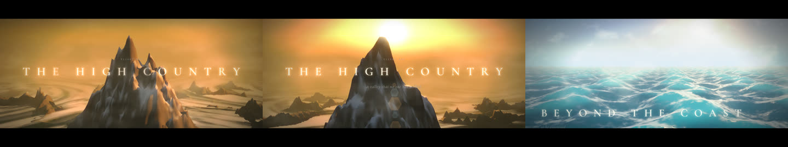

A cinematic 20-second flight over a procedurally built 3D world: a mountain valley assembles itself and the camera glides past the peak through low cloud, then skims a golden-hour sea, with a title card. Film-grade grade and slow camera.

**Mix:** `terrain-build-3d` + `fog-clouds` + `blur-in-title` → `ocean-surface-3d` + `fog-clouds` + `blur-in-title`  
**Customise:** Replace the two titles and kicker / subtitle. terrain-build-3d: seed (different mountain), sunElevation / sunAzimuth, colors, camera (fly | dive), trail (a glowing route down the slope), look (natural | contours); raise stageFrames (up to 48) to show the world being built before the flight, with showCode / showTitle for the build overlay. ocean-surface-3d: camera (low | high | drift), sun, colours. For a stylised world swap in hex-island-grow, voxel-diorama or iso-city-build. The cinematic-3d style adds the golden-hour grade and 2.39:1 bars; the 3D motions are heavy, so export to mp4 / webm for mobile web.

### `app-store-preview` — App store preview (portrait) (portrait)

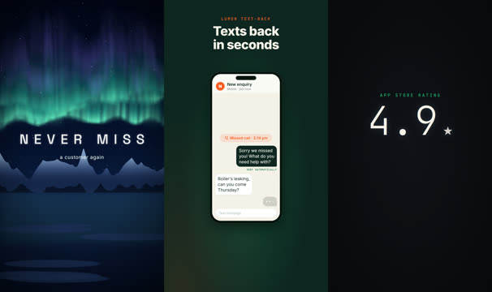

A vertical 9:16 app preview / store video / story ad: hook title, the app conversation in a phone, then the rating.

**Mix:** `aurora` + `blur-in-title` → `sms-thread` → `number-counter` + `sparkle-burst`  
**Customise:** All three scenes are resolution independent; render with --format portrait (default for this recipe). Replace the hook title, sms-thread texts and the rating.

### `data-story-60s` — Data story (22 s cut) (landscape)

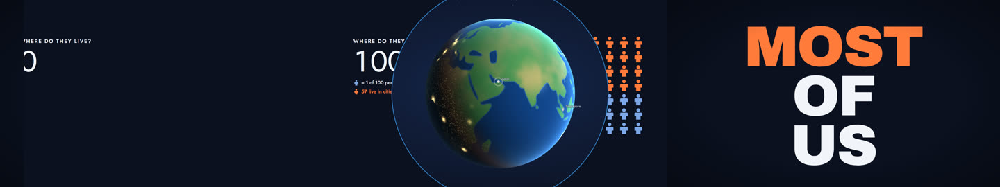

A short data-journalism beat: a question, the answer shown as one icon per person, a globe for 'where', and a single takeaway number. Replace the figures with your own; extend a scene or add a chart to reach 60 s.

**Mix:** `kinetic-type-slam` → `isotype-count` → `globe-3d` + `number-counter` → `kinetic-type-slam`  
**Customise:** Illustrative figures (about 57 of every 100 people live in cities): replace them with your own sourced numbers and name the source on screen or in the narration. isotype-count: count, highlight, unitValue, unitLabel, icon (person | drop | house | cup | box | tree), arrangement (grid | bar | row | heart). globe-3d: points / arcs / focus for the geography; number-counter: keyframes, label, unit. For a 60-second version add scenes: dot-tally for a second comparison, axis-ratchet-rescale for a time series, painted-choropleth or map-route for the map.

### `end-card` — End card with call to action (landscape)

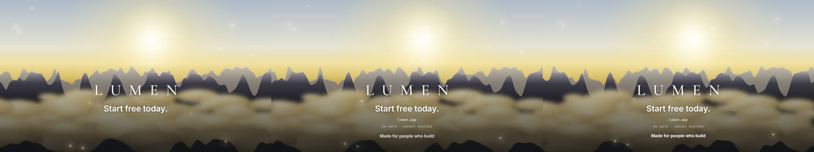

The last shot of a video or the footer of a landing page: headline, short stat lines and a credit / CTA over a drifting sunrise.

**Mix:** `end-card-credits` (type) + `embers` (accent)  
**Customise:** Replace title / headline / lines / credit. Set fadeToBlack true when it is the very last shot of a video.

### `error-glitch` — Error / 404 glitch (landscape)

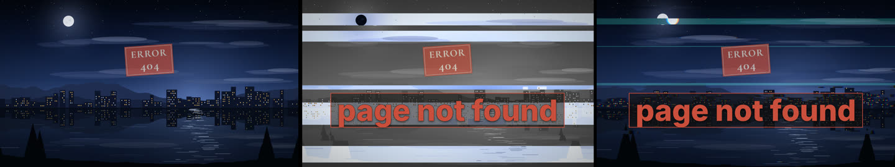

Error, 404, outage and "something broke" states — a glitching night plate with a stamped code.

**Mix:** `glitch-image` (backdrop) + `stamp-slam` (type)  
**Customise:** Change stamp-slam.lines / keyword. Use glitch-image.src for a screenshot of your own UI breaking.

### `event-countdown` — Event countdown (landscape)

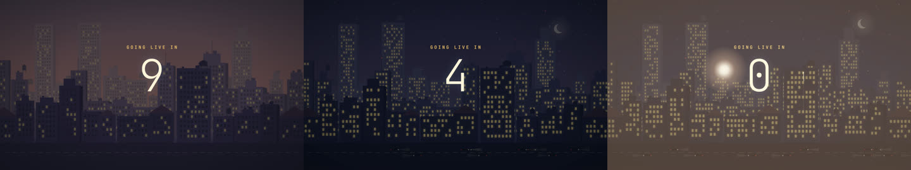

Countdown to a launch, live stream or event: a night city with a big counter ticking down and fireworks at zero.

**Mix:** `city-skyline` (backdrop) + `number-counter` (type) + `fireworks` (accent)  
**Customise:** number-counter.keyframes counts 10 → 0 over 8 s; change the values / frames for your countdown and label. For a real-time web countdown render the number in HTML and use only city-skyline + fireworks.

### `explainer-5-scene` — 5-scene explainer (30 s) (landscape)

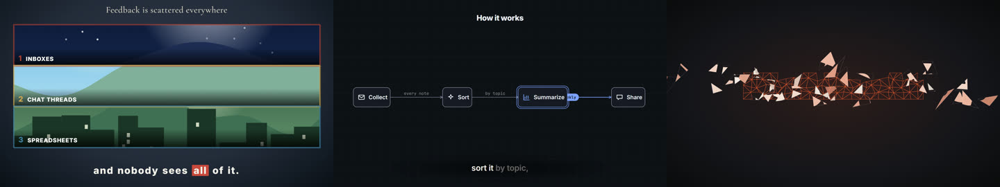

A 30-second explainer for a business, product or idea: the problem, what we do, how it works in three steps (animated flow diagram), one proof number, then your name and a call to action. Built to take captions and a narration track.

**Mix:** `panel-triptych` → `kinetic-type-slam` → `flow-diagram` + `kinetic-captions` → `number-counter` → `logo-assemble` + `end-card-credits`  
**Customise:** Replace every text: panel-triptych.title / panels / caption (pass src for real screenshots), the two kinetic-type-slam lines, flow-diagram nodes + edges (3-5 nodes; icons: bolt shield chart chat globe spark lock cog user db cloud star queue server mail), the captions, the number-counter keyframes + label, and the name, tagline and CTA of the last scene. Narrate it with the CLI voice command and use the caption lines as the script, one line per sentence; extend a scene's duration to fit each sentence. Scene 3 is the hero of the film: give it the longest line of narration.

### `game-trailer-20s` — Game trailer (20 s) (landscape)

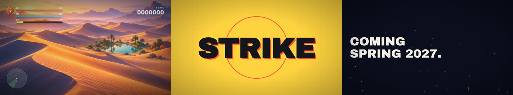

A 20-second trailer or store teaser for a game: logo sting, gameplay shot with the in-game HUD, three impact hits, a loot reveal and a release date. Works for mobile, indie and arcade titles.

**Mix:** `chrome-title-slam` → `ken-burns` + `game-hud` → `impact-frame` → `loot-reveal` → `embers` + `mask-rise-title`  
**Customise:** Replace the game name and tagline (chrome-title-slam), pass your own gameplay still or footage frame to ken-burns.src and your HUD values (game-hud.bars, score, feed; theme arcade | modern | pixel), the three impact words, the loot-reveal item (title, rarity, container, image) and the release-date lines. Recolour chrome-title-slam.skyColors / sunColors / neon for your palette. For footage, replace ken-burns with a screen-recording clip and keep game-hud transparent on top.

### `generative-loop` — Generative loop (hero background) (landscape)

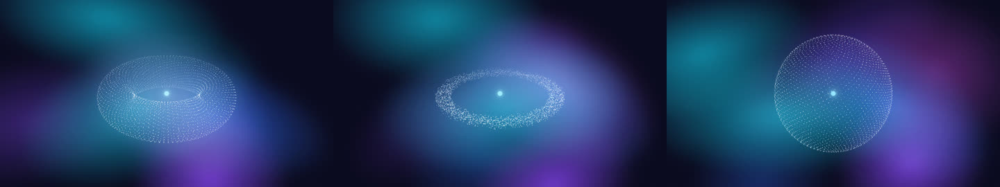

A 12-second looping generative backdrop for a website hero, app splash or live-visuals wall: a particle cloud morphs sphere, torus, ring and cube and back, glowing over drifting mesh-gradient light. Words go in HTML above it.

**Mix:** `mesh-gradient-bg` (backdrop) + `particle-shape-morph` (subject)  
**Customise:** A 360-frame (12 s) loop: the cloud returns to the sphere it started as and the rotation completes one full turn, and the web player cross-fades the seam (web.loop: crossfade). Behind HTML text keep opacity at 0.7-0.9 and use <MotionBackground recipe="generative-loop">. Recolour with mesh-gradient-bg.colors and particle-shape-morph.colors / coreColor; lower particle-shape-morph.count (1500-2500) for mobile. Reduced motion: export a poster frame (mgl export generative-loop --as poster --frame 100) and show it as a still.

### `hero-aurora-night` — Aurora night hero (landscape)

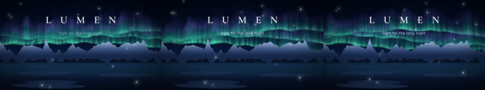

Dark website hero background or video title card: calm, premium, "wonder" mood. Put your headline in HTML on top (web) or in the title layer (video).

**Mix:** `aurora` (backdrop) + `embers` (accent) + `blur-in-title` (type)  
**Customise:** Change blur-in-title.title/subtitle (video) — on the web MotionBackground drops the type layer so your HTML headline sits there. Tint aurora.colors to the brand (e.g. ["#7AA2FF","#3B4FC4","#1B2466"]).

### `hero-blueprint-logo` — Blueprint logo reveal (landscape)

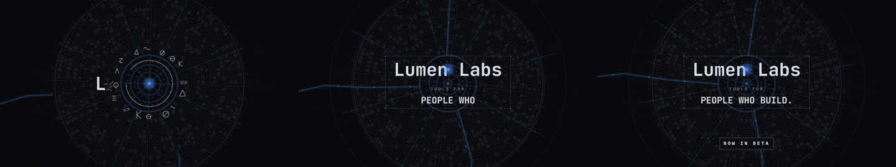

Developer-tool / AI / engineering brand intro: a rotating blueprint plan as texture and a typed monospace logotype on top.

**Mix:** `radial-blueprint` (backdrop) + `glyph-orbit-logo` (type)  
**Customise:** Change glyph-orbit-logo.logo / tagline / pill and accent (dot colour). The blueprint is dimmed to 38 % so it reads as texture, not a second subject.

### `hero-paper-sketch` — Paper sketch hero (landscape)

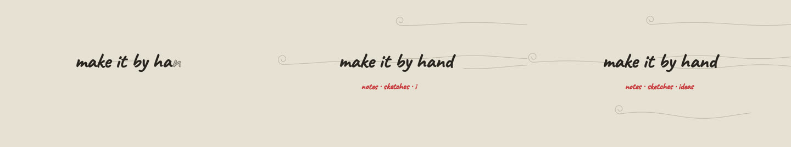

Warm, human, hand-made hero for craft / education / indie brands: a headline handwritten on paper with soft pencil wind lines.

**Mix:** `handwrite-on` (type) + `flow-lines` (accent)  
**Customise:** Replace handwrite-on.lines. Plays once and holds (writing should not loop). For a looping web background drop the type layer and keep the paper + wind lines.

### `history-film-90s` — History film (24 s cut) (landscape)

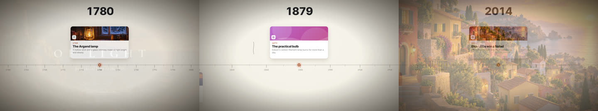

A short documentary-style history of anything: a title over an aged photo plate, a ruler of years gliding under a playhead with pinned event cards and a rolling year counter, then a closing 'today' card. Film-print finish. Extend the events for a longer cut.

**Mix:** `ken-burns` + `blur-in-title` → `timeline-ruler` → `ken-burns` + `blur-in-title`  
**Customise:** Replace the events (date as a 4-digit year, title, one line of body, optional image under public/, icon), the opening title / subtitle and the closing card. About 80 frames per event: add events and lengthen the second scene to match; scale 'even' gives equal gaps ('linear' spaces them by years). Swap ken-burns.src for your archive photos. The film-look print overlay adds dust, scratches and flicker; lower scratches / dust for a cleaner look. Narrate with the CLI voice command: one sentence per event.

### `history-timeline` — History timeline dial (landscape)

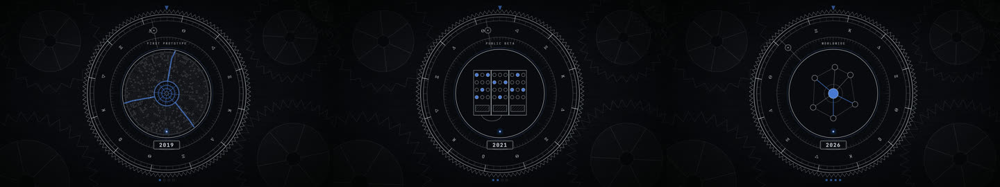

A company history, product versions or "how we got here" timeline: a blueprint dial turns one notch per era while the year rolls.

**Mix:** `era-dial` (subject) + `film-look` (frame)  
**Customise:** Replace era-dial.eras (label, year, icon: plan | press | book | computer | monitor | network). stepFrames × eras ≈ duration.

### `kinetic-type-film` — Kinetic type film (20 s) (landscape)

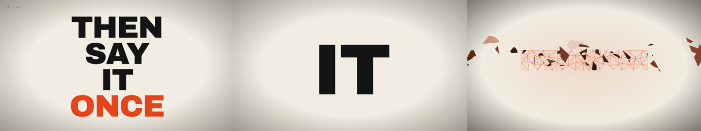

A 20-second kinetic-typography film for a speech, manifesto, brand belief or poem: huge phrases land one word per beat on a 120 BPM grid in one accent colour, then it ends on a wordmark.

**Mix:** `kinetic-type-slam` → `kinetic-type-slam` → `logo-assemble`  
**Customise:** Replace the lines with your own text: 2-4 words each, accent = the one word that takes the colour (an index also works). beatFrames sets the beat (15 = 120 BPM, 10 = 180 BPM); use the 'center' layout (one word at a time) for short punchy phrases and 'stack' for longer ones. Keep one accent colour. For a dark version: background "#0E0E10", ink "#F3EFE6". End scene: logo-assemble.text / tagline (or src for an SVG logo).

### `loading-loop` — Loading loop (square)

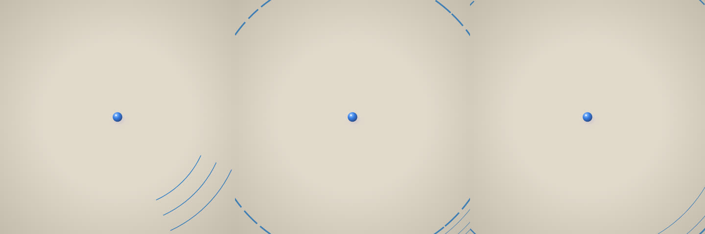

Seamless loading / waiting / processing loop for splash screens, empty states and "generating…" moments.

**Mix:** `sonar-ping` (subject)  
**Customise:** A 144-frame (3 × 48) sonar loop with no picture windows. Recolour with color and background. For dark UIs: background "#0E1116", color "#7AA2FF", paper false.

### `lyric-video-vertical` — Lyric video (vertical) (portrait)

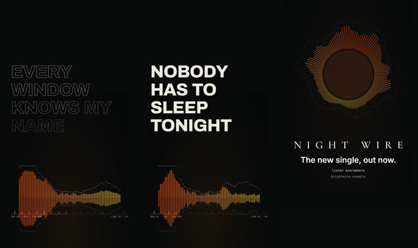

A 9:16 lyric video for a song, hook or spoken-word track: big lyric lines that fill word by word on the beat over a dimmed audio spectrum, a beat-cut montage drop, then an end card. Swap in your timed lyrics and your track.

**Mix:** `audio-spectrum` + `lyric-video` → `beat-montage` → `audio-spectrum` + `end-card-credits`  
**Customise:** Replace lyric-video.lines with your lyrics (or pass timed `lyrics` [{text, start, end, words}] from a transcription for exact sync) and set bpm / offsetSec to your song's grid (cli/beats.py finds them). Add your track as audio (spec.audio.music, or play it from the host) and pass its file to both audio-spectrum.src layers so the bars follow the real audio. beat-montage.images takes your artwork or stills; recolour with accent colours. Keep lyrics in the middle third, clear of the platform UI.

### `music-neon-promo` — Neon music promo (landscape)

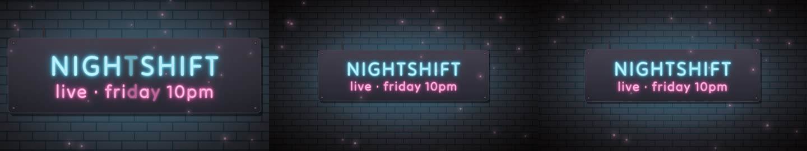

Gig, club night, album drop or late-night food promo: a neon sign strikes on over a brick wall with drifting embers and film grain.

**Mix:** `neon-sign` (type) + `embers` (accent) + `film-look` (frame)  
**Customise:** Replace neon-sign.lines (text, color, glow, size). Keep to two lines; one line in a second colour.

### `ocean-explainer` — Ocean / science explainer (landscape)

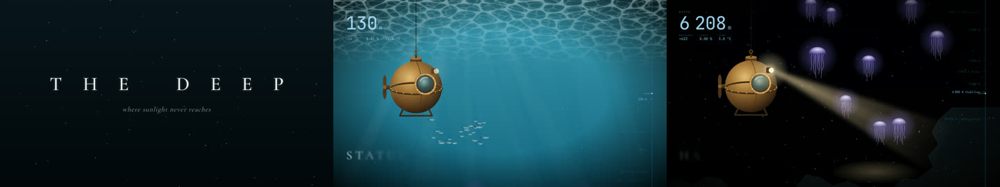

Open a science or nature explainer: a serif title over the ocean, then a depth-gauge descent past landmarks with light rays.

**Mix:** `blur-in-title` → `depth-descent` + `caustics-godrays`  
**Customise:** Change blur-in-title.title / subtitle and depth-descent.landmarks ([{depth, label, …}]). The god-rays fade out as the descent gets dark (layer duration 140).

### `onboarding-steps` — Onboarding steps (landscape)

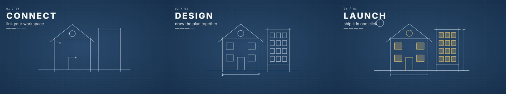

Explain a 3-step process or onboarding flow: a blueprint drawing builds while numbered step titles advance with a progress bar.

**Mix:** `line-draw-on` (subject) + `chapter-header` (type)  
**Customise:** Replace chapter-header.stages (one per step) and stageFrames (= duration / steps). line-draw-on.paths can draw your own SVG icon / product outline.

### `pixel-short-loop` — Pixel short loop (landscape)

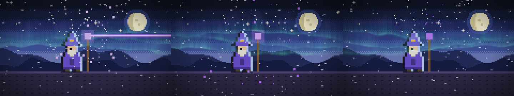

A looping pixel-art scene for a stream background, game page, retro greeting or festival card: a night sky with aurora and drifting pixel snow behind a wizard (or knight / cat) who idles, charges and casts, finished with a soft CRT / VHS pass.

**Mix:** `pixel-sprite-scene` (subject) + `aurora` (accent) + `snowfall` (accent) + `vhs-crt-pass` (frame)  
**Customise:** Two 220-frame wizard cycles (idle, charge, cast, recover) make a 440-frame (14.7 s) loop; the web player cross-fades the seam. Change pixel-sprite-scene.sprite (wizard | knight | cat | custom), palette and states; keep aurora / snowfall pixelSize equal to pixel-sprite-scene.pixelFactor (12) so every pixel sits on one grid. For a festival scene change the palette and swap the aurora for fireworks or falling-petals. Drop vhs-crt-pass for crisp pixels, or add style "pixel-8bit" for an even chunkier look.

### `product-launch` — Product launch intro (landscape)

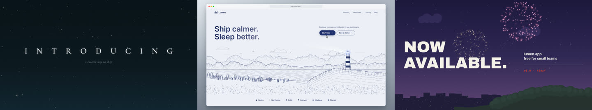

A 12-second launch / announcement video: teaser title over night sky, the product (website mockup), then "now available" with fireworks.

**Mix:** `starfield-night` + `blur-in-title` → `browser-mockup` → `fireworks` + `mask-rise-title`  
**Customise:** Replace the texts in all three scenes. browser-mockup.heroSrc can show your real screenshot. Swap the fireworks scene for confetti-burst for a lighter, daytime brand.

### `saas-launch-30s` — SaaS launch film (30 s) (landscape)

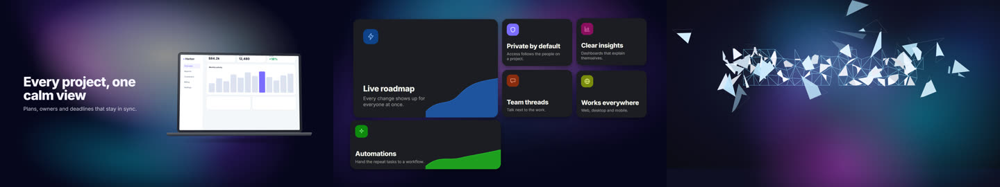

A slick 30-second product-launch video for a software startup: a hook question over a mesh-gradient, the product in a device, a cursor operating the UI, a feature bento, one proof number, then logo and call to action.

**Mix:** `mesh-gradient-bg` + `kinetic-type-slam` → `mesh-gradient-bg` + `device-mockup` → `mesh-gradient-bg` + `cursor-driver` → `mesh-gradient-bg` + `card-stack-cascade` → `mesh-gradient-bg` + `number-counter` → `logo-assemble` + `mesh-gradient-bg` + `end-card-credits`  
**Customise:** Replace every text: the hook lines (2-4 words each, accent = the word that takes the colour), device-mockup.headline / brand (pass src for a real screenshot; fit:"scroll" for a tall one), cursor-driver.demoText, the six card-stack-cascade.cards, the number-counter label / keyframes, and the logo text, tagline and CTA. Recolour by passing your brand colours to mesh-gradient-bg.colors, accent and ctaColor. Swap logo-assemble.src for your SVG logo.

### `section-divider` — Section divider wipe (landscape)

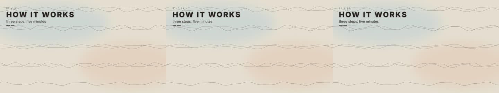

A soft, full-width animated band between website sections, or a quick chapter break in a video (pencil wave rows sweep across).

**Mix:** `flow-lines` (backdrop) + `chapter-header` (type)  
**Customise:** On the web, give MotionBackground a short height (e.g. 160–240 px) with fit cover — the waves read as a divider band; drop the type layer (default) and put your section title in HTML.

### `showreel-15s` — Motion showreel (15 s) (landscape)

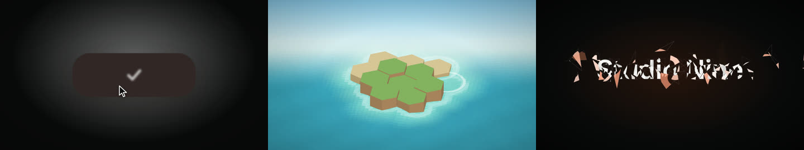

A punchy 15-second showreel / portfolio opener / 'what we can make' sizzle: a hook word, five hard cuts of contrasting motions on a 120 BPM grid, then a logo lock-up. Dark tech-minimal.

**Mix:** `kinetic-type-slam` → `ui-shape-morph` → `particle-shape-morph` → `line-draw-on` → `hex-island-grow` → `number-counter` → `logo-assemble`  
**Customise:** Hook word, logo text and tagline are placeholders: replace them, and pass your accent colour to every accent / colors / highlightColor prop. Each cut is 45 frames = 3 beats at 120 BPM (15 frames per beat); keep cuts on multiples of your beat and swap any cut for another contrasting motion (iso-bar-chart, number-counter, voxel-diorama, ocean-surface-3d, pointcloud-orbit). Use offset to skip a motion's slow intro. Audio: lay a track with cli/beats.py analysis and keep the cuts on its grid.

### `social-short-captions` — Social short with captions (portrait) (portrait)

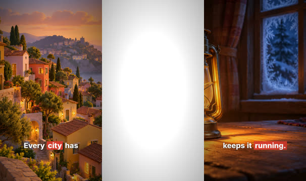

A vertical short / reel / TikTok: photo plates with a slow push, word-by-word kinetic captions with highlighted keywords, and a soft grade.

**Mix:** `ken-burns` + `kinetic-captions` → `ken-burns` + `kinetic-captions`  
**Customise:** Swap ken-burns.src for your photos and the caption lines (*word* = highlighted). Captions sit at the bottom third, clear of the platform UI; nothing else in the frame carries text.

### `stats-reveal` — Stats reveal (landscape)

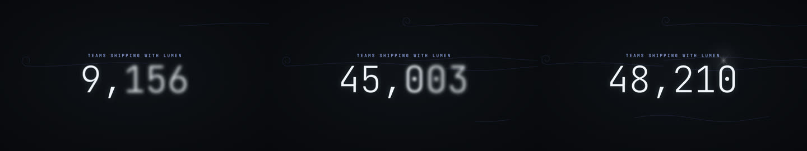

One big number with context — users, revenue, growth — for an "in numbers" website section or a data beat in a video.

**Mix:** `number-counter` (type) + `flow-lines` (accent) + `star-glint` (accent)  
**Customise:** Set number-counter.keyframes ([[frame, value], …]; two close keys = dwell), label, prefix ("$") and unit ("%"). Web: plays once on view and holds the final number.

### `story-short-30s` — Story short (30 s, portrait) (portrait)

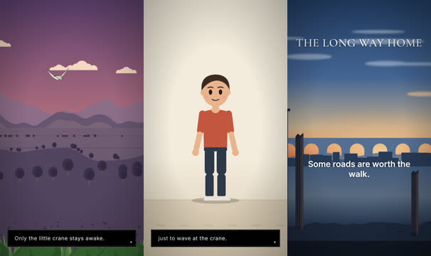

A 30-second vertical story for Shorts / Reels / TikTok: a slow establishing shot, a flat-vector character acting a beat, a day-to-night turn, story captions and an emotional end card. Silent-film pacing, ready for a music bed.

**Mix:** `parallax-landscape` + `story-caption-box` → `character-rig-2d` + `story-caption-box` → `time-of-day-grade` + `story-caption-box` → `end-card-credits`  
**Customise:** Write your own story in four beats: place, character, turn, last line. Replace the story-caption-box items (one or two short lines each, kept in the lower third clear of the platform UI), character-rig-2d.say / cues / colours (swap parts for your own art), the end-card title and headline. Try style "flat-vector" or "paper-diorama" on any scene. Slow, quiet pacing works best: put a soft music bed under it.

### `success-celebration` — Success celebration (square)

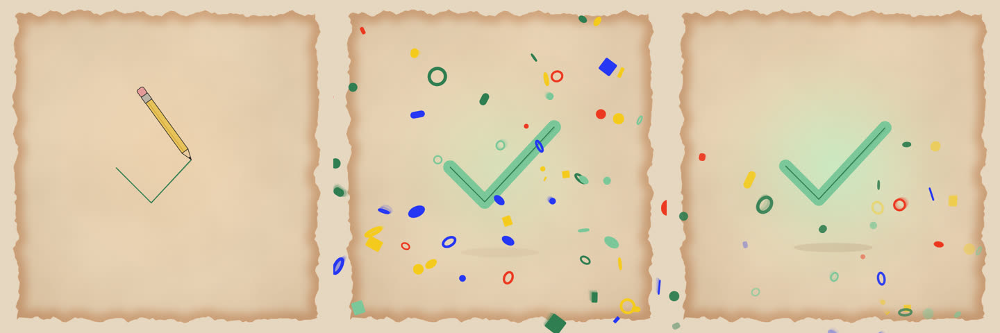

The "done!" moment: order placed, payment received, level complete, onboarding finished — a drawn check with a confetti burst.

**Mix:** `heart-draw-fill` (subject) + `confetti-burst` (accent)  
**Customise:** For an in-app overlay use just the confetti layer: <MotionPlayer motion="confetti-burst" overlay loop={false}/> over your UI. icon can be check | heart | star | bolt.

### `take-apart-explainer` — Take-apart explainer (22 s) (landscape)

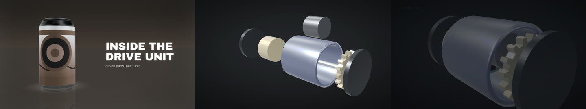

A hardware teardown / 'what is inside' film: a product turns on a studio turntable, a 3D assembly separates part by part with numbered labels, a cutaway slices it open, then a closing title. Dark graphite, one orange accent.

**Mix:** `product-turntable-3d` → `exploded-view-3d` → `exploded-view-3d` → `blur-in-title`  
**Customise:** Swap the product: product-turntable-3d.shape (can | bottle | box | phone), colours and labelSrc, and the exploded-view-3d.parts table (name, spec, mesh, pos, size, dir, dist) to describe your own assembly, in the order the labels should number. Cutaway shows the shell sliced open; use explode for the full separation. Replace the headline, subline, title and subtitle. The teardown style gives the dark graphite studio with an orange index accent.

### `testimonial-chat` — Customer message testimonial (landscape)

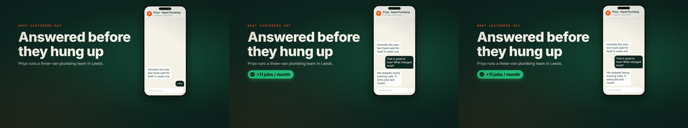

Social proof as a real-feeling text thread: a customer message, your reply, the outcome badge — for testimonial sections, case-study videos and ads.

**Mix:** `sms-thread` (subject) + `film-look` (frame)  
**Customise:** Replace kicker / title / subtitle / contact / messages / badge with a real customer quote. Colours: background, ink, accent, mint. A quieter alternative: story-caption-box over ken-burns of the customer photo.

### `testimonial-quote` — Photo testimonial quote (landscape)

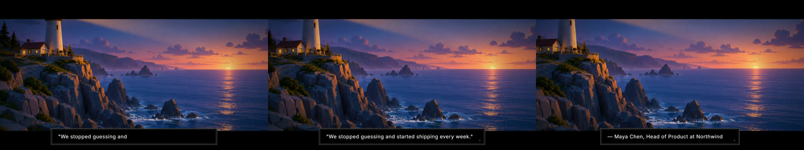

A customer quote typed in a cinematic caption box over a slowly pushed-in photo of the person or their work.

**Mix:** `ken-burns` (backdrop) + `film-look` (frame) + `story-caption-box` (type)  
**Customise:** Set ken-burns.src to your photo (public/ path or https URL) and the story-caption-box.items to the quote and name.

### `ui-morph-loop` — UI morph loop (14 s) (landscape)

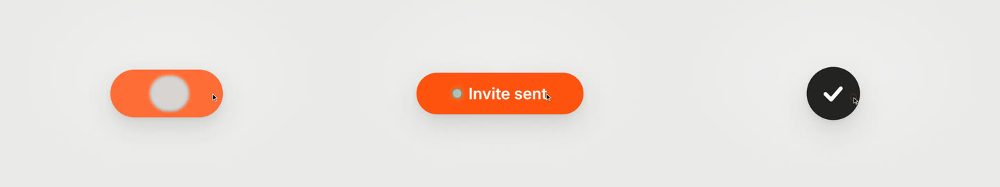

A seamless 14-second loop for a landing-page hero, app promo or showreel tile: one rounded rectangle morphs through a button, loader, check, player, slider, tabs, chart, search and toast on a 120 BPM beat while a cursor clicks every change.

**Mix:** `ui-shape-morph` (subject) + `cursor-driver` (accent)  
**Customise:** 28 states x 15 frames = 420 frames (14 s at 30 fps, 120 BPM); the last state repeats the first so the loop is seamless: loop it for exactly 420 frames. Edit ui-shape-morph.states (kind, label, size, radius, colour), set accent and background to your brand, beatFrames to your tempo (15 = 120 BPM; keep states x beatFrames equal to the duration). cursor-driver.keys click once per change (frame, x/y in % of the frame); drop that layer and set ui-shape-morph.cursor true for the built-in pointer. The light-editorial-minimal style keeps one orange accent and drains other hues, so use a single accent colour. On a dark site use background "#0E0E10" with ink "#EDEBE7".

## motions by category

## text

### `agenda-list-slide` — Agenda list slide

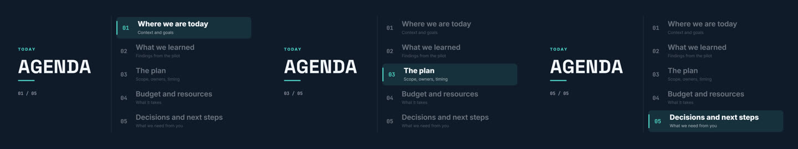

Keynote agenda slide: big title column and a numbered list; a highlight pill glides item to item so the current topic is bright and the rest dim.

**Use for:** Meeting and webinar agendas, chapter lists, course outlines, table-of-contents beats and "what we will cover" slides in decks and videos.  
**Rebuilt from:** original (round 3, presentation slides)  
**Default length:** 240 frames (8.0 s @ 30 fps)

**Roles:** type, accent · **Mood:** —  
**Capabilities:** overlay (`{"background":"transparent"}`) · text: `title`, `items` · weight: light  

| prop | default | notes |
|---|---|---|
| `title` | `"Agenda"` | slide title (left column / top) |
| `eyebrow` | `"Today"` | small tag above the title (empty to hide) |
| `items` | `[{"title":"Where we are today","note":"Context and goals"…` | array of strings or {title, note?} — up to 9 |
| `activeIndex` | `-1` | -1 = highlight steps through every item; 0..n-1 = hold the highlight on that item |
| `holdFrames` | `36` | frames each item stays highlighted |
| `background` | `"#101A2B"` | frame colour, or "transparent" to overlay content |
| `ink` | `"#F2F5FA"` | text colour |
| `accent` | `"#4FD1C5"` | numbers, pill and rule colour |
| `fontFamily` | `"grotesk"` | title font: sans \| serif \| display \| grotesk \| rounded \| instrument \| mono |
| `startAt` | `0` | frame the slide begins |

### `alphabet-letter-trace` — Alphabet letter trace

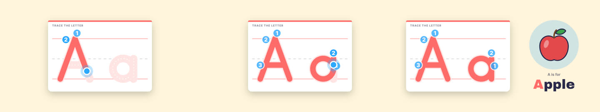

A handwriting lesson on ruled paper: a dotted letter track, numbered stroke-order dots with arrows, a pen dot tracing each stroke, a pop and sparkle, then a drawn picture and "A is for Apple" example word slide in.

**Use for:** Kids' phonics and handwriting videos, alphabet series, ESL letter lessons, number-writing practice and educational app promos. Works for A-Z, a-z and 0-9 (up to 3 characters at once, e.g. "Aa"); pass a built-in picture or your own image.  
**Rebuilt from:** original (round 3)  
**Default length:** 420 frames (14.0 s @ 30 fps)

**Roles:** type, accent · **Mood:** paper, photo  
**Capabilities:** overlay (`{"background":"transparent"}`) · weight: light  

| prop | default | notes |
|---|---|---|
| `letter` | `"Aa"` | the letter(s) to trace — up to 3 characters from A-Z, a-z, 0-9 (e.g. "Aa", "B", "7") |
| `exampleWord` | `"Apple"` | example word shown after tracing (its first letter is highlighted) |
| `exampleLead` | `"A is for"` | small line above the word, e.g. "B is for" |
| `picture` | `"apple"` | built-in drawing: apple \| ball \| cat \| sun \| fish \| star \| house \| tree |
| `imageSrc` | `""` | optional public/ path or URL of your own picture (replaces the built-in drawing) |
| `prompt` | `"Trace the letter"` | small instruction on the board header |
| `background` | `"#FFF4DC"` | backdrop colour or 'transparent' |
| `ink` | `"#2B2A4C"` | text and outline colour |
| `accent` | `"#FF6B6B"` | drawn stroke colour and first-letter highlight |
| `accent2` | `"#2EA8FF"` | start dots, arrows and pen colour |
| `board` | `"#FFFFFF"` | writing-board paper colour |
| `fontFamily` | `""` | optional CSS font-family for the example word (empty = display) |
| `showPicture` | `true` | false keeps the board centred and skips the picture + word |
| `traceFrames` | `230` | frames the whole tracing takes (spread across the strokes) |
| `startAt` | `0` | frame the lesson starts |
| `speed` | `1` | playback speed multiplier |

### `anniversary-years-badge` — Anniversary years badge (ribbons & laurel)

A gold milestone seal pops in over a slow sunburst, ribbons drop behind it, laurel branches draw around it, the year count climbs to N and lands with a shine and sparkle burst, then a headline and thank-you line write on.

**Use for:** Company and brand anniversaries, "5 years of ..." milestones, employee tenure, subscription / membership years, loyalty badges, awards and years-in-business trust marks. Set `years`, the headline and your colours.  
**Rebuilt from:** original (round 3, events & celebrations)  
**Default length:** 240 frames (8.0 s @ 30 fps)

**Roles:** type, accent · **Mood:** nature  
**Capabilities:** overlay (`{"background":"transparent"}`) · text: `unit`, `headline`, `caption` · weight: light  

| prop | default | notes |
|---|---|---|
| `years` | `5` | the number shown in the seal (counts up from 0) |
| `eyebrow` | `"Celebrating"` | text curved along the top of the seal |
| `unit` | `"years"` | label under the number (years, months, days...) |
| `headline` | `"Thank you for 5 great years"` | big line beside / under the badge (wraps to three lines) |
| `caption` | `"Here is to many more together"` | smaller line under the headline |
| `laurel` | `true` | draw laurel branches around the seal |
| `ribbons` | `true` | show the two hanging ribbons |
| `countUp` | `true` | count up from 0 instead of showing the number straight away |
| `background` | `"#14213D"` | frame colour (hex), or "transparent" to overlay content |
| `ink` | `"#FFFFFF"` | text colour (hex) |
| `accent` | `"#F2C14E"` | seal, laurel and highlight colour (hex) |
| `accent2` | `"#C8372D"` | ribbon colour (hex) |
| `seed` | `3` | seed for the sparkles and confetti |
| `startAt` | `0` | frame the sequence begins |

### `atomic-orbit-title` — Atomic orbit title (retro toon)

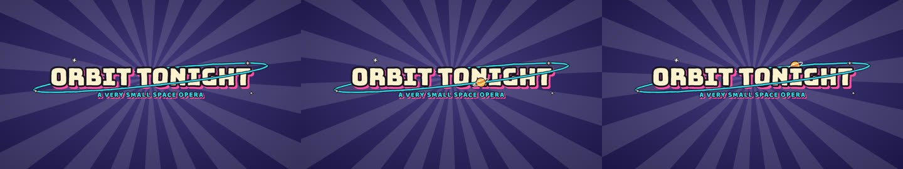

A 1950s atomic-age TV title in fat cream block caps with a thick ink outline and a hard magenta offset shadow, wrapped by a tilted cyan orbit that threads behind the top of the letters and in front of the bottom, a small object flying round it and twinkling four-point stars; pops in on twos.

**Use for:** Playful show or episode titles, product names for tech and comedy brands, YouTube intros; complements stamp-slam and blur-in-title.  
**Rebuilt from:** lemo-opuscar styles/scifi-toon demo/main.js (titleArt), DEMO.md "Titles & end card" (MIT, LemoLab)  
**Default length:** 120 frames (4.0 s @ 30 fps)

**Roles:** type · **Mood:** pixel, comic, playful, night  
**Capabilities:** paints its own background · text: `title`, `subtitle` · weight: light  

| prop | default | notes |
|---|---|---|
| `title` | `"Orbit Tonight"` | title text (auto-fits; two lines when too wide) |
| `subtitle` | `"A very small space opera"` | line under the title (empty = none) |
| `fill` | `"#fff1cf"` | letter colour |
| `inkColor` | `"#1b1422"` | outline colour |
| `shadowColor` | `"#ff4fa3"` | hard offset shadow colour |
| `ringColor` | `"#33d6e8"` | orbit ring colour |
| `ringTilt` | `-6` | ring tilt in degrees |
| `orbitIcon` | `"planet"` | 'planet', an emoji, or an image path/URL |
| `orbitSeconds` | `2` | seconds per orbit |
| `stars` | `4` | twinkling stars |
| `popAt` | `8` | frame of the pop-in |
| `boil` | `true` | wobble outlines on threes |
| `background` | `"#2a1f6b"` | backdrop colour |
| `fontSize` | `150` | title size in u at one line |
| `seed` | `2` | star layout seed |

### `big-stat-slide` — Big stat slide

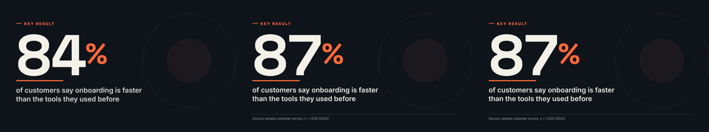

Keynote one-number slide: an eyebrow tag, a huge number counting up with accent prefix/suffix, an accent rule drawing under it, a one-line label and a source footnote.

**Use for:** The "one number" beat of a pitch or keynote deck, KPI reveals, annual-report highlights, data-led social posts and explainer videos that need a headline statistic with its source.  
**Rebuilt from:** original (round 3, presentation slides)  
**Default length:** 180 frames (6.0 s @ 30 fps)

**Roles:** type, accent · **Mood:** —  
**Capabilities:** overlay (`{"background":"transparent"}`) · text: `prefix`, `label` · weight: light  

| prop | default | notes |
|---|---|---|
| `value` | `87` | the number to count up to |
| `decimals` | `0` | decimal places shown |
| `prefix` | `""` | small accent text before the number (e.g. "$", "+") |
| `suffix` | `"%"` | small accent text after the number (e.g. "%", "x", "M") |
| `thousands` | `true` | use thousands separators |
| `label` | `"of customers say onboarding is faster than the tools the…` | sentence under the number (wraps, shrinks to fit) |
| `eyebrow` | `"Key result"` | small tag above the number (empty to hide) |
| `source` | `"Source: sample customer survey, n = 1,200 (2025)"` | footnote at the bottom (empty to hide) |
| `background` | `"#10141C"` | frame colour, or "transparent" to overlay content |
| `ink` | `"#F4F1EA"` | text colour |
| `accent` | `"#FF6A3D"` | rule, tag, prefix/suffix and ring colour |
| `fontFamily` | `"grotesk"` | number font: sans \| serif \| display \| grotesk \| rounded \| instrument \| mono |
| `ring` | `true` | faint decorative rings behind the number |
| `countFrames` | `70` | frames the count-up takes |
| `startAt` | `0` | frame the slide begins |

### `birthday-cake-candles` — Birthday cake, candles & blow-out

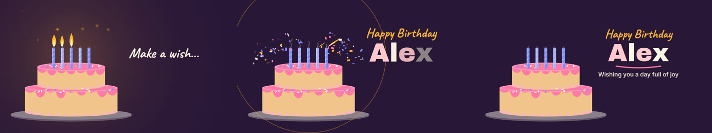

A tiered cake drops in, candles are lit one by one with a warm glow and a wish line, then a puff of breath blows them out (leaning flames, smoke wisps) and confetti bursts as the name is revealed.

**Use for:** Birthday greetings and reels, party invites, "happy birthday" posts, team-member birthdays, kids party intros, any "make a wish" reveal. Replace the name, title and colours; set the candle count to the age (up to 12).  
**Rebuilt from:** original (round 3, events & celebrations)  
**Default length:** 300 frames (10.0 s @ 30 fps)

**Roles:** type, accent · **Mood:** playful  
**Capabilities:** overlay (`{"background":"transparent"}`) · text: `title` · weight: light  

| prop | default | notes |
|---|---|---|
| `title` | `"Happy Birthday"` | greeting line shown in script above the name |
| `name` | `"Alex"` | big name revealed after the candles go out |
| `wish` | `"Make a wish…"` | line shown while the candles burn |
| `message` | `"Wishing you a day full of joy"` | small line under the name |
| `candles` | `5` | number of candles (1-12) |
| `hold` | `42` | frames the lit candles glow before the blow-out |
| `background` | `"#2A1738"` | frame colour (hex), or "transparent" to overlay content |
| `ink` | `"#FFF4E6"` | text colour (hex) |
| `accent` | `"#FF7AA8"` | frosting and underline colour (hex) |
| `accent2` | `"#7A8BFF"` | candle and sprinkle colour (hex) |
| `cake` | `"#F2C48D"` | sponge colour (hex) |
| `flame` | `"#FFB52E"` | flame and glow colour (hex) |
| `seed` | `4` | seed for drips, sprinkles and confetti |
| `startAt` | `0` | frame the sequence begins |

### `blob-to-wordmark` — Blob to wordmark

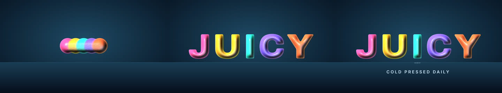

A row of coloured beads gathers and fuses into a capsule, erupts into a crown of spikes and morphs into a glossy liquid wordmark; thin liquid bridges join the letters and snap one after another, a glint sweeps across, a drip forms under one letter, falls and ripples the floor, and a tagline fades in.

**Use for:** Liquid logo reveals for beverages, cosmetics and apps named after liquids; end cards.  
**Rebuilt from:** mg-styles-15 demos/07-liquid textsdf.js, shaders.js SDF morph, scene.js, type.js (MIT), video 07-liquid 5.75-10 s  
**Default length:** 160 frames (5.3 s @ 30 fps)

**Roles:** type · **Mood:** —  
**Capabilities:** paints its own background · text: `word`, `tagline` · weight: light  

| prop | default | notes |
|---|---|---|
| `word` | `"JUICY"` | the wordmark (4-7 letters work best; one bead per letter) |
| `tagline` | `"cold pressed daily"` | small line that fades in at the end (empty = none) |
| `colors` | `["#ff4d8d","#ffb02e","#2ee6c8","#7a5cff","#ff6a3d"]` | per-letter colours, cycled |
| `gatherAt` | `16` | frame the beads start gathering into a capsule |
| `burstAt` | `46` | frame the capsule erupts and morphs into letters |
| `snapAt` | `74` | frame the first letter bridge snaps (one more every 2 frames) |
| `glintAt` | `100` | frame the glint sweep starts |
| `drip` | `{"letter":2,"at":108}` | {letter: index of the letter that drips, at: frame the drip starts forming} |
| `light` | `225` | key light azimuth in degrees |
| `background` | `"#060e1c"` | backdrop base colour |

### `blur-in-title` — Blur-in title card

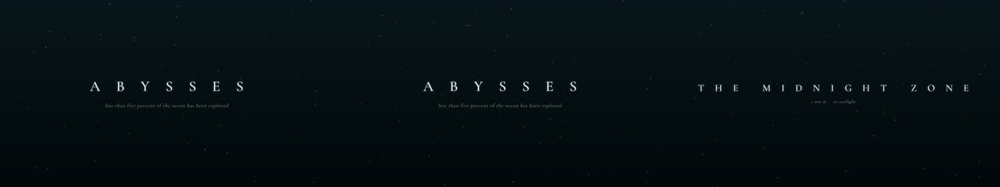

Wide-tracked title whose letters sharpen out of a blur with a random stagger, tagline and rule below, then blur-swap to a second title.

**Use for:** Documentary title cards, chapter/zone names, place names and calm caption swaps.  
**Rebuilt from:** video23 1:31-1:33, video23 0:07.6-0:09.1, video8 0:00-0:40, video10 0:02-0:40, video21 0:12  
**Default length:** 210 frames (7.0 s @ 30 fps)

**Roles:** type, accent · **Mood:** dark, cinematic, editorial  
**Capabilities:** overlay (`{"backdrop":"none","background":"transparent"}`) · text: `title`, `subtitle`, `swapTo`, `kicker` · image: `src` · weight: light  
**Pairs well with:** `aurora`, `starfield-night`, `caustics-godrays`, `embers`, `ken-burns`  
**Avoid:** Change title and subtitle (defaults ABYSSES / THE MIDNIGHT ZONE are sample text); set swapTo null for a single card.  

| prop | default | notes |
|---|---|---|
| `title` | `"ABYSSES"` | first title (use caps + wide tracking for the video23 look) |
| `subtitle` | `"less than five percent of the ocean has been explored"` | tagline under the first title |
| `swapTo` | `{"title":"THE MIDNIGHT ZONE","subtitle":"1 000 m  ·  no s…` | {title, subtitle} to blur-swap to at swapAt, or null for a single card |
| `swapAt` | `118` | frame the first title starts blurring out |
| `startFrame` | `10` |  |
| `stagger` | `"random"` | random (video23 card) \| ltr (video23 zone swap) |
| `staggerFrames` | `14` | max random delay per letter (0.45 s = 14 f) |
| `letterFrames` | `24` | frames each letter takes to sharpen (0.8 s = 24 f) |
| `maxBlur` | `12` | starting blur in px |
| `font` | `"serif"` | font role: serif \| sans \| grotesk \| display \| instrument \| mono \| rounded … |
| `weight` | `500` |  |
| `size` | `84` |  |
| `tracking` | `1.1` | letter spacing in em (video23 ≈ 1.1, video21 ≈ 0.4) |
| `color` | `"#EEF0F2"` |  |
| `subtitleFont` | `"serif"` |  |
| `subtitleItalic` | `true` |  |
| `subtitleColor` | `"#7d8b93"` |  |
| `underline` | `false` | thin rule under the subtitle that draws left→right and fades at its end |
| `layout` | `"center"` | center \| upper (video10 sky titles) \| lower-left (video23 zone caption) |
| `glow` | `0.3` | soft white glow opacity behind letters |
| `backdrop` | `"ocean"` | ocean \| ink \| dusk \| peaks \| dunes \| warm \| none (plain background colour) |
| `background` | `"#020406"` |  |
| `src` | `""` | optional public/ image behind the title |
| `fadeOut` | `true` | blur-fade everything out over the last 16 frames |
| `material` | `"plain"` | 'plain' (default) \| 'gold' (7-stop banded gold gradient letters; combine with a light backdrop / ink background) |
| `sheenAt` | `-1` | frame the specular band starts crossing the letters (-1 = right after the letters land) |
| `sheenFrames` | `18` | frames the band takes to cross (~0.6 s) |
| `glint` | `null` | {t0?, dur?, angle?} a white diagonal glint sweeping across the (plain-colour) letters; null = off. Pair with weight 200 and tracking ~0.5 for a thin launch-film title |
| `kicker` | `""` | small tracked mono caps line above the title ("" = none) |

### `bouncing-ball-singalong` — Bouncing-ball singalong

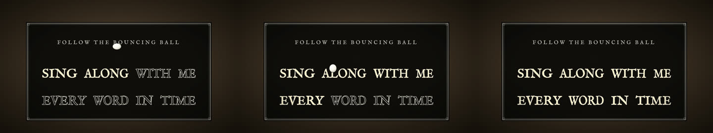

Lyrics or a slogan on a period cinema title card: a white ball hops from word to word on the beat along parabolic arcs, squashing as it lands, and every word lights up (outline to solid) the moment the ball touches it.

**Use for:** Jingles, slogans, safety rhymes, karaoke captions, kids learning content; works over any backdrop motion (set `background` transparent-ish or pass `src`).  
**Rebuilt from:** lemo-opuscar styles/rubber-hose/STYLE.md §8 "bouncing-ball singalong", §4 title cards (MIT / CC BY 4.0, LemoLab); original implementation  
**Default length:** 210 frames (7.0 s @ 30 fps)

**Roles:** type · **Mood:** pixel, editorial  
**Capabilities:** paints its own background · text: `lines`, `title` · image: `src` · weight: light  

| prop | default | notes |
|---|---|---|
| `lines` | `["SING ALONG WITH ME","EVERY WORD IN TIME"]` | lyric lines (replace the sample words) |
| `title` | `"Follow the bouncing ball"` | small heading on the card (empty = none) |
| `cues` | `[]` | optional frame of each word touch; empty = one hop per beat from bpm |
| `bpm` | `100` | beats per minute (one word per beat) |
| `startAt` | `30` | frame of the first touch |
| `ballColor` | `"#F6F2E8"` | ball colour |
| `textColor` | `"#F4EFE3"` | outline / unlit word colour |
| `litColor` | `"#FFF3C9"` | colour a touched word fills with |
| `highlight` | `"fill"` | 'fill' (outline to solid) \| 'brighten' (55 % to 100 %) |
| `cardStyle` | `"period"` | 'period' (double-rule cinema card) \| 'modern' (rounded dark card) |
| `font` | `"serif"` | 'serif' (small-caps period serif) \| 'limelight' (show caps) \| 'sans' |
| `background` | `"#4A3A2A"` | backdrop colour (period style darkens it to a vignette) |
| `src` | `""` | optional backdrop image (public path), shown dimmed behind the card |
| `grain` | `true` | film grain |
| `exit` | `true` | ball hops off the card after the last word |

### `bulb-marquee-sign` — Bulb marquee sign

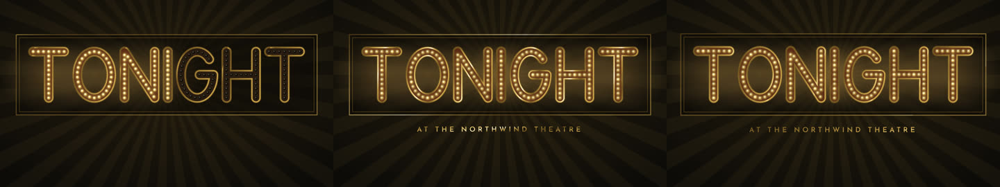

Any word becomes a theatre marquee of evenly spaced warm bulbs on gold channel letters; letters ignite one per beat with a flash overshoot, then a chase runs across the sign and a tracked gold subtitle rises.

**Use for:** Counted reveals (countdowns, launch names, award winners), premiere / Vegas / theatre titles, event openers.  
**Rebuilt from:** lemo-opuscar styles/art-deco demo/engine/bulbs.js bulb render + litSequence (MIT, LemoLab), analysis/sources/lemo-styles-a.md §2 bulb-marquee-sign  
**Default length:** 150 frames (5.0 s @ 30 fps)

**Roles:** type · **Mood:** pixel  
**Capabilities:** paints its own background · text: `text`, `subtitle` · weight: light  

| prop | default | notes |
|---|---|---|
| `text` | `"TONIGHT"` | word(s) to spell in bulbs (A–Z, 0–9, ! ? - . & and spaces; keep it short, ≤ 10 letters) |
| `subtitle` | `"AT THE NORTHWIND THEATRE"` | tracked gold caps under the sign (empty = none) |
| `beatFrames` | `8` | frames between letters igniting |
| `startAt` | `12` | frame the first letter lights |
| `chaseGap` | `12` | frames after the last letter before the chase starts |
| `spacing` | `0.62` | bulb spacing along the strokes in cap-height/6 units (smaller = more bulbs) |
| `bulbColor` | `"#ffe6a3"` | lit bulb colour |
| `channelColor` | `"#2a1a10"` | enamel colour inside the gold channel letters |
| `background` | `"#0d0b09"` | warm lacquer black background |
| `rays` | `true` | faint gold sunburst behind the sign |

### `carved-plaque` — Carved plaque (shadow-theatre title)

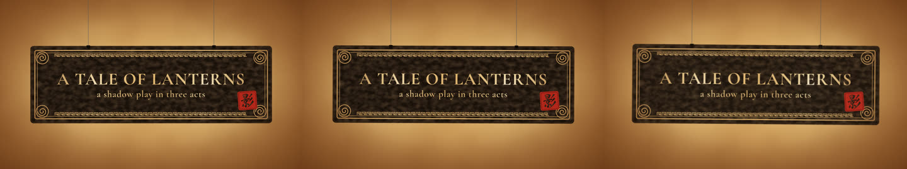

A dark hide plaque with the title cut out so the letters glow with the lamp light behind; carved border with a meander band and cloud-scroll corner roundels, a vermilion seal with a cut glyph, carried on two thin rods, pressed on to enter and lifted off to exit.

**Use for:** Titles, end cards and chapter cards for heritage, myths and festivals (Lunar New Year, Diwali shadow plays), "a tale of ..." openers; works over lamp-screen or any bright backdrop.  
**Rebuilt from:** lemo-opuscar styles/shadow-puppet demo/stage.js (plaque), DEMO.md "Title plaque" (MIT, LemoLab)  
**Default length:** 150 frames (5.0 s @ 30 fps)

**Roles:** type · **Mood:** editorial, night  
**Capabilities:** paints its own background · text: `lines` · weight: light  

| prop | default | notes |
|---|---|---|
| `lines` | `[{"text":"A TALE OF LANTERNS","font":"cormorant","size":9…` | title lines [{text, font (cormorant\|playfair\|bungee\|oldItalic\|gothic\|...), size, weight}] |
| `plaqueColor` | `"#1a100a"` | hide colour |
| `borderColor` | `"#5a3a1c"` | plaque edge highlight |
| `sealColor` | `"#b3261b"` | seal colour (vermilion) |
| `seal` | `"影"` | single glyph cut into the seal |
| `rods` | `true` | show the carrying rods |
| `enterAt` | `14` | frame the plaque presses on |
| `exitAt` | `118` | frame the plaque lifts off (-1 = stays) |
| `tremor` | `1` | hand tremor strength |
| `backdrop` | `"lamp"` | 'lamp' (lit cloth behind) or 'color' |
| `backdropColor` | `"#120805"` | colour when backdrop = color |
| `seed` | `6` | tremor seed |

### `channel-intro-sting` — Channel intro sting (3 s)

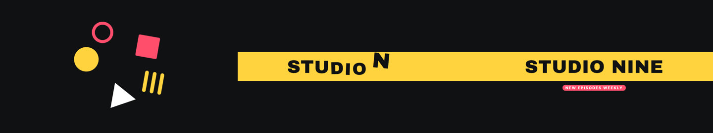

A 3-second bumper: five flat shapes snap in on the beat, spin and collapse to a point with a flash; a colour band shoots across and the channel name slams in letter by letter, a tagline pill slides in under it, then everything wipes out.

**Use for:** Channel / show intro bumpers, section stingers and "from the makers of" openers; optional logo picture above the name.  
**Rebuilt from:** original (branding pass, round 3)  
**Default length:** 90 frames (3.0 s @ 30 fps)

**Roles:** type · **Mood:** —  
**Capabilities:** overlay (`{"background":"transparent"}`) · text: `tagline` · image: `src` · weight: light  

| prop | default | notes |
|---|---|---|
| `name` | `"STUDIO NINE"` | channel / show name that slams in |
| `tagline` | `"new episodes weekly"` | small pill under the name ("" = none) |
| `src` | `""` | optional logo picture shown above the name (public/ path or URL) |
| `background` | `"#101114"` | backdrop colour, or "transparent" to sit over footage |
| `accent` | `"#FFD23F"` | band colour and shapes |
| `accent2` | `"#FF4D6D"` | second brand colour (shapes, tagline pill) |
| `ink` | `"#101114"` | name colour (must read on the accent band) |
| `startAt` | `0` | frame the sting starts |
| `speed` | `1` | timing multiplier (1.3 = faster, hits a shorter beat) |
| `fontFamily` | `""` | optional CSS font-family for the name |

### `chapter-countdown` — Chapter countdown (3-2-1 ring)

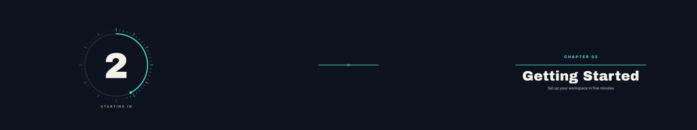

A tick-marked ring counts 3-2-1: each number pops in and the ring sweeps once per count while the ticks light up; the ring then snaps shut into a line that opens sideways, with the chapter label, title and subtitle rising out from behind it.

**Use for:** Chapter / section intros in tutorials, courses and long videos; "starting in 3-2-1" openers before a segment, with the chapter title.  
**Rebuilt from:** original (branding pass, round 3)  
**Default length:** 190 frames (6.3 s @ 30 fps)

**Roles:** type · **Mood:** editorial  
**Capabilities:** overlay (`{"background":"transparent"}`) · text: `title`, `subtitle` · weight: light  

| prop | default | notes |
|---|---|---|
| `from` | `3` | number to count down from (1-9) |
| `preLabel` | `"starting in"` | small line under the ring while counting ("" = none) |
| `chapterLabel` | `"Chapter 02"` | small tracked label above the title (e.g. "Chapter 02", "Part 3") |
| `title` | `"Getting Started"` | chapter title |
| `subtitle` | `"Set up your workspace in five minutes"` | line under the title ("" = none) |
| `framesPerCount` | `28` | frames per number (30 = one second) |
| `background` | `"#0E1320"` | backdrop colour, or "transparent" to sit over footage |
| `ink` | `"#F4F1EA"` | number and title colour |
| `accent` | `"#4DD6C1"` | ring, ticks, label and line colour |
| `startAt` | `0` | frame the countdown starts |
| `fontFamily` | `""` | optional CSS font-family for the number and title |

### `chapter-header` — Chapter header

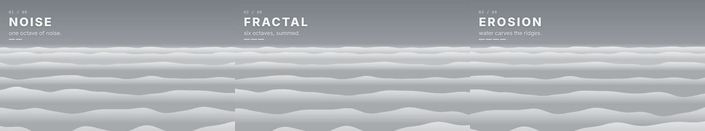

Numbered chapter/stage header that steps through titles: tracked title + segmented progress bar, era badge card, or vertical location tag.

**Use for:** Step-by-step explainers, timelines, era/location markers and chapter breaks.  
**Rebuilt from:** video8 0:00-0:36, video17 0:00-0:39, video14 0:00-2:06, video10 0:14.5-0:16.4  
**Default length:** 180 frames (6.0 s @ 30 fps)

**Roles:** type · **Mood:** light, editorial  
**Capabilities:** overlay (`{"backdrop":"none"}`) · text: `stages` · image: `src` · weight: light  
**Pairs well with:** `line-draw-on`, `flow-lines`, `ken-burns`, `map-route`  

| prop | default | notes |
|---|---|---|
| `variant` | `"stage"` | stage (video8 top-left block) \| era (video14 top-right year card) \| location (video10 vertical tag) \| fight-banner (tilted dark band snapping across the frame, heavy italic gold word + sub-line; title = word, subtitle = sub) \| fantasy (radial navy card, CHAPTER I capitals over a gold diamond ornament, glowing italic serif name, drifting ember; title = name, subtitle = chapter label) |
| `stages` | `[]` | [{title, subtitle}] stepped through in order; [] = built-in sample for the variant |
| `stageFrames` | `56` | frames per stage |
| `startFrame` | `8` | frame the first stage appears |
| `startIndex` | `1` | stage: number shown for the first stage |
| `total` | `8` | stage: total count shown after the slash (progress dashes = total + 1) |
| `scale` | `1.25` | overall size multiplier (1 = source size at 1080p) |
| `color` | `"#f0f4f6"` | text colour (stage) / letter + border colour (location) |
| `accent` | `"#c14d3c"` | location tag fill |
| `backdrop` | `"auto"` | auto (dunes / warm / dusk per variant) \| any backdrop kind |
| `src` | `""` | optional public/ image behind the header |
| `position` | `"bottom"` | fight-banner: band 'top' or 'bottom' |
| `angle` | `-4` | fight-banner: band tilt in degrees (-4) |
| `bandColor` | `"#070224"` | fight-banner: band colour |
| `goldColor` | `"#F8CB61"` | fight-banner / fantasy: gold rules, word and ornament colour |
| `ornament` | `"diamond-line"` | fantasy: 'diamond-line' \| 'none' |
| `ember` | `true` | fantasy: drifting ember particle |

### `chrome-80s-title` — Chrome 80s title

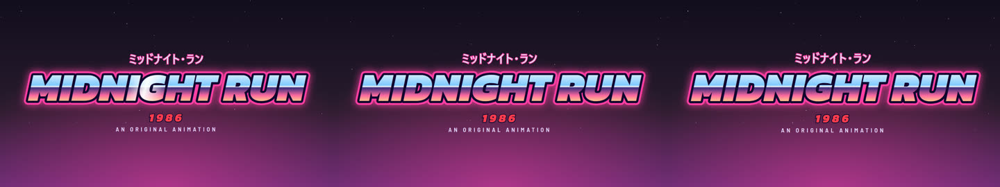

Heavy italic title in a sky-to-sunset chrome gradient with a white horizon line, dark outline plus neon outline glowing through; flickers on, a light bar sweeps the letters, a star glint pops, katakana line above, red year below.

**Use for:** Synthwave / retro / 80s anime title cards, YouTube intros and game or film trailers.  
**Rebuilt from:** lemo-opuscar styles/cel-anime-80s/demo/scenes1.js titleCard() (MIT, LemoLab)  
**Default length:** 120 frames (4.0 s @ 30 fps)

**Roles:** type · **Mood:** neon, pixel, comic, nature, night  
**Capabilities:** paints its own background · text: `title`, `subtitle`, `tagline` · weight: light  

| prop | default | notes |
|---|---|---|
| `title` | `"MIDNIGHT RUN"` | main title (caps recommended; wraps to two lines at 9:16) |
| `subtitle` | `"ミッドナイト・ラン"` | katakana / Japanese line above (empty = none) |
| `year` | `"1986"` | red year line below (empty = none) |
| `tagline` | `"AN ORIGINAL ANIMATION"` | small tracked caps line under the year |
| `neon` | `"#FF3FA4"` | neon outline colour |
| `outline` | `"#120830"` | dark outline colour |
| `sweepAt` | `14` | frame the light-bar sweep starts |
| `glintAt` | `33` | frame the star glint starts |
| `flicker` | `true` | flicker on at 12 fps with a 2-frame white flash |
| `stars` | `60` | number of background stars |
| `background` | `"#130D1F"` | night sky top colour |

### `chrome-title-slam` — Chrome title slam

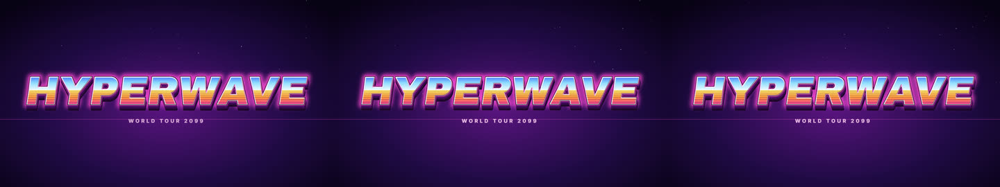

An extruded 80s chrome logotype slams in from huge scale, flashes the frame white and shakes: sky-to-sunset split face with a bright horizon line, dark outline, neon edge, stacked purple extrusion, bevel slivers and reflection lines; then a diagonal glint sweeps across and a four-point star pops.

**Use for:** Retro title cards, gaming / esports intros, event posters and Y2K chrome brand moments; the extruded, slammed cousin of `chrome-80s-title`.  
**Rebuilt from:** mg-styles-15 demos/10-synthwave chrome title (MIT), video 10-synthwave 4.13-5.6 s  
**Default length:** 120 frames (4.0 s @ 30 fps)

**Roles:** type · **Mood:** neon, 3d, pixel, nature, night  
**Capabilities:** paints its own background · text: `text`, `subtitle` · weight: light  

| prop | default | notes |
|---|---|---|
| `text` | `"HYPERWAVE"` | the logotype (short, caps) |
| `subtitle` | `"WORLD TOUR 2099"` | small letter-spaced line under it (empty = none) |
| `skyColors` | `["#3f6bff","#8fdcff","#eefaff"]` | face gradient stops, top to the horizon line (2-4 hex colours) |
| `sunColors` | `["#ffe76a","#ff9a3d","#ff3d9a"]` | face gradient stops, below the horizon line |
| `rimColor` | `"#ff7bdd"` | colour of the bright rim stroke |
| `neon` | `"#ff49d6"` | neon edge + glow colour |
| `extrudeColor` | `"#5c1080"` | extrusion colour at the face; it darkens with depth |
| `extrudeSteps` | `14` | number of stacked extrusion copies (depth) |
| `slamAt` | `8` | frame the title starts slamming in |
| `flash` | `0.6` | white flash peak 0..1 |
| `glintAt` | `52` | frame the diagonal glint starts (0.6 s sweep) |
| `starGlint` | `true` | pop a four-point star + streak at the end of the sweep |
| `skew` | `-8` | italic skew in degrees |
| `background` | `"#090216"` | backdrop base colour |

### `cinematic-title-card` — Cinematic title card

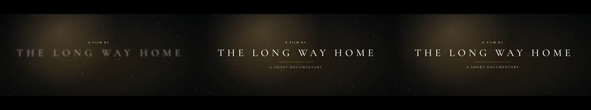

Letterbox bars slide in over a slowly pushing backdrop (your picture or a graded gradient with a drifting light leak); floating dust catches the light, a small kicker appears, a wide-tracked serif title resolves from blur as its tracking tightens, a thin rule and subtitle follow, and the card fades to black.

**Use for:** Film and documentary titles, trailers, "a film by" cards, episode titles and any moody opening over a photo or colour.  
**Rebuilt from:** original (branding pass, round 3)  
**Default length:** 180 frames (6.0 s @ 30 fps)

**Roles:** type · **Mood:** photo, cinematic, editorial  
**Capabilities:** overlay (`{"background":"transparent"}`) · text: `title`, `subtitle`, `kicker` · image: `src` · weight: light  

| prop | default | notes |
|---|---|---|
| `title` | `"The Long Way Home"` | main title (set in caps) |
| `subtitle` | `"a short documentary"` | line under the title ("" = none) |
| `kicker` | `"a film by"` | tiny tracked line above the title, e.g. "a film by" ("" = none) |
| `src` | `""` | backdrop picture (public/ path or URL); empty = graded gradient with light leak |
| `background` | `"#0A0C12"` | base colour (the gradient shade / picture tint); "transparent" = bars and text only over your footage |
| `ink` | `"#F1EBDD"` | text and dust colour |
| `accent` | `"#C89B5A"` | light leak and rule colour |
| `ratio` | `2.39` | letterbox aspect ratio (2.39 = scope, 1.85 = flat); bars are capped at 27 % of the height |
| `dust` | `70` | floating dust motes (0-160) |
| `push` | `0.08` | slow push-in over the whole card (0.08 = 8 %) |
| `tracking` | `0.3` | final letter spacing of the title in em |
| `startAt` | `0` | frame the bars start closing in |
| `fadeOut` | `true` | fade to black over the last 20 frames |
| `fontFamily` | `""` | optional CSS font-family for the title |

### `comic-burst` — Comic SFX burst

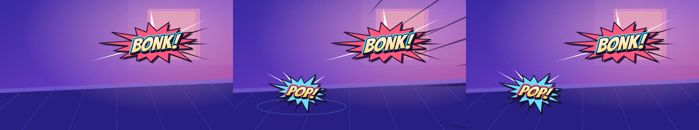

Comic onomatopoeia (BONK! POP!) in a jagged halftone starburst that springs in after an impact frame, wobbles and boils, with speed lines and a shockwave ring.

**Use for:** Impacts, punchlines, notifications and any "sound you can see" beat.  
**Rebuilt from:** video12 0:07-0:66, video14 1:46-1:58, video17 0:28.15-0:28.20  
**Default length:** 150 frames (5.0 s @ 30 fps)

**Roles:** type · **Mood:** mid, comic  
**Capabilities:** overlay (`{"backdrop":"none"}`) · text: `bursts` · image: `src` · weight: light  
**Pairs well with:** `speed-lines`, `comic-halftone`, `confetti-burst`  

| prop | default | notes |
|---|---|---|
| `bursts` | `[{"text":"BONK!","at":10,"x":0.66,"y":0.34,"palette":"pin…` | [{text, at, x, y, palette?, rotate?, size?, impact?, life?}] — palette pink \| yellow \| white \| cyan \| green; impact = 3-frame yellow smash frame before it; life = frames until it pops away |
| `points` | `15` | number of star points (12–18) |
| `speedLines` | `true` | radial speed lines whip in on each burst |
| `shockwave` | `true` | ground shockwave ellipse under each burst |
| `wobble` | `0.035` | post-pop scale wobble amount |
| `outline` | `"#1b1030"` | ink colour for outlines and shadows |
| `backdrop` | `"comic"` | comic \| dusk \| warm \| … procedural scene behind |
| `src` | `""` | optional public/ image as the scene |
| `seed` | `3` | changes the burst shapes |
| `variant` | `"burst"` | burst (starburst + onomatopoeia) \| telop (huge outlined verdict word pops at an angle, drifts up, with a star + ring + speed-line burst) |
| `angle` | `-6` | telop: default tilt in degrees (a burst rotate overrides it) |
| `strokeRatio` | `0.15` | telop: ink outline width as a share of the font size |
| `tagCorner` | `false` | telop: after the hold the word shrinks into a small tag in the top-left corner and stays |
| `skewDeg` | `0` | telop: horizontal skew of the word |

### `countdown-new-year` — New-year countdown with fireworks finale

A big 10 to 0 countdown inside a depleting tick ring (each number pops in and punches out); rockets climb for the last three counts, then a flash, a firework volley and falling confetti reveal the year and a greeting.

**Use for:** New-year countdowns, product-launch and live-stream countdowns, sale starts, "going live in 10" intros, festival openers, midnight reveals. Set `year`, `message`, `from` (start number) and `tick` (frames per number).  
**Rebuilt from:** original (round 3, events & celebrations)  
**Default length:** 400 frames (13.3 s @ 30 fps)

**Roles:** type, accent · **Mood:** 3d, playful, night  
**Capabilities:** overlay (`{"background":"transparent"}`) · text: `subtitle`, `caption` · weight: light  

| prop | default | notes |
|---|---|---|
| `from` | `10` | number the countdown starts from |
| `tick` | `22` | frames each number stays (30 = one second) |
| `year` | `"2027"` | big text revealed at zero (a year, "GO!", "LIVE"…) |
| `message` | `"Happy New Year"` | greeting under the year |
| `subtitle` | `"Wishing you a bright start"` | small line under the greeting |
| `caption` | `"Counting down to midnight"` | small line above the ring while counting |
| `colors` | `["#FFC857","#FF4F9A","#5BD1FF","#9CFF8A"]` | firework / confetti colours (array of hex) |
| `background` | `"#0A0E27"` | night-sky base colour (hex), or "transparent" to overlay content |
| `ink` | `"#FFFFFF"` | text colour (hex) |
| `accent` | `"#FFC857"` | ring, zero and year colour (hex) |
| `seed` | `6` | seed for stars and firework patterns |
| `startAt` | `0` | frame the sequence begins |

### `counting-objects` — Counting objects

Kid-friendly counting: cute faced shapes (stars, hearts, apples, balloons, fish ...) pop into a ten-frame grid one by one while a big number and its word count up in step, then the set waves and the total is announced with confetti.

**Use for:** Early-years maths and number-recognition videos, kids' app promos, preschool lessons and "how many?" social posts — pass the count, the shape, the unit word and your colours.  
**Rebuilt from:** original (round 3)  
**Default length:** 360 frames (12.0 s @ 30 fps)

**Roles:** type, accent · **Mood:** nature, playful, night  
**Capabilities:** overlay (`{"background":"transparent"}`) · text: `title` · weight: light  

| prop | default | notes |
|---|---|---|
| `count` | `7` | how many objects to count (1-40) |
| `shape` | `"star"` | star \| circle \| heart \| apple \| balloon \| square \| triangle \| flower \| fish |
| `colors` | `["#FF6B6B","#FFB020","#2EC4B6","#4D96FF","#9B5DE5"]` | colours cycled across the objects (also tints the number box) |
| `title` | `"Let's count!"` | heading shown while counting |
| `unitLabel` | `"stars"` | what is being counted, plural (used in doneText) |
| `doneText` | `"{n} {unit}!"` | heading after the last object; {n} = the count, {unit} = unitLabel |
| `numberWords` | `["one","two","three","four","five","six","seven","eight",…` | number words for 1, 2, 3 ... (translate for other languages) |
| `showWords` | `true` | show the number word under the number |
| `faces` | `true` | give each object a smiling face |
| `perRow` | `5` | objects per row in the grid (5 = ten-frame style) |
| `interval` | `0` | frames between pops (0 = auto-fit to the clip) |
| `background` | `"#FFF6E5"` | backdrop colour or 'transparent' |
| `ink` | `"#2B2A4C"` | text, face and outline colour |
| `accent` | `"#FF6B6B"` | completion heading colour |
| `card` | `"#FFFFFF"` | number box colour before counting starts |
| `fontFamily` | `""` | optional CSS font-family for the number and headings (empty = display) |
| `startAt` | `0` | frame the lesson starts |
| `speed` | `1` | playback speed multiplier |

### `deco-title-bar` — Art deco title bar

An art-deco title card unfolding from a centre point: hairline → stepped lacquer bar with double gold keyline → title rises in Limelight gold → wings with speed lines, over a stepped arch and a 72-ray sunburst, with a diamond year badge and a specular sheen across the gold.

**Use for:** Openers and end cards for galas, launches, 1920s themes, hotel / luxury brands and New Year countdowns.  
**Rebuilt from:** lemo-opuscar styles/art-deco demo/engine/type.js titleBar, yearBadge; engine/deco.js goldGrad, gline, sunburst, archFrame (MIT, LemoLab), analysis/sources/lemo-styles-a.md §2 deco-title-bar  
**Default length:** 150 frames (5.0 s @ 30 fps)

**Roles:** type · **Mood:** nature  
**Capabilities:** paints its own background · text: `title`, `subtitle`, `badge`, `caption` · weight: light  

| prop | default | notes |
|---|---|---|
| `title` | `"Midnight"` | main title (set in Limelight caps; long titles shrink to fit the bar) |
| `subtitle` | `"at the Northwind Hotel"` | tracked caps line under the bar |
| `badge` | `"2026"` | text in the diamond badge, split in two halves (e.g. "2026" → 20 / 26) |
| `caption` | `"New Year's Eve"` | thin tracked caps line under the badge (empty = none) |
| `rays` | `72` | sunburst ray count (alternate wedges are drawn) |
| `steps` | `3` | stepped arch frames drawn above the bar |
| `accent` | `"#8E1B2E"` | burgundy jewel accent at the bar ends |
| `background` | `"#0d0b09"` | warm lacquer black |
| `sheenAt` | `84` | frame the specular sheen sweeps across the gold |

### `definition-card` — Definition card

A dictionary entry card: big headword with a speaker icon, phonetic spelling and part-of-speech pill, a rule that draws, the definition typing on with a caret, then an italic example sentence.

**Use for:** Vocabulary and "what does X mean" explainers, glossary beats, language lessons, jargon-busting intros — pass the word, phonetic, part of speech, definition and example.  
**Rebuilt from:** original (round 3)  
**Default length:** 240 frames (8.0 s @ 30 fps)

**Roles:** type · **Mood:** ui  
**Capabilities:** overlay (`{"background":"transparent"}`) · text: `word` · weight: light  

| prop | default | notes |
|---|---|---|
| `word` | `"Inflation"` | the headword |
| `phonetic` | `"/ɪnˈfleɪ.ʃən/"` | phonetic spelling, e.g. /ˈwɜːd/ |
| `partOfSpeech` | `"noun"` | noun / verb / adjective ... shown as a pill |
| `definition` | `"A general rise in prices over time, which means each uni…` | the definition text (types on) |
| `example` | `"With inflation at 3%, a $100 basket of groceries costs $…` | optional example sentence (empty string hides it) |
| `background` | `"#E9E1D0"` | backdrop colour or 'transparent' |
| `ink` | `"#1D1B18"` | text colour |
| `accent` | `"#C8452D"` | pill, rule, caret and left-edge colour |
| `card` | `"#FFFDF7"` | card colour |
| `fontFamily` | `""` | optional CSS font-family for the word and example (empty = serif) |
| `startAt` | `0` | frame the card starts entering |
| `speed` | `1` | playback speed multiplier |
| `typeSpeed` | `1` | typing speed multiplier for the definition |

### `diagonal-assemble-title` — Diagonal assemble title (shatter into title)

The previous scene slices into 23 strips along a 30-degree cut that slide off alternately; the title letters then fly in along the same diagonal from alternating sides, spinning and landing one per sixteenth note, the title sitting split along the cut until the halves close with a click.

**Use for:** Logo and name reveals ("the chase ends at the brand"), event openers, trailers: an assemble-the-title finale with real graphic punch.  
**Rebuilt from:** lemo-opuscar styles/spy-titles demo/film.js (sShatter), title.js (MIT, LemoLab)  
**Default length:** 150 frames (5.0 s @ 30 fps)

**Roles:** type · **Mood:** paper, ui  
**Capabilities:** paints its own background · text: `title` · weight: light  

| prop | default | notes |
|---|---|---|
| `title` | `["Northwind","Station"]` | title lines (one or two short lines) |
| `cutAngle` | `30` | cut line angle from vertical, degrees |
| `strips` | `23` | number of strips the outgoing scene is cut into |
| `stripWidth` | `260` | strip width in u |
| `landFrom` | `28` | frame the first letter lands |
| `landEvery` | `3` | frames between letter landings |
| `splitGap` | `40` | gap between the two title halves in u |
| `closeAt` | `92` | frame the halves close with a click |
| `scene` | `true` | show the outgoing scene (false = start straight on the title) |
| `sceneGround` | `"#c8321e"` | outgoing scene sky/ground colour |
| `sceneInk` | `"#1b1714"` | outgoing scene skyline colour |
| `sceneAccent` | `"#e2a52a"` | window / click accent colour |
| `paper` | `"#efe4c9"` | background behind the title |
| `titleInk` | `"#1b1714"` | title letter colour |
| `seed` | `3` | skyline seed |

### `diagonal-band-title` — Diagonal band title

Constructivist title package on warm paper: an archive-footage window slams down, a red girder band slams in along a −18° axis with a decaying shake, a huge Oswald number stamps digit by digit (one per eighth note) with its unit in red, and a caps line rides on the band; everything printed in one ink, one red.

**Use for:** Bold documentary, anniversary and report openers; launch numbers with real photos (pass src).  
**Rebuilt from:** lemo-opuscar styles/kino-montage (MIT, LemoLab) — STYLE.md §6 title package, poster.jpg, index.html slam/slant  
**Default length:** 150 frames (5.0 s @ 30 fps)

**Roles:** type · **Mood:** paper, photo, cinematic, editorial  
**Capabilities:** paints its own background · text: `unit` · image: `src` · weight: light  

| prop | default | notes |
|---|---|---|
| `number` | `"410"` | the huge number (stamped digit by digit) |
| `unit` | `"days"` | unit word in red beside it |
| `line` | `"Northwind Tower · built floor by floor"` | caps line riding on the red band |
| `subline` | `"Opened ahead of schedule"` | ink-tab line under the number |
| `tag` | `"Film · Northwind archive · 1931"` | Space Mono source tag on the footage window |
| `src` | `""` | optional photo/still in public/ for the footage window (print-graded to ink/paper) |
| `footage` | `"tower"` | procedural archive scene when no src: 'tower' \| 'girder' \| 'crowd' \| 'street' \| 'works' |
| `axisDeg` | `-18` | band axis in degrees (−15 to −30) |
| `bpm` | `120` | beat grid: digits land on eighth notes |
| `red` | `"#D52B1E"` | the one red |
| `ink` | `"#141210"` | ink colour |
| `paper` | `"#EDE4D0"` | paper colour |

### `end-card-credits` — End card credits

Bottom scrim fades in over a drifting landscape; headline, mono stat lines and a credit stagger in with a blur fade-up, then fade to black.

**Use for:** Closing cards, "how it was made" stats, credits and calls to action over the last shot.  
**Rebuilt from:** video8 0:38.5-0:43, video17 0:38.7-0:42.8, video23 1:31  
**Default length:** 165 frames (5.5 s @ 30 fps)

**Roles:** type · **Mood:** mid, cinematic, editorial, nature  
**Capabilities:** overlay (`{"backdrop":"none"}`) · text: `title`, `headline`, `lines`, `credit` · image: `src` · weight: light  
**Pairs well with:** `embers`, `starfield-night`, `thumbnail-mosaic`  

| prop | default | notes |
|---|---|---|
| `title` | `""` | optional wide-tracked serif title shown above the headline ("" = none) |
| `headline` | `"every pixel you just saw is math."` | main end-card sentence |
| `lines` | `["0 images · 0 footage · 0 video models · 0 audio samples…` | mono stat lines (first at 85 % white, the rest 55 %) |
| `credit` | `"written by Claude"` | bold credit line |
| `startFrame` | `18` | frame the headline fades in |
| `offsets` | `[0.55,1.2,2]` | seconds after the headline for each stat line and the credit (video8: 0.55, 1.2, 2.0) |
| `scrimStrength` | `1` | bottom gradient scrim opacity |
| `headlineY` | `0.72` | vertical centre of the text block as a fraction of height |
| `fadeToBlack` | `true` | fade to black over the last 11 frames |
| `backdrop` | `"peaks"` | peaks (sunrise over mountains) \| dunes \| dusk \| ocean \| … scene behind |
| `src` | `""` | optional public/ image or still of your last shot |
| `layout` | `"stack"` | stack (headline block over a bottom scrim) \| storybook (calm: serif title blurs in at the top over a slow pull-back, CTA low in the frame) |
| `cta` | `""` | call-to-action button text ("" = none) |
| `ctaColor` | `"#D83A34"` | CTA button fill |
| `ctaTextColor` | `"#ffffff"` | CTA button text colour |
| `ctaAt` | `0` | frame the CTA pops in (0 = visible from the first frame) |
| `pullBack` | `false` | slow pull-back (≈3 %/s) with a slight truck right instead of the drift-in |

### `end-screen-cards` — End screen with video cards

Outro screen: headline, two video-card slots (thumbnail or placeholder, label, running timer bar) and a round subscribe circle with a rotating ring of text and pulsing halos; everything rises in staggered, then a supporting line fades in. Lays out 3-across on 16:9 and stacks on 1:1 and 9:16.

**Use for:** YouTube / social end screens, "watch next" outros and channel sign-offs; keep the card areas for the platform end-screen elements.  
**Rebuilt from:** original (branding pass, round 3)  
**Default length:** 240 frames (8.0 s @ 30 fps)

**Roles:** type · **Mood:** ui  
**Capabilities:** overlay (`{"background":"transparent"}`) · text: `title`, `subtitle`, `cards` · weight: light  

| prop | default | notes |
|---|---|---|
| `title` | `"Thanks for watching"` | big headline at the top |
| `subtitle` | `"New videos every week"` | supporting line at the bottom ("" = none) |
| `cards` | `[{"label":"Watch next","src":""},{"label":"Most popular",…` | [{label, src}] up to 2 video cards; src = thumbnail image (public/ path or URL), empty = placeholder |
| `circleLabel` | `"Subscribe"` | text inside the circle when no circleSrc is given |
| `circleSrc` | `""` | channel avatar / logo picture for the circle |
| `ringText` | `"SUBSCRIBE · SUBSCRIBE · SUBSCRIBE · SUBSCRIBE · "` | text that rotates around the circle (repeat it to fill the ring) |
| `background` | `"#10131A"` | backdrop colour, or "transparent" to place over footage |
| `ink` | `"#F3F1EC"` | text colour |
| `accent` | `"#FF4D4D"` | brand colour of the circle, halos and timer bars |
| `cardColor` | `"#1C2130"` | card background shown behind thumbnails |
| `timerBars` | `true` | show the running timer bar along the bottom of each card |
| `startAt` | `0` | frame the screen starts building |
| `speed` | `1` | timing multiplier |
| `fontFamily` | `""` | optional CSS font-family for all text |

### `event-ticket-reveal` — Event ticket reveal & stub tear

An admission ticket slides in and settles, its event name, venue and details write on, a QR-style code scans in, then the stub tears off along the perforation while a shine sweeps the ticket and an "admit one" stamp lands.

**Use for:** Concert, festival, conference, cinema and match announcements, "tickets on sale" promos, event confirmations and booking flows, gift vouchers. Replace the event name, venue, date/time/seat details and colours; works as a vertical ticket in 9:16.  
**Rebuilt from:** original (round 3, events & celebrations)  
**Default length:** 240 frames (8.0 s @ 30 fps)

**Roles:** type · **Mood:** hud  
**Capabilities:** overlay (`{"background":"transparent"}`) · weight: light  

| prop | default | notes |
|---|---|---|
| `eyebrow` | `"Live in concert"` | small line above the title (e.g. "Live in concert") |
| `eventName` | `"Summer Lights Festival"` | event title (wraps to two lines, three in 9:16) |
| `venue` | `"Harbour Arena, Main Stage"` | venue / location line |
| `details` | `[{"label":"Date","value":"SAT 21 JUN"},{"label":"Doors","…` | up to four {label, value} pairs shown in a grid (date, time, gate, seat…) |
| `ticketId` | `"No. 004281"` | reference text under the code; also seeds the code pattern |
| `admit` | `"Admit one"` | stub label and stamp text |
| `scanLabel` | `"Scan at gate"` | small line under the code |
| `tear` | `true` | tear the stub off at the end |
| `background` | `"#17142B"` | frame colour (hex), or "transparent" to overlay content |
| `ticket` | `"#FFF7EA"` | paper colour of the ticket (hex) |
| `ink` | `"#241B3A"` | text colour (hex) |
| `accent` | `"#E8553D"` | stub and top-band colour (hex) |
| `accent2` | `"#2D9C8F"` | scan line and stamp colour (hex) |
| `seed` | `5` | reserved for pattern variety |
| `startAt` | `0` | frame the sequence begins |

### `fill-in-the-blank` — Fill in the blank

A cloze exercise: a sentence with a pulsing blank, answer chips that pop in below, a wrong chip that is tried and bounces back with a shake and a cross, then the right chip arcs into the blank, turns green with a tick and sparkles and the feedback appears.

**Use for:** Grammar and vocabulary exercises, language-learning reels, classroom quiz clips, ESL practice posts and "can you spot the right word?" engagement videos — pass the sentence with ___ for the blank, the options and the answer.  
**Rebuilt from:** original (round 3)  
**Default length:** 330 frames (11.0 s @ 30 fps)

**Roles:** type, accent · **Mood:** playful  
**Capabilities:** overlay (`{"background":"transparent"}`) · weight: light  

| prop | default | notes |
|---|---|---|
| `sentence` | `"The cat sat on the ___ all day."` | the sentence; write ___ (3 underscores) where the blank goes |
| `options` | `["mat","sky","cloud"]` | answer chips shown below the sentence |
| `answerIndex` | `0` | index (0-based) of the correct option |
| `tryWrongFirst` | `true` | try a wrong option first (shake + cross) before the correct one lands |
| `prompt` | `"Fill in the blank"` | label pill above the sentence |
| `correctText` | `"Correct!"` | headline of the success banner |
| `wrongText` | `"Not quite - try again"` | message while the wrong option is in the blank |
| `explanation` | `"A cat can sit on a mat, but not on the sky."` | optional one-line explanation under the success banner (empty hides it) |
| `background` | `"#EAF2FF"` | backdrop colour or 'transparent' |
| `ink` | `"#1D2440"` | sentence text colour |
| `accent` | `"#4C6FFF"` | chip and blank colour |
| `card` | `"#FFFFFF"` | sentence card colour |
| `correctColor` | `"#1FA463"` | success colour |
| `wrongColor` | `"#E5484D"` | wrong-answer colour |
| `fontFamily` | `""` | optional CSS font-family for the sentence and chips (empty = grotesk) |
| `startAt` | `0` | frame the exercise starts |
| `speed` | `1` | playback speed multiplier |

### `flashcard-flip-deck` — Flashcard flip deck

A study deck of flashcards: each card slides in showing the term, flips over in 3D to reveal its definition, then flies off as the next arrives, with a deck stack, progress dots, a counter and a deck-complete finish.

**Use for:** Vocabulary, revision and quiz-prep videos, language-learning reels, course trailers and "test yourself" social posts — pass your own cards (term + definition), labels and brand colours.  
**Rebuilt from:** original (round 3)  
**Default length:** 430 frames (14.3 s @ 30 fps)

**Roles:** type · **Mood:** 3d, ui  
**Capabilities:** overlay (`{"background":"transparent"}`) · text: `cards`, `title` · weight: light  

| prop | default | notes |
|---|---|---|
| `cards` | `[{"term":"Photosynthesis","definition":"How plants turn s…` | array of {term, definition} cards, shown in order |
| `title` | `"Science words"` | deck title shown top-left |
| `termLabel` | `"Term"` | small label on the term side |
| `definitionLabel` | `"Meaning"` | small label on the definition side |
| `flipHint` | `"Think, then flip"` | hint line at the bottom of the term side (empty hides it) |
| `doneText` | `"Deck complete!"` | headline of the end state |
| `doneSubtitle` | `"{n} cards reviewed"` | end-state subtitle; {n} is replaced by the card count |
| `background` | `"#F4EFE6"` | backdrop colour or 'transparent' |
| `ink` | `"#1F2430"` | title / counter / end-state text colour |
| `accent` | `"#3D5AFE"` | term-side card colour, progress dots, check mark |
| `accent2` | `"#FF9F1C"` | definition-side top stripe and label colour |
| `card` | `"#FFFFFF"` | definition-side card colour |
| `fontFamily` | `""` | optional CSS font-family for terms and the title (empty = grotesk) |
| `hold` | `24` | frames each side is held before flipping / moving on (definition is held 30% longer) |
| `startAt` | `0` | frame the deck starts |
| `speed` | `1` | playback speed multiplier |

### `flipbook-riffle-outro` — Flipbook riffle outro

A hand-drawn end card (scalloped red title plate, flame mascot, sparkles) pulls back in three drawings to become the top sheet of an animation-paper stack on a peg bar on a desk; a red pencil writes and circles the drawing count, a cartoon thumb lifts the corner and riffles back through earlier drawings on ones, then settles on the top sheet and the mascot winks.

**Use for:** A memorable "it was all hand-made" signature ending for studio reels, behind-the-scenes, craft and handmade brands.  
**Rebuilt from:** mg-styles-15 05-cel-boil 9.0-9.7 s, scene.js drawDesk / drawThumb / RIFFLE (MIT, Vincentwei1021) — technique after mg-styles-15  
**Default length:** 180 frames (6.0 s @ 30 fps)

**Roles:** type · **Mood:** paper, 3d, comic, playful  
**Capabilities:** paints its own background · text: `title`, `subtitle`, `tagline` · image: `src` · weight: light  

| prop | default | notes |
|---|---|---|
| `title` | `"Made by Hand"` | title on the scalloped plate |
| `subtitle` | `"FRAME BY FRAME"` | small caps line inside the plate |
| `tagline` | `"drawn one sheet at a time"` | hand-lettered line under the plate |
| `countLabel` | `"No. 146"` | red-pencil drawing count that gets circled |
| `sceneLabel` | `"SC. 05"` | slate text top-left of every sheet |
| `src` | `""` | optional image (public/ path or URL) shown in place of the title plate |
| `paper` | `"#F1E7CF"` | animation paper colour |
| `deskColor` | `"#57523F"` | desk colour around the sheet |
| `plateColor` | `"#E04A33"` | title plate colour |
| `titleColor` | `"#FFC425"` | title fill colour |
| `ink` | `"#1C1613"` | ink colour |
| `pencil` | `"#D9573F"` | red col-erase pencil colour |
| `pegBar` | `true` | draw the peg bar, peg holes and tape |
| `riffleCount` | `6` | earlier drawings flashed during the riffle (2–8, one per frame) |
| `showFlame` | `true` | flame mascot peeking over the plate |
| `seed` | `1` | variation seed |

### `follower-milestone` — Follower milestone

A counter climbs to a milestone while a progress bar fills and little hearts float up; it lands with a shockwave, rays and a confetti burst, then a thank-you line pops in word by word.

**Use for:** Follower / subscriber / download / sales milestones, community thank-you posts, anniversary and goal-reached celebrations, "we hit 100K" announcements.  
**Rebuilt from:** original (round 3, social & marketing)  
**Default length:** 240 frames (8.0 s @ 30 fps)

**Roles:** type, accent · **Mood:** playful  
**Capabilities:** overlay (`{"background":"transparent"}`) · text: `label`, `caption`, `subtitle` · weight: light  

| prop | default | notes |
|---|---|---|
| `value` | `100000` | the milestone the counter climbs to |
| `fromValue` | `0` | where the counter starts |
| `label` | `"followers"` | unit under the number (followers, subscribers, users…) |
| `caption` | `"New milestone"` | small line above the number |
| `thankYou` | `"Thank you!"` | big thank-you line that pops in after the burst |
| `subtitle` | `"We could not have done it without you"` | smaller line under the thank-you |
| `format` | `"full"` | "full" (100,000) or "compact" (100K) |
| `climbFrames` | `90` | frames the counter takes to climb |
| `floaters` | `true` | floating hearts / plus marks during the climb |
| `background` | `"#0F1226"` | frame colour, or "transparent" to overlay content |
| `ink` | `"#FFFFFF"` | text colour |
| `accent` | `"#FFB63D"` | number glow, bar and burst colour |
| `accent2` | `"#FF5C8A"` | label, shockwave and underline colour |
| `seed` | `3` | seed for the burst pattern |
| `startAt` | `0` | frame the sequence begins |

### `glyph-fractal-push` — Glyph fractal push

A big word on a phosphor terminal holds, then the camera pushes on an exponential curve into one glyph until you see it is made of lines of smaller text (names, logs, headlines); outside the glyph the text is barely visible.

**Use for:** Scale reveals for text-heavy stories: "a company made of its people", "a year made of headlines", "a model made of a million lines".  
**Rebuilt from:** lemo-opuscar styles/ascii-crt demo/main.js fractal section, term.js thin bitmaps (MIT, LemoLab), analysis/sources/lemo-styles-a.md §3 glyph-fractal-push  
**Default length:** 180 frames (6.0 s @ 30 fps)

**Roles:** type · **Mood:** editorial  
**Capabilities:** paints its own background · text: `word` · weight: light  

| prop | default | notes |
|---|---|---|
| `word` | `"TEAM"` | the big word (A–Z, 0–9; 2–6 letters reads best) |
| `target` | `1` | index of the letter the camera pushes into |
| `innerText` | `[]` | strings that make up the small text (names, log lines, headlines); empty = 24 neutral placeholder names |
| `holdFrames` | `34` | frames the whole word holds before the push |
| `pushFrames` | `110` | push duration |
| `zoomTo` | `7` | final zoom (the small text reads at ≈ 30 px at the end) |
| `phosphor` | `"#FFB000"` | phosphor colour (beam edges / glow) |
| `phosphorHi` | `"#FFE2A0"` | small-text colour |
| `background` | `"#090604"` | unlit glass colour |

### `glyph-orbit-logo` — Glyph-orbit logo build

Glyphs fly in and orbit a ring, then resolve into a typed mono logotype (scrambled letter fragments, blue dot becomes the i tittle); a frame draws around it and tagline lines type below.

**Use for:** Logo reveals, brand end cards, product names and title lock-ups.  
**Rebuilt from:** video19 0:15.4-0:20.0  
**Default length:** 220 frames (7.3 s @ 30 fps)

**Roles:** type · **Mood:** dark, blueprint  
**Capabilities:** overlay (`{"backdrop":"none"}`) · text: `logo`, `tagline`, `pill` · image: `src` · weight: light  
**Pairs well with:** `radial-blueprint`, `star-glint`, `aurora`  
**Avoid:** Change logo / tagline / pill (defaults are sample text).  

| prop | default | notes |
|---|---|---|
| `logo` | `"Ideas in Motion"` | logotype text (monospaced; the first lowercase i/j gets the blue dot) |
| `tagline` | `["KNOWLEDGE WAS ALWAYS","THE TECHNOLOGY."]` | up to two lines typed under the logo: [small tracked line, bold line] |
| `pill` | `"BUILT IN THE OPEN."` | double-ruled label typed at the bottom ("" = none) |
| `glyphCount` | `16` | number of orbiting glyphs |
| `orbitRadius` | `230` | glyph orbit radius in px at 1080p |
| `framesPerChar` | `3` | logotype typing speed (frames per letter; each letter scrambles for 3 frames) |
| `typeStart` | `44` | frame the logotype starts typing |
| `color` | `"#DADDE5"` |  |
| `dim` | `"#8A8C93"` |  |
| `accent` | `"#5086FE"` | focus dot colour |
| `backdrop` | `"ink"` | ink (blueprint black) \| any backdrop kind |
| `src` | `""` |  |
| `seed` | `2` |  |
| `variant` | `"orbit"` | orbit (typed with jumble) \| fly (wordmark-fly-assemble: letters fly out of the hero point one after another, motion-blurred, and settle into the wordmark) |
| `travel` | `12` | fly: frames each letter takes to travel (0.42 s = 12) |
| `paletteDashes` | `[]` | fly: colours of short dashes that line up under the logo as a palette signature (e.g. ['#FF5A4A','#FFC24A','#3FB6C8']) |
| `dotColor` | `""` | colour of the focus / tittle dot ('' = accent) |

### `graduation-cap-toss` — Graduation caps tossed in the air

Mortarboard caps are thrown up from below the frame, tumble with swinging tassels and fall away while confetti pops from both corners; Congratulations, the graduate name, a class pill and a tagline pop onto the frame, with a second smaller toss as finale.

**Use for:** Graduation and commencement videos, school or bootcamp class announcements, "congrats graduates" posts, certificate and course-completion celebrations, alumni and yearbook intros. Set the name (or "Graduates"), class line and colours.  
**Rebuilt from:** original (round 3, events & celebrations)  
**Default length:** 270 frames (9.0 s @ 30 fps)

**Roles:** type, accent · **Mood:** playful  
**Capabilities:** overlay (`{"background":"transparent"}`) · text: `headline`, `subtitle` · weight: light  

| prop | default | notes |
|---|---|---|
| `headline` | `"Congratulations"` | big line (Congratulations / Well done / Graduates) |
| `name` | `"Jordan Lee"` | graduate or group name, shown in script |
| `classLabel` | `"Class of 2027"` | text in the gold pill (Class of 2027, Batch 12...) |
| `subtitle` | `"The future is yours"` | tagline under the pill |
| `caps` | `9` | caps in the first toss (1-16); the second toss uses about 60% |
| `colors` | `["#E0A82E","#D9534F","#3B82C4","#4FB58A","#FFFFFF"]` | confetti colours (array of hex) |
| `cap` | `"#1E2A4A"` | cap colour (hex) |
| `tassel` | `"#E0A82E"` | tassel and button colour (hex) |
| `background` | `"#F4EBDD"` | frame colour (hex), or "transparent" to overlay content |
| `ink` | `"#1E2A4A"` | headline and tagline colour (hex) |
| `accent` | `"#F2C14E"` | class pill colour (hex) |
| `accent2` | `"#D9534F"` | name colour (hex) |
| `seed` | `5` | seed for toss spread and confetti |
| `startAt` | `0` | frame the sequence begins |

### `halftone-exhibit-numeral` — Halftone exhibit numeral

A giant rounded numeral bleeds off the right edge in flat yellow overprinted with an orange Ben-Day halftone clipped to the glyph, rising in with a back-ease behind a boiling evidence tag, while a misregistered slab headline drops letter by letter and a navy caption pill pops — all on mottled archive paper.

**Use for:** Numbered lists ("Reason 3"), step counters, chapter numbers and exhibit cards in print / editorial / true-crime-parody looks.  
**Rebuilt from:** lemo-opuscar styles/halftone-dossier (MIT, LemoLab) — demo/index.html halftone(), radial(), charge-card scene, caption, boil filter  
**Default length:** 150 frames (5.0 s @ 30 fps)

**Roles:** type · **Mood:** paper, pixel, comic, editorial  
**Capabilities:** paints its own background · text: `headline`, `caption`, `keyword` · image: `src` · weight: light  

| prop | default | notes |
|---|---|---|
| `numeral` | `"03"` | the giant numeral (1–3 characters) |
| `headline` | `"Exhibit three"` | slab headline with misregistered shadow (letters drop in) |
| `caseLine` | `"CASE No.2026-NW-003"` | mono case number top-left |
| `tag` | `"CHARGE 03"` | navy pill under the case number |
| `caption` | `"Left the oven on 17 times this year."` | caption pill text (empty = none) |
| `keyword` | `"17 times"` | part of the caption shown in yellow |
| `numeralColor` | `"#FFC628"` | flat spot ink of the numeral (yellow / pale pink) |
| `dotColor` | `"#F58A34"` | halftone overprint colour inside the numeral |
| `shadowColor` | `"#FFC628"` | misregistration shadow colour of the headline |
| `src` | `""` | optional public/ image shown as the exhibit (boiling evidence tag otherwise) |
| `background` | `"#F4ECDD"` | paper colour |
| `exhibitLabel` | `"EXHIBIT"` | small caps label above the numeral on the card |

### `hanazi-caption` — Hanazi caption

A fat rounded variety-show caption made of five stacked layers (offset extrusion, coloured outer stroke, white stroke, gradient fill, top gloss) pops in character by character on a damped spring with a slight drop and rotation, then wiggles, bobs and breathes before popping out; a small handwritten aside and sparkles ride along.

**Use for:** Social packaging (Douyin / Bilibili / Reels / TikTok), vlogs, interviews and reaction moments: drop emotional captions on top of footage.  
**Rebuilt from:** mg-styles-15 demos/18-hanazi HZ, charXf, driveHZ, spring (MIT), video 18-hanazi 0.2-0.5 s, 2.57 s, 6.0 s, 8.1 s, 8.9 s  
**Default length:** 150 frames (5.0 s @ 30 fps)

**Roles:** type · **Mood:** paper, 3d, playful, editorial  
**Capabilities:** paints its own background · text: `text` · image: `src` · weight: light  

| prop | default | notes |
|---|---|---|
| `text` | `"SO HAPPY!"` | the caption (Latin or CJK) |
| `preset` | `"joy"` | joy \| shock \| aside \| question \| bye: colours, font and skew |
| `aside` | `"(quietly) soaking up the sun..."` | small handwritten line under it (empty = none) |
| `at` | `8` | frame the first character pops |
| `out` | `138` | frame the pop-out starts (0.17 s) |
| `stagger` | `2` | frames between characters |
| `wiggle` | `1.8` | hold wiggle in degrees (1.15 Hz) |
| `bob` | `3` | hold bob in px at 1080 |
| `sparkles` | `true` | twinkling sparkles around it |
| `src` | `""` | optional photo/video frame (public/) to caption over; empty = demo sky |
| `background` | `"#7fd3ff"` | backdrop colour behind the demo sky |

### `handwrite-on` — Handwrite-on title

Text written glyph by glyph with a pen: outline strokes on, ink fill follows; optional fast un-write.

**Use for:** Friendly titles, end cards, chapter interstitials and handwritten captions.  
**Rebuilt from:** video4 0:26-0:28, video22 0:05-0:07, video22 0:14-0:16  
**Default length:** 120 frames (4.0 s @ 30 fps)

**Roles:** type · **Mood:** light, paper, editorial  
**Capabilities:** paints its own background · text: `lines` · weight: light  
**Pairs well with:** `flow-lines`, `falling-petals`, `heart-draw-fill`, `sprout-grow`  

| prop | default | notes |
|---|---|---|
| `lines` | `[{"text":"ballpoint","color":"#C8363A"},{"text":"gambit",…` | array of {text, color?, size?, delay?} — each line written after the previous |
| `background` | `"#EFE9DC"` |  |
| `color` | `"#2B74C5"` |  |
| `font` | `"hand"` | hand \| serif \| sans \| grotesk |
| `size` | `150` |  |
| `framesPerGlyph` | `3` | writing speed (video4 ≈ 1.75 f @30fps, video22 ≈ 3 f) |
| `strokeWidth` | `2` |  |
| `unwriteAt` | `0` | frame to start erasing backwards at 2x speed (0 = never) |
| `paper` | `true` |  |
| `jitter` | `1.2` | pen wobble in px |
| `variant` | `"pen"` | 'pen' (default outline-then-ink) \| 'marker' (dry-erase marker: per-glyph seeded tilt / baseline / size wobble, thicker translucent multiply ink, wet glint at the nib) \| 'brush' (swelling pressure per glyph, thick stroke, dry streaks) |
| `glyphJitter` | `{"tilt":2.5,"baseline":2,"size":0.03}` | marker: {tilt deg, baseline px, size fraction} seeded per glyph |
| `wetGlint` | `true` | marker: small white glint at the nib while a glyph is being written |
| `multiply` | `true` | marker: ink is ~90 % opaque and multiplies with what is below |
| `dry` | `0.6` | brush: 0..1 dry-brush streak strength |
| `halo` | `null` | written-caption mode: {color, width} paper-coloured blurred halo behind each glyph so it knocks back lines passing behind (null = off) |
| `anchor` | `"center"` | 'center' (default) \| 'bottom' (caption position, 10 % from the bottom) |
| `seed` | `4` | marker glyph jitter seed |

### `holiday-greeting-card` — Greeting card opens (seasonal motif)

A greeting card slides in closed, swings open on its spine to reveal a written greeting, message and signature, while a seasonal motif (snow, leaves, lights or hearts) drifts around and decorates the cover and left page.

**Use for:** Holiday, Christmas, autumn, winter, Valentine, thank-you and season's-greetings e-cards, newsletters and social posts, company holiday wishes, customer thank-you videos. Choose the motif, replace the greeting text and colours.  
**Rebuilt from:** original (round 3, events & celebrations)  
**Default length:** 270 frames (9.0 s @ 30 fps)

**Roles:** type · **Mood:** nature  
**Capabilities:** overlay (`{"background":"transparent"}`) · weight: light  

| prop | default | notes |
|---|---|---|
| `greeting` | `"Happy Holidays"` | big script greeting inside the card |
| `message` | `"Wishing you warmth, joy and peace this season and a brig…` | message paragraph (wraps to five lines) |
| `signature` | `"With love, The Team"` | sign-off written at the bottom |
| `coverText` | `"Season's Greetings"` | small caps line on the cover |
| `motif` | `"snow"` | "snow", "leaves", "lights" or "hearts" - drives the cover emblem, left page art and drifting particles |
| `background` | `"#1F3B4D"` | frame colour (hex), or "transparent" to overlay content |
| `card` | `"#FBF5EA"` | paper colour (hex) |
| `ink` | `"#2B2A33"` | message text colour (hex) |
| `accent` | `"#C8453B"` | cover, greeting and frame colour (hex) |
| `accent2` | `"#2F7D5B"` | signature and ornament colour (hex) |
| `seed` | `2` | seed for the drifting particles |
| `startAt` | `0` | frame the sequence begins |

### `intertitle-card` — Intertitle card (silent-film)

A full-frame black painted silent-film card with an Art-Deco border whose ornament follows the emotion (narration, shout, tender, title), set in small-caps and italic serifs, with weave, flicker, scratches, dust and a hair of print damage.

**Use for:** Chapter cards, quotes, punchlines ("Meanwhile, in the lab..."), a statistic as a twist; any retro or silent-comedy explainer. The SRT text can be the card text, so it doubles as a subtitle style.  
**Rebuilt from:** lemo-opuscar styles/silent-film demo/engine/cards.js, STYLE.md §4 (MIT, LemoLab)  
**Default length:** 120 frames (4.0 s @ 30 fps)

**Roles:** type · **Mood:** photo, pixel, cinematic, editorial  
**Capabilities:** paints its own background · text: `lines` · weight: light  

| prop | default | notes |
|---|---|---|
| `lines` | `[{"text":"Meanwhile, in the laboratory, a small idea was …` | card text [{text, font?, size?, italic?}]; level 'title' treats the first line as the title and the rest as italic subtitles |
| `level` | `"narration"` | 'narration' \| 'shout' \| 'tender' \| 'title': picks the border ornament and type style |
| `shake` | `1` | shout shake strength |
| `cardColor` | `"#141210"` | painted card colour |
| `inkColor` | `"#e8e4da"` | text colour |
| `borderColor` | `"#bdb6a8"` | border colour |
| `hold` | `3.5` | seconds the card is shown before a cut to black |
| `fadeFrames` | `5` | fade from black at the start (0 = hard cut) |
| `damage` | `1` | print damage 0..1 (weave, flicker, scratches, dust) |
| `aspect` | `0` | 0 = 4:3 (3:4 in portrait), -1 = fill the frame, or a width/height number |
| `outside` | `"#050403"` | colour outside the gate |

### `iso-ground-title` — Iso ground title

A bold extruded wordmark that belongs to an isometric world: letters drop one by one onto the iso floor plane (16th-note stagger) with a contact shadow, a small bounce and a lean, a hairline rule draws under them, a tagline and a mono stats line type on flat on the plane, and a cyan floor ping closes it.

**Use for:** Titles and end cards for iso dioramas, maps and product worlds; pair with iso-city-build after its pull-back.  
**Rebuilt from:** mg-styles-15 03-isometric 8.4-9.2 s, title.js / title5.js (MIT, Vincentwei1021) — technique after mg-styles-15  
**Default length:** 120 frames (4.0 s @ 30 fps)

**Roles:** type · **Mood:** 3d, playful  
**Capabilities:** paints its own background · text: `text`, `tagline` · weight: light  

| prop | default | notes |
|---|---|---|
| `text` | `"NORTHWIND"` | the wordmark (short, caps reads best) |
| `tagline` | `"a city that grows itself"` | line set flat on the plane under the title |
| `stats` | `"CITY OS · 144 TILES · ONLINE"` | mono stats line |
| `plane` | `"right"` | 'right' reads up-right along one iso axis, 'left' reads down-right along the other |
| `background` | `["#E6E0FB","#CFC5F4","#B6A8EC"]` | background gradient stops |
| `color` | `"#2C2960"` | letter top colour |
| `sideColor` | `"#1C1946"` | extrusion / text colour |
| `accent` | `"#62F0F2"` | dot and floor ping colour |
| `depth` | `12` | extrusion layers (thickness) |
| `stagger` | `2` | frames between letters (2 = 16ths at 120 bpm) |
| `startAt` | `6` | frame of the first letter drop |
| `grid` | `true` | faint iso floor grid |
| `ping` | `true` | cyan floor ping at the end |

### `key-takeaway-highlight` — Key takeaway highlight

A reading paragraph whose key phrases are swiped with a marker one by one, followed by a KEY TAKEAWAY box with a lightbulb and a one-line summary.

**Use for:** Lesson recaps, article / study summaries, "what to remember" endings, explainer chapters — pass your paragraph, the phrases to highlight and the takeaway line.  
**Rebuilt from:** original (round 3)  
**Default length:** 270 frames (9.0 s @ 30 fps)

**Roles:** type · **Mood:** —  
**Capabilities:** overlay (`{"background":"transparent"}`) · text: `text` · weight: light  

| prop | default | notes |
|---|---|---|
| `text` | `"Compound interest means you earn interest on your intere…` | the paragraph shown on screen |
| `highlights` | `["interest on your interest","invested early","time does …` | phrases inside `text` to marker-highlight, in the order they are swiped (matched case-insensitively) |
| `takeaway` | `"Start early: time matters more than the amount."` | summary sentence in the takeaway box |
| `takeawayLabel` | `"KEY TAKEAWAY"` | label above the takeaway |
| `background` | `"#F4EFE3"` | backdrop colour or 'transparent' |
| `ink` | `"#1F1D1A"` | text colour |
| `accent` | `"#FFC21A"` | marker colour (odd highlights), takeaway border and lightbulb |
| `accent2` | `"#7FD6C2"` | marker colour for every second highlight |
| `card` | `"#FFFFFF"` | takeaway box fill |
| `fontFamily` | `""` | optional CSS font-family for the paragraph (empty = serif) |
| `startAt` | `0` | frame the paragraph starts fading in |
| `speed` | `1` | playback speed multiplier |
| `stagger` | `26` | frames between marker swipes |

### `kinetic-captions` — Kinetic word captions

Word-by-word pop-in captions; *starred* words sit on a solid highlight box.

**Use for:** Narrated shorts: subtitles that pace with the voice and punch key words.  
**Rebuilt from:** video10 0:04-0:42, lemo-opuscar styles/caption-news, glass-product, ui toast (MIT, LemoLab), pdoom karaoke-fill idea  
**Default length:** 150 frames (5.0 s @ 30 fps)

**Roles:** type, frame · **Mood:** dark, editorial  
**Capabilities:** overlay (`{"background":"transparent"}`) · text: `lines` · weight: light  
**Pairs well with:** `ken-burns`, `film-look`, `beat-montage`  
**Avoid:** Do not put captions over a motion that already shows its own words (titles, signs, counters).  

| prop | default | notes |
|---|---|---|
| `lines` | `["People *bent* double","on the *sidewalk.*","It *isn't* …` | caption lines; wrap a word in *stars* to highlight it |
| `framesPerLine` | `50` | frames each line stays on screen |
| `background` | `"#1c2433"` | scene colour; "transparent" = caption overlay on top of other motions |
| `position` | `"center"` | bottom \| center \| top |
| `highlightColor` | `"#d23a2c"` | box colour behind highlighted words |
| `size` | `64` |  |
| `variant` | `"kinetic"` | kinetic (word pop + highlight boxes) \| premium (calm line, words brighten as spoken, soft scrim) \| slam (huge left-aligned chunks split by \|, {keyword} on a colour block, optional secondLines) \| toast (UI notification pill with live dot) \| frosted-bar (blurred glass slab + accent line) \| terminal (LOG tag, > prompt, words typed with the voice) \| print (glyph-drop headline with offset overprint shadow) \| karaoke (outline words fill as sung) \| rise (calm per-word fade + rise) |
| `accent` | `"#E9C27A"` | premium/toast/terminal/karaoke: accent colour (starred words, dot, tag, current word) |

### `kinetic-type-slam` — Kinetic type slam (phrases)

Huge 2-4 word phrases land one word per beat: each word rises through its own mask with a 1.25→1 (or 0.6→1) scale punch, they stack (or justify full-width, or swap in place), one accent word takes the brand colour, then the whole line is shoved off the top by the next phrase while the camera creeps in.

**Use for:** Hooks for shorts, launch films, manifestos and title sequences: pass `lines` (accent word per line), pick `layout`, set `beatFrames` to your music grid.  
**Rebuilt from:** prompt-corpus: kinetic-type-slam (52 cases), awesome-opus5-5-videos prompts (MIT) — technique only  
**Default length:** 180 frames (6.0 s @ 30 fps)

**Roles:** type · **Mood:** —  
**Capabilities:** paints its own background · text: `lines` · weight: light  

| prop | default | notes |
|---|---|---|
| `lines` | `[{"text":"Make it punchy","accent":"punchy"},{"text":"One…` | [{text, accent?: word or index, at?: start frame}] — 2-4 words each |
| `layout` | `"stack"` | 'stack' words stacked at one size · 'fill' each word justified to full width · 'center' one word at a time |
| `beatFrames` | `10` | frames per word (6-15; match your beat grid) |
| `holdBeats` | `1.4` | beats a finished line holds before being pushed off |
| `font` | `"display"` | 'display' \| 'sans' \| 'grotesk' \| 'serif' \| 'mono' |
| `align` | `"center"` | 'left' \| 'center' for stack |
| `tracking` | `-0.03` | letter-spacing in em (-0.02…-0.04) |
| `uppercase` | `true` |  |
| `capHeight` | `0.28` | cap height of the biggest word as a fraction of frame height (0.25-0.45) |
| `entryScale` | `1.25` | start scale of even words (1.25 punch-in); odd words use ≤0.6 pop-up |
| `push` | `0.06` | camera push-in over the whole clip (0.06 = +6 %) |
| `shake` | `5` | landing shake in px (0 = none) |
| `flash` | `true` | accent-colour flash on accent-word impact |
| `showIndex` | `true` | small 01/04 line counter |
| `background` | `"#0E0E10"` | background colour |
| `ink` | `"#F3EFE6"` | text colour |
| `accent` | `"#FF4D12"` | accent word colour |

### `knife-cut` — Knife cut (strike a row out)

A thin red rule shoots across a list row in three frames, then the row collapses vertically to its own midline and is gone; the rows below re-flow into the freed space nearest first and the running total counts down. Precise Swiss deletion.

**Use for:** Removing text, bullets, prices or features with a precise non-fade beat: "budget cut", quote tidy-ups, feature trimming; pairs with kinetic captions.  
**Rebuilt from:** lemo-opuscar styles/swiss-motion demo/film.js drawPosterText cut (MIT / CC BY 4.0, LemoLab)  
**Default length:** 130 frames (4.3 s @ 30 fps)

**Roles:** type · **Mood:** 3d  
**Capabilities:** paints its own background · text: `title`, `items` · weight: light  

| prop | default | notes |
|---|---|---|
| `title` | `"Quote"` | heading above the list |
| `items` | `[{"label":"Setup fee","amount":240},{"label":"Premium sup…` | rows: label + numeric amount |
| `cuts` | `[1,3]` | indexes of the rows to strike out |
| `cutAt` | `[40,78]` | frame each cut line lands (one per cut) |
| `currency` | `"$"` | currency symbol for amounts |
| `totalLabel` | `"Total"` | label of the running-total row |
| `direction` | `"ltr"` | 'ltr' or 'rtl' knife direction |
| `lineFrames` | `3` | frames the rule takes to cross |
| `collapseFrames` | `6` | frames the collapse takes |
| `background` | `"#ece8df"` | page colour |
| `ink` | `"#111111"` | text colour |
| `signal` | `"#e5322d"` | knife and total accent colour |
| `muted` | `"#8f8b82"` | hairline colour |

### `letters-become-image` — Letters become image

A typed sentence on a phosphor terminal breaks apart: its letters fly as particles into the cells of a picture made only of those letters, landing bottom-to-top with a flash on each landing while the source letters dim.

**Use for:** Text-to-image climaxes: a manifesto becomes a city, a product name becomes the product, a recipe becomes the dish.  
**Rebuilt from:** lemo-opuscar styles/ascii-crt demo/main.js letter-fall block + term.js (MIT, LemoLab), analysis/sources/lemo-styles-a.md §3 letters-become-image  
**Default length:** 180 frames (6.0 s @ 30 fps)

**Roles:** type · **Mood:** photo, pixel, playful, ui  
**Capabilities:** paints its own background · image: `src` · weight: light  

| prop | default | notes |
|---|---|---|
| `sentence` | `"Every city is made of small lights"` | the typed sentence; the picture is built only from its letters |
| `src` | `""` | public/ image to build (empty = procedural night plate) |
| `seed` | `2` | procedural plate seed |
| `palette` | `"dusk"` | procedural plate palette |
| `cols` | `84` | picture columns in landscape (portrait uses 60 %) |
| `typeStart` | `4` | frame typing starts |
| `splitAt` | `66` | frame the sentence breaks apart (≈1.5 s after typing ends) |
| `flightFrames` | `18` | flight time of one letter |
| `spreadFrames` | `52` | frames from the first landing row to the last |
| `order` | `"bottomUp"` | bottomUp = ground lands first, random = scattered |
| `phosphorLo` | `"#FF6605"` | dim phosphor colour |
| `phosphorMid` | `"#FFB000"` | mid phosphor colour (cursor) |
| `phosphorHi` | `"#FFEBB8"` | bright phosphor colour (sentence) |
| `background` | `"#090604"` | unlit glass colour |

### `logo-assemble` — Logo assemble (wireframe, shards lock in)

The logo draws on as a triangle wireframe, then faceted shards fly in from depth (or scatter) with a stagger, overshoot about 2 % and lock into place; a soft thud (camera punch, glow and ring) and a diagonal light sweep follow, then a tracked tagline. Works from a word or from an image / SVG logo.

**Use for:** Logo stings, brand intros and end cards; set text to the brand name or src to a logo file.  
**Rebuilt from:** prompt-corpus research: logo-assemble (12 cases, ideas only; original implementation)  
**Default length:** 210 frames (7.0 s @ 30 fps)

**Roles:** type · **Mood:** blueprint, photo  
**Capabilities:** paints its own background · text: `text`, `tagline` · image: `src` · weight: light  

| prop | default | notes |
|---|---|---|
| `text` | `"Northwind"` | brand name (used when src is empty) |
| `src` | `""` | public/ path or URL of a logo image / SVG (overrides text) |
| `logoAspect` | `1` | width / height of the src logo |
| `fontRole` | `"display"` | font role for the text logo: sans \| display \| grotesk \| serif \| mono |
| `weight` | `400` | font weight for the text logo |
| `tagline` | `"BUILT PIECE BY PIECE"` | tracked line under the logo ("" = none) |
| `color` | `"#F2F5FF"` | logo colour |
| `accent` | `"#5B8CFF"` | wireframe / glow / in-flight tint colour |
| `background` | `"#0B0F1C"` | background colour |
| `shardCount` | `90` | approximate number of shards (40-200) |
| `origin` | `"depth"` | 'depth' (fly from the camera side) \| 'scatter' (fly in from all around) |
| `wireframe` | `true` | show the wireframe stage first |
| `sweep` | `true` | light sweep after the lock |
| `seed` | `4` | randomness seed |

### `logo-reveal-lines` — Logo reveal: sweeping lines

Fine rules sweep in from alternating sides across the frame, converge on the logo box (outer rules become top and bottom rule, the rest merge into a bright centre line), the logo opens out of that line with a sheen and the tagline tracks in.

**Use for:** Clean logo intros and outros for a channel, product or studio; wordmark text or your own logo image.  
**Rebuilt from:** original (branding pass, round 3)  
**Default length:** 120 frames (4.0 s @ 30 fps)

**Roles:** type · **Mood:** playful  
**Capabilities:** overlay (`{"background":"transparent"}`) · text: `text`, `tagline` · image: `src` · weight: light  

| prop | default | notes |
|---|---|---|
| `text` | `"NORTHWIND"` | wordmark shown when no src is given (use \n for two lines) |
| `tagline` | `"made to move"` | small tracked line under the logo ("" = none) |
| `src` | `""` | logo image (public/ path or https URL, transparent PNG/SVG best); empty = wordmark text |
| `lines` | `9` | how many sweeping rules (3-24) |
| `background` | `"#0B0D10"` | backdrop colour, or "transparent" to sit over other footage |
| `ink` | `"#F4F1EA"` | wordmark / secondary line colour |
| `accent` | `"#FF5A36"` | brand colour of the main rules and ticks |
| `startAt` | `0` | frame the sweep starts |
| `speed` | `1` | timing multiplier (1 = default, 1.5 = faster) |
| `fontFamily` | `""` | optional CSS font-family for the wordmark text |
| `exit` | `false` | fade everything out over the last 14 frames |

### `marquee-ticker` — Marquee ticker

Endless horizontal bands of big uppercase text (solid, outline or pill-logo style) scrolling seamlessly with star/dot/arrow separators — one band, or several tilted and crossing in opposite directions — wiping in staggered.

**Use for:** Hype reels, event promos, client-logo walls (pill style), website section dividers, "now playing" bars; replace the items with your own words.  
**Rebuilt from:** prompt-corpus: awesome-opus5-5-videos (MIT) — marquee / ticker cases (5), original implementation  
**Default length:** 180 frames (6.0 s @ 30 fps)

**Roles:** type · **Mood:** ui  
**Capabilities:** paints its own background · weight: light  

| prop | default | notes |
|---|---|---|
| `bands` | `[{"items":["New drop","Limited run","Free shipping","Ship…` | [{items[], speed(px/s at 1080), direction(1 right\|-1 left), tilt(deg), bg, ink, style(solid\|outline\|pill), offsetY(-0.5..0.5 of frame height), height?}] |
| `separator` | `"star"` | star \| dot \| slash \| arrow \| none — glyph between items |
| `font` | `"display"` | font role: display \| sans \| grotesk \| serif \| comic \| rounded \| instrument ... |
| `background` | `"#E94E2C"` | colour behind the bands |
| `grid` | `true` | faint dot grid on the background |
| `stagger` | `8` | frames between each band wiping in |

### `mask-rise-title` — Mask-rise title

Editorial title whose letters rise out of baseline masks with motion blur; chapter variant rolls a red italic numeral and types a subtitle, stack variant builds an end-card headline.

**Use for:** Chapter titles, principle/step headers, end-card headlines and list reveals.  
**Rebuilt from:** video17 0:06.0-0:06.6, video17 0:38.7-0:42.8, video3 0:16.6-0:17.4  
**Default length:** 180 frames (6.0 s @ 30 fps)

**Roles:** type · **Mood:** light, nature, editorial  
**Capabilities:** overlay (`{"backdrop":"none","background":"transparent"}`) · text: `chapter`, `fromChapter`, `lines`, `sideCopy`, `sideMono`, `text`, `subtitle` · image: `src` · weight: light  
**Pairs well with:** `fireworks`, `glass-pane-grid`, `duotone`, `confetti-burst`  
**Avoid:** Change chapter / lines / sideCopy / sideMono (defaults like STAGING, 12 PRINCIPLES are sample text).  

| prop | default | notes |
|---|---|---|
| `variant` | `"chapter"` | chapter (numeral + title + typed subtitle) \| stack (end-card lines + side column) \| water (caps rise from a thin waterline, damped overshoot + splash dots) \| numeral (giant numeral climbing into a clip window in eased steps) \| vertical (vertical word lockup + side line) \| breathing (end card: dot drops, headline rises, rule, typed eyebrow, breathing dot with rings) |
| `chapter` | `{"number":"03","title":"STAGING","subtitle":"— One idea. …` | {number, title, kicker?, subtitle?} shown (after the swap if fromChapter is set) |
| `fromChapter` | `{"number":"02","title":"ANTICIPATION","subtitle":"— Wind …` | previous chapter shown first and swapped out at swapAt (null = enter fresh, numeral rolls from 00) |
| `swapAt` | `78` | frame the previous title exits upward |
| `lines` | `[{"numeral":"12","word":"PRINCIPLES."},{"numeral":"0","wo…` | stack: [{numeral?, word}] headline lines |
| `sideCopy` | `["Every frame and every sound","in this film is code."]` | stack: body lines in the right column |
| `sideMono` | `["8,951 LINES OF CODE · 37 FILES","0 KEYFRAMES · MADE WIT…` | stack: mono lines typed under the rule (last one in accent colour) |
| `startFrame` | `8` |  |
| `letterFrames` | `7` | frames each letter takes to rise |
| `letterStagger` | `1` | frames between letters (video17 ≈ 1) |
| `lineStagger` | `12` | stack: frames between lines (0.4 s = 12) |
| `typeSpeed` | `30` | subtitle typing, characters per second |
| `background` | `"#EEEBDE"` |  |
| `ink` | `"#0B0D0C"` |  |
| `accent` | `"#ED3821"` | numeral / cursor / progress colour |
| `muted` | `"#888578"` |  |
| `progressRule` | `true` | chapter: global progress rule + timecode at the bottom |
| `cropMarks` | `true` |  |
| `exit` | `true` | compress (chapter) or skew-slide (stack) out over the last 12 frames |
| `backdrop` | `"cream"` | cream \| ink \| dunes \| … (plain background colour for cream) |
| `src` | `""` |  |
| `text` | `""` | variants water / numeral / vertical / breathing: the headline ('' = a built-in sample word per variant) |
| `eyebrow` | `""` | breathing: mono eyebrow typed above the headline behind a block cursor |
| `subtitle` | `""` | water / numeral / breathing: sub-line |
| `sideLine` | `""` | vertical: small tracked caps line running alongside the vertical word |
| `dotColor` | `"#ED3821"` | breathing: accent dot colour (also its rings and the rule tick) |
| `breathPeriod` | `1` | breathing: seconds per breath (dot swells, ring emitted) |
| `steps` | `4` | numeral: number of eased climb steps |
| `stepFrames` | `8` | numeral: frames per step |
| `exitAt` | `0` | water / numeral / vertical / breathing: frame to exit (0 = the last 12 frames when exit is true) |
| `letterStepFrames` | `2` | vertical: frames between letters (2) |
| `font` | `"display"` | water / numeral / vertical / breathing: display \| sans \| serif \| instrument \| rounded \| grotesk |

### `myth-vs-fact` — Myth vs fact

A MYTH card drops in, a red FALSE stamp slams across it and shakes the card, then the card flips in 3D to a FACT card with a green tick.

**Use for:** Myth-busting beats, misconception explainers, health / science / finance "common belief vs reality" shorts, quiz answers — pass your own myth and fact.  
**Rebuilt from:** original (round 3)  
**Default length:** 180 frames (6.0 s @ 30 fps)

**Roles:** type · **Mood:** 3d  
**Capabilities:** overlay (`{"background":"transparent"}`) · weight: light  

| prop | default | notes |
|---|---|---|
| `myth` | `"We only use 10% of our brains."` | the false claim (shown in quotes on the front card) |
| `fact` | `"Brain scans show that nearly every region is active over…` | the correct statement (back of the card) |
| `mythLabel` | `"MYTH"` | pill on the myth card |
| `factLabel` | `"FACT"` | pill on the fact card |
| `stampText` | `"FALSE"` | word stamped across the myth (FALSE, BUSTED, WRONG...) |
| `factStamp` | `"VERIFIED"` | small caption at the bottom of the fact card |
| `background` | `"#16181F"` | backdrop colour or 'transparent' |
| `ink` | `"#1A1A22"` | statement text colour |
| `accent` | `"#1FA971"` | fact colour (tick, border, pill) |
| `accent2` | `"#E5412D"` | myth colour (stamp, pill) |
| `card` | `"#FBF7EE"` | card face colour |
| `fontFamily` | `""` | optional CSS font-family for the statements (empty = grotesk) |
| `startAt` | `0` | frame the card starts dropping in |
| `hold` | `40` | frames the myth is read before the stamp lands |
| `speed` | `1` | playback speed multiplier |

### `neon-sign` — Neon sign ignite

Dark plum plate on a brick wall; rounded neon lettering strikes on letter by letter with flicker, then hums, with one faulty letter stuttering and glow spilling onto the wall.

**Use for:** Shop/venue names, nightlife or retro beats, "open" moments and glowing titles.  
**Rebuilt from:** video20 1:30.7-1:32.5  
**Default length:** 150 frames (5.0 s @ 30 fps)

**Roles:** type · **Mood:** dark, neon, night  
**Capabilities:** paints its own background · text: `lines` · weight: light  
**Pairs well with:** `embers`, `film-look`, `rain`, `crowd-bob`  
**Avoid:** Change lines (default NOODLES / open late is sample text).  

| prop | default | notes |
|---|---|---|
| `lines` | `[{"text":"NOODLES","color":"#f59ac4","glow":"#be5b80"},{"…` | [{text, color?, glow?, font?, size?}] neon lines stacked on the plate (size is relative to the first line) |
| `igniteAt` | `16` | frame the first letters strike |
| `igniteSpread` | `22` | frames over which the letters strike in random order |
| `faultyLetter` | `4` | index (across all lines) of a letter that keeps stuttering; -1 = none |
| `plateColor` | `"#45323e"` | sign plate colour |
| `wallColor` | `"#2a1c22"` | brick colour |
| `color` | `"#f59ac4"` | default tube colour |
| `glow` | `"#be5b80"` | default outer glow colour |
| `font` | `"neon"` | font role for lines without their own (neon = Tilt Neon) |
| `tracking` | `0.08` | letter spacing in em for the main font |
| `pullBack` | `true` | start tight on the plate and pull back after ignition |
| `seed` | `5` | changes the ignition order and stutters |
| `script` | `false` | script mode: a cursive neon word is traced on as unlit glass with a hot head, then the tube strikes on with a ballast flicker (uses the first line; default lines render "Midnight") |
| `scriptFont` | `"hand"` | script: font role of the cursive word (hand = Caveat) |
| `traceFrames` | `24` | script: frames the trace takes (≈0.8 s in the source) |
| `strikeEnvelope` | `[1,0.15,1,1,0.08,0.5,0.85,1]` | script: per-frame brightness levels after the trace, then hum |
| `glassColor` | `"#5f4653"` | script: colour of the unlit glass tube |
| `rotation` | `-8` | script: tilt in degrees (−8 italic placement) |
| `noPlate` | `false` | script: transparent background so the neon floats over another scene |

### `news-strap` — News strap (broadcast lower third)

Persistent broadcast lower third: lemon category tab on a paper strap with a lemon left bar, ink headline + olive caps sub-line, ink end block with the channel name, offset drop shadow and a mono source line; content changes flip vertically and the tab flashes on a new category. Overlay-capable (backdrop "none").

**Use for:** News / market / update videos, podcast name straps (PROFILE tab), changelog bulletins — one strap that holds the headline for the whole programme.  
**Rebuilt from:** lemo-opuscar styles/news-package (MIT code, CC BY 4.0 docs, LemoLab) — demo/main.js strap/cornerTag/credit  
**Default length:** 240 frames (8.0 s @ 30 fps)

**Roles:** type, accent · **Mood:** paper  
**Capabilities:** overlay (`{"background":"transparent","backdrop":"none"}`) · text: `items` · weight: light  

| prop | default | notes |
|---|---|---|
| `items` | `[{"at":0,"tab":"Markets","headline":"Northwind shares cli…` | strap states [{at (frame), tab, tab2?, headline, sub, source?, tag?}] — tag shows the top-left ILLUSTRATION-style corner tag |
| `channel` | `"Lumen"` | channel name in the end block |
| `accent` | `"#F2CF1D"` | lemon accent (tab, bars, channel name) |
| `paper` | `"#F4F1E8"` | strap paper colour |
| `ink` | `"#121417"` | ink / end block colour |
| `olive` | `"#6E5A1E"` | sub-line colour |
| `gold` | `"#D4B064"` | corner-tag accent |
| `inAt` | `6` | frame the strap wipes in |
| `outAt` | `0` | frame it wipes out (0 = never; straps hold for the programme) |
| `changeMode` | `"flip"` | "flip" (vertical flip) or "cut" |
| `backdrop` | `"studio"` | "studio" (ink studio with glow, fins and dot grid) or "none" (overlay) |
| `background` | `"transparent"` | background when backdrop is "none" (default transparent) |
| `disclaimer` | `"NOT ACTUAL FOOTAGE"` | small caps disclaimer under the strap |

### `newsreel-ident` — Newsreel ident (searchlights & globe)

Late-1920s newsreel opener: searchlight beams snap on with a flash and sweep from the bottom corners, a 36-wedge sunburst turns slowly, a shaded wireframe globe grows and spins, the channel name lands in Art-Deco silver lettering with a big overshoot over a spaced subtitle, and an iris closes on the globe.

**Use for:** Vintage intros and outros for history channels, anniversaries, retro launches, "this week in…" shows; reprise it as the end card.  
**Rebuilt from:** lemo-opuscar styles/newsreel (MIT code, CC BY 4.0 docs, LemoLab) — demo/index.html sceneLogo/globe/sunburst/beams/silverText  
**Default length:** 120 frames (4.0 s @ 30 fps)

**Roles:** type · **Mood:** blueprint, nature, playful  
**Capabilities:** paints its own background · text: `title`, `subtitle`, `tagline` · weight: light  

| prop | default | notes |
|---|---|---|
| `title` | `"World in Review"` | Art-Deco silver title |
| `subtitle` | `"Sound news of the week"` | spaced caps line under the title |
| `tagline` | `"Presenting"` | small line above the globe ("" to hide) |
| `beamsAt` | `5` | frame the searchlights snap on |
| `globe` | `true` | show the wireframe globe |
| `globeSpin` | `1.4` | globe spin speed (rad/s) |
| `irisOut` | `true` | iris to black at the end |
| `gate` | `1.37` | pillarbox gate aspect (0 = none) |
| `damage` | `1` | projector damage 0..1 (flicker, scratches, dust, grain) |
| `silver` | `["#FFFFFF","#D9D4CA","#9E978A","#EFEBE2"]` | four stops of the silver lettering gradient |
| `background` | `"#000000"` | outside-gate colour |

### `number-counter` — Number counter

Huge thin-mono counter that ticks or odometer-rolls through dwell keyframes, with unit, label and derived readouts (pressure, light, temperature, percent).

**Use for:** Depth/altitude/speed meters, growing stats, countdowns, progress percentages and scoreboards.  
**Rebuilt from:** video23 0:03-1:20, video19 0:13.6-0:14.3, video17 0:03.0-0:04.4  
**Default length:** 180 frames (6.0 s @ 30 fps)

**Roles:** type · **Mood:** dark, hud  
**Capabilities:** overlay (`{"backdrop":"none"}`) · text: `keyframes`, `label`, `unit`, `prefix`, `readoutLabels`, `kicker` · image: `src` · weight: light  
**Pairs well with:** `star-glint`, `flow-lines`, `confetti-burst`, `iso-bar-chart`  
**Avoid:** Set label, unit ('' to hide 'm'), readouts [] and keyframes — defaults are the DEPTH dive sample.  

| prop | default | notes |
|---|---|---|
| `keyframes` | `[[0,0],[14,0],[62,760],[96,868],[168,10935],[180,10935]]` | [[frame, value], …] monotone-cubic; put two close keys to dwell (slow down) near a landmark |
| `mode` | `"roll"` | roll (odometer digit strips with motion blur) \| tick (re-typeset each frame) \| lock (digits spin, lock one by one) \| scramble (glyph noise + trail + drop) \| flap (split-flap tiles) \| clock (time-lapse clock) |
| `label` | `"DEPTH"` | small tracked label above the number |
| `unit` | `"m"` | unit after the number ("" = none) |
| `prefix` | `""` | text before the number (e.g. "$", "×") |
| `decimals` | `0` | decimal places (tick mode; roll mode uses integers) |
| `separator` | `" "` | thousands separator (" " thin space, ",", "") |
| `readouts` | `["pressure","light","temp"]` | derived stats under the number: pressure \| light \| temp \| percent \| rate |
| `readoutLabels` | `[]` | override the readout labels (same order) |
| `layout` | `"center"` | center (big, standalone) \| hud (top-left overlay block like video23) |
| `gauge` | `false` | semicircle gauge above the number (video17 anticipation meter); centre layout only |
| `size` | `300` | number size in px at 1080p (auto-shrinks to fit) |
| `labelSize` | `28` | label size in px at 1080p (centre layout) |
| `labelColor` | `"#6c95ac"` |  |
| `numberColor` | `"#a9d8ee"` |  |
| `accent` | `"#ED3821"` |  |
| `backdrop` | `"ocean"` | ocean \| ink \| dunes \| … scene behind |
| `linkBackdrop` | `true` | ocean backdrop darkens with the value (log scale) like a dive |
| `src` | `""` | optional public/ image behind |
| `lockStart` | `14` | lock / scramble / flap modes: frame the first character locks (or flips) |
| `lockStep` | `5` | lock mode: frames between one character locking and the next (a sixteenth note at your tempo) |
| `lockOrder` | `"ltr"` | lock / scramble: ltr \| rtl character lock order |
| `glyphs` | `""` | scramble: glyph set the unlocked digits flicker through (empty = digits) |
| `accentOnLock` | `false` | locked characters flash in the accent colour for 6 frames |
| `flashFrame` | `false` | one-frame brightness flash when a character locks |
| `progressBar` | `false` | thin accent progress bar under the number while it locks |
| `flapFrom` | `null` | flap mode: starting value (default = first keyframe value); ends on the max keyframe |
| `flapStagger` | `3` | flap mode: frames between tiles starting to flip |
| `flipFrames` | `8` | flap mode: frames one tile flip takes (0.26 s = 8) |
| `tileColor` | `"#2B3038"` | flap mode: tile colour |
| `callout` | `""` | flap mode: text that pops under the number after the last flip (e.g. "×2") |
| `clockStart` | `25200` | clock mode: start time in seconds since midnight (25200 = 07:00) |
| `clockRate` | `[[0,24],[90,24],[120,1]]` | clock mode: [[frame, rate]] time-lapse speed; the clock integrates it |
| `speedTag` | `true` | clock mode: show ×N TIME-LAPSE / ×1 REAL TIME tag |
| `block` | `""` | block background colour behind the number (hook look, e.g. #FFD60A); "" = none |
| `blockColor` | `"#111111"` | number colour on the block |
| `kicker` | `""` | hook line slamming in above the number |
| `rollDuration` | `0.45` | block hook: seconds of the scale slam |

### `outline-to-fill-text` — Outline to fill text

A headline appears as hollow outlined letters, then each letter floods with solid colour one after another — rising like liquid with a wavy surface or wiping up, down, left or right (optional top-to-bottom gradient) — and can drain back to an outline; long text wraps and shrinks to fit.

**Use for:** Bold website hero words, section titles, poster-style stat words, title cards and reel openers; works as a looping brand headline.  
**Rebuilt from:** original — generic kinetic-type effect (R3)  
**Default length:** 170 frames (5.7 s @ 30 fps)

**Roles:** type, accent · **Mood:** nature, playful, ui  
**Capabilities:** overlay (`{"background":"transparent"}`) · text: `text`, `subtitle` · weight: light  

| prop | default | notes |
|---|---|---|
| `text` | `"Make it count"` | the headline (\n = forced break; wraps and shrinks to fit) |
| `subtitle` | `""` | optional small line under the headline |
| `font` | `"display"` | font role (heavy display faces read best) |
| `size` | `190` | max font size in u; shrinks to fit |
| `weight` | `400` | font weight |
| `tracking` | `0.01` | letter spacing in em |
| `textCase` | `"upper"` | upper \| none |
| `direction` | `"up"` | wipe direction: up \| down \| left \| right (liquid always rises) |
| `surface` | `"liquid"` | liquid (wavy rising surface) \| wipe (hard straight edge) |
| `fillDelay` | `14` | frames after the outline appears before the first fill starts |
| `stagger` | `2.6` | frames between neighbouring letters starting to fill |
| `fillFrames` | `24` | frames one letter takes to fill |
| `startAt` | `6` | frame the outline starts appearing |
| `cycle` | `"fill-unfill"` | fill (stay filled) \| fill-unfill (drain back to outline at the end) |
| `holdFilled` | `34` | frames the filled text holds before it drains |
| `stroke` | `0.03` | outline weight as a fraction of the font size |
| `background` | `"#0E0E12"` | background colour; "transparent" for an overlay |
| `outline` | `"#F4F0E6"` | outline colour |
| `fill` | `"#FF4D2E"` | fill colour |
| `fill2` | `""` | optional second colour: fill becomes a top-to-bottom gradient per letter ("" = solid) |
| `subtitleColor` | `"#BDB8AA"` | subtitle colour |

### `paper-strip-title` — Paper strip title (scroll unroll + seal)

Vertical columns of brush calligraphy on cut gold-paper strips unroll from their anchor edge one per beat — the strip is uncovered, glyphs never squash — each casting a soft shadow, then a small red seal stamps beside the last column; a horizontal serif mode unrolls lines the same way.

**Use for:** East-Asian festival titles, poems, recipes, letters, wedding / anniversary cards; any "unrolling scroll" title over a dark scene.  
**Rebuilt from:** lemo-opuscar styles/paper-lantern (MIT code, CC BY 4.0 docs, LemoLab) — demo/src/shots/s17 poem reveal, s13 note reveal  
**Default length:** 150 frames (5.0 s @ 30 fps)

**Roles:** type, accent · **Mood:** paper, editorial  
**Capabilities:** overlay (`{"background":"transparent"}`) · weight: light  

| prop | default | notes |
|---|---|---|
| `columns` | `["月满人团圆","灯下共此时"]` | vertical: one string per column (right to left); horizontal: one per line |
| `vertical` | `true` | vertical CJK columns (true) or horizontal serif lines |
| `stripColor` | `"#F1DBAC"` | paper strip colour (odd columns) |
| `stripColor2` | `"#F3D998"` | paper strip colour (even columns) |
| `inkColor` | `"#3A2A1A"` | calligraphy ink |
| `seal` | `"印"` | seal glyph ("" to hide) |
| `sealColor` | `"#B3302A"` | seal red |
| `startFrame` | `6` | delay before the first column |
| `columnFrames` | `38` | frames each column takes to unroll |
| `stagger` | `16` | frames between columns (or land them on spoken words) |
| `size` | `160` | glyph size in u |
| `anchor` | `"top"` | edge the strips grow from |
| `backdrop` | `"#121a38"` | backdrop colour behind the strips |
| `background` | `"backdrop"` | "backdrop" or "transparent" (overlay over any scene, e.g. lightbox-stack) |

### `per-letter-wave` — Per-letter wave

Every letter rides a travelling wave: it lifts, scales, rocks or all three, so a crest runs through the words — smooth sine, bouncing hops, a single ripple or a swing — with crest letters shifting to the accent colour; letters pop in on a stagger, long text wraps, and the clip loops seamlessly.

**Use for:** Playful titles, loading and waiting states, "hello" greetings, party / music / kids content, website hero words, looping caption accents; replace the text.  
**Rebuilt from:** original — generic kinetic-type effect (R3)  
**Default length:** 150 frames (5.0 s @ 30 fps)

**Roles:** type, accent · **Mood:** 3d, playful, ui  
**Capabilities:** overlay (`{"background":"transparent"}`) · text: `text` · weight: light  

| prop | default | notes |
|---|---|---|
| `text` | `"Let it flow"` | the text (\n = forced break; wraps and shrinks to fit) |
| `shape` | `"sine"` | sine \| bounce \| ripple \| swing — wave profile |
| `effect` | `"lift-scale"` | lift \| scale \| rotate \| lift-scale — what the wave moves |
| `amplitude` | `0.16` | wave height as a fraction of the font size |
| `wavelength` | `9` | letters per wave (bigger = broader crest) |
| `speed` | `1` | wave cycles per second (integer values loop seamlessly on the default 5 s) |
| `colorWave` | `true` | letters shift towards the accent colour on the crest |
| `entrance` | `"pop"` | pop \| rise \| none — how letters first appear |
| `enterStagger` | `1.8` | frames between letters entering |
| `startAt` | `4` | frame the first letter enters |
| `font` | `"display"` | font role |
| `size` | `200` | max font size in u; shrinks to fit |
| `weight` | `400` | font weight |
| `tracking` | `0.03` | letter spacing in em |
| `textCase` | `"upper"` | upper \| none |
| `background` | `"#FFF4E0"` | background colour; "transparent" for an overlay |
| `ink` | `"#1D1B3A"` | base letter colour |
| `accent` | `"#FF3D7F"` | crest colour |
| `shadow` | `false` | soft drop shadow that follows each letter |

### `pixel-logo-drop` — Pixel logo drop

A chunky gold pixel-glyph logo falls with gravity, lands on a white flash frame, squashes and rebounds in 2-frame steps with a screen shake, puffs dithered dust and sparks, gets a diagonal shine sweep and corner glints; a red ribbon unfolds under it, types a subtitle and PRESS START blinks.

**Use for:** Retro title cards, game-jam and stream intros, "achievement unlocked" end cards.  
**Rebuilt from:** mg-styles-15 demos/20-pixel/film.js LG glyphs, drawLogo, drawRibbon, drawPress (MIT), video 20-pixel 7.2-8.5 s  
**Default length:** 150 frames (5.0 s @ 30 fps)

**Roles:** type · **Mood:** pixel  
**Capabilities:** paints its own background · text: `title`, `subtitle` · weight: light  

| prop | default | notes |
|---|---|---|
| `title` | `"PIXEL QUEST"` | logo text (caps, 5x7 pixel glyphs; wraps per word in portrait) |
| `subtitle` | `"A TINY ADVENTURE"` | text typed on the ribbon (empty = no ribbon) |
| `pressStart` | `"PRESS START"` | blinking line at the bottom (empty = none) |
| `fillRamp` | `["#fff3a0","#ffd23a","#f0a020","#c86414"]` | four gold colours, light (top rows) to dark (bottom rows) |
| `outline` | `"#2a1030"` | outline colour |
| `ribbonColor` | `"#d92b3a"` | ribbon colour |
| `background` | `"#0b0a1f"` | base backdrop colour |
| `dropAt` | `14` | frame the logo starts falling |
| `shineAt` | `44` | frame the shine band starts |
| `glints` | `true` | four-point glints after the shine |
| `seed` | `5` | seed for stars, dust and sparks |

### `qa-slide` — Q&A slide

Keynote Q&A slide: a question lands beside an accent "Q" badge, three thinking dots pulse in the answer card, then the answer reveals word by word; several pairs play in turn with a counter.

**Use for:** FAQ and Q&A segments in decks, webinars and explainer videos, "common questions" slides, interview-style answers and objection handling beats.  
**Rebuilt from:** original (round 3, presentation slides)  
**Default length:** 300 frames (10.0 s @ 30 fps)

**Roles:** type, accent · **Mood:** 3d  
**Capabilities:** overlay (`{"background":"transparent"}`) · text: `items` · weight: light  

| prop | default | notes |
|---|---|---|
| `items` | `[{"question":"How long does it take to get started?","ans…` | array of {question, answer} — each pair plays for holdFrames (up to 8) |
| `heading` | `"Q & A"` | small caption top-left (empty to hide) |
| `qLabel` | `"Q"` | letter in the question badge |
| `aLabel` | `"A"` | letter in the answer badge |
| `holdFrames` | `150` | frames each question/answer pair stays on screen |
| `background` | `"#F5F1EA"` | frame colour, or "transparent" to overlay content |
| `cardColor` | `"#FFFFFF"` | answer card fill, or "auto" |
| `ink` | `"#1C2030"` | text colour |
| `accent` | `"#3E6AE1"` | badge, bar and dot colour |
| `fontFamily` | `"grotesk"` | question font: sans \| serif \| display \| grotesk \| rounded \| instrument \| mono |
| `startAt` | `0` | frame the slide begins |

### `quiz-question-reveal` — Quiz question reveal

A QUIZ tag and question, lettered option cards dealing in, a draining timer ring with a countdown, then the correct option lights up with a tick and a pulse while the rest dim.

**Use for:** Quiz shorts, "can you guess" engagement beats, classroom / course videos, trivia — pass the question, options and the correct index.  
**Rebuilt from:** original (round 3)  
**Default length:** 270 frames (9.0 s @ 30 fps)

**Roles:** type · **Mood:** nature, ui  
**Capabilities:** overlay (`{"background":"transparent"}`) · text: `label` · weight: light  

| prop | default | notes |
|---|---|---|
| `label` | `"QUIZ"` | tag above the question |
| `question` | `"Which planet in our solar system has the most moons?"` | the question text |
| `options` | `["Jupiter","Saturn","Uranus","Neptune"]` | answer options (2-6) |
| `correct` | `1` | zero-based index of the correct option |
| `timerSeconds` | `5` | length of the countdown ring in seconds |
| `background` | `"#101A33"` | backdrop colour or 'transparent' |
| `ink` | `"#F3F5FB"` | question and option text colour |
| `accent` | `"#2EC4B6"` | correct-answer, tag and letter colour |
| `accent2` | `"#FF6B4A"` | colour of the timer in its last third |
| `card` | `"#1C2B52"` | option card fill |
| `fontFamily` | `""` | optional CSS font-family (empty = grotesk) |
| `startAt` | `0` | frame the intro starts |
| `speed` | `1` | playback speed multiplier |

### `quote-slide` — Quote slide

Keynote quote slide: giant accent quote mark pops in, the quote reveals word by word / typed / line by line, then name and role slide in beside an optional round portrait.

**Use for:** Testimonial and pull-quote slides, customer or founder quotes in pitch decks, interview highlights, quote cards for social and videos.  
**Rebuilt from:** original (round 3, presentation slides)  
**Default length:** 210 frames (7.0 s @ 30 fps)

**Roles:** type, accent · **Mood:** —  
**Capabilities:** overlay (`{"background":"transparent"}`) · image: `src` · weight: light  

| prop | default | notes |
|---|---|---|
| `quote` | `"Good design is mostly about removing everything that get…` | the quote text (wraps and shrinks to fit; no quote marks needed) |
| `author` | `"Alex Morgan"` | name shown under the quote |
| `role` | `"Creative Director"` | role / company line (empty to hide) |
| `src` | `""` | optional portrait image (public/ path or URL); empty = type only |
| `reveal` | `"words"` | words \| type \| fade — how the quote appears |
| `fontFamily` | `"serif"` | quote font: serif \| sans \| display \| grotesk \| rounded \| instrument |
| `background` | `"#F4EFE6"` | frame colour, or "transparent" to overlay content |
| `ink` | `"#1E1B16"` | text colour |
| `accent` | `"#C8553D"` | quote mark, bar and rule colour |
| `revealFrames` | `90` | frames the quote takes to reveal |
| `startAt` | `0` | frame the slide begins |

### `ransom-note-type` — Ransom-note type

Each letter sits on its own scrap of paper (newsprint, red, black, white) with a different typeface, slightly rotated and jittered, slapped onto kraft one by one; then a diagonal black band with condensed caps, a torn masthead strip and a speech scrap slap in.

**Use for:** Punk and editorial titles, music promos, meme captions and zine-style hero words. Distinct from comic-burst and stamp-slam.  
**Rebuilt from:** mg-styles-15 demos/06-collage/index.html (MIT, drawBang / speechScrap / chip / tornStrip / band)  
**Default length:** 150 frames (5.0 s @ 30 fps)

**Roles:** type · **Mood:** paper, editorial  
**Capabilities:** paints its own background · text: `text` · weight: light  

| prop | default | notes |
|---|---|---|
| `text` | `"Make some noise"` | the headline; every letter gets its own scrap |
| `tiles` | `["red","black","paper","news"]` | scrap styles cycled over letters: red \| black \| paper \| news |
| `band` | `"Special edition"` | text of the diagonal band (empty to hide) |
| `masthead` | `"The Paper"` | torn strip masthead (shown at the top) |
| `speech` | `"Hey!"` | speech scrap text (empty to hide) |
| `at` | `6` | start frame |
| `stepFrames` | `5` | frames between letters (5 = one per 16th at 90 bpm) |
| `seed` | `4` | jitter seed |
| `background` | `"#B89A72"` | kraft table colour |
| `red` | `"#D2261C"` | red scrap colour |
| `ink` | `"#16130F"` | black scrap / type colour |
| `paper` | `"#F4EFE4"` | white scrap colour |

### `rolling-credits` — Rolling credits

Credits that roll up from a list of {role, names[]} sections under a title: roles in small tracked accent caps beside (landscape) or above (portrait) the names, soft edge fade, a steady scroll that settles on the closing line at the end, or beat-locked glides (set a bpm) that land one section per bar for music.

**Use for:** End credits for films, videos and podcasts, "made by" rolls, cast / crew / thanks lists; pass bpm to match the music.  
**Rebuilt from:** original (branding pass, round 3)  
**Default length:** 480 frames (16.0 s @ 30 fps)

**Roles:** type · **Mood:** cinematic, nature, editorial  
**Capabilities:** overlay (`{"background":"transparent"}`) · text: `title` · weight: light  

| prop | default | notes |
|---|---|---|
| `title` | `"Credits"` | heading that rolls first ("" = none) |
| `sections` | `[{"role":"Directed by","names":["Alex Morgan"]},{"role":"…` | [{role, names[]}] credit blocks, in order |
| `closing` | `"Thank you for watching"` | last centred line ("" = none) |
| `layout` | `"auto"` | auto \| split (role left, names right) \| stack (role above names, centred) |
| `bpm` | `0` | 0 = steady scroll to the end; e.g. 96 = glide to a new block every `beatsPerStep` beats |
| `beatsPerStep` | `4` | beats between blocks when bpm is set (4 = one per bar) |
| `background` | `"#0B0B0F"` | backdrop colour, or "transparent" to roll over footage |
| `ink` | `"#F2EFE8"` | names colour |
| `accent` | `"#E0A23B"` | role label colour |
| `startAt` | `0` | frame the roll starts |
| `fontFamily` | `""` | optional CSS font-family |

### `rsvp-invite-card` — RSVP invite card with button press

An invitation card rises into place, its title, host and icon rows (date, time, place, dress code) pop in, then a pointer glides to the RSVP button and presses it: ripple, a confirmed check state, confetti and a "see you there" line.

**Use for:** Party, wedding, webinar, launch-event and meetup invitations, RSVP reminders, event sign-up promos, "reserve your spot" call-to-actions. Replace the title, host, details (icon: calendar, clock, pin, hanger, gift, star, heart, ticket, phone) and the colours.  
**Rebuilt from:** original (round 3, events & celebrations)  
**Default length:** 270 frames (9.0 s @ 30 fps)

**Roles:** type, accent · **Mood:** playful  
**Capabilities:** overlay (`{"background":"transparent"}`) · text: `title` · weight: light  

| prop | default | notes |
|---|---|---|
| `eyebrow` | `"You are invited"` | small line above the title |
| `title` | `"Garden Party"` | event name (wraps to up to three lines) |
| `host` | `"Hosted by Sam & Jo"` | host / organiser line under the title |
| `details` | `[{"icon":"calendar","label":"Date","value":"Saturday, 12 …` | up to four {icon, label, value} rows (icons: calendar, clock, pin, hanger, gift, star, heart, ticket, phone) |
| `button` | `"RSVP"` | button label before the press |
| `confirmLabel` | `"I'm going!"` | button label after the press |
| `thanks` | `"See you there!"` | line that replaces the reply-by note after the press |
| `replyBy` | `"Please reply by 1 April"` | note shown under the button |
| `background` | `"#E7DFF7"` | frame colour (hex), or "transparent" to overlay content |
| `card` | `"#FFFFFF"` | card and button text colour (hex) |
| `ink` | `"#2A2340"` | detail text colour (hex) |
| `accent` | `"#7B5CE0"` | header panel, icon and button colour (hex) |
| `success` | `"#2FA37A"` | confirmed-state colour (hex) |
| `seed` | `4` | seed for the panel decorations |
| `startAt` | `0` | frame the sequence begins |

### `rundown-board` — Rundown board (today in this video)

News rundown: a date block (huge numerals, lemon month, mono week, title) pushes up out of masks while ink story rows with lemon number blocks flip open one per beat with a light sweep; the first row pulses; in recap a lemon tick disc pops onto each row.

**Use for:** "Today in this video" agendas, episode chapter lists, top-N intros and tick-off recaps at the end.  
**Rebuilt from:** lemo-opuscar styles/news-package (MIT code, CC BY 4.0 docs, LemoLab) — demo/main.js rundown  
**Default length:** 180 frames (6.0 s @ 30 fps)

**Roles:** type · **Mood:** editorial  
**Capabilities:** overlay (`{"backdrop":"none","background":"transparent"}`) · text: `title`, `subtitle` · weight: light  

| prop | default | notes |
|---|---|---|
| `date` | `{"big":"12–18","month":"March","week":"Week 11"}` | date block {big numerals, month, week} |
| `title` | `"This week"` | block title |
| `subtitle` | `"The stories we are following"` | caps line under the title |
| `rows` | `[{"title":"Northwind posts record quarter","sub":"Markets…` | story rows [{n?, title, sub, date}] (3–6) |
| `mode` | `"both"` | "open" (rows flip in), "recap" (rows already in, ticks pop) or "both" (open then tick off) |
| `startFrame` | `0` | delay |
| `rowEvery` | `12` | frames between row flips (one per beat) |
| `tickAt` | `120` | frame the first tick pops (mode both) |
| `accent` | `"#F2CF1D"` | lemon accent |
| `gold` | `"#D4B064"` | gold sub-lines |
| `ink` | `"#121417"` | ink background |
| `paper` | `"#F4F1E8"` | paper text |
| `highlightFirst` | `true` | pulse an outline on the first row |
| `backdrop` | `"studio"` | "studio" or "none" (overlay) |
| `background` | `"transparent"` | background when backdrop is "none" |

### `sale-countdown-banner` — Sale countdown banner

Promo banner: headline pill, a huge discount that slams in, a subtitle, a flip-style hours/min/sec countdown, a pulsing call-to-action pill and a scrolling ribbon.

**Use for:** Flash sales, launch / early-bird offers, Black-Friday style promos, "ends soon" ads, limited-time offers, social and e-commerce video ads.  
**Rebuilt from:** original (round 3, social & marketing)  
**Default length:** 210 frames (7.0 s @ 30 fps)

**Roles:** type · **Mood:** —  
**Capabilities:** overlay (`{"background":"transparent"}`) · text: `headline`, `subtitle` · weight: light  

| prop | default | notes |
|---|---|---|
| `headline` | `"Flash sale"` | small pill above the discount |
| `discount` | `"50%"` | the big number / text, e.g. "50%" or "$20" |
| `discountLabel` | `"OFF"` | word after the discount (OFF, SAVE, …) |
| `subtitle` | `"Everything in the store. Today only."` | one or two lines under the discount |
| `timerLabel` | `"Ends in"` | caption above the timer |
| `unitLabels` | `["Hours","Min","Sec"]` | three labels under the timer boxes (hours, minutes, seconds) |
| `timerSeconds` | `9254` | timer value at the start, in seconds |
| `tickSpeed` | `1` | timer seconds that pass per video second (1 = real time) |
| `ctaLabel` | `"Shop now"` | text in the call-to-action pill |
| `ribbon` | `"Limited time  •  Free shipping  •  While stock lasts  •"` | text that scrolls along the bottom ribbon |
| `background` | `"#17132B"` | frame colour, or "transparent" to overlay content |
| `ink` | `"#FFFFFF"` | text colour |
| `accent` | `"#FFC933"` | discount number + ribbon colour |
| `accent2` | `"#FF4D6D"` | headline pill + call-to-action colour |
| `startAt` | `0` | frame the sequence begins |

### `scene-tag` — Scene index tag

Small glass pill in a corner with an index number, a hairline and a name; slides in, holds, fades. Transparent overlay.

**Use for:** Labelling items in showreels, galleries, portfolios, product feature tours and step-by-step videos.  
**Rebuilt from:** library  
**Default length:** 120 frames (4.0 s @ 30 fps)

**Roles:** type, accent · **Mood:** dark  
**Capabilities:** overlay (`{"background":"transparent"}`) · text: `index`, `name`, `family` · weight: light  
**Pairs well with:** `hud-chrome`, `film-look`  

| prop | default | notes |
|---|---|---|
| `index` | `"042"` | index text, e.g. "042 / 108" |
| `name` | `"Depth Descent"` | item name (shown in tracked caps) |
| `family` | `"environment"` | small second line ("" to hide) |
| `corner` | `"top-left"` | top-left \| top-right \| bottom-left \| bottom-right |
| `tone` | `"light"` | light (for dark scenes) \| dark (for bright scenes) |
| `accent` | `"#E9C27A"` |  |
| `accentDark` | `"#8A5A12"` |  |
| `inAt` | `6` |  |
| `outBefore` | `4` |  |
| `background` | `"#1a2230"` | "transparent" to overlay (default shows a preview colour) |
| `variant` | `"pill"` | pill (default) \| fighter (slanted halftone name plate + sub-bar; name, family = sub-line, color, side, drift, subDelay) \| terminal (typed '> ID' box; index = id, name = description, color = box fill, charsPerSecond) \| badge (pill logo with cat ears + episode tag; name, episode, ears, idleBob, twitchAt) \| flag (bottom event bar; index + name, color) |
| `color` | `"#2567D2"` | fighter / terminal / badge / flag: main fill colour |
| `side` | `"right"` | fighter: which side the plate slides in from |
| `drift` | `0.03` | fighter: slow drift while held, as a fraction of the width |
| `subDelay` | `12` | fighter: frames before the sub-bar appears |
| `charsPerSecond` | `0` | terminal: typing speed (0 = 40, or 110 when the tag lives < 1.5 s) |
| `episode` | `"EP.07"` | badge: episode tag text ("" hides) |
| `ears` | `true` | badge: cat-ear triangles |
| `idleBob` | `3` | badge: idle bob in px |
| `twitchAt` | `[50,90]` | badge: frames at which an ear twitches |

### `slice-assemble-glyph` — Slice-assemble glyph

On black, a big word cut into 8–10 horizontal slices of different heights flies in from both sides at different speeds (some overshoot or sit misaligned like a glitch) and locks into place; a mono caption decodes under it and a red dot pops on at its top-right.

**Use for:** Punchy logo / word reveals with a clean glitch flavour; display type and CJK titles; chapter openers on dark.  
**Rebuilt from:** video x2 0:07.20-0:07.60 (chapter 04 TYPE, glyph slice-in)  
**Default length:** 120 frames (4.0 s @ 30 fps)

**Roles:** type · **Mood:** playful, editorial, night  
**Capabilities:** paints its own background · text: `text`, `caption`, `label` · weight: light  

| prop | default | notes |
|---|---|---|
| `text` | `"FLOW"` | the word / glyphs to assemble (CJK works if a system font has the glyphs) |
| `caption` | `"MOTION DESIGN"` | mono caption that decodes under the word ("" = none) |
| `slices` | `9` | number of horizontal slices |
| `spread` | `1` | scale of the slices’ start offsets (1 = 0.3–0.6 W) |
| `frames` | `16` | assembly window in frames (each slice flies for 45–90 % of it, starts in its first 40 %) |
| `font` | `"display"` | display (Archivo Black) \| sans \| grotesk |
| `color` | `"#EADED8"` | glyph colour |
| `background` | `"#0C0B10"` | background colour |
| `dotColor` | `"#FC491D"` | accent dot colour |
| `glitchAt` | `[70,102]` | frames where a short glitch re-slice happens while holding ([] = none) |
| `seed` | `4` | slice layout seed |
| `hud` | `true` | show the reel HUD |
| `label` | `"04 — TYPE"` | HUD chapter label |

### `split-flap-board` — Split-flap board

A mechanical split-flap (Solari) departure board: a grid of two-half flap cells clatters through the alphabet, the upper flap folding down and the lower flap of the new letter dropping in, rippling across the board to spell each message in turn — auto-sized to the text, wrapped to the board width.

**Use for:** Announcements, schedules, countdown/updates, retro tech titles, "coming soon" reveals, scoreboards and price boards; give it messages[] with \n for rows.  
**Rebuilt from:** original — generic kinetic-type effect (R3)  
**Default length:** 240 frames (8.0 s @ 30 fps)

**Roles:** type · **Mood:** pixel  
**Capabilities:** overlay (`{"background":"transparent"}`) · text: `messages`, `title` · weight: light  

| prop | default | notes |
|---|---|---|
| `messages` | `["WELCOME\nTO THE SHOW\nDOORS OPEN 7PM","SOLD OUT\nTONIGH…` | array of messages shown one after another; \n starts a new row, long rows wrap to the board width |
| `title` | `"Now showing"` | small label above the board ("" to hide) |
| `accentRows` | `[0]` | row numbers (0-based) drawn in the accent colour |
| `alphabet` | `" ABCDEFGHIJKLMNOPQRSTUVWXYZ0123456789.:-!?'/&,"` | characters the flaps cycle through, in order |
| `columns` | `0` | board width in cells (0 = fit the longest line, capped per format) |
| `flipFrames` | `3` | frames per single flap (2 = fast clatter, 5 = lazy) |
| `maxFlips` | `12` | most flaps a cell flips before landing (long cycles are shortened to this) |
| `colStagger` | `1.5` | frames between neighbouring columns starting to flip |
| `rowStagger` | `5` | frames between rows |
| `jitter` | `5` | random extra start delay per cell in frames |
| `startAt` | `10` | frame the first message starts flipping |
| `hold` | `70` | frames a message stays readable before the next one flips |
| `uppercase` | `true` | upper-case all text (the default alphabet is upper-case) |
| `font` | `"grotesk"` | font role for the characters |
| `weight` | `700` | font weight |
| `background` | `"#121212"` | background colour; "transparent" for an overlay |
| `cellBg` | `"#232326"` | flap colour |
| `ink` | `"#F1E9D2"` | character colour |
| `accent` | `"#FFB320"` | title and accent-row colour |

### `sponsor-slate` — Sponsor slate

A "presented by" label flanked by drawing rules, a rounded panel that scales up carrying the sponsor logo (picture or wordmark) with a sheen pass, an optional offer pill and a small disclaimer line, then a fade out.

**Use for:** Sponsor reads and "this video is brought to you by" slates, partner credits, event sponsor cards and disclosure lines.  
**Rebuilt from:** original (branding pass, round 3)  
**Default length:** 150 frames (5.0 s @ 30 fps)

**Roles:** type · **Mood:** photo  
**Capabilities:** overlay (`{"background":"transparent"}`) · text: `label` · image: `src` · weight: light  

| prop | default | notes |
|---|---|---|
| `label` | `"presented by"` | small tracked label above the panel (e.g. "presented by", "in partnership with") |
| `name` | `"Brightline"` | sponsor wordmark shown when no src is given |
| `src` | `""` | sponsor logo picture (public/ path or URL, transparent PNG/SVG best) |
| `offer` | `""` | optional pill under the panel, e.g. "Code SAVE10 for 10% off" ("" = none) |
| `disclaimer` | `"This video is sponsored. All opinions are our own."` | small disclosure line at the bottom ("" = none) |
| `background` | `"#12151B"` | backdrop colour, or "transparent" to sit over footage |
| `ink` | `"#F3F0EA"` | label and disclaimer colour |
| `accent` | `"#5B8CFF"` | rules, panel outline and offer pill colour |
| `panelColor` | `"#FFFFFF"` | logo panel fill (pick one the logo reads on) |
| `panelInk` | `"#12151B"` | wordmark colour on the panel |
| `startAt` | `0` | frame the slate starts |
| `fadeOut` | `true` | fade out over the last 16 frames |
| `fontFamily` | `""` | optional CSS font-family |

### `stacked-repeat-echo` — Stacked repeat echo

A headline repeated again and again behind itself: copies peel off the crisp front word one after another as offset outlines marching up or down (or alternating solid and hollow, a zooming tunnel, a diagonal trail or a fan), fading from one accent to a second, then breathing slowly.

**Use for:** Bold poster-style hero words, music / fashion / sport titles, repeating-text backdrops behind a subject, section openers; replace the text and colours.  
**Rebuilt from:** original — generic kinetic-type effect (R3)  
**Default length:** 150 frames (5.0 s @ 30 fps)

**Roles:** type, accent · **Mood:** —  
**Capabilities:** overlay (`{"background":"transparent"}`) · text: `text` · weight: light  

| prop | default | notes |
|---|---|---|
| `text` | `"Echo"` | the headline (\n = forced break; wraps and shrinks to fit) |
| `count` | `7` | how many echoes behind the front word |
| `mode` | `"stack"` | stack (offset copies) \| tunnel (growing copies) \| diagonal (trail) \| fan (rotating copies) |
| `direction` | `"up"` | stack mode: up \| down \| both |
| `echoStyle` | `"outline"` | outline \| alternate (solid and hollow) \| solid |
| `spread` | `0.5` | distance between echoes as a fraction of the font size |
| `fade` | `1` | 0..1 how much the echoes fade towards the back |
| `float` | `1` | 0..1 amount of slow breathing after the echoes settle |
| `font` | `"display"` | font role |
| `size` | `260` | max font size in u; shrinks so the stack fits |
| `weight` | `400` | font weight |
| `tracking` | `0.01` | letter spacing in em |
| `textCase` | `"upper"` | upper \| none |
| `startAt` | `6` | frame the front word appears |
| `stagger` | `3` | frames between successive echoes peeling off |
| `stroke` | `0.018` | outline weight as a fraction of the font size |
| `background` | `"#101014"` | background colour; "transparent" for an overlay |
| `ink` | `"#F6F1E6"` | front word colour |
| `accent` | `"#FF4F6D"` | colour of the nearest echo |
| `accent2` | `"#5A6BFF"` | colour of the farthest echo |

### `stamp-slam` — Stamp slam + keyword pop

A rotated vermilion label slams down from 1.3x like a rubber stamp over the scene (the serif title blurs away), then a huge keyword punches in.

**Use for:** Hard facts, place/date stamps, verdicts and single-word emphasis beats.  
**Rebuilt from:** video10 0:34.7-0:34.9, video10 0:17.0-0:17.2, video19 0:10-0:12, video21 0:26.7  
**Default length:** 150 frames (5.0 s @ 30 fps)

**Roles:** type · **Mood:** mid, nature, editorial  
**Capabilities:** overlay (`{"backdrop":"none"}`) · text: `lines`, `preTitle`, `keyword` · image: `src` · weight: light  
**Pairs well with:** `glitch-image`, `duotone`, `lightning-flash`  
**Avoid:** Change lines / preTitle / keyword (defaults LONDON 1736 / GIN are sample text). Not a default choice for every title.  

| prop | default | notes |
|---|---|---|
| `lines` | `["LONDON","1736"]` | stamp lines; the 2nd+ lines render 1.25x (years / numbers) |
| `preTitle` | `"The hard way"` | serif title shown first that blurs out as the stamp lands ("" = none) |
| `keyword` | `"GIN"` | big word that pops later ("" = none) |
| `keywordStyle` | `"plain"` | plain \| box (outlined plate) \| indicator (video19 3-node slider under the word) |
| `slamAt` | `36` | frame the stamp hits (5-frame slam) |
| `keywordAt` | `84` | frame the keyword pops |
| `rotation` | `-4` | final stamp rotation in degrees (−4…−6) |
| `x` | `0.5` | stamp centre x as a fraction of width |
| `y` | `0.22` | stamp centre y as a fraction of height (video10 ≈ 0.18–0.22) |
| `keywordY` | `0.64` | keyword centre y fraction (video10 ≈ 0.64) |
| `color` | `"#c14d3c"` | stamp fill (multiply-blended) |
| `textColor` | `"#f3ead8"` |  |
| `keywordColor` | `"#cb4e3d"` |  |
| `font` | `"serif"` | stamp font role |
| `keywordFont` | `"sans"` | keyword font role (sans = Inter heavy, display = Archivo Black) |
| `size` | `64` | stamp text size in px at 1080p |
| `shake` | `true` | camera jolt on impacts |
| `push` | `0.06` | slow scene push-in amount over the clip |
| `backdrop` | `"dusk"` | dusk \| peaks \| warm \| comic \| … procedural scene behind |
| `src` | `""` | optional public/ image as the scene |
| `variant` | `"stamp"` | stamp (slam) \| seal (small square seal, glyph lines knocked out in the text colour, wet -> dry fade; try color '#B02E22', textColor '#f3ead8', size 40, lines ['朱','印'] or 2-4 letters) |
| `ink` | `"clean"` | clean (default multiply print) \| rough (displaced edge + mottled ink, use with doubleBorder, slamScale 2.6, flash 0.4, shakeAmp 2) |
| `doubleBorder` | `false` | second inner rule inside the cream border (rough-ink verdict stamps) |
| `flash` | `0` | white flash 0..0.5 on the slam frame |
| `slamScale` | `1.3` | scale the stamp slams in from (1.3 default; 2.6 = heavy slam) |
| `shakeAmp` | `1` | multiplier for the camera jolt on the slam |

### `sting-bug` — News sting → channel bug

Broadcast sting: lemon slashes zip across a dark studio, a sheared lemon name plate slams in with overshoot as its letters drop in, an ellipse ring and a shake land the hit, the wordmark and mono dateline open from the centre, a glint sweeps, then the plate flies to the corner and stays as the channel bug.

**Use for:** Intros for weekly updates, newsletters-as-video, YouTube news channels — opening and persistent branding in one object.  
**Rebuilt from:** lemo-opuscar styles/news-package (MIT code, CC BY 4.0 docs, LemoLab) — demo/main.js shotSting/stingLogo/plate/bug/studioBg  
**Default length:** 90 frames (3.0 s @ 30 fps)

**Roles:** type, accent · **Mood:** night  
**Capabilities:** overlay (`{"backdrop":"none","background":"transparent"}`) · weight: light  

| prop | default | notes |
|---|---|---|
| `name` | `"Lumen"` | plate letters (short brand name, 3–7 letters) |
| `wordmark` | `[["DAILY ","#F4F1E8"],["BRIEF","#F2CF1D"]]` | wordmark segments [[text, colour], …] under the plate and beside the bug |
| `dateline` | `"Monday · 14 March"` | mono dateline under the wordmark |
| `accent` | `"#F2CF1D"` | lemon accent (slashes, ring) |
| `accentLight` | `"#F8DE4A"` | plate gradient top |
| `accentDark` | `"#D8B30C"` | plate gradient bottom |
| `gold` | `"#D4B064"` | gold bar / dateline colour |
| `ink` | `"#121417"` | ink (studio, letters) |
| `paper` | `"#F4F1E8"` | paper colour for light text |
| `bugCorner` | `"tr"` | "tr" or "tl" corner for the bug |
| `bugScale` | `0.327` | bug size relative to the plate |
| `holdBug` | `true` | fly to the corner and stay as the bug |
| `startFrame` | `0` | delay before the sting |
| `backdrop` | `"studio"` | "studio" or "none" (overlay) |
| `background` | `"transparent"` | background when backdrop is "none" |

### `story-caption-box` — Story caption box

Double-ruled black narrative caption box under a letterboxed scene (RPG-style typing), or a yellow comic time-stamp plate ("7:00 AM  RISE AND SHINE").

**Use for:** Story narration, game cutscene text, timeline time-stamps and location/time chyrons.  
**Rebuilt from:** video21 0:17.2-0:18.2, video12 0:02-1:30, lemo-opuscar styles hd-2d, spy-titles, stained-glass (MIT, LemoLab)  
**Default length:** 210 frames (7.0 s @ 30 fps)

**Roles:** type · **Mood:** dark, paper, comic, cinematic, editorial  
**Capabilities:** overlay (`{"backdrop":"none"}`) · text: `items` · image: `src` · weight: light  
**Pairs well with:** `ken-burns`, `film-look`, `light-sweep`, `pixel-dither`  

| prop | default | notes |
|---|---|---|
| `variant` | `"box"` | box (video21 narrative box) \| plate (video12 time-stamp plate) \| ornate (RPG dialogue: gold border, corner ornaments, name plate) \| bubble (speech bubble, tail to speaker) \| banderole (parchment ribbon unfurls) \| paper-strip (cut-paper subtitle strip) |
| `items` | `[]` | [{text, tag?, name?, sub?, speaker?:[x,y]}] shown in order; plate uses tag as the time; ornate name = name plate; bubble sub = second language line, speaker = tail target as frame fractions; [] = built-in sample |
| `framesPerItem` | `66` | frames each caption stays |
| `startFrame` | `8` | frame the first caption appears |
| `reveal` | `"type"` | box: type (RPG typing + ▼) \| instant (video21) \| fade |
| `charsPerSecond` | `36` | typing speed for reveal = type |
| `letterbox` | `true` | box: black cinema bars top and bottom |
| `textColor` | `"#ffffff"` |  |
| `boxColor` | `"#000000"` |  |
| `borderColor` | `"#8a8a8a"` | box outline + inner rule colour (video21 #616161 on 1080p) |
| `plateColor` | `"#ffd93a"` | plate fill |
| `inkColor` | `"#1b1030"` | plate border / shadow / text colour |
| `size` | `34` | caption text size in px at 1080p (plate scales with it) |
| `backdrop` | `"auto"` | auto (aurora pixel night for box, comic room for plate) \| any backdrop kind |
| `src` | `""` | optional public/ image as the scene |
| `accent` | `"#D8C28E"` | ornate: gold border / ornament / name colour |
| `paper` | `""` | ornate/bubble/paper-strip: fill or text colour of the paper (empty = per-variant default) |
| `ink` | `""` | bubble/paper-strip/banderole: outline + text ink (empty = per-variant default) |

### `text-on-circle-spin` — Text on a circle, spinning

Concentric rings of text that wrap a circle exactly — a phrase repeating with a separator, seam closed by adjusting the letter spacing — each spinning at its own speed and direction, solid or outlined, reading outward or inward, around a centre word that pops in; rings spin up on a stagger.

**Use for:** Badge / seal / stamp logos, rotating "coming soon" or "limited edition" rings, music and podcast discs, circular text backdrops, loaders, website decorations; set rings[] and centerText.  
**Rebuilt from:** original — generic kinetic-type effect (R3)  
**Default length:** 180 frames (6.0 s @ 30 fps)

**Roles:** type, accent · **Mood:** —  
**Capabilities:** overlay (`{"background":"transparent"}`) · weight: light  

| prop | default | notes |
|---|---|---|
| `rings` | `[{"text":"Round and round we go","separator":"  ✦  ","rad…` | [{text, separator?, radius(outer edge, 0..1 of the circle), size(u), speed(deg/s, negative = anticlockwise), color, style?(solid\|outline), inward?(read from the inside), weight?, font?}] |
| `centerText` | `"Hello"` | word(s) in the middle ("" for none); wraps and shrinks to fit |
| `centerFont` | `"display"` | font role of the centre word |
| `centerSize` | `150` | max centre font size in u |
| `centerWeight` | `400` | centre font weight |
| `centerColor` | `"#F7F2E7"` | centre colour |
| `disc` | `""` | colour of a disc behind the centre ("" = none) |
| `guides` | `true` | thin circle next to each ring |
| `startAngle` | `-90` | initial rotation in degrees |
| `enterStagger` | `8` | frames between rings spinning in |
| `startAt` | `4` | frame the first ring enters |
| `tracking` | `0.02` | extra letter spacing in em |
| `textCase` | `"upper"` | upper \| none |
| `background` | `"#16223A"` | background colour; "transparent" for an overlay |
| `ink` | `"#F7F2E7"` | general light colour (for presets) |
| `accent` | `"#FF6B3D"` | accent colour (glow) |

### `text-scramble-decode` — Text scramble decode

A headline starts as flickering random glyphs (blocks, symbols, binary or your own charset) and each character locks onto its real letter in turn — left to right, centre out, edges in or random — flashing the accent colour as it lands, with an optional "decoding 64%" status line and bar; wraps and shrinks for long text, optional scramble-out.

**Use for:** Hacker / cyber / AI reveals, tech product titles, "secret message" stings, section headers on dark sites, caption reveals; replace the text and charset.  
**Rebuilt from:** original — generic kinetic-type effect (R3)  
**Default length:** 150 frames (5.0 s @ 30 fps)

**Roles:** type, accent · **Mood:** playful, editorial, ui  
**Capabilities:** overlay (`{"background":"transparent"}`) · text: `text` · weight: light  

| prop | default | notes |
|---|---|---|
| `text` | `"Hidden in plain sight"` | the line or paragraph to decode (\n = forced break; long text wraps and shrinks to fit) |
| `eyebrow` | `"Decoding message"` | small status label above the text ("" to hide) |
| `showProgress` | `true` | show the % counter and progress bar |
| `charset` | `"glyphs"` | glyphs \| binary \| hex \| letters \| symbols \| digits — or any string whose characters are used as the noise |
| `order` | `"ltr"` | ltr \| rtl \| center \| edges \| random — order in which glyphs lock in |
| `font` | `"mono"` | font role (mono keeps cells even; others work too) |
| `size` | `120` | max font size in u (1080-short-side units); shrinks to fit |
| `weight` | `700` | font weight |
| `align` | `"center"` | center \| left |
| `tracking` | `0` | extra letter spacing in em |
| `startAt` | `8` | frame the noise appears |
| `revealFrames` | `62` | frames over which the glyphs lock in (longer = slower decode) |
| `scrambleEvery` | `2` | frames between noise changes (1 = frantic, 4 = calm) |
| `exit` | `"scramble"` | scramble (back to noise and gone) \| fade \| none |
| `exitFrames` | `26` | length of the exit at the end of the clip |
| `seed` | `7` | noise seed |
| `background` | `"#0A0F14"` | background colour; "transparent" for an overlay |
| `ink` | `"#EAF4F2"` | colour of resolved text |
| `accent` | `"#34F5B0"` | noise / flash / status colour |
| `dim` | `"#2F8F78"` | secondary colour for noise and counter |

### `type-architecture` — Type architecture (credits as a set)

One line of credits fills the frame as a set: letters stand as black cut-paper pillars, words ride as train carriages on wheels (or colonnade bays) on a flat red ground with telegraph wires behind, while a silhouette agent runs the rooftops, leaps the word gaps and ducks behind the line; the camera opens wide, trucks with the chase and pulls back.

**Use for:** Conference programmes, team rosters, festival line-ups, feature lists: "credits as a set" for any short named list; a very distinctive opener.  
**Rebuilt from:** lemo-opuscar styles/spy-titles demo/scenes.js, glyph.js (MIT, LemoLab)  
**Default length:** 210 frames (7.0 s @ 30 fps)

**Roles:** type · **Mood:** paper, nature, editorial  
**Capabilities:** paints its own background · weight: light  

| prop | default | notes |
|---|---|---|
| `line` | `"Northwind Express"` | the line of text (short; 2-3 words works best) |
| `mode` | `"train"` | 'train' carriages + wheels, 'colonnade' plinths + capitals, 'ledge' ground slab, 'plain' |
| `figure` | `true` | show the running silhouette agent |
| `ground` | `"#c8321e"` | flat ground colour |
| `ink` | `"#1b1714"` | cut-paper black |
| `paper` | `"#efe4c9"` | cream for rails, wires and hubs |
| `accent` | `"#e2a52a"` | the agent's tie |
| `openWideFrames` | `24` | frame the camera starts moving in from the wide establishing view |
| `speed` | `1` | runner speed multiplier |
| `seed` | `3` | letter re-cut seed |

### `type-marquee-field` — Type marquee field

A heavy grotesk word rises letter by letter from a baseline mask (a red dot replaces one letter), then outline and solid rows of the word fill the frame, marquee-scrolling in alternating directions while the whole field rolls ≈ −8° and pushes in.

**Use for:** Kinetic-type backgrounds for a brand word, poster-style title cards, a "type" chapter in a principles reel.  
**Rebuilt from:** video x2 0:05.95-0:07.05 (chapter 04 TYPE)  
**Default length:** 150 frames (5.0 s @ 30 fps)

**Roles:** type · **Mood:** —  
**Capabilities:** paints its own background · text: `word`, `label` · weight: light  

| prop | default | notes |
|---|---|---|
| `word` | `"MOTION"` | the hero word (repeated in every row) |
| `dotLetter` | `"O"` | letter replaced by the accent dot (first occurrence; empty = none) |
| `font` | `"display"` | display (Archivo Black) \| sans (Inter ExtraBold) \| grotesk (Space Grotesk Bold) |
| `background` | `"#EDE9E1"` | paper colour (centre) |
| `vignette` | `"#CDC9C1"` | vignette colour at the corners |
| `ink` | `"#1E181E"` | type / HUD ink |
| `dotColor` | `"#FC491D"` | accent dot colour |
| `outlineEvery` | `2` | rows alternate outline/solid with this period (1 = all outline, 0 = all solid) |
| `speed` | `0.15` | marquee speed in frame widths per second (alternating direction per row) |
| `roll` | `-8` | final roll of the field in degrees |
| `push` | `1.12` | final push-in scale |
| `rowsAt` | `20` | frame the rows start fading in (roll/push follow) |
| `hud` | `true` | show the reel HUD (crop marks, label, timecode, segment bar) |
| `label` | `"04 — TYPE"` | HUD chapter label |

### `typewriter-code` — Typewriter code window

macOS-style code editor or terminal window that types syntax-coloured code with a block cursor; the panel grows upward line by line.

**Use for:** Show the code behind a visual, a command being run, or a "made with code" credit beat.  
**Rebuilt from:** video8 0:05-0:30, video17 0:00-0:43 footer, video13 0:00-0:20  
**Default length:** 180 frames (6.0 s @ 30 fps)

**Roles:** type · **Mood:** mid, paper, hud  
**Capabilities:** overlay (`{"backdrop":"none"}`) · text: `lines`, `title` · image: `src` · weight: light  
**Pairs well with:** `glitch-image`, `hud-chrome`, `radial-blueprint`  

| prop | default | notes |
|---|---|---|
| `lines` | `["// fractal brownian motion","float fbm(vec2 p) {","  fl…` | code lines (strings, or {text, color}); in terminal mode "$ " lines type, other lines are output |
| `mode` | `"editor"` | editor (line numbers, syntax colours) \| terminal (bold, prompt/output colours) |
| `title` | `"world.glsl"` | filename centred in the title bar |
| `charsPerSecond` | `42` | typing speed (video17 ≈ 30, video8 time-boxes ≈ 150 chars in 1 s) |
| `startFrame` | `10` | frame the first character types (panel fades in 6 frames before) |
| `outputDelay` | `8` | terminal: frames between a command finishing and its output appearing |
| `position` | `"corner"` | corner (bottom-left panel) \| center (bigger, centred) |
| `fontSize` | `28` | code size in px at 1080p |
| `lineNumbers` | `true` |  |
| `colors` | `{}` | override any of keyword, fn, number, string, comment, text, prompt, command, ok, warn, error, lineNo |
| `panelColor` | `""` | window body colour (empty = grey for editor, plum for terminal) |
| `headerColor` | `""` | title bar colour (empty = auto) |
| `cursorColor` | `"#e6e6e6"` | block cursor colour (video17 uses red #ED3821) |
| `backdrop` | `"auto"` | auto \| dunes \| warm \| ink \| cream \| peaks \| dusk \| ocean \| none — procedural scene behind the panel |
| `src` | `""` | optional public/ image behind the panel (overrides backdrop) |
| `theme` | `"dark"` | dark \| paper (light editor card, teal accents) |
| `highlightLines` | `[]` | code-run-sync: 0-based lines a pale teal band steps through after typing ends, e.g. [4,5,6,7] |
| `highlightEvery` | `10` | frames the band rests on each line |
| `consoleLines` | `[]` | serial-monitor / console pane below the code, lines appended one by one while it runs; the play button turns into a red stop |
| `runAt` | `-1` | frame the Run is pressed (-1 = shortly after typing ends) |
| `consoleEvery` | `9` | frames between console lines |
| `chips` | `false` | numeric literals on small rounded chips |

### `typewriter-delete-retype` — Typewriter delete & retype

A lead-in line is typed once, then phrases are typed after it with an uneven keystroke rhythm, held, then deleted — backspacing with accelerating speed or select-all-and-delete — and replaced by the next phrase, with an optional typo that is noticed and corrected and a blinking bar, block or underscore caret.

**Use for:** Hero taglines that cycle ("Built to be fast / secure / simple"), search-box and prompt demos, "we help X do Y" rotators, chat/AI typing intros, coding-themed titles; set prefix and phrases[].  
**Rebuilt from:** original — generic kinetic-type effect (R3)  
**Default length:** 290 frames (9.7 s @ 30 fps)

**Roles:** type, accent · **Mood:** ui  
**Capabilities:** overlay (`{"background":"transparent"}`) · text: `prefix` · weight: light  

| prop | default | notes |
|---|---|---|
| `prefix` | `"Built to be "` | lead-in typed once and kept (include a trailing space if the phrase follows directly) |
| `phrases` | `["fast.","secure.","simple."]` | phrases typed, held and deleted one after another |
| `typo` | `true` | every second phrase gets a mistyped letter that is noticed and corrected |
| `deleteStyle` | `"backspace"` | backspace (letter by letter, speeding up) \| select (highlight the phrase, then delete at once) |
| `loop` | `true` | delete the last phrase too (false = last phrase stays on screen) |
| `typeCps` | `12` | typing speed in characters per second |
| `deleteCps` | `26` | backspace speed in characters per second |
| `hold` | `38` | frames a finished phrase stays before deleting |
| `startAt` | `10` | frame typing starts |
| `cursor` | `"bar"` | bar \| block \| underscore |
| `align` | `"left"` | left (anchored, block centred on screen) \| center |
| `font` | `"mono"` | font role (mono looks most typed) |
| `size` | `120` | max font size in u; shrinks so the longest line fits |
| `weight` | `700` | font weight |
| `tracking` | `0` | letter spacing in em |
| `seed` | `5` | keystroke-rhythm seed |
| `background` | `"#0F1217"` | background colour; "transparent" for an overlay |
| `ink` | `"#ECEFF4"` | lead-in colour |
| `accent` | `"#4FE3A6"` | phrase colour |
| `cursorColor` | `"#4FE3A6"` | caret colour |
| `selectColor` | `"rgba(79,227,166,0.28)"` | selection highlight colour (select delete style) |

### `typewriter-signature` — Typewriter signature

Small lowercase credit typed into a corner two frames per character, no cursor; optional glyph-scramble dissolve out.

**Use for:** Sign-offs, maker credits, version tags and quiet end stamps.  
**Rebuilt from:** video1 1:06.2-1:06.5, video6 0:52.3-0:53.2  
**Default length:** 90 frames (3.0 s @ 30 fps)

**Roles:** type · **Mood:** dark, editorial  
**Capabilities:** overlay (`{"background":"transparent"}`) · text: `text` · weight: light  
**Pairs well with:** `compass-construct`, `end-card-credits`, `starfield-night`  

| prop | default | notes |
|---|---|---|
| `text` | `"opus 5.5"` | the credit text |
| `framesPerChar` | `2` | frames per typing step (2 = video6; video1 uses 2 with charsPerStep 2) |
| `charsPerStep` | `1` | characters added per step |
| `startFrame` | `24` | frame the first character appears |
| `wordPause` | `4` | extra frames held after the first word |
| `scrambleOut` | `true` | glyph-scramble + pixel dissolve exit |
| `scrambleAt` | `0` | frame the scramble-out starts (0 = 14 frames before the end) |
| `position` | `"bottom-right"` | bottom-right \| bottom-left \| top-right \| top-left \| center |
| `font` | `"rounded"` | font role (rounded = Quicksand, video1/6 look) |
| `weight` | `300` |  |
| `size` | `44` | glyph size in px at 1080p |
| `color` | `"#E9E0D5"` |  |
| `tracking` | `0.05` |  |
| `background` | `"#15100E"` | scene colour (use "transparent" to overlay) |
| `decor` | `true` | draw a faint flower-of-life construction behind the credit |
| `decorColor` | `"#6f86d8"` |  |
| `mode` | `"type"` | type (typed on) \| decode (random symbols resolve into the real letters, then break back into symbols) |
| `decodeFrames` | `20` | decode: frames the resolve takes (≈20 ms per char in the source) |
| `reseedEvery` | `2` | decode: frames between re-randomising unresolved glyphs |
| `pool` | `""` | decode: glyph pool (empty = brackets, symbols, letters) |
| `direction` | `"ltr"` | decode: ltr \| center-out \| random resolve order |
| `decodeOut` | `8` | decode: frames the break-back-to-symbols exit takes at scrambleAt (0 = no decode exit) |

### `wedding-save-the-date` — Wedding save the date (floral line art)

Elegant save-the-date card: a thin double frame draws on, line-art floral sprigs grow from the corners and bloom, then the two names, an ampersand, a flourish divider, the date and the venue fade up in turn while petals drift.

**Use for:** Wedding and engagement announcements, save-the-date and invitation reels, anniversary parties, baby showers, any formal "you are invited" reveal. Replace names, date, venue, and set colours (sage + gold by default).  
**Rebuilt from:** original (round 3, events & celebrations)  
**Default length:** 240 frames (8.0 s @ 30 fps)

**Roles:** type · **Mood:** blueprint, nature  
**Capabilities:** overlay (`{"background":"transparent"}`) · weight: light  

| prop | default | notes |
|---|---|---|
| `eyebrow` | `"Save the date"` | small line above the names |
| `nameA` | `"Emma"` | first name |
| `nameB` | `"James"` | second name |
| `connector` | `"&"` | joiner between the names (& / and / +) |
| `date` | `"June 14, 2027"` | event date, shown in letter-spaced capitals |
| `venue` | `"Willow Garden Estate"` | venue name |
| `place` | `"Napa Valley, California"` | city / region line |
| `florals` | `true` | draw the corner floral line art |
| `background` | `"#F7F1E8"` | card colour (hex), or "transparent" to overlay content |
| `ink` | `"#3A3631"` | text colour (hex) |
| `accent` | `"#B08D57"` | frame, flowers and ampersand colour (hex) |
| `accent2` | `"#7F987C"` | leaf / sprig colour (hex) |
| `seed` | `3` | seed for leaf sizes and drifting petals |
| `startAt` | `0` | frame the sequence begins |

### `word-carousel-rotator` — Word carousel rotator

A fixed sentence with one swapping word — "We build [fast | safe | beautiful | scalable] apps": the word rolls like a slot machine (or blurs, flips, slides) inside an accent pill whose width glides to each new word while the rest re-centres; stacks into three lines on narrow frames.

**Use for:** Website hero taglines, value-prop rotators, "for designers / developers / teams" audience swaps, intro slides, social hooks; set prefix, words[] and suffix.  
**Rebuilt from:** original — generic kinetic-type effect (R3)  
**Default length:** 220 frames (7.3 s @ 30 fps)

**Roles:** type, accent · **Mood:** 3d, ui  
**Capabilities:** overlay (`{"background":"transparent"}`) · text: `prefix` · weight: light  

| prop | default | notes |
|---|---|---|
| `prefix` | `"We build"` | static text before the swapping word ("" for none) |
| `words` | `["fast","secure","beautiful","scalable"]` | the words that rotate, in order |
| `suffix` | `"apps"` | static text after the swapping word ("" for none) |
| `layout` | `"auto"` | auto (inline if it fits, otherwise stacked) \| inline \| stacked |
| `transition` | `"roll"` | roll \| blur \| flip \| slide — how one word replaces another |
| `pill` | `true` | put the word on an accent pill (false = accent-coloured text) |
| `anchor` | `"center"` | center (sentence re-centres as the word width changes) \| prefix (prefix stays put) |
| `loop` | `true` | wrap back to the first word after the last (false = hold the last word) |
| `startAt` | `14` | frame the first word rolls in |
| `interval` | `50` | frames each word stays (min transitionFrames + 4) |
| `transitionFrames` | `14` | frames each swap takes |
| `font` | `"sans"` | font role |
| `size` | `150` | max font size in u; shrinks to fit the frame |
| `weight` | `800` | font weight |
| `tracking` | `-0.01` | letter spacing in em |
| `background` | `"#F5F1E8"` | background colour; "transparent" for an overlay |
| `ink` | `"#16130F"` | colour of the fixed text |
| `accent` | `"#FF5A36"` | pill / word colour |
| `pillInk` | `"#FFFFFF"` | word colour when on the pill |

### `word-translation-pair` — Word translation pair

A language lesson: a word in the first language rolls away letter by letter while its translation rolls in, the language chips swap highlight, and a pronunciation line with a speaker icon sweeps in. Cycles through any number of word pairs.

**Use for:** Language-learning reels, vocabulary-of-the-day posts, travel phrase videos, bilingual kids' content and app promos — pass your own pairs (word, translation, pronunciation) and the two language names.  
**Rebuilt from:** original (round 3)  
**Default length:** 380 frames (12.7 s @ 30 fps)

**Roles:** type · **Mood:** —  
**Capabilities:** overlay (`{"background":"transparent"}`) · weight: light  

| prop | default | notes |
|---|---|---|
| `pairs` | `[{"from":"Hello","to":"Hola","pron":"OH-lah"},{"from":"Th…` | array of {from, to, pron}: source word, translation, pronunciation respelling (empty pron hides the line) |
| `fromLang` | `"English"` | name of the source language (left chip) |
| `toLang` | `"Español"` | name of the target language (right chip) |
| `background` | `"#16213E"` | backdrop colour or 'transparent' |
| `ink` | `"#F4F1E8"` | source word and chip text colour |
| `accent` | `"#FF8A5B"` | translated word and active chip colour |
| `accent2` | `"#5BD1D7"` | underline, arrow and pronunciation sweep colour |
| `fontFamily` | `""` | optional CSS font-family for the words (empty = grotesk); set one that supports your script |
| `pairFrames` | `120` | frames each word pair stays on screen |
| `startAt` | `0` | frame the lesson starts |
| `speed` | `1` | playback speed multiplier |

## transition

### `match-cut` — Match cut (shape continues)

A record button in an app screen becomes a sun in a sunrise scene at exactly the same position and size: the shape is held 3 frames across the cut (scaled 1 -> 1.6 first), then scene B opens through a clip-path that grows from that shape to the full frame while the sun drifts to its rest position.

**Use for:** Premium launch films, showreels and one-shot explainers: copy the rect/clip-path maths into any scene change so a button, screen or circle continues as a shape in the next scene (pairs with cursor-driver and ui-shape-morph).  
**Rebuilt from:** prompt-corpus: match-cut (31 cases), awesome-opus5-5-videos prompts (MIT) — technique only  
**Default length:** 120 frames (4.0 s @ 30 fps)

**Roles:** transition · **Mood:** nature  
**Capabilities:** paints its own background · weight: light  

| prop | default | notes |
|---|---|---|
| `shape` | `"circle"` | 'circle' \| 'rounded' \| 'rect' |
| `from` | `{"x":50,"y":56,"w":300,"h":300}` | matched shape in scene A: {x,y in % of frame centre, w,h in u} |
| `to` | `{"x":50,"y":40,"w":340,"h":340}` | where the shape comes to rest in scene B |
| `cutAt` | `46` | frame of the hard cut |
| `holdFrames` | `3` | frames the matched shape is held across the cut (2-4) |
| `expandFrames` | `26` | frames for B to open to full frame |
| `scaleThrough` | `1.6` | scale of the matched shape just before the cut (1 = none) |
| `titleA` | `"Ready when you are"` | headline in scene A |
| `titleB` | `"A new day"` | headline in scene B |
| `imageB` | `""` | optional public image path for scene B (replaces the procedural sunrise) |
| `colorA` | `"#ECE9E3"` | scene A background |
| `colorB` | `"#FFB27A"` | scene B sky top colour |
| `shapeA` | `"#1B1B1F"` | matched shape colour in A |
| `shapeB` | `"#FFE3A8"` | matched shape colour in B |

### `transition-reel` — Transition reel

Every scene transition in the library, one after another, between contrasting labelled colour panels.

**Use for:** Previewing and choosing transitions; each panel names the transition (and variant) that revealed it.  
**Rebuilt from:** video1, video4, video6, video8, video9, video10, video11, video14, video16, video17, video18, video19, video20, video21  
**Default length:** 4266 frames (142.2 s @ 30 fps)

**Roles:** transition · **Mood:** —  
**Capabilities:** paints its own background · text: `title`, `subtitle`, `panels` · weight: light  

| prop | default | notes |
|---|---|---|
| `types` | `["fade","slide","wipe","clock","flip","iris","blob","tear…` | transition entries to show in order, "type" or "type:variant" (e.g. "page-turn:roll") |
| `include` | `"default"` | "default" = just `types`; "all" = `types` plus every other transition and variant in transitions.json (each labelled); "extra" = only the ones `types` lacks. The default render length covers only the default list: for "all"/"extra" pass a longer duration (render --frames N, N = reelDuration) |
| `holdFrames` | `36` | frames each panel holds between transitions |
| `transitionFrames` | `0` | length of every transition in frames; 0 = each type's recommended length |
| `title` | `"Transitions"` | label on the opening panel |
| `subtitle` | `"{n} scene transitions · src/transitions.tsx"` | note under the opening label; {n} = number of transitions |
| `variantLabel` | `"variant ·"` | word before the variant name on a panel |
| `panels` | `[["#1F2A44","#F4EFE6","#F2C84B"],["#F2C84B","#1A1A1A","#E…` | [[background, ink, accent], ...] colours of the labelled panels, cycled |
| `notes` | `{}` | overrides for the small note on each panel, keyed "type" or "type:variant" |
| `background` | `"#000000"` | colour behind the series (normally covered) |

## shape

### `atom-model` — Atom / molecule model

Bohr atom with a jiggling nucleus of shaded protons and neutrons and electron shells on tilted 3D orbit rings (60 / 0 / -60 deg) that pass behind and in front, electrons with glowing trails; or a rotating ball-and-stick molecule (water, methane, CO2, ammonia, benzene) with CPK colours.

**Use for:** Chemistry / physics explainers, end stage of a scale-dive, science and materials brands.  
**Rebuilt from:** prompt-corpus research: atom-model (21 cases, ideas only; original implementation)  
**Default length:** 180 frames (6.0 s @ 30 fps)

**Roles:** subject · **Mood:** 3d, nature, hud  
**Capabilities:** paints its own background · text: `title`, `caption` · weight: light  

| prop | default | notes |
|---|---|---|
| `kind` | `"bohr"` | 'bohr' (nucleus + orbits) \| 'molecule' (ball and stick) |
| `element` | `"C"` | bohr: H He Li C N O Ne Na Si Cl Fe (sets nucleus + shells) |
| `shells` | `[]` | bohr: electrons per shell, overrides the element, e.g. [2,8,1] |
| `molecule` | `"water"` | molecule preset: water \| methane \| co2 \| ammonia \| benzene |
| `atoms` | `[]` | custom molecule atoms [{el,x,y,z}] (units ~ bond lengths) |
| `bonds` | `[]` | custom molecule bonds [[i,j],...] |
| `title` | `""` | caption title (default: element / molecule name) |
| `caption` | `""` | caption line (default: particle counts) |
| `rotation` | `22` | scene rotation in deg / s |
| `electronPeriod` | `48` | frames per orbit of the innermost shell (30-60) |
| `protonColor` | `"#F0506E"` | proton colour (also the nucleus glow) |
| `neutronColor` | `"#5B8CFF"` | neutron colour |
| `electronColor` | `"#5CE1E6"` | electron + trail colour |
| `orbitColor` | `"#9FB4E8"` | orbit ring colour |
| `background` | `"#0B1226"` | background colour |
| `glow` | `1` | electron / nucleus glow strength 0-1.5 |

### `bouncing-ball` — Bouncing ball (squash, anticipation, crack, hop)

A red ball over a dark dev-HUD: gravity bounces with velocity stretch and 1-frame squash, or a charge-gauge launch, an exaggerated ground-cracking drop, or beat hops that write notes on a staff.

**Use for:** Explaining physics / animation principles, playful logo or mascot drops, "charging then launch" beats, heavy-impact emphasis.  
**Rebuilt from:** video17 0:00-0:05 squash-stretch-bounce + anticipation-charge-launch, video17 0:21-0:24 note-per-bounce, video17 0:27-0:30 impact-frame + ground-crack-debris  
**Default length:** 120 frames (4.0 s @ 30 fps)

**Roles:** subject · **Mood:** dark, hud, playful, night  
**Capabilities:** paints its own background · text: `title`, `subtitle`, `labels`, `scaleLabel` · weight: light  
**Pairs well with:** `hud-chrome`, `easing-graph`, `onion-skin-arc`  

| prop | default | notes |
|---|---|---|
| `mode` | `"bounce"` | 'bounce' (gravity bounces) \| 'anticipation' (charge gauge + launch) \| 'crack' (exaggerated drop, impact frame, ground crack + debris) \| 'hop' (beat hops, a note per landing) \| 'timeline' (timing chart: ticks, dot trail, live squash readout) \| 'slime' (glossy jelly hopper with eyes, puffs, chroma rim) \| 'impact' (flat-vector drop: speed streaks, burst rays, ground rings, launch) |
| `background` | `""` | background colour; '' = mode default (ink / pink for hop; crack flips to cream) |
| `color` | `"#ED3821"` | ball colour |
| `radius` | `69.5` | ball radius in u (1080-short-side px) |
| `restitution` | `0.67` | velocity kept per bounce (0.67 measured) |
| `gravity` | `7100` | gravity in u/s² (7100 measured at 1080p) |
| `maxStretch` | `0.3` | max extra vertical stretch from speed |
| `squash` | `0.55` | scaleY on the hardest impact frame |
| `notes` | `["E","G","A","G","E","D","E","C"]` | hop mode: note names on the staff, one per landing (C D E F G A B C5 D5…) |
| `bpm` | `160` | beat rate (hop period, HUD beat squares) |
| `hud` | `true` | show the HUD chrome + chapter title |
| `numeral` | `""` | chapter numeral ('' = mode default) |
| `title` | `""` | chapter title, \n for a second line ('' = mode default) |
| `subtitle` | `""` | small line under the title |
| `code` | `""` | live code comment typed in the footer |
| `seed` | `4` | crack / debris randomness |
| `period` | `0.5` | timeline mode: seconds per bounce (0.5 measured) |
| `apex` | `0.31` | timeline mode: apex height as a fraction of the frame height |
| `trail` | `"dots"` | timeline mode: 'dots' keeps a grey dot every 2 frames (spacing chart) \| 'none' |
| `labels` | `""` | timeline mode: leader-line label text ("" = live sy / sx readout) |
| `bounces` | `0` | timeline mode: bounces across the axis (0 = fit the duration) |
| `eyes` | `"square"` | slime mode: 'square' \| 'ii' \| 'x' \| 'closed' |
| `puffs` | `true` | slime mode: white dust puffs at each landing |
| `rim` | `true` | slime mode: red / cyan chromatic rim copies |
| `rays` | `7` | impact mode: burst ray count (two colours) |
| `rings` | `3` | impact mode: expanding ground rings per impact |
| `ground` | `"line"` | impact mode: 'line' \| 'band' |
| `launchAt` | `0` | impact mode: frame of the stretch launch (0 = frame 31 @30 fps) |
| `accent` | `"#F5C518"` | impact mode: first ray colour |
| `accent2` | `"#E8553B"` | impact mode: second ground-ring colour |
| `identityNote` | `"CIRCLE = ELLIPSE = ELLIPSE"` | bounce: small grey note under the scale diagram |
| `scaleLabel` | `"SCALE · LIVE"` | bounce: caption above the live scale readout |
| `phaseLabels` | `["ANTICIPATION","ACTION","FOLLOW-THROUGH"]` | anticipation: labels of the three timeline bars |
| `chargeLabels` | `["LOADED","CHARGING","RELEASE"]` | anticipation: [prefix, first-phase word, second-phase word] of the gauge caption |
| `hopLabel` | `"PRIMARY · HOP"` | hop: callout label next to the ball |

### `branch-grow` — Branching growth (dendrites / tree / network)

A glowing recursive branching structure draws itself level by level from the trunk in a navy HUD void, gold dots pop at every tip, signal pulses run root to tips, and a binary-tree diagram counts the doubling.

**Use for:** Growth, learning, neural networks, family trees, decision trees, "one idea spreads into many" beats.  
**Rebuilt from:** video11 0:16.1-0:17.0 branching-growth-stroke, video11 0:03.5-0:05.2 branching-tree-diagram  
**Default length:** 150 frames (5.0 s @ 30 fps)

**Roles:** subject · **Mood:** dark, hud  
**Capabilities:** paints its own background · text: `label`, `sublabel` · weight: light  
**Pairs well with:** `radial-blueprint`, `pair-field`, `callout-labels`  

| prop | default | notes |
|---|---|---|
| `layout` | `"neuron"` | 'neuron' (dendrites up, roots down, inside a reticle) \| 'tree' (one tree from the bottom) \| 'radial' (network from the centre) \| 'explosion' (one line splits on every beat subdivision: 1 -> 2 -> 4 ... up to 1024 branches, shockwave rings) |
| `depth` | `6` | recursion depth (levels) |
| `angleSpread` | `28` | branch angle from the parent in degrees (25-35 measured) |
| `lengthDecay` | `0.74` | child length / parent length (0.72 measured) |
| `framesPerLevel` | `8` | frames to draw one level (children start at 70 %) |
| `startAt` | `10` | frame the trunk starts drawing |
| `color` | `"#C8D0F5"` |  |
| `tipColor` | `"#D3B761"` | synapse dot colour at the tips |
| `pulseColor` | `"#7FE0E8"` | signal pulse colour |
| `pulses` | `true` | run signal pulses root -> tips after growth |
| `diagram` | `true` | show the doubling binary-tree diagram + count |
| `label` | `"dendrites · synapses form"` | typed mono label |
| `sublabel` | `"one cell, thousands of connections"` | second label line |
| `seed` | `3` | branch randomness |
| `splitOn` | `"eighth"` | explosion: beat \| eighth (switches to sixteenth for the second half) \| sixteenth — how often every branch splits |
| `bpm` | `150` | explosion: tempo that sets the split interval |
| `maxDepth` | `9` | explosion: number of split levels (2-10; 10 = 1024 branches) |
| `rings` | `[]` | explosion: extra shockwave ring times in frames after startAt (rings also fire at the start and the final split) |

### `brush-paint-in` — Watercolour brush paint-in

Any path set (a plant sprig by default) paints itself in stroke by stroke: each stroke is a translucent variable-width ribbon with thin bristle tracks that break into dashes and end early (dry-brush flying white), overlaps darken, and the finished painting sways gently.

**Use for:** Paint-on reveals of icons, logos, plants, horizons and illustrations in warm editorial / field-journal looks; hand-made accents for nature, craft, wellness and education brands.  
**Rebuilt from:** lemo-opuscar styles/watercolor demo/engine.js mk/drawS/drawList (MIT, LemoLab) — own SVG build  
**Default length:** 210 frames (7.0 s @ 30 fps)

**Roles:** subject · **Mood:** paper, nature, playful, night  
**Capabilities:** paints its own background · weight: light  

| prop | default | notes |
|---|---|---|
| `paths` | `[]` | [{pts:[[x,y]..] (0-1000 design space) \| d:'svg path', color, width, profile}] — empty = built-in plant sprig |
| `colors` | `["#4f7a4b","#c4462f","#6b5a3c","#d7b277"]` | fallback colours cycled over paths without a colour |
| `width` | `44` | default stroke width in design units |
| `profile` | `"auto"` | width profile: 'brush'\|'leaf'\|'even'\|'tip'\|'trunk'\|'auto' |
| `bristles` | `true` | dry-brush bristle tracks |
| `rough` | `0.22` | width noise 0-0.5 |
| `opacity` | `1` | overall stroke opacity |
| `order` | `"given"` | 'given'\|'top-down'\|'radial'\|'byLength' |
| `startFrame` | `14` | frame painting starts |
| `durationFrames` | `140` | frames the whole painting takes |
| `sway` | `1.4` | degrees of idle sway after finishing (0 = still) |
| `paper` | `"#8a7350"` | paper fibre tint |
| `background` | `"#F3EDE0"` | paper colour |
| `seed` | `7` | randomness seed |

### `burin-engrave-hatch` — Burin engrave hatch

Any SVG shape becomes a copperplate engraving that cuts itself in order on laid paper: swelling outline runs, then parallel hatch lines whose width follows a lit distance-field tone, a crossing family in the half-tones, a lozenge family in the darks and a hatched cast shadow; roman capitals are cut glyph by glyph below.

**Use for:** Heritage logo or product reveals, museum labels, banknote / certificate looks, editorial illustration from any SVG path.  
**Rebuilt from:** lemo-opuscar styles/engraving (MIT, LemoLab) — demo/engine/burin.js hatch/outline/formTone, index.js engraveShape, plate.js  
**Default length:** 210 frames (7.0 s @ 30 fps)

**Roles:** subject · **Mood:** paper, blueprint, night  
**Capabilities:** paints its own background · text: `title`, `subtitle`, `kicker` · weight: light  

| prop | default | notes |
|---|---|---|
| `path` | `"M440 110 L560 110 L556 140 C548 150 540 160 538 200 C536…` | SVG path d of the subject (closed subpaths are hatched, open ones become outline strokes); auto-fitted |
| `title` | `"PLATE IV · THE AMPHORA"` | roman-capital caption cut glyph by glyph |
| `subtitle` | `"a storage jar, after the antique"` | italic line under the caption |
| `kicker` | `"CABINET OF OBJECTS · VESSELS"` | small tracked caps line at the top |
| `spacing` | `3.6` | hatch spacing in px@1080 (≈ figure height / 180) |
| `wMax` | `1.7` | widest burin line in px@1080 |
| `angle` | `-0.6` | first hatch family angle (radians) |
| `lightX` | `-0.6` | light direction x (toward the light, screen space) |
| `lightY` | `-0.7` | light direction y |
| `passes` | `3` | 1–3 hatch families (3 = hatch + cross + lozenge) |
| `shadow` | `true` | hatched cast shadow on the ground |
| `duration` | `5` | seconds for the whole cut |
| `ink` | `"#1C1510"` | ink colour |
| `paper` | `"#F1E8D2"` | paper colour |
| `push` | `0.9` | extra loupe zoom at the start (0 = locked plate) |

### `call-response` — Call & response (two spheres)

Blue and pink glossy spheres take turns pinging rings, flash a colour-swap halo, the paper tilts into a perspective floor, sparkles ride the ring crossings and a lotus blooms between them.

**Use for:** Two agents / users / systems communicating, a handshake or sync moment, "a result blooms where two inputs meet".  
**Rebuilt from:** video4 0:17.75-0:22.95  
**Default length:** 210 frames (7.0 s @ 30 fps)

**Roles:** subject · **Mood:** light, paper  
**Capabilities:** paints its own background · weight: light  
**Pairs well with:** `chat-bubbles`, `handwrite-on`, `sparkle-burst`  

| prop | default | notes |
|---|---|---|
| `background` | `"#ECE4D7"` |  |
| `colors` | `["#3780E7","#E546AA"]` | [listener, partner] sphere colours |
| `ringColors` | `["#3383CB","#E546AA"]` | [listener, partner] ring stroke colours |
| `turnFrames` | `11` | frames between alternate pings after the tilt |
| `tiltStart` | `62` | frame the paper starts tilting into a floor |
| `tiltFrames` | `24` | length of the tilt (easeInOutCubic) |
| `pitchTo` | `70` | final camera pitch in degrees (0 = top-down) |
| `lotus` | `true` | bloom a lotus between the spheres after the joint ping |
| `lotusColors` | `["#F8B6E6","#E546AA","#F2B33D"]` | [petal light, petal deep, centre] |
| `sparkles` | `true` | sparkles at pink/blue ring intersections |
| `sparkleColor` | `"#FFF6B0"` |  |
| `paper` | `true` | paper grain + vignette |

### `cel-shade-crescent` — Cel shade crescent

Flat shapes become 80s anime cels: a hard shadow crescent, a hard highlight crescent, a saturated neon rim and a coloured outline are built up step by step, then the light swings round and the crescents re-cut.

**Use for:** Show or demo the cel-shading primitive; copy the CelShape recipe (clipPath + shape-minus-translated-copy) to give any flat character or prop an anime look with one prop.  
**Rebuilt from:** lemo-opuscar styles/cel-anime-80s/demo/cel.js (MIT, LemoLab)  
**Default length:** 150 frames (5.0 s @ 30 fps)

**Roles:** subject · **Mood:** neon, comic, playful, night  
**Capabilities:** paints its own background · weight: light  

| prop | default | notes |
|---|---|---|
| `colors` | `["#2F6FE2","#FF6B6B","#8D5BFF"]` | fill colours of the three demo shapes (shade/highlight/line are derived from each fill) |
| `rim` | `"#FF3FA4"` | saturated rim-light colour on the shadow edge |
| `light` | `233` | light direction in degrees (0 = from the right, 90 = from below, 233 = upper-left) |
| `swing` | `70` | degrees the light swings back and forth after the build |
| `shadeOff` | `14` | shadow crescent offset in shape units (shape is about 200 wide) |
| `hiOff` | `6` | highlight crescent offset |
| `rimOff` | `4.5` | rim offset |
| `lineW` | `3.4` | outline width |
| `closeUp` | `false` | true = outline x0.55 as for extreme close-ups |
| `labels` | `true` | show the five step chips |
| `background` | `"#130D1F"` | backdrop colour |
| `bottom` | `"FLAT FILL + SHADOW + HIGHLIGHT + RIM + COLOURED LINE"` | caption line at the bottom (empty = none) |

### `cell-division` — Cell division doubling

Glossy gold nuclei bud and split inside an egg outline, doubling every few frames up to 256, while a corner binary tree grows one level per doubling.

**Use for:** Exponential growth, doubling, compounding, replication, "one becomes many".  
**Rebuilt from:** video6 0:03.15-0:04.6  
**Default length:** 120 frames (4.0 s @ 30 fps)

**Roles:** subject · **Mood:** dark  
**Capabilities:** paints its own background · weight: light  
**Pairs well with:** `number-counter`, `science-reticle`, `swimmers-converge`  

| prop | default | notes |
|---|---|---|
| `background` | `"#180F0B"` |  |
| `outlineColor` | `"#E9E0D5"` | egg outline / count text colour |
| `nucleusColors` | `["#F6C886","#E7B96B","#B8863F"]` | [highlight, base, rim] of the gold nuclei |
| `lineColor` | `"#7589CB"` | spindle lines and binary tree |
| `dotColor` | `"#EFE6D2"` | colour the nuclei flatten to at the end |
| `generations` | `8` | number of doublings (8 = 256 nuclei, max 10) |
| `framesPerDoubling` | `8` | frames per doubling (source: 5 at 30 fps) |
| `start` | `20` | frame of the first split |
| `tree` | `true` | grow the binary-tree diagram in the top-right corner |
| `showCount` | `true` | show the running count under the tree |
| `seed` | `6` |  |
| `countLabel` | `"CELLS"` | unit word after the live count (showCount: true) |

### `comet-pulse-guide` — Comet pulse guide

Light pulses travel a dark channel (spiral, ring, wave, circuit trace or your own path) as comets — narrow white-hot head, long exponential tail, hue drifting from accent A to B with age; near-zero idle glow, pulses fired on a beat pattern, up to 8 alive, optional wrap. Overlay-capable with background: transparent.

**Use for:** Data or energy flowing: charging, network traffic, pipelines, audio-to-light; overlay pulses on UI diagrams and product shots.  
**Rebuilt from:** lemo-opuscar styles/glass-product (MIT, LemoLab) — demo/product.js comet pulse shader  
**Default length:** 180 frames (6.0 s @ 30 fps)

**Roles:** accent, subject · **Mood:** neon, hud, night  
**Capabilities:** overlay (`{"background":"transparent"}`) · text: `label` · weight: light  

| prop | default | notes |
|---|---|---|
| `path` | `""` | own polyline as 'x y x y …' in a 0–100 box (used when shape = 'path') |
| `shape` | `"spiral"` | channel: spiral \| ring \| wave \| circuit \| path |
| `colorA` | `"#62DCFF"` | young pulse colour |
| `colorB` | `"#A98BFF"` | old pulse colour (hue drifts A→B with age) |
| `background` | `"#010306"` | backdrop; 'transparent' = overlay on host content |
| `pulses` | `[]` | explicit pulse start times in seconds (overrides bpm pattern) |
| `speed` | `620` | pulse speed in px@1080 per second |
| `width` | `7` | head width in px@1080 |
| `wrap` | `true` | pulses wrap around the channel |
| `idleGlow` | `0.05` | brightness of the empty channel 0..1 |
| `bpm` | `120` | tempo of the default pattern |
| `loopBeats` | `[0,0.75,1,1.5]` | beats inside each bar when a pulse fires (demo bass pattern) |
| `label` | `"hear the light"` | small tracked caption (hidden when overlaying) |
| `channelColor` | `""` | idle channel colour (defaults to colorA) |

### `compass-construct` — Compass geometry construct

A drafting compass sweeps a circle and the six Seed-of-Life petals, a ruler draws the hexagon with a bright tip, nodes glint, then the construction spins and implodes to a point.

**Use for:** Sacred-geometry / "first principles" / "how it is built" openers, logo construction, a geometric intro or outro.  
**Rebuilt from:** video6 0:02.00-0:03.15, video6 0:51.3-0:53.2  
**Default length:** 150 frames (5.0 s @ 30 fps)

**Roles:** subject · **Mood:** dark, blueprint  
**Capabilities:** paints its own background · weight: light  
**Pairs well with:** `glyph-orbit-logo`, `hex-comb-build`, `typewriter-signature`  

| prop | default | notes |
|---|---|---|
| `background` | `"#180F0B"` |  |
| `lineColor` | `"#7589CB"` | construction lines (circle, petals, vesica) |
| `hexColor` | `"#C9D1F5"` | hexagon edges |
| `nodeColor` | `"#F6C886"` | gold centre / node glints |
| `compassColor` | `"#E9E0D5"` | compass legs and radius line |
| `radius` | `0.27` | circle radius as a fraction of the short side |
| `speed` | `1` | time multiplier (2 = twice as fast, like the source) |
| `showCompass` | `true` | show the compass arms + pivot while arcs are drawn |
| `vesica` | `true` | add the vertical vesica lens and two gold nodes |
| `implode` | `true` | end by spinning -60 deg, shrinking and un-drawing into a point |
| `seed` | `6` |  |

### `crayon-hatch-fill` — Crayon hatch fill

A hand-drawn bar chart on toothy paper: indigo crayon outlines draw on, then each bar is coloured in with back-and-forth zig-zag wax strokes that overshoot the line row by row; the hero bar gets a cross-hatch, values are hand-lettered, lines boil at 12 fps.

**Use for:** Colouring-in as an action: kids/education charts, playful reports, filling a bar, region or silhouette by hand.  
**Rebuilt from:** lemo-opuscar styles/crayon-book (MIT, LemoLab) — demo/crayon.js fill(), line()  
**Default length:** 210 frames (7.0 s @ 30 fps)

**Roles:** subject · **Mood:** paper, photo, hud  
**Capabilities:** paints its own background · text: `title`, `labels`, `unit` · weight: light  

| prop | default | notes |
|---|---|---|
| `title` | `"Books we read"` | hand-lettered title |
| `labels` | `["Spring","Summer","Autumn","Winter"]` | one label per bar |
| `values` | `[12,19,15,27]` | bar values (up to 8) |
| `colors` | `["#79ACD9","#F5C63C","#EC8A3C","#D4483C"]` | crayon colour per bar (cycled) |
| `unit` | `""` | suffix after each value, e.g. "%" |
| `highlight` | `3` | index of the hero bar (red value + cross-hatch), -1 for none |
| `angle` | `0.62` | hatch angle in radians (0.62 = source) |
| `gap` | `10.5` | hatch row spacing in px@1080 |
| `pressure` | `0.66` | crayon pressure 0..1 (light = speckled, heavy = near-solid) |
| `overshoot` | `7` | how far strokes run past the outline (px@1080) |
| `cross` | `true` | lighter cross-hatch pass on the hero bar |
| `boil` | `true` | lines re-jitter 12 times a second |
| `paperColor` | `"#F4EFE3"` | drawing paper colour |
| `inkColor` | `"#2D3263"` | outline / lettering crayon (never black) |
| `stagger` | `30` | frames between bars |

### `dash-flow-field` — Dash flow field

A grid of rounded cream dashes on ultramarine turns to follow a vector field around a wandering red dot — circling it (vortex), pointing at it (radial), circling again — while rings of longer lime dashes ripple outward and dashes near the dot shrink to dots.

**Use for:** Ambient "rhythm / data flow / magnetic field" backgrounds, interactive-feeling hero loops (the attractor reads like a cursor), music or pulse beats.  
**Rebuilt from:** video x2 0:10.25-0:11.55 (chapter 06 RHYTHM)  
**Default length:** 180 frames (6.0 s @ 30 fps)

**Roles:** subject · **Mood:** —  
**Capabilities:** paints its own background · text: `label` · weight: heavy  

| prop | default | notes |
|---|---|---|
| `pitch` | `80` | grid spacing in u (both axes) |
| `dashLength` | `32` | dash length in u |
| `thickness` | `10` | dash thickness in u (round caps) |
| `modes` | `[{"at":0,"mode":"vortex"},{"at":60,"mode":"radial"},{"at"…` | field keyframes [{at: frame, mode: vortex \| radial \| flow}] |
| `blendFrames` | `8` | frames to blend between field modes |
| `rippleEvery` | `24` | frames between lime ripple rings (0 = none) |
| `rippleSpeed` | `0.45` | ripple speed in frame widths per second |
| `rippleBoost` | `24` | extra dash length (u) inside a ripple ring |
| `wander` | `1` | attractor wander amount (0 = stays at the centre) |
| `background` | `"#2034F4"` | field colour (centre) |
| `vignette` | `"#1C2EDA"` | field colour at the corners |
| `dashColor` | `"#E8E6DC"` | dash colour |
| `rippleColor` | `"#D2FC36"` | ripple dash colour |
| `dotColor` | `"#F6481E"` | attractor dot colour |
| `dotSize` | `50` | attractor dot diameter in u |
| `hud` | `true` | show the reel HUD |
| `label` | `"06 — RHYTHM"` | HUD chapter label |

### `easing-graph` — Easing graph + compare tracks

A linear black ball and an eased red ball race along two tracks with per-frame spacing ticks, while a dark graph-editor panel drags its bezier handles from linear to an S-curve and prints cubic-bezier(...).

**Use for:** Explaining easing / timing, UI motion specs, "slow in, slow out" lessons, any linear-vs-curved comparison.  
**Rebuilt from:** video17 0:14.75-0:17.75 ease-compare-tracks + graph-editor-curve  
**Default length:** 150 frames (5.0 s @ 30 fps)

**Roles:** subject · **Mood:** light, editorial  
**Capabilities:** paints its own background · text: `title`, `subtitle` · weight: light  
**Pairs well with:** `bouncing-ball`, `hud-chrome`, `onion-skin-arc`  

| prop | default | notes |
|---|---|---|
| `background` | `"#EEEBDE"` |  |
| `easing` | `[0.7,0,0.3,1]` | target cubic-bezier [x1, y1, x2, y2] the graph handles drag to |
| `traverse` | `30` | frames per track traverse (30 = 1.0 s) |
| `tickCount` | `16` | spacing ticks per track (one per sampled frame) |
| `colorA` | `"#0B0D0C"` | linear ball / tick colour |
| `colorB` | `"#ED3821"` | eased ball / tick colour |
| `labelA` | `"A · LINEAR"` |  |
| `labelB` | `"B · EASE IN · EASE OUT"` |  |
| `zones` | `["SLOW OUT","FAST","SLOW IN"]` | three labels under the eased track (start, middle, end) |
| `hud` | `true` | show HUD chrome + chapter title |
| `numeral` | `"06"` |  |
| `title` | `"SLOW IN & SLOW OUT"` |  |
| `subtitle` | `"Ease into every pose. Ease out of it."` |  |
| `code` | `"x = x0 + Δx·ease(u) // same frames, different spacing"` |  |
| `lanes` | `[]` | lane race instead of the two tracks: any of 'linear','ease-out','ease-in','bezier' (uses easing),'spring','back','steps', e.g. ['linear','ease-out','bezier','spring']; [] = classic A/B |
| `editorLabel` | `"GRAPH EDITOR · EASE"` | caption at the top-left of the graph panel |
| `axisLabel` | `"VALUE / TIME"` | caption at the top-right of the graph panel |
| `idleLabelB` | `"B · LINEAR"` | label of track B before it starts moving (then labelB) |

### `exploded-view-balloons` — Exploded view with balloons

A drawn blueprint assembly comes apart part by part, one per beat; each part trails a leader line and a numbered balloon, a parts list fills in on the side, then the parts click back together and the balloons fade.

**Use for:** Product teardowns, feature lists, "what's inside" hardware or SaaS architecture diagrams.  
**Rebuilt from:** lemo-opuscar styles/blueprint demo/machine.js, sheet.js parts list (MIT, LemoLab), analysis/sources/lemo-styles-a.md §5 exploded-view-balloons  
**Default length:** 210 frames (7.0 s @ 30 fps)

**Roles:** subject · **Mood:** blueprint  
**Capabilities:** paints its own background · text: `title` · weight: light  

| prop | default | notes |
|---|---|---|
| `parts` | `[]` | [{d, label, qty, dir:[x,y], dist}] SVG paths in a 0..100 box, back to front; empty = built-in winch |
| `explodeAt` | `42` | frame the first part lifts |
| `returnAt` | `150` | frame the parts start returning (last part first) |
| `beatFrames` | `8` | frames per beat (one part per beat) |
| `lineColor` | `"#E7F0F9"` | line work colour |
| `accent` | `"#E7F0F9"` | balloon ring colour |
| `paperDark` | `"#18336B"` | paper dark ramp end |
| `paperLight` | `"#2A58A6"` | paper light ramp end |
| `title` | `"The Hand Winch"` | hand-lettered sheet title |
| `seed` | `5` | paper seed |
| `camera` | `true` | pull the camera back while exploded |
| `listTitle` | `"PARTS LIST"` | heading above the parts list |

### `flat-to-3d-sphere` — Flat disc to 3D sphere

A flat red disc gains a wireframe, a perspective floor grid and gradient 3D shading with specular and cast shadow, leader-line callouts (highlight, terminator, core shadow…) type in, then it renders back flat.

**Use for:** Explaining form / lighting / "2D vs 3D", product feature callouts on a hero object, before-after render reveals.  
**Rebuilt from:** video17 0:30-0:34.5 flat-to-3d-sphere + callout-leader-labels, video17 0:38.3-0:38.7 render-flatten  
**Default length:** 180 frames (6.0 s @ 30 fps)

**Roles:** subject · **Mood:** light, 3d, editorial  
**Capabilities:** paints its own background · text: `title`, `subtitle` · weight: light  
**Pairs well with:** `callout-labels`, `hud-chrome`, `easing-graph`  

| prop | default | notes |
|---|---|---|
| `background` | `"#EEEBDE"` | flat background (also the HUD colour reference) |
| `studio` | `["#FBF3E6","#C2BDB1"]` | studio gradient [centre, vignette] shown while the ball is 3D |
| `color` | `"#ED3821"` | ball base colour |
| `highlight` | `"#FF6A50"` | lit-side colour of the 3D shading |
| `shadowCore` | `"#5D100A"` | core-shadow colour |
| `callouts` | `[{"label":"HIGHLIGHT","sub":"where the light lands","anch…` | leader labels: anchor = [x, y] in ball radii from the centre (y > 1.05 = on the floor), side = -1 left / 1 right |
| `flattenAt` | `150` | frame the render flattens back to the flat disc |
| `hud` | `true` | show HUD chrome + chapter title |
| `numeral` | `"11"` |  |
| `title` | `"SOLID DRAWING"` |  |
| `subtitle` | `"Think in volume, light and weight."` |  |
| `code` | `"L = albedo·max(n·l, 0) + spec // light it like an object"` |  |

### `gears` — Meshing gears

Procedural hatched cog wheels pop in and mesh, counter-rotating at the correct tooth ratios; coloured-pencil gears on paper or white line-art gears on black.

**Use for:** "How it works" / process / mechanism sections, cause and effect, teamwork, machinery of an idea.  
**Rebuilt from:** video20 3:03.7-3:09, video19 0:13.35-0:14.4 (background gears)  
**Default length:** 150 frames (5.0 s @ 30 fps)

**Roles:** subject · **Mood:** light, paper, blueprint  
**Capabilities:** paints its own background · weight: light  
**Pairs well with:** `smoke-puffs`, `line-draw-on`, `chapter-header`  

| prop | default | notes |
|---|---|---|
| `style` | `"filled"` | "filled" (video20 coloured pencil on paper) or "line" (video19 white line art on black) |
| `gears` | `[]` | list of {teeth, parent, angle(deg), color?}: each gear meshes with its parent at that angle; [] = built-in 8-gear train |
| `module` | `22` | tooth size in u (pitch radius = module x teeth / 2) |
| `speed` | `14` | root gear speed in degrees per second (children follow the tooth ratio) |
| `colors` | `[]` | gear fill colours, cycled ([] = style palette) |
| `background` | `""` | background colour ("" = style default) |
| `inkColor` | `""` | outline colour ("" = style default) |
| `hatch` | `true` | pencil hatching on the faces |
| `origin` | `[]` | [x, y] of the root gear as fractions of the frame ([] = default) |

### `grid-beat-construct` — Grid beat construct

A cream sheet rules its module grid from the centre outward; Bauhaus primitives (disc, bar, triangle, square, semicircle, quarter-disc) land, slide, flip, scale and rotate in one per beat, each preceded by a crosshair target; the finished composition then turns upright in a clock-escapement of 7.5 degree ticks and locks into a poster with title, subtitle and folio.

**Use for:** Beat-synced kinetic posters, music promos, logo builds from primitives and Swiss / rational explainer intros.  
**Rebuilt from:** mg-styles-15 demos/09-bauhaus/film.js (MIT, gridProg / target / groupAngle) + cues.json; video 0-6 s  
**Default length:** 240 frames (8.0 s @ 30 fps)

**Roles:** subject · **Mood:** —  
**Capabilities:** paints its own background · text: `title`, `subtitle` · weight: light  

| prop | default | notes |
|---|---|---|
| `module` | `0` | module size in px at 1080 (0 = auto: 1/16 width) |
| `bpm` | `120` | beats per minute: one primitive lands per beat |
| `palette` | `["#D2261C","#16130F","#1F4E9C","#F2B31B"]` | reference palette (shapes carry their own colours) |
| `shapes` | `[{"kind":"disc","x":-2,"y":-2,"w":3,"h":3,"color":"#D2261…` | cues: kind disc\|bar\|tri\|square\|semi\|quarter, x/y centre in modules from the composition centre, w/h modules, colour, verb land\|slide\|flip\|scale\|rotate |
| `title` | `"Construct"` | poster title |
| `subtitle` | `"Form follows the beat"` | small mono line |
| `folio` | `"No. 01 / Grid study"` | folio in the corner |
| `turn` | `true` | build sideways then turn upright in escapement ticks |
| `showTargets` | `true` | crosshair target before each landing |
| `escapementTeeth` | `12` | teeth in the 90 degree turn (12 = 7.5 degrees each) |
| `paper` | `"#EFE7D6"` | sheet colour |
| `ink` | `"#16130F"` | rule / type colour |
| `startFrame` | `34` | frame of the first beat |
| `compScale` | `0.8` | scale of the shape composition relative to the module grid (0.8) |

### `heart-draw-fill` — Icon draw, fill & glow (heart)

On warm sketch paper a pencil draws a red heart outline (or star / check / bolt), the hatched fill fades in, 4-point sparkles twinkle around it and a soft warm glow pulses while it hovers.

**Use for:** Love / thanks / success end beats, like-subscribe moments, a finished checkmark or a power-up icon.  
**Rebuilt from:** video20 3:29.5-3:33 heart-draw-fill-glow, video20 3:36.5 fade-to-paper heart  
**Default length:** 120 frames (4.0 s @ 30 fps)

**Roles:** subject · **Mood:** light, paper  
**Capabilities:** paints its own background · text: `icon` · weight: light  
**Pairs well with:** `confetti-burst`, `sparkle-burst`, `handwrite-on`  

| prop | default | notes |
|---|---|---|
| `icon` | `"heart"` | 'heart' \| 'star' \| 'check' \| 'bolt' |
| `background` | `"#E9D3B6"` | paper colour |
| `color` | `"#E38C76"` | fill colour (hatched) |
| `outlineColor` | `"#C0403E"` | pencil outline colour |
| `glowColor` | `"#FFB070"` | radial glow colour |
| `size` | `0.46` | icon width as a fraction of the short side |
| `drawDur` | `36` | frames for the outline draw-on (36 measured) |
| `startAt` | `8` | frame the outline starts drawing |
| `glow` | `true` | warm glow fades in after the fill |
| `pencil` | `true` | show the pencil that draws the outline |
| `sparkleCount` | `5` | twinkling 4-point sparkles around the icon |
| `frame` | `true` | draw the torn deckle paper frame |

### `hex-comb-build` — Hex comb build

Cream wax hexagon edges grow segment by segment with node balls and compass-circle previews, cells fill with honey colours, wax caps spiral shut and the comb tilts into extruded prisms.

**Use for:** Building a system cell by cell, modular growth, teamwork / hive, filling a grid of slots.  
**Rebuilt from:** video6 0:14.67-0:16.6, video6 0:09.25-0:09.92 (spiral cap), video6 0:02.6-0:03.1 (prism extrude)  
**Default length:** 200 frames (6.7 s @ 30 fps)

**Roles:** subject · **Mood:** dark, nature  
**Capabilities:** paints its own background · weight: light  
**Pairs well with:** `compass-construct`, `number-counter`, `glyph-orbit-logo`  

| prop | default | notes |
|---|---|---|
| `background` | `"#180F0B"` |  |
| `waxColor` | `"#F2EAD8"` | wax edge colour |
| `guideColor` | `"#7589CB"` | compass-preview circle colour |
| `ghostColor` | `"#3A2A1A"` | faint pre-existing comb outline colour |
| `cellColors` | `["#E8B04A","#E8B04A","#D99A3A","#E8B04A","#E8B04A","#C847…` | fill colours picked per cell (honey, pollen...) |
| `rings` | `2` | rings of cells built around the seed cell (1 = 7 cells, 2 = 19, 3 = 37) |
| `edgeLength` | `98` | hexagon edge length in u |
| `framesPerEdge` | `5` | frames each wax edge takes to grow (easeOutQuad) |
| `edgeStagger` | `1.6` | frames between edge starts |
| `compassPreview` | `true` | lavender compass circles preview each next cell |
| `fill` | `true` | fill finished cells with colour |
| `caps` | `0.25` | fraction of filled cells that get a spiral wax cap |
| `extrude` | `true` | end by tilting the comb into perspective and extruding prisms |
| `seed` | `6` |  |

### `ink-brush-stroke` — Ink brush stroke

Sumi brushstrokes paint themselves on rice paper: a wet loaded body with a darker contour side, bristle tracks that break into flying white at the dry tail, soft edge bleed; presets for a decisive swoosh, an underline, an ensō circle and a bamboo sprig, or pass your own paths.

**Use for:** Hand-made accent strokes, underlines, logo swooshes, dividers; the foundation stroke for any brush or calligraphy look.  
**Rebuilt from:** lemo-opuscar styles/ink-wash (MIT, LemoLab) — demo/ink.js brush engine, STYLE.md  
**Default length:** 150 frames (5.0 s @ 30 fps)

**Roles:** accent, subject · **Mood:** paper, night  
**Capabilities:** overlay (`{"background":"transparent"}`) · text: `caption` · weight: light  

| prop | default | notes |
|---|---|---|
| `strokes` | `[]` | custom strokes: {path [[x,y,pressure]..] in 0..1, width (u), dry 0–0.7, tone 0–1, at, dur, profile brush\|tip\|even\|lens\|fan\|rise, darkSide -1\|0\|1, color?} — empty uses the preset |
| `preset` | `"bamboo"` | built-in stroke sets: 'swoosh' \| 'underline' \| 'enso' \| 'bamboo' \| 'none' |
| `caption` | `"one breath, one stroke"` | small italic serif line with a vermilion square ("" = none) |
| `color` | `"#131110"` | ink colour |
| `background` | `"paper"` | 'paper' (warm rice paper), any colour, or 'transparent' for an overlay |
| `paper` | `true` | draw the procedural rice-paper texture |
| `bleed` | `1` | wet edge bleed strength (0 = crisp) |
| `seed` | `3` | bristle randomness seed |

### `line-draw-on` — Line-art draw-on

Line art constructs itself stroke by stroke with a pen nib riding each tip, then groups of lines recolour to a highlight; defaults to a blueprint building elevation.

**Use for:** Build any diagram, blueprint, wireframe, icon or logo line by line; highlight the part you are talking about.  
**Rebuilt from:** video20 2:52.5-2:55 (blueprint), video1 1:03.1-1:04.6 (crease recolour), video10 0:23.0-0:23.65, video19 engrave-stroke-draw  
**Default length:** 180 frames (6.0 s @ 30 fps)

**Roles:** subject · **Mood:** mid, paper, blueprint  
**Capabilities:** paints its own background · text: `caption` · weight: light  
**Pairs well with:** `chapter-header`, `callout-labels`, `gears`  

| prop | default | notes |
|---|---|---|
| `paths` | `[]` | SVG path strings in any coordinate space (auto-fitted); empty = built-in blueprint drawing |
| `groups` | `[]` | group index per path (for the highlight recolour) |
| `background` | `"#2E5E91"` |  |
| `grid` | `true` | blueprint grid background |
| `strokeColor` | `"#F2F6FF"` | line colour |
| `strokeWidth` | `3` | line width in u (screen space) |
| `highlightColor` | `"#FFD36B"` | colour lines recolour to in the highlight pass |
| `highlightGroups` | `[1]` | which groups recolour, in order, after everything is drawn |
| `drawFrames` | `10` | frames each stroke takes (easeInOutQuad) |
| `stagger` | `4` | frames between stroke starts (auto-tightened to fit 60% of the duration) |
| `startFrame` | `8` |  |
| `pen` | `true` | pen-nib dot on each stroke tip and a "+" flash where a stroke starts |
| `engrave` | `false` | draw strokes as outlined double lines (video19 engraving) |
| `fillOpacity` | `0.28` | highlighted closed shapes get a soft fill of the highlight colour |
| `caption` | `"ELEVATION A  ·  1:100"` | small mono title block typed after the drawing ("" to hide) |
| `margin` | `0.1` | margin around the drawing as a fraction of the frame |
| `medium` | `"clean"` | stroke style: clean (default) \| cable (thick outlined round cables with highlight + connector-cap pop; draws a breadboard demo when no paths) \| crayon (wobbly tapered wax lines that keep boiling at boilFps) \| fineliner (tapered pen, overshoot + skips) |
| `surface` | `"blueprint"` | blueprint (default) \| whiteboard \| chalkboard \| paper — swaps background, ink and highlight colours, grid off |
| `hand` | `"none"` | marker \| pen \| chalk — a hand holding the tool follows the active stroke tip and lifts between strokes (replaces the nib dot) |
| `cables` | `[]` | medium cable: [{from:[x,y], to:[x,y], color?, lift?}] in a 1000x640 space (lift = arc height as a fraction of 640) |
| `wobble` | `1.4` | crayon / fineliner: line wobble in px |
| `boilFps` | `12` | crayon: re-seed rate of the wobble (12 = hand-drawn boil) |
| `taper` | `0.55` | crayon / fineliner: how much both stroke ends thin out (0..1) |
| `overshoot` | `0` | fineliner: px the pen overshoots each stroke end |
| `gapChance` | `0` | fineliner: 0..1 chance a stroke skips a small gap mid-way |
| `seed` | `3` | noise seed for wobble / gaps |
| `retractAt` | `0` | frame to start removing the drawing (0 = never): cables split into pieces that shrink to nothing; crayon / fineliner erase from the tail |
| `retractFrames` | `14` | frames each retract takes |
| `retractPieces` | `3` | cable pieces the stroke splits into when retracting |

### `logo-reveal-liquid` — Logo reveal: liquid flood

Gooey two-colour liquid rises from the bottom edge with droplets lifting off the wavy surface until it floods the frame; a wobbly hole then opens in the middle and spreads out, revealing the logo inside it, followed by a ripple ring and the tagline.

**Use for:** Playful or organic logo intros and outros (drinks, wellness, kids, creative studios); your logo image or a wordmark.  
**Rebuilt from:** original (branding pass, round 3)  
**Default length:** 150 frames (5.0 s @ 30 fps)

**Roles:** subject · **Mood:** playful  
**Capabilities:** overlay (`{"background":"transparent"}`) · text: `text`, `tagline` · image: `src` · weight: light  

| prop | default | notes |
|---|---|---|
| `text` | `"Fluent"` | wordmark shown when no src is given (use \n for two lines) |
| `tagline` | `"pour it on"` | small tracked line under the logo ("" = none) |
| `src` | `""` | logo image (public/ path or https URL); empty = wordmark text |
| `background` | `"#FFF6EA"` | colour of the revealed frame the logo sits on, or "transparent" |
| `ink` | `"#1B1A2E"` | wordmark / tagline colour (pick one that reads on `background`) |
| `accent` | `"#3A4BFF"` | front liquid colour |
| `accent2` | `"#FF7AA8"` | rear liquid colour |
| `droplets` | `10` | droplets that lift off the surface (0-24) |
| `wobble` | `1` | edge wobble of the hole (0 = perfect circle, 1 = default, 2 = very jelly) |
| `startAt` | `0` | frame the liquid starts rising |
| `speed` | `1` | timing multiplier |
| `fontFamily` | `""` | optional CSS font-family for the wordmark text |

### `metaball-heatmap` — Metaball heat-map / goo

A liquid splat spreads and oozes, rendered as heat-map contour bands (maroon core to mint rim) on a starfield; or gooey dark blobs merge and swell with an RGB-split rim.

**Use for:** Heat maps, spills, thermal / density imagery, organic growth, liquid transitions, "it spreads".  
**Rebuilt from:** video2 0:13.08-0:14.17 (heatmap), video18 0:06.55-0:06.65 (goo)  
**Default length:** 150 frames (5.0 s @ 30 fps)

**Roles:** subject · **Mood:** dark, night  
**Capabilities:** paints its own background · weight: light  
**Pairs well with:** `live-chart`, `number-counter`, `curl-flow`  

| prop | default | notes |
|---|---|---|
| `style` | `"heatmap"` | "heatmap" (iso-contour bands), "goo" (gooey blobs with RGB-split rim) or "merge" (puddles hop into one mass, fuse, marble, leap and splat) |
| `ballCount` | `12` | number of metaball lobes (tendrils and droplets scale with it) |
| `colors` | `[]` | heatmap: 5 bands rim->core; goo: [blob, rim A, rim B] ([] = source palette) |
| `background` | `""` | background colour ("" = starfield navy / orange) |
| `blur` | `34` | field softness in u (bigger = smoother, wider bands) |
| `growth` | `0.045` | heatmap ooze rate (fraction per second the splat keeps spreading) |
| `rgbSplit` | `true` | goo: red/green channel-split rim |
| `stars` | `true` | heatmap: starfield specks |
| `seed` | `2` |  |
| `puddles` | `3` | merge style: number of separate puddles that hop into one central mass (area-conserving growth) |
| `puddleColors` | `[]` | merge: puddle colours ([] = coral, amber, teal, violet, mint); the first colour is the mass colour, the others marble inside it |
| `hopAt` | `14` | merge: frame the first puddle hops |
| `hopStagger` | `14` | merge: frames between hops |
| `hopFrames` | `22` | merge: frames one ballistic hop takes |
| `leapAt` | `-1` | merge: frame the fused mass leaps (a thread stretches and snaps, then it splats); -1 = no leap |
| `leapHeight` | `0.28` | merge: leap height as a fraction of the short side |
| `snapFrames` | `18` | merge: frame offset into the leap where the thread snaps |
| `marble` | `true` | merge: original colours swirl inside the mass |
| `wobble` | `14` | merge: wobble amplitude in % after each landing |

### `motif-grid-pattern` — Motif grid pattern (identity backdrop)

Brandable identity backdrop: square cells of big discs, half-discs and 14 small geometric motifs in five tones of one hue; whole rows slide against each other, breathe and jump a quarter cell on the beat, with a faint diagonal light sweep. One prop swaps the whole colour.

**Use for:** Event, sports and launch identity backgrounds, website hero sections, chapter colour cards; low spread under text, high spread for hero cards.  
**Rebuilt from:** lemo-opuscar styles/pictogram-motion (MIT code, CC BY 4.0 docs, LemoLab) — demo/engine.js G.pattern/G.drawPattern  
**Default length:** 240 frames (8.0 s @ 30 fps)

**Roles:** subject · **Mood:** —  
**Capabilities:** overlay (`{"background":"transparent"}`) · weight: light  

| prop | default | notes |
|---|---|---|
| `hue` | `"#D8B21A"` | base hue; five tones are mixed toward black / white from it |
| `tones` | `[]` | or five explicit tones [t0 darkest … t4 lightest] (overrides hue) |
| `spread` | `0.6` | contrast of the pattern against the ground (0.42 under text, 0.95 hero) |
| `cell` | `180` | cell size in u (180 = six rows at 1080p) |
| `density` | `0.5` | share of cells with a small motif |
| `motifs` | `["quarter","fish","dots","tri","sunset","arcs","wheel","c…` | allow-list of motif kinds: quarter, fish, dots, tri, sunset, arcs, wheel, checker, crescent, swave, gradq, bars, half, ring |
| `rowDrift` | `26` | row drift speed (px/s at 1080p) |
| `bpm` | `150` | tempo for the quarter-cell beat jumps |
| `beatJump` | `true` | rows jump a quarter cell on each beat |
| `sweep` | `true` | faint diagonal light sweep |
| `seed` | `7` | layout seed |
| `background` | `"tone"` | "tone" (t1 ground) or "transparent" (shapes only) |

### `nib-follow-camera` — One-line drawing, nib-follow camera

A single continuous ink line draws a whole scene with real pen dynamics — thin on fast travels, fat and pooled at slow corners, a soaked bleed, one red accent stretch, a soft pen shadow at the nib — while the camera glides after the drawing point with lag and anticipation and pulls back at the end to reveal the whole picture.

**Use for:** Minimal brand stories, signature / logo reveals, life-milestone films, "one continuous process" explainers; pass your own polyline for a custom picture.  
**Rebuilt from:** lemo-opuscar styles/one-line (MIT code, CC BY 4.0 docs, LemoLab) — demo/cam.js camAt, ink.js prepare/drawLine, geom.js  
**Default length:** 240 frames (8.0 s @ 30 fps)

**Roles:** subject · **Mood:** photo, nature  
**Capabilities:** overlay (`{"background":"transparent"}`) · text: `caption` · weight: light  

| prop | default | notes |
|---|---|---|
| `paths` | `""` | JSON array of polylines [[[x,y],…],…] in a 1920×1080 world (smoothed through a spline); empty = built-in sailboat scene |
| `paper` | `"#F4EFE4"` | paper colour |
| `ink` | `"#1D1A17"` | ink colour |
| `accent` | `"#B3332B"` | accent colour for one stretch |
| `accentRange` | `[0.47,0.56]` | accent stretch [from, to] as fractions of total line length |
| `baseWidth` | `5.2` | base line width (world px) |
| `curvatureK` | `1.6` | how much sharp turns slow the pen (0 = constant speed) |
| `bleed` | `0.22` | soaked-edge opacity |
| `penShadow` | `true` | soft shadow wedge at the nib |
| `drawStart` | `4` | frame the line starts |
| `drawEnd` | `0` | frame it finishes (0 = auto: duration − reveal) |
| `revealFrames` | `50` | pull-back reveal length |
| `openZoom` | `3.4` | macro zoom at the start |
| `travelZoom` | `1.9` | zoom during travel |
| `caption` | `"It all starts with one line."` | handwritten caption at the end ("" to hide) |
| `captionAt` | `200` | caption frame |
| `pool` | `true` | ink pools where the pen moves slowly |
| `seed` | `3` | width-noise seed |
| `background` | `"paper"` | "paper" or a colour / "transparent" |

### `oblique-extrude-drawing` — Oblique extrude drawing

On cyanotype blueprint paper, a flat line elevation draws on in drafting order, then turns into a thick oblique drawing as the depth animates 0 → 0.5 with hidden lines vanishing correctly; parts explode along the depth axis with hand-lettered labels, a dimension and a title block.

**Use for:** Plan → object reveals without three.js: flat-pack furniture, lamps, circuit boards, product diagrams, patents.  
**Rebuilt from:** lemo-opuscar styles/blueprint demo/draw.js S(), solid() (MIT, LemoLab), analysis/sources/lemo-styles-a.md §5 oblique-extrude-drawing  
**Default length:** 180 frames (6.0 s @ 30 fps)

**Roles:** subject · **Mood:** paper, blueprint, 3d  
**Capabilities:** paints its own background · text: `title`, `subtitle` · weight: light  

| prop | default | notes |
|---|---|---|
| `parts` | `[]` | [{d, name?, dz?, explode?}] SVG paths in a 0..100 box, rear to front; dz = relative thickness, explode = offset along depth on the explode beat; empty = built-in desk lamp |
| `k` | `0.5` | final oblique depth factor (0.5 = cavalier/2) |
| `angle` | `35` | receding axis angle in degrees (30–45) |
| `drawFrames` | `44` | frames for the flat elevation to draw on |
| `extrudeAt` | `64` | frame the extrusion starts |
| `extrudeFrames` | `36` | extrusion duration |
| `explodeAt` | `118` | frame parts fly apart along the depth axis (set past the duration to skip) |
| `title` | `"The Desk Lamp"` | hand-lettered title in the block |
| `subtitle` | `"PATENT PENDING · FIG. 1 · SCALE 1:4"` | mono line under the title |
| `note` | `"REV.1 — add one (1) bulb."` | witty marginal note (empty = none) |
| `lineColor` | `"#E7F0F9"` | line work colour |
| `paperDark` | `"#18336B"` | cyanotype paper dark ramp end |
| `paperLight` | `"#2A58A6"` | cyanotype paper light ramp end |
| `seed` | `3` | paper texture seed |

### `one-line-journey` — One-line journey

A single gold line with a glowing pen tip travels through a chain of figures (seed, plant, building, skyline, wave, ring) as one continuous path; a virtual camera rides the tip zoomed in and pulls back as the drawing grows, older parts dim to ~35 %, the clock breathes on each figure, and the finished drawing relights under a tracked title.

**Use for:** Luxury, architecture, finance and founder-story films; agents can feed brand-specific path pieces for a one-stroke story.  
**Rebuilt from:** mg-styles-15 demos/02-line-art/film.js camera + PIECES (MIT)  
**Default length:** 330 frames (11.0 s @ 30 fps)

**Roles:** subject · **Mood:** nature  
**Capabilities:** paints its own background · text: `title`, `subtitle` · weight: light  

| prop | default | notes |
|---|---|---|
| `pieces` | `[{"weight":1,"pts":[[-140,0],[40,0],[170,0]]},{"weight":1…` | ordered figures [{pts:[[x,y,corner?]…] \| d:"svg path", weight}] in world units (ground y=0, y down); the pen continues from piece to piece |
| `background` | `"#0E1B33"` | centre colour of the backdrop gradient |
| `color` | `"#E8C46A"` | line and glow colour |
| `lineWidth` | `3.4` | line width in screen px at 1080p |
| `zoomKeys` | `[[0,5],[0.9,3.4],[2.4,2.4],[4.4,1.7],[6.4,1.25],[8.2,1]]` | [[clock seconds, zoom]…] camera zoom (1 = whole drawing fits), interpolated in log space |
| `dimTo` | `0.35` | opacity older line fades to (0-1) |
| `holdAfter` | `[2,3,4,5]` | piece indices after which the clock holds (punctuation) then runs ~2x to catch up |
| `holdSec` | `0.15` | seconds of each hold |
| `drawStart` | `0.3` | clock second the pen starts |
| `drawEnd` | `8.2` | clock second the last piece is finished |
| `follow` | `0.8` | camera smoothing window in seconds (gaussian) |
| `bank` | `0.016` | camera roll (radians) while drawing the wave piece |
| `title` | `"Northwind"` | tracked title that appears after the drawing |
| `subtitle` | `"one continuous line"` | small line under the title |

### `onion-skin-arc` — Onion-skin arc (straight ahead vs pose to pose)

Two panels compare animation methods: ghost circles drawn frame by frame along a wandering path vs keys, a breakdown and eased in-betweens filling an arc; or (mode drop) a bowling ball, ball and balloon fall the same height in different frame counts.

**Use for:** Explaining process vs planning, keyframes and in-betweens, timing and weight, any "same task, different approach" comparison.  
**Rebuilt from:** video17 0:09-0:11.6 onion-skin-trail, video17 0:24-0:27 split-compare-drop  
**Default length:** 150 frames (5.0 s @ 30 fps)

**Roles:** subject · **Mood:** mid  
**Capabilities:** paints its own background · text: `dropLabels`, `title`, `subtitle` · weight: light  
**Pairs well with:** `easing-graph`, `bouncing-ball`, `hud-chrome`  

| prop | default | notes |
|---|---|---|
| `mode` | `"compare"` | 'compare' (straight-ahead vs pose-to-pose panels) \| 'drop' (three objects, same height, different timing) |
| `background` | `"#0B0D0C"` |  |
| `color` | `"#ED3821"` | hero ball colour |
| `inbetweens` | `8` | number of eased in-between circles on the pose-to-pose arc |
| `dropFrames` | `[5,12,26]` | drop mode: frames each object takes to fall (heavy, ball, light) |
| `dropLabels` | `["HEAVY","BALL","LIGHT"]` | drop mode: labels above the three columns |
| `hud` | `true` | show HUD chrome + chapter title |
| `numeral` | `""` | chapter numeral ('' = mode default) |
| `title` | `""` | chapter title ('' = mode default) |
| `subtitle` | `""` |  |
| `code` | `""` |  |

### `origami-fold` — Origami fold sequence (paper crane)

A paper sheet in front of a sunny window: crease lines draw on, the sheet folds in snappy 2-3 frame flap rotations (excess strip falls away, pre-creases, diamond, 3/4 tilt, kite and narrowing folds, neck, tail, head) into a crane that flaps its wings; reversible (unfold).

**Use for:** Making / transformation / "step by step" stories, craft or paper themes, turning a plain idea into something that flies.  
**Rebuilt from:** video1 0:03.3-0:11.25 origami-fold-sequence, crease-line-draw, paper-scrap-fall, paper-crane-flap, video1 1:58-1:02.6 reverse unfold + crease highlight  
**Default length:** 240 frames (8.0 s @ 30 fps)

**Roles:** subject · **Mood:** light, paper, nature  
**Capabilities:** paints its own background · weight: light  
**Pairs well with:** `flock`, `handwrite-on`, `falling-petals`  

| prop | default | notes |
|---|---|---|
| `direction` | `"fold"` | 'fold' (sheet → crane, then flapping) \| 'unfold' (crane flaps, unfolds back to the sheet, crease pattern highlights) |
| `paperColor` | `"#E6DECD"` | front face colour |
| `backColor` | `"#D1C9BB"` | back face colour (≈8 % darker) |
| `creaseColor` | `"#BDB6A8"` | faint crease line colour |
| `highlightColor` | `"#6773B5"` | unfold mode: crease highlight colour |
| `inkColor` | `"#2A2630"` |  |
| `wall` | `"#E2D8C1"` |  |
| `sky` | `"#B7CDDC"` |  |
| `stepFrames` | `4` | frames per flap rotation (2-3 at 24 fps measured; animated on twos) |
| `holdFrames` | `4` | hold frames after each fold |
| `showArcGuides` | `true` | dotted arc guides along flap-corner paths in the 3/4 view |
| `dutchJitter` | `true` | hard dutch-angle re-frames at fold-group boundaries |
| `window` | `true` | draw the sunny window backdrop |
| `seed` | `3` |  |

### `pair-field` — Pair field zoom-out

Dark violet field of hundreds of cyan+pink dot pairs pinging small rings; the camera pulls out 2.5x from a hero pair.

**Use for:** "This happens millions of times" — scale reveal of a population of connections, users, agents or conversations.  
**Rebuilt from:** video4 0:24.0-0:26.0  
**Default length:** 120 frames (4.0 s @ 30 fps)

**Roles:** subject · **Mood:** dark, night  
**Capabilities:** paints its own background · weight: light  
**Pairs well with:** `number-counter`, `branch-grow`, `blur-in-title`  

| prop | default | notes |
|---|---|---|
| `count` | `360` | number of dot pairs in the field |
| `colors` | `["#549BEA","#E54FC0"]` | [dot A, dot B] colours (rings match their dot) |
| `background` | `["#452F7A","#19113E"]` | [centre, corner] of the radial background |
| `zoomFrom` | `2.5` | starting camera zoom |
| `zoomTo` | `1` | zoom after the pull-out (then a slow 7% drift further) |
| `zoomFrames` | `70` | length of the pull-out (easeOutQuad) |
| `pingPeriod` | `70` | average frames between pings of each pair |
| `ringRadius` | `42` | max ring radius of field pairs (u) |
| `heroRingRadius` | `120` | max ring radius of the hero pair (u) |
| `stars` | `true` | faint star specks in the background |
| `seed` | `4` |  |

### `papercut-rosette` — Papercut rosette (fold · cut · unfold)

A square of red paper folds three times in snappy flaps down to a wedge, scissors trim a scalloped edge and cut saw-tooth bands, crescents, slits and coins out as holes, then the wedge unfolds in three quick snaps into an 8-fold round window flower that blooms with a warm flash, turns slowly and sheds fluttering red scraps.

**Use for:** Lunar New Year and festive greetings, "one becomes many" metaphors, emblem / logo-style reveals, a slow decorative spinning backdrop (mode static).  
**Rebuilt from:** lemo-opuscar styles/papercut-red (MIT code, CC BY 4.0 docs, LemoLab) — demo/tuanhua.js, demo/fold.js, demo/motifs.js  
**Default length:** 210 frames (7.0 s @ 30 fps)

**Roles:** subject · **Mood:** paper, 3d, nature  
**Capabilities:** overlay (`{"background":"transparent"}`) · text: `title` · weight: light  

| prop | default | notes |
|---|---|---|
| `color` | `"#D2201F"` | paper red (front) |
| `backColor` | `"#DE3B30"` | paper back side (lighter, shows on folded flaps) |
| `paper` | `"#1C2446"` | background paper colour when background is "paper" |
| `motifs` | `["saw","crescent","slit","coin","petal","dots"]` | cut motifs: saw, crescent, slit, coin, petal, dots |
| `title` | `"Good Fortune"` | title under the rosette after the bloom ("" to hide) |
| `titleColor` | `"#FFF1D6"` | title colour |
| `foldAt` | `4` | frame the first fold starts |
| `cutAt` | `52` | frame the scissors start |
| `cutFrames` | `60` | length of the cutting phase |
| `unfoldAt` | `122` | frame the unfold starts |
| `spin` | `0.12` | slow spin after the bloom (deg/frame) |
| `scraps` | `26` | red paper scraps fluttering down |
| `mode` | `"full"` | "full" (fold-cut-unfold), "unfold-only" or "static" (finished rosette, slow spin) |
| `background` | `"paper"` | "paper" or any colour / "transparent" |

### `petal-bloom` — Petal bloom (lotus / radial)

Layered petals unfold radially with spring overshoot into a lotus, or dense rings of spike petals sweep round a seed disk into a sunflower / fur ball.

**Use for:** An organic reveal of a result or idea; "it blossoms"; building a radial emblem, flower, logo mark or mascot head.  
**Rebuilt from:** video4 0:22.10-0:22.45 (lotus), video15 0:02.35-0:04.6 (radial)  
**Default length:** 120 frames (4.0 s @ 30 fps)

**Roles:** subject · **Mood:** light, nature  
**Capabilities:** paints its own background · weight: light  
**Pairs well with:** `falling-petals`, `handwrite-on`, `sparkle-burst`  

| prop | default | notes |
|---|---|---|
| `style` | `"lotus"` | "lotus" (spring-unfolding layered petals) or "radial" (spike rings sweeping round a seed disk) |
| `petalCount` | `8` | lotus: petals per layer; radial: ring 1 gets 4.5x this (8 -> 36), +6 per ring |
| `layers` | `3` | lotus: petal layers; radial: rings = 2.34x this (3 -> 7) |
| `colors` | `[]` | lotus: [light, deep]; radial: [base, outer tip, inner tip] — empty uses the source palette |
| `centerColor` | `""` | lotus centre / radial seed disk colour ("" = default) |
| `background` | `""` | background colour ("" = paper for lotus, navy for radial) |
| `sun` | `true` | radial: big orange sun disc behind the bloom |
| `start` | `10` | frame the bloom starts |
| `seed` | `15` |  |

### `ribbon-trail` — Ribbon follow-through trail

A red ball swoops across a blue field trailing five lagging pastel ribbons; when it stops the ribbons whip past and settle hanging with a damped swing (or, style neon, two orbiting dots draw looping neon tube trails).

**Use for:** Follow-through / overlapping-action explainers, energetic logo or cursor trails, dance / orbit paths, "two things meet" moments.  
**Rebuilt from:** video17 0:11-0:15 ribbon-follow-through, video11 0:20-0:22 motion-trail-ribbons  
**Default length:** 150 frames (5.0 s @ 30 fps)

**Roles:** subject · **Mood:** dark, neon, night  
**Capabilities:** paints its own background · text: `label`, `title`, `subtitle` · weight: light  
**Pairs well with:** `neon-sign`, `hud-chrome`, `easing-graph`  

| prop | default | notes |
|---|---|---|
| `style` | `"ribbons"` | 'ribbons' (video17 ball + lagging ribbons) \| 'neon' (video11 orbiting neon tube trails with beads) \| 'dabs' (ribbon of impasto knife dabs flying along a Bezier, dripping and fading) |
| `background` | `""` | background colour ('' = blue for ribbons, plaza terracotta for neon) |
| `ballColor` | `"#ED3821"` |  |
| `colors` | `["#FFFFFF","#C9B6F2","#F7A7CC","#F5CA1E","#FFFFFF"]` | ribbon colours (one ribbon each) |
| `neonColors` | `["#E978D6","#F4D96A"]` | neon style: the two trail colours |
| `label` | `"two paths · in sync"` | neon style: mono label typed when the two dots meet |
| `ribbonLength` | `330` | ribbon length in u |
| `ribbonWidth` | `12` | ribbon width in u |
| `stopAt` | `84` | frame the ball halts (ribbons overshoot and settle after it) |
| `period` | `10.5` | settle swing period in frames (~0.35 s) |
| `damping` | `0.3` | settle damping ratio ζ |
| `path` | `[[-0.08,0.82],[0.2,0.36],[0.42,0.66],[0.66,0.3],[0.8,0.58…` | ball waypoints as [x,y] fractions of the frame (smooth curve through them; ends at the last one) |
| `hud` | `true` | show HUD chrome + chapter title |
| `numeral` | `"05"` |  |
| `title` | `"FOLLOW THROUGH\n& OVERLAPPING ACTION"` |  |
| `subtitle` | `"Nothing stops all at once."` |  |
| `code` | `"strand[i].pos = ball.pos(t - i·Δ) // drag & settle"` |  |
| `bezier` | `[[0.12,0.72],[0.3,0.12],[0.7,0.95],[0.88,0.3]]` | dabs: cubic Bezier [[x,y]x4] as frame fractions (source -> target) |
| `dabs` | `26` | dabs: number of knife dabs in the ribbon (16-30) |
| `dabLife` | `90` | dabs: frames a dab stays before it washes away |
| `dabCols` | `["#F8C850","#F0A030","#FFDF80","#E88A28"]` | dabs: colour ramp the dabs blend through (gold by default) |
| `drip` | `0.7` | dabs: share of dabs that drip (0..1) |
| `dabWidth` | `[20,64]` | dabs: [min, max] dab width in u (envelope peaks mid-ribbon) |
| `seed` | `4` | dabs: random seed |
| `stopLabel` | `"STOP"` | big word that pops when the ball stops |
| `ballLabel` | `"BALL"` | word before the stop time under the big word |
| `settleLabel` | `"FRAMES AFTER STOP · SETTLE"` | caption above the settle table |
| `strandLabel` | `"STRAND"` | word before the strand number in the settle table |

### `rose-curve-trace` — Rose-curve pendulum trace

A red ball swings on a dotted pendulum string tracing petal loops; the outlines complete into a flower that fills pink, then zooms past camera and its colour becomes the background.

**Use for:** Decorative parametric drawing (flower, spirograph, loader), "natural motion follows arcs", a chapter transition.  
**Rebuilt from:** video17 0:17.9-0:20.8  
**Default length:** 150 frames (5.0 s @ 30 fps)

**Roles:** subject · **Mood:** light, nature  
**Capabilities:** paints its own background · text: `title` · weight: light  
**Pairs well with:** `easing-graph`, `bouncing-ball`, `mask-rise-title`  

| prop | default | notes |
|---|---|---|
| `background` | `"#F5CA1E"` |  |
| `ballColor` | `"#ED3821"` |  |
| `lineColor` | `"#0B0D0C"` |  |
| `fillColor` | `"#F7A7CC"` | petal fill, and the background after the zoom wipe |
| `echoColor` | `"#888578"` | offset echo outlines under the filled flower |
| `petals` | `6` | number of petal loops traced |
| `radius` | `0.3` | petal length as a fraction of the short side |
| `framesPerPetal` | `15` | frames per petal loop (pendulum swing out and back) |
| `zoomWipe` | `true` | end with the flower scaling past the camera into a full pink frame |
| `number` | `"07"` | chapter number label ("" to hide) |
| `title` | `"ARCS"` | chapter title label ("" to hide) |

### `scissor-cut` — Scissor cut

A dashed "cut along the line" guide draws across an image, a pair of scissors travels it snipping five times, then the cut piece separates: it lifts away, flips over or falls, revealing a coloured panel beneath.

**Use for:** Price-cut and coupon promos, "cut through the noise" reveals, before/after splits and paper-collage transitions into a reveal.  
**Rebuilt from:** mg-styles-15 demos/06-collage/index.html (MIT, scissors() / CUT)  
**Default length:** 150 frames (5.0 s @ 30 fps)

**Roles:** subject · **Mood:** paper, photo  
**Capabilities:** paints its own background · text: `title`, `subtitle` · image: `src` · weight: light  

| prop | default | notes |
|---|---|---|
| `title` | `"Cut the noise"` | headline on the sheet |
| `subtitle` | `"Prices slashed this week"` | small caps line under it |
| `revealText` | `"50% off"` | word revealed under the cut |
| `src` | `""` | optional image path (public/) used instead of the drawn sheet |
| `path` | `[[0,0.58],[0.2,0.46],[0.42,0.6],[0.64,0.44],[0.82,0.56],[…` | cut line as [x,y] points in 0-1 sheet fractions, left edge to right edge |
| `snips` | `5` | number of snips (one per 6 frames) |
| `at` | `4` | start frame |
| `separate` | `"lift"` | lift \| flip \| fall: what the cut piece does afterwards |
| `color` | `"#D2261C"` | accent / reveal colour |
| `ink` | `"#16130F"` | line and type colour |
| `background` | `"#B89A72"` | table colour |
| `paper` | `"#F2ECDF"` | paper colour |
| `scissorSize` | `0.2` | scissors length as a fraction of sheet width |
| `cutLabel` | `"CUT ALONG THE LINE"` | mono caption on the coupon strip |

### `shape-morph-chain` — Shape morph chain

A solid flat icon (mug, sun, paper plane, pin, heart, star) morphs into the next through a circle, rotating and stretching on the way; its sub-parts (steam, rays, wing folds, highlights) morph in lockstep through constant-count slots, and the field colour changes with each shape. Any SVG outline can be fed in.

**Use for:** Product-to-benefit explainers, logo reveals and icon sequences for slides: the core visual-storytelling grammar of one shape becoming the next.  
**Rebuilt from:** mg-styles-15 demos/08-morph/index.html (sampleD, resamplePoly, bestShift, alignTo) (MIT)  
**Default length:** 300 frames (10.0 s @ 30 fps)

**Roles:** subject · **Mood:** paper, nature  
**Capabilities:** paints its own background · weight: light  

| prop | default | notes |
|---|---|---|
| `shapes` | `[{"name":"Mug","fill":"#FF7A59","partFill":"#FFB199","bg"…` | shapes[{name, fill, partFill, bg, body: svg path d, hole?: path d, parts?: path d[] (max 8)}] in a ±100 box |
| `via` | `"circle"` | 'circle' \| 'capsule' \| 'none': the shape every outline passes through |
| `holdFrames` | `28` | frames each icon rests |
| `morphFrames` | `22` | frames of each morph (halves ~ 0.35 s at 30 fps) |
| `startAt` | `8` | frame the first morph cycle starts |
| `squash` | `0.13` | stretch along travel at mid-morph (0.12-0.14) |
| `rotate` | `22` | degrees of twist at mid-morph (18-26) |
| `points` | `160` | outline resolution of the body (more = smoother) |
| `showLabels` | `true` | show the icon name and progress dots |
| `ink` | `"#1b1b2f"` | label and progress-dot colour (blended 50 % with the icon colour) |
| `shadow` | `"#000000"` | ground shadow colour |

### `sketch-shade-in` — Sketch shade-in

Everyday objects drawn as bare black ink lines on a book page; an ink sun icon switches on and the shading arrives in a few tenths of a second — white clay fills, pen cross-hatching on the shadow sides and soft cast shadows — then the light drifts so the shadows swing.

**Use for:** The "render pass" reveal from sketch to finished look: product or architecture visualisation, before/after, an ink-and-clay NPR finish for an explainer.  
**Rebuilt from:** video x3 2.45-3.20 s (sun icon, fill + hatch, cast shadows)  
**Default length:** 150 frames (5.0 s @ 30 fps)

**Roles:** subject · **Mood:** paper, 3d, nature  
**Capabilities:** paints its own background · text: `caption` · weight: light  

| prop | default | notes |
|---|---|---|
| `objects` | `["block","spring","mug","battery","balloon"]` | objects left to right: 'block' \| 'spring' \| 'mug' \| 'battery' \| 'balloon' \| 'ball' \| 'jar' (portrait splits into two rows) |
| `drawFrames` | `20` | frames for each object’s ink lines to draw on (staggered 3 f) |
| `sunAt` | `26` | frame the sun icon draws (source 2.45 s) |
| `shadeAt` | `36` | frame the clay fill + hatching start (source 2.70 s) |
| `shadeFrames` | `12` | frames for the fill + hatch fade (easeInOutQuad; source 0.4 s) |
| `hatchSpacing` | `5.5` | hatch line spacing in u (source ≈ 5 px at 1280 w) |
| `hatchAngle` | `12` | hatch angle in degrees (second direction at +70°) |
| `lightAngle` | `20` | cast-shadow direction on the page in degrees (0 = right, 90 = toward camera) |
| `lightDrift` | `25` | degrees the light swings after the shade-in |
| `shadowOpacity` | `0.25` | cast shadow darkness (source ≈ 0.25) |
| `sunIcon` | `true` | show the ink sun icon |
| `caption` | `"Fig. 3  Light switches on: fill, hatch, shadow."` | italic figure caption ("" hides) |
| `paper` | `"#EFEDE9"` | page colour |
| `ink` | `"#1E1E1E"` | ink line colour |
| `clay` | `"#F4F2EE"` | clay fill colour |
| `yaw` | `-16` | 3/4 view yaw in degrees (drifts +6°) |
| `pitch` | `24` | camera elevation in degrees |

### `sonar-ping` — Sonar ping + echo window

Glossy dot on paper emits sonar rings; echo arcs return and pop open a circular picture window.

**Use for:** Listening / broadcasting / searching beats; reveal examples one by one from an anchor point.  
**Rebuilt from:** video4 0:00-4:46  
**Default length:** 150 frames (5.0 s @ 30 fps) · best 144

**Roles:** subject · **Mood:** light, paper  
**Capabilities:** paints its own background · seamless loop · text: `unit` · image: `windowImages` · weight: light  
**Pairs well with:** `starfield-night`, `chat-bubbles`, `embers`  
**Note:** windowSize 0 + echoAngles [] + pings/pingEvery multiple of the length = a clean loading loop.  

| prop | default | notes |
|---|---|---|
| `background` | `"#ECE4D7"` |  |
| `color` | `"#3383CB"` |  |
| `pings` | `3` | number of ping cycles |
| `pingEvery` | `48` | frames per ping cycle |
| `ringCount` | `3` |  |
| `ringGap` | `4` |  |
| `ringLife` | `13` |  |
| `echoAngles` | `[40,-70,160]` | degrees (0 = right, 90 = down) each echo comes from |
| `windowImages` | `[]` | public/ paths of images shown in the pop-out windows (falls back to colour gradients) |
| `windowColors` | `["#2b6e8f","#3b2a6b","#a34b6b"]` |  |
| `windowSize` | `0.53` | window diameter as a fraction of the short side |
| `paper` | `true` |  |
| `projection` | `"flat"` | flat \| iso (rings and echo arcs lie on an isometric ground: ellipses with ry = 0.5 rx) |
| `measure` | `false` | draw a measurement gizmo: dashed line from the sensor to a handle on a target, live distance pill, ground ellipses and echo arcs pulsing back |
| `targetFrom` | `[0.5,0.78]` | measure: [x, y] (0..1) where the obstacle starts |
| `target` | `[0.76,0.34]` | measure: [x, y] (0..1) where the obstacle ends up |
| `moveStart` | `12` | measure: frame the obstacle starts moving |
| `moveFrames` | `27` | measure: frames the obstacle takes to move (the label counts live) |
| `unitScale` | `60` | measure: label units per short-side length |
| `unit` | `"cm"` | measure: unit text (cm, m, ft ...) |
| `lineColor` | `"#2FA493"` | measure: line / handle / ground ring colour |
| `echoColor` | `"#E5A24C"` | measure: echo arc colour |
| `pillColor` | `"#181B30"` | measure: label pill colour |

### `speed-lines` — Manga speed lines + impact frame

Manga focus lines converge on a subject over a halftone comic backdrop, re-randomised every render frame on twos; at the hit the frame flips for two render frames into a yellow / violet two-tone impact print with a giant comic word, then red lines fade out and calm lines return.

**Use for:** Hits, reveals, sudden realisations, "ATTENTION" moments, comic or anime-styled emphasis on any subject.  
**Rebuilt from:** video12 0:07.87-0:08.27 impact-frame (BONK) + radial-speed-lines, video12 1:03.1 CRASH, video17 0:28.15 impact-frame  
**Default length:** 90 frames (3.0 s @ 30 fps)

**Roles:** subject · **Mood:** mid, comic, nature  
**Capabilities:** paints its own background · text: `label`, `footnote` · weight: light  
**Pairs well with:** `comic-burst`, `stamp-slam`, `comic-halftone`  

| prop | default | notes |
|---|---|---|
| `background` | `"#C4489A"` | backdrop centre colour |
| `backgroundEdge` | `"#3A0B5C"` | backdrop edge colour (radial) |
| `color` | `"#FFFFFF"` | line colour before the impact / in the calm return |
| `afterColor` | `"#E75855"` | line colour right after the impact (fades over ~4 render frames) |
| `count` | `56` | number of lines (40-70) |
| `maxWidth` | `18` | max wedge width at the outer edge in u |
| `innerRadius` | `[0.42,0.3]` | clear ellipse [rx, ry] around the focus as fractions of the short side |
| `focus` | `[0.5,0.52]` | [x, y] focus point as fractions of the frame |
| `reseedEvery` | `2` | frames per redraw (2 = on twos boil) |
| `impactAt` | `40` | frame of the 2-render-frame impact (-1 = never) |
| `impactColors` | `["#120222","#F1D741"]` | impact two-tone [dark, light] (yellow/violet, B/W, red/maroon…) |
| `label` | `"BONK!"` | giant comic word shown during the impact frame |
| `subject` | `"ball"` | 'ball' (toon ball at the focus) \| 'none' (lines only) |
| `subjectColor` | `"#E57016"` |  |
| `halftone` | `true` | comic halftone dot screen on the backdrop |
| `seed` | `2` | line randomness |
| `mode` | `"manga"` | manga (default focus lines + impact frame) \| super (full-screen special-move cut-in: two-tone sunburst, halftone, sparkle with cubes, slammed move name in `label`) \| carved (woodcut gouge-ray burst from `focus` on black) |
| `rayCount` | `32` | super / carved: number of rays (super 28-36, carved ~36) |
| `rayColors` | `["#E05123","#E7AA54"]` | super: [dark ray, light ray] colours (orange #E05123/#E7AA54, blue #1D6FE0/#4FC1F6) |
| `rayTurn` | `10` | super: sunburst rotation in deg/s |
| `footnote` | `""` | super: tiny italic footnote under the move name (e.g. '*allegedly') |
| `emitPoint` | `[0.5,0.18]` | super: [x,y] where the sparkle bursts and spits cubes |
| `cubes` | `8` | super: number of cubes the sparkle spits |
| `labelColor` | `"#FFFFFF"` | super: move-name fill colour |
| `carveInner` | `0.1` | carved: inner radius as a fraction of the short side |
| `carveOuter` | `0.5` | carved: outer radius as a fraction of the short side |
| `carveWidth` | `10` | carved: gouge width px at 1080p |
| `carveBend` | `0.25` | carved: ray bend (radians over its length) |
| `revealFrames` | `18` | carved: frames the burst takes to carve out from the centre |
| `plateColor` | `""` | carved: colour plate (e.g. copper #C8703A) that floods the carved white; '' = none |
| `plateAt` | `24` | carved: frame the plate starts flooding in |
| `withdrawAt` | `-1` | carved: frame the plate withdraws to a single highlight (-1 = never) |
| `carveBg` | `"#0B0907"` | carved: block colour (black wood) |
| `carveInk` | `"#F4EFE6"` | carved: colour of the carved rays |

### `sprout-grow` — Sprout grow row

Pencil-sketch planters on a park lawn: stems rise one after another, leaf pairs pop and flower heads (sunflower, blossom, tulip) scale in with overshoot, then sway with twinkling sparkles inside a torn-paper frame.

**Use for:** Growth / progress / "it worked" beats, gardening or sustainability topics, a cheerful payoff after a fix.  
**Rebuilt from:** video20 2:09-2:16 sprout-grow-row  
**Default length:** 150 frames (5.0 s @ 30 fps)

**Roles:** subject · **Mood:** light, paper, nature  
**Capabilities:** paints its own background · weight: light  
**Pairs well with:** `handwrite-on`, `sun-rise-set`, `number-counter`  

| prop | default | notes |
|---|---|---|
| `background` | `"#DFD6C5"` | paper colour (sky) |
| `ground` | `"#C6C9A0"` | lawn colour under the hatching |
| `rows` | `0` | planter rows (0 = auto: 2 landscape, 3 portrait; back rows smaller) |
| `planters` | `3` | planters per row |
| `perPlanter` | `5` | sprouts per planter |
| `stagger` | `2.4` | frames between consecutive sprouts (left to right, 0.08 s measured) |
| `startAt` | `8` | frame the first sprout starts |
| `headColors` | `["#E8C25A","#E0626A","#9070C0","#F2A65A"]` | flower head colours (picked per sprout) |
| `stemColor` | `"#5F8F4E"` |  |
| `leafColor` | `"#7CAE5E"` |  |
| `sparkles` | `true` | twinkle 4-point sparkles after the flowers open |
| `frame` | `true` | draw the torn deckle paper frame |
| `seed` | `3` | layout / colour randomness |

### `swimmers-converge` — Swimmers converge + shockwave + fusion

Small glowing agents with wavy sine tails swim in along dotted S-curves and stop around a glowing cell; one gets through with a flash and an expo shockwave ring, the rest fade, then two aster dots drift together and fuse in a starburst.

**Use for:** Competition / "one wins" moments, many inputs converging on a goal, biology or origin stories, two things combining into one.  
**Rebuilt from:** video11 0:02.1-0:03.55 wavy-swimmers-converge + pulse-shockwave-ring + twin-dot-fusion  
**Default length:** 150 frames (5.0 s @ 30 fps)

**Roles:** subject · **Mood:** dark, hud  
**Capabilities:** paints its own background · text: `label`, `finalLabel` · weight: light  
**Pairs well with:** `cell-division`, `science-reticle`, `blur-in-title`  

| prop | default | notes |
|---|---|---|
| `count` | `13` | number of swimmers |
| `stopRadius` | `1.5` | where they stop, in target radii |
| `tailLength` | `90` | tail length in u |
| `waveHz` | `4` | tail undulation frequency |
| `arriveFrames` | `52` | average frames to arrive (easeOutQuad) |
| `hitAt` | `72` | frame the winner touches the membrane (flash + shockwave) |
| `fusion` | `true` | run the twin-dot fusion after the hit |
| `color` | `"#EAFBFF"` |  |
| `membrane` | `"#D8DAF5"` | membrane colour before the hit |
| `hitColor` | `"#A3EDE6"` | membrane colour after the hit |
| `dotColors` | `["#C35CCB","#62CAD8"]` | the two fusing dots [resident, incoming] |
| `label` | `"fertilization · t = 0 s"` | typed label at the hit |
| `finalLabel` | `"two become one"` | typed label after fusion |
| `seed` | `4` | layout randomness |

### `toon-cel-shape` — Toon cel shapes (mid-century print)

Mid-century limited-animation card: flat icon fills printed off-register and re-jittering on twos, broken pressure-varying ink lines that write themselves on, dry-brush tooth, a starburst behind each icon and a two-plate slab title.

**Use for:** Warm 1950s educational-film icons, help-centre / onboarding steps, retro product explainers; the toon look for any icon set.  
**Rebuilt from:** lemo-opuscar styles/midcentury-toon (MIT code, CC BY 4.0 docs, LemoLab) — engine/toon.js ink/shape/reg/text  
**Default length:** 150 frames (5.0 s @ 30 fps)

**Roles:** accent, subject · **Mood:** pixel, comic  
**Capabilities:** overlay (`{"background":"transparent"}`) · text: `items`, `kicker`, `title` · weight: light  

| prop | default | notes |
|---|---|---|
| `items` | `[{"icon":"bulb","color":"#E8B43A","label":"Idea"},{"icon"…` | icons [{icon: star\|heart\|kidney\|boomerang\|drop\|cloud\|house\|circle\|burst\|bulb\|leaf\|blob, color, label?}] |
| `kicker` | `"Chapter one"` | small spaced caps line above the title ("" to hide) |
| `title` | `"Good Ideas"` | slab title printed in two plates ("" to hide) |
| `paper` | `"#F4EAD5"` | paper colour (floor) |
| `ground` | `"#EBC66C"` | one ground colour plane behind the icons |
| `ink` | `"#2B2420"` | ink line colour |
| `plate` | `"#E4613F"` | title colour plate (offset behind the ink text) |
| `lineWidth` | `4.5` | ink width in u (3–5) |
| `breaks` | `0.18` | share of gaps in the ink line 0..0.4 |
| `wob` | `0.4` | line width breathing 0..0.8 |
| `jitter` | `1` | register jitter multiplier (0 = locked register) |
| `tooth` | `0.35` | dry-brush tooth inside fills 0..0.6 |
| `drawFrames` | `20` | frames for each ink line to write on |
| `stagger` | `12` | frames between icons |
| `startFrame` | `0` | delay before the first icon |
| `shadow` | `true` | flat drop shadow under each icon |
| `sparkles` | `true` | four-point atomic sparkles |
| `seed` | `0` | variation seed |
| `background` | `"paper"` | "paper" or "transparent" (overlay: icons + title only) |

## fx

### `backlit-cutout` — Backlit paper cut-out (holes are light)

In a dark paper night scene a hanging cut-out — a rosette window flower, a lantern or a word — lights up from behind: the paper glows deep red, every cut hole burns warm white with a two-level bloom and soft rays, and the hole pattern is projected across the ground as squashed light, with a candle flicker.

**Use for:** Night reveals, "an idea shines through", lantern / Diwali / Lunar New Year moments, a word or emblem projected as light; overlay over dark scenes with background "transparent".  
**Rebuilt from:** lemo-opuscar styles/papercut-red (MIT code, CC BY 4.0 docs, LemoLab) — demo/light.js glowWindow/bloom/rays/lightMasked  
**Default length:** 150 frames (5.0 s @ 30 fps)

**Roles:** accent · **Mood:** paper, nature, night  
**Capabilities:** overlay (`{"background":"transparent"}`) · text: `text` · weight: light  

| prop | default | notes |
|---|---|---|
| `shape` | `"rosette"` | "rosette" (8-fold window flower), "lantern" or "text" (word cut out of a red card) |
| `text` | `"Light"` | the word when shape is "text" |
| `lightColors` | `["#FFF6D6","#FFC46E","#EC782E"]` | backlight ramp [centre, mid, edge] |
| `transmission` | `"#B51D18"` | paper colour when lit |
| `ambient` | `"#3A1420"` | paper colour before ignite |
| `ground` | `"#29356E"` | ground paper colour (night background) |
| `groundY` | `0.8` | ground line 0..1 of the height |
| `igniteAt` | `30` | frame the light comes on |
| `flicker` | `0.06` | candle flicker amount |
| `bloom` | `0.55` | bloom strength |
| `rays` | `true` | soft light rays |
| `project` | `true` | project the hole pattern onto the ground |
| `background` | `"night"` | "night" (indigo paper scene), any colour, or "transparent" (overlay) |

### `beam-clash` — Beam clash

Two fighters fire white-core energy beams in their own colours that meet mid-frame in a jittering four-point star flare spraying spark streaks, with a blurred reflection on the glossy neon floor, a "DEAD EVEN!" pop and a white-out bloom at the end.

**Use for:** "Two forces are equal / competing" metaphors, head-to-head finales, energy-transfer diagrams.  
**Rebuilt from:** video x7 21.25-23.55 s (beam clash, contact jitter, white-out) — original fighters  
**Default length:** 75 frames (2.5 s @ 30 fps)

**Roles:** subject · **Mood:** neon, night  
**Capabilities:** paints its own background · text: `text` · weight: light  

| prop | default | notes |
|---|---|---|
| `leftColor` | `"#E66154"` | left beam / fighter colour |
| `rightColor` | `"#3598F6"` | right beam / fighter colour |
| `contact` | `0.5` | where the beams meet between the fighters (0..1) |
| `jitter` | `0.02` | contact jitter as a fraction of width |
| `sparks` | `16` | spark streaks around the flare |
| `reflection` | `true` | blurred reflection on the floor |
| `text` | `"DEAD EVEN!"` | exclamation that pops in above ("" = none) |
| `textAt` | `22` | frame the exclamation pops |
| `bloomAt` | `68` | frame of the 3-frame white-out bloom (0 = none) |
| `fighters` | `true` | draw the two original fighters at the beam ends |
| `grain` | `true` | spray-grain speckle |
| `seed` | `3` | spark seed |

### `beat-punch-zoom` — Beat punch zoom

Music-synced camera kick: the whole frame punches a few percent toward a chosen point on every accent (ticks, hits, slams at different amplitudes, summed and capped) and relaxes in ~5 frames. Demo: a candy sunburst stage where a toy star squashes on each slam with a star-ring-lines burst; or feed any image with src.

**Use for:** Universal music-energy layer for promos, recaps and social cuts; wrap any footage, image or composition in beat punches.  
**Rebuilt from:** lemo-opuscar styles/game-show (MIT, LemoLab) — demo/main_v1.js punch(), main_b.js camera; also used by halftone-dossier  
**Default length:** 180 frames (6.0 s @ 30 fps)

**Roles:** subject · **Mood:** photo, nature  
**Capabilities:** paints its own background · text: `word` · image: `src` · weight: light  

| prop | default | notes |
|---|---|---|
| `bpm` | `150` | tempo of the accent grid |
| `pattern` | `"S.t.h.t."` | one char per eighth note, looped: 'S' slam, 'h' hit, 't' tick, '.' rest |
| `tick` | `0.008` | tick punch amplitude |
| `hit` | `0.02` | hit punch amplitude |
| `slam` | `0.045` | slam punch amplitude |
| `cap` | `0.06` | cap on summed simultaneous punches (frame edges never show) |
| `originX` | `0.5` | punch origin x (0..1 of width) |
| `originY` | `0.5` | punch origin y (0..1 of height) |
| `src` | `""` | optional image (public/ path or URL) that receives the punches instead of the demo stage |
| `overlayDemo` | `true` | draw the candy demo stage when src is empty |
| `hue` | `"#3FB8AF"` | demo stage hue |
| `word` | `"Perfect!"` | demo judgement word |
| `background` | `"#26264A"` | colour behind everything |

### `circuit-traces` — Circuit traces

A faint glowing PCB pattern — thin traces with 45° bends ending in round pads — draws itself over the ground (flat or squashed onto the iso plane), then breathes at low opacity under the scene.

**Use for:** "AI / tech layer over the real world" overlay on maps, photos and product shots; background texture that says "computed".  
**Rebuilt from:** video x6 2.57 s, 9.2-9.5 s (draw-on), 16-46 s (breathing under the armies)  
**Default length:** 150 frames (5.0 s @ 30 fps)

**Roles:** accent · **Mood:** —  
**Capabilities:** overlay (`{"background":"transparent"}`) · text: `label` · weight: light  

| prop | default | notes |
|---|---|---|
| `background` | `"transparent"` | backdrop; 'transparent' (default) overlays the host content |
| `color` | `"#E8FFE0"` | trace colour |
| `density` | `1` | trace count multiplier |
| `drawFrames` | `20` | frames each trace takes to draw on |
| `projection` | `"iso"` | 'flat' \| 'iso' (squashed onto the ground plane) |
| `pulse` | `true` | breathe at 0.3 Hz after the draw-on |
| `glow` | `4` | glow blur in px at 1080p |
| `label` | `""` | optional mono caption under the pattern |
| `demoScene` | `true` | paint the painterly battlefield behind (preview only; turn off as an overlay) |
| `seed` | `8` | walk seed |

### `confetti-burst` — Confetti burst

Flat circles, rings, squares and capsules explode radially from a point with drag, gravity, spin and 3D flutter; fill mode tiles the whole frame (video17). Overlay-ready: background "transparent".

**Use for:** Celebrations, completions, level-ups, "chaos" beats; small counts make an impact puff on a landing or tap.  
**Rebuilt from:** video17 6.40-7.50 confetti-burst-fill, video7 impact-confetti, video14 style-swap-confetti-burst  
**Default length:** 100 frames (3.3 s @ 30 fps)

**Roles:** accent · **Mood:** light, playful  
**Capabilities:** overlay (`{"background":"transparent","showSubject":false}`) · weight: light  
**Pairs well with:** `heart-draw-fill`, `number-counter`, `mask-rise-title`, `browser-mockup`  
**Note:** As a web overlay: <MotionPlayer motion="confetti-burst" overlay loop="once"/> over your success screen.  

| prop | default | notes |
|---|---|---|
| `background` | `"#EEEBDE"` | scene colour; 'transparent' = overlay (subject ball hidden) |
| `x` | `0.5` | burst origin x (0..1 of frame width) |
| `y` | `0.55` | burst origin y (0..1 of frame height) |
| `delay` | `18` | local frame the burst fires (the hero ball winds up during the frames before it) |
| `count` | `150` | number of pieces (v17 ~141, v14 30-40, v7 3-12) |
| `palette` | `["#ED3821","#2536F4","#F5CA1E","#F7A7CC","#0B0D0C","#8A87…` | piece colours |
| `weights` | `[0.18,0.18,0.12,0.14,0.2,0.18]` | relative weight of each palette colour (same length as palette, else uniform) |
| `shapes` | `["circle","ring","square","capsule","dot"]` | any of circle, ring, square, capsule, dot, triangle |
| `power` | `1` | launch speed multiplier (0.15 = tiny landing puff, 1 = fills the frame) |
| `gravity` | `1` | gravity multiplier (0 = float) |
| `size` | `1` | piece size multiplier |
| `spread` | `360` | launch cone in degrees, centred upward (360 = all directions) |
| `upBias` | `520` | extra upward launch speed in px/s (v14 -150..-500) |
| `flutter` | `1` | sway + 3D flip amount while falling (0 = rigid) |
| `fill` | `false` | true = v17 mode: pieces fly to a jittered grid that tiles the whole frame, float, then drop out |
| `life` | `4` | seconds before a piece fades (burst mode) |
| `ringRadius` | `40` | spawn ring radius in u (v14 spawns on a 60-120 px ring) |
| `ghosts` | `true` | draw motion-blur ghost copies while pieces move fast |
| `showSubject` | `true` | draw the hero ball that pops (scene mode only) |
| `subjectColor` | `"#ED3821"` | hero ball colour |
| `seed` | `3` | random seed |

### `copper-proof-pull` — Copper proof pull

ECU of polished warm copper with hairline scratches and a blurred four-pane window reflection: a burin cuts glinting grooves (dark trough, bright burr) with a curling swarf ribbon while the camera pulls back over the mirrored plate; then a paper sheet sweeps across with a curled edge and the image is revealed printed true, with an engraved title.

**Use for:** "The secret comes out / draft becomes final / die and strike" reveals: stamps, coins, certificates, heritage brands, craft stories.  
**Rebuilt from:** lemo-opuscar styles/engraving (MIT, LemoLab) — demo/engine/copper.js drawCopper, copperLight, drawGrooves, drawBurin, drawSwarf  
**Default length:** 210 frames (7.0 s @ 30 fps)

**Roles:** subject · **Mood:** paper, photo, night  
**Capabilities:** paints its own background · text: `title`, `subtitle` · weight: light  

| prop | default | notes |
|---|---|---|
| `title` | `"PROOF · FIRST STATE"` | roman caption cut on the proof |
| `subtitle` | `"pulled from the copper"` | italic line under it |
| `cutDuration` | `3.4` | seconds of burin cutting on the copper |
| `peelAt` | `3.6` | second the paper starts to sweep across |
| `peelDuration` | `0.9` | seconds of the sweep (~0.7–1) |
| `push` | `1.4` | extra loupe zoom at the start |
| `ink` | `"#1C1510"` | printing ink colour |
| `paper` | `"#F1E8D2"` | paper colour |
| `copperA` | `"#5E2A12"` | copper gradient start |
| `copperB` | `"#94502C"` | copper gradient middle |
| `copperC` | `"#4E220E"` | copper gradient end |

### `crayon-wax-shader` — Crayon wax shader

Wax-crayon-on-toothy-paper look as a layer: a picture-book garden (sun, cloud, flowers, grass) is outlined, coloured lightly so the wax only catches the paper tooth, then coloured over hard until near-solid; embossed paper, fibre grooves, 12 fps boil. With src, any picture is coloured in by big zig-zag strokes through the same filter.

**Use for:** A hand-made crayon style layer for kids content, picture books, greeting cards; turn a photo into a crayon drawing.  
**Rebuilt from:** lemo-opuscar styles/crayon-book (MIT, LemoLab) — demo/gl.js tooth / wax adhesion / emboss, demo/crayon.js  
**Default length:** 210 frames (7.0 s @ 30 fps)

**Roles:** subject · **Mood:** paper, photo, nature  
**Capabilities:** paints its own background · text: `caption` · image: `src` · weight: light  

| prop | default | notes |
|---|---|---|
| `src` | `""` | optional picture (public/ path or URL) rendered as wax crayon; empty = the procedural garden |
| `caption` | `"colour outside the lines"` | printed words, written letter by letter at the bottom |
| `pressure` | `0.42` | first, light colouring pressure 0..1 (speckled) |
| `heavyPressure` | `0.95` | second, pressed-hard pressure 0..1 (near-solid) |
| `toothScale` | `1` | paper tooth size multiplier |
| `emboss` | `0.6` | paper emboss strength 0..1 |
| `paperColor` | `"#F4EFE3"` | drawing paper colour |
| `inkColor` | `"#2D3263"` | outline crayon colour |
| `boil` | `true` | lines re-jitter 12 times a second |
| `colors` | `["#F5C63C","#EE8EA4","#62A24C","#EC8A3C","#79ACD9"]` | [sun, petals, leaves, flower centre, cloud] crayon colours |

### `cyanotype-water-bloom` — Cyanotype water bloom

Water drops fall onto a cyanotype blueprint and bloom into deeper, more saturated blue stains with pale tide-line rims; the white line work inside each stain goes soft, and a drop on the signature makes the ink bleed.

**Use for:** Rain / flood / emotion beats on any paper-based motion; a melancholy turn in a blueprint or patent story.  
**Rebuilt from:** lemo-opuscar styles/blueprint demo/paper.js wet branch (MIT, LemoLab), analysis/sources/lemo-styles-a.md §5 cyanotype-water-bloom  
**Default length:** 165 frames (5.5 s @ 30 fps)

**Roles:** subject · **Mood:** paper, blueprint, nature  
**Capabilities:** paints its own background · text: `title` · weight: light  

| prop | default | notes |
|---|---|---|
| `drops` | `[]` | [{x, y, at, r}] drop positions (0..1), landing frames and stain radii in px at 1080; empty = four default drops, the last on the signature |
| `title` | `"The Cloud Catcher"` | hand-lettered sheet title |
| `signature` | `"A. Northwind"` | signature that bleeds when the last drop hits it |
| `note` | `"FIG. 2 · WORKS BEAUTIFULLY. NO CLOUDS YET."` | mono caption bottom-left |
| `lineColor` | `"#E7F0F9"` | line work colour |
| `paperDark` | `"#18336B"` | paper dark ramp end |
| `paperLight` | `"#2A58A6"` | paper light ramp end |
| `seed` | `4` | paper + stain displacement seed |

### `data-view-flash` — Data view flash

Beat-synced 1–5-frame "data" flashes: the painterly army close-up cuts to the same units as flat glyphs on near-black noise (with an occasional RGB-split frame) and straight back, hiding each faction change inside a flash.

**Use for:** Rhythmic "under the hood / what the AI sees" accents; hiding hard cuts on music beats.  
**Rebuilt from:** video x6 13.8-26.4 s (12 flashes at ≈ 92 BPM, 1-5 frames each)  
**Default length:** 160 frames (5.3 s @ 30 fps)

**Roles:** subject · **Mood:** hud  
**Capabilities:** paints its own background · weight: light  

| prop | default | notes |
|---|---|---|
| `bpm` | `92` | flash tempo (one flash per beat) |
| `flashFrames` | `[2,1,3,1,5,1,2,1]` | flash lengths in frames, cycled per beat (1–5) |
| `rgbSplit` | `true` | add a ±8 px red/blue split on the second flash frame |
| `background` | `"#0C0C10"` | data-view background |
| `factions` | `[{"name":"NOVA","color":"#E58682","unit":"#BE6E6C","chip"…` | armies to cut between (shot changes every 4 beats, hidden in a flash) |
| `unitsPerArmy` | `84` | units per close-up |
| `push` | `3.5` | camera push during each 4-beat shot in %/s |
| `seed` | `6` | layout seed (match army-formation / tactical-map) |

### `drop-splash-crown` — Drop splash crown

A glossy drop falls stretched onto a polished floor, squashes into a lens and throws a crown of tapered tendrils; the tips bead up and pinch off as secondary droplets that fly and land as small beads or melt into the puddle while the stubs recoil, all mirrored in the floor; a second smaller drop lands in the puddle.

**Use for:** Drink, food and cosmetics ads, logo openers, "drop" product launches and loader hits.  
**Rebuilt from:** mg-styles-15 demos/07-liquid/js/scene.js makeDroplet, emitDroplet, tendrilState (MIT), video 07-liquid 0.3-1.7 s  
**Default length:** 150 frames (5.0 s @ 30 fps)

**Roles:** subject · **Mood:** nature  
**Capabilities:** paints its own background · weight: light  

| prop | default | notes |
|---|---|---|
| `drops` | `[{"t":22,"x":0.5,"size":1,"hue":335},{"t":96,"x":0.43,"si…` | list of {t: impact frame, x: 0..1 across the frame, size, hue 0-360} |
| `crown` | `{"count":7,"height":1}` | {count: tendrils (6-8 looks right), height: multiplier} |
| `secondaries` | `true` | tips pinch off into flying droplets |
| `floorY` | `0.74` | floor line as a fraction of the frame height |
| `reflection` | `0.35` | mirror strength in the floor 0..1 (0 = none) |
| `cameraMacro` | `true` | macro framing: bigger drop and crown |
| `light` | `225` | key light azimuth in degrees |
| `background` | `"#0a1024"` | backdrop base colour |

### `electric-arcs` — Electric arcs

Jagged white-core lightning arcs with violet glow, re-randomised every 1-2 frames with drop-outs and brightness flashes, radiating from a plasma orb, jumping between two electrodes or crawling around an object. Overlay-ready: background "transparent".

**Use for:** Energy, power, surges, sci-fi, "electrifying" ideas; around mode electrifies a logo or product.  
**Rebuilt from:** video2 electric-arc-flicker  
**Default length:** 90 frames (3.0 s @ 30 fps)

**Roles:** accent · **Mood:** dark, night  
**Capabilities:** overlay (`{"background":"transparent","showSubject":false}`) · weight: light  
**Pairs well with:** `stamp-slam`, `glitch-image`, `zoom-tunnel`  

| prop | default | notes |
|---|---|---|
| `background` | `"#0d1018"` | scene colour; 'transparent' = overlay (no orb / electrodes) |
| `x` | `0.5` | arc origin x (0..1) — orb centre or first electrode |
| `y` | `0.47` | arc origin y (0..1) |
| `delay` | `0` | frame the arcs switch on |
| `mode` | `"radial"` | radial (out of an object edge) \| between (x,y) and (x2,y2) \| around (crawling over the object surface) |
| `x2` | `0.75` | between mode: second point x (0..1) |
| `y2` | `0.5` | between mode: second point y (0..1) |
| `count` | `14` | number of arcs (10-20) |
| `reach` | `0.46` | radial mode: max arc length as a fraction of the short side |
| `radius` | `120` | object radius in u (arcs start at its edge) |
| `holdFrames` | `2` | regenerate every N frames (1-2) |
| `levels` | `6` | midpoint-displacement recursion levels (5-6) |
| `jaggedness` | `0.25` | displacement factor (0.25 = source) |
| `branches` | `true` | add short forks off the arcs |
| `color` | `"#ffffff"` | arc core colour |
| `glowColor` | `"#b48cff"` | glow colour |
| `coreWidth` | `2` | core stroke width in u |
| `flashes` | `true` | random full-frame brightness flashes |
| `rampIn` | `8` | frames to power up |
| `rampOut` | `12` | frames to power down at the end |
| `showSubject` | `true` | draw the plasma orb / electrodes (scene mode only) |
| `seed` | `7` | random seed |

### `emote-pop` — Emote pop

Doodle reaction icons (! ? lightbulb hearts sweat-drop music notes) pop in over a point in 1-2 frames, boil, bob and fade, chained one after another above a box-bot. Overlay-ready: background "transparent".

**Use for:** Quick reactions over any character, face or UI element: surprise, confusion, idea, love, stress, joy.  
**Rebuilt from:** video20 emote-icon-pop, video22 cheer-bounce-emotes floating notes  
**Default length:** 150 frames (5.0 s @ 30 fps)

**Roles:** accent · **Mood:** light, paper, nature, playful, night  
**Capabilities:** overlay (`{"background":"transparent","showSubject":false}`) · weight: light  
**Pairs well with:** `box-bot`, `chat-bubbles`, `perspective-grid`  

| prop | default | notes |
|---|---|---|
| `background` | `"#E1D7C5"` | scene paper colour; 'transparent' = overlay (no bot, no paper) |
| `x` | `0.5` | emote anchor x (0..1) — the point the icons pop over |
| `y` | `0.3` | emote anchor y (0..1) |
| `delay` | `8` | frame the first emote pops |
| `icons` | `["!","?","bulb","heart"]` | sequence of icons: '!', '?', '!?', 'bulb', 'heart', 'sweat', 'note' + round-2 set: 'ticks' (flickering manga action strokes), 'anger' (vein), 'steam' (rising puffs), 'zzz', 'dots' (typing bubble), 'stars' (orbiting), 'spark', 'cloud' (personal rain cloud); each starts the frame after the previous ends |
| `hold` | `22` | frames each icon holds (0.6-1.2 s) |
| `size` | `1` | icon size multiplier |
| `ink` | `"#2e2a26"` | ink line colour |
| `red` | `"#D2454F"` | "!" fill colour |
| `bulb` | `"#F6DC72"` | lightbulb fill colour |
| `heart` | `"#E9727C"` | heart fill colour |
| `sweat` | `"#7DB3E0"` | sweat-drop colour |
| `showSubject` | `true` | draw the reacting box-bot under the icons (scene mode only) |
| `seed` | `2` | random seed (line boil) |

### `eraser-rewind` — Eraser rewind (undo wipe)

A charcoal felt eraser slides along a zig-zag path at constant speed and wipes a wide band of hand-drawn ink, leaving a faint ghost; then a corrected line is written in. Reads as "undo / rewind time" or a clean whiteboard wipe.

**Use for:** Undo / rewind beats, "what if we hadn't…" storytelling, clean wipes between whiteboard sections, correcting a wrong answer on screen.  
**Rebuilt from:** lemo-opuscar styles/whiteboard demo engine (MIT, LemoLab) — Timeline.erase / zigzag / drawEraser, own SVG mask build  
**Default length:** 210 frames (7.0 s @ 30 fps)

**Roles:** subject · **Mood:** paper  
**Capabilities:** paints its own background · text: `text`, `label` · weight: light  

| prop | default | notes |
|---|---|---|
| `background` | `"#F2EFE8"` | board colour |
| `ink` | `"#26282C"` | ink colour of the drawing that gets erased |
| `accent` | `"#E5462F"` | accent colour (highlight, new text, label) |
| `text` | `"we expected 2x growth…"` | handwritten line(s) under the chart, \n for more lines |
| `after` | `"Start again."` | text written after the wipe (empty = none) |
| `passes` | `5` | zig-zag passes |
| `width` | `170` | eraser band width in px (90-230) |
| `strength` | `0.9` | how much ink is removed (0.9 leaves a 10 % ghost) |
| `startFrame` | `62` | frame the eraser starts |
| `durationFrames` | `80` | frames the wipe takes |
| `box` | `[0.08,0.1,0.84,0.72]` | [x, y, w, h] erase area as frame fractions |
| `label` | `"UNDO"` | tiny label on the eraser |

### `explosion-burst` — Explosion burst

Two-frame flash, a fireball that swells in 12 frames and then rolls while cooling yellow to red to soot with turbulent edges, rising smoke puffs, a shockwave ring that outruns the frame in about 10 frames, glowing debris with streaks, drifting embers and a decaying camera shake; or a cartoon version with a spiky flash, scalloped ink-outlined clouds, chunky debris on twos and optional comic text.

**Use for:** Game trailers, dramatic reveals, comedy beats, history / battle stories, "blow up the old way" transitions.  
**Rebuilt from:** prompt-corpus research: explosion-burst (21 cases, ideas only; original implementation)  
**Default length:** 120 frames (4.0 s @ 30 fps)

**Roles:** subject · **Mood:** comic, playful  
**Capabilities:** paints its own background · text: `text` · weight: light  

| prop | default | notes |
|---|---|---|
| `style` | `"real"` | 'real' (turbulent fireball) \| 'cartoon' (spiky flat shapes on twos) |
| `palette` | `"fire"` | 'fire' \| 'plasma' \| 'toxic' |
| `at` | `8` | detonation frame |
| `originX` | `0.5` | blast centre x (0-1 of width) |
| `originY` | `0.58` | blast centre y (0-1 of height) |
| `scale` | `1` | blast size multiplier |
| `debris` | `56` | number of debris pieces |
| `smoke` | `true` | rolling smoke puffs |
| `shake` | `1` | camera shake strength (0 = none) |
| `text` | `""` | cartoon only: comic word above the blast (e.g. a sound effect) |
| `seed` | `7` | randomness seed |
| `background` | `"#0B0807"` | scene colour behind the blast; use a dark base or composite with screen blending |

### `eyes-blink` — Eyes blink & look

A pair of cartoon eyes on a red ball blinks, darts between look targets and switches to happy ^ ^ arcs with a squash hop; watching variant fills dark negative space with staggered glowing green eye pairs. Overlay-ready: background "transparent".

**Use for:** Give any shape, logo or object a personality; suspense / "being watched" beats in dark scenes.  
**Rebuilt from:** video17 34.5-38.7 character-eyes, video2 eye-look-blink, video21 watching-eyes-in-dark  
**Default length:** 120 frames (4.0 s @ 30 fps)

**Roles:** accent · **Mood:** light, playful, comic  
**Capabilities:** overlay (`{"background":"transparent","showSubject":false}`) · weight: light  
**Pairs well with:** `starfield-night`, `giant-eye-reveal`, `story-caption-box`  

| prop | default | notes |
|---|---|---|
| `background` | `"auto"` | 'auto' = cream (character) or near-black (watching); any colour; 'transparent' = overlay |
| `variant` | `"character"` | character (one pair that blinks / looks / smiles) \| watching (field of glowing eye pairs in the dark) |
| `x` | `0.5` | character: eye-pair centre x (0..1) |
| `y` | `0.47` | character: eye-pair centre y (0..1) |
| `delay` | `0` | frame offset for the whole timeline |
| `eyeStyle` | `"oval"` | oval (v17 black ovals) \| sclera (v2 white eyes with moving pupils and lids) \| round-2 eye library: happy closed sleepy narrow angry determined sad teary cry heart x swirl spark shades scared dot |
| `eyes` | `[]` | [left, right] eye styles for mismatched pairs, e.g. ['oval','x'] or ['heart','heart']; [] = both use eyeStyle |
| `size` | `1` | size multiplier |
| `spacing` | `1` | distance between the two eyes multiplier |
| `color` | `"#0B0D0C"` | eye / ink colour |
| `blinks` | `[12,58,104]` | frames (after delay) at which the eyes blink |
| `looks` | `[{"at":22,"x":-1,"y":0},{"at":36,"x":1,"y":-0.3},{"at":66…` | saccade schedule [{at, x, y}] with x,y in -1..1 of maxOffset |
| `maxOffset` | `40` | look offset in u at x/y = 1 |
| `happyAt` | `80` | frame the eyes switch to happy arcs (-1 = never) |
| `happyFor` | `26` | frames the happy arcs hold |
| `hop` | `true` | squash-and-stretch hop when happy (scene mode) |
| `showSubject` | `true` | draw the ball (character) or the fog, wind and lantern figure (watching) — scene mode only |
| `subjectColor` | `"#ED3821"` | ball colour (also lid colour for sclera eyes) |
| `count` | `8` | watching: number of eye pairs |
| `stagger` | `12` | watching: frames between pairs appearing (~0.4 s) |
| `region` | `[0.5,0.1,0.95,0.8]` | watching: [x0, y0, x1, y1] area (0..1) the pairs scatter in |
| `glowColor` | `"#4CB040"` | watching: eye glow colour |
| `coreColor` | `"#C8F0A0"` | watching: bright iris core colour |
| `seed` | `8` | random seed |

### `fire-flames` — Fire flames (cartoon / real / lava)

A fire bed that licks upward with 6-10 Hz flicker and 15 % height variance: flat layered red / orange / yellow tongues (cartoon), soft additive gradient layers with heat glow and embers (real), or dark crust with pulsing glowing cracks and gooey rising lava blobs. Overlay-capable.

**Use for:** Hearths and campfire ambience, danger beats, hot deals, forge / craft stories, lava worlds; drop over a dark scene with overlay=true.  
**Rebuilt from:** prompt-corpus research: fire-flames (20 cases, ideas only; original implementation)  
**Default length:** 150 frames (5.0 s @ 30 fps)

**Roles:** accent · **Mood:** comic, playful, night  
**Capabilities:** overlay (`{"overlay":true}`) · weight: light  

| prop | default | notes |
|---|---|---|
| `style` | `"cartoon"` | 'cartoon' \| 'real' \| 'lava' |
| `intensity` | `1` | flame height / glow 0-1.5 |
| `position` | `"bottom"` | 'bottom' (floor of the frame) \| 'center' (lower middle) |
| `width` | `0.8` | fraction of the frame width the fire spans |
| `tongues` | `7` | number of flame tongues (lava: blob density follows it) |
| `flicker` | `1` | flicker speed multiplier (1 = about 7-8 Hz) |
| `sparks` | `true` | rising sparks / embers |
| `overlay` | `false` | true = transparent background so it can sit over any scene |
| `outer` | `"#E5391C"` | outer flame colour |
| `mid` | `"#FF8A1F"` | middle flame colour |
| `inner` | `"#FFD84A"` | hot core colour |
| `background` | `"#150A08"` | background colour (ignored when overlay) |
| `seed` | `3` | randomness seed |

### `focus-desaturate` — Focus desaturate

At the key moment the whole scene greys toward warm cream (mix with luma and #E9DFCB) while one subject keeps full colour and gets a dashed ring and label. Default scene is a flat isometric town with one red-roofed house as the subject; with src it greys an image except a kept circle.

**Use for:** "This one" moments — one user, one store, one product, one data point in a busy scene.  
**Rebuilt from:** lemo-opuscar styles/iso-infographic (MIT, LemoLab) — engine.js colour pipeline (desat + keep flag)  
**Default length:** 180 frames (6.0 s @ 30 fps)

**Roles:** subject · **Mood:** photo, 3d  
**Capabilities:** paints its own background · text: `label`, `sublabel` · image: `src` · weight: light  

| prop | default | notes |
|---|---|---|
| `at` | `54` | frame the desaturation starts |
| `dur` | `36` | frames to fully desaturate (30–60) |
| `amount` | `1` | 0..1 how grey the rest gets |
| `tint` | `"#E9DFCB"` | cream the rest greys toward |
| `label` | `"Corner bakery"` | label on the kept subject |
| `sublabel` | `"our first customer"` | second label line |
| `src` | `""` | optional image in public/ — greyed except the keep circle |
| `keep` | `[0.5,0.5,0.18]` | image mode: kept circle [x, y, r] as fractions (r of the short side) |
| `subjectColor` | `"#CF5140"` | procedural mode: the subject roof colour |
| `background` | `"#F2E6D0"` | ground colour |
| `seed` | `4` | town layout seed |

### `frame-blend-timelapse` — Frame-blend time-lapse

A keyed speed ramp (1x to 70x and a hard brake to 0.3x) integrated to source time, each frame an average of blended sub-frames: headlights become continuous lines, clouds turn to water, the sky runs through the day, then everything snaps sharp.

**Use for:** Hyperlapse and time-lapse looks, "time flies" beats, light-trail backgrounds; the same speed-integration + sub-frame-average recipe applies to any procedural child.  
**Rebuilt from:** lemo-opuscar styles/city-symphony/demo/tools/prep.py (MIT, LemoLab); STYLE.md sections 5 and 8  
**Default length:** 180 frames (6.0 s @ 30 fps)

**Roles:** subject · **Mood:** nature, night  
**Capabilities:** paints its own background · image: `src` · weight: light  

| prop | default | notes |
|---|---|---|
| `speedKeys` | `[[0,1],[0.8,1],[1.6,30],[3.6,70],[4.4,2.2],[4.95,0.3]]` | speed keyframes [[seconds, multiplier], ...] — smoothstep (log-space) between keys; 0.3 - 75 |
| `blend` | `20` | cap on sub-frames averaged per output frame (8 - 30) |
| `shutter` | `1` | fraction of the frame interval that is sampled (1 = 360 degrees; ~0.4 for noon clouds) |
| `lanes` | `4` | road lanes (even number, half each way) |
| `hourStart` | `14` | clock hour at source time zero (the sky and window lights follow it) |
| `showHud` | `true` | speed / clock / curve readout |
| `src` | `""` | optional still image (public/) used as the sky + skyline plate behind the road |
| `seed` | `4` | seed for buildings, clouds and cars |
| `background` | `"#070B1C"` | fallback background |
| `speedLine` | `"SPEED · {n} SUB-FRAME{s} BLENDED"` | HUD line; {n} = sub-frames blended, {s} = "S" when more than one |
| `clockLabel` | `"SOURCE CLOCK"` | caption under the source clock readout |
| `curveLabel` | `"0.3× – 80× SPEED CURVE"` | caption under the speed-curve graph |

### `frame-breakout` — Frame breakout

A framed woodblock-style print sits on a tan mount; the red koi inside grows, leaps and pushes out past the top border while the rest of the picture stays clipped to the frame — the camera tilts up into the mount and widens to follow, holds the almost-frozen crest outside the frame, then falls toward the lens with a camera push and small roll, bursts into foam that fills the screen and fades to bare paper. Clip is bound left/right/bottom but open on the break edge.

**Use for:** Thumbnail-style "pop out of the frame" moments for any framed media: a product leaving a phone screen, a character leaping from a comic panel, a chart line breaking its axis box; dramatic climaxes.  
**Rebuilt from:** lemo-opuscar styles/ukiyoe/DEMO.md climax beats; STYLE.md §6 §8 (MIT, LemoLab) — original koi + print  
**Default length:** 200 frames (6.7 s @ 30 fps)

**Roles:** subject · **Mood:** paper, photo, playful  
**Capabilities:** paints its own background · image: `src` · weight: light  

| prop | default | notes |
|---|---|---|
| `src` | `""` | optional subject image in public/ (transparent PNG) instead of the built-in koi |
| `breakEdge` | `"top"` | which border the subject escapes: top or right |
| `growAt` | `14` | frame when the subject starts growing |
| `riseAt` | `52` | frame when it starts to rise and the camera tilts |
| `hangAt` | `112` | frame the crest hangs outside the frame (near frozen) |
| `fallAt` | `150` | frame it falls toward the lens |
| `foamAt` | `188` | frame the foam bursts |
| `jitter` | `1` | subject jitter amount (hang uses ×0.25) |
| `endWash` | `true` | fade the foam to bare paper at the end |
| `subjectColor` | `"#E4572A"` | koi body colour |
| `mount` | `"#C9B690"` | mount colour around the print |
| `paper` | `"#EEE2C6"` | paper colour |
| `ink` | `"#231F1C"` | outline ink |
| `sea` | `"#1D3A66"` | sea blue |
| `sun` | `"#B8412F"` | sun colour |
| `seed` | `3` | texture seed |

### `freeze-frame-brackets` — Freeze-frame brackets

The footage stops dead with a white flash, a small punch-in and colour draining to 45 %; yellow corner brackets close in on the subject and a timecode chip with a red pause mark slides in top-right.

**Use for:** "Wait — look at this" moments in reaction videos, tutorials, sports, news and explainers.  
**Rebuilt from:** lemo-opuscar styles/caption-news demo/main.js shotFreeze() (MIT, LemoLab), analysis/sources/lemo-styles-a.md §8 freeze-frame-brackets  
**Default length:** 120 frames (4.0 s @ 30 fps)

**Roles:** subject · **Mood:** photo, nature, hud  
**Capabilities:** paints its own background · text: `label` · image: `src` · weight: light  

| prop | default | notes |
|---|---|---|
| `src` | `""` | public/ photo (empty = procedural footage with a crossing bird) |
| `seed` | `6` | procedural plate seed |
| `palette` | `"dusk"` | procedural plate palette |
| `freezeAt` | `46` | frame the picture freezes |
| `focus` | `[0.5,0.45]` | [x, y] 0..1 bracket centre for a supplied photo (procedural footage tracks the bird) |
| `timecode` | `"00:01:32:14"` | timecode on the chip |
| `label` | `"THERE."` | bold caption under the brackets (empty = none) |
| `accent` | `"#FFD21F"` | bracket colour |
| `subject` | `true` | draw the moving subject on procedural footage |

### `giant-eye-reveal` — Giant eye reveal

In darkness a huge reptilian eye opens from a cyan slit through an almond lid mask, with a glowing fibrous iris, contracting slit pupil and lit scales; ends with an exponential push into the pupil (or an eyelid close). Overlay-ready: background "transparent".

**Use for:** Creature reveals, "you are being watched" twists, dramatic awakenings, zoom-through-the-pupil transitions.  
**Rebuilt from:** video23 87.1-90.5 giant-eye-reveal, video15 24.6-25.55 eye-zoom-match-cut, video17 eyelid-iris-close  
**Default length:** 128 frames (4.3 s @ 30 fps)

**Roles:** accent · **Mood:** dark, night  
**Capabilities:** overlay (`{"background":"transparent"}`) · image: `src` · weight: light  
**Pairs well with:** `lightning-flash`, `glitch-image`, `blur-in-title`  

| prop | default | notes |
|---|---|---|
| `background` | `"#020406"` | scene colour (near-black); 'transparent' = overlay |
| `x` | `0.5` | eye centre x (0..1) |
| `y` | `0.48` | eye centre y (0..1) |
| `delay` | `8` | frame the slit appears |
| `size` | `1` | eye size multiplier (1 = ~72 % of frame width in landscape) |
| `openFrames` | `39` | lid opening frames (39 = 1.3 s, easeOutCubic) |
| `holdFrames` | `52` | frames the open eye holds (pupil contracts, iris sparkles) |
| `ending` | `"push"` | push (exponential zoom into the pupil -> endColor) \| close (lids squash shut) \| hold |
| `pushFrames` | `28` | push duration (0.95 s = 28) |
| `maxScale` | `60` | final zoom of the push |
| `closeFrames` | `9` | close duration (0.3 s = 9) |
| `irisColor` | `"#38C8F0"` | iris mid colour |
| `glowColor` | `"#38C8F0"` | glow / halo colour |
| `pupil` | `"slit"` | slit (reptile) \| round |
| `endColor` | `"#010406"` | colour the push lands on (match-cut into the next scene) |
| `src` | `""` | optional public/ image shown inside the lids instead of the procedural iris |
| `scales` | `true` | draw lit scales around the eye |
| `seed` | `9` | random seed |

### `glass-crack-mend` — Glass crack and mend (re-leading)

A leaded stained-glass pane takes a blow: nine white-hot jagged cracks race out from the impact in a quarter second with a flash and a 2-frame shake, then groups of glass slide along the leads into a new arrangement, one group per beat with a weld spark, and the cracks turn into dark mending lead lines.

**Use for:** Turning points: reinvention, injury and recovery, a restored building, a before/after pivot; works over any image via `src`.  
**Rebuilt from:** lemo-opuscar styles/stained-glass demo/story.js (CRACKS, WELDS, crackAfter) + STYLE.md (MIT, LemoLab)  
**Default length:** 180 frames (6.0 s @ 30 fps)

**Roles:** subject · **Mood:** night  
**Capabilities:** paints its own background · image: `src` · weight: light  

| prop | default | notes |
|---|---|---|
| `impact` | `{"x":0.46,"y":0.42}` | impact point as 0..1 of the window |
| `cols` | `6` | glass columns |
| `rows` | `4` | glass rows |
| `cracks` | `9` | number of primary cracks |
| `crackAt` | `30` | frame of the blow |
| `groupAt` | `[58,76,94,112]` | start frame of each re-lead group (one slide per entry) |
| `slideFrames` | `15` | frames each slide takes |
| `mend` | `true` | turn the cracks into lead lines |
| `flash` | `0.85` | white flash strength 0..1 |
| `colors` | `["#1f5f9e","#b3262f","#d9a22b","#2e7d4f","#6b3a8c","#e076…` | jewel glass colours |
| `lead` | `"#1d1f23"` | lead came colour |
| `background` | `"#14121a"` | wall behind the window |
| `src` | `""` | optional image shown through the glass (public path); empty = coloured glass |
| `seed` | `5` | seed for colours and cracks |

### `grease-pencil-mark` — Grease pencil marks

Hand-made telestration: a warm-white grease pencil draws a wobbly overshooting ring around a detail, quick arrows with barbs, crosses and soft-lead underlines — each stroke doubled by a thinner offset pass so it reads waxy; optionally freezes an image with a short jolt first. Transparent overlay by default.

**Use for:** "Look here" evidence circles for documentaries, sports telestration on stills, tutorial screenshots, annotated archive photos.  
**Rebuilt from:** lemo-opuscar styles/newsreel (MIT code, CC BY 4.0 docs, LemoLab) — demo/index.html pencil/ring/lineP/pencilDark  
**Default length:** 120 frames (4.0 s @ 30 fps)

**Roles:** accent · **Mood:** paper, photo, cinematic, editorial  
**Capabilities:** overlay (`{"background":"transparent"}`) · weight: light  

| prop | default | notes |
|---|---|---|
| `marks` | `[{"type":"ring","at":[0.62,0.38],"rx":0.1,"ry":0.07,"rot"…` | annotations [{type: ring\|arrow\|underline\|cross, at: [x,y] 0..1, to? (arrow), rx/ry (size), rot, start (frame), dur?, label?}] |
| `color` | `"rgba(250,248,240,0.92)"` | pencil colour (warm white; use a dark tone on paper) |
| `width` | `7` | stroke width in u |
| `double` | `true` | second thinner offset pass (waxy look) |
| `freezeSrc` | `""` | optional image to freeze and jolt under the marks |
| `joltAmp` | `16` | freeze jolt amplitude in u |
| `labelColor` | `"#F3EEE4"` | label colour |
| `seed` | `5` | wobble seed |
| `background` | `"transparent"` | default "transparent" (overlay); any colour for standalone |

### `impact-frame` — Impact frame (flash, shake, punch)

On each hit: one inverted frame, one white frame, a decaying camera shake, a 1.06 to 1 zoom punch, a chromatic RGB split and a burst of speed lines with a shock ring; the default scene slams one giant word per hit (READY / SET / GO) on a new colour with an anticipation ring closing before every beat.

**Use for:** Beat drops, fight and comedy shorts, stat slams, game trailers. Set `scene: false` and `background: "transparent"` to lay the flash + speed lines over other layers; pairs with comic-burst and speed-lines.  
**Rebuilt from:** prompt corpus x18 (hit: inverted/white frames, decaying shake, zoom punch, chroma split)  
**Default length:** 140 frames (4.7 s @ 30 fps)

**Roles:** accent · **Mood:** comic  
**Capabilities:** overlay (`{"scene":false,"background":"transparent"}`) · weight: light  

| prop | default | notes |
|---|---|---|
| `scene` | `true` | draw the built-in word scene (false = effect layers only, for overlaying) |
| `at` | `[30,66,102]` | frames of the impacts |
| `words` | `["READY","SET","GO!"]` | one giant word per impact |
| `colors` | `["#f4efe4","#ffd23f","#15151c"]` | background colour per impact (cycled) |
| `inkColor` | `"#15151c"` | word colour on light backgrounds |
| `accent` | `"#ff3b30"` | speed-line / ring / shadow colour |
| `strength` | `1` | overall hit strength (1 = shake 2% of the frame, flash, 1.06 punch) |
| `ramp` | `0.35` | extra strength added per successive hit |
| `flash` | `"both"` | 'invert' \| 'white' \| 'both' \| 'none' |
| `lines` | `true` | draw the speed-line burst |
| `chroma` | `true` | chromatic RGB split on the hit |
| `background` | `"transparent"` | backdrop when `scene` is off ("transparent" to overlay) |

### `ink-blot-stop` — Ink blot (pen stop)

Where the pen stops, ink soaks into the paper as a growing teardrop: the tip stays at the nib, the belly sags downward, the rim is irregular with a darker tide line; several blots with their own timing and optional handwritten words. Transparent overlay by default.

**Use for:** A hesitation / loss / signature beat in ink, pencil, ink-wash or woodcut styles; punctuation in hand-drawn explainers.  
**Rebuilt from:** lemo-opuscar styles/one-line (MIT code, CC BY 4.0 docs, LemoLab) — demo/ink.js drawBlots  
**Default length:** 120 frames (4.0 s @ 30 fps)

**Roles:** accent · **Mood:** paper, night  
**Capabilities:** overlay (`{"background":"transparent"}`) · weight: light  

| prop | default | notes |
|---|---|---|
| `blots` | `[{"x":0.38,"y":0.42,"start":6,"dur":46,"size":3.2},{"x":0…` | blots [{x, y (0..1), start (frame), dur?, size? (1 = small), label?}] |
| `color` | `"#1D1A17"` | ink colour |
| `lineWidth` | `5` | the stopped line's width in u (sets the initial dot) |
| `tideLine` | `0.9` | darker rim strength 0..1 |
| `labelColor` | `"#1D1A17"` | handwritten label colour |
| `paper` | `"#F4EFE4"` | paper colour when background is "paper" |
| `seed` | `11` | rim-noise seed |
| `background` | `"paper"` | "paper", "transparent" (overlay) or any colour |

### `ink-brush-boil` — Ink brush boil

A doodle (light bulb, mug, star, heart or your own strokes) inks itself on warm paper with real brush lines — tapered ends, pressure wobble, heavier on the shadow side — then flat fills drop in off-register, a hatched shadow scratches in, a hand-lettered caption writes on, and every line keeps breathing (re-drawn each exposure).

**Use for:** Hand-made, craft or "drawn for you" moments: ideas (bulb), coffee breaks, ratings, love/likes, or any line art you feed as strokes; the kit upgrades any doodle to brush ink.  
**Rebuilt from:** mg-styles-15 05-cel-boil engine.js boil/outline/inkW/inkLoop/hatch (MIT, Vincentwei1021) — technique after mg-styles-15  
**Default length:** 180 frames (6.0 s @ 30 fps)

**Roles:** subject · **Mood:** paper, editorial  
**Capabilities:** paints its own background · text: `caption` · weight: light  

| prop | default | notes |
|---|---|---|
| `background` | `"#F4E9D0"` | paper colour |
| `subject` | `"bulb"` | bulb \| mug \| star \| heart \| custom (uses `strokes`) |
| `strokes` | `[]` | custom: list of strokes, each a list of [x,y] in 0..1; a stroke whose last point equals its first is a filled loop |
| `caption` | `"bright idea"` | hand-lettered caption under the drawing ("" to hide) |
| `ink` | `"#1C1613"` | ink colour |
| `fillColors` | `["#E5402B","#FFC425","#3B2A22","#B9B0A2"]` | flat fill colours (subject parts pick by index; first is also the underline) |
| `inkWidth` | `1` | brush width multiplier (6 px base at 1080p) |
| `boilAmp` | `1` | boil amplitude multiplier (2.3 px base) |
| `boilScale` | `1` | boil noise scale multiplier (70 px base; bigger = smoother wobble) |
| `boilEvery` | `2` | frames per drawing (2 = on twos, 3 = on threes) |
| `taper` | `1` | taper length multiplier (14 px in / 26 px out) |
| `heavySide` | `0.35` | extra weight on the lower-right shadow side (0–1) |
| `offRegister` | `5` | colour-to-line misregistration in px |
| `drawDuration` | `70` | frames to ink the whole drawing |
| `hatch` | `true` | hatched cast shadow |
| `size` | `1` | drawing scale |
| `slate` | `true` | show the drawing counter |
| `seed` | `1` | variation seed |

### `long-exposure-trails` — Long-exposure trails

Dusk city with a road bending to the horizon: moving lights leave long glowing streaks like a long-exposure photograph — warm white headlights streaming toward the viewer and red tail-lights streaming away, each trail a tapered additive-glow line that fades toward its tail and grows with perspective, plus a brighter hero car. Overlay-capable: set background transparent (or give a src plate) and your own light paths.

**Use for:** Night-city intros, logistics / delivery routes, "data packets" metaphors, festive lantern scenes, traffic and motion energy over any dark plate.  
**Rebuilt from:** lemo-opuscar styles/tilt-shift/STYLE.md §8 long-exposure light; DEMO.md dawn car trail (MIT, LemoLab)  
**Default length:** 180 frames (6.0 s @ 30 fps)

**Roles:** accent · **Mood:** photo, night  
**Capabilities:** overlay (`{"background":"transparent"}`) · image: `src` · weight: light  

| prop | default | notes |
|---|---|---|
| `paths` | `[{"pts":[[0.51,0.665],[0.56,0.72],[0.63,0.8],[0.72,0.9],[…` | light paths: {pts:[[x,y]…] (0-1 of the frame), color, count, speed (path fractions/s), offset (px), delay, perspective, reverse, hero} |
| `trail` | `3` | trail length in seconds of world time (1–4) |
| `width` | `4.5` | light core width in px at 1080p |
| `glow` | `14` | additive glow radius in px at 1080p |
| `rate` | `1` | time-lapse rate multiplier (higher = longer-looking streaks) |
| `background` | `"#0B0D22"` | plate colour, or "transparent" to overlay on a host scene |
| `src` | `""` | optional plate image in public/ (replaces the procedural dusk city) |
| `headColor` | `"#FFF1C9"` | default head-light colour (warm white) |
| `tailColor` | `"#FF3B30"` | default tail-light colour (red) |
| `intensity` | `1` | overall trail opacity 0–1.5 |
| `hero` | `true` | enlarge paths flagged hero |

### `loupe-magnify` — Loupe magnify (light table)

A black-rimmed magnifier with a bevel highlight and clear acrylic skirt drops onto a document on a backlit light table, reads a line at 2.5× with colour fringing at the rim, glides to the key figure (underlined and ringed in the signal colour), then the camera pushes through the lens.

**Use for:** The "look closer" beat in an explainer or evidence film: a contract clause, a receipt, a product detail, a screenshot or a map.  
**Rebuilt from:** lemo-opuscar styles/archive-lighttable demo/film.js lens branch (MIT, LemoLab), analysis/sources/lemo-styles-a.md §1 loupe-magnify  
**Default length:** 165 frames (5.5 s @ 30 fps)

**Roles:** subject · **Mood:** —  
**Capabilities:** paints its own background · text: `title`, `lines` · image: `src` · weight: light  

| prop | default | notes |
|---|---|---|
| `src` | `""` | optional public/ image to inspect instead of the procedural document (fills the page area) |
| `org` | `"NORTHWIND HARBOUR AUTHORITY"` | document letterhead (small caps line) |
| `title` | `"Report on the New Crossing"` | document title |
| `meta` | `"Ref. NH-2041 · Filed 14 March · Page 3 of 12"` | reference / date line under the title |
| `lines` | `["The survey team walked the full length of the channel o…` | body lines of the document (one string per printed line) |
| `keyLine` | `6` | index of the line that holds the key figure (underlined after the glide) |
| `keyNumber` | `"1,208"` | text inside the key line that gets ringed (e.g. "1,208") |
| `focus` | `[]` | lens stops as [[x,y],[x,y]] in 0..1 page coordinates; empty = meta line then the key figure |
| `magnify` | `2.5` | lens magnification (2.5 in the source) |
| `fringe` | `1` | lateral colour fringe strength (0 = none, 1 = ±1.1 % per channel) |
| `landAt` | `10` | frame the loupe lands (0.4 s drop, scale 1.35 → 1) |
| `glideAt` | `62` | frame it lifts and glides to the second stop |
| `pushAt` | `118` | frame the camera starts pushing through the lens |
| `pushThrough` | `true` | end by pushing through the lens until the rim leaves frame |
| `accent` | `"#FF5A1F"` | signal colour for the underline and ring (use sparingly) |
| `table` | `"#F7F9FB"` | light-table diffuser colour |
| `desk` | `"#0E0F11"` | dark desk colour |

### `magnifier-loupe` — Magnifier reading loupe

A thin round glass lens wanders across textbook text like a reading cursor, magnifying it 1.6× with a slight barrel bulge, a prismatic orange/magenta rim fringe with tinted ghost text, a white edge highlight and a small magnifier icon; it follows its path with a soft critically damped lag. Works over any `src` image, or as glass only over host content (backdrop "none").

**Use for:** Drawing attention to fine print, a definition, a UI detail or a chart value; "look closer" and "read along" beats in explainers and product tours.  
**Rebuilt from:** video x3 13.9-20.0 (magnifier-loupe)  
**Default length:** 240 frames (8.0 s @ 30 fps)

**Roles:** accent · **Mood:** photo  
**Capabilities:** overlay (`{"background":"transparent","backdrop":"transparent"}`) · image: `src` · weight: light  

| prop | default | notes |
|---|---|---|
| `src` | `""` | image to read over (public/ path or URL); empty = procedural textbook page |
| `backdrop` | `"book"` | "book" procedural textbook \| "none" = transparent overlay: only the glass is drawn (no magnified copy) |
| `path` | `[[1.05,0.95,0],[0.3,0.14,26],[0.16,0.19,12],[0.74,0.19,40…` | lens path as [x, y, travelFrames] in 0..1 of the reading area (left page, or the whole frame with src) |
| `zoom` | `1.6` | magnification (1.6 = source) |
| `bulge` | `0.12` | barrel bulge: extra magnification at the centre (0 = flat) |
| `size` | `250` | lens diameter in u |
| `lag` | `0.1` | follow lag in seconds (critically damped) |
| `fringe` | `1` | prismatic rim strength (0 = none) |
| `fringeOuter` | `"#F6BC7C"` | outer fringe colour (orange) |
| `fringeInner` | `"#E38AE8"` | inner fringe colour (magenta) |
| `icon` | `true` | show the small magnifier icon at the centre |
| `drift` | `0.02` | slow camera push on the backdrop over the clip |
| `background` | `"transparent"` | colour behind the glass in overlay mode ("transparent") |

### `marker-ring-arrow` — Marker ring and arrow

Broadcast-telestrator annotations drawn live without a freeze: glowing fluorescent marker arrows (solid for what happened, dashed with an open chevron for what was intended), a perspective ring with rotating dashes, a translucent dashed area, and a comet with a fading tapered trail behind a moving point — every stroke has a dark outline, colour glow, colour core and white highlight. Overlay-capable: set background to transparent and scene to none.

**Use for:** Annotating any video, map, chart or UI capture; sports analysis, "what happened vs what should have", callouts and pointers; a punchy alternative to pencil / blueprint annotation looks.  
**Rebuilt from:** lemo-opuscar styles/telestrator/demo/index.html — marker, partial, ring, comet, trail (MIT, LemoLab)  
**Default length:** 180 frames (6.0 s @ 30 fps)

**Roles:** accent · **Mood:** night  
**Capabilities:** overlay (`{"background":"transparent"}`) · text: `items` · weight: light  

| prop | default | notes |
|---|---|---|
| `items` | `[{"type":"ring","x":0.46,"y":0.5,"r":0.075,"color":"did",…` | annotations: {type:"arrow"\|"ring"\|"comet"\|"area", pts:[[x,y]…] (0-1 of the frame) or x,y,r, color (role name or hex), at (s), dur (s), dash, wobble} |
| `palette` | `{"did":"#FFD400","plan":"#2BE3FF","alert":"#FF3B7A","focu…` | colour roles: did = what happened, plan = intended (dashed), alert, focus |
| `weight` | `8` | marker core width in px at 1080p (6-9) |
| `scene` | `"pitch"` | demo backdrop: pitch, grid or none (use none + transparent background to overlay) |
| `background` | `"#142A20"` | backdrop colour, or "transparent" for a pure overlay |
| `ringSquash` | `0.42` | ring height / width — lower = flatter perspective ring |
| `trail` | `0.6` | comet trail window in seconds (≤ 0.6) |
| `boil` | `true` | wobble re-seeds at 12 fps (hand-drawn feel) |

### `palette-reink` — Palette re-ink (squeegee recolour)

A finished screen-print poster of a lake under mountains is pulled again: a wide tilted squeegee crosses the sheet in about a third of a second and behind it every ink has changed (noon, golden hour, dusk), geometry identical; the big number swaps with the palette.

**Use for:** Time passing (day/night hours), seasons, product colourways, A/B variants — any "same thing, new palette" beat.  
**Rebuilt from:** lemo-opuscar styles/silkscreen-poster STYLE.md §5/§8 + DEMO.md "7 h" swap (MIT, LemoLab)  
**Default length:** 150 frames (5.0 s @ 30 fps)

**Roles:** subject · **Mood:** —  
**Capabilities:** paints its own background · text: `labels` · weight: light  

| prop | default | notes |
|---|---|---|
| `palettes` | `["noon","golden","dusk"]` | palette names (dawn, noon, golden, dusk, harbour, winter) or inline objects; one per re-ink + the first |
| `at` | `[44,100]` | frame each re-ink starts (one per palette after the first) |
| `frames` | `11` | frames the blade takes to cross the sheet |
| `angle` | `-12` | blade tilt in degrees |
| `tail` | `30` | depth of the ragged ink front in poster units |
| `header` | `"Hours at the lake"` | tracked line at the top of the poster |
| `name` | `"Northwind Lake"` | big name in the info band |
| `labels` | `["7 H","13 H","19 H"]` | big number per palette |
| `stats` | `[{"label":"Light","value":"Soft"},{"label":"Wind","value"…` | info-band stat blocks |
| `background` | `"#e9e3d6"` | page colour behind the poster |
| `paper` | `"#f4efe4"` | poster paper colour |
| `blade` | `true` | draw the squeegee |
| `seed` | `3` | landscape seed |

### `physics-pile` — Physics pile (falling, stacking shapes)

Colourful circles, rounded boxes and triangles (or letter tiles from a word) drop in one after another, bounce, tumble, stack and settle in a box, bowl or on the floor; a deterministic pre-simulated 2D rigid-body sim at 120 Hz sampled per frame, with small impact marks and exported collision frames for sound effects.

**Use for:** Playful product demos, logos or words that fall into a heap, music-from-collisions, data drops (one body per item), toy / game stories.  
**Rebuilt from:** prompt-corpus research: physics-pile (18 cases, ideas only; original implementation)  
**Default length:** 210 frames (7.0 s @ 30 fps)

**Roles:** subject · **Mood:** hud, playful  
**Capabilities:** paints its own background · text: `text` · weight: light  

| prop | default | notes |
|---|---|---|
| `count` | `26` | number of bodies (ignored when text is set) |
| `shapes` | `["circle","box","tri"]` | mix of 'circle' \| 'box' \| 'tri' |
| `text` | `""` | letters that fall as tiles instead of shapes (e.g. a brand name) |
| `size` | `112` | body size in u (1u = 1px at 1080 on the short side) |
| `container` | `"box"` | 'box' (walls + floor) \| 'bowl' (slanted) \| 'floor' |
| `restitution` | `0.38` | bounciness 0.2-0.5 |
| `friction` | `0.55` | surface friction 0-1 |
| `spawnEvery` | `3` | frames between spawns |
| `startFrame` | `6` | frame of the first spawn |
| `colors` | `["#FF6B4A","#FFC145","#3DD6A3","#4D8BFF","#B26BFF","#FF7E…` | body colours, cycled |
| `background` | `"#F3EEE4"` | background colour |
| `ink` | `"#2A2622"` | wall / impact / letter colour |
| `impacts` | `true` | draw small impact bursts at hard collisions |
| `seed` | `5` | randomness seed |

### `portal-glow` — Portal glow

A golden ring between paper-stone ruins with a four-point star at its centre, slowly rotating light rays, a pulsing glow, a shimmering basin pool, winking glints and rising motes, ending in a warm white-out bloom.

**Use for:** "The goal / destination / unlock" beat, level-ups and launches; ends in a white-out you can cut on.  
**Rebuilt from:** video x5 48.3-53.9 s (star-portal ruins + burnout), video x5 30.4-35.8 s (cave ripple glow)  
**Default length:** 180 frames (6.0 s @ 30 fps)

**Roles:** subject · **Mood:** paper  
**Capabilities:** paints its own background · weight: light  

| prop | default | notes |
|---|---|---|
| `background` | `"#182C4B"` | night sky colour |
| `color` | `"#EDCB6A"` | ring / star gold |
| `glow` | `"#FFF0B8"` | light colour (rays, halo, pool) |
| `x` | `0.5` | ring centre x (fraction of width) |
| `y` | `0.42` | ring centre y (fraction of height) |
| `size` | `0.36` | ring diameter as a fraction of the short side |
| `rays` | `20` | number of light rays behind the star (16–24) |
| `raySpeed` | `6` | ray rotation in degrees per second |
| `pulse` | `0.1` | pulse depth (0.1 = 0.9–1.0 opacity at 0.5 Hz) |
| `bloomAt` | `164` | frame the light blooms into a white-out (0 = never) |
| `bloomColor` | `"#FBF4E0"` | white-out colour ('#FBF4E0' warm, '#F5F9FA' cool) |
| `ruins` | `true` | draw the stone pillars, carvings and glints |
| `stone` | `"#C8A866"` | pillar stone colour |
| `seed` | `4` | layout seed |

### `practical-light-shadow-jump` — Practical light shadow jump

A cold, dim room with two figures beside an unlit lantern. On the switch-on beat the light ignites (0 to 1 in ~.3 s with a flicker overshoot), the glow blooms, the figures turn toward it and their shadows swing out across the floor from their feet while the mood flips from cold blue to warm. Source can be lantern, lamp or screen.

**Use for:** "Switching on" moments: product power-on, store opening, an idea lighting up, a story turning from dark to hopeful.  
**Rebuilt from:** lemo-opuscar styles/hd-2d STYLE.md §5/§8, DEMO.md (MIT, LemoLab), lemo-styles-a hd-2d: practical-light-shadow-jump  
**Default length:** 150 frames (5.0 s @ 30 fps)

**Roles:** subject · **Mood:** night  
**Capabilities:** paints its own background · weight: light  

| prop | default | notes |
|---|---|---|
| `switchAt` | `42` | frame the light ignites |
| `source` | `"lantern"` | lantern \| lamp \| screen |
| `warm` | `"#FFAE4A"` | light colour (ignored for screen, which is cool white-blue) |
| `cold` | `"#1B2552"` | colour of the unlit room darkness |
| `strength` | `1` | overall light intensity 0.6–1.3 |
| `figures` | `2` | one or two characters |
| `floorColor` | `"#5A4A56"` | floor colour |
| `wallColor` | `"#6E6288"` | wall colour |

### `registration-snap` — Registration snap (loose print layers clamp)

A crane down a screen-print: the ink layers hang loose as separate paper sheets with paper-white gaps, thickness shadows and depth parallax, then clamp into perfect register on one loud hit (2-frame shake and flash) before the key facts print in.

**Use for:** The "everything locks into place" beat before a date, price or launch fact; multi-plane parallax that does not look like moving mountains.  
**Rebuilt from:** lemo-opuscar styles/silkscreen-poster DEMO.md climb shot + STYLE.md §5/§8 (MIT, LemoLab)  
**Default length:** 150 frames (5.0 s @ 30 fps)

**Roles:** subject · **Mood:** paper  
**Capabilities:** paints its own background · weight: light  

| prop | default | notes |
|---|---|---|
| `palette` | `"harbour"` | poster palette name or object |
| `planes` | `7` | how many ink layers hang loose (2-7) |
| `loosenFrom` | `0` | frame the sheets start to hang loose |
| `snapAt` | `84` | frame of the clamp hit |
| `depthScale` | `0.16` | parallax strength between planes |
| `gap` | `3` | paper gap between planes in poster units |
| `shadow` | `9` | thickness shadow size in poster units |
| `header` | `"Opening night"` | tracked line at the top |
| `name` | `"Harbour Lights"` | info-band name |
| `number` | `"21"` | info-band big number |
| `stats` | `[{"label":"Doors","value":"19:00"},{"label":"Entry","valu…` | info-band stat blocks printed after the snap |
| `background` | `"#e9e3d6"` | page colour |
| `paper` | `"#f4efe4"` | paper colour |
| `seed` | `3` | landscape seed |

### `scribble-ball` — Scribble ball

A boiling tangle of open ink loops, regenerated every 2 frames, floats over an upset box-bot linked by a red steam squiggle; storm variant swaps in a boiling doodle cloud with a lightning scribble and rain. Overlay-ready: background "transparent".

**Use for:** Frustration, confusion, overthinking, "problem" states, bad moods.  
**Rebuilt from:** video20 scribble-frustration-ball, video2 line-boil  
**Default length:** 90 frames (3.0 s @ 30 fps)

**Roles:** accent · **Mood:** light, paper, playful  
**Capabilities:** overlay (`{"background":"transparent","showSubject":false}`) · weight: light  
**Pairs well with:** `box-bot`, `error-glitch`, `chat-bubbles`  

| prop | default | notes |
|---|---|---|
| `background` | `"#E1D7C5"` | scene paper colour; 'transparent' = overlay (no bot, no paper) |
| `x` | `0.5` | scribble centre x (0..1) |
| `y` | `0.27` | scribble centre y (0..1) |
| `delay` | `6` | frame the scribble fades in (it fades out at the end of the clip) |
| `variant` | `"tangle"` | tangle (v20 frustration ball) \| storm (doodle storm cloud with lightning scribble) |
| `loops` | `8` | number of ink loops (6-10) |
| `size` | `1` | size multiplier (1 = 430 u wide tangle) |
| `boilEvery` | `2` | regenerate the drawing every N frames (1-2 = line boil) |
| `color` | `"#2e2a26"` | ink colour |
| `steamColor` | `"#C8424F"` | colour of the steam squiggle to the head |
| `cloudColor` | `"#c3c6cb"` | storm cloud fill |
| `boltColor` | `"#F2C94C"` | lightning fill |
| `steam` | `true` | draw the red steam squiggle (tangle variant) |
| `fade` | `6` | fade in/out frames (0.2 s) |
| `showSubject` | `true` | draw the upset box-bot underneath (scene mode only) |
| `seed` | `5` | random seed |
| `elementBoil` | `false` | per-element line boil: each ink loop keeps its own random stream and re-draws only on its own staggered beat (no all-over shimmer) |

### `sdf-liquid-shade` — SDF liquid shade

Coloured metaballs orbit and fuse into thick glossy jelly: smooth necks that blend their colours, dome-shaped diffuse shading from a key light, a hard specular highlight, a broad softbox sheen, a saturated translucent rim and a fading floor reflection.

**Use for:** The shading look under liquid motions: drops, logo melts, blob loaders, liquid buttons and transitions; also a standalone glossy-goo background.  
**Rebuilt from:** mg-styles-15 demos/07-liquid/js/shaders.js shadeLiquid / fadd (MIT), video 07-liquid 0-10 s  
**Default length:** 150 frames (5.0 s @ 30 fps)

**Roles:** subject · **Mood:** —  
**Capabilities:** paints its own background · weight: light  

| prop | default | notes |
|---|---|---|
| `colors` | `["#ff4d8d","#ffb02e","#2ee6c8","#7a5cff","#ff6a3d","#3aa0…` | ball colours (hex), cycled over the balls |
| `count` | `5` | number of balls |
| `light` | `225` | key light azimuth in degrees (225 = upper left) |
| `gloss` | `1` | specular strength |
| `rim` | `0.55` | saturated rim glow strength 0..1 |
| `reflection` | `0.3` | floor reflection strength 0..1 (0 = none) |
| `speed` | `1` | orbit speed multiplier |
| `blur` | `14` | merge softness in px at 1080 (bigger = longer necks) |
| `seed` | `4` | seed for orbits and sizes |
| `background` | `"#0d0820"` | backdrop base colour |

### `smear-frame` — Smear frame

Hand-animation smears: a red ink ball (or the flame mascot, or a star) holds on twos, anticipates, then whips to its next spot in one stretched dry-brush smear drawing followed by one "multiples" drawing of overlapping copies, landing with squash, trailing speed lines and an impact star on the slam.

**Use for:** Instant "animator craft" accents on hits, whooshes and logo slams; the multiples / smear grammar for any fast move in a hand-drawn piece.  
**Rebuilt from:** mg-styles-15 05-cel-boil 0.29-0.46 s, scene.js drawStrikeSmear / smearUp (MIT, Vincentwei1021) — technique after mg-styles-15  
**Default length:** 150 frames (5.0 s @ 30 fps)

**Roles:** accent · **Mood:** paper, comic, playful, ui  
**Capabilities:** overlay (`{"background":"transparent"}`) · weight: light  

| prop | default | notes |
|---|---|---|
| `background` | `"#F4E9D0"` | paper colour ('transparent' to overlay) |
| `subject` | `"ball"` | ball \| flame \| star |
| `color` | `"#E5402B"` | subject fill colour |
| `accent` | `"#FFC425"` | impact star / inner flame colour |
| `ink` | `"#1C1613"` | ink colour |
| `stretch` | `1` | smear length as a fraction of the move (1 ≈ 90 %) |
| `multiples` | `3` | copies in the multiples drawing (3–4) |
| `streaks` | `5` | dry-brush streaks inside the smear |
| `size` | `1` | subject size multiplier |
| `holdFrames` | `20` | frames held (on twos) at each station before the next whip |
| `ground` | `true` | ink ground line and contact shadow |
| `slate` | `true` | show exposure + drawing counter |
| `seed` | `1` | variation seed |

### `smoke-puffs` — Smoke puffs

Clusters of open doodle ink circles (or soft blurred circles) rise from a vent, grow and fade, then shrink away when fixed; flash mode fires a 2-frame muzzle flash and a forward-drifting smoke puff. Overlay-ready: background "transparent".

**Use for:** Broken machines, steam, thinking, engines; with flash: cannon / gun / launch / explosion beats.  
**Rebuilt from:** video20 27-33 s smoke-puff-circles, video3 cannon-flash-smoke  
**Default length:** 120 frames (4.0 s @ 30 fps)

**Roles:** accent · **Mood:** light, paper  
**Capabilities:** overlay (`{"background":"transparent","showSubject":false}`) · weight: light  
**Pairs well with:** `gears`, `box-bot`, `stamp-slam`  

| prop | default | notes |
|---|---|---|
| `background` | `"auto"` | scene colour; 'auto' = cream paper (doodle) or dusk navy (soft); 'transparent' = overlay |
| `x` | `0.5` | vent / muzzle x (0..1) |
| `y` | `0.42` | vent / muzzle y (0..1) |
| `delay` | `0` | frame the first puff (or shot) fires |
| `style` | `"doodle"` | doodle (v20 open ink circles) \| soft (v3 blurred grey-white smoke) |
| `flash` | `false` | true = cannon mode: muzzle flash + one big puff per shot |
| `shots` | `2` | flash mode: number of shots |
| `shotEvery` | `8` | flash mode: frames between shots (0.25 s) |
| `rate` | `9` | continuous mode: frames between new clusters (0.3 s) |
| `rise` | `0.24` | rise distance as a fraction of frame height |
| `life` | `36` | frames each puff lives (1.2 s) |
| `grow` | `1.5` | scale reached at end of life |
| `size` | `1` | size multiplier |
| `direction` | `-25` | flash mode: barrel / blast direction in degrees (0 = right, -90 = up) |
| `drift` | `0` | sideways wind in u per second |
| `stopAt` | `-1` | continuous mode: local frame spawning stops and puffs shrink away (-1 = 22 frames before the end) |
| `color` | `"#2e2a26"` | ink colour |
| `smokeColor` | `"#e7e4dd"` | soft smoke colour |
| `flashColor` | `"#ff9a3c"` | muzzle flash outer colour |
| `showSubject` | `true` | draw the broken machine (doodle) or cannon (flash) — scene mode only |
| `seed` | `6` | random seed |

### `sparkle-burst` — Sparkle burst

Four-point doodle sparkles burst from a contact point and twinkle out (tool-tap repair), or gold stars fly out of a jittering scuffle cloud, or twinkle around a cheering character. Overlay-ready: background "transparent".

**Use for:** Success / fixed / done accents, comic fights and replacements, celebration beats.  
**Rebuilt from:** video20 tool-tap-repair + sparkle-burst, video22 capture-scuffle-sparkles, video22 cheer-bounce-emotes  
**Default length:** 64 frames (2.1 s @ 30 fps)

**Roles:** accent · **Mood:** light, paper, playful  
**Capabilities:** overlay (`{"background":"transparent","showSubject":false}`) · weight: light  
**Pairs well with:** `heart-draw-fill`, `number-counter`, `box-bot`  

| prop | default | notes |
|---|---|---|
| `background` | `"#E1D7C5"` | scene paper colour; 'transparent' = overlay (no subject, no paper) |
| `x` | `0.5` | contact point x (0..1) |
| `y` | `0.56` | contact point y (0..1) |
| `delay` | `34` | repair: frame of the final tap (sparkles fire here); scuffle/cheer: start frame |
| `variant` | `"repair"` | repair (4-point colour sparkles + impact ticks) \| scuffle (dust cloud + gold stars) \| cheer (twinkling gold stars around a bouncing bot) |
| `count` | `8` | number of stars (v20 5-9, v22 4-6) |
| `radius` | `230` | scatter radius in u (~1.2 body widths) |
| `colors` | `["#5FAE6E","#3F7FD6","#E0B84A","#D9534F"]` | sparkle colours (repair variant) |
| `starColor` | `"#E0B84A"` | gold star colour (scuffle / cheer) |
| `size` | `1` | overall size multiplier |
| `life` | `21` | sparkle life in frames (0.4-0.7 s) |
| `ticks` | `true` | flash radial ink impact ticks for 3 frames on each tap |
| `taps` | `3` | repair scene: number of hammer taps (sparkles on the last) |
| `tapEvery` | `8` | frames between taps (0.25 s) |
| `scuffleFrames` | `40` | scuffle variant: length of the jittering cloud window |
| `ink` | `"#2e2a26"` | outline colour |
| `showSubject` | `true` | draw the scene subject (hammer + cracked pipe / bouncing bot); ignored in overlay mode |
| `seed` | `4` | random seed |

### `star-glint` — Star glint flare

A six-spike specular "ting" with soft bloom flashes on a blade tip, shimmers through a hold and slowly decays; can slide along an edge, or fire as a quick 4-point twinkle. Overlay-ready: background "transparent".

**Use for:** Specular highlight on a logo, product edge, blade, badge or coin; "shiny / new / premium" accents.  
**Rebuilt from:** video5 0.60-2.90 star-glint-flare, video2 zipper-slide-glint  
**Default length:** 90 frames (3.0 s @ 30 fps)

**Roles:** accent · **Mood:** light  
**Capabilities:** overlay (`{"background":"transparent","showSubject":false}`) · weight: light  
**Pairs well with:** `glyph-orbit-logo`, `number-counter`, `browser-mockup`, `neon-sign`  
**Note:** The 'shiny / premium' accent on a logo, badge or number.  

| prop | default | notes |
|---|---|---|
| `background` | `"#BBC2D9"` | scene colour (lavender sky); 'transparent' = overlay (no blade scene) |
| `x` | `0.5` | glint x (0..1) |
| `y` | `0.3` | glint y (0..1) |
| `delay` | `14` | frame the glint fires |
| `style` | `"flare"` | flare (v5 6-spike flare with hold) \| twinkle (v2 quick 4-point star, repeated) |
| `size` | `1.7` | flare size multiplier |
| `hold` | `48` | frames the flare holds with shimmer (v5 ~48) |
| `inFrames` | `3` | ramp-in frames (easeOutQuad) |
| `outFrames` | `18` | decay frames (easeInQuad) |
| `color` | `"#FFFFFF"` | core / spike colour |
| `bloomColor` | `"#DDE6FF"` | bloom tint |
| `spikeAngles` | `[45,135,0,90,22,158]` | spike angles in degrees; first two are the long X diagonals, a vertical (0) is mid-length, others short |
| `shimmer` | `1` | shimmer strength (spike length +-8 %, rotation +-3 deg) |
| `to` | `[]` | [x, y] (0..1) to slide the glint along an edge during the hold; [] = stays put |
| `repeat` | `3` | twinkle style: number of twinkles |
| `every` | `20` | twinkle style: frames between twinkles |
| `showSubject` | `true` | draw the etched sword-and-army scene (scene mode only) |
| `ink` | `"#2D3A6F"` | etching ink colour for the scene |
| `seed` | `1` | random seed |
| `trail` | `0` | guide-star trail: number of tiny shrinking stars popping on one by one behind the glint, then twinkling (0 = none; try 6 with spikeAngles [0,90,180,270], style flare, color #D6B65D, bloomColor #FFF3C4) |
| `trailSpacing` | `0.025` | trail: spacing between trail stars as a fraction of width |
| `trailAngle` | `125` | trail: direction in degrees the trail leaves the glint (90 = straight down) |
| `trailCurve` | `0.3` | trail: arc bend (degrees per star x30) |
| `trailStagger` | `4` | trail: frames between stars popping on |
| `lens` | `0` | anamorphic lens flare 0..1: horizontal streak + 5 hexagonal ghosts along the line through the frame centre |

### `sticker-cutout` — Sticker cut-out (die-cut border)

Paper-sticker finish for any subject: a thick rounded off-white die-cut border, a thin grey cardboard edge peeking out below, paper grain and a soft cut-out-shaped shadow; icons, words and transparent images slap down one by one with a back-ease and sway gently.

**Use for:** Kids / game / social sticker moments, scrapbook explainers, craft-made icon sets; wrap a product PNG to make it a sticker.  
**Rebuilt from:** lemo-opuscar styles/paper-popup (MIT code, CC BY 4.0 docs, LemoLab) — demo/paper.js finishCut, cutmesh.js  
**Default length:** 120 frames (4.0 s @ 30 fps)

**Roles:** accent · **Mood:** paper, nature  
**Capabilities:** overlay (`{"background":"transparent"}`) · text: `items` · weight: light  

| prop | default | notes |
|---|---|---|
| `items` | `[{"kind":"icon","icon":"heart","x":0.25,"y":0.36,"size":0…` | stickers [{kind: icon\|text\|src, icon? (FlatIcon kind: heart, star, coffee, leaf, sun, moon, bolt, gear, chat, check, flame…), text?, src?, color?, x, y (0..1), size (fraction of short side), rot (deg), at (frame)}] |
| `border` | `14` | die-cut border width in u (12–16) |
| `color` | `"#FFFDF7"` | border colour |
| `edge` | `"#B9AD9C"` | cardboard edge colour |
| `shadow` | `0.3` | cut-out shadow opacity |
| `ink` | `"#3A2A24"` | outline ink for icons / text |
| `grain` | `0.18` | paper grain amount |
| `sway` | `1.5` | idle sway in degrees |
| `paper` | `"#E9DCC3"` | desk paper colour |
| `background` | `"paper"` | "paper" or "transparent" (overlay) |

### `swirl-portal` — Swirl portal (goo-rim toon hole)

A vertical oval hole in the world with a lumpy thickly outlined goo rim, five spiral arms in two alternating tints rotating inside, a pale hot core, orbiting sparks, drips off the bottom and flat rings of glow; pops open with an overshoot and boils on threes.

**Use for:** A "jump" device: a product teleporting between use cases, a meanwhile-in-another-universe beat, a doorway reveal for a picture (src inside the core), a playful CTA hole. Pairs with portal-wipe. Overlay-capable.  
**Rebuilt from:** lemo-opuscar styles/scifi-toon demo/worlds.js (portal), demo/main.js (popOpen), DEMO.md "The portal" (MIT, LemoLab)  
**Default length:** 120 frames (4.0 s @ 30 fps)

**Roles:** accent · **Mood:** 3d, comic, playful  
**Capabilities:** overlay (`{"background":"transparent"}`) · image: `src` · weight: light  

| prop | default | notes |
|---|---|---|
| `x` | `0.5` | centre x (0..1 of frame width) |
| `y` | `0.5` | centre y (0..1 of frame height) |
| `radius` | `400` | radius in u (1u = 1px of a 1080 short side) |
| `openAt` | `5` | frame the pop-open starts (-1 = use `open` directly, 0..1, for a transition driver) |
| `open` | `1` | manual open amount 0..1+ when openAt = -1 |
| `spin` | `1` | arm spin speed multiplier |
| `ovalX` | `0.74` | x-scale: 0.74 oval, 1.0 for a wipe |
| `colors` | `{"rim":"#241a46","armA":"#6f55f0","armB":"#ff6fae","core"…` | {rim, armA, armB, core, glow} (non-green by default) |
| `sparks` | `12` | orbiting spark count |
| `drips` | `true` | drips off the bottom once open |
| `wash` | `0.12` | full-frame flat tint alpha while open |
| `boil` | `true` | wobble the outline on threes |
| `src` | `""` | optional image shown through the hole instead of the arms |
| `background` | `"#1f2547"` | backdrop colour; empty string = transparent overlay |
| `seed` | `4` | rim lump seed |

### `tape-stutter` — Tape stutter

The picture behaves like worn tape: it steps down to 15 fps while tracking, jolts two or three frames backwards, drags at 15 fps into the drop and winds down at half speed; a cassette demo with a source-time curve and OSD makes each skipped frame visible.

**Use for:** Pre-drop tension, retro / found-tape feel and rhythm edits: wrap any motion in `TapeRemap` with the same segments, or reuse the remap curve for a tape-stop ending.  
**Rebuilt from:** mg-styles-15 demos/10-synthwave sceneTime + audio.py tape_stop (MIT), video 10-synthwave 0-3 s  
**Default length:** 240 frames (8.0 s @ 30 fps)

**Roles:** subject · **Mood:** photo, 3d, pixel  
**Capabilities:** paints its own background · text: `label` · weight: light  

| prop | default | notes |
|---|---|---|
| `segments` | `[{"from":30,"to":96,"mode":"step"},{"from":96,"to":99,"mo…` | list of {from,to,mode} in frames; mode = normal \| step (hold every Nth frame) \| reverse (rewind blip) \| half (half speed) |
| `stepEvery` | `2` | frames held per step in step / half modes (2 = 15 fps at 30) |
| `jitter` | `10` | horizontal picture jitter in px while the tape misbehaves |
| `showGraph` | `true` | show the source-time curve and playhead |
| `label` | `"MIXTAPE 90"` | text on the cassette label |
| `body` | `"#2a2145"` | cassette body colour |
| `accent` | `"#35e0c0"` | accent colour (label stripe, meter, curve) |
| `background` | `"#07040f"` | backdrop colour |
| `graphLabel` | `"source time vs. output time"` | caption under the time graph (showGraph: true) |

### `theatre-gate` — Theatre gate (framed film print)

Frames any picture or motion as a film being shown: a 4:3 print in a rounded aperture with a soft dark rim, flanked by deep red-brown velvet drapes lit by the screen spill and footlights, with curtains that part at the start and close at the end.

**Use for:** Frames any motion as "a film being shown": retro launches, the-story-so-far, nostalgia pieces; solves 4:3 content inside 16:9 frames; wraps other motions via `layers`.  
**Rebuilt from:** lemo-opuscar styles/silent-film demo/engine/cards.js (theatre), DEMO.md "Frame", poster.jpg (MIT, LemoLab)  
**Default length:** 180 frames (6.0 s @ 30 fps)

**Roles:** subject · **Mood:** photo, pixel, cinematic, night  
**Capabilities:** paints its own background · image: `src` · weight: light  

| prop | default | notes |
|---|---|---|
| `layers` | `[]` | motions to show inside the aperture [{motion, props, from, duration, ...}] (rendered full-frame and clipped) |
| `src` | `""` | image for the print (public path or URL); empty + no layers = procedural plate |
| `aspect` | `1.3333` | aperture width/height (4/3) |
| `openAt` | `8` | frame the curtains start to part |
| `openFrames` | `46` | frames to part |
| `closeAt` | `132` | frame the curtains start to close (-1 = stay open) |
| `closeFrames` | `44` | frames to close |
| `drapeColor` | `"#3a1410"` | velvet colour |
| `footlights` | `true` | warm footlight glow along the bottom |
| `spill` | `1` | screen spill on the drapes (0..1.5) |
| `radius` | `22` | aperture corner radius in u |
| `grade` | `true` | sepia print grade |
| `damage` | `1` | print damage 0..1 (scratches, dust, flicker) |
| `seed` | `3` | procedural plate seed |

### `vhs-crt-pass` — VHS CRT pass

Soft VHS-on-CRT playback over a night scene: smeared chroma with the red shifted right, scanlines, RGB grille, phosphor glow, dark corners, noise, a power-on opening and tracking-noise tears.

**Use for:** Retro, 80s, found-footage and synthwave looks over any picture; use overlay:true for a scanline/grille/corner/noise finish over other layers; the power-on and tracking bursts double as a tape transition.  
**Rebuilt from:** lemo-opuscar core/post/crt.js + styles/cel-anime-80s/demo/post.js (MIT, LemoLab)  
**Default length:** 150 frames (5.0 s @ 30 fps)

**Roles:** accent · **Mood:** neon, photo, pixel, hud, night  
**Capabilities:** overlay (`{"overlay":true}`) · text: `title`, `subtitle` · image: `src` · weight: light  

| prop | default | notes |
|---|---|---|
| `src` | `""` | optional image path (public/) to put through the tape pass instead of the demo scene |
| `title` | `"NIGHT SHIFT"` | big demo-scene title (ignored with src) |
| `subtitle` | `"Last train leaves at midnight."` | cream-yellow subtitle composited inside the pass (empty = none) |
| `scan` | `0.18` | scanline darkness 0..1 (3 px period) |
| `grille` | `0.06` | RGB phosphor grille strength 0..1 |
| `bleed` | `7` | chroma horizontal smear width in px (at 1080) |
| `rshift` | `2` | red-chroma shift to the right in px |
| `glow` | `0.35` | phosphor glow amount 0..1 |
| `corner` | `0.28` | corner darkening 0..1 |
| `noise` | `0.018` | per-frame noise amount |
| `powerOn` | `[0,20]` | [startFrame, endFrame] of the CRT power-on opening (equal = off) |
| `tracking` | `[[70,82],[118,123]]` | list of [startFrame, endFrame] tracking-noise bursts |
| `overlay` | `false` | true = transparent finish only (grille, scanlines, corners, noise, bursts) to layer over other motions |
| `seed` | `3` | seed for the demo scene and tear offsets |
| `background` | `"#0b0814"` | scene background colour |

### `wash-bloom-colour` — Wash bloom colour

A copperplate print of a pear is cut in black line, then transparent watercolour blooms region by region from where the brush touched — ragged wet front, spill past the line, off-register, darker tide-line, backruns and granulation — multiplied under the ink, with an engraved title and a script note.

**Use for:** "Colour arrives" climax for line art: botanical / natural-history plates, maps, product sketches, heritage brands.  
**Rebuilt from:** lemo-opuscar styles/engraving (MIT, LemoLab) — demo/engine/wash.js Wash, burin.js, plate.js  
**Default length:** 240 frames (8.0 s @ 30 fps)

**Roles:** subject · **Mood:** nature, playful, night  
**Capabilities:** paints its own background · text: `title` · weight: light  

| prop | default | notes |
|---|---|---|
| `title` | `"PLATE VII · THE PEAR"` | engraved roman caption |
| `latin` | `"Pyrus communis"` | italic line under it |
| `note` | `"Coloured by hand, after the print."` | copperplate script note, written left to right after the colour |
| `bodyColor` | `"#D9962A"` | wash colour of the fruit |
| `blushColor` | `"#C8674A"` | wash colour of the blush |
| `leafColor` | `"#7E9A52"` | wash colour of the leaf |
| `stemColor` | `"#8A6242"` | wash colour of the stem |
| `printDuration` | `2.2` | seconds for the black line print to cut itself |
| `colourAt` | `2.6` | second the first region starts to bloom |
| `regionDuration` | `1.4` | seconds per region bloom (1.25–1.6) |
| `stagger` | `0.42` | seconds between regions |
| `ink` | `"#1C1510"` | ink colour |
| `paper` | `"#F1E8D2"` | paper colour |

### `wax-resist-reveal` — Wax resist reveal

Crayon picture-book page (hills, lighthouse, moon) drawn on toothy paper; a broad ultramarine watercolour wash sweeps across with bristle streaks and a dark wet front, and hundreds of white-wax stars plus a hidden hand-lettered message appear exactly where it passes, each uncovered star glinting.

**Use for:** Reveal a hidden message, thank-you names or a feature: greeting cards, kids brands, bedtime stories, education.  
**Rebuilt from:** lemo-opuscar styles/crayon-book (MIT, LemoLab) — demo/gl.js FS_WASH wax resist, demo/crayon.js  
**Default length:** 240 frames (8.0 s @ 30 fps)

**Roles:** subject · **Mood:** paper, photo, nature, night  
**Capabilities:** paints its own background · weight: light  

| prop | default | notes |
|---|---|---|
| `message` | `"make a wish"` | the hidden message written in white wax (short) |
| `stars` | `150` | number of white-wax stars |
| `washColor` | `"#2B3576"` | watercolour colour (ultramarine default; try rose #9B3B5A or sap green #2F5A3A) |
| `direction` | `"right"` | wash sweep direction: right or down |
| `washStart` | `82` | frame the brush enters |
| `washDuration` | `88` | frames for the sweep (2–3 s) |
| `paperColor` | `"#F4EFE3"` | paper colour |
| `inkColor` | `"#2D3263"` | outline crayon colour |
| `hillColors` | `["#62A24C","#6A5AA6"]` | two crayon colours for the hills |
| `scene` | `true` | draw the picture-book scene (false = only paper, wax and wash) |
| `beam` | `true` | the lighthouse beam is coloured in after the wash |
| `seed` | `3` | star layout seed |

### `mix` — Mix (layer motions together)

Stacks any motions in one frame: backdrop + subject + text + accent, each with its own timing, opacity and blend mode. Per-layer extras: knock-out halo, beat breathe (squash/stretch on the beat) and stop-motion stepping / boil.

**Use for:** Building a richer shot out of several motions at once (e.g. aurora sky + neon sign + embers, or a photo look + callouts + captions).  
**Rebuilt from:** library  
**Default length:** 180 frames (6.0 s @ 30 fps)

**Roles:** mix · **Mood:** dark  
**Capabilities:** paints its own background · weight: light  

| prop | default | notes |
|---|---|---|
| `background` | `"#05070d"` | colour under all layers |
| `layers` | `[{"motion":"aurora","props":{"pixelSize":0}},{"motion":"b…` | [{motion, props?, from?, duration?, offset?, opacity?, blend?, scale?, x?, y?, style?, halo?, breathe?, stepFps?, jitterPx?, jitterDeg?, boilFps?}] bottom to top. Extras: halo {size px, color, stamps} knock-out rim; breathe {amp 0.06, bpm \| beatFrames, phase, onTwos, pivot bottom\|center\|top, peak [{from,to,mult}], freeze [{from,to}]} squash/stretch on the beat; stepFps (quantise the layer to N fps, e.g. 12), jitterPx / jitterDeg (seeded per-step wobble), boilFps (boil clock) |

## environment

### `aurora` — Aurora curtain

Undulating teal-green aurora curtains shimmer over a navy starry sky, snowy mountains and an icy sea, with an optional pixel-art (pixelate + dither) look. Overlay-capable.

**Use for:** Polar / night / wonder / title-card backdrops; transparent overlay for any night sky.  
**Rebuilt from:** video21 15.5-16.6, 24.0-27.5  
**Default length:** 210 frames (7.0 s @ 30 fps)

**Roles:** backdrop, accent · **Mood:** dark, pixel, nature, night  
**Capabilities:** overlay (`{"background":"transparent","backdrop":false}`) · weight: light  
**Pairs well with:** `blur-in-title`, `embers`, `starfield-night`, `glyph-orbit-logo`, `neon-sign`  
**Note:** pixelSize 0 = smooth (premium web look); 6 = pixel-art.  

| prop | default | notes |
|---|---|---|
| `background` | `"#03081C"` | CSS background; "transparent" = overlay (only the curtains) |
| `backdrop` | `true` | paint sky, stars, mountains and ice |
| `colors` | `["#46DEA0","#1C7B64","#124E49"]` | [bright edge, mid, dark] curtain colours |
| `topColor` | `"#6C5BC4"` | faint tint at the curtain tops |
| `curtains` | `3` | number of ray curtains (1-4) |
| `strips` | `11` | broad soft strips behind the curtains (8-14 in source) |
| `speed` | `1` | undulation speed multiplier |
| `intensity` | `1` | overall brightness multiplier |
| `height` | `0.32` | curtain height as a fraction of frame height |
| `pixelSize` | `6` | pixel-art block size at 1080p; 0 = smooth (6 = video21 look) |
| `stars` | `170` | stars per 1080p frame |
| `seed` | `1` | random seed |

### `bubbles` — Iridescent bubbles

A packed foam of soap bubbles on a steel sink: rotating rainbow thin-film rims, jiggle, occasional pops and re-growth; "rising" mode sends bubbles up through deep water. Overlay-capable.

**Use for:** Clean / fresh / soap / fizz / bubbly-mood beats, underwater ambience; overlay bubbles on footage.  
**Rebuilt from:** video2 1.08-2.21, video23 bathysphere-idle-bob bubbles  
**Default length:** 150 frames (5.0 s @ 30 fps)

**Roles:** backdrop, accent · **Mood:** light, cinematic, nature  
**Capabilities:** overlay (`{"background":"transparent","backdrop":false}`) · weight: light  
**Pairs well with:** `caustics-godrays`, `fish-school`, `blur-in-title`  

| prop | default | notes |
|---|---|---|
| `mode` | `"cluster"` | "cluster" (packed foam with pops) or "rising" (bubbles rising through water) |
| `background` | `"#B7C3C9"` | CSS background; "transparent" = overlay |
| `backdrop` | `true` | paint the steel sink (cluster) or deep-water gradient (rising) |
| `count` | `95` | number of bubbles (rising: per 1080p frame) |
| `radiusRange` | `[12,72]` | [min, max] bubble radius in px at 1080p |
| `hueSpeed` | `60` | thin-film rainbow rotation in degrees per second |
| `popRate` | `1.2` | cluster pops per second |
| `speed` | `1` | rising speed multiplier |
| `foam` | `true` | tiny foam bubbles around the cluster |
| `seed` | `1` | random seed |

### `caustics-godrays` — Caustics & god-rays

Underwater: a rippling caustic web at the surface, swaying light shafts and drifting motes; "pool" = full-frame scrolling caustic texture; "beam" = warm window light shaft with dust. Overlay-capable.

**Use for:** Ocean / underwater openers, pool or summer textures, quiet interiors with a single light shaft; layer over footage as light.  
**Rebuilt from:** video23 0.0-14.0, video2 14.17-15.25, video14 era ambience (light-shaft-dust)  
**Default length:** 180 frames (6.0 s @ 30 fps)

**Roles:** backdrop, accent · **Mood:** mid, cinematic, nature  
**Capabilities:** overlay (`{"background":"transparent","backdrop":false}`) · weight: light  
**Pairs well with:** `fish-school`, `depth-descent`, `blur-in-title`, `bubbles`  
**Note:** Excellent calm web hero background for water / health / science brands.  

| prop | default | notes |
|---|---|---|
| `mode` | `"underwater"` | "underwater" (surface web + god-rays), "pool" (full-frame caustic texture), "beam" (window light shaft + dust), "floor" (dark glossy floor: dancing RGB-fringed filaments, lens ring, coloured beat rings) |
| `background` | `"#11577E"` | CSS background; "transparent" = overlay (only light elements are drawn) |
| `backdrop` | `true` | paint the procedural water / room |
| `lineColor` | `"#CFF3F8"` | caustic web line colour (pool source: #cfeff0) |
| `rayColor` | `""` | light shaft colour; empty = #E6FBFF underwater, #FFDC96 beam |
| `rayCount` | `8` | number of god-rays (underwater) |
| `causticScale` | `1` | caustic cell size multiplier |
| `speed` | `1` | animation speed multiplier |
| `motes` | `1` | dust / marine-snow density multiplier |
| `fadeDepth` | `0.42` | fraction of height the surface caustics reach before fading (underwater) |
| `intro` | `true` | pool mode: open on a wire grid that switches to caustics in 3 frames |
| `seed` | `1` | random seed |
| `rgbSplit` | `1` | floor mode: chromatic fringe strength of the filaments (0 = single colour) |
| `lensRing` | `true` | floor mode: ring-shaped lens caustic around the centre |
| `waveEvents` | `[]` | floor mode: frames at which a coloured ring spreads out (empty = every ~36 frames) |
| `accentA` | `"#FF4F9A"` | floor mode: ring colour near the centre |
| `accentB` | `"#3FB6FF"` | floor mode: ring colour at the outer radius |

### `city-rooftops-rain-window` — City rooftops rain window

A rainy window over a defocused city: blurred rooftops with lit windows, soft bokeh lights, thin rain outside, and fogged glass with clinging beads and larger drops that slide down leaving trails; loops seamlessly, night / dusk / dawn / day palettes and a custom light colour list.

**Use for:** Moody lo-fi / study-beats / podcast backdrops, melancholy or cosy titles, noir and thriller scenes, weather and "rainy day" content, city-life brand heroes; add a title or put your own UI over the glass.  
**Rebuilt from:** original — round 3 nature backdrops  
**Default length:** 240 frames (8.0 s @ 30 fps)

**Roles:** backdrop · **Mood:** dark, nature, night  
**Capabilities:** paints its own background · seamless loop · text: `title`, `subtitle` · weight: light  

| prop | default | notes |
|---|---|---|
| `timeOfDay` | `"night"` | "dawn" \| "day" \| "dusk" \| "night" – sky and light palette preset |
| `skyTop` | `""` | override the top sky colour (hex); empty = from timeOfDay |
| `skyBottom` | `""` | override the horizon sky colour (hex); empty = from timeOfDay |
| `lights` | `["#FFB347","#FF6B6B","#6EC1FF","#FFE08A"]` | city light / lit-window / bokeh colours (hex list) |
| `rain` | `1` | rain streaks outside the glass (0 = none) |
| `drops` | `1` | amount of water drops on the glass (0 = clean glass) |
| `fog` | `1` | condensation haze on the glass (0 = none) |
| `blur` | `1` | defocus of the city behind the glass (0 = sharp) |
| `frame` | `true` | dark window frame around the edges |
| `speed` | `1` | animation speed; quantised to whole cycles per loop so the clip loops seamlessly (0 = frozen) |
| `density` | `1` | multiplier for how many particles / elements are drawn |
| `seed` | `9` | random seed (changes the layout, not the look) |
| `title` | `""` | optional headline over the scene (empty = none) |
| `subtitle` | `""` | optional small line under the title (empty = none) |
| `fontFamily` | `"serif"` | font role ("serif", "display", "sans", "grotesk", "hand", "mono") or any CSS family for title / subtitle |
| `ink` | `""` | title / subtitle colour; empty = from timeOfDay |
| `titlePosition` | `"center"` | "center" \| "top" \| "bottom" |
| `titleSize` | `1` | title size multiplier |

### `city-skyline` — City skyline (window flicker, dusk to night)

Seeded procedural city: three depth rows of buildings with setbacks, water tanks, antennas and window grids that flicker on and off; the sky goes from dusk to night as more windows light up, with traffic on the street and an optional aerial crane pull-back from one window to the whole skyline. Sketch style gives the hatched pencil-on-paper look.

**Use for:** Urban establishing shots, "the city at night", time passing, ending pull-backs, backdrops behind titles.  
**Rebuilt from:** video20 3:16-3:36 procedural-sketch-city + crane-pullback-reveal, video2 window-grid-flicker  
**Default length:** 210 frames (7.0 s @ 30 fps)

**Roles:** backdrop · **Mood:** dark, night, cinematic  
**Capabilities:** paints its own background · weight: medium  
**Pairs well with:** `number-counter`, `fireworks`, `rain`, `neon-sign`  

| prop | default | notes |
|---|---|---|
| `style` | `"flat"` | "flat" dusk/night silhouettes or "sketch" hatched pencil-on-paper (video20) |
| `pullback` | `true` | start close on one window and crane back to the whole city |
| `pullFrom` | `0` | frame the pull-back starts |
| `pullFrames` | `105` | pull-back length (bezier .4,0,.2,1) |
| `toNight` | `true` | sky grades from dusk to night while windows switch on (flat style) |
| `litRatio` | `0.55` | share of windows lit at full night |
| `stepFrames` | `5` | frames between window flicker steps (5 = 0.17 s) |
| `windowColor` | `"#f2d27a"` | lit window colour |
| `traffic` | `true` | cars with head/tail lights on the street |
| `seed` | `"metro"` | city seed |
| `lightsMode` | `"flicker"` | 'flicker' (default, windows toggle randomly) \| 'sequence' (every window lights once, one by one on the cadence, with a white bloom pop, until the city glows) |
| `lightsStart` | `20` | sequence: first frame a window can light |
| `lightsSpan` | `110` | sequence: frames over which all windows have lit |
| `cadence` | `3` | sequence: lighting steps every N frames (2-4 = steady cadence; match the beat) |
| `glowColor` | `""` | sequence: lit window / glow colour (empty = windowColor) |

### `conveyor-flow` — Conveyor flow

Storybook workshop doors swing open and identical products (cassettes, boxes, cards or your image) roll out one after another on a wooden perspective belt toward the lower right, growing with depth at an even spacing while slats scroll and rollers turn.

**Use for:** "Output / production / shipping" metaphors: many generated items (videos, orders, builds) leaving a system; pass itemSrc for your own product.  
**Rebuilt from:** video x4 0:19.6-0:24.1 (conveyor-flow)  
**Default length:** 150 frames (5.0 s @ 30 fps)

**Roles:** backdrop · **Mood:** photo, ui  
**Capabilities:** paints its own background · weight: light  

| prop | default | notes |
|---|---|---|
| `background` | `"scene"` | 'scene' = procedural gouache street + workshop, or a CSS colour (belt + items only) |
| `item` | `"cassette"` | built-in item: cassette \| box \| card |
| `itemSrc` | `""` | optional image (public/ path or URL) used as the item instead |
| `colors` | `["#7C6E8A","#C9584A","#4F7F9A","#D29A3A","#5F8A6A"]` | item body colours, cycled |
| `startAt` | `12` | frame the first item leaves the doors |
| `gapFrames` | `18` | frames between items (≈ 0.6 s) |
| `travelFrames` | `90` | frames for an item to ride the whole belt (≈ 3 s) |
| `count` | `0` | number of items (0 = endless) |
| `perspective` | `2.5` | near/far depth ratio: items grow 1/perspective → 1 |
| `itemSize` | `230` | item width at the near end, in u |
| `openDoors` | `true` | swing the workshop doors open at the start |
| `sign` | `""` | text on the plaque above the door (empty = blank) |
| `beltColor` | `"#9C7652"` | belt slat colour |
| `railColor` | `"#5F7678"` | belt rail colour |
| `ticks` | `true` | small action ticks over the door as each item appears |
| `seed` | `5` | town / cloud seed |

### `curl-flow` — Curl-flow swirl

Hundreds of coloured ribbons stream through a turbulent curl-noise vortex around a dark spiky pupil, inside a red magnifier lens on cream paper (or full-frame). Overlay-capable.

**Use for:** Inspection / insight / chaos-under-the-lens beats, psychedelic or hypnotic transitions, "looking closer" moments.  
**Rebuilt from:** video2 18.54-20.71  
**Default length:** 150 frames (5.0 s @ 30 fps)

**Roles:** backdrop, accent · **Mood:** light, paper  
**Capabilities:** overlay (`{"background":"transparent","backdrop":false}`) · weight: light  
**Pairs well with:** `blur-in-title`, `science-reticle`, `glitch-image`  

| prop | default | notes |
|---|---|---|
| `background` | `"#E7DDC7"` | CSS background; "transparent" = overlay |
| `backdrop` | `true` | paper texture, iris lines, magnifier handle and boiling sketch arcs |
| `lens` | `true` | clip the flow inside a magnifier lens circle; false = full frame |
| `lensColor` | `"#B8323F"` | magnifier rim colour |
| `pupil` | `true` | dark spiky pupil at the vortex centre |
| `palette` | `["#D6317A","#22B0C4","#E3A72F","#161616","#5FC3E4","#E35D…` | ribbon colours |
| `particleCount` | `760` | number of ribbons |
| `vortexStrength` | `1.5` | tangential swirl strength |
| `noiseScale` | `0.65` | curl-noise feature frequency (higher = smaller eddies) |
| `flowSpeed` | `1` | curl-noise advection speed |
| `ribbonWidth` | `1` | ribbon width multiplier |
| `seed` | `1` | random seed |

### `depth-descent` — Deep-sea depth descent

Underwater descent infographic: a bobbing brass bathysphere hangs on its cable while the world scrolls up past it — surface god-rays, a fish school, glowing jellyfish, a trench wall and the seafloor — the water darkens with depth, marine snow drifts, the headlamp beam rises as light falls, a depth counter with pressure/light/temperature counts top-left, a log-scale depth ruler with landmark ticks scrolls on the right and zone titles blur in letter by letter.

**Use for:** Scale explainers ("how deep / how far / how big"), descending through levels or eras, any ranked list read as depth.  
**Rebuilt from:** video23 0:00-1:30 depth-descent-scroll, depth-counter-hud, log-depth-ruler, bathysphere-idle-bob, headlamp-beam, marine-snow-particles, zone-title-blur-swap  
**Default length:** 480 frames (16.0 s @ 30 fps)

**Roles:** backdrop · **Mood:** dark, nature, hud, night  
**Capabilities:** paints its own background · text: `landmarks`, `surfaceTitle`, `surfaceNote`, `unit`, `labels` · image: `heroSrc` · weight: light  
**Pairs well with:** `caustics-godrays`, `blur-in-title`, `fish-school`  

| prop | default | notes |
|---|---|---|
| `landmarks` | `[{"depth":93,"label":"Statue of Liberty","note":"pressure…` | ruler ticks + zone titles: [{depth, label, note}] (depth in metres) |
| `maxDepth` | `10935` | depth reached at the end (counter stops here) |
| `surfaceTitle` | `"Surface"` | first zone title |
| `surfaceNote` | `"11 km below your feet"` | first zone subtitle |
| `descentStart` | `40` | frame the counter starts counting |
| `holdFrames` | `40` | frames held at the bottom at the end |
| `scrollSpeed` | `7` | world scroll speed in px per frame at 1080 (constant, decoupled from the counter) |
| `unit` | `"m"` | unit after numbers |
| `labels` | `["DEPTH","PRESSURE","LIGHT","TEMP."]` | HUD labels [depth, pressure, light, temperature] |
| `ticks` | `[10,20,60,150,500,1500,3000,5000]` | extra plain round-depth ruler ticks |
| `heroSrc` | `""` | optional public/ image to replace the procedural bathysphere |
| `hud` | `true` | show the counter and zone titles |
| `ruler` | `true` | show the log depth ruler |
| `seed` | `"abyss"` | random seed |
| `background` | `"#000"` | colour behind the water (normally fully covered) |
| `waterTop` | `[]` | water colour at the top of the frame per depth, 8 hex colours for depths 0/100/300/800/1500/3000/4500/6000 m; [] = default ocean ramp |
| `waterBottom` | `[]` | water colour at the bottom of the frame per depth (8 hex colours), [] = default ocean ramp |
| `hudInk` | `"#97CEE8"` | counter digits / ruler pointer colour |
| `hudDim` | `"#51758B"` | HUD label colour |
| `hudAccent` | `"#77B9D8"` | HUD unit and value colour |
| `rulerColor` | `"#2A7191"` | depth ruler line / tick colour |
| `rulerActive` | `"#61ACCC"` | depth ruler highlighted tick colour |
| `titleColor` | `"#DDEBF1"` | zone title text colour |
| `noteColor` | `"#9DC3D8"` | zone subtitle text colour |
| `ruleColor` | `"#6FA5BC"` | underline rule colour under the zone title |

### `desert-dunes-heat` — Desert dunes heat haze

Rolling sand-dune ridges under a huge low sun: 3-7 layered dunes with lit crest edges, a shimmering heat-haze horizon and wind-blown sand streaks racing along the dunes; loops seamlessly, dawn / day / dusk / night palettes.

**Use for:** Warm looping landscape backdrop for travel, adventure, Middle-East / Sahara themes, western titles, survival or thirst / heat messages, product reveals on sand; add a title or place your own HTML on top.  
**Rebuilt from:** original — round 3 nature backdrops  
**Default length:** 240 frames (8.0 s @ 30 fps)

**Roles:** backdrop · **Mood:** mid, nature, night  
**Capabilities:** paints its own background · seamless loop · text: `title`, `subtitle` · weight: light  

| prop | default | notes |
|---|---|---|
| `timeOfDay` | `"dusk"` | "dawn" \| "day" \| "dusk" \| "night" – sky and light palette preset |
| `skyTop` | `""` | override the top sky colour (hex); empty = from timeOfDay |
| `skyBottom` | `""` | override the horizon sky colour (hex); empty = from timeOfDay |
| `accent` | `""` | override the sun / moon / glow colour (hex); empty = from timeOfDay |
| `sandColor` | `""` | mid-distance sand colour (hex); near and far dunes shade from it; empty = from timeOfDay |
| `dunes` | `5` | number of dune layers (2-7) |
| `heat` | `1` | heat shimmer strength (0 = none, 1 = default, 2 = strong) |
| `wind` | `1` | blown-sand intensity; negative blows right-to-left, 0 = no streaks motion |
| `sunSize` | `1` | sun size multiplier |
| `speed` | `1` | animation speed; quantised to whole cycles per loop so the clip loops seamlessly (0 = frozen) |
| `density` | `1` | multiplier for how many particles / elements are drawn |
| `seed` | `4` | random seed (changes the layout, not the look) |
| `title` | `""` | optional headline over the scene (empty = none) |
| `subtitle` | `""` | optional small line under the title (empty = none) |
| `fontFamily` | `"serif"` | font role ("serif", "display", "sans", "grotesk", "hand", "mono") or any CSS family for title / subtitle |
| `ink` | `""` | title / subtitle colour; empty = from timeOfDay |
| `titlePosition` | `"top"` | "center" \| "top" \| "bottom" |
| `titleSize` | `1` | title size multiplier |

### `embers` — Embers & gold flecks

Golden additive sparks rising and twinkling over a fire glow; "motes" = slow soft glowing ember dots, "gold" = spinning Klimt gold flecks with sparkle pulses. Overlay-capable.

**Use for:** Warmth, fire, magic, craft/forge or luxury beats; drop over any dark scene as an additive ambience layer.  
**Rebuilt from:** video3 2.40-4.40, video14 era ambience (ember-motes, gold-fleck-float)  
**Default length:** 180 frames (6.0 s @ 30 fps)

**Roles:** backdrop, accent · **Mood:** dark, night, cinematic  
**Capabilities:** overlay (`{"background":"transparent","backdrop":false}`) · seamless loop · weight: light  
**Pairs well with:** `aurora`, `neon-sign`, `end-card-credits`, `blur-in-title`, `light-sweep`  
**Note:** mode motes + low count is the classic subtle accent over any dark scene (blend screen).  

| prop | default | notes |
|---|---|---|
| `mode` | `"sparks"` | "sparks" (fast golden sparks), "motes" (slow glowing dots), "gold" (spinning gold flecks), "fireflies" (40-60 warm dots wandering on smooth noise paths, each with a short comet tail, blinking at its own rate) |
| `background` | `"#070405"` | CSS background; "transparent" = overlay (particles use screen blend) |
| `backdrop` | `true` | paint the procedural dark fire-glow (or Klimt) backdrop |
| `color` | `""` | particle colour; empty = mode default (#FFD79A / #FF9A4A / #E2B84A) |
| `count` | `0` | particles per 1080p frame; 0 = mode default (140 / 34 / 70) |
| `speed` | `1` | rise speed multiplier |
| `life` | `1` | spark lifetime multiplier (sparks mode) |
| `size` | `1` | particle size multiplier |
| `wind` | `0.3` | sideways drift (positive = right) |
| `glow` | `true` | soft glow halos and fire glow |
| `seed` | `1` | random seed |
| `tail` | `6` | fireflies: number of trail dots behind each firefly (6) |
| `blink` | `2.2` | fireflies: average blink period in seconds (1.5-3) |
| `band` | `[0.15,0.75]` | fireflies: [top, bottom] vertical band 0..1 the swarm wanders in |

### `falling-petals` — Falling petals / leaves / papers

Petals (or autumn leaves, or paper sheets) sway, spin and flip in 3D as they fall in three depth layers past a blossom branch over a soft meadow. Overlay-capable.

**Use for:** Spring / romance / seasons / time passing; papers for office chaos, letters, bureaucracy; overlay on any scene.  
**Rebuilt from:** video6 21.33-39.30, video14 era ambience (falling-papers)  
**Default length:** 180 frames (6.0 s @ 30 fps)

**Roles:** backdrop, accent · **Mood:** light, nature  
**Capabilities:** overlay (`{"background":"transparent","backdrop":false}`) · weight: light  
**Pairs well with:** `handwrite-on`, `petal-bloom`, `blur-in-title`  

| prop | default | notes |
|---|---|---|
| `mode` | `"petals"` | "petals", "leaves" or "papers" |
| `background` | `"#A9CDE0"` | CSS background; "transparent" = overlay (no painted meadow) |
| `backdrop` | `true` | paint the procedural sky / meadow / branch |
| `colors` | `[]` | fill colours; empty = mode palette |
| `count` | `0` | items per 1080p frame; 0 = mode default (30 / 22 / 8) |
| `speed` | `1` | fall speed multiplier |
| `sway` | `1` | sideways sway amplitude multiplier |
| `size` | `1` | item size multiplier |
| `wind` | `0.6` | constant sideways drift (positive = right) |
| `branch` | `true` | draw the blossom (or autumn) branch in the top-left |
| `seed` | `1` | random seed |

### `firefly-meadow-night` — Firefly meadow night

A moonlit meadow: starry sky, rolling hills and tree line, two layers of swaying grass blades and dozens of fireflies drifting on closed loops and pulsing softly; loops seamlessly.

**Use for:** Magical, cosy or calm night backdrop for bedtime stories, meditation / sleep apps, fantasy and fairytale titles, cottagecore, wedding / romantic videos, "end of day" screens and lyric videos.  
**Rebuilt from:** original — round 3 nature backdrops  
**Default length:** 240 frames (8.0 s @ 30 fps)

**Roles:** backdrop · **Mood:** dark, nature, night  
**Capabilities:** paints its own background · seamless loop · text: `title`, `subtitle` · weight: light  

| prop | default | notes |
|---|---|---|
| `skyTop` | `""` | top sky colour (hex); empty = deep navy |
| `skyBottom` | `""` | horizon sky colour (hex); empty = midnight blue |
| `grassColor` | `""` | meadow colour (hex); nearer grass and hills darken from it; empty = forest green |
| `glowColor` | `""` | firefly glow colour (hex); empty = warm yellow |
| `moon` | `true` | show the moon |
| `moonX` | `0.72` | moon horizontal position, 0 (left) – 1 (right) |
| `fireflies` | `46` | firefly count at default density |
| `glowSize` | `1` | firefly glow radius multiplier |
| `sway` | `1` | grass sway amount (0 = still) |
| `speed` | `1` | animation speed; quantised to whole cycles per loop so the clip loops seamlessly (0 = frozen) |
| `density` | `1` | multiplier for how many particles / elements are drawn |
| `seed` | `6` | random seed (changes the layout, not the look) |
| `title` | `""` | optional headline over the scene (empty = none) |
| `subtitle` | `""` | optional small line under the title (empty = none) |
| `fontFamily` | `"serif"` | font role ("serif", "display", "sans", "grotesk", "hand", "mono") or any CSS family for title / subtitle |
| `ink` | `""` | title / subtitle colour; empty = from timeOfDay |
| `titlePosition` | `"top"` | "center" \| "top" \| "bottom" |
| `titleSize` | `1` | title size multiplier |

### `fireworks` — Fireworks

Staggered fireworks over a night city: a faint launch streak climbs, a white flash ball holds for a few frames, then a peony of sparks expands with an ease-out-cubic, droops under gravity, fades from the core out and twinkles away, while a warm global light pulse briefly lifts the whole scene.

**Use for:** Celebrations, launches, milestones, "it worked!" beats, festive end cards.  
**Rebuilt from:** video13 1:02-1:04 firework-burst, video13 1:05 scene-light-flash  
**Default length:** 210 frames (7.0 s @ 30 fps)

**Roles:** backdrop · **Mood:** dark, playful, night  
**Capabilities:** overlay (`{"scene":false}`) · weight: light  
**Pairs well with:** `city-skyline`, `number-counter`, `mask-rise-title`, `neon-sign`  
**Note:** scene:false = transparent bursts over your own scene (use blend screen).  

| prop | default | notes |
|---|---|---|
| `count` | `6` | number of shells |
| `every` | `30` | frames between launches |
| `firstAt` | `4` | frame of the first launch |
| `sparkCount` | `170` | sparks per burst |
| `radius` | `195` | burst radius in u (195 = 18 % of a 1080 frame) |
| `colors` | `["#ffcf73","#ff7aa8","#8fd3ff","#ffd27a","#b6ff8f","#ff9a…` | spark colours, one per shell (cycled) |
| `launchFrames` | `12` | launch streak duration |
| `flashFrames` | `3` | frames the white flash ball holds |
| `expandFrames` | `27` | burst expansion (ease-out cubic) |
| `fadeFrames` | `30` | extra frames for the sparks to fade and twinkle out |
| `lightPulse` | `0.3` | peak opacity of the warm global light pulse |
| `tint` | `"#FFC48A"` | light pulse colour (screen blend) |
| `scene` | `true` | paint the night sky + city (false = transparent overlay) |
| `seed` | `"festival"` | random seed |

### `fish-school` — Fish school + jellyfish

Underwater scene: a loose school of fish sweeps across the frame along an eased Bézier S-curve, each fish trailing at its own lag with tail wobble, depth-faded colour and gentle wander, past pulsing glowing jellyfish, swaying kelp, god-rays and drifting particles.

**Use for:** Ocean / nature beats, "moving together" or crowd metaphors, calm ambient backgrounds.  
**Rebuilt from:** video23 0:03-0:40 sprite-swim-cycle (fish school, jellyfish)  
**Default length:** 210 frames (7.0 s @ 30 fps)

**Roles:** backdrop · **Mood:** mid, nature  
**Capabilities:** paints its own background · weight: light  
**Pairs well with:** `caustics-godrays`, `bubbles`, `blur-in-title`  

| prop | default | notes |
|---|---|---|
| `count` | `42` | number of fish in the school |
| `path` | `[[-0.1,0.66],[0.3,0.06],[0.7,1],[1.1,0.34]]` | cubic Bézier control points [[x,y] x4] as fractions of the frame; the school travels it over the clip (ease in-out) |
| `fishSize` | `78` | fish length in u |
| `fishColor` | `"#2d6c84"` | back colour of the fish |
| `bellyColor` | `"#cfe9ee"` | belly colour of the fish |
| `spread` | `150` | half-width of the school across its path (u) |
| `jellies` | `5` | number of pulsing jellyfish |
| `waterTop` | `"#2B88A2"` | water colour at the top |
| `waterBottom` | `"#004768"` | water colour at the bottom |
| `floor` | `true` | sandy floor with swaying kelp |
| `rays` | `true` | god-rays and surface shimmer |
| `seed` | `"reef"` | random seed |

### `flock` — V-formation flock

A V-formation of red-crowned cranes flies right-to-left over snowy peaks: birds shrink with depth along each arm, flap on twos with offset phases (white down-strokes, grey-blue up-strokes) and bob against their wings, while a lone paper crane swoops in from the lower right and takes the last slot.

**Use for:** Migration / journey / teamwork beats, "joining the group" metaphors, sky interludes.  
**Rebuilt from:** video1 0:28-0:35 v-formation-flock, video1 0:30-0:32 bird-flap-cycle  
**Default length:** 180 frames (6.0 s @ 30 fps)

**Roles:** backdrop · **Mood:** light, paper, nature  
**Capabilities:** paints its own background · weight: light  
**Pairs well with:** `blur-in-title`, `sun-rise-set`, `handwrite-on`  

| prop | default | notes |
|---|---|---|
| `count` | `9` | number of real cranes (including the leader) |
| `spacing` | `175` | distance between birds in u |
| `angleDeg` | `30` | angle of the V arms (degrees from horizontal) |
| `scaleFalloff` | `0.93` | size factor per bird toward the back (depth) |
| `birdSize` | `68` | leader body half-length in u |
| `period` | `25` | flap cycle in frames (25 = 0.833 s, drawn on twos) |
| `paperCrane` | `true` | a paper crane flies in and joins the formation |
| `joinAt` | `18` | frame the paper crane enters |
| `joinFrames` | `110` | frames it takes to reach its slot |
| `sky` | `"#7a9fc0"` | sky colour (top) |
| `horizon` | `"#a9c1d6"` | sky colour at the horizon |
| `mountains` | `true` | snowy peaks, cloud banks and conifers below |
| `grain` | `0.05` | film grain opacity |
| `seed` | `"migrate"` | random seed |

### `flow-lines` — Flow lines (wind / heat / steam / waves)

Wavy streamlines: wind lines with end curls across a sky, rising heat wiggles over a desert road, soft steam wisps from a bowl, or braided pencil wave rows on paper. Overlay-capable.

**Use for:** Show air, heat, smell, sound or time: breeze over a landscape, a hot day, a hot meal, a ripple/time wipe.  
**Rebuilt from:** video1 15.0-18.33, video6 heat-wiggle-lines, video16 65.8-74.2, video20 182.5-183.7  
**Default length:** 180 frames (6.0 s @ 30 fps)

**Roles:** backdrop, accent · **Mood:** light, paper, nature  
**Capabilities:** overlay (`{"background":"transparent","backdrop":false}`) · weight: light  
**Pairs well with:** `handwrite-on`, `number-counter`, `chapter-header`  
**Note:** mode waves on paper makes a good section divider band.  

| prop | default | notes |
|---|---|---|
| `mode` | `"wind"` | "wind", "heat", "steam", "waves" or "ink-curls" (wind drawn as ~@ ink curls spawning behind a moving object that draw on, then erase from the tail, with falling leaf dabs) |
| `background` | `"#A2C0D4"` | CSS background; "transparent" = overlay (lines only) |
| `backdrop` | `true` | paint the mode scene (sky / desert road / kitchen bowl / paper) |
| `color` | `""` | line colour; empty = mode default (#5A6FAE / white / white / ink #2B2622) |
| `count` | `0` | lines per frame; 0 = mode default (7 / 16 / 8 per source / 16) |
| `speed` | `1` | animation speed multiplier |
| `amplitude` | `1` | wave amplitude multiplier |
| `weight` | `1` | stroke width multiplier |
| `curlProbability` | `0.5` | wind: chance a line ends in a curl |
| `sources` | `[]` | steam: [[x, y], ...] emitter positions as frame fractions (default bowl at [0.5, 0.66]) |
| `fade` | `true` | waves: 0.35 s fade in at the start and out at the end (wipe use) |
| `seed` | `1` | random seed |
| `followPath` | `[]` | ink-curls: [[x, y], ...] frame fractions the hero object travels along (empty = a gentle wave left to right) |
| `spawnEvery` | `12` | ink-curls: frames between curl spawns (one per beat, e.g. 12) |
| `drawFrames` | `12` | ink-curls: frames a curl takes to draw on (0.4 s = 12) |
| `life` | `42` | ink-curls: frames before a curl has erased itself from its tail |
| `curlSize` | `1` | ink-curls: curl size multiplier |
| `dabs` | `8` | ink-curls: number of leaf-shaped wash dabs tumbling after the hero |
| `dabColors` | `[]` | ink-curls: foliage colours for the dabs (empty = greens / ochre) |

### `fog-clouds` — Fog and clouds (parallax)

Three parallax layers of drifting noise-built clouds (lit white cumulus with soft grey undersides), low ground fog over dark ridges, or a wide soft mist; layer speeds run 1 : 2 : 4, blur grows toward the front and a screen-blended sun glow scatters through them.

**Use for:** Skies for heroes, passing through clouds, mood and ambience; overlay-capable (`background: "transparent"`) over any scene or website hero.  
**Rebuilt from:** prompt corpus x23 (layered drifting clouds / ground fog, parallax, light scattering)  
**Default length:** 240 frames (8.0 s @ 30 fps)

**Roles:** backdrop, accent · **Mood:** 3d, nature, night  
**Capabilities:** overlay (`{"background":"transparent"}`) · weight: light  

| prop | default | notes |
|---|---|---|
| `style` | `"cumulus"` | 'cumulus' \| 'fog' \| 'mist' |
| `colors` | `["#ffffff","#93a6cc"]` | [light, shade] cloud colours (fog / mist use the light colour only) |
| `speed` | `22` | back-layer drift in px per second at 1080p (mid layer x2, front x4) |
| `density` | `0.5` | cloud coverage 0..1 |
| `opacity` | `1` | overall layer opacity multiplier |
| `blur` | `20` | edge softness in px (grows toward the front layer) |
| `layers` | `3` | number of parallax layers (1-4) |
| `sun` | `true` | screen-blended sun scatter glow |
| `sunColor` | `"#fff0c2"` | sun glow colour |
| `sunPos` | `[0.78,0.2]` | [x, y] of the sun as fractions of the frame |
| `background` | `"auto"` | 'auto' (sky gradient for the style) \| 'transparent' \| any CSS background |
| `ridge` | `true` | dark ridge silhouettes behind fog / mist (auto background only) |
| `seed` | `5` | noise seed |

### `forest-parallax-mist` — Forest parallax mist

A misty pine forest in depth: 3-7 layers of conifer silhouettes swaying in parallax, drifting fog banks between them, breathing god rays from a low sun and floating pollen motes; loops seamlessly in dawn / day / dusk / night palettes.

**Use for:** Atmospheric looping hero or title backdrop for outdoors, camping, wellness / meditation, storytelling, fantasy and horror-lite scenes, eco brands, podcasts and lyric videos; tint with timeOfDay or brand colours and add a title.  
**Rebuilt from:** original — round 3 nature backdrops  
**Default length:** 240 frames (8.0 s @ 30 fps)

**Roles:** backdrop · **Mood:** mid, nature, night  
**Capabilities:** paints its own background · seamless loop · text: `title`, `subtitle` · weight: light  

| prop | default | notes |
|---|---|---|
| `timeOfDay` | `"dawn"` | "dawn" \| "day" \| "dusk" \| "night" – sky and light palette preset |
| `skyTop` | `""` | override the top sky colour (hex); empty = from timeOfDay |
| `skyBottom` | `""` | override the horizon sky colour (hex); empty = from timeOfDay |
| `accent` | `""` | override the sun / moon / glow colour (hex); empty = from timeOfDay |
| `treeColor` | `""` | nearest tree colour (hex); farther layers fade toward the sky haze; empty = deep green |
| `layers` | `5` | number of tree layers (3-7) |
| `treeHeight` | `1` | tree height multiplier |
| `fog` | `1` | fog bank strength (0 = none) |
| `rays` | `1` | god-ray amount (0 = none) |
| `sunX` | `0.68` | sun horizontal position, 0 (left) – 1 (right) |
| `sway` | `1` | parallax sway amount (0 = still) |
| `motes` | `true` | floating pollen / dust motes |
| `trunks` | `true` | dark foreground trunks at the frame edges |
| `speed` | `1` | animation speed; quantised to whole cycles per loop so the clip loops seamlessly (0 = frozen) |
| `density` | `1` | multiplier for how many particles / elements are drawn |
| `seed` | `5` | random seed (changes the layout, not the look) |
| `title` | `""` | optional headline over the scene (empty = none) |
| `subtitle` | `""` | optional small line under the title (empty = none) |
| `fontFamily` | `"serif"` | font role ("serif", "display", "sans", "grotesk", "hand", "mono") or any CSS family for title / subtitle |
| `ink` | `""` | title / subtitle colour; empty = from timeOfDay |
| `titlePosition` | `"top"` | "center" \| "top" \| "bottom" |
| `titleSize` | `1` | title size multiplier |

### `grass-field` — Grass field (teal blades + golden leaves)

Procedural tapered teal grass blades grow up from the bottom edge in a staggered wave, golden pointed leaves pop up behind, and the whole field sways with travelling wind gusts under a starry night sky.

**Use for:** A living foreground for night/sunrise scenes, an opening or end-card ground plane, a calm nature beat.  
**Rebuilt from:** video15 0:00-0:03 grass-blade-field, video15 0:26-0:27 grass-grow-up  
**Default length:** 150 frames (5.0 s @ 30 fps)

**Roles:** backdrop · **Mood:** dark, nature, night  
**Capabilities:** paints its own background · weight: light  
**Pairs well with:** `starfield-night`, `insect-flight`, `blur-in-title`  

| prop | default | notes |
|---|---|---|
| `background` | `"#0c1820"` | night sky colour (top) |
| `horizon` | `"#13262f"` | sky colour at the bottom edge |
| `bladeBase` | `"#253a43"` | front blade colour at the base |
| `bladeTip` | `"#3f7f86"` | front blade colour at the tip |
| `golden` | `true` | add the row of golden pointed leaves behind the teal blades |
| `goldenAt` | `26` | frame the golden leaves start popping up |
| `growAt` | `0` | frame the teal blades start growing (-1 = already grown) |
| `density` | `1` | blade density multiplier |
| `heightScale` | `1` | blade height multiplier |
| `swayAmp` | `2` | base sway in degrees (2.5 s period) |
| `gust` | `6` | extra lean of the travelling wind gust (degrees) |
| `windSpeed` | `1` | speed multiplier for sway and gusts |
| `stars` | `true` | twinkling stars |
| `moon` | `true` | crescent moon |
| `motes` | `true` | floating pollen motes drifting on the wind |
| `grain` | `0.07` | film grain opacity (0 = off) |
| `seed` | `"meadow"` | random seed for the blades |

### `insect-flight` — Insect dart flight (dragonflies / fireflies)

Red dragonflies zig-zag over a sunny lotus pond in fast expo-eased darts separated by jittery hovers, their translucent wings flickering every frame, and one lands on a lotus bud and folds its wings; firefly mode fills a night meadow with glowing, blinking fireflies drifting between waypoints.

**Use for:** Nature ambience, "a small idea arrives / lands" beats, summer or night atmosphere.  
**Rebuilt from:** video1 0:42-0:46 insect-dart-land (dragonfly), video2 insect-zigzag-flight  
**Default length:** 180 frames (6.0 s @ 30 fps)

**Roles:** backdrop, accent · **Mood:** mid, nature, night  
**Capabilities:** overlay (`{"scene":false}`) · weight: light  
**Pairs well with:** `grass-field`, `starfield-night`, `handwrite-on`  

| prop | default | notes |
|---|---|---|
| `kind` | `"dragonfly"` | "dragonfly" (sunny pond) or "firefly" (night meadow) |
| `count` | `3` | number of dragonflies |
| `fireflies` | `40` | number of fireflies (firefly mode) |
| `color` | `"#c0392b"` | dragonfly body colour |
| `dartFrames` | `5` | frames per dart (dragonfly; fireflies are slower) |
| `holdFrames` | `7` | hover frames between darts |
| `land` | `true` | the first dragonfly lands on the lotus bud |
| `glowColor` | `"#e8ff8a"` | firefly glow colour |
| `scene` | `true` | paint the pond / meadow background (false = transparent overlay) |
| `seed` | `"pond"` | random seed |

### `lamp-screen` — Lamp screen (shadow-theatre cloth)

A warm cotton shadow-theatre screen in a lacquered stage frame (optional blurred audience heads) lit from behind by flickering oil lamps; the pierced subject is transmitted light: dyes glow, holes shine, overlaps darken. More lamps bleach the cloth, snuffing steps it back to gold.

**Use for:** The light is the world: lights switching on one by one (servers, city, a fever), folklore and heritage explainers, festival openers; turns any silhouette or icon set into a warm theatre scene.  
**Rebuilt from:** lemo-opuscar styles/shadow-puppet demo/gl.js, demo/main.js (lamps, exposure), DEMO.md "Rendering constants" (MIT, LemoLab)  
**Default length:** 150 frames (5.0 s @ 30 fps)

**Roles:** backdrop · **Mood:** night  
**Capabilities:** paints its own background · image: `src` · weight: light  

| prop | default | notes |
|---|---|---|
| `lamps` | `[{"x":0.3,"y":0.46},{"x":0.7,"y":0.46},{"x":0.5,"y":0.62}]` | lamp positions [{x,y}] as fractions of the frame |
| `igniteAt` | `[8,40,66]` | frame each lamp ignites (flare overshoot) |
| `snuffAt` | `[-1,124,110]` | frame each lamp is snuffed (-1 = never; 0.35 s gutter + smoke) |
| `subject` | `"temple"` | built-in transmission layer: 'temple', 'lanterns' or 'none' |
| `src` | `""` | optional image used as the transmission layer (dark = shadow) |
| `subjectAt` | `22` | frame the subject is pressed onto the cloth |
| `stage` | `true` | lacquered lintel, pillars and gold cloud curls |
| `audience` | `true` | blurred audience heads along the bottom |
| `frameColor` | `"#52200e"` | lacquer colour |
| `goldColor` | `"#d9a441"` | gold curls colour |
| `dyeColor` | `"#b3261b"` | transparent dye colour (glows when lit) |
| `inkColor` | `"#2a1209"` | opaque hide colour |
| `weave` | `1` | cloth weave and blotch strength |
| `tremor` | `1` | hand tremor strength |
| `seed` | `3` | tremor / audience seed |

### `lava-lamp-blobs` — Lava lamp blobs

Gooey metaball blobs slowly rising, stretching, merging and splitting over a glowing liquid gradient: a full-frame psychedelic backdrop or contained in a retro lava-lamp silhouette; palette-driven and seamlessly loopable.

**Use for:** Relaxing / lo-fi / retro-70s backdrops, music and podcast visuals, wellness and creative-brand heroes, loading and ambient screens, title cards; set background and a colour list from the brand palette, or switch shape to "lamp" for an object.  
**Rebuilt from:** original — round 3 nature backdrops  
**Default length:** 240 frames (8.0 s @ 30 fps)

**Roles:** backdrop · **Mood:** dark, pixel  
**Capabilities:** paints its own background · seamless loop · text: `title`, `subtitle` · weight: light  

| prop | default | notes |
|---|---|---|
| `background` | `"#2B0A3D"` | liquid colour (CSS hex); the glow warms its bottom |
| `colors` | `["#FF4D8D","#FF9A3C","#FFD23C"]` | blob colours (hex list), cycled across the blobs |
| `glow` | `"#FF5A4F"` | heat glow colour at the bottom |
| `shape` | `"full"` | "full" (blobs fill the whole frame) \| "lamp" (inside a lava-lamp silhouette) |
| `blobs` | `9` | number of blobs at default density |
| `blobSize` | `1` | blob size multiplier |
| `goo` | `1` | how strongly blobs merge (0.5 = barely, 1 = default, 1.6 = very gooey) |
| `shine` | `true` | lamp mode: glass highlight on the lamp |
| `speed` | `1` | animation speed; quantised to whole cycles per loop so the clip loops seamlessly (0 = frozen) |
| `density` | `1` | multiplier for how many particles / elements are drawn |
| `seed` | `12` | random seed (changes the layout, not the look) |
| `title` | `""` | optional headline over the scene (empty = none) |
| `subtitle` | `""` | optional small line under the title (empty = none) |
| `fontFamily` | `"display"` | font role ("serif", "display", "sans", "grotesk", "hand", "mono") or any CSS family for title / subtitle |
| `ink` | `""` | title / subtitle colour; empty = from timeOfDay |
| `titlePosition` | `"center"` | "center" \| "top" \| "bottom" |
| `titleSize` | `1` | title size multiplier |

### `light-band-window` — Light-band stained-glass window

A tall leaded window with four lancets and a rose in a dark ashlar wall: a soft band of coloured sunlight travels across it (dawn, noon, afternoon, dusk, moon) so the lit lancet glows jewel-bright with a shaft, dust and a floor patch while the others go dark and milky and freeze their figures.

**Use for:** Light as time: recipe steps, the seasons of a farm, factory shifts, chapters of a biography, a product line-up lit in turn; strong heritage or holiday look.  
**Rebuilt from:** lemo-opuscar styles/stained-glass demo/comp.js, window.js, scene.js (MIT, LemoLab)  
**Default length:** 240 frames (8.0 s @ 30 fps)

**Roles:** backdrop · **Mood:** nature, editorial, night  
**Capabilities:** paints its own background · text: `title` · weight: light  

| prop | default | notes |
|---|---|---|
| `panes` | `[{"caption":"DAWN","sky":"#e0663f","sky2":"#f3b85a","sun"…` | one object per lancet: caption, sky, sky2, sun, hill, accent colours (2-5 lancets) |
| `schedule` | `[{"at":0,"sunU":0.06,"color":"#ff9a62","intensity":0.75},…` | sun path keys: at (frame), sunU (0..1 across the window), colour, intensity |
| `bandWidth` | `10` | extra band width beyond a lancet, in u |
| `soft` | `28` | band edge softness in u |
| `rose` | `true` | show the rose window (dark at night) |
| `shafts` | `true` | light shafts, dust and floor patch |
| `dust` | `28` | number of dust motes in each shaft |
| `freezeUnlit` | `true` | only the lit pane animates |
| `title` | `"HOURS OF THE DAY"` | carved string-course text (empty = none) |
| `wall` | `"#3a3942"` | stone colour |
| `lead` | `"#14131a"` | lead came colour |
| `seed` | `4` | wall and dust seed |
| `background` | `"#08070b"` | page colour behind the wall (normally covered) |
| `floor` | `"#15131a"` | floor colour under the window |
| `recess` | `"#07060a"` | dark window recess colour (behind the glass) |
| `titleColor` | `"#55525e"` | carved title colour (tinted by the sun colour) |
| `captionColor` | `"#4a4752"` | pane caption colour when unlit (tinted by the sun colour) |
| `dustColor` | `"#ffffff"` | dust mote colour in the shafts |

### `lightbox-stack` — Paper-cut lightbox (纸雕灯)

A glowing paper-cut lamp scene in eight stacked sheets: starry pulp sky, a moon with halo, auspicious clouds with carved spirals, two mountain ranges, a village whose warm windows switch on one by one, a river with a broken moon trail, a dark tree and reeds, and blurred hanging lanterns that flicker — each sheet casting a soft shadow on the one behind while the lamp turns on back-to-front and the camera creeps in.

**Use for:** Festival greetings (Mid-Autumn, Diwali, holidays), gift and brand stories, cosy website hero backgrounds (reduced-motion still = lamp fully on).  
**Rebuilt from:** lemo-opuscar styles/paper-lantern (MIT code, CC BY 4.0 docs, LemoLab) — demo/src/paper.js, stage.js, art.js, shots/s01_night.js  
**Default length:** 240 frames (8.0 s @ 30 fps)

**Roles:** backdrop · **Mood:** paper, nature, night  
**Capabilities:** paints its own background · weight: light  

| prop | default | notes |
|---|---|---|
| `ladder` | `"night"` | paper value ladder: "night" (indigo), "desert", "winter" or "violet" (far city) |
| `light` | `{"x":0.64,"y":0.3,"color":"","radius":0.85}` | backlight point {x, y (0..1), color ("" = ladder default), radius} |
| `moon` | `true` | moon + halo + river trail |
| `windows` | `8` | how many village windows switch on |
| `lanternCount` | `3` | hanging foreground lanterns |
| `lampOnAt` | `10` | frame the lamp starts turning on (moon first) |
| `lampOnStagger` | `13` | frames between each sheet lighting, back to front |
| `windowsAt` | `90` | frame the first window switches on |
| `dolly` | `0.08` | slow dolly-in amount |
| `drift` | `10` | lateral parallax drift in u |
| `stars` | `60` | star count |
| `seed` | `7` | scene seed (ridges, houses, reeds) |
| `background` | `"auto"` | "auto" (ladder sky) or any colour |

### `lightning-flash` — Lightning flash relight

A rainy night house scene is relit by lightning: a forked bolt draws on, the frame flashes to a pink storm-lit plate for 2 frames and decays back to night in ~0.3 s; repeatable, with double strikes. Overlay-capable.

**Use for:** Drama, shock, revelation or horror punctuation; a storm establishing shot; overlay the flash + bolt on any night footage.  
**Rebuilt from:** video16 52.72-53.20, 80.72-81.10  
**Default length:** 150 frames (5.0 s @ 30 fps)

**Roles:** backdrop, accent · **Mood:** dark, nature, night  
**Capabilities:** overlay (`{"background":"transparent","backdrop":false}`) · weight: light  
**Pairs well with:** `rain`, `stamp-slam`, `glitch-image`  

| prop | default | notes |
|---|---|---|
| `background` | `"#04080F"` | CSS background; "transparent" = overlay (bolt + screen flash + rain only) |
| `backdrop` | `true` | paint the night house scene and its lit plate |
| `strikes` | `[28,104]` | frames where lightning strikes |
| `sheetFlashes` | `[66]` | frames of distant cloud-only flickers (no bolt, ~0.35 intensity) |
| `holdFrames` | `2` | frames the flash holds at full brightness |
| `decay` | `0.1` | exponential decay time constant in seconds (0.1 = source) |
| `doubleStrike` | `true` | second flash 3 frames after the hold at 0.6 intensity |
| `rain` | `true` | rain streaks (brighten during the flash) |
| `boltColor` | `"#FFFFFF"` | bolt core colour |
| `glowColor` | `"#C9A8FF"` | bolt glow colour |
| `flashColor` | `"#E8C6E0"` | overlay-mode flash tint |
| `shake` | `6` | camera jolt in px on strike frames |
| `seed` | `1` | random seed (changes bolt shapes) |

### `mesh-gradient-bg` — Mesh gradient backdrop

Big soft pools of violet, blue, cyan and magenta light drifting slowly over an indigo-black base, gently breathing, with an optional ripple of light and fine grain: the 2025-26 tech-brand backdrop.

**Use for:** Hero sections, AI product pages, keynote slides and any video that needs a calm premium moving backdrop. Cheap CSS mode: safe as a website MotionBackground (overlay=true for transparent base).  
**Rebuilt from:** mg-styles-15 demos/12-aurora-glass (MIT, FS_AURORA + BLOBS loops)  
**Default length:** 240 frames (8.0 s @ 30 fps)

**Roles:** backdrop, accent · **Mood:** nature, ui  
**Capabilities:** overlay (`{"overlay":true}`) · weight: light  

| prop | default | notes |
|---|---|---|
| `colors` | `["#7c3aed","#2563eb","#06b6d4","#d946ef"]` | pool colours (cycled over the blobs) |
| `base` | `"#07061c"` | base colour behind the pools |
| `blobs` | `7` | number of light pools (5-9) |
| `speed` | `2.2` | drift speed multiplier (1 = 24-40 s loops, default 2.2 so an 8 s clip visibly moves) |
| `warp` | `90` | shape breathing / rotation amplitude, 0 = rigid |
| `rippleAt` | `90` | frame of a light ripple that pushes the pools outward (-1 = none) |
| `grain` | `0.16` | film-grain opacity 0-0.4 |
| `motes` | `28` | tiny drifting dust specks |
| `seed` | `7` | layout seed |
| `overlay` | `false` | transparent base so it layers over host content |

### `mode7-floor-perspective` — Mode-7 lobby floor

An art-deco lobby in true one-point perspective: a checkered marble floor with a burgundy runner slides under a dollying camera, with depth darkening, gold pilasters and glowing sconces receding on both walls, warm mirrored glow pools and a sunburst door at the end of the hall.

**Use for:** Instant lobby / stage / hallway depth behind titles or characters: hotels, galas, luxury, theatre, "walk into the event" openers.  
**Rebuilt from:** lemo-opuscar styles/art-deco demo/scenes/lobby.js mode-7 floor (MIT, LemoLab), analysis/sources/lemo-styles-a.md §2 mode7-floor-perspective  
**Default length:** 180 frames (6.0 s @ 30 fps)

**Roles:** backdrop · **Mood:** nature, playful, night  
**Capabilities:** paints its own background · weight: light  

| prop | default | notes |
|---|---|---|
| `tileA` | `"#e8dcc4"` | light marble tile colour |
| `tileB` | `"#15110c"` | dark marble tile colour |
| `runner` | `"#5c1420"` | centre runner colour (gold-edged) |
| `wall` | `"#1D3B33"` | wall colour (deep emerald by default) |
| `ceiling` | `"#0b0907"` | ceiling colour |
| `glow` | `"#ffc45c"` | sconce / door / reflection glow colour |
| `speed` | `2.4` | dolly speed in tiles per second |
| `camY` | `1.6` | camera eye height in tiles (lower = more floor drama) |
| `hallWidth` | `9` | hall width in tiles |
| `sway` | `0.35` | gentle lateral camera sway in tiles |
| `endDoor` | `true` | show the glowing sunburst door at the end of the hall |

### `ocean-waves-layers` — Ocean waves layers

Stylised flat-vector ocean: a sun or moon over a hazy horizon, 3-9 layered waves heaving and sliding on whole-cycle sine sums with foam dashes on the front crests and a glittering sun path; loops seamlessly, palette from dawn / day / dusk / night.

**Use for:** A calm looping seascape behind titles, travel / holiday / wellness / meditation scenes, podcast or lyric backdrops; set timeOfDay or your brand colours, add a title, or let it run empty under your own HTML.  
**Rebuilt from:** original — round 3 nature backdrops  
**Default length:** 240 frames (8.0 s @ 30 fps)

**Roles:** backdrop · **Mood:** mid, nature, night  
**Capabilities:** paints its own background · seamless loop · text: `title`, `subtitle` · weight: light  

| prop | default | notes |
|---|---|---|
| `timeOfDay` | `"dusk"` | "dawn" \| "day" \| "dusk" \| "night" – sky and light palette preset |
| `skyTop` | `""` | override the top sky colour (hex); empty = from timeOfDay |
| `skyBottom` | `""` | override the horizon sky colour (hex); empty = from timeOfDay |
| `accent` | `""` | override the sun / moon / glow colour (hex); empty = from timeOfDay |
| `waterColor` | `""` | nearest (deepest) water colour; the far water blends toward the horizon sky; empty = from the sky |
| `layers` | `6` | number of wave layers (2-9) |
| `waveHeight` | `1` | wave amplitude multiplier |
| `horizon` | `0.46` | horizon height as a fraction of the frame height (0.3-0.65) |
| `sunX` | `0.5` | sun / moon horizontal position, 0 (left) – 1 (right) |
| `sunSize` | `1` | sun / moon size multiplier |
| `foam` | `true` | dashed foam lines along the front crests |
| `glints` | `true` | glittering reflection of the sun on the water |
| `speed` | `1` | animation speed; quantised to whole cycles per loop so the clip loops seamlessly (0 = frozen) |
| `density` | `1` | multiplier for how many particles / elements are drawn |
| `seed` | `1` | random seed (changes the layout, not the look) |
| `title` | `""` | optional headline over the scene (empty = none) |
| `subtitle` | `""` | optional small line under the title (empty = none) |
| `fontFamily` | `"serif"` | font role ("serif", "display", "sans", "grotesk", "hand", "mono") or any CSS family for title / subtitle |
| `ink` | `""` | title / subtitle colour; empty = from timeOfDay |
| `titlePosition` | `"top"` | "center" \| "top" \| "bottom" |
| `titleSize` | `1` | title size multiplier |

### `outrun-grid` — Outrun grid

One-point-perspective neon floor grid scrolling toward the camera to a hot horizon, a banded retro sun with scrolling cut-out stripes, ridged wireframe mountains, palm silhouettes and reflector posts whipping past, a starry sky with a shooting star and a tail-lit car; beats fire a bright shock line across the floor and pump the sun.

**Use for:** Retro / synthwave backdrop for music, gaming and 80s-themed promos, or a website hero loop (export to webm on mobile).  
**Rebuilt from:** mg-styles-15 demos/10-synthwave/index.html (MIT); video 1-4 s  
**Default length:** 180 frames (6.0 s @ 30 fps)

**Roles:** backdrop · **Mood:** neon, blueprint, pixel, nature, night  
**Capabilities:** paints its own background · weight: light  

| prop | default | notes |
|---|---|---|
| `speed` | `22` | floor travel speed in world units per second (it ramps in over the first second) |
| `gridColor` | `"#ff3fb4"` | floor grid colour |
| `glowColor` | `"#35e8ff"` | mountain / palm rim colour |
| `sunColors` | `["#ffe45e","#ff7a3d","#ff2f8e"]` | sun gradient top, middle, bottom |
| `skyColors` | `["#0a0220","#3b0a63","#c2146f"]` | sky gradient zenith, mid, horizon |
| `sunRise` | `40` | frames for the sun to rise |
| `mountains` | `true` | ridged wireframe mountains |
| `palms` | `true` | palm silhouettes whipping past |
| `posts` | `true` | reflector posts along the road |
| `pulses` | `[50,95,140]` | frames of kick hits: shock line across the floor + sun pump |
| `car` | `true` | tail-lit car from behind |
| `stars` | `110` | number of stars |
| `horizonY` | `0.52` | horizon height as a fraction of the frame |
| `seed` | `5` | mountain / star seed |

### `paper-cutout-layers` — Paper cut-out layers (stop-motion)

A scene built from flat coloured paper layers with deckled edges and soft drop shadows that grow with depth, fibre grain over everything: layers slide up with a 4-8 degree rotation that settles to 0, a sun, clouds, three hills, a paper sea and a sailboat bob and drift in parallax, a paper-cut title lands last, all stepped on twos (12 fps stop-motion).

**Use for:** Kids / education explainers, festive greetings, charity stories and warm brand films: pass your own `layers` (shapes or text) and `palette`; reuse `paperShape` / `DeckleFilter` / `paperShadow` from r2-pr1-kit to give any SVG scene the paper look. For a fixed pop-up landscape see paper-diorama.  
**Rebuilt from:** prompt-corpus: paper-cutout-layers (20 cases), awesome-opus5-5-videos prompts (MIT) — technique only  
**Default length:** 180 frames (6.0 s @ 30 fps)

**Roles:** backdrop · **Mood:** paper, 3d, nature  
**Capabilities:** paints its own background · weight: light  

| prop | default | notes |
|---|---|---|
| `layers` | `[{"kind":"rect","color":0,"x":50,"y":50,"w":124,"h":110,"…` | [{kind:'rect'\|'circle'\|'hill'\|'wave'\|'cloud'\|'tree'\|'star'\|'blob'\|'sail'\|'ring'\|'text', color: hex \| palette index, x, y (centre, % of frame), w (bands: % of frame width; objects: % of the short side; text: % of frame width), h? (bands: % of frame height), depth 0-4, delay?, rot?, text?}] |
| `palette` | `["#F7E3C3","#F4A261","#FFFDF6","#9CCBB4","#66AA90","#3F86…` | colours that layers can reference by index |
| `step` | `2` | hold each drawing for n frames (2 = 12 fps stop-motion) |
| `shadow` | `1` | drop-shadow strength (0 = none, 1 = default) |
| `drift` | `22` | camera parallax drift in u |
| `edge` | `5` | deckled-edge roughness in u (0 = clean) |
| `grain` | `0.5` | paper fibre overlay opacity |
| `seed` | `3` | edge / hill shape seed |
| `background` | `"#F7E3C3"` | table colour behind the layers |

### `paper-diorama` — Paper diorama

A pop-up-book landscape of 8 cut-paper layers with fibre texture, torn light rims and soft inter-layer shadows; a slow multiplane dolly, a walking paper critter on a stone bridge, a flowing stream and a golden guide star that ignites and leaves a trail.

**Use for:** Storybook / brand-journey openers, children’s education, calm website hero loops and chapter backgrounds with a title in the sky band.  
**Rebuilt from:** video x5 0:00-0:06 (alpine sunset scene, measured dolly 6.5-11 s), video x5 every scene (layer stack, palette)  
**Default length:** 180 frames (6.0 s @ 30 fps)

**Roles:** backdrop · **Mood:** paper, nature  
**Capabilities:** paints its own background · text: `title` · image: `heroSrc` · weight: light  

| prop | default | notes |
|---|---|---|
| `palette` | `"sunset"` | 'sunset' (warm dusk) \| 'moonlit' (night, stars, moon) \| 'dawn' (pale morning) |
| `heroAction` | `"walk"` | critter pose: 'walk' (in place) \| 'sit' \| 'stand' \| 'look-up' |
| `species` | `"fox"` | critter recolour: 'fox' \| 'cat' \| 'wolf' \| 'hare' |
| `showHero` | `true` | show the paper critter on the bridge |
| `heroSrc` | `""` | optional public/ image (transparent PNG) to stand on the bridge instead of the critter |
| `heroX` | `0.31` | hero x as a fraction of width (keep it on the left third, eye line to the star) |
| `ambient` | `["water"]` | ambient loops: any of 'water', 'stars', 'fireflies', 'rain' |
| `guideStar` | `true` | show the golden guide star |
| `starAt` | `46` | frame the guide star ignites (bloom + sparkle spray + trail) |
| `starX` | `0.65` | guide star x (fraction of width) |
| `starY` | `0.075` | guide star y (fraction of height) |
| `dolly` | `1.6` | push-in rate in %/s at depth 1 (far layers move 40 %) |
| `pan` | `27` | lateral truck in px/s at depth 1 (0 = pure push-in) |
| `dof` | `4` | blur (px at 1080p) on the nearest foreground layer |
| `title` | `""` | optional title set in the sky band (Fraunces) |
| `titleColor` | `"#FFF6E8"` | title colour |
| `seed` | `3` | layout seed (mountains, trees, flowers) |

### `parallax-landscape` — Parallax landscape truck / speed-run

Layered flat-vector landscape (sky and clouds, two mountain ranges, distant fields with a village, a hill, a tree row, foreground and whizzing near blades) trucking sideways at depth-proportional speeds with a flapping paper crane; speed-run mode ramps to a gallop-speed rush over a savanna with a fixed giant sun, horizontal streak blur on the near layers and light streaks.

**Use for:** Travel and progress beats, establishing shots, "moving fast" moments behind a hero character.  
**Rebuilt from:** video1 0:15-0:18 parallax-landscape-truck, video15 0:13-0:20 parallax-speed-run  
**Default length:** 180 frames (6.0 s @ 30 fps)

**Roles:** backdrop · **Mood:** mid, paper, nature  
**Capabilities:** paints its own background · weight: light  
**Pairs well with:** `map-route`, `chapter-header`, `kinetic-captions`  

| prop | default | notes |
|---|---|---|
| `mode` | `"truck"` | "truck" (slow camera truck) or "speedrun" (ramp up to a rush, blur streaks, ramp down) |
| `palette` | `"auto"` | "auto" (day for truck, savanna for speedrun) \| "day" \| "savanna" \| "dusk" |
| `speed` | `3` | truck mode foreground speed in px per frame at 1080 |
| `peakSpeed` | `123` | speed-run peak foreground speed in px per frame (123 = 3700 px/s) |
| `layerFactors` | `[]` | speed factors for [far mtn, near mtn, fields, hill, trees, ground, front blades]; [] = auto per mode |
| `rampIn` | `48` | speed-run ease-in ramp length (frames) |
| `rampOut` | `33` | speed-run ease-out ramp length (frames) |
| `hero` | `"crane"` | "crane" flapping paper crane or "none" |
| `streaks` | `true` | horizontal light streaks at speed (speed-run) |
| `grain` | `0.06` | film grain opacity |
| `seed` | `"valley"` | landscape seed |
| `finish` | `"flat"` | 'flat' (default) \| 'papercut' (flat paper sheets from a tonal ladder, back sheets glowing and light, front near-black, each casting a soft shadow on the next; grass and tufts are dropped) |
| `paperFamily` | `"indigo"` | papercut: 'indigo' \| 'rice' \| 'jade' \| 'black' tonal ladder |
| `shadow` | `1` | papercut: shadow strength multiplier (1 = 2.6 / 3.6 px blur 5) |

### `popup-layer-rise` — Pop-up layer rise

A cut-paper landscape assembles like a pop-up book: over the existing sky each paper layer slides up into place, far layers first and the nearest last from furthest down (easeOutCubic, no overshoot), then holds with a slow dolly and drops back out near-first with motion blur.

**Use for:** "Opening the book" intros for any layered illustration, chapter openers, exploded-view build-ins and slide build-ins.  
**Rebuilt from:** video x5 0:00-0:01.2 (phase-correlated layer rise), video x5 47.6-48.3 s (reversed inside the layer swap)  
**Default length:** 150 frames (5.0 s @ 30 fps)

**Roles:** backdrop · **Mood:** paper, nature  
**Capabilities:** paints its own background · text: `title` · weight: light  

| prop | default | notes |
|---|---|---|
| `palette` | `"sunset"` | 'sunset' \| 'moonlit' \| 'dawn' |
| `direction` | `"up"` | 'up' = layers rise from below (pop-up book) \| 'down' = layers drop in from above |
| `stagger` | `4` | frames between layers (back to front) |
| `duration` | `22` | frames each layer takes to land (easeOutCubic) |
| `riseBase` | `0.09` | travel of the farthest layer as a fraction of height |
| `risePerDepth` | `0.1` | extra travel per unit depth (the nearest layer travels riseBase + risePerDepth) |
| `exitAt` | `118` | frame the layers drop back out near-first (0 = no exit) |
| `exitFrames` | `12` | frames each layer takes to drop out (easeInCubic) |
| `heroAction` | `"look-up"` | critter pose: 'walk' \| 'sit' \| 'stand' \| 'look-up' |
| `species` | `"fox"` | critter recolour: 'fox' \| 'cat' \| 'wolf' \| 'hare' |
| `showHero` | `true` | show the paper critter |
| `ambient` | `["water"]` | any of 'water', 'stars', 'fireflies', 'rain' |
| `guideStar` | `true` | golden guide star ignites once the scene has landed |
| `title` | `""` | optional title in the sky band (fades in after the build) |
| `titleColor` | `"#FFF6E8"` | title colour |
| `dolly` | `1.2` | push-in rate %/s once assembled |
| `seed` | `5` | layout seed |

### `print-wave` — Print wave

An original woodblock-style wave: a tall wall of water in bokashi blues (pale crest → Prussian → deep trough) with offset banding and grouped broken white flow lines along the back slope, a hollow shaded under the curling lip, a scalloped foam rim, fractal claws (each splits into three fingers that split again, tips hooking inward) over a pale back layer, spray in clusters, and a background sea of banded curls. It swells, curls and hangs with jitter ×0.25; nature steps at 8 fps. Paper, double border, ink outlines.

**Use for:** Dramatic climax or backdrop for Japanese-themed content, "a wave of …" metaphors (sales surge, data flood, demand spike); pairs with frame-breakout.  
**Rebuilt from:** lemo-opuscar styles/ukiyoe/demo/wave.js + DEMO.md (MIT, LemoLab) — original composition, not the Great Wave  
**Default length:** 210 frames (7.0 s @ 30 fps)

**Roles:** backdrop · **Mood:** paper, 3d, nature  
**Capabilities:** paints its own background · weight: light  

| prop | default | notes |
|---|---|---|
| `height` | `1` | wave height multiplier (0.6–1.2) |
| `crestAt` | `90` | frame the swell reaches its crest |
| `clawDepth` | `2` | claw recursion 1–3 (each level splits into 3 fingers) |
| `spray` | `1` | spray amount 0–1.5 |
| `stepFps` | `8` | nature frame rate (8 = hold 3–4 frames) |
| `border` | `true` | draw the paper margin + double border (off for a full-bleed layer) |
| `seed` | `5` | claw / foam / texture seed |
| `paper` | `"#EEE2C6"` | paper colour |
| `ink` | `"#231F1C"` | key-line ink |
| `light` | `"#8DB0C6"` | pale blue (crest) |
| `mid` | `"#1D3A66"` | Prussian blue |
| `deep` | `"#0F2344"` | deep trough blue |
| `foam` | `"#F4EBD3"` | foam / claw colour |

### `rain` — Rain

Night street in the rain: 3 parallax layers of slanted streaks, lamp-lit cone, ground ripples; optional glass droplets and trickles. Works as a transparent overlay.

**Use for:** Moody/rainy ambience under any scene; set background "transparent" to lay rain over footage, glass: true for a window POV.  
**Rebuilt from:** video1 34.9-41.7, video14 109.75-115.2, video16 46.0-52.2, 75.9-80.1  
**Default length:** 180 frames (6.0 s @ 30 fps)

**Roles:** backdrop, accent · **Mood:** dark, neon, nature, night  
**Capabilities:** overlay (`{"background":"transparent","backdrop":false}`) · weight: light  
**Pairs well with:** `light-sweep`, `city-skyline`, `lightning-flash`, `story-caption-box`  

| prop | default | notes |
|---|---|---|
| `background` | `"#060D16"` | CSS background; "transparent" = overlay mode (no painted street) |
| `backdrop` | `true` | paint the procedural night street (sky, blocks, wet road, lamp) |
| `color` | `"#C8D6E5"` | streak / ripple colour |
| `density` | `1` | streak + ripple count multiplier (1 = 150/300/600 per 1080p frame) |
| `speed` | `1` | fall speed multiplier (1 = 2600/1800/1200 px/s) |
| `angle` | `8` | degrees from vertical; positive falls to the right |
| `layers` | `3` | 1-3 parallax layers (near layer always kept) |
| `ripples` | `true` | expanding ripple ellipses on the ground band |
| `groundY` | `0.64` | fraction of height where the ground / ripple band starts |
| `glass` | `false` | window-glass POV: droplets with highlights, slow trickles, backdrop blurred |
| `glassDrops` | `40` | number of static droplets per 1080p frame |
| `lamp` | `true` | street lamp with volumetric cone that lights the streaks |
| `lampColor` | `"#F0904F"` | sodium lamp colour |
| `seed` | `1` | random seed |
| `reflection` | `"none"` | wet-ground reflection of the lights: none \| streaks (neon-noir: blurred flipped streaks + ripple bands) \| dabs (painterly stacked knife dabs, shimmering on twos) |
| `reflectionColors` | `["#4FB0F0","#F05FA0","#F0C44F"]` | colours of the extra reflected neon lights (each adds one column) |
| `reflectionAlpha` | `1` | reflection strength multiplier |

### `rocket-launch` — Rocket launch

Countdown on a dusk launch pad, ignition with billowing ground smoke and a flickering plume, an ease-in lift-off and a camera that tilts up to follow the rocket as the sky turns to space, leaving a smoke trail.

**Use for:** Launch metaphors for product releases, "we shipped" reveals, space / science education; pair with number-counter or a title for the label.  
**Rebuilt from:** prompt-corpus: awesome-opus5-5-videos (MIT) — rocket launch metaphor cases (8), original implementation  
**Default length:** 300 frames (10.0 s @ 30 fps)

**Roles:** backdrop · **Mood:** nature, hud, night  
**Capabilities:** paints its own background · text: `label`, `sublabel` · weight: light  

| prop | default | notes |
|---|---|---|
| `countdown` | `3` | seconds counted down before ignition (0 = no countdown) |
| `label` | `"LIFTOFF"` | big word shown once airborne |
| `sublabel` | `"all systems go"` | small mono line under the label |
| `seed` | `5` | seed for smoke, clouds and stars |
| `skyTop` | `"#2E3470"` | sky colour at the zenith while still on the ground |
| `skyHorizon` | `"#F2A06B"` | sky colour at the horizon (dusk glow) |
| `space` | `"#04061A"` | colour the sky fades to at altitude |
| `rocketColor` | `"#F2F4FA"` | rocket body colour |
| `accent` | `"#E8503F"` | nose cone / fins colour |
| `flameColor` | `"#FFA23A"` | plume and smoke-glow colour |
| `ink` | `"#FFFFFF"` | text colour |
| `smoke` | `1` | ground smoke amount (0.3-1.5) |
| `shake` | `1` | pre-lift vibration strength (0 = steady) |
| `countdownLabel` | `"T MINUS"` | small mono label under the big countdown number |

### `segmented-worm-breach` — Segmented worm breach

A giant panelled mechanical worm with a toothed circular mouth bursts out of a cream line-art desert in a dust plume, arcs toward camera and dives back; optional translucent cyan x-ray pass.

**Use for:** Hero reveal of a colossal machine/creature, desert or sand worlds, sci-fi cold opens, product-as-monster metaphors.  
**Rebuilt from:** analysis/sheets/r3/v2.jpg  
**Default length:** 150 frames (5.0 s @ 30 fps)

**Roles:** backdrop · **Mood:** blueprint, 3d  
**Capabilities:** paints its own background · weight: light  

| prop | default | notes |
|---|---|---|
| `background` | `"#e9e6df"` | sky colour |
| `sand` | `"#f2e9cf"` | desert ground colour |
| `ink` | `"#2b2a27"` | line-art ink colour |
| `body` | `"#8f8a78"` | worm ring base colour |
| `bodyDark` | `"#4a4739"` | panel / shadow colour |
| `accent` | `"#d9a42a"` | gold ring accents |
| `dust` | `"#c4a981"` | dust puff colour |
| `xrayColor` | `"#4fc3d0"` | cyan used in the x-ray pass |
| `xray` | `false` | turn the worm translucent cyan x-ray for the middle of the clip |
| `segments` | `34` | number of ring segments |
| `size` | `1` | worm girth multiplier |
| `dustAmount` | `1` | dust puff density (0 = none) |
| `seed` | `5` | seed for panels, dunes and dust |

### `snow-mountain-dawn` — Snow mountain dawn

Three ridged mountain ranges with soft snow lines at first light: an alpine glow breathing on the sun-facing slopes, drifting mist between the ranges, slow clouds, falling snow and pine silhouettes; loops seamlessly in dawn / day / dusk / night palettes.

**Use for:** Calm looping hero or title backdrop for outdoor / adventure / expedition, winter, wellness, finance "summit" metaphors, motivational quotes, podcasts and lyric videos; colour with timeOfDay or brand colours and add your own title.  
**Rebuilt from:** original — round 3 nature backdrops  
**Default length:** 240 frames (8.0 s @ 30 fps)

**Roles:** backdrop · **Mood:** mid, 3d, nature, night  
**Capabilities:** paints its own background · seamless loop · text: `title`, `subtitle` · weight: light  

| prop | default | notes |
|---|---|---|
| `timeOfDay` | `"dawn"` | "dawn" \| "day" \| "dusk" \| "night" – sky and light palette preset |
| `skyTop` | `""` | override the top sky colour (hex); empty = from timeOfDay |
| `skyBottom` | `""` | override the horizon sky colour (hex); empty = from timeOfDay |
| `accent` | `""` | override the sun / moon / glow colour (hex); empty = from timeOfDay |
| `rockColor` | `""` | nearest mountain rock colour (hex); far ranges fade toward the sky; empty = from the sky |
| `snowColor` | `""` | snow cap colour (hex); empty = from the sky |
| `ranges` | `3` | number of mountain ranges (2-5) |
| `peakHeight` | `1` | peak height multiplier |
| `sunX` | `0.62` | sun / glow horizontal position, 0 (left) – 1 (right) |
| `snowfall` | `1` | falling snow amount (0 = none) |
| `mist` | `1` | mist between the ranges (0 = none) |
| `pines` | `true` | pine tree silhouettes in the foreground |
| `speed` | `1` | animation speed; quantised to whole cycles per loop so the clip loops seamlessly (0 = frozen) |
| `density` | `1` | multiplier for how many particles / elements are drawn |
| `seed` | `3` | random seed (changes the layout, not the look) |
| `title` | `""` | optional headline over the scene (empty = none) |
| `subtitle` | `""` | optional small line under the title (empty = none) |
| `fontFamily` | `"serif"` | font role ("serif", "display", "sans", "grotesk", "hand", "mono") or any CSS family for title / subtitle |
| `ink` | `""` | title / subtitle colour; empty = from timeOfDay |
| `titlePosition` | `"top"` | "center" \| "top" \| "bottom" |
| `titleSize` | `1` | title size multiplier |

### `snowfall` — Snowfall

Layered snow drifting diagonally over a dusk snowy landscape; blizzard mode streams pixel snow and streaks sideways through a blue-grey white-out. Overlay-capable.

**Use for:** Winter / cold / quiet beats; blizzard for harsh weather, isolation or a white-out scene change; set background "transparent" to snow over anything.  
**Rebuilt from:** video2 12.00-13.08, 27.25-28.92, video21 7.20-8.35, 21.9-23.3  
**Default length:** 180 frames (6.0 s @ 30 fps)

**Roles:** backdrop, accent · **Mood:** light, pixel, nature  
**Capabilities:** overlay (`{"background":"transparent","backdrop":false}`) · weight: light  
**Pairs well with:** `starfield-night`, `blur-in-title`, `handwrite-on`  

| prop | default | notes |
|---|---|---|
| `mode` | `"drift"` | "drift" (soft layered snow), "blizzard" (horizontal pixel snow + white-out) or "stab" (woodcut teardrop flecks on black; background "#3A5D80" default becomes near-black) |
| `background` | `"#3A5D80"` | CSS background; "transparent" = overlay (no painted landscape) |
| `backdrop` | `true` | paint the procedural landscape / white-out |
| `color` | `"#FFFFFF"` | flake colour |
| `density` | `1` | flake count multiplier (drift 520/240/60, blizzard 600 per 1080p frame) |
| `speed` | `1` | fall / stream speed multiplier |
| `wind` | `1` | horizontal drift multiplier (negative blows left) |
| `size` | `1` | flake size multiplier (drift mode) |
| `streaks` | `0` | extra fast wind streak lines in drift mode (video2 hydrant look), e.g. 120 |
| `pixelSize` | `6` | blizzard pixel size in px at 1080p (6 = source) |
| `seed` | `1` | random seed |
| `freezeAt` | `-1` | stab: frame at which the flecks freeze mid-air (-1 = never) |
| `reinkFrom` | `-1` | stab: frame the flecks start being inked back in one by one (-1 = off) |
| `reinkStagger` | `0.4` | stab: frames between re-inked flecks |
| `angle` | `12` | stab: shared fall angle in degrees |
| `sizeRange` | `[4,11]` | stab: [min, max] fleck radius in px at 1080p |

### `starfield-night` — Starfield night

Dark teal night sky with twinkling cream stars, a grainy crescent moon that fades in, swaying teal grass and a shooting star. Overlay-capable.

**Use for:** Calm night / sleep / dream / wish beats, end cards and quiet intros; transparent overlay for stars over any sky.  
**Rebuilt from:** video15 0.0-0.35, 25.55-26.1  
**Default length:** 180 frames (6.0 s @ 30 fps)

**Roles:** backdrop, accent · **Mood:** dark, nature, night  
**Capabilities:** overlay (`{"background":"transparent","backdrop":false}`) · weight: light  
**Pairs well with:** `aurora`, `blur-in-title`, `grass-field`, `end-card-credits`  

| prop | default | notes |
|---|---|---|
| `background` | `"#0C1820"` | CSS background; "transparent" = overlay (stars, moon, shooting star only) |
| `backdrop` | `true` | paint the teal sky gradient, grass and print grain |
| `starCount` | `90` | stars per 1080p frame (source ≈ 80) |
| `starColor` | `"#FDF3DB"` | star / moon colour |
| `moon` | `true` | show the crescent moon |
| `moonPos` | `[0.7,0.22]` | [x, y] moon centre as fractions of the frame |
| `moonSize` | `46` | moon radius in px at 1080p |
| `moonPhase` | `0.42` | crescent thickness: inner-circle offset as a fraction of the radius (0.42 = source) |
| `shootingStar` | `true` | one shooting star streak |
| `shootingAt` | `0.45` | when the shooting star starts, as a fraction of the duration |
| `grass` | `true` | swaying teal grass silhouette along the bottom |
| `grain` | `true` | static print speckle over the frame |
| `seed` | `1` | random seed |
| `ripple` | `null` | {x, y, at}: a wave of brightened twinkles spreads from that point (0..1 fractions) starting at that frame - a "star arriving home" / payoff accent; null = off |
| `rippleSpeed` | `1100` | ripple speed in px/s at 1080p (1100) |

### `starfield-warp` — Starfield warp

Hyperspace flight: stars burst from a vanishing point and accelerate outward as growing light streaks over a soft nebula and bright core glow; the warp amount stretches dots into light-speed lines, with optional gentle swirl; loops seamlessly and can be a transparent star overlay.

**Use for:** Space / sci-fi / tech intros and transitions, "launching" or "speed" moments, AI and startup hero backgrounds, game loading screens, countdowns; use background "transparent" to layer the stars over footage or a UI.  
**Rebuilt from:** original — round 3 nature backdrops  
**Default length:** 240 frames (8.0 s @ 30 fps)

**Roles:** backdrop, accent · **Mood:** dark, night  
**Capabilities:** overlay (`{"background":"transparent"}`) · seamless loop · text: `title`, `subtitle` · weight: light  

| prop | default | notes |
|---|---|---|
| `background` | `"#02030B"` | CSS background; "transparent" = star overlay only (no sky, no nebula) |
| `nebula` | `true` | soft coloured nebula clouds behind the stars (not drawn on a transparent background) |
| `colors` | `["#9FC4FF","#B58CFF","#5ED3C7"]` | star / nebula / glow colours (hex list); first is the core glow, 2nd and 3rd tint the nebula |
| `warp` | `1` | streak length: 0 = round dots, 1 = default, 2-3 = long light-speed lines |
| `count` | `520` | stars at default density |
| `swirl` | `0` | gentle rotation of the flight direction (0 = straight out, try 1-3) |
| `centerX` | `0.5` | vanishing point x, 0 (left) – 1 (right) |
| `centerY` | `0.5` | vanishing point y, 0 (top) – 1 (bottom) |
| `coreGlow` | `1` | glow at the vanishing point (0 = none) |
| `pulse` | `1` | how much the warp and core glow breathe over the loop (0 = steady) |
| `speed` | `1` | animation speed; quantised to whole cycles per loop so the clip loops seamlessly (0 = frozen) |
| `density` | `1` | multiplier for how many particles / elements are drawn |
| `seed` | `8` | random seed (changes the layout, not the look) |
| `title` | `""` | optional headline over the scene (empty = none) |
| `subtitle` | `""` | optional small line under the title (empty = none) |
| `fontFamily` | `"grotesk"` | font role ("serif", "display", "sans", "grotesk", "hand", "mono") or any CSS family for title / subtitle |
| `ink` | `""` | title / subtitle colour; empty = from timeOfDay |
| `titlePosition` | `"center"` | "center" \| "top" \| "bottom" |
| `titleSize` | `1` | title size multiplier |

### `studio-sweep` — Studio sweep (graphite seamless backdrop)

A dark graphite photographic seamless: a soft radial gradient with the floor implied only by a blurred contact shadow beneath a glossy subject, and a slow narrow softbox light sweep gliding across the set.

**Use for:** Instant premium packshot background for product cut-outs (src PNG with alpha), logos and 3D motions; set `subject: "none"` for a bare backdrop.  
**Rebuilt from:** lemo-opuscar styles/teardown STYLE.md §2–3, demo/src/main.js sweep light (MIT, LemoLab)  
**Default length:** 180 frames (6.0 s @ 30 fps)

**Roles:** backdrop · **Mood:** photo, night  
**Capabilities:** paints its own background · image: `src` · weight: light  

| prop | default | notes |
|---|---|---|
| `center` | `"#34363a"` | gradient centre colour |
| `edge` | `"#0d0e10"` | gradient edge colour |
| `centerAt` | `[0.5,0.42]` | gradient centre as 0..1 [x, y] |
| `radius` | `0.9` | gradient radius as a fraction of the frame |
| `shadow` | `0.38` | contact shadow opacity |
| `sweep` | `true` | run the softbox sweep |
| `sweepFrames` | `126` | length of the sweep in frames (4.2 s default) |
| `sweepIntensity` | `0.3` | peak sweep strength (0.3 of key) |
| `subject` | `"sphere"` | demo subject: 'sphere', 'slab' or 'none' |
| `subjectColor` | `"#8b9099"` | demo subject metal colour |
| `src` | `""` | optional alpha PNG (public path) shown instead of the demo subject |
| `focus` | `[0.5,0.46]` | subject position as 0..1 [x, y] |
| `scale` | `1` | subject size multiplier |

### `sun-rise-set` — Sun rise / sun set

Sunrise: a huge orange gradient disc rises from behind teal grass with an ease-out, grows a ring of spike rays and golden leaves pop up over a starry night. Sunset mode: stepped purple-to-peach sky bands, a cream sun with rotating dashed rays sinks behind the horizon and the sky darkens to dusk.

**Use for:** Openers, "a new day" beats, endings and time-passing; a giant backlight disc behind a hero.  
**Rebuilt from:** video15 0:00-0:03 sunrise-disc-rise, video1 0:52-0:58 sun-set-descent  
**Default length:** 150 frames (5.0 s @ 30 fps)

**Roles:** backdrop · **Mood:** mid, nature, night  
**Capabilities:** paints its own background · weight: light  
**Pairs well with:** `flock`, `blur-in-title`, `handwrite-on`  

| prop | default | notes |
|---|---|---|
| `mode` | `"rise"` | "rise" (video15 sunrise disc) or "set" (video1 sunset descent) |
| `background` | `"#0c1820"` | night sky colour (rise mode) |
| `sunCore` | `"#fb8346"` | sun gradient centre colour (rise) |
| `sunRim` | `"#f1643e"` | sun gradient rim colour (rise) |
| `rayColor` | `"#c4573c"` | spike ray colour (rise) |
| `rayCount` | `70` | number of rays (70 rise, try 36 for set) |
| `rayLength` | `72` | ray length in u (rise) / ray length scale (set) |
| `sunScale` | `1` | sun size multiplier |
| `riseStart` | `6` | frame the sun starts rising |
| `riseFrames` | `45` | rise duration in frames (ease-out quad) |
| `grass` | `true` | teal grass foreground (rise) |
| `golden` | `true` | golden leaves pop up after the rise |
| `moon` | `true` | crescent moon that sinks and fades as the sun rises |
| `bands` | `["#8d5f88","#a76a82","#bb727d","#d08a80","#dcab8c","#f5ed…` | sunset sky band colours, top to horizon (set) |
| `duskBands` | `["#423463","#563d6e","#6e4672","#8a5272","#a8636a","#d08a…` | the same bands at full dusk (set) |
| `bandStyle` | `"wobble"` | set mode: 'wobble' (default soft wobbly band tops) \| 'thinning' (flat colour stepping into the next via thinning stripes — instant screen-print sky, no gradients) |
| `sunRings` | `0` | set mode: concentric rings around the sun disc (0 = none, 2-3 = print look) |
| `stripes` | `5` | set mode, bandStyle 'thinning': stripes per band transition (5) |
| `land` | `["#65536e","#50425e","#3f344c"]` | land layer colours far to near (set) |
| `grain` | `0.07` | film grain opacity |
| `seed` | `"sun"` | random seed |

### `time-of-day-grade` — Time-of-day grade (day to night)

A simple procedural hillside village whose sky gradient and colour grade keyframe from day through golden hour, dusk pink and mauve to night: the sun arcs down and sets behind the hills, clouds pick up the sunset, a multiply night grade cools everything, the moon and stars come out and the house windows switch on one by one.

**Use for:** Time passing, "by the end of the day", before/after moods, calm transitions between story beats.  
**Rebuilt from:** video13 time-of-day-grade, video16 0:44-0:46 grade-to-night, video20 scene-grade-shift  
**Default length:** 240 frames (8.0 s @ 30 fps)

**Roles:** backdrop · **Mood:** mid, nature, night  
**Capabilities:** paints its own background · weight: light  
**Pairs well with:** `chapter-header`, `number-counter`, `kinetic-captions`  

| prop | default | notes |
|---|---|---|
| `stops` | `[{"t":0,"skyTop":"#7fa6d6","skyBottom":"#cfe0ec","sun":"#…` | grade keyframes [{t 0..1, skyTop, skyBottom, sun, grade}] (grade = multiply wash colour) |
| `holdStart` | `12` | frames held at the first stop |
| `holdEnd` | `30` | frames held at the last stop |
| `lights` | `true` | house windows switch on as it gets dark |
| `lightsAt` | `0.25` | darkness (0..1) at which the first windows light |
| `nightGrade` | `0.75` | strength of the #0C1A2E night multiply layer (video16 uses 0.75) |
| `sun` | `true` | sun disc that sets behind the hills |
| `moon` | `true` | moon rising at night |
| `hills` | `["#9db4c4","#7fa37a","#5f8f4f"]` | hill colours far, mid, near (before grading) |
| `seed` | `"village"` | random seed |
| `wallColor` | `"#e8dcc8"` | house wall colour |
| `wallShade` | `"#d4c6ae"` | house side-wall (shaded) colour |
| `roofColor` | `"#b5533c"` | roof colour A (houses alternate randomly with B) |
| `roofColor2` | `"#8b5a4a"` | roof colour B |
| `doorColor` | `"#7a5a44"` | door colour |
| `windowColor` | `"#5a6470"` | window glass colour by day |
| `chimneyColor` | `"#6d4a3a"` | chimney colour |
| `lightColor` | `"#ffd27a"` | lit window colour at night |
| `lightGlow` | `"#ffb84a"` | lit window glow colour |
| `nightColor` | `"#0C1A2E"` | night multiply layer colour |
| `season` | `"off"` | off (day to night) \| cycle (spring -> summer -> autumn -> winter with petals, leaves, snow) \| spring \| summer \| autumn \| winter (one fixed season) |
| `seasonFrames` | `0` | cycle: frames per season (0 = split the duration in four; 2-4 s each is typical) |
| `seasonFade` | `18` | cycle: crossfade frames between seasons (≈30 in the source) |

### `topdown-terrain` — Top-down terrain scroll

Bird’s-eye view: a fixed paper crane (with hatched cast shadow and streaming dashed trail) flies over seeded top-down terrain — fields, river and town roofs, ocean with a whale breach, desert dunes, snowy peaks, night city, autumn forest — that scrolls diagonally with a speed ramp and hard-cuts between biomes.

**Use for:** Journeys and "around the world" montages, travel/progress beats, map-like transitions under a hero.  
**Rebuilt from:** video1 0:18-0:28 topdown-terrain-scroll, video1 0:18-0:28 biome-hardcut-montage  
**Default length:** 240 frames (8.0 s @ 30 fps)

**Roles:** backdrop · **Mood:** mid, paper, nature  
**Capabilities:** paints its own background · image: `heroSrc` · weight: light  
**Pairs well with:** `map-route`, `chapter-header`, `number-counter`  

| prop | default | notes |
|---|---|---|
| `biomes` | `["farmland","ocean","desert","snow","city","forest"]` | list of biomes: farmland \| ocean \| desert \| snow \| city \| forest |
| `montage` | `true` | hard-cut through all biomes (true) or scroll only the first one (false) |
| `speed` | `8` | ground speed in px per frame at 1080 (8 = source farmland speed) |
| `speedRamp` | `1.96` | speed multiplier reached at the end (1.96 = 8 -> 15.7 px/f as in the source) |
| `angle` | `40` | flight heading in degrees clockwise from up (terrain moves the opposite way) |
| `hero` | `"crane"` | "crane" (procedural paper crane) or "none" |
| `heroSrc` | `""` | optional public/ image path used as the hero instead of the crane |
| `heroSize` | `165` | hero half-wingspan in u |
| `shadow` | `true` | hatched cast shadow under the hero |
| `trail` | `true` | dashed flight trail behind the hero |
| `trailColor` | `"#8688ad"` | trail colour |
| `grain` | `0.06` | paper grain opacity |
| `seed` | `"journey"` | terrain seed |

### `toy-town-traffic` — Toy-town traffic

A seeded miniature city seen from a high oblique angle: blocks of low-rise buildings with coloured roofs and blue shadows, parks with round bright trees and ponds, crosswalks, and dozens of little cars that flow, queue at red lights and surge on green (IDM car-following simulated deterministically), pedestrians gathering at corners. Actors step at 8 / 12 Hz under the time-lapse while the camera rotates smoothly, a tilt-shift focus band follows the red hero car, and a time-lapse clock ramps from ×6 down to ×1 real time.

**Use for:** Mobility / logistics / smart-city / real-estate explainers, "rush hour" metaphors for queues and load, satisfying looping backgrounds; nothing else in the library animates a traffic system.  
**Rebuilt from:** lemo-opuscar styles/tilt-shift/demo/traffic.js, story.js, main.js stepT (MIT, LemoLab)  
**Default length:** 240 frames (8.0 s @ 30 fps)

**Roles:** backdrop · **Mood:** —  
**Capabilities:** paints its own background · weight: light  

| prop | default | notes |
|---|---|---|
| `seed` | `5` | town layout + car colours seed |
| `blocks` | `[4,3]` | [columns, rows] of city blocks (swapped automatically in portrait) |
| `density` | `0.55` | traffic density 0–1 |
| `rate` | `[[0,6],[5.2,6],[6.8,1.2]]` | time-lapse rate keyframes [[seconds, rate]] — ≥6 steps at 8 Hz, 2–6 at 12 Hz, <2 smooth; drop to ~1 for the real-time detail |
| `lightCycle` | `16` | traffic-light cycle in world seconds |
| `view` | `"oblique"` | oblique (high three-quarter) or top (straight down) |
| `rotation` | `3.5` | camera rotation in degrees per second |
| `pitch` | `52` | oblique pitch in degrees (45–58) |
| `follow` | `true` | tilt-shift band follows the red hero car |
| `band` | `{"center":0.55,"width":0.08,"falloff":0.28,"maxBlur":15}` | tilt-shift band: centre (when not following), width, falloff (fractions of height), maxBlur px at 1080p |
| `heroColor` | `"#E23B2E"` | hero car colour |
| `carColors` | `["#F4F4F2","#C9CED4","#2B2F36","#D6382C","#2E6FD0","#F2C2…` | colour pool for the other cars |
| `walls` | `["#F6E7C8","#F1CFA8","#F4B9A0","#CDE3D0","#BFD7EA","#F8E0…` | building wall colours |
| `roofs` | `["#C8673A","#4F7FB8","#3F8F86","#E39B3C","#7C5A9A","#B84A…` | building roof colours |
| `asphalt` | `"#4B4E53"` | road colour |
| `grass` | `"#6FA24A"` | park / ground colour |
| `water` | `"#2F78C8"` | pond colour |
| `clock` | `true` | show the time-lapse clock chip |
| `saturation` | `1.3` | miniature colour boost (1.3–1.7) |
| `vignette` | `0.35` | edge darkening 0–0.6 |

### `window-glow-sequence` — Window glow sequence

A storybook brick workshop powers up: its arched windows turn golden one after another with a warm bloom and one flicker, action ticks flicker over the roof hopper, the tower cog speeds up and smoke puffs rise as a giant hand withdraws.

**Use for:** "It's alive / powering up / open for business" beats; light the windows of any building image (src + windows) — factories, shops, houses, city shots.  
**Rebuilt from:** video x4 0:07.5-0:10.5 (window-glow-sequence, action-ticks)  
**Default length:** 120 frames (4.0 s @ 30 fps)

**Roles:** backdrop, accent · **Mood:** —  
**Capabilities:** overlay (`{"background":"transparent"}`) · image: `src` · weight: light  

| prop | default | notes |
|---|---|---|
| `background` | `"scene"` | 'scene' = procedural gouache street + workshop, 'transparent' = glow overlay only, or a CSS colour |
| `src` | `""` | optional building picture (public/ path or URL); then list its windows in `windows` |
| `windows` | `[]` | normalised frame rects [{x, y, w, h, shape: arch\|round\|rect}] to light; empty = the procedural workshop windows |
| `order` | `"ltr"` | lighting order: ltr \| rtl \| random \| center-out |
| `startAt` | `24` | frame the first window lights |
| `stagger` | `6` | frames between windows (≈ 0.2 s) |
| `fadeFrames` | `5` | fade-in length per window |
| `flicker` | `3` | index of the window that flickers once after lighting (-1 = none) |
| `glowColor` | `"#F2C66E"` | bloom colour |
| `hand` | `true` | show the giant creator hand withdrawing at the top |
| `ticks` | `true` | flicker action ticks over the hopper (or at tickAt) |
| `tickAt` | `[]` | normalised [x, y] for the action ticks (empty = above the hopper) |
| `sign` | `""` | text on the blank plaque above the door (empty = blank) |
| `smoke` | `true` | tower smoke puffs after power-up |
| `push` | `0.035` | slow camera push-in amount over the shot |
| `seed` | `3` | town / cloud / random-order seed |

## character

### `blob-mascot` — Blob mascot hop & roll

White eyed sphere hops down an isometric bar staircase with squash/stretch, painting each cap, lands with a tile ripple, then rolls back with its eyes coming round, leaving a fading peach trail.

**Use for:** Declining-metric metaphors, playful loaders, step-by-step progress where a tiny character visits each step.  
**Rebuilt from:** video7 0:00-0:16 squash-stretch-blob, roll-with-trail, hop-and-paint, floor-tile-ripple, impact-confetti, follow-cam-diagonal  
**Default length:** 240 frames (8.0 s @ 30 fps)

**Roles:** subject · **Mood:** light, 3d, playful  
**Capabilities:** paints its own background · weight: light  
**Pairs well with:** `confetti-burst`, `emote-pop`, `number-counter`  

| prop | default | notes |
|---|---|---|
| `background` | `"#EFE8DE"` |  |
| `floorColor` | `"#ECE4D8"` |  |
| `barColor` | `"#CEC6BB"` |  |
| `accent` | `"#E48E6D"` | cap paint colour |
| `trailColor` | `"#F0D6C4"` | roll trail tint |
| `bodyColor` | `"#F9F4EE"` |  |
| `steps` | `5` | number of bars in the staircase |
| `hopFrames` | `18` | frames per hop at the top (hops speed up toward the bottom) |
| `rollFrames` | `72` | frames for the roll back along the floor |
| `trailFade` | `90` | frames for a trail tile to fade back |
| `squash` | `0.3` | landing squash amount (sy = 1 - squash; floor landing is 1.6x) |
| `followCam` | `true` | camera follows the blob diagonally |

### `body-vessel-glow` — Body vessel glow character

A friendly flat-vector kid in a hoodie in a night landscape: the camera eases in, the hoodie turns see-through and a glowing pink vessel network draws on from the heart through head, arms and legs with light pulses, then a small element chip ("Fe") pops out of the chest.

**Use for:** Biology and health explainers, "what is in your body" reveals, nutrition and iron/mineral stories, science-for-kids channels, origin-of-elements intros.  
**Rebuilt from:** analysis/sheets/r3/v3 (flat-vector "iron in your blood came from a star")  
**Default length:** 240 frames (8.0 s @ 30 fps)

**Roles:** subject · **Mood:** nature, hud, playful, night  
**Capabilities:** paints its own background · weight: light  

| prop | default | notes |
|---|---|---|
| `background` | `"#0a1033"` | night sky base colour |
| `hoodieColor` | `"#3a7be0"` | hoodie colour |
| `skinColor` | `"#f3b48b"` | skin colour |
| `hairColor` | `"#1c2040"` | hair colour |
| `pantsColor` | `"#222a58"` | trousers colour |
| `vesselColor` | `"#ff4f9a"` | glowing vessel colour |
| `moonColor` | `"#7fe3d2"` | moon colour |
| `chipText` | `"Fe"` | element symbol on the chip ("" hides the chip text) |
| `chipSub` | `"4 g"` | small line under the symbol (e.g. amount; "" for none) |
| `chipColor` | `"#ffb347"` | chip outline / glow colour |
| `zoom` | `1.55` | camera zoom into the torso (1 = none) |
| `seed` | `3` | capillary twigs / star field seed |

### `box-bot` — Box-bot mascot

Orange cube mascot with dark rectangular eyes, little arms and four stubby legs acting out a script: walk on twos, look around, emote, hop with squash and landing, wave, run off.

**Use for:** A friendly guide/mascot that walks in, reacts (? ! idea, hearts) and leaves; explainer beats that need a character.  
**Rebuilt from:** video20 box-bot-character + emote-icon-pop, video13 cube-mascot-rig, eye-expression-swap, hop-cycle, video12 character-hop-squash  
**Default length:** 240 frames (8.0 s @ 30 fps)

**Roles:** subject · **Mood:** light, paper, playful  
**Capabilities:** paints its own background · weight: light  
**Pairs well with:** `emote-pop`, `scribble-ball`, `sparkle-burst`, `chat-bubbles`  

| prop | default | notes |
|---|---|---|
| `style` | `"sketch"` | 'sketch' (v20 pencil on paper) \| 'clean' (v13 sunny toon) \| 'toon' (v12 comic synthwave) |
| `script` | `[{"action":"walk","to":0.5,"frames":54},{"action":"look",…` | sequence of actions: {action:'walk'\|'run', to?\|dx?, frames} {action:'hop', dx?, height?, frames} {action:'look', dir:-1\|1} {action:'emote', icon:'?'\|'!'\|'heart'\|'bulb'\|'sweat'\|'scribble'\|'sparkle'\|'zzz'} {action:'wave'} {action:'turn', yaw} {action:'blink'} {action:'idle'\|'expression', expression?} {action:'hop-spin', dx?, height?, frames} (hop with a full 360 degree turn) |
| `startX` | `0.16` | start position as a fraction of frame width |
| `size` | `0.26` | body width as a fraction of the short side |
| `bodyColor` | `""` | override body colour ('' = style default) |
| `shadeColor` | `""` | override shade-face colour ('' = style default) |
| `eyeColor` | `""` | override eye colour ('' = style default) |
| `legs` | `"quad"` | 'quad' (v20 four corner legs) \| 'row' (v13 four legs in a row) |
| `snout` | `false` | pig-snout variant |
| `flower` | `false` | pink flower on the head (v20 later acts) |
| `onTwos` | `true` | step the character every 2nd frame (12/15 fps hand-animated feel) |
| `background` | `""` | override background colour ('' = style default) |
| `floorY` | `0` | ground line as a fraction of height (0 = auto) |
| `hat` | `"none"` | wardrobe: none \| party \| wizard \| crown \| helmet \| cap \| tophat \| beanie (follows the body) |
| `hatColor` | `""` | hat colour ('' = hat default) |
| `mood` | `"none"` | body-colour mood tint: none \| fear (pale) \| anger (red) \| sad (blue) \| love (pink) \| disgust (green) \| pride (gold) |
| `tint` | `""` | custom tint colour mixed into the body (overrides mood) |
| `tintK` | `0.5` | tint mix amount 0..1 (0.5) |
| `gloom` | `0` | indigo gloom lines hanging from the forehead 0..1 |
| `blush` | `0` | blush cheeks 0..1 |

### `character-rig-2d` — Character rig 2D (presenter)

A flat-vector humanoid presenter on a jointed rig: walks in, idles with a 1.5 s breathing bob, blinks every 2-5 s, lip-flaps through four mouth shapes from text or an amplitude array, and plays cue actions (wave, point, nod, shrug, cheer, walk, talk). Body parts can be swapped for your own images.

**Use for:** Presenters, mascots, explainers with a host and story shorts: set `say`/`amplitude` for speech, `cues` for gestures, colours for the brand, `parts` for a custom character.  
**Rebuilt from:** prompt-corpus: character-rig-2d (56 cases), awesome-opus5-5-videos prompts (MIT) — technique only  
**Default length:** 240 frames (8.0 s @ 30 fps)

**Roles:** subject · **Mood:** playful  
**Capabilities:** paints its own background · weight: light  

| prop | default | notes |
|---|---|---|
| `cues` | `[{"at":52,"action":"wave","dur":44},{"at":128,"action":"p…` | [{at, action: 'wave'\|'point'\|'nod'\|'shrug'\|'cheer'\|'walk'\|'talk'\|'idle', dur?}] |
| `say` | `"Hi there, welcome to the show. Let me walk you through it."` | text whose letters drive the 4 mouth shapes (empty = silent) |
| `sayAt` | `58` | frame the speech starts |
| `charFrames` | `3` | frames per character of `say` |
| `amplitude` | `[]` | optional per-frame audio amplitude 0..1 (30 fps) for real lip-flap; overrides `say` |
| `walkInFrames` | `48` | frames of the walk-in from the left (0 = already standing) |
| `facing` | `"right"` | 'right' \| 'left' |
| `parts` | `{}` | optional image paths per part: head, torso, armL, armR, legL, legR (replace the vector part) |
| `skin` | `"#E9B38D"` | skin colour |
| `hair` | `"#3B2A22"` | hair colour |
| `shirt` | `"#2F7F86"` | shirt colour |
| `pants` | `"#2D3748"` | trousers colour |
| `shoes` | `"#E8E2D6"` | shoe colour |
| `accent` | `"#F2C14E"` | collar accent |
| `background` | `"#F4EBDD"` | wall colour |
| `floor` | `"#D9C9B2"` | floor colour |
| `seed` | `7` | blink timing seed |
| `showFloor` | `true` | draw the floor and shadow |

### `collage-puppet` — Collage puppet

A cut-out engraving portrait split into scalp lid, face and jaw: the jaw flaps between three stepped poses to "talk", dashed cut lines and scissors snip across the forehead, then the scalp flips open on a brass brad to reveal a torn wedge of space from which a rocket, planet, bird, rose and butterfly spill out one per beat, with ransom-letter chips and paper confetti. Animated on twos at 12 fps on kraft paper.

**Use for:** Monty-Python style comedy beats, music and street-culture promos, "mind blown" explainers. Pass faceSrc / revealSrc / spillSrcs to use your own cut-outs.  
**Rebuilt from:** mg-styles-15 demos/06-collage/index.html (MIT; drawHead, MOUTH, LIDF, SPILL) + work/prep.py  
**Default length:** 240 frames (8.0 s @ 30 fps)

**Roles:** subject · **Mood:** paper, 3d, nature, playful  
**Capabilities:** paints its own background · text: `caption` · weight: light  

| prop | default | notes |
|---|---|---|
| `faceSrc` | `""` | optional cut-out portrait (public/ path, transparent PNG ~380x540); default is a drawn engraving-style head |
| `revealSrc` | `""` | optional image revealed under the lid (default: a nebula) |
| `spillSrcs` | `[]` | up to 5 optional cut-outs that spill out (default: rocket, planet, bird, rose, butterfly) |
| `talkAt` | `26` | frame the jaw starts flapping (3 flaps) |
| `cutAt` | `66` | frame the dashed cut line appears; scissors snip 5 times after it |
| `openAt` | `132` | frame the lid pops open |
| `endTalkAt` | `182` | frame of the closing jaw flaps (and the caption band) |
| `speech` | `"Ahem"` | speech scrap beside the mouth during the first talk (empty to hide) |
| `bang` | `"BANG!"` | ransom-letter chips that pop when the lid opens |
| `caption` | `"Mind blown"` | diagonal black band text at the end (empty to hide) |
| `seed` | `3` | jitter / confetti seed |
| `background` | `"#B89A72"` | kraft table colour |
| `red` | `"#D2261C"` | page red |
| `ink` | `"#16130F"` | ink colour |
| `paper` | `"#F4EFE4"` | paper-white scissor rim colour |

### `colour-model-relight` — Colour-model relight

One cel character re-lit through day, dawn, night, backlit and silhouette by multiplying each paint role separately (fills, shadows, lines, hand-set skin), beside the muddy result of a single filter over the whole frame.

**Use for:** Reuse the same character or asset across times of day and moods without a frame filter; copy relight(palette, set) from r2-la1-kit into your own character motions as a timeOfDay prop.  
**Rebuilt from:** lemo-opuscar styles/cel-anime-80s/demo/pal.js (MIT, LemoLab)  
**Default length:** 160 frames (5.3 s @ 30 fps)

**Roles:** subject · **Mood:** comic, playful, night  
**Capabilities:** paints its own background · weight: light  

| prop | default | notes |
|---|---|---|
| `sets` | `["day","dawn","night","backlit","silhouette"]` | sequence of light sets: day \| dawn \| night \| backlit \| silhouette (30 frames each, blended) |
| `jacket` | `"#2F6FE2"` | jacket fill colour (shade and line colours are derived) |
| `scarf` | `"#FF6B6B"` | hero accent colour — stays readable in every set |
| `hair` | `"#5B3A9E"` | hair fill colour |
| `skin` | `"#F0C7A8"` | daylight skin colour (each set overrides it by hand) |
| `compare` | `true` | true = left panel shows one filter over the whole frame, right panel the per-role relight |
| `swatches` | `true` | show the set chips at the bottom |
| `background` | `"#0E0A18"` | page colour behind the panels |
| `frameLabel` | `"ONE FILTER OVER THE FRAME"` | caption of the left (whole-frame filter) panel in compare mode |
| `relightLabel` | `"RELIGHT PER PAINT ROLE"` | caption of the per-paint-role relight panel |

### `creator-hand` — Creator hand

A giant storybook hand in a chunky red ribbed sweater reaches in from the edge, unpins a light-bulb idea card from a corkboard, carries it on a slow S-curve on twos and drops it onto a closed laptop in a warm gouache desk room.

**Use for:** "Your input enters the product" promo beat, tutorial hands, a big friendly hand acting on a small illustrated world; overlay it (background transparent) over any shot.  
**Rebuilt from:** video x4 0:00-0:04.5 (creator-hand)  
**Default length:** 150 frames (5.0 s @ 30 fps)

**Roles:** accent, subject · **Mood:** —  
**Capabilities:** overlay (`{"background":"transparent"}`) · weight: light  

| prop | default | notes |
|---|---|---|
| `background` | `"desk"` | 'desk' = procedural storybook desk room, 'transparent' = overlay (hand + card only), or any CSS colour |
| `from` | `"right"` | edge the arm enters from: right \| left \| top |
| `onTwos` | `true` | hold each hand drawing for 2 frames (hand-made 12 drawings/s feel) |
| `sleeveColor` | `"#D2714E"` | sweater colour |
| `cuffColor` | `"#C5613F"` | ribbed cuff colour |
| `skin` | `"#E8C497"` | skin tone |
| `cardIcon` | `"bulb"` | doodle on the carried card: bulb \| star \| heart \| none |
| `cardColor` | `"#FBF6EA"` | card paper colour |
| `cardSrc` | `""` | optional image (public/ path or URL) printed on the card instead of the doodle |
| `handSize` | `250` | hand length in u (1u = 1 px on a 1080 short side) |
| `ink` | `"#3E2A20"` | outline ink colour |
| `seed` | `4` | seed for the corkboard notes and textures |

### `crowd-bob` — Crowd stomp / cheer

A massed perspective crowd of box-bots, ink-etched soldiers or paper dolls; the camera cranes up to reveal its size while everyone stomp-hops in sync (or cheer-bobs with hearts).

**Use for:** Scale beats (“thousands of users / sessions / agents”), community and celebration moments, armies of AI.  
**Rebuilt from:** video5 crowd-stomp-hop (0:02.6-0:10), video20 crowd-cheer-bob (3:22-3:25), video12 clone-army-crane-reveal (0:36.5-0:38.6)  
**Default length:** 180 frames (6.0 s @ 30 fps)

**Roles:** subject · **Mood:** mid, paper, playful  
**Capabilities:** paints its own background · weight: light  
**Pairs well with:** `neon-sign`, `confetti-burst`, `fireworks`  

| prop | default | notes |
|---|---|---|
| `character` | `"boxbot"` | 'boxbot' (v12 synthwave clones) \| 'soldier' (v5 blue ink etching) \| 'doll' (v20 paper sketch) |
| `mode` | `"stomp"` | 'stomp' synchronised hop (v5) \| 'cheer' random-phase arms-up bob with hearts (v20) \| 'beans' (toy bean contestants drop from the sky one per half-beat, hop on the beat, shout on accents) |
| `crane` | `true` | camera cranes up and tilts down to reveal the crowd |
| `craneStart` | `14` |  |
| `craneFrames` | `66` | length of the crane move (easeInOutCubic) |
| `rows` | `30` | rows in the formation |
| `cols` | `27` | columns in the formation |
| `periodFrames` | `22` | stomp period (v5: 22 f = 80 BPM) |
| `amplitude` | `0.45` | hop height in character heights at the front row |
| `depthFalloff` | `1.4` | exponent of the amplitude falloff toward the back rows |
| `stompStart` | `30` | frame of the first stomp |
| `hearts` | `true` | float hearts in cheer mode |
| `heroExcluded` | `true` | front-centre hero stays still (v5) |
| `seed` | `7` |  |
| `background` | `""` |  |
| `beans` | `10` | beans: number of contestants (2-24) |
| `bpm` | `120` | beans: tempo for the drops and hops |
| `names` | `[]` | beans: name-tag texts in order ([] = built-in names) |
| `hop` | `1` | beans: hop height multiplier |
| `shoutEvery` | `4` | beans: every Nth beat is an accent where all beans shout (0 = never) |

### `flame-sprite` — Flame sprite

A hand-inked flame mascot (red outer, yellow core, paper-white glint, dot eyes, rubber-hose arms with white gloves) wakes on a cream paper stage, looks around, hops three times along red dotted arc guides with squash and stretch, throws a ta-da with sparkles, squashes to a pancake and pops back with a wink — all on ones, twos and threes with boiling ink.

**Use for:** A warm mascot for energy, ideas, "spark" and craft metaphors; intros, explainers and stickers with hand-animation charm.  
**Rebuilt from:** mg-styles-15 05-cel-boil 1.0-6.5 s (MIT, Vincentwei1021) — technique after mg-styles-15; own character design  
**Default length:** 240 frames (8.0 s @ 30 fps)

**Roles:** subject · **Mood:** paper, 3d, comic, playful  
**Capabilities:** paints its own background · weight: light  

| prop | default | notes |
|---|---|---|
| `background` | `"#F4E9D0"` | paper colour |
| `outer` | `"#E5402B"` | outer flame colour |
| `inner` | `"#FFC425"` | inner flame colour |
| `ink` | `"#1C1613"` | ink line colour |
| `poolColor` | `"#F3DC93"` | stepped light-pool colour behind the flame |
| `boxTop` | `"#E5402B"` | stage box top colour |
| `boxFront` | `"#FFC425"` | stage box front colour |
| `showBox` | `true` | draw the inked box the flame stands on |
| `arms` | `true` | rubber-hose arms with gloves |
| `expression` | `"auto"` | 'auto' runs the acting script; or lock a face: neutral \| happy \| sleepy \| determined \| squeezed |
| `flicker` | `0.4` | how much the flame tongues lick between drawings (0–1) |
| `boilAmp` | `1` | line-boil strength multiplier |
| `size` | `1` | flame size multiplier |
| `slate` | `true` | show the scene slate and drawing counter |
| `sceneLabel` | `"SC. 01"` | slate text top-left |
| `seed` | `1` | variation seed |

### `flat-person-desk` — Flat person at desk

A geometric flat-vector person with round glasses works at a laptop in a cosy sunflower room (window with skyline and sun, framed print, swaying pendant lamp, plant, steaming mug); the room pops in with springs, they type and blink, the phone pings with a bell bubble, their head snaps round with an "!" mark, they reach for the phone and break into a smile, bobbing on the beat.

**Use for:** A reusable "user" moment for app, SaaS and notification explainers; pairs with sms-thread, chat-bubbles and kinetic-captions.  
**Rebuilt from:** mg-styles-15 01-flat-vector 3.8-5.0 s, index.html updInterior / mkArm (MIT, Vincentwei1021) — technique after mg-styles-15; own character design  
**Default length:** 180 frames (6.0 s @ 30 fps)

**Roles:** subject · **Mood:** nature, playful, ui  
**Capabilities:** paints its own background · weight: light  

| prop | default | notes |
|---|---|---|
| `wall` | `"#F7C934"` | room wall colour |
| `desk` | `"#2B2BFF"` | desk colour |
| `skin` | `"#F6B48F"` | skin tone |
| `hair` | `"#151433"` | hair colour |
| `shirt` | `"#2EE6A8"` | top colour |
| `ink` | `"#151433"` | dark line / laptop colour |
| `accent` | `"#FF5A4E"` | notification / sun / mug accent colour |
| `sky` | `"#2B2BFF"` | window sky + print colour |
| `frameColor` | `"#3FF2A6"` | picture frame colour |
| `plant` | `"#2ED18E"` | plant leaf colour |
| `pingAt` | `66` | frame the phone pings |
| `expression` | `"auto"` | 'auto' runs the acting; or neutral \| surprised \| smile |
| `message` | `""` | optional tiny word on the phone screen after the ping |
| `glasses` | `true` | round glasses |

### `paper-critter-rig` — Paper critter rig

An original paper-cut critter (fox-like by default) made of overlapping scale-shaped paper pieces, with walk-in-place, stand, sit and look-up poses, tail swish, head tilts and ear flicks, paper rims and a contact shadow on a mossy paper ledge.

**Use for:** A reusable storybook hero for explainers, kids’ content and brand journeys; a mascot in a paper world.  
**Rebuilt from:** video x5 0:02-0:06 (walk), 0:12.5-0:17.5 (sit idle) — original design  
**Default length:** 240 frames (8.0 s @ 30 fps)

**Roles:** subject · **Mood:** paper, playful  
**Capabilities:** overlay (`{"scene":false,"background":"transparent"}`) · weight: light  

| prop | default | notes |
|---|---|---|
| `pose` | `"cycle"` | 'cycle' (walk → stand → sit → look-up) \| 'walk' \| 'stand' \| 'sit' \| 'look-up' |
| `species` | `"fox"` | palette preset: 'fox' \| 'cat' \| 'wolf' \| 'hare' |
| `bodyColor` | `""` | override body colour (hex), shade is derived |
| `facing` | `"right"` | 'right' \| 'left' |
| `size` | `1` | critter size multiplier (1 = 46 % of the short side) |
| `stride` | `0.9` | seconds per walk stride |
| `palette` | `"moonlit"` | scene palette: 'sunset' \| 'moonlit' \| 'dawn' |
| `scene` | `true` | draw the paper ledge / mountains / sky (false = plain background, use background "transparent" for an overlay) |
| `background` | `"#182C4B"` | background when scene is off ('transparent' for an overlay) |
| `fireflies` | `true` | drifting fireflies |
| `star` | `true` | golden guide star in the sky |
| `seed` | `2` | scene seed |

### `pictogram-figure` — Pictogram figure (geometric athlete)

Faceless geometric pictogram figure — round-capped bars and a disc head driven by beat-timed key poses (run, walk, jump, throw, kick, lift, wave, cheer) — far-side limbs tinted toward the background, standing on a big sun disc with a light sweep over a low-contrast motif grid, assembled from horizontal bands that slide into register.

**Use for:** "Person doing X" icon animation for explainers, onboarding, sports, workplace steps, fitness and safety instructions — any brand colour, no character design needed.  
**Rebuilt from:** lemo-opuscar styles/pictogram-motion (MIT code, CC BY 4.0 docs, LemoLab) — demo/engine.js joints/drawFigure/keyPose/runCycle/walkCycle  
**Default length:** 180 frames (6.0 s @ 30 fps)

**Roles:** subject · **Mood:** nature  
**Capabilities:** overlay (`{"background":"transparent"}`) · text: `label` · weight: light  

| prop | default | notes |
|---|---|---|
| `action` | `"run"` | run \| walk \| jump \| throw \| kick \| lift \| wave \| cheer |
| `bpm` | `150` | tempo; key poses are timed in beats |
| `hue` | `"#D8B21A"` | chapter hue (five tones derived from it) |
| `figure` | `"auto"` | figure colour ("auto" = dark ink) |
| `farMix` | `0.42` | how far the far-side limbs mix toward the background |
| `disc` | `true` | big sun disc behind the figure |
| `sweep` | `true` | light sweep across the disc |
| `assemble` | `true` | arrive by horizontal bands sliding into register |
| `label` | `"Sprint"` | big title beside the figure ("" to hide) |
| `meta` | `"06 / 43"` | mono index line above the title |
| `pattern` | `true` | low-contrast motif grid in the background |
| `background` | `"tone"` | "tone" or "transparent" |

### `sign-drop` — Sign drop & swing

A neon, comic banner or wooden sign drops in on ropes with a springy bounce, swings on a damped pendulum and settles into a gentle sway; neon flickers on after landing.

**Use for:** Announcements, chapter cards, “now open / limit reached / reset” beats, shop or level names.  
**Rebuilt from:** video12 43:17 sign-drop-swing (ATTENTION banner), 60:67 LIMIT REACHED neon, video13 pendulum-sway  
**Default length:** 120 frames (4.0 s @ 30 fps)

**Roles:** subject · **Mood:** dark, neon, playful  
**Capabilities:** paints its own background · text: `text`, `subtext` · weight: light  
**Pairs well with:** `embers`, `film-look`, `confetti-burst`  

| prop | default | notes |
|---|---|---|
| `text` | `"Now Open"` | main sign text |
| `subtext` | `"step right in"` | small second line ('' to hide) |
| `style` | `"neon"` | 'neon' (dark plate, glowing tube) \| 'banner' (v12 maroon comic banner) \| 'wood' (planks on ropes) |
| `color` | `""` | text / neon colour ('' = style default) |
| `background` | `""` | scene colour ('' = style default) |
| `from` | `"top"` | 'top' drop or 'topRight' swing-in |
| `dropFrame` | `6` | frame the drop starts |
| `swingAmp` | `8` | initial swing amplitude in degrees |
| `restAngle` | `0` | resting tilt in degrees (v12 banner hangs at about -10) |
| `width` | `0.6` | sign width as a fraction of frame width (landscape) |
| `exit` | `false` | pull the sign back up at the end |

### `silhouette-runner` — Silhouette runner (cut-paper chase)

A flat black cut-paper agent with a streaming red tie sprints on twos across red rooftops under a paper moon, leaping the gaps, chased by a taller villain in a wide brim whose red coat lining flashes as he runs.

**Use for:** Chases, heists, couriers on a deadline, detective or spy-themed explainers and title sequences.  
**Rebuilt from:** lemo-opuscar styles/spy-titles (chars.js, DEMO.md "Silhouette figures") (MIT, LemoLab)  
**Default length:** 180 frames (6.0 s @ 30 fps)

**Roles:** subject · **Mood:** paper, playful, night  
**Capabilities:** paints its own background · text: `caption` · weight: light  

| prop | default | notes |
|---|---|---|
| `action` | `"chase"` | 'chase' (agent + villain), 'run' (agent only) or 'walk' |
| `caption` | `"Tonight, the courier runs out of roof."` | subtitle strip text (empty = none) |
| `background` | `"#141216"` | night sky colour |
| `ground` | `"#c8321e"` | rooftop colour (flat red) |
| `ink` | `"#111014"` | silhouette colour |
| `accentColor` | `"#d8261c"` | the only colour on the figures: tie and coat lining |
| `objectColor` | `"#e0a526"` | mustard windows and the carried case |
| `moon` | `true` | show the big paper moon |
| `moonColor` | `"#efe6d2"` | moon / caption paper colour |
| `speed` | `1` | run speed multiplier |
| `scale` | `1` | figure size multiplier |
| `seed` | `3` | rooftop layout seed |

### `stickman-rig` — Stickman rig

Round-capped stick figures with circle heads walk, run, punch, kick, fall, cheer, moonwalk, wave and dance from a joint-angle pose library with 2-bone IK legs; lines boil on twos and strikes trigger impact frames (flash, burst, hit-stop shake).

**Use for:** Comedy and meme shorts, fight parodies, process explainers with people, "someone does a thing" beats where a full character is overkill.  
**Rebuilt from:** prompt-corpus: awesome-opus5-5-videos (MIT) — stick-figure comedy / fight-parody / process cases (5), original implementation  
**Default length:** 270 frames (9.0 s @ 30 fps)

**Roles:** subject · **Mood:** playful, night  
**Capabilities:** paints its own background · text: `title`, `caption` · weight: light  

| prop | default | notes |
|---|---|---|
| `actors` | `[{"name":"blue","color":"#2F6BFF","track":[{"at":0,"pose"…` | [{name?, color, track:[{at, pose, x, face?, speed?}]}] — pose: idle\|walk\|run\|punch\|kick\|fall\|cheer\|moonwalk\|wave\|dance\|think\|getup; x: -1..1 across the ground; face: 1 right, -1 left |
| `background` | `"#F4F1EA"` | background colour |
| `groundColor` | `"#25232A"` | ground line colour |
| `ink` | `"#1D1B22"` | text / impact colour |
| `height` | `1` | figure size multiplier |
| `stroke` | `8` | limb stroke width (px at 1080) |
| `boil` | `1.6` | line-boil jitter in px (on twos; 0 = steady) |
| `impacts` | `true` | flash + burst + hit-stop shake when a punch or kick lands |
| `title` | `"STICK FIGHT"` | comic-lettered title |
| `caption` | `"round one"` | handwritten sub-caption |

### `toon-object-character` — Toon object character

An everyday object (mug, box, bottle, can) becomes a 1930s rubber-hose cartoon character: pie eyes and a big mouth on its front, black noodle arms and legs, white four-finger gloves, huge round shoes, boiling ink outlines and a steam carrier that shows the mood; it walks in, hops with squash and stretch, points, waves and cheers.

**Use for:** Product mascots from the host's own product shape (mug, bottle, box), retro ads, kids content; a second character family beside box-bot.  
**Rebuilt from:** lemo-opuscar styles/rubber-hose demo/chars.js + toon.js ideas, STYLE.md §2 anatomy (MIT / CC BY 4.0, LemoLab); original redraw  
**Default length:** 210 frames (7.0 s @ 30 fps)

**Roles:** subject · **Mood:** pixel, comic, playful  
**Capabilities:** paints its own background · weight: light  

| prop | default | notes |
|---|---|---|
| `body` | `"mug"` | 'mug' \| 'box3d' \| 'bottle' \| 'can' |
| `color` | `"#F2EEE2"` | body fill colour (greyscale or brand) |
| `ink` | `"#16130F"` | outline / limb colour |
| `accent` | `"#E5788A"` | mouth tongue, heart steam and bottle cap colour |
| `background` | `"#E9E3D3"` | backdrop colour |
| `floor` | `"#7A7466"` | floor line colour |
| `expressions` | `[{"at":0,"mouth":"smile","brows":"happy","steam":"lazy"},…` | [{at, mouth:'smile\|grin\|o\|wavy\|pucker\|tongue', brows:'none\|happy\|worried\|angry\|up', steam:'lazy\|bitter\|alarm\|wilted\|heart\|none', look:[x,y]}] |
| `script` | `[{"at":0,"action":"walk","dur":56,"x":0},{"at":56,"action…` | [{at, dur, action:'idle\|walk\|run\|hop\|point\|wave\|cheer', x?}] ; x = horizontal target (fraction of the frame width) reached at the end of the segment |
| `startX` | `-0.62` | starting x as a fraction of the frame width (0 = centre) |
| `bpm` | `100` | beat-breathe tempo |
| `boil` | `1.2` | ink boil amplitude in character units (0 = off) |
| `onTwos` | `true` | boil on 3 drawings at 12 fps |
| `size` | `1` | character scale multiplier |
| `shadow` | `true` | floor shadow |

### `walker-world-scroll` — Walker world scroll (era wipe)

A chibi explorer in a bucket hat walks in place at 37.5 % W while procedural era panels (cave, Egypt, Greek vase, ink wash, 8-bit, vaporwave) scroll by with eased stop-and-go; torn decorated seams restyle him as they pass, with a confetti burst and an era badge swap.

**Use for:** History / timeline / evolution stories, “through the ages” montages, product version timelines, chapter travel.  
**Rebuilt from:** video14 pinned-walker-world-scroll, torn-seam-era-wipe, seam-split-character-restyle, style-swap-confetti-burst, era-badge-crossfade, chibi-hero-rig, gag-beat  
**Default length:** 570 frames (19.0 s @ 30 fps)

**Roles:** subject · **Mood:** mid, paper, playful  
**Capabilities:** paints its own background · text: `eras` · weight: light  
**Pairs well with:** `chapter-header`, `era-dial`, `film-look`  

| prop | default | notes |
|---|---|---|
| `eras` | `[{"style":"cave","label":"Cave painting","year":"15000 BC…` | list of {style: 'cave'\|'egypt'\|'greek'\|'ink'\|'pixel'\|'vaporwave', label, year} |
| `speed` | `0.42` | cruise speed in frame widths per second (source ≈ 0.29) |
| `stopFrames` | `30` | hold length of each gag stop |
| `eraWidth` | `0.8` | width of each era panel in frame widths |
| `stopAt` | `0.45` | where in each era the walker stops (0..1) |
| `heroX` | `0` | hero screen x as a fraction of width (0 = auto: 0.375 landscape) |
| `gags` | `true` | play a small gag (wave / jump / point / cheer) at every stop |
| `badge` | `true` | show the year / title badge top-right |
| `confettiCount` | `36` | confetti capsules per seam crossing |
| `grain` | `true` | global speckle grain overlay |
| `background` | `"#1A1410"` | colour behind the era panels (only visible at the extreme edges) |
| `badgeColor` | `"#F8F3EA"` | year / title badge fill colour |
| `badgeInk` | `"#1F2018"` | year / title badge text colour |
| `confettiColors` | `[]` | confetti colours (hex list); [] = the palette of the era being entered |
| `vaseText` | `"ΝΙΚΑ"` | Greek-vase panel banner text (default 'ΝΙΚΑ') |
| `arcadeScore` | `"SCORE 002000"` | 8-bit panel HUD score text |
| `arcadeLives` | `"● x07"` | 8-bit panel HUD coin/lives text |
| `vaporTitle` | `"AESTHETIC"` | vaporwave panel big title |
| `vaporStamp` | `"PLAY ▶ OCT. 04 2011"` | vaporwave panel small VHS-style stamp text |

## data

### `api-request-flow` — API request flow

A request / response round trip: client, server and database nodes in a row; labelled request packets travel between them, responses come back in a second colour, each arrival pulses the node and pops an HTTP status badge, and a call log fills in underneath.

**Use for:** Explaining how an API call works, backend architecture, REST / HTTP basics, error-handling stories (a 500 shakes the node), latency and developer-docs videos.  
**Rebuilt from:** original (generic developer explainer)  
**Default length:** 240 frames (8.0 s @ 30 fps)

**Roles:** subject · **Mood:** hud  
**Capabilities:** overlay (`{"background":"transparent"}`) · text: `title` · weight: light  

| prop | default | notes |
|---|---|---|
| `nodes` | `[{"label":"Client","kind":"client","sub":"web app"},{"lab…` | boxes in order [{label, kind?: 'client' \| 'server' \| 'database' \| 'cache' \| 'queue' \| 'service', sub?}] (2–5) |
| `steps` | `[{"from":0,"to":1,"label":"POST /orders"},{"from":1,"to":…` | packets in order [{from, to (node indexes), label, status? (HTTP code, 4xx/5xx = red + shake), statusText?, ms?, type? ('request' \| 'response'; default: response when going back toward node 0)}] |
| `title` | `"What happens on a request"` | heading (empty = none) |
| `showLog` | `true` | show the call log under the diagram |
| `stepFrames` | `42` | frames per packet |
| `speed` | `1` | timing multiplier |
| `startAt` | `0` | frame the flow starts |
| `background` | `"#0C0F16"` | page colour or 'transparent' |
| `panel` | `"#151A25"` | node / card colour |
| `ink` | `"#EAEFF8"` | text colour |
| `accent` | `"#4C8DFF"` | request colour |
| `accent2` | `"#F5A524"` | response colour |
| `okColor` | `"#2EC4A6"` | 2xx badge colour |
| `errColor` | `"#FF5C5C"` | 5xx badge / error colour |
| `fontFamily` | `""` | monospace font override (empty = JetBrains Mono) |

### `atom-electron-cloud` — Atom electron cloud builder

Dark blue space: a nucleus of protons and neutrons grows one proton per beat with a counter and an element symbol/name card updating (H, He, Li ...) while each new electron is a seeded particle swarm that spreads into its shell, expanding the electron cloud.

**Use for:** Chemistry and physics explainers, "how elements are built" lessons, periodic-table intros, science channel hero shots.  
**Rebuilt from:** analysis/sheets/r3/v1 (3D periodic table: click adds a proton, electron cloud)  
**Default length:** 300 frames (10.0 s @ 30 fps)

**Roles:** subject · **Mood:** hud, night  
**Capabilities:** paints its own background · text: `title`, `caption` · weight: light  

| prop | default | notes |
|---|---|---|
| `title` | `"Build an atom"` | headline (top-left) |
| `caption` | `"Each click adds a proton."` | mono sub-line |
| `elements` | `[{"symbol":"H","name":"Hydrogen","neutrons":0},{"symbol":…` | steps [{symbol,name,z? (default index+1),neutrons? (default ~z)}], one per beat |
| `background` | `"#050f26"` | space colour |
| `protonColor` | `"#ff6b8c"` | proton colour |
| `neutronColor` | `"#a9b9d8"` | neutron colour |
| `electronColor` | `"#6fd0ff"` | electron cloud / shell colour |
| `inkColor` | `"#e8f0ff"` | text colour |
| `accent` | `"#6fd0ff"` | element-card outline |
| `beatFrames` | `26` | frames between steps (30 fps) |
| `startFrame` | `22` | frame of the first step |
| `particles` | `110` | particles per electron (more = denser cloud) |
| `stars` | `90` | background star count |
| `seed` | `4` | nucleus layout / particle seed |
| `protonsLabel` | `"PROTONS"` | label of the proton counter |
| `neutronsLabel` | `"NEUTRONS"` | label of the neutron counter |
| `electronsLabel` | `"ELECTRONS"` | label of the electron counter |
| `protonNote` | `"+1 proton"` | floating note when a proton is added |

### `axis-ratchet-rescale` — Axis ratchet rescale

A pencil chart draws calmly until one value pierces the top frame line — torn red scar, 2-frame punch-in, decaying shake — holds the break for a beat, then the y-axis rescales in 4 ratchet clicks with every tick and mark sliding to its new position.

**Use for:** "Record-breaking" moments — a viral spike, price bubble, flood level, heat record — in any chart story; pairs with number-counter.  
**Rebuilt from:** lemo-opuscar styles/dataviz (MIT, LemoLab) — STYLE.md "Breaking the frame", DEMO.md Shots  
**Default length:** 180 frames (6.0 s @ 30 fps)

**Roles:** subject · **Mood:** paper, hud  
**Capabilities:** paints its own background · text: `title`, `subtitle`, `unit` · weight: light  

| prop | default | notes |
|---|---|---|
| `values` | `[19.1,22.9,22.2,27,28.2,23.8,26.7,25.2,29.6,28.9,33.2,40,…` | the series; one value should exceed domainBefore |
| `spikeIndex` | `23` | index of the record value (-1 = third from last) |
| `ticks` | `4` | number of y-axis divisions |
| `domainBefore` | `90` | y domain before the rescale (the spike must overshoot it) |
| `domainAfter` | `160` | y domain after the 4 ratchet clicks |
| `title` | `"Then came March"` | serif headline |
| `subtitle` | `"DAILY VISITS, THOUSANDS · ONE MARK PER DAY"` | mono kicker |
| `unit` | `"k"` | unit label above the axis |
| `note` | `"off the chart"` | handwritten red note at the spike |
| `accent` | `"#A8283A"` | spike colour |
| `seed` | `9` | pencil wobble seed |
| `background` | `"#F6F3EC"` | paper colour |

### `bar-race` — Bar chart race

Ranked horizontal bars that grow, then re-order smoothly over time as the data steps through keyframes: bars overtake each other, values roll, the leader changes, and a big faded period label (year, quarter) changes behind them.

**Use for:** Rankings over time: market share by year, top products by quarter, followers by month, league tables, "who is winning" stories. Give the names once and one values row per period in `frames`.  
**Rebuilt from:** original round-3 chart motion  
**Default length:** 240 frames (8.0 s @ 30 fps)

**Roles:** accent, subject · **Mood:** hud  
**Capabilities:** overlay (`{"background":"transparent"}`) · text: `title`, `subtitle`, `prefix` · weight: light  

| prop | default | notes |
|---|---|---|
| `names` | `["Aurora","Beacon","Cobalt","Delta","Ember","Fjord","Garn…` | one name per bar; colours follow the name index so a bar keeps its colour while it moves |
| `frames` | `[{"label":"2019","values":[12,18,9,30,6,14,4,20]},{"label…` | keyframes [{label, values[]}] — one values row per period, same order as names |
| `topN` | `6` | how many bars are visible at a time (others slide off the bottom) |
| `title` | `"Who is growing fastest"` | headline (empty = none) |
| `subtitle` | `"Index of weekly active users"` | small line under the headline (empty = none) |
| `prefix` | `""` | text before every value |
| `suffix` | `""` | text after every value, e.g. "%", "M" |
| `decimals` | `0` | decimal places on values |
| `stepFrames` | `34` | frames per keyframe step at speed 1 |
| `scale` | `"dynamic"` | "dynamic" rescales to the current leader, "fixed" keeps one scale for the whole race |
| `showRank` | `false` | print the live rank number at the left |
| `showPeriod` | `true` | big faded period label behind the bars |
| `colors` | `["#2F6FED","#FF7A45","#16B39A","#F2B134","#8E5CF0","#E548…` | bar palette by name index |
| `background` | `"#0F1722"` | page colour, or "transparent" |
| `ink` | `"#EEF2F7"` | text colour |
| `fontFamily` | `""` | CSS font family (empty = Space Grotesk) |
| `startAt` | `8` | frame the bars start to grow |
| `speed` | `1` | animation speed multiplier |

### `beat-montage` — Accelerating beat montage

Hard-cut image montage whose cuts accelerate 12 f -> 6 f -> 3 f, a persistent centre dot, breathing sonar rings on the beat, per-shot micro push and beat-synced style swaps.

**Use for:** Recaps, "so many examples" sequences, showreels, building energy before a reveal.  
**Rebuilt from:** video4 4:50-16:00 accelerating-montage + sonar-ring-overlay, video2 beat-hardcut-montage, video18 beat-style-shuffler  
**Default length:** 240 frames (8.0 s @ 30 fps)

**Roles:** subject · **Mood:** mid, photo, hud  
**Capabilities:** paints its own background · image: `images` · weight: light  
**Pairs well with:** `neon-sign`, `kinetic-captions`, `film-look`  

| prop | default | notes |
|---|---|---|
| `images` | `["demo/koi.jpg","demo/jellyfish.jpg","demo/lighthouse.jpg…` | public/ image paths cycled through the shots (empty = procedural scenes) |
| `steps` | `[12,6,3]` | frames per cut for each block (accelerating) |
| `counts` | `[6,8,24]` | number of shots in each block |
| `bpm` | `150` | beat tempo: sets the sonar ring period and the dot pulse (150 bpm = 12 f) |
| `shuffle` | `0.35` | 0..1 chance that a shot after the first block is restyled |
| `styles` | `["duotone","dot","invert"]` | styles to shuffle between: duotone \| dot \| invert |
| `rings` | `"fast"` | sonar ring overlay: 'fast' (last block), 'always' or 'off' |
| `pingBeats` | `true` | insert 6-frame paper ping beats between blocks |
| `dotColor` | `"#3780E7"` |  |
| `paper` | `"#ECE4D7"` |  |
| `ringColor` | `"#7AA8E0"` |  |
| `seed` | `2` |  |
| `mode` | `"images"` | images (default) \| shapes (graphic match cuts: one circle keeps its centre and size while it becomes a wheel, roulette, pupil, moon, keyhole, target; steps [10,8,6,4] + dotColor as accent) |
| `reverse` | `false` | replay the shots in reverse order with contracting rings (rewind / flashback; combine with steps [4,2]) |
| `shapePalette` | `["#E8584A","#2B6CB0","#F2C94C","#1F7A5C","#7B4FB8","#ECE4…` | shapes mode: background colours cycled per shot |

### `bubble-scatter-grow` — Bubble scatter grow

A bubble chart: axes and grid fade in, then bubbles grow in from left to right at their x / y position with area proportional to size, coloured per group, with collision-aware labels and an optional highlighted bubble with a ring.

**Use for:** Three-variable comparisons: markets by size, growth and margin, countries, products, campaigns, startups. Pass points as [{label, x, y, size, group?, color?}], axis titles and number formats; works on a transparent background.  
**Rebuilt from:** original round-3 chart motion  
**Default length:** 180 frames (6.0 s @ 30 fps)

**Roles:** accent, subject · **Mood:** hud  
**Capabilities:** overlay (`{"background":"transparent"}`) · text: `title`, `subtitle`, `xLabel`, `yLabel` · weight: light  

| prop | default | notes |
|---|---|---|
| `points` | `[{"label":"Alpha","x":12,"y":78,"size":40,"group":"North"…` | bubbles [{label, x, y, size, group?, color?}]; group sets the colour and builds the legend |
| `title` | `"Reach vs engagement"` | headline (empty = none) |
| `subtitle` | `"Bubble area shows audience size"` | small line under the headline (empty = none) |
| `xLabel` | `"Reach (thousands)"` | x-axis title (empty = none) |
| `yLabel` | `"Engagement"` | y-axis title (empty = none) |
| `sizeLabel` | `"Bubble size = audience"` | small note about what the bubble size means (empty = none) |
| `xPrefix` | `""` | text before x-axis numbers |
| `xSuffix` | `""` | text after x-axis numbers |
| `yPrefix` | `""` | text before y-axis numbers |
| `ySuffix` | `"%"` | text after y-axis numbers, e.g. "%" |
| `xDecimals` | `0` | decimals on x-axis numbers |
| `yDecimals` | `0` | decimals on y-axis numbers |
| `zeroBased` | `true` | start both axes at zero (false zooms to the data range) |
| `showLabels` | `true` | print bubble labels (inside when they fit, else beside, skipping collisions) |
| `labelTop` | `0` | only label the N largest bubbles (0 = all that fit) |
| `maxRadius` | `96` | radius of the largest bubble in u (capped to the plot size) |
| `bubbleOpacity` | `0.72` | fill opacity of bubbles 0-1 |
| `highlight` | `""` | label of a bubble to ring and spotlight at the end (empty = none) |
| `colors` | `["#2F6FED","#FF7A45","#16B39A","#F2B134","#8E5CF0","#E548…` | palette for groups / bubbles without their own colour |
| `background` | `"#F5F3EE"` | page colour, or "transparent" to sit over other content |
| `ink` | `"#18212B"` | text and grid colour |
| `fontFamily` | `""` | CSS font family (empty = Space Grotesk) |
| `startAt` | `10` | frame the axes start to appear |
| `speed` | `1` | animation speed multiplier |

### `budget-envelope-split` — Budget envelope split

An income bar at the top splits into coins that travel down dashed lines to a grid of paper envelopes; each envelope pops in, opens its flap and lifts a slip showing the amount and share, while the "left to assign" counter on the bar runs down to zero.

**Use for:** Personal-finance and budgeting apps, envelope / zero-based budgeting explainers, salary or revenue allocation stories, "where does my money go" reels. Pass the income and a list of labelled envelopes with amounts and colours.  
**Rebuilt from:** original round-3 vertical motion  
**Default length:** 210 frames (7.0 s @ 30 fps)

**Roles:** accent, subject · **Mood:** paper  
**Capabilities:** overlay (`{"background":"transparent"}`) · text: `title`, `subtitle`, `prefix` · weight: light  

| prop | default | notes |
|---|---|---|
| `title` | `"Every dollar gets a job"` | headline (empty = none) |
| `subtitle` | `"Monthly income split into envelopes"` | line under the headline (empty = none) |
| `income` | `4200` | total income on the bar; envelopes are scaled to add up to it (0 = sum of the envelopes) |
| `incomeLabel` | `"Monthly income"` | caption over the income amount |
| `leftLabel` | `"Left to assign"` | caption over the running "left to assign" amount |
| `envelopes` | `[{"label":"Rent","amount":1500},{"label":"Bills","amount"…` | envelopes [{label, amount, color?}] up to 9; amounts are shares of the income |
| `prefix` | `"$"` | text before amounts (currency symbol) |
| `suffix` | `""` | text after amounts |
| `showPercent` | `true` | show each envelope's percentage share on its slip |
| `colors` | `["#4C8DF6","#F2994A","#27AE8F","#EB5B8C","#8E6CF0","#F2C9…` | palette for envelopes without their own colour |
| `background` | `"#101826"` | page colour, or "transparent" |
| `panel` | `"#1B2638"` | income bar colour |
| `ink` | `"#EEF3FA"` | text colour |
| `accent` | `"#7BE0A8"` | "left to assign" amount colour |
| `fontFamily` | `""` | CSS font family (empty = Space Grotesk) |
| `startAt` | `6` | frame the income bar starts |
| `speed` | `1` | animation speed multiplier |

### `cause-effect-chain` — Cause and effect chain

Step boxes linked by dashed arrows; each arrow fills with a travelling pulse and the next box lights up, the colour sliding from the cause colour to the effect colour, ending with a pulse ring on the last box.

**Use for:** Domino-effect explainers, "how X leads to Y" chains, root-cause stories, economics / science / news cause chains — pass `steps` (2-7 short strings).  
**Rebuilt from:** original (round 3)  
**Default length:** 240 frames (8.0 s @ 30 fps)

**Roles:** subject · **Mood:** —  
**Capabilities:** overlay (`{"background":"transparent"}`) · text: `title` · weight: light  

| prop | default | notes |
|---|---|---|
| `title` | `"How one decision ripples out"` | heading above the chain (empty = none) |
| `steps` | `["Interest rates rise","Loans cost more","People spend le…` | chain step texts, in order (up to 7) |
| `causeLabel` | `"CAUSE"` | tag on the first box |
| `effectLabel` | `"EFFECT"` | tag on the last box |
| `background` | `"#0F1B2D"` | backdrop colour or 'transparent' |
| `ink` | `"#EAF0FA"` | title and idle text colour |
| `accent` | `"#F4B63D"` | cause end colour |
| `accent2` | `"#E5543F"` | effect end colour |
| `card` | `"#1B2D48"` | idle box fill |
| `fontFamily` | `""` | optional CSS font-family (empty = grotesk) |
| `startAt` | `0` | frame the chain starts |
| `stagger` | `30` | frames between steps lighting up |

### `chip-stack-bars` — Chip stack bars

Horizontal bars built from labelled unit chips, one chip per item: each row has a tiny tracked label above and a rolling count at the end, rows grow left to right chip by chip (about one chip per frame), and the highlighted row uses the accent colour with a gentle wave once complete.

**Use for:** A unit-chart (isotype) alternative to bar charts for counts of things that have names: parts per system, features per tier, ingredients per category.  
**Rebuilt from:** mg-styles-15 demos/19-paperclip/index.html CATS / chart section (MIT)  
**Default length:** 180 frames (6.0 s @ 30 fps)

**Roles:** subject · **Mood:** hud  
**Capabilities:** paints its own background · text: `title`, `subtitle` · weight: light  

| prop | default | notes |
|---|---|---|
| `rows` | `[{"label":"STRUCTURE","items":["Al","Fe","Ti","Mg","Cu","…` | rows[{label, items: string[] (chip texts), accent?: true}] |
| `title` | `"What goes inside"` | headline |
| `subtitle` | `"ONE CHIP PER ITEM"` | small tracked line under the headline |
| `background` | `"#EEF1F4"` | page colour |
| `chipColor` | `"#25313D"` | chip colour |
| `accentColor` | `"#FF5A36"` | accent row colour |
| `startAt` | `16` | frame the first row starts |
| `rowGap` | `12` | frames between row starts |
| `chipFrames` | `1.2` | frames per chip (1 = one chip per frame) |

### `clock-time-teach` — Clock time teach

A friendly analogue clock for learning to tell the time: the short hour hand and long minute hand sweep forward to each target time, a coloured minute wedge follows, a digital readout ticks along and a caption ("half past six") pops in, with a hand legend.

**Use for:** Telling-the-time lessons, kids' routine and schedule videos, ESL time vocabulary, timetable explainers and clock-based countdown/scheduling graphics — pass any list of times and optional captions.  
**Rebuilt from:** original (round 3)  
**Default length:** 420 frames (14.0 s @ 30 fps)

**Roles:** subject · **Mood:** editorial  
**Capabilities:** overlay (`{"background":"transparent"}`) · weight: light  

| prop | default | notes |
|---|---|---|
| `times` | `["3:00","6:30","9:15","12:45"]` | target times in order, "h:mm" with optional am/pm or 24h (e.g. "3:00", "6:30 PM", "15:15"); the clock starts at 12:00 |
| `captions` | `[]` | optional caption per time (empty or missing = auto English such as "half past 6") |
| `format` | `"12h"` | '12h' or '24h' digital readout |
| `showMinuteNumbers` | `true` | show 5, 10, 15 ... around the outside of the rim |
| `showLegend` | `true` | show the hour-hand / minute-hand legend |
| `hourHandLabel` | `"Hour hand: short"` | legend text for the hour hand |
| `minuteHandLabel` | `"Minute hand: long"` | legend text for the minute hand |
| `background` | `"#E8F6FF"` | backdrop colour or 'transparent' |
| `ink` | `"#1E2A4A"` | numbers, ticks and readout panel colour |
| `accent` | `"#FF6B6B"` | rim and hour-hand colour |
| `accent2` | `"#1E9BE8"` | minute hand, wedge and readout digits colour |
| `card` | `"#FFFFFF"` | clock face colour |
| `fontFamily` | `""` | optional CSS font-family for clock numbers and captions (empty = display) |
| `timeFrames` | `96` | frames each time is shown (sweep takes ~40%) |
| `startAt` | `0` | frame the clock starts |
| `speed` | `1` | playback speed multiplier |

### `comparison-dumbbell` — Comparison dumbbell

A dumbbell (before / after) chart: for each category a "before" dot appears on a shared axis, then the "after" dot slides away from it, stretching a connector coloured green for improvement and red for decline, with value labels and a change pill at the right.

**Use for:** Change between two states per item: before vs after, last year vs this year, plan vs actual, men vs women, A vs B, scores pre- and post-launch. Pass data as [{label, before, after}], set the two series names, colours, prefix / suffix and which direction is good.  
**Rebuilt from:** original round-3 chart motion  
**Default length:** 180 frames (6.0 s @ 30 fps)

**Roles:** accent, subject · **Mood:** hud  
**Capabilities:** overlay (`{"background":"transparent"}`) · text: `title`, `subtitle`, `prefix` · weight: light  

| prop | default | notes |
|---|---|---|
| `data` | `[{"label":"Onboarding","before":42,"after":78},{"label":"…` | rows [{label, before, after}]; any count |
| `title` | `"Satisfaction by area"` | headline (empty = none) |
| `subtitle` | `"Score out of 100, before and after the redesign"` | small line under the headline (empty = none) |
| `beforeLabel` | `"Before"` | legend name of the first dot |
| `afterLabel` | `"After"` | legend name of the second dot |
| `prefix` | `""` | text before every number, e.g. "$" |
| `suffix` | `""` | text after every number, e.g. "%", " pts" |
| `decimals` | `0` | decimal places on the numbers |
| `sort` | `"none"` | "none", "delta" (biggest change first), "after" or "before" (largest first) |
| `showValues` | `true` | print the before and after values beside the dots |
| `showDelta` | `true` | show the change pill at the right |
| `deltaMode` | `"absolute"` | "absolute" (after minus before) or "percent" |
| `goodDirection` | `"up"` | "up" (increase is green) or "down" (decrease is green, e.g. cost, time) |
| `zeroBased` | `false` | start the axis at zero (otherwise it zooms to the data range) |
| `beforeColor` | `"#9AA3AD"` | colour of the before dot |
| `afterColor` | `"#2F6FED"` | colour of the after dot |
| `goodColor` | `"#12A150"` | connector and pill colour for a good change |
| `badColor` | `"#E5484D"` | connector and pill colour for a bad change |
| `background` | `"#F5F3EE"` | page colour, or "transparent" to sit over other content |
| `ink` | `"#18212B"` | text and grid colour |
| `fontFamily` | `""` | CSS font family (empty = Space Grotesk) |
| `startAt` | `10` | frame the first row starts |
| `speed` | `1` | animation speed multiplier |

### `crowd-tracks` — Crowd tracks

A locked-off concourse plate darkens and desaturates while every walker becomes a glowing sodium-orange dot trailing a decaying polyline of where it just was, linked to its nearest neighbour — people as data — with a lock-digit footfall count.

**Use for:** Footfall / mobility / network-activity explainers, smart-city and retail-analytics films, "everyone is connected" beats; drop a crowd still into `src`.  
**Rebuilt from:** lemo-opuscar styles/city-symphony (MIT, LemoLab) — render.py Trails, lock_digits; poster docs/frames/city-symphony.jpg  
**Default length:** 210 frames (7.0 s @ 30 fps)

**Roles:** subject · **Mood:** cinematic, hud, playful, editorial, night  
**Capabilities:** paints its own background · text: `caption` · image: `src` · weight: light  

| prop | default | notes |
|---|---|---|
| `agents` | `300` | number of walkers |
| `color` | `"#D9772F"` | trail / dot / link colour (sodium orange) |
| `decay` | `0.9` | trail alpha multiplier per frame of age (0.9 = source) |
| `trail` | `26` | trail length in frames |
| `linkRadius` | `70` | max distance (u) for nearest-neighbour links |
| `speed` | `4` | time-lapse factor on walking speed |
| `revealAt` | `16` | frame where the plate starts darkening and the tracks appear |
| `number` | `"128,406"` | counter value (digits lock left→right one per sixteenth); empty = no text |
| `caption` | `"FOOTFALL · ONE MORNING"` | tracked line under the rule |
| `sub` | `"CONCOURSE B · NORTHWIND STATION"` | small tracked line |
| `src` | `""` | optional public/ crowd still used as the plate (procedural concourse otherwise) |
| `seed` | `7` | walker layout seed |

### `deploy-pipeline-stages` — Deploy pipeline stages

A CI/CD pipeline of stage cards (build, test, scan, deploy): each runs in turn with a spinner that becomes a check or a red cross, sub-steps tick off, a timer counts up and the connector fills; a failing stage stops the line, later stages show as skipped, and a banner ends it.

**Use for:** DevOps / CI-CD explainers, "how we ship" and release-process videos, deployment tooling promos, incident stories (set one stage to fail).  
**Rebuilt from:** original (generic developer explainer)  
**Default length:** 270 frames (9.0 s @ 30 fps)

**Roles:** subject · **Mood:** hud, ui  
**Capabilities:** overlay (`{"background":"transparent"}`) · text: `title`, `subtitle`, `stages` · weight: light  

| prop | default | notes |
|---|---|---|
| `title` | `"Deploy to production"` | pipeline name |
| `subtitle` | `"main · 5de2147"` | branch / commit line under the title |
| `stages` | `[{"name":"Build","steps":["Install dependencies","Compile…` | stages in order [{name, steps? (up to 5 sub-steps), seconds? (timer end value), result? ('pass' default \| 'fail' — stops the pipeline, later stages are skipped)}] |
| `successText` | `"Deployed to production"` | banner text when every stage passes |
| `failText` | `"Pipeline failed"` | banner text when a stage fails |
| `stageFrames` | `48` | frames each stage runs |
| `speed` | `1` | timing multiplier |
| `startAt` | `0` | frame the pipeline starts |
| `background` | `"#0C0F16"` | page colour or 'transparent' |
| `panel` | `"#151A25"` | card colour |
| `ink` | `"#EAEFF8"` | text colour |
| `accent` | `"#4C8DFF"` | running colour |
| `okColor` | `"#2EC4A6"` | pass colour |
| `errColor` | `"#FF5C5C"` | fail colour |
| `fontFamily` | `""` | monospace font override (empty = JetBrains Mono) |

### `dna-helix-unzip` — DNA helix unzip

A rotating DNA double helix draws on, coloured A-T / G-C base-pair rungs fill in, then a zipper point runs along the axis and the two strands peel apart into half-rungs with letter tags.

**Use for:** Biology / genetics explainers, "copying the code" or "unlocking" metaphors, biotech and health intros.  
**Rebuilt from:** original  
**Default length:** 180 frames (6.0 s @ 30 fps)

**Roles:** subject · **Mood:** hud  
**Capabilities:** paints its own background · text: `title`, `caption` · weight: light  

| prop | default | notes |
|---|---|---|
| `title` | `"REPLICATION"` | heading above the helix |
| `caption` | `"EACH STRAND BECOMES A TEMPLATE"` | line shown once the strands have separated |
| `sequence` | `"ATGCGTACCGATTAGC"` | bases for strand A (A/T/G/C); complements are derived; repeats if shorter than pairs |
| `background` | `"#0E1726"` | scene background colour |
| `strandA` | `"#4FC3F7"` | colour of the first backbone |
| `strandB` | `"#F48FB1"` | colour of the second backbone |
| `inkColor` | `"#E8EEF6"` | text and guide colour |
| `baseColors` | `{"A":"#FFB74D","T":"#81C784","G":"#BA68C8","C":"#FFF176"}` | colour per base {A,T,G,C} |
| `pairs` | `16` | number of base-pair rungs |
| `turns` | `2` | helix turns along the axis |
| `spin` | `1` | rotation speed multiplier (0 = still) |
| `unzipAt` | `70` | frame the unzip starts |
| `unzipFrames` | `80` | length of the unzip in frames |
| `letters` | `true` | show base letters on the separated half-rungs |
| `seed` | `3` | seed for bases when sequence is empty |

### `donut-breakdown` — Donut breakdown

A donut chart that sweeps round clockwise segment by segment with percentage labels, a count-up total in the centre and a legend whose values count up as each segment lands; an optional highlighted slice pops out while the rest dim.

**Use for:** Share-of-total stories on any brand: revenue by channel, budget split, traffic sources, survey answers, market share. Replace data, colours, prefix / suffix; works on a transparent background over footage.  
**Rebuilt from:** original round-3 chart motion  
**Default length:** 180 frames (6.0 s @ 30 fps)

**Roles:** accent, subject · **Mood:** hud  
**Capabilities:** overlay (`{"background":"transparent"}`) · text: `title`, `subtitle`, `centerLabel`, `prefix` · weight: light  

| prop | default | notes |
|---|---|---|
| `data` | `[{"label":"Direct","value":420},{"label":"Search","value"…` | slices [{label, value, color?}]; any count, values are relative |
| `title` | `"Traffic by source"` | headline (empty = none) |
| `subtitle` | `"Share of total sessions, thousands"` | small line under the headline (empty = none) |
| `centerLabel` | `"TOTAL"` | small caption under the centre total (empty = none) |
| `prefix` | `""` | text before every number, e.g. "$" |
| `suffix` | `"K"` | text after every number, e.g. "K", "%", " users" |
| `decimals` | `0` | decimal places on the numbers |
| `showPercent` | `true` | print each slice share on the ring |
| `showLegend` | `true` | legend beside (16:9, 1:1) or below (9:16) the donut |
| `legendValues` | `true` | show the count-up value next to each legend label |
| `sort` | `false` | sort slices largest first |
| `highlight` | `-1` | index of a slice to pop out once the sweep ends (-1 = none) |
| `ringWidth` | `0.34` | ring thickness as a fraction of the radius (0.1-0.8) |
| `gap` | `2` | gap between slices in degrees |
| `colors` | `["#2F6FED","#FF7A45","#16B39A","#F2B134","#8E5CF0","#E548…` | palette used for slices without their own colour |
| `background` | `"#F5F3EE"` | page colour, or "transparent" to sit over other content |
| `ink` | `"#18212B"` | text and track colour |
| `fontFamily` | `""` | CSS font family (empty = Space Grotesk) |
| `startAt` | `10` | frame the sweep starts |
| `speed` | `1` | animation speed multiplier |

### `dot-tally` — Dot tally (people as dots)

One dot per person in labelled groups; selected dots turn one by one from filled cream discs into open red rings while a huge counter runs; the total and a two-symbol legend land at the end.

**Use for:** Casualties, survey answers ("37 of 100 said…"), seats won, users affected, failure rates — a restrained alternative to a bar chart an agent can generate from two numbers.  
**Rebuilt from:** lemo-opuscar styles/visual-investigation demo sPeople() (MIT, LemoLab) — idea, own SVG build  
**Default length:** 240 frames (8.0 s @ 30 fps)

**Roles:** subject · **Mood:** hud  
**Capabilities:** paints its own background · weight: light  

| prop | default | notes |
|---|---|---|
| `groups` | `[{"label":"Customers","count":72,"marked":26},{"label":"P…` | [{label, count, marked}] one grid per group; `marked` dots turn |
| `cols` | `18` | dots per row |
| `background` | `"#0F1012"` | background colour |
| `ink` | `"#ECEAE4"` | colour of the filled dots and text |
| `accent` | `"#FF4A2E"` | colour of marked dots and the big number |
| `markStyle` | `"ring"` | 'ring' \| 'fill' \| 'cross' |
| `markStart` | `50` | frame the first dot turns |
| `stagger` | `0.9` | frames between marked dots |
| `groupGap` | `14` | frames pause between groups |
| `shuffle` | `true` | mark in seeded random order (false = row order) |
| `total` | `""` | text for the final big figure (default: number of marked dots) |
| `totalLabel` | `""` | line under the figure (default "of N") |
| `legend` | `["unaffected","affected"]` | [unmarked label, marked label] |
| `seed` | `5` | shuffle seed |

### `dot-to-stripes-morph` — Dot-to-stripes morph

A hand-drawn pencil dot chart on cream paper sweeps mark by mark into a full-height warming-stripes band: each dot falls to the band centre, stretches into its coloured stripe and loses its ink ring, while the graphite line fades and a handwritten note returns as a tiny pencil tick.

**Use for:** Climate / finance / health "the whole century in one band" reveals; the ramp centre, span and colours are props so it stays brand-safe.  
**Rebuilt from:** lemo-opuscar styles/dataviz (MIT, LemoLab) — engine.js morphMark, valueColor, rampRGB, dataDot  
**Default length:** 210 frames (7.0 s @ 30 fps)

**Roles:** subject · **Mood:** paper, hud  
**Capabilities:** paints its own background · text: `title`, `subtitle` · weight: light  

| prop | default | notes |
|---|---|---|
| `values` | `[-0.2,-0.12,-0.21,-0.13,-0.05,-0.21,-0.17,-0.21,-0.19,0.0…` | the series (one mark each) |
| `startLabel` | `"1978"` | label under the first mark |
| `endLabel` | `"2025"` | label under the last mark |
| `title` | `"Every summer since 1978"` | serif headline |
| `subtitle` | `"ANOMALY VS 1951–80 MEAN, °C · ONE MARK PER YEAR"` | mono kicker under it |
| `centre` | `0.22` | ramp centre (reference mean) |
| `half` | `0.85` | symmetric half-span of the diverging ramp |
| `morphAt` | `110` | frame where the sweep starts |
| `sweep` | `1.9` | sweep duration in seconds |
| `noteIndex` | `-1` | which mark gets the handwritten ring note (-1 = the last one) |
| `note` | `"the hottest yet"` | handwritten note text (empty = none) |
| `seed` | `5` | pencil wobble seed |
| `background` | `"#F6F3EC"` | paper colour |

### `element-columns-3d` — Element columns 3D

A periodic table of 3D tiles on a wooden bench in a dark lab: the columns rise from the floor to heights set by a property (melting point), the camera drifts round, the tallest column is tagged with a label and a caption pill sits at the bottom. Sample values are illustrative.

**Use for:** Show a property across the periodic table (or any 118-item grid dataset) and call out the extreme; science explainers.  
**Rebuilt from:** analysis/sheets/r3/v1.jpg  
**Default length:** 270 frames (9.0 s @ 30 fps)

**Roles:** subject · **Mood:** 3d, hud, playful, editorial, night  
**Capabilities:** paints its own background · text: `unit`, `caption` · weight: light  

| prop | default | notes |
|---|---|---|
| `values` | `[14,1,454,1560,2349,3800,63,54,53,25,371,923,933,1687,317…` | 118 numbers in atomic-number order (default: illustrative melting points in K); sets column heights |
| `unit` | `"K"` | unit shown in the auto label |
| `caption` | `"The taller the column, the higher its melting point."` | bottom caption pill text |
| `highlightLabel` | `""` | text for the tallest-column label (empty = element name + value) |
| `highlightIndex` | `-1` | zero-based element index to highlight (-1 = the tallest) |
| `colors` | `["#F28C38","#2FB8B0","#8A6FD8","#5FA8F0","#E87FA8","#E6C3…` | six group colours: alkali, transition, post-transition, nonmetal, noble gas, f-block |
| `background` | `"#0b1522"` | room colour |
| `floorColor` | `"#8a5a33"` | wooden bench colour |
| `maxHeight` | `4` | tallest column height in tile widths |
| `orbitDeg` | `38` | camera orbit over the clip, degrees |
| `startYaw` | `-22` | starting camera yaw, degrees |
| `pitch` | `52` | camera elevation, degrees |
| `showCaption` | `true` | show the caption pill |

### `emission-spectrum-lines` — Emission spectrum lines

A glowing gas-discharge tube sends light through a slit and a prism; a dark spectrum panel with an nm axis draws bright emission lines at element-specific wavelengths (hydrogen, helium, neon) as a scanner sweeps across, then swaps to the next gas.

**Use for:** Physics and chemistry explainers on atomic spectra, "how we know what stars are made of", element fingerprints, astronomy intros.  
**Rebuilt from:** analysis/sheets/r3/v1 (krypton spectrum tube and spectrum panel)  
**Default length:** 340 frames (11.3 s @ 30 fps)

**Roles:** subject · **Mood:** neon, hud, night  
**Capabilities:** paints its own background · text: `title`, `subtitle` · weight: light  

| prop | default | notes |
|---|---|---|
| `title` | `"Atomic fingerprints"` | headline (top-left) |
| `subtitle` | `"Every element glows in its own lines"` | mono sub-line |
| `gases` | `[{"symbol":"H","name":"Hydrogen","tube":"#ff6fcf","lines"…` | gases [{symbol,name,tube (tube glow colour),lines: [wavelength nm, ...]}] one per step |
| `background` | `"#0a1024"` | backdrop colour |
| `inkColor` | `"#e8eeff"` | text and axis colour |
| `minNm` | `380` | left end of the nm axis |
| `maxNm` | `720` | right end of the nm axis |
| `framesPer` | `100` | frames per gas (30 fps) |
| `startFrame` | `18` | frame the first gas lights |
| `showLabels` | `true` | print the wavelength under each line |
| `seed` | `1` | unused spare seed |
| `spectrumLabel` | `"EMISSION SPECTRUM"` | caption after the gas name above the spectrum panel |
| `axisLabel` | `"wavelength (nm)"` | axis caption under the spectrum panel |

### `empty-next-cell` — Empty next cell

After a short run of pencil data marks, a dashed red rectangle draws itself around the next empty slot with a handwritten "?", holds, then widens into a frame-within-frame end card for the value nobody knows yet.

**Use for:** Forecasts, "what's next" end cards, upcoming launches / quarters / seasons at the end of any chart story.  
**Rebuilt from:** lemo-opuscar styles/dataviz (MIT, LemoLab) — engine.js dashedCell  
**Default length:** 180 frames (6.0 s @ 30 fps)

**Roles:** subject · **Mood:** paper, hud  
**Capabilities:** paints its own background · text: `labels`, `title`, `subtitle` · weight: light  

| prop | default | notes |
|---|---|---|
| `values` | `[34,41,38,47,52,49,58,63]` | the known series (one mark per slot; the dashed cell sits after the last) |
| `labels` | `["Q1 ’24","Q1 ’26"]` | [first, last+1] slot labels; the second is the unknown slot in the accent colour |
| `title` | `"Eight quarters in"` | serif headline |
| `subtitle` | `"NEW TEAMS PER QUARTER"` | mono kicker |
| `question` | `"?"` | handwritten text inside the cell |
| `cardTitle` | `"Q1 2026 — your guess"` | end-card line once widened |
| `cardSub` | `"THE NEXT CELL IS STILL EMPTY"` | end-card mono line |
| `widenAt` | `120` | frame where the cell widens into the end card (0 = never) |
| `color` | `"#A8283A"` | pencil colour of the dashed cell (red = records/warnings) |
| `seed` | `3` | pencil jitter seed |
| `background` | `"#F6F3EC"` | paper colour |

### `energy-jar-fill` — Energy jar fill

Ink-line glass jars on a clay shelf rack light up one by one: saturated self-lit liquid rises with a meniscus, its glow spills onto the shelf, panels and label cards, and handwritten values count up, then everything drains.

**Use for:** Visualising stores and quantities (energy, budget, storage, progress) as glowing jars — a physical alternative to a bar chart in explainers and lessons.  
**Rebuilt from:** video x3 3:40-4:60 (3.4-4.6 s, 5.6-6.2 s, 22-28 s)  
**Default length:** 180 frames (6.0 s @ 30 fps)

**Roles:** subject · **Mood:** paper, 3d, nature, hud, ui  
**Capabilities:** paints its own background · text: `title`, `caption` · weight: light  

| prop | default | notes |
|---|---|---|
| `jars` | `[{"label":"Gravitational","color":"#7E2AE4","value":14,"u…` | jar list in reading order (top row first): {label, color, value (full value shown on the card), unit} |
| `timeline` | `[{"jar":0,"level":0.78,"at":8},{"jar":1,"level":0.62,"at"…` | fill / drain events: {jar (index), level 0..1, at (frame)}; level 0 drains |
| `drainAt` | `150` | frame where every lit jar drains (staggered 3 f); 0 = never |
| `fillFrames` | `12` | frames for a fill (easeOutCubic; source 0.35-0.45 s) |
| `drainFrames` | `9` | frames for a drain (easeInCubic; source 0.3 s) |
| `cols` | `4` | jars per shelf |
| `rows` | `2` | number of shelves (1-3) |
| `eyebrow` | `"Lesson 1"` | small letter-spaced eyebrow above the title ("" hides) |
| `title` | `"Energy stores"` | serif italic title top-left ("" hides) |
| `caption` | `"Fig. 1  Eight stores on one shelf. Each jar lights when …` | italic figure caption bottom-left ("" hides) |
| `glow` | `1` | glow spill strength (0 = none, 1 = source) |
| `labels` | `true` | show the paper label cards with handwritten values |
| `sun` | `true` | show the ink sun icon |
| `paper` | `"#EFEDE9"` | page paper colour |
| `ink` | `"#1E1E1E"` | line / text ink colour |
| `yaw` | `-20` | 3/4 view yaw in degrees (drifts +7° over the clip) |
| `pitch` | `28` | camera elevation in degrees |

### `fitness-activity-rings` — Fitness activity rings

A fitness-app daily summary: three thick concentric activity rings close clockwise (a ring above its goal laps a second, lighter turn) while a count-up list shows each value against its goal with a check when closed, and a streak card with a flame and seven weekly mini rings fills in beneath.

**Use for:** Fitness, wellness and habit apps and promos: daily steps / calories / active minutes, closing-your-rings moments, streak and weekly-consistency stories. Each ring has its own label, value, goal, unit and colour; the week row and streak count are props.  
**Rebuilt from:** original round-3 vertical motion  
**Default length:** 180 frames (6.0 s @ 30 fps)

**Roles:** accent, subject · **Mood:** 3d  
**Capabilities:** overlay (`{"background":"transparent"}`) · text: `title`, `subtitle`, `centerLabel` · weight: light  

| prop | default | notes |
|---|---|---|
| `title` | `"Daily activity"` | headline (empty = none) |
| `subtitle` | `"Two of three goals closed, keep the streak alive"` | line under the headline (empty = none) |
| `rings` | `[{"label":"Move","value":540,"goal":500,"unit":"kcal"},{"…` | rings [{label, value, goal, unit?, color?, decimals?}] up to 5, outermost first; value above goal laps twice |
| `week` | `[{"label":"M","value":1},{"label":"T","value":1},{"label"…` | weekly mini rings [{label, value 0-1}] up to 7; 1 = closed day (check mark) |
| `streak` | `12` | streak length shown with the flame (counts up) |
| `streakLabel` | `"day streak"` | text after the streak number |
| `centerLabel` | `"GOALS"` | caption under the closed-goals count in the middle of the rings |
| `colors` | `["#FF4D6D","#8BE04E","#34C9F5","#B07CFF","#F2B134"]` | palette for rings without their own colour |
| `background` | `"#0E1216"` | page colour, or "transparent" |
| `panel` | `"#1A2027"` | streak card colour |
| `ink` | `"#F2F5F8"` | text colour |
| `accent` | `"#FF9F2E"` | flame / weekly ring colour |
| `fontFamily` | `""` | CSS font family (empty = Space Grotesk) |
| `startAt` | `6` | frame the first ring starts |
| `speed` | `1` | animation speed multiplier |

### `flame-test-colors` — Flame test colours

A Bunsen-style burner on a lab bench: a wire loop dips into the flame, which turns crimson, yellow, lilac, green, red and orange for Li, Na, K, Cu, Sr and Ca with sparks, a label pill and the matching sample bottle lighting up.

**Use for:** Chemistry lessons on flame tests and emission, "why fireworks have colours", element-by-element reveals, school science channels.  
**Rebuilt from:** analysis/sheets/r3/v1 (strontium flame test with wire loop)  
**Default length:** 390 frames (13.0 s @ 30 fps)

**Roles:** subject · **Mood:** hud, playful, night  
**Capabilities:** paints its own background · text: `title`, `subtitle` · weight: light  

| prop | default | notes |
|---|---|---|
| `title` | `"Flame test"` | headline (top-left) |
| `subtitle` | `"Each metal burns its own colour"` | mono sub-line |
| `elements` | `[{"symbol":"Li","name":"Lithium","color":"#ff2f5a","color…` | steps [{symbol,name,color (flame colour),colorName?}] one per dip |
| `background` | `"#0f1b2b"` | wall colour |
| `benchColor` | `"#8a5a38"` | bench wood colour |
| `baseFlame` | `"#6ea8ff"` | flame colour before the first dip |
| `inkColor` | `"#e9f1ff"` | text colour |
| `framesPer` | `58` | frames per element (30 fps) |
| `startFrame` | `22` | frame of the first dip |
| `sparks` | `26` | spark particles per dip |
| `seed` | `3` | spark seed |

### `floorplan-draw` — Floor plan draw

A top-down floor plan draws itself room by room: walls trace on, each room tints and gets its name and a counting area figure, door swings appear, dimension lines measure the whole footprint and a total-area chip counts up.

**Use for:** Real-estate listings and new-build promos, interior design and renovation reveals, office or store layouts, venue plans. Describe the layout with a rooms list of {label, x, y, w, h} in your own units (metres, feet); areas are computed or given.  
**Rebuilt from:** original round-3 vertical motion  
**Default length:** 210 frames (7.0 s @ 30 fps)

**Roles:** accent, subject · **Mood:** blueprint  
**Capabilities:** overlay (`{"background":"transparent"}`) · text: `title`, `subtitle`, `unit` · weight: light  

| prop | default | notes |
|---|---|---|
| `title` | `"Open-plan apartment"` | headline (empty = none) |
| `subtitle` | `"Seven rooms on one level"` | line under the headline (empty = none) |
| `rooms` | `[{"label":"Living room","x":0,"y":0,"w":7,"h":5},{"label"…` | rooms [{label, x, y, w, h, color?, area?}] in your own units, top-left origin, up to 16; area defaults to w x h |
| `doors` | `[{"x":1.2,"y":0,"size":1.1,"orient":"h","swing":1},{"x":7…` | doors [{x, y, size?, orient?("h" on a horizontal wall / "v"), swing?(1 or -1)}] placed on walls in the same units |
| `unit` | `"m"` | length unit for the dimension lines |
| `areaUnit` | `"m²"` | area unit written after the numbers |
| `totalLabel` | `"Total area"` | caption on the total-area chip |
| `showTotal` | `true` | show the total-area chip |
| `showDimensions` | `true` | show the overall width / depth dimension lines |
| `colors` | `["#F2A65A","#6CC5B0","#7FA8F2","#E88FB2","#B79BE8","#F2D1…` | palette for rooms without their own colour |
| `background` | `"#EEF1F4"` | page colour, or "transparent" |
| `ink` | `"#1C2733"` | wall and text colour |
| `paper` | `"#FBFCFD"` | drawing sheet colour |
| `accent` | `"#2F6FED"` | dimension, door and chip colour |
| `fontFamily` | `""` | CSS font family (empty = Space Grotesk) |
| `startAt` | `6` | frame the first room starts drawing |
| `speed` | `1` | animation speed multiplier |

### `flow-diagram` — Flow diagram (packets on edges)

Rounded boxes with icons joined by arrows that draw on in sequence (14 f each, 5 f stagger); glowing packets or labelled chips travel the edges, each receiving node pulses 1 -> 1.08 -> 1 and a highlight ring follows the active step. Auto-lays out left-to-right (top-to-bottom on portrait) from the edge graph; blueprint / paper / dark themes.

**Use for:** How-it-works explainers (APIs, AI agents, networks, payments), onboarding and architecture videos: pass `nodes` + `edges`; optionally `steps` to script which edge fires when.  
**Rebuilt from:** prompt-corpus: flow-diagram (31 cases), awesome-opus5-5-videos prompts (MIT) — technique only  
**Default length:** 270 frames (9.0 s @ 30 fps)

**Roles:** subject · **Mood:** paper, blueprint, hud, playful, night  
**Capabilities:** paints its own background · text: `title` · weight: light  

| prop | default | notes |
|---|---|---|
| `nodes` | `[{"id":"app","label":"Your app","icon":"user"},{"id":"gw"…` | [{id, label, icon?: bolt\|shield\|chart\|chat\|globe\|spark\|lock\|cog\|user\|db\|cloud\|star\|queue\|server\|mail, x?, y? in % of frame}] (3-7 nodes) |
| `edges` | `[{"from":"app","to":"gw","label":"request"},{"from":"gw",…` | [{from, to, label?}] — a label turns the packet into a chip |
| `steps` | `[]` | [{at: frame, edge?: 'a>b' \| index, node?: id}] — empty = auto: packets fire layer by layer and loop |
| `direction` | `"auto"` | 'auto' (vertical on portrait) \| 'horizontal' \| 'vertical' |
| `theme` | `"blueprint"` | 'blueprint' \| 'paper' \| 'dark' |
| `accent` | `""` | highlight colour (empty = theme default) |
| `packetColor` | `""` | packet colour (empty = accent) |
| `drawFrames` | `14` | frames to draw one edge |
| `stagger` | `5` | frames between edge starts |
| `stepFrames` | `28` | frames per step / packet travel |
| `loop` | `true` | repeat the steps |
| `title` | `""` | optional heading |

### `function-plot` — Function plot (curve, tangent, area)

Maths-explainer plot on dark slate: axes draw on, a curve from a safe expression string traces left to right with a glowing head, a tangent (or a secant that shrinks into the tangent) slides along it with a slope readout, then Riemann bars melt into a filled area with a running integral.

**Use for:** Maths and physics teaching, finance curves, "explain the formula" and derivative / integral explainers.  
**Rebuilt from:** prompt-corpus research: function-plot (16 cases, ideas only; original implementation)  
**Default length:** 240 frames (8.0 s @ 30 fps)

**Roles:** subject · **Mood:** night  
**Capabilities:** paints its own background · text: `title`, `xLabel`, `yLabel` · weight: light  

| prop | default | notes |
|---|---|---|
| `fn` | `"sin(x) + x/3"` | expression in x: + - * / ^, sin cos tan exp ln sqrt abs, pi, e, implicit "2x" |
| `points` | `[]` | optional [[x,y],...] data instead of fn (linearly interpolated) |
| `domain` | `[-6,6]` | x range [min, max] |
| `range` | `null` | y range [min, max]; null = auto from the curve |
| `tangentMode` | `"secant"` | 'tangent' \| 'secant' (shrinking h) \| 'none' |
| `tangentFrom` | `-4.6` | x where the tangent starts sliding |
| `tangentTo` | `3.2` | x where it stops |
| `fillArea` | `[-1,4]` | [a, b] integral to fill, or null for none |
| `riemann` | `10` | number of Riemann bars that melt into the area (0 = none) |
| `title` | `"f(x) = sin x + x/3"` | formula caption (top left) |
| `xLabel` | `"x"` | x axis label |
| `yLabel` | `"f(x)"` | y axis label |
| `showGrid` | `true` | faint grid |
| `background` | `"#1C1C1C"` | background colour |
| `ink` | `"#F2F2F2"` | axes / text colour |
| `curveColor` | `"#58C4DD"` | curve colour |
| `tangentColor` | `"#FFFF00"` | tangent / readout colour |
| `areaColor` | `"#83C167"` | area colour |

### `funnel-conversion` — Funnel conversion

A conversion funnel: stage bars narrow in proportion to their value and grow in one after another from the top, labels with colour keys on the left, count-up values on the right, step-to-step "↓ 40%" conversion pills between stages and an overall conversion figure at the bottom.

**Use for:** Sales and signup funnels, hiring pipelines, checkout drop-off, content-to-lead stories, any "how many survive each step" breakdown. Replace stages, colours, prefix / suffix.  
**Rebuilt from:** original round-3 chart motion  
**Default length:** 180 frames (6.0 s @ 30 fps)

**Roles:** accent, subject · **Mood:** hud, playful  
**Capabilities:** overlay (`{"background":"transparent"}`) · text: `stages`, `title`, `subtitle`, `prefix` · weight: light  

| prop | default | notes |
|---|---|---|
| `stages` | `[{"label":"Visitors","value":48000},{"label":"Sign-ups","…` | stages top to bottom [{label, value, color?}]; widths are proportional to value |
| `title` | `"From visit to renewal"` | headline (empty = none) |
| `subtitle` | `"Users at each stage of the journey"` | small line under the headline (empty = none) |
| `prefix` | `""` | text before values |
| `suffix` | `""` | text after values, e.g. "K" |
| `decimals` | `0` | decimals on stage values |
| `conversionDecimals` | `0` | decimals on the conversion percentages |
| `showConversion` | `true` | show the "↓ n%" pill between stages |
| `showPercentInside` | `true` | print each stage share of the top inside its bar when wide enough |
| `summaryLabel` | `"Overall conversion"` | label of the final overall-conversion line (empty = hide it) |
| `colors` | `["#2F6FED","#3D83F0","#3F9AE6","#2DB3C6","#16B39A","#3CC4…` | palette for stages without their own colour |
| `background` | `"#F5F3EE"` | page colour, or "transparent" |
| `ink` | `"#18212B"` | text colour |
| `fontFamily` | `""` | CSS font family (empty = Space Grotesk) |
| `startAt` | `10` | frame the first stage appears |
| `speed` | `1` | animation speed multiplier |

### `gantt-timeline` — Gantt timeline

A project Gantt chart: a time axis with grid, task rows whose bars grow from their start to their end with a progress fill and duration, diamond milestones dropping in on a lane above, and a red "today" marker sweeping down and bobbing on the timeline; bars coloured by group with a legend.

**Use for:** Schedules and roadmaps: project plans, launch timelines, sprint plans, production calendars, course or treatment plans. Pass tasks as [{label, start, end, group?, progress?}] and milestones as [{label, at}] in any unit (days, weeks, months); use tickLabels for named periods.  
**Rebuilt from:** original round-3 chart motion  
**Default length:** 210 frames (7.0 s @ 30 fps)

**Roles:** accent, subject · **Mood:** hud  
**Capabilities:** overlay (`{"background":"transparent"}`) · text: `title`, `subtitle` · weight: light  

| prop | default | notes |
|---|---|---|
| `tasks` | `[{"label":"Research","start":0,"end":3,"group":"Plan","pr…` | rows [{label, start, end, group?, color?, progress? 0-1}] in axis units |
| `milestones` | `[{"label":"Kick-off","at":0},{"label":"Beta","at":10},{"l…` | diamond markers [{label, at}] in axis units (empty array = none) |
| `today` | `7` | axis position of the "today" marker (outside the axis range or negative = hidden) |
| `todayLabel` | `"TODAY"` | text in the today pill |
| `title` | `"Project timeline"` | headline (empty = none) |
| `subtitle` | `"Fourteen weeks from kick-off to launch"` | small line under the headline (empty = none) |
| `axisMin` | `0` | left end of the axis (with axisMax = 0 both are automatic) |
| `axisMax` | `0` | right end of the axis (0 = automatic) |
| `tickStep` | `0` | distance between axis ticks (0 = automatic) |
| `tickPrefix` | `"W"` | text before axis numbers, e.g. "W" or "Day " |
| `tickSuffix` | `""` | text after axis numbers |
| `tickLabels` | `[]` | optional names for whole-number ticks, e.g. ["Jan","Feb","Mar"] (index = value) |
| `showDurations` | `true` | print each task length on or after its bar |
| `durationSuffix` | `" wk"` | text after the length, e.g. " wk", "d" |
| `showProgress` | `true` | fill the completed part of each bar from its progress value |
| `colors` | `["#2F6FED","#FF7A45","#16B39A","#F2B134","#8E5CF0","#E548…` | palette for groups |
| `background` | `"#F5F3EE"` | page colour, or "transparent" to sit over other content |
| `ink` | `"#18212B"` | text, grid and milestone colour |
| `accent` | `"#2F6FED"` | bar colour for tasks without a group or colour |
| `fontFamily` | `""` | CSS font family (empty = Space Grotesk) |
| `startAt` | `8` | frame the axis starts to appear |
| `speed` | `1` | animation speed multiplier |

### `gauge-kpi-dial` — Gauge KPI dial

A 240-degree dial gauge: coloured zone bands sweep on, tick labels appear, the needle swings to the value with a small overshoot and wobble while a big KPI number counts up in the colour of the zone it is in, with a target marker and zone legend.

**Use for:** One headline KPI with a good / ok / bad reading: NPS, uptime, conversion rate, utilisation, health score, goal progress. Set value, min, max, zones, prefix / suffix.  
**Rebuilt from:** original round-3 chart motion  
**Default length:** 150 frames (5.0 s @ 30 fps)

**Roles:** subject · **Mood:** hud  
**Capabilities:** overlay (`{"background":"transparent"}`) · text: `label`, `title`, `subtitle`, `prefix` · weight: light  

| prop | default | notes |
|---|---|---|
| `value` | `78` | the reading the needle lands on |
| `min` | `0` | dial minimum |
| `max` | `100` | dial maximum |
| `target` | `85` | target marker position (outside min..max = no marker) |
| `label` | `"Customer satisfaction"` | caption under the big number |
| `title` | `"Satisfaction score"` | headline (empty = none) |
| `subtitle` | `"Current quarter against target"` | small line under the headline (empty = none) |
| `prefix` | `""` | text before numbers |
| `suffix` | `"%"` | text after numbers, e.g. "%" |
| `decimals` | `0` | decimal places on the big number |
| `zones` | `[{"to":40,"color":"#E5484D","label":"Needs work"},{"to":7…` | colour bands [{to, color, label?}] ascending by "to"; empty = one accent arc that fills to the value |
| `accent` | `"#2F6FED"` | colour used when there are no zones |
| `ticks` | `5` | number of tick intervals around the dial |
| `tickDecimals` | `0` | decimals on tick labels |
| `showLegend` | `true` | legend of the labelled zones |
| `targetLabel` | `"Target"` | word before the target number |
| `background` | `"#0F1722"` | page colour, or "transparent" |
| `ink` | `"#EEF2F7"` | text, needle and track colour |
| `fontFamily` | `""` | CSS font family (empty = Space Grotesk) |
| `startAt` | `8` | frame the dial starts drawing |
| `speed` | `1` | animation speed multiplier |

### `git-branch-graph` — Git branch graph

A git history graph from commit data: dots appear in order along a time axis, branches take coloured lanes, edges draw on, a merge commit joins two lanes, tags flag a commit, a HEAD pill travels to the newest commit and a caption shows its message.

**Use for:** Explaining branching and merging, release flow, pull-request workflows, version-control tutorials, "how our team ships" and developer-tool promos.  
**Rebuilt from:** original (generic developer explainer)  
**Default length:** 240 frames (8.0 s @ 30 fps)

**Roles:** subject · **Mood:** hud, editorial  
**Capabilities:** overlay (`{"background":"transparent"}`) · text: `title` · weight: light  

| prop | default | notes |
|---|---|---|
| `commits` | `[{"id":"a1f3c9e","message":"Initial commit","branch":"mai…` | commits oldest → newest [{id, message, branch, parents?: ids (default: previous commit on the same branch; list 2 ids for a merge), tag?}] |
| `colors` | `["#4C8DFF","#F5A524","#2EC4A6","#C77DFF","#FF6B8B","#8BD4…` | lane colours, one per branch in order of first appearance |
| `title` | `"Branch, build, merge"` | heading (empty = none) |
| `headLabel` | `"HEAD"` | text of the pointer on the newest commit |
| `showMessages` | `true` | show the newest commit message as a caption |
| `every` | `15` | frames between commits |
| `speed` | `1` | timing multiplier |
| `startAt` | `0` | frame the graph starts |
| `background` | `"#0C0F16"` | page colour or 'transparent' |
| `ink` | `"#EAEFF8"` | text / HEAD colour |
| `accent` | `"#FF5C7A"` | tag colour |
| `fontFamily` | `""` | monospace font override (empty = JetBrains Mono) |

### `grid-exception` — Grid exception (the one that breaks out)

Swiss grid poster where everything moves in exact eased snaps and one red circle hesitates, then breaks out in the only linear move, growing and pausing mid-flight before landing off the grid; a mono readout flips from on grid to red off grid, the other elements re-flow nearest-first and the grid lines extend to fill the frame.

**Use for:** "One product or person that breaks the mould" stories, the outlier in the data, launch films: a system plus one exception.  
**Rebuilt from:** lemo-opuscar styles/swiss-motion demo/film.js (circleState, flight, drawCircle, gridState) + DEMO.md arc (MIT / CC BY 4.0, LemoLab)  
**Default length:** 210 frames (7.0 s @ 30 fps)

**Roles:** subject · **Mood:** ui  
**Capabilities:** paints its own background · text: `items` · weight: light  

| prop | default | notes |
|---|---|---|
| `cols` | `6` | grid columns |
| `rows` | `8` | grid rows |
| `items` | `[{"id":"a","col":0,"row":0,"w":2,"h":2,"kind":"block"},{"…` | grid elements: id, col, row, w, h (cells), kind block\|bar\|ring\|text (+ text) |
| `exceptionFrom` | `[5,0]` | start cell [col,row] of the red circle |
| `exceptionTo` | `[0.9,3.1]` | landing position [col,row] — non-integer lands off grid |
| `endDiameter` | `2.2` | circle diameter in cells at landing |
| `reflowTo` | `{"c":[3,1],"f":[2,5]}` | ids of elements that move out of the way: id -> [col,row] |
| `hesitateAt` | `56` | frame of the twitch |
| `breakAt` | `84` | frame the flight starts |
| `pauseFrames` | `4` | mid-flight pause in frames |
| `flightFrames` | `36` | moving frames of the whole flight |
| `reflowFrom` | `122` | frame the re-flow starts |
| `page` | `"#e6e3dc"` | page colour |
| `paper` | `"#fbfaf6"` | poster colour |
| `ink` | `"#111111"` | element colour |
| `muted` | `"#bdb9ae"` | grid line colour |
| `signal` | `"#e5322d"` | exception colour |

### `grid-score` — Grid score (poster is the score)

A Swiss poster whose modular grid draws on column by column, black note bars step down a diagonal over lighter second-voice bars; the whole sheet rotates 90 degrees, pitch labels and step numbers wipe in and a red playhead sweeps, turning each bar red on the frame it is played and pulsing a ring on the red circle.

**Use for:** Music or audio brand films, event posters, timetables, "your data is the design" reveals, spec sheets; a data-driven Swiss poster instead of a generic bar chart.  
**Rebuilt from:** lemo-opuscar styles/swiss-motion demo/film.js (buildUnits, drawUnits, gridState, drawScoreLabels) + DEMO.md (MIT / CC BY 4.0, LemoLab)  
**Default length:** 300 frames (10.0 s @ 30 fps)

**Roles:** subject · **Mood:** hud  
**Capabilities:** paints its own background · text: `title`, `caption` · weight: light  

| prop | default | notes |
|---|---|---|
| `cols` | `7` | grid columns (pitches or categories) |
| `rows` | `16` | grid rows (time steps) |
| `notes` | `[{"col":0,"row":0,"len":2,"voice":"main"},{"col":1,"row":…` | bars: col, row, len, voice main\|second (main bars turn red when played) |
| `pitchLabels` | `["C","D","E","F","G","A","B"]` | label per column, shown after the rotation |
| `circle` | `{"col":3,"row":14}` | cell of the red circle that pulses when hit |
| `title` | `"SCORE N.7"` | tracked heading on the poster |
| `caption` | `"7 PITCHES / 16 STEPS / 2 VOICES"` | mono caption at the foot of the poster |
| `gridStart` | `6` | frame the grid starts drawing |
| `barsStart` | `34` | frame the first bars land |
| `rotateAt` | `100` | frame the 90 degree rotation starts |
| `rotateFrames` | `28` | rotation length in frames |
| `labelsAt` | `140` | frame the labels start to wipe in |
| `playFrom` | `176` | frame the playhead starts |
| `playFrames` | `112` | frames the playhead takes to sweep all rows |
| `page` | `"#e6e3dc"` | page colour |
| `paper` | `"#fbfaf6"` | poster colour |
| `ink` | `"#111111"` | bar and text colour |
| `second` | `"#cfcdc6"` | second-voice bar colour |
| `signal` | `"#e5322d"` | playhead, played bars and circle colour |

### `ground-plane-ruler` — Ground-plane ruler

A measuring tape is laid on the ground of a photograph in true one-point perspective, its ticks crowding toward the horizon, while a big mono counter runs and lands on the measured distance.

**Use for:** Distances, spans and heights on real photos — sports, architecture, travel, history ("the first flight covered 120 ft").  
**Rebuilt from:** lemo-opuscar styles/archive-lighttable demo/film.js measure() (MIT, LemoLab), analysis/sources/lemo-styles-a.md §1 ground-plane-ruler  
**Default length:** 150 frames (5.0 s @ 30 fps)

**Roles:** subject · **Mood:** photo, hud, playful  
**Capabilities:** paints its own background · text: `unit`, `label` · image: `src` · weight: light  

| prop | default | notes |
|---|---|---|
| `src` | `""` | public/ photo with a visible ground plane (empty = procedural archive beach) |
| `horizonY` | `0.5` | horizon height as a fraction of the frame height (match your photo) |
| `vanishX` | `0.56` | vanishing point x as a fraction of the width |
| `value` | `260` | measured length in units (the counter lands here) |
| `unit` | `"M"` | unit label after the number |
| `label` | `"DISTANCE COVERED"` | caption above the counter |
| `tickEvery` | `10` | units between minor ticks |
| `labelEvery` | `50` | units between numbered major ticks |
| `startDistance` | `14` | ground distance from the camera to the tape start (bigger = flatter perspective) |
| `startX` | `-2.2` | lateral ground position of the tape start (units, negative = left) |
| `endX` | `9` | lateral ground position of the tape end |
| `tapeWidth` | `0.8` | tape width in ground units |
| `startAt` | `22` | frame the tape starts running |
| `runFrames` | `78` | frames for the tape to reach its end |
| `accent` | `"#FF5A1F"` | tape / signal colour |
| `mono` | `true` | grade a supplied photo to silver-gelatin greys |

### `heart-rate-monitor` — Heart rate monitor

A glowing ECG trace sweeps across a gridded monitor with the classic P-QRS-T beat while a large BPM number and a pulsing heart follow the rate as it climbs from rest to a peak and recovers; a zone list (rest / fat burn / cardio / peak) highlights the current zone and the trace colour follows it.

**Use for:** Fitness trackers, smartwatch and health-app promos, workout recaps, medical or wellness explainers: show a live heart rate with training zones. Set the resting, peak and recovery BPM and your own zone names, ranges and colours.  
**Rebuilt from:** original round-3 vertical motion  
**Default length:** 240 frames (8.0 s @ 30 fps)

**Roles:** accent, subject · **Mood:** hud  
**Capabilities:** overlay (`{"background":"transparent"}`) · text: `title`, `subtitle`, `unit` · weight: light  

| prop | default | notes |
|---|---|---|
| `title` | `"Live heart rate"` | headline (empty = none) |
| `subtitle` | `"Warm-up to peak effort and recovery"` | line under the headline (empty = none) |
| `unit` | `"BPM"` | unit text next to the zone name under the number |
| `bpmStart` | `68` | resting beats per minute at the start |
| `bpmPeak` | `168` | highest beats per minute (reached around the middle) |
| `bpmEnd` | `104` | beats per minute after recovery at the end |
| `zones` | `[{"label":"Rest","min":0,"max":99,"color":"#5AA9FF"},{"la…` | zones [{label, min, max, color?}] low to high; the one containing the live BPM is highlighted and tints the trace |
| `zonesTitle` | `"Heart rate zones"` | small caption over the zone list (empty = none) |
| `showGrid` | `true` | draw the ECG-paper grid |
| `background` | `"#0B1117"` | page colour, or "transparent" |
| `panel` | `"#131C25"` | monitor / zone chip colour |
| `ink` | `"#EAF1F7"` | text colour |
| `accent` | `"#3DDC97"` | colour when a zone has none |
| `fontFamily` | `""` | CSS font family (empty = Space Grotesk) |
| `startAt` | `4` | frame the interface fades in |
| `speed` | `1` | speed multiplier for the BPM ramp |

### `heatmap-calendar` — Heatmap calendar

A GitHub-style contribution calendar: one rounded square per day, shaded in levels of the accent colour, popping in left to right with month and weekday labels, count-up stats and a less / more legend; the best day gets a pulsing ring. Reflows to a grid of mini-month calendars in square and vertical frames.

**Use for:** Activity over a year: commits, workouts, streaks, sales days, habits, support tickets, website traffic by day. Pass values (one number per day) and startDate, set the accent colour and unit; leave values empty to preview with seeded sample data.  
**Rebuilt from:** original round-3 chart motion  
**Default length:** 210 frames (7.0 s @ 30 fps)

**Roles:** accent, subject · **Mood:** hud  
**Capabilities:** overlay (`{"background":"transparent"}`) · text: `title`, `subtitle`, `prefix` · weight: light  

| prop | default | notes |
|---|---|---|
| `values` | `[]` | one number per day, up to 371 (empty = seeded sample year) |
| `sampleSeed` | `7` | seed for the sample data used when values is empty |
| `startDate` | `"2025-01-01"` | date of the first value, "YYYY-MM-DD" (drives month labels and weekday alignment) |
| `weekStart` | `"sun"` | "sun" or "mon": which weekday is the top row |
| `layout` | `"auto"` | "auto" (strip in 16:9, mini months in 1:1 / 9:16), "strip" or "months" |
| `levels` | `5` | number of shades including empty (3-8) |
| `title` | `"A year of activity"` | headline (empty = none) |
| `subtitle` | `"Each square is one day, darker means more"` | small line under the headline (empty = none) |
| `prefix` | `""` | text before total and best-day numbers |
| `suffix` | `""` | text after total and best-day numbers, e.g. " commits" |
| `totalLabel` | `"Total contributions"` | caption under the total |
| `bestLabel` | `"Best day"` | caption under the best-day value |
| `activeLabel` | `"Active days"` | caption under the active-days count |
| `lessLabel` | `"Less"` | legend text at the light end |
| `moreLabel` | `"More"` | legend text at the dark end |
| `showStats` | `true` | show the three count-up stats |
| `showLegend` | `true` | show the less / more legend |
| `showWeekdays` | `true` | show Mon / Wed / Fri labels (strip layout) |
| `accent` | `"#16A34A"` | colour of the busiest days |
| `emptyOpacity` | `0.09` | opacity of days with a zero value |
| `background` | `"#F5F3EE"` | page colour, or "transparent" to sit over other content |
| `ink` | `"#18212B"` | text and empty-day colour |
| `fontFamily` | `""` | CSS font family (empty = Space Grotesk) |
| `startAt` | `8` | frame the first square appears |
| `speed` | `1` | animation speed multiplier |

### `iso-bar-chart` — Isometric bar-chart staircase

Data-driven clay-isometric bar chart on a tiled floor; a white eyed blob hops down it on the beat painting each cap orange (squash, confetti), the paint cascades, the floor ripples, and it rides a pillar back up — a seamless loop.

**Use for:** Metric stories (declines, rankings, progress through steps) as a friendly looping hero animation.  
**Rebuilt from:** video7 0:00-16:04 (iso-bar-staircase, hop-and-paint, squash-stretch-blob, impact-confetti, paint-cascade, floor-tile-ripple, roll-with-trail, pillar-rise-sink, follow-cam-diagonal)  
**Default length:** 480 frames (16.0 s @ 30 fps)

**Roles:** subject · **Mood:** light, 3d, playful  
**Capabilities:** paints its own background · seamless loop · weight: light  
**Pairs well with:** `number-counter`, `chapter-header`, `confetti-burst`  
**Note:** loop: true (default) is a seamless loop; great as a friendly looping stats hero.  

| prop | default | notes |
|---|---|---|
| `values` | `[16,15,14,13,12,11,10,9,8,7,6,5,4,3,2,1]` | bar heights (any series; loop length = (N-2)*beat + 270 f for N>=6) |
| `beatFrames` | `15` | frames per hop (15 = 0.5 s) |
| `showCharacter` | `true` | show the hopping blob (off: caps paint on the same beat) |
| `loop` | `true` | true = seamless loop with return trip; false = bars rise in, blob drops, descends and settles on the floor |
| `maxHeight` | `8` | height of the tallest bar in cells |
| `zoom` | `1` | close-up camera scale multiplier |
| `hopHeight` | `0.6` | hop arc height in cells |
| `accent` | `"#E48E6D"` | painted cap colour |
| `ghost` | `"#F7DAC9"` | cap colour as it materialises |
| `barColor` | `"#E7E0D5"` | bar body colour |
| `floorColor` | `"#ECE4D8"` | floor tile colour |
| `background` | `"#E9E1D6"` | backdrop colour behind the floor |
| `pillarColor` | `"#E5BDA6"` | lift pillar colour |
| `seed` | `7` | confetti / ripple jitter seed |
| `floorIntro` | `"none"` | 'none' (default) \| 'ring-drop' (floor tiles fall in rings expanding from the centre: 0.3 s fall with a spin that settles flat at contact, squash, two tiny bounces, cyan rim flash) |
| `ringEvery` | `7` | ring-drop: frames between rings (0.25 s = 7) |
| `ringExtent` | `4` | ring-drop: tile margin around the bars in cells |
| `rimColor` | `"#38C8E8"` | ring-drop: outline flash colour on landing |

### `isotype-count` — Isotype count

Isotype statistic: identical flat icons pop in with a back-ease overshoot into a grid, bar, row or heart silhouette, accelerating from quarter notes to 16ths while a big count-up number runs in sync; a highlighted subset turns accent and a legend reads "icon = N".

**Use for:** Stats that feel physical — users, litres, votes, homes — for explainers, reports and pitch decks.  
**Rebuilt from:** lemo-opuscar styles/iso-infographic (MIT, LemoLab) — engine.js ICON/iconGrid, DEMO.md Isotype numbers  
**Default length:** 180 frames (6.0 s @ 30 fps)

**Roles:** subject · **Mood:** hud  
**Capabilities:** paints its own background · text: `title`, `icon` · weight: light  

| prop | default | notes |
|---|---|---|
| `title` | `"People served each day"` | caps line above the number |
| `count` | `60` | number of icons (≤ 400) |
| `highlight` | `15` | how many icons (from the first) turn the accent colour |
| `unitValue` | `1000` | value of one icon (count-up = icons × this) |
| `unitLabel` | `"people"` | legend unit ("1 icon = N unitLabel") |
| `highlightLabel` | `"first-time visitors"` | legend label for the highlighted subset |
| `icon` | `"person"` | 'person' \| 'drop' \| 'house' \| 'cup' \| 'box' \| 'tree' |
| `arrangement` | `"grid"` | 'grid' \| 'bar' \| 'row' \| 'heart' (silhouette) |
| `bpm` | `100` | beat grid for the pops (accelerates to 16ths and waves) |
| `start` | `14` | frame of the first pop |
| `color` | `"#3C7FB1"` | icon colour |
| `accent` | `"#CF5140"` | highlight colour |
| `background` | `"#F2E6D0"` | ground colour |
| `ink` | `"#2E2522"` | text colour |

### `json-tree-expand` — JSON tree expand

A JSON viewer built from a data prop: objects and arrays expand node by node with a rotating caret and child-count badge, indent guides, syntax-coloured keys and values, a highlighted newest row, auto-scroll, and a path breadcrumb along the bottom.

**Use for:** API-response explainers, "what the data looks like" beats, structured-output / schema stories for AI, developer docs and tutorials, config-file walkthroughs.  
**Rebuilt from:** original (generic developer explainer)  
**Default length:** 240 frames (8.0 s @ 30 fps)

**Roles:** subject · **Mood:** hud, playful, ui  
**Capabilities:** overlay (`{"background":"transparent"}`) · text: `title` · weight: light  

| prop | default | notes |
|---|---|---|
| `data` | `{"id":1042,"name":"Ada Example","active":true,"roles":["a…` | any JSON value (object / array) to expand |
| `title` | `"response.json"` | file name in the window header |
| `collapseDepth` | `3` | nesting depth from which objects stay collapsed as {…} (3 = three levels expand) |
| `showBreadcrumb` | `true` | show the $.path breadcrumb of the newest row |
| `showLineNumbers` | `true` | show line numbers |
| `every` | `7` | frames between rows |
| `speed` | `1` | timing multiplier |
| `startAt` | `0` | frame the viewer starts |
| `background` | `"#0B0E14"` | page colour or 'transparent' |
| `panel` | `"#12161F"` | window colour (dark or light — syntax colours adapt) |
| `ink` | `"#E6EAF2"` | text colour |
| `accent` | `"#79B8FF"` | highlight / breadcrumb colour |
| `fontFamily` | `""` | monospace font override (empty = JetBrains Mono) |

### `live-chart` — Live chart / ECG traces

Line charts that draw live with a glowing head dot: growth curve + synapse curve + scrolling ECG ('trace'), two heartbeats drifting into sync ('sync'), or a quality line turning red and falling while a gauge needle swings down ('decline').

**Use for:** Growth / vital-sign / metric beats, "in sync" relationship moments, "it got worse" data moments.  
**Rebuilt from:** video11 8:00-9:42 live-chart-trace, video11 20:00-21:96 dual-heartbeat-sync, video12 52:83-57:60 data-decline-chart  
**Default length:** 210 frames (7.0 s @ 30 fps)

**Roles:** subject · **Mood:** dark, hud  
**Capabilities:** paints its own background · text: `title`, `xLabel`, `yLabel`, `label`, `gaugeLabels` · weight: light  
**Pairs well with:** `number-counter`, `hud-chrome`, `callout-labels`  

| prop | default | notes |
|---|---|---|
| `mode` | `"trace"` | 'trace' (growth + synapses + ECG), 'sync' (dual heartbeat sync), 'decline' (quality chart + gauge), 'threshold' (line steps toward a dashed limit, final point breaks it with shake, ring, readout panel + stamp), 'scope' (phosphor oscilloscope: beat-repainted trace with echoes, graticule, CRT-off exit) |
| `data` | `[0.05,0.12,0.3,0.6,1,1.5,2.1,2.7,3.1,3.4]` | trace: main curve values (one sample revealed per 0.25 s) |
| `declineValues` | `[1,0.93,0.97,0.8,0.84,0.62,0.66,0.45,0.32]` | decline: values of the falling red line |
| `title` | `"fetal growth"` | trace: chart title; decline: monitor title ('QUALITY' also names the gauge REASONING EFFORT) |
| `xLabel` | `"wk"` |  |
| `yLabel` | `"kg"` |  |
| `readout` | `"wk 8 → wk 40 · 3.4 kg"` | trace: typed mono readout under the chart |
| `color` | `"#C8D0F5"` | trace: main curve colour |
| `ecgColor` | `"#E05DD5"` | trace: ECG colour |
| `syncColors` | `["#E978D6","#F4D96A"]` | sync: [first, second] trace / heart colours |
| `label` | `"in sync"` | sync: label typed when the traces align |
| `bpm` | `140` | ECG beats per minute (sync uses it for both hearts) |
| `colorFrom` | `"#5FE0F0"` | decline: starting line colour |
| `colorTo` | `"#E75855"` | decline: colour after the switch |
| `gaugeLabels` | `["LOW","MEDIUM","HIGH"]` |  |
| `gaugeFrom` | `0.85` | decline: needle start 0..1 (0 = LOW, 1 = HIGH) |
| `gaugeTo` | `0.5` | decline: needle end 0..1 |
| `background` | `"#020414"` | background colour (trace / decline) |
| `series` | `[]` | threshold: 0..1 values of the line ([] = built-in climb that breaks the limit on the last point) |
| `threshold` | `0.72` | threshold: height of the dashed limit line, 0..1 |
| `stamp` | `"BREAK"` | threshold: stamp text that lands on the readout panel |
| `echoes` | `4` | scope: number of fading previous sweeps kept on screen |
| `graticule` | `true` | scope: draw the glass graticule over the trace |
| `secondaryLabel` | `"synapses"` | trace: axis label of the second (synapse) curve |
| `gaugeTitle` | `""` | decline: gauge heading (empty = 'REASONING EFFORT' when title is 'QUALITY', else 'EFFORT') |

### `map-route` — Map route

Top-down illustrated paper map (fields, river, trees, blossoms) with a marker flying a curved dotted route, a red bearing vector with angle arc and distance ticks, a dashed line to the sun; hop style hops leg by leg leaving popping dots.

**Use for:** Journeys, routes, foraging / delivery paths, travel distances, "from A to B" explainers.  
**Rebuilt from:** video6 32-40 s (map-flight-path, waggle-dance-diagram), video22 (hop-move-dotted-trail)  
**Default length:** 270 frames (9.0 s @ 30 fps)

**Roles:** subject · **Mood:** light, paper, nature  
**Capabilities:** paints its own background · text: `waypoints`, `unit` · image: `src` · weight: light  
**Pairs well with:** `chapter-header`, `number-counter`, `story-caption-box`  

| prop | default | notes |
|---|---|---|
| `waypoints` | `[{"x":-0.62,"y":0.55,"label":"Hive"},{"x":-0.18,"y":0.12,…` | route stops {x, y, label} in map space -1..1 (first = start, last = bearing target) |
| `style` | `"flight"` | flight = smooth curve; hop = straight legs with hop arcs, popping dots and landing rings; range = ticked measuring line A to B over imagery (camera chases the tip, pulls back, reading lands) |
| `trail` | `"dots"` | dots \| dash (marching) \| line |
| `marker` | `"bee"` | bee \| pin \| dot |
| `showBearing` | `true` | red bearing vector, angle arc and distance ticks from the start |
| `showSun` | `true` | sun icon with dashed tie line to the marker |
| `distanceKm` | `2.4` | distance shown at the end of the route |
| `seed` | `6` | map layout seed |
| `paper` | `"#C0D288"` | map base colour |
| `trailColor` | `"#24221C"` |  |
| `vectorColor` | `"#C83230"` |  |
| `sunColor` | `"#E8A93A"` |  |
| `zoom` | `1` | camera zoom |
| `from` | `[0.2,0.68]` | range: start point as frame fractions [x, y] |
| `to` | `[0.8,0.32]` | range: end point as frame fractions [x, y] |
| `unit` | `"km"` | range: unit shown after the rolling value |
| `src` | `""` | range: public/ image used as the ground (empty = procedural satellite-style ground) |
| `corridor` | `true` | range: light a corridor along the line and dim the rest |
| `chase` | `true` | range: camera follows the line tip then pulls back |
| `labelA` | `"A"` | range: label of the start marker |
| `labelB` | `"B"` | range: label of the end marker |

### `math-equation-solve` — Math equation solve

A worked algebra solution on a chalkboard: each step is a new line, surviving terms fly down (across the equals sign when they swap sides), cancelled terms are struck through, new terms pop in, notes explain each move and the answer is boxed with a burst.

**Use for:** Maths tutorials, homework-help shorts, algebra explainers, STEM course trailers and "solve it with me" reels — pass any list of equation steps as space-separated tokens and a note per step.  
**Rebuilt from:** original (round 3)  
**Default length:** 360 frames (12.0 s @ 30 fps)

**Roles:** subject · **Mood:** —  
**Capabilities:** overlay (`{"background":"transparent"}`) · text: `title` · weight: light  

| prop | default | notes |
|---|---|---|
| `steps` | `["2x + 3 = 11","2x + 3 - 3 = 11 - 3","2x = 8","2x / 2 = 8…` | equation lines, one string per step; tokens are separated by spaces, e.g. "2x + 3 = 11" (- * / are shown as − × ÷) |
| `notes` | `["Start with the equation","Subtract 3 from both sides","…` | optional one-line explanation per step (same order as steps; empty strings are skipped) |
| `title` | `"Solve for x"` | heading above the board |
| `background` | `"#17342D"` | backdrop colour or 'transparent' |
| `ink` | `"#F4F1E8"` | numbers and general text colour |
| `accent` | `"#FFD166"` | variable (letter) colour |
| `accent2` | `"#7BDFF2"` | moving-term flash, notes and answer box colour |
| `cancelColor` | `"#FF7A7A"` | strike-through colour for terms that cancel |
| `fontFamily` | `""` | optional CSS font-family for the equations (empty = monospace; keep it monospaced so columns line up) |
| `stepFrames` | `58` | frames per step |
| `startAt` | `0` | frame the board starts |
| `speed` | `1` | playback speed multiplier |

### `microscope-dive` — Microscope dive

One continuous powers-of-ten zoom from a glass slide on a graphite bench through a procedural stained tissue section and cell field to a single nucleus; focus racks in, breathes at each magnification step and sweeps a focal plane on landing; frosted instrument panel (1-2-5 scale bar, rolling field of view, magnification and turning turret glyph) and a measurement ring with leader to a reading panel.

**Use for:** Scale reveals from object to cell, "one measured number" beats, science / medical / materials explainers, powers-of-ten transitions.  
**Rebuilt from:** lemo-opuscar styles/microscope (LemoLab, MIT code / CC BY 4.0 docs) — idea only, re-implemented  
**Default length:** 300 frames (10.0 s @ 30 fps)

**Roles:** subject · **Mood:** hud, ui  
**Capabilities:** paints its own background · text: `label`, `unit`, `title` · image: `src` · weight: light  

| prop | default | notes |
|---|---|---|
| `label` | `"Nucleus diameter"` | small label above the reading |
| `value` | `8.4` | the measured number (also sets the nucleus size, and so the final field of view) |
| `unit` | `"µm"` | unit of the reading ('µm', 'nm' or 'mm') |
| `method` | `"least-squares circle · 72 rays"` | mono method line under the reading |
| `stain` | `"he"` | 'he' (pink / purple) or 'trichrome' (red / blue) |
| `accent` | `"rgb(120,240,205)"` | measurement ring and reading colour |
| `bench` | `"#0B0D0F"` | bench colour at the dark end of the graphite gradient |
| `seed` | `4` | seed for the procedural specimen |
| `title` | `""` | optional small title written on the slide label at the start |
| `src` | `""` | optional public/ image used as the specimen (zoom range is shortened so it stays sharp; give value/unit that match the circled region) |
| `fieldLabel` | `"FIELD"` | small label above the field-of-view readout |

### `network-graph` — Network graph (your nodes and edges)

A labelled node-link diagram built from your own nodes and edges: a seeded force layout (computed once, fully deterministic) is revealed outward from the hub, nodes pop in coloured by group and sized by importance, edges draw between them, and the hub pulses with expanding rings; nodes drift slightly after.

**Use for:** Explicit relationship maps: system architecture, supply chains, org or contact networks, dependency graphs, knowledge graphs, social graphs with named members. Pass nodes [{id, label?, group?, size?}] and edges [{from, to, weight?}]; for a random generated growth effect use node-network instead.  
**Rebuilt from:** original round-3 chart motion  
**Default length:** 210 frames (7.0 s @ 30 fps)

**Roles:** accent, subject · **Mood:** hud  
**Capabilities:** overlay (`{"background":"transparent"}`) · text: `title`, `subtitle` · weight: light  

| prop | default | notes |
|---|---|---|
| `nodes` | `[{"id":"Core","group":"Platform"},{"id":"API","group":"Pl…` | nodes [{id, label?, group?, size?, color?}]; group sets the colour and legend; size (default = number of links) sets the radius; nodes missing here are created from the edges |
| `edges` | `[{"from":"Core","to":"API"},{"from":"Core","to":"Auth"},{…` | links [{from, to, weight?}] using node ids; weight 0.1-10 thickens and shortens the link |
| `seed` | `3` | layout seed: change it to get a different arrangement of the same graph |
| `title` | `"How the pieces connect"` | headline (empty = none) |
| `subtitle` | `"Services, clients and data stores around one core"` | small line under the headline (empty = none) |
| `showLabels` | `true` | print node names under the nodes |
| `hub` | `"Core"` | id of the node that reveals first and pulses (empty = the most connected node) |
| `hubPulse` | `true` | expanding rings around the hub |
| `minRadius` | `14` | smallest node radius in u |
| `maxRadius` | `40` | largest node radius in u |
| `edgeOpacity` | `0.32` | link opacity 0-1 |
| `drift` | `5` | gentle post-layout drift in u (0 = still) |
| `colors` | `["#2F6FED","#FF7A45","#16B39A","#F2B134","#8E5CF0","#E548…` | palette for groups / nodes without their own colour |
| `background` | `"#F5F3EE"` | page colour, or "transparent" to sit over other content |
| `ink` | `"#18212B"` | text and link colour |
| `accent` | `"#FF7A45"` | colour of the hub links and pulse |
| `fontFamily` | `""` | CSS font family (empty = Space Grotesk) |
| `startAt` | `10` | frame the hub appears |
| `speed` | `1` | animation speed multiplier |

### `neural-net-layers` — Neural net layers

Columns of neuron circles joined by weighted connections: an activation wave flows layer by layer as glowing pulses (blue to yellow), line widths show the weights, and an output bar chart (softmax) updates; it repeats with fresh inputs.

**Use for:** AI / machine-learning explainers, ML courses, "how the model decides" beats, product AI-feature launch videos.  
**Rebuilt from:** prompt-corpus: awesome-opus5-5-videos (MIT) — neural network explainers (9 cases), original implementation  
**Default length:** 240 frames (8.0 s @ 30 fps)

**Roles:** subject · **Mood:** hud  
**Capabilities:** paints its own background · text: `labels`, `title`, `subtitle` · weight: light  

| prop | default | notes |
|---|---|---|
| `layers` | `[5,7,7,4]` | neurons per layer, e.g. [5,7,7,4] (2-7 layers, up to 14 each); the last is the output |
| `inputs` | `[]` | optional input values 0..1 for the first pass (empty = seeded) |
| `labels` | `["cat","dog","bird","fish"]` | output class names (bar chart rows) |
| `title` | `"How a network decides"` | title text |
| `subtitle` | `"forward pass · weights · activations"` | small mono caption under the title |
| `cycle` | `80` | frames per forward pass (a new input is fed each pass) |
| `travel` | `12` | frames the activation takes to cross one layer (8-12) |
| `showWeights` | `true` | line thickness + hue show each weight (false = uniform lines) |
| `seed` | `7` | seed for weights and inputs |
| `background` | `"#0B1020"` | background colour |
| `ink` | `"#DCE4FF"` | text / outline colour |
| `ramp` | `["#2B5BFF","#2FD0E0","#F7E15A"]` | activation colour ramp (low -> high), 2-4 colours |
| `positive` | `"#5C8DFF"` | positive-weight connection colour |
| `negative` | `"#FF9A4A"` | negative-weight connection colour |
| `outputLabel` | `"OUTPUT · SOFTMAX"` | small caption above the output bars |

### `node-network` — Node network

A force-laid community graph grows: nodes pop in and glow, links draw between them, clusters take their colours, and counters tick as connections outgrow members (network effect); a shortest path then lights up hop by hop.

**Use for:** Network effects, communities, knowledge graphs, AI agents, social-proof and "everything connects" beats.  
**Rebuilt from:** prompt-corpus: awesome-opus5-5-videos (MIT) — network-effect / knowledge-graph cases (5), original implementation  
**Default length:** 240 frames (8.0 s @ 30 fps)

**Roles:** subject · **Mood:** hud  
**Capabilities:** paints its own background · text: `title` · weight: light  

| prop | default | notes |
|---|---|---|
| `count` | `64` | number of nodes (20-140) |
| `clusters` | `4` | number of communities (colours) |
| `seed` | `11` | seed for the graph and its layout |
| `growthCurve` | `"quadratic"` | linear \| quadratic \| exponential — how quickly nodes arrive over time |
| `highlightPath` | `true` | light up a shortest path between two members at the end |
| `nodesLabel` | `"members"` | label under the node counter |
| `linksLabel` | `"connections"` | label under the link counter |
| `potentialLabel` | `"possible links"` | label under the n(n-1)/2 counter |
| `title` | `"The network effect"` | title text |
| `background` | `"#0A0F1E"` | background colour |
| `ink` | `"#E3E9FF"` | text colour |
| `colors` | `["#4F8BFF","#31D0C0","#B07CFF","#FF8FB1"]` | cluster colours (cycled) |
| `linkColor` | `"#8FA4D8"` | tint of the links inside a cluster |
| `accent` | `"#FFD84D"` | highlight-path and potential-links colour |
| `drift` | `1` | strength of the slow positional drift (0 = static) |

### `orbit-system` — Orbit system

A glowing star and five bodies (one ringed, one with a moon) on dashed elliptical orbits moving at Kepler-ish speeds with name labels and orbit counters and an elapsed-years readout, then a smooth zoom into one body with a spec card.

**Use for:** Astronomy teaching, "ecosystem" metaphors for products (a platform and its satellites), timelines of cycles, a hero background for space or science topics.  
**Rebuilt from:** prompt-corpus: orbit-system (16 cases, awesome-opus5-5-videos)  
**Default length:** 240 frames (8.0 s @ 30 fps)

**Roles:** subject · **Mood:** hud, night  
**Capabilities:** paints its own background · text: `title`, `subtitle`, `unit` · weight: light  

| prop | default | notes |
|---|---|---|
| `title` | `"A small system"` | headline (top-left, hidden while zoomed) |
| `subtitle` | `"Five bodies, one star"` | mono sub-line |
| `starName` | `"Helio"` | label under the star ("" for none) |
| `bodies` | `[{"name":"Ember","a":0.7,"e":0.12,"r":7,"color":"#d9a066"…` | bodies [{name,a (semi-major axis, AU-like),e (eccentricity),period (optional; defaults to a^1.5),r (px at 1080),color,ring?,moon?}] |
| `background` | `"#070b1a"` | space colour |
| `starColor` | `"#ffc857"` | star / sun colour |
| `inkColor` | `"#e6ecff"` | labels, orbit lines and text |
| `accent` | `"#ffc857"` | spec-card rule colour |
| `timeScale` | `0.35` | simulated years per second of video |
| `tilt` | `0.52` | orbit-plane squash 0.25 (edge-on) .. 1 (top-down) |
| `focus` | `"Azur"` | body name to zoom into ("" = no zoom) |
| `focusAt` | `150` | frame the zoom starts (-1 = never) |
| `focusFrames` | `46` | zoom duration in frames |
| `unit` | `"yr"` | period unit label |
| `labels` | `true` | show name + period + orbit counter next to each body |
| `counter` | `true` | show the elapsed-time readout |
| `stars` | `90` | background star count |
| `seed` | `5` | start angles / star field seed |
| `elapsedLabel` | `"ELAPSED"` | label before the elapsed-time counter |
| `focusLabels` | `["ORBIT","DISTANCE","ECCENTRICITY","ORBITS DONE"]` | row labels of the focus card [period, distance, eccentricity, orbits done] |
| `distanceUnit` | `"AU"` | unit after the distance value in the focus card |

### `order-book-depth` — Order-book depth chart

Stepped cumulative bid (left) and ask (right) depth curves grow out from a dashed mid line, then breathe as levels refill; a ticking mid price, spread readout and trade pings sit on a dark trading-desk panel.

**Use for:** Finance and trading explainers: liquidity, spread, supply vs demand, market depth, fintech product heroes (sample data only).  
**Rebuilt from:** original  
**Default length:** 180 frames (6.0 s @ 30 fps)

**Roles:** subject · **Mood:** hud, night  
**Capabilities:** paints its own background · text: `title`, `subtitle` · weight: light  

| prop | default | notes |
|---|---|---|
| `title` | `"Market depth"` | headline above the chart |
| `subtitle` | `"SAMPLE ORDER BOOK"` | small caps label above the headline (keep it saying sample data unless you pass real numbers) |
| `pair` | `"ABC / XYZ"` | instrument label shown next to the spread (fictional by default) |
| `midPrice` | `100` | centre price the book drifts around |
| `tick` | `0.05` | price step between levels |
| `levels` | `24` | number of price levels per side (6+) |
| `decimals` | `2` | decimals in price readouts |
| `bidColor` | `"#2FD39A"` | buy side colour |
| `askColor` | `"#FF5C6C"` | sell side colour |
| `background` | `"#0E1320"` | panel background |
| `ink` | `"#E9EEF7"` | text and mid-line colour |
| `gridColor` | `"#222B3D"` | horizontal grid line colour |
| `seed` | `7` | changes the sample book shape |
| `liveliness` | `1` | 0 = frozen book, 1 = normal churn, 2 = frantic |

### `org-chart-tree` — Org chart tree

A hierarchy diagram from one nested tree prop: the root card pops in, then elbow connectors draw down (or across, in vertical frames) and each level of cards pops in, with branches colour-coded and an optional highlighted node that spotlights its chain of command.

**Use for:** Org charts, team structures, decision trees, site maps, product families, taxonomies, family trees. Pass tree as {name, role?, children:[...]} nested to any depth; reflows left-to-right in 9:16.  
**Rebuilt from:** original round-3 chart motion  
**Default length:** 210 frames (7.0 s @ 30 fps)

**Roles:** accent, subject · **Mood:** hud, ui  
**Capabilities:** overlay (`{"background":"transparent"}`) · text: `title`, `subtitle` · weight: light  

| prop | default | notes |
|---|---|---|
| `tree` | `{"name":"Chief Executive","role":"Leadership","children":…` | hierarchy {name, role?, color?, children?: [...]} nested to any depth |
| `title` | `"How the company is organised"` | headline (empty = none) |
| `subtitle` | `"Three departments, seven teams"` | small line under the headline (empty = none) |
| `direction` | `"auto"` | "auto" (down in 16:9 / 1:1, across in 9:16), "down" or "right" |
| `showInitials` | `false` | draw a coloured initials badge in each card |
| `highlight` | `""` | name of a node to spotlight at the end (empty = none); its ancestors and descendants stay lit |
| `colors` | `["#2F6FED","#FF7A45","#16B39A","#F2B134","#8E5CF0","#E548…` | palette: one colour per top-level branch |
| `cardColor` | `"#FFFFFF"` | card fill colour |
| `rootColor` | `"#18212B"` | root card colour |
| `lineColor` | `"#9AA3AD"` | connector colour |
| `background` | `"#F5F3EE"` | page colour, or "transparent" to sit over other content |
| `ink` | `"#18212B"` | text colour |
| `fontFamily` | `""` | CSS font family (empty = Space Grotesk) |
| `startAt` | `10` | frame the root card appears |
| `speed` | `1` | animation speed multiplier |

### `overhead-trail-mandala` — Overhead trail mandala

Top-down 8-panel umbrellas dance in counter-rotating rings on grey cobbles, swelling on every downbeat of a waltz, while each drips its colour as dashed dabs along its path; the camera rotates and cranes out until the trails read as a coloured mandala.

**Use for:** Choreography, routes and "many paths make a pattern": delivery networks, community, team dashboards, movement maps.  
**Rebuilt from:** lemo-opuscar styles/impasto/demo/film.js l.284-297, docs/frames/impasto.jpg (MIT, LemoLab)  
**Default length:** 270 frames (9.0 s @ 30 fps)

**Roles:** subject · **Mood:** —  
**Capabilities:** paints its own background · weight: light  

| prop | default | notes |
|---|---|---|
| `count` | `21` | number of umbrellas (spread over the rings) |
| `rings` | `3` | number of dance rings (1–4) |
| `bpm` | `96` | waltz tempo; rings swell on each bar of three |
| `palette` | `["#E8503A","#F2A93B","#2F9E8F","#3E6FD8","#C2458F","#7BB6…` | umbrella / trail colours |
| `ground` | `"#8D9096"` | cobble colour |
| `umbrellaR` | `84` | umbrella radius in px at 1080p (the original is 128–150, fewer umbrellas) |
| `dabEvery` | `0.125` | trail dab spacing in beats (0.125 = every eighth of a beat) |
| `zoomFrom` | `1.7` | camera zoom at the start |
| `zoomTo` | `0.72` | camera zoom at the end (crane out) |
| `seed` | `4` | cobble layout seed |

### `panel-triptych` — Panel triptych collide

Navy grid backdrop; three coloured panel outlines draw on clockwise, pictures slide into them with numbered labels, the panels slam together with doubled misprint outlines, then prison bars drop.

**Use for:** "Three things came together" explainers, numbered causes/factors, list reveals that end in a consequence.  
**Rebuilt from:** video10 23:00-37:80 navy-grid-backdrop, stroke-draw-frames, mask-slide-image-fill, panel-collide, prison-bars-drop  
**Default length:** 210 frames (7.0 s @ 30 fps)

**Roles:** subject · **Mood:** dark, photo, editorial  
**Capabilities:** paints its own background · text: `title`, `panels`, `caption` · weight: light  
**Pairs well with:** `stamp-slam`, `film-look`, `kinetic-captions`  

| prop | default | notes |
|---|---|---|
| `title` | `"Every time, three things collided"` | serif title above the panels |
| `panels` | `[{"src":"demo/lantern.jpg","label":"A light left burning"…` | {src, label, color} for each of the three panels (src empty = procedural scene) |
| `caption` | `"three things collided."` | kinetic caption under the panels (words pop on one by one) |
| `highlight` | `"collided"` | caption word that gets the red highlight box |
| `bars` | `true` | drop prison bars at the end |
| `barCount` | `12` | number of bars across the frame |
| `collideAt` | `104` | frame of the panel slam |
| `background` | `"#0b1018"` |  |
| `gridSize` | `90` | backdrop grid spacing in px at 1080p |
| `seed` | `3` |  |
| `litAt` | `[]` | lit-panel grid: frames at which panel i lights its accent border + label (e.g. on the spoken word); [] = always lit |
| `litRise` | `0` | panels rise this many px at 1080p, staggered (0 = no rise) |

### `periodic-table-lightup` — Periodic table light-up

The 118-element periodic table as rounded tiles; the chosen elements light up one per frame in ink with a pop, a second group lights in the accent colour, a big count-up "N /118" ticks beside the table, and a soft shimmer sweeps the lit tiles. Switch to a custom grid for any category matrix.

**Use for:** "How many X of Y" science and finance explainers and data storytelling (elements used in a phone, states served, features in a matrix).  
**Rebuilt from:** mg-styles-15 demos/19-paperclip/index.html tiles / TP / USED (MIT)  
**Default length:** 240 frames (8.0 s @ 30 fps)

**Roles:** subject · **Mood:** hud  
**Capabilities:** paints its own background · text: `title` · weight: light  

| prop | default | notes |
|---|---|---|
| `grid` | `"periodic"` | 'periodic' (built-in 118 layout) or 'custom' (use cells) |
| `cells` | `[]` | custom grid cells [{label, row, col}] (col 1-based, row 1-based; fractional rows allowed) |
| `lit` | `"H Li B C N O F Na Mg Al Si P S Cl K Ca Ti Cr Mn Fe Co Ni…` | space-separated labels that light in ink |
| `accent` | `"Ru Rh Pd Pt Ir Os Re Eu Tb Dy Er"` | space-separated labels that light in the accent colour afterwards |
| `order` | `"sequence"` | 'sequence' (grid order) \| 'random' \| 'by-row' |
| `stagger` | `1.1` | frames between tiles lighting |
| `startAt` | `14` | frame the first tile lights |
| `accentAt` | `90` | earliest frame the accent group starts |
| `title` | `"ELEMENTS IN USE"` | small caption above the counter |
| `background` | `"#EEF1F4"` | page colour |
| `litColor` | `"#25313D"` | lit tile fill |
| `accentColor` | `"#FF5A36"` | accent tile fill |
| `seed` | `3` | seed for random order |

### `perspective-grid` — Hand-drawn perspective board

Pen strokes draw a perspective trapezoid board, coloured-pencil hatch fills squares, doodle pieces pop in (outline -> blob -> sprite) during a pull-back that reveals margin doodles, then move-hint rings and "your move".

**Use for:** Game boards, calendars / schedules drawn by hand, planning grids, playful "your move" decision beats.  
**Rebuilt from:** video22 7:60-10:50 perspective-grid-draw-on, pencil-hatch-squares, doodle-piece-pop-in, move-hint-rings, board-pullback-reveal  
**Default length:** 240 frames (8.0 s @ 30 fps)

**Roles:** subject · **Mood:** light, paper  
**Capabilities:** paints its own background · text: `caption` · weight: light  
**Pairs well with:** `handwrite-on`, `sparkle-burst`, `emote-pop`  

| prop | default | notes |
|---|---|---|
| `cols` | `8` | board columns (files) |
| `rows` | `8` | board rows (ranks) |
| `strokeColor` | `"#483E31"` | pen ink colour |
| `hatchColor` | `"#9BAF8E"` | coloured-pencil hatch on dark squares |
| `labelColors` | `["#C8453B","#3F5FB8"]` | [left-half, right-half] file letter colours |
| `lightColors` | `["#F2B36B","#E08F4A","#5A3A22"]` | [body, shade, ink] of the light pieces |
| `darkColors` | `["#8A7FE6","#5E54C8","#2A2550"]` | [body, shade, ink] of the dark pieces |
| `ringColor` | `"#B19551"` | ochre hint ring / bracket colour |
| `paper` | `"#E9E4DA"` |  |
| `caption` | `"your move"` | handwritten line under the board at the end |
| `pieces` | `true` | pop in doodle pieces on the first/last two ranks |
| `doodles` | `true` | draw margin doodles during the pull-back |
| `hints` | `true` | select a piece and show move-hint rings + cursor |
| `pullback` | `1.35` | starting zoom of the camera pull-back (1 = none) |
| `seed` | `2` |  |

### `progress-rings-stats` — Progress rings stats

Activity-style progress rings with round caps that sweep clockwise to their value one after another while the numbers count up; either a row / grid of separate rings with the number inside and a label below, or concentric rings with a live legend and an overall percentage in the middle.

**Use for:** Goal progress and KPI sets: completion rates, daily targets, quota attainment, fitness-style stats, survey scores. Each ring has its own value, max, colour, prefix and suffix.  
**Rebuilt from:** original round-3 chart motion  
**Default length:** 150 frames (5.0 s @ 30 fps)

**Roles:** accent, subject · **Mood:** hud  
**Capabilities:** overlay (`{"background":"transparent"}`) · text: `title`, `subtitle`, `prefix`, `centerLabel` · weight: light  

| prop | default | notes |
|---|---|---|
| `rings` | `[{"label":"Move","value":480,"max":600,"suffix":" kcal"},…` | rings [{label, value, max?(default 100), color?, prefix?, suffix?, decimals?}]; the fill is value / max |
| `layout` | `"row"` | "row" = separate rings in a row / grid, "concentric" = nested rings with a legend |
| `title` | `"Today at a glance"` | headline (empty = none) |
| `subtitle` | `"Progress against daily goals"` | small line under the headline (empty = none) |
| `prefix` | `""` | default text before numbers |
| `suffix` | `""` | default text after numbers (a ring can override) |
| `decimals` | `0` | decimal places on numbers |
| `showPercent` | `true` | row layout: print the percentage under the number inside each ring |
| `showLegend` | `true` | concentric layout: legend with count-up values |
| `centerLabel` | `"OVERALL"` | concentric layout: caption under the overall percentage |
| `thickness` | `0.12` | ring thickness as a fraction of the ring diameter (row) or slot (concentric) 0.05-0.4 |
| `colors` | `["#FF4D6D","#7ED957","#35C2FF","#B07CFF","#F2B134","#16B3…` | palette for rings without their own colour |
| `background` | `"#0F1722"` | page colour, or "transparent" |
| `ink` | `"#EEF2F7"` | text colour |
| `fontFamily` | `""` | CSS font family (empty = Space Grotesk) |
| `startAt` | `10` | frame the first ring starts |
| `speed` | `1` | animation speed multiplier |

### `pros-cons-columns` — Pros and cons columns

Two cards (PROS in green, CONS in red) with coloured headers; items slide in alternately, each marked by a drawn tick or cross, and a verdict pill pops at the end.

**Use for:** Decision videos, review / comparison summaries, "should you…?" explainers, tech / money / lifestyle trade-offs — pass `pros`, `cons` and an optional `verdict`.  
**Rebuilt from:** original (round 3)  
**Default length:** 270 frames (9.0 s @ 30 fps)

**Roles:** subject · **Mood:** ui  
**Capabilities:** overlay (`{"background":"transparent"}`) · text: `title`, `verdict` · weight: light  

| prop | default | notes |
|---|---|---|
| `title` | `"Working from home"` | heading above the columns (empty = none) |
| `prosLabel` | `"PROS"` | header of the positive card |
| `consLabel` | `"CONS"` | header of the negative card |
| `pros` | `["No commute","Flexible hours","Quiet focus time","Lower …` | positive items (up to 6) |
| `cons` | `["Harder to switch off","Less face time","Feels isolating…` | negative items (up to 6) |
| `verdict` | `"Great if you plan for the downsides"` | optional closing pill (empty = none) |
| `background` | `"#F1EEE7"` | backdrop colour or 'transparent' |
| `ink` | `"#1B1D22"` | text colour |
| `accent` | `"#1E9E6A"` | pros colour |
| `accent2` | `"#DB4437"` | cons colour |
| `card` | `"#FFFFFF"` | card fill |
| `fontFamily` | `""` | optional CSS font-family (empty = grotesk) |
| `startAt` | `0` | frame the title starts |
| `stagger` | `22` | frames between items |

### `pythagoras-rearrange` — Pythagoras proof by rearrangement

A square of side a+b draws on; four right triangles pop in around a tilted c-square, then three of them slide into two rectangles, uncovering the a-square and the b-square, and a² + b² = c² writes itself below.

**Use for:** Maths lessons, geometry explainers, "the proof in 7 seconds" shorts, and any "same pieces, new arrangement" idea.  
**Rebuilt from:** original design: classic rearrangement proof of the Pythagorean theorem  
**Default length:** 220 frames (7.3 s @ 30 fps)

**Roles:** subject · **Mood:** 3d  
**Capabilities:** paints its own background · text: `title` · weight: light  

| prop | default | notes |
|---|---|---|
| `a` | `3` | short leg length (relative) |
| `b` | `4` | long leg length (relative) |
| `title` | `"Why a² + b² = c²"` | caption above the square |
| `showLabels` | `true` | side and area labels (a, b, c, a², b², c²) |
| `background` | `"#F4EFE6"` | background colour |
| `ink` | `"#1F2A44"` | outline and text colour |
| `triangleColor` | `"#F2B33D"` | fill of the four right triangles |
| `cColor` | `"#5B8DEF"` | c² square / equation colour |
| `aColor` | `"#E2584D"` | a² square / equation colour |
| `bColor` | `"#43A57A"` | b² square / equation colour |

### `radar-compare` — Radar compare

A radar (spider) chart: concentric rings and spokes fade in with axis labels, then each series polygon grows out from the centre in turn with vertex dots and count-up value labels; a legend lists every series with its average.

**Use for:** Comparing two or three things across the same criteria: products, plans, candidates, teams, skill profiles, before / after. Replace axes, series, max and colours.  
**Rebuilt from:** original round-3 chart motion  
**Default length:** 180 frames (6.0 s @ 30 fps)

**Roles:** accent, subject · **Mood:** hud  
**Capabilities:** overlay (`{"background":"transparent"}`) · text: `title`, `subtitle`, `prefix` · weight: light  

| prop | default | notes |
|---|---|---|
| `axes` | `["Speed","Quality","Cost","Support","Reach","Design"]` | axis labels around the chart (3 or more) |
| `series` | `[{"name":"Option A","values":[82,70,55,88,64,76]},{"name"…` | series [{name, values[] (one per axis), color?}] |
| `max` | `100` | value at the outer ring (0 = largest value in the data) |
| `rings` | `4` | number of grid rings |
| `title` | `"How the options compare"` | headline (empty = none) |
| `subtitle` | `"Scores out of 100 on six criteria"` | small line under the headline (empty = none) |
| `prefix` | `""` | text before numbers |
| `suffix` | `""` | text after numbers |
| `decimals` | `0` | decimal places on numbers |
| `showValues` | `true` | value labels at every vertex (best with 1-2 series) |
| `showAverage` | `true` | show each series average (count-up) in the legend |
| `showLegend` | `true` | legend beside (16:9, 1:1) or below (9:16) the chart |
| `fillOpacity` | `0.22` | polygon fill opacity 0-1 |
| `colors` | `["#2F6FED","#FF7A45","#16B39A","#F2B134","#8E5CF0","#E548…` | palette for series without their own colour |
| `background` | `"#F5F3EE"` | page colour, or "transparent" |
| `ink` | `"#18212B"` | text and grid colour |
| `fontFamily` | `""` | CSS font family (empty = Space Grotesk) |
| `startAt` | `10` | frame the grid starts drawing |
| `speed` | `1` | animation speed multiplier |

### `ride-dimension-line` — Ride the dimension line

Quantities drawn as real lengths to one scale on a whiteboard: blue dimension arrows shoot from a shared start line while the camera rides their tips, arrowheads tap on landing, items short of the red limit line get struck through with a dashed shortfall, then the camera pulls back to the whole judgement frame and a verdict lands.

**Use for:** Comparisons in real units — spans, ranges, distances, prices against a budget — that read better than bar charts.  
**Rebuilt from:** lemo-opuscar styles/briefing-board demo/kit/board.js ink kind dim; DEMO.md judgement frames (MIT / CC BY 4.0, LemoLab), analysis/sources/lemo-styles-a.md §7 ride-dimension-line  
**Default length:** 240 frames (8.0 s @ 30 fps)

**Roles:** subject · **Mood:** hud, ui  
**Capabilities:** paints its own background · text: `items`, `unit`, `verdict` · weight: light  

| prop | default | notes |
|---|---|---|
| `items` | `[{"label":"Beam bridge","value":330},{"label":"Arch bridg…` | [{label, value}] one dimension line each, drawn to one shared scale |
| `unit` | `"m"` | unit after each value |
| `limit` | `1000` | limit / requirement value (dashed red line); items below it fail |
| `limitLabel` | `"needed: 1,000 m"` | marker label at the limit line |
| `verdict` | `"The ship decides the span."` | red marker verdict after the pull-back (empty = none) |
| `measure` | `"#1F4FC8"` | measurement ink (blue) |
| `fail` | `"#D33A21"` | decision ink (red) |
| `ink` | `"#23272E"` | graphite ink for labels |
| `itemFrames` | `34` | frames between items |
| `rideCamera` | `true` | camera rides the arrow tips (false = whole frame from the start) |
| `background` | `"#F3F1EB"` | board colour |

### `sankey-flow` — Sankey flow

A Sankey diagram built from a list of weighted links: node bars grow column by column and curved ribbons, sized by value and coloured source-to-target, sweep across between them with labels and values; an optional highlighted node dims everything not connected to it.

**Use for:** Where things go: traffic to conversions, budget to departments, energy or cash flows, funnels with leaks, user journeys. Pass links as [{from, to, value}], set prefix / suffix and brand colours; works on a transparent background over footage.  
**Rebuilt from:** original round-3 chart motion  
**Default length:** 210 frames (7.0 s @ 30 fps)

**Roles:** accent, subject · **Mood:** hud  
**Capabilities:** overlay (`{"background":"transparent"}`) · text: `title`, `subtitle`, `prefix` · weight: light  

| prop | default | notes |
|---|---|---|
| `links` | `[{"from":"Organic","to":"Visitors","value":420},{"from":"…` | weighted links [{from, to, value, color?}]; nodes are created from the names, columns follow the flow direction |
| `nodeColors` | `{"Visitors":"#8E5CF0","Bounced":"#9AA3AD","Inactive":"#B8…` | optional node name -> colour overrides, e.g. {"Paid":"#E5487F"} |
| `title` | `"Where visitors go"` | headline (empty = none) |
| `subtitle` | `"Monthly sessions from first touch to paying customer"` | small line under the headline (empty = none) |
| `prefix` | `""` | text before every number, e.g. "$" |
| `suffix` | `""` | text after every number, e.g. "K", " users" |
| `decimals` | `0` | decimal places on the numbers |
| `showValues` | `true` | print each node total (tall nodes: under the name, short nodes: next to it) |
| `linkMode` | `"gradient"` | ribbon colour: "gradient" (source to target), "source" or "target" |
| `linkOpacity` | `0.5` | ribbon opacity 0-1 |
| `nodeWidth` | `26` | node bar width in u |
| `nodePad` | `22` | vertical gap between nodes of a column in u |
| `align` | `"left"` | "justify" pushes end nodes to the last column, "left" keeps them where they land |
| `highlight` | `""` | node name to spotlight at the end (empty = none); unrelated nodes and links dim |
| `colors` | `["#2F6FED","#FF7A45","#16B39A","#F2B134","#8E5CF0","#E548…` | palette used for nodes without an override |
| `background` | `"#F5F3EE"` | page colour, or "transparent" to sit over other content |
| `ink` | `"#18212B"` | text colour |
| `fontFamily` | `""` | CSS font family (empty = Space Grotesk) |
| `startAt` | `8` | frame the first column appears |
| `speed` | `1` | animation speed multiplier |

### `savings-goal-jar` — Savings goal jar

A glass savings jar fills with a wavy liquid as coins drop in, a big saved-amount counter runs up beside it, tick marks on the glass and a milestone checklist light up as each milestone is passed, and a "to go" line turns into a sparkle "goal reached" celebration when the target is hit.

**Use for:** Savings, fundraising and crowdfunding progress, goal-tracker and fintech app promos, "save for X" explainers. Set the goal, the amount saved, your own milestones, currency and colours.  
**Rebuilt from:** original round-3 vertical motion  
**Default length:** 210 frames (7.0 s @ 30 fps)

**Roles:** accent, subject · **Mood:** playful  
**Capabilities:** overlay (`{"background":"transparent"}`) · text: `title`, `subtitle`, `prefix` · weight: light  

| prop | default | notes |
|---|---|---|
| `title` | `"Saving for the trip"` | headline (empty = none) |
| `subtitle` | `"Every deposit gets us closer"` | line under the headline (empty = none) |
| `goal` | `5000` | target amount (the jar is full at this value) |
| `saved` | `3200` | amount saved; if it reaches the goal the jar celebrates |
| `goalLabel` | `"of"` | word before the goal amount ("of $5,000") |
| `savedLabel` | `"Saved so far"` | caption over the big amount |
| `reachedLabel` | `"Goal reached!"` | message shown when saved >= goal |
| `toGoLabel` | `"to go"` | text after the remaining amount |
| `milestones` | `[{"label":"First step","value":1000},{"label":"Halfway th…` | milestones [{label, value}] up to 6; ticks on the jar and a checklist light up when passed |
| `prefix` | `"$"` | text before amounts (currency symbol) |
| `suffix` | `""` | text after amounts |
| `coins` | `8` | number of coins that drop into the jar (0 = none) |
| `background` | `"#101A24"` | page colour, or "transparent" |
| `liquid` | `"#34C3A0"` | colour of the liquid |
| `glass` | `"#CFE6F2"` | colour of the jar glass and rim |
| `ink` | `"#EDF4FA"` | text colour |
| `accent` | `"#F5C451"` | coins, ticks, checks and highlight colour |
| `fontFamily` | `""` | CSS font family (empty = Space Grotesk) |
| `startAt` | `6` | frame the jar fades in |
| `speed` | `1` | animation speed multiplier |

### `science-reticle` — Science HUD reticle

Instrument overlay (rings, spokes, tick ring, axis, scale bar) builds around a procedural cell or planet that is drawn by a clockwise comet sweep; typed mono labels on leader lines, comet laps the outlines.

**Use for:** Scientific / microscopic / astronomical subjects, "under the microscope" beats, measured close-ups.  
**Rebuilt from:** video11 1:79-5:20 scientific-hud-reticle, ring-sweep-build, typewriter-mono-label, outline-comet-trace  
**Default length:** 210 frames (7.0 s @ 30 fps)

**Roles:** subject · **Mood:** dark, hud  
**Capabilities:** paints its own background · text: `labels`, `scaleLabel` · image: `src` · weight: light  
**Pairs well with:** `callout-labels`, `number-counter`, `caustics-godrays`  

| prop | default | notes |
|---|---|---|
| `subject` | `"cell"` | 'cell' (egg with corona cells, honeycomb and pronuclei) or 'planet' (banded planet with a ring) |
| `labels` | `["day 0 · fertilisation","zona pellucida"]` | [upper label, lower label] typed on leader lines |
| `scaleLabel` | `"100 µm"` | scale bar caption |
| `axisAngle` | `-28` | angle of the long tick axis in degrees |
| `spokes` | `6` | number of spoke segments between the outer rings |
| `color` | `"#5A5D8A"` | reticle line colour |
| `accent` | `"#8B8DB8"` | leader line colour |
| `background` | `"#020414"` |  |
| `seed` | `3` |  |
| `mode` | `"reticle"` | 'reticle' (instrument overlay around a cell / planet) \| 'lock' (four corner brackets wander over an image, snap onto a target with overshoot + ping, label leader, then open out to frame a title) |
| `src` | `""` | lock: public/ image behind the brackets (empty = procedural plate) |
| `target` | `[0.62,0.55]` | lock: target point as frame fractions [x, y] |
| `lockAt` | `40` | lock: frame the brackets snap onto the target |
| `searchFrames` | `40` | lock: informational; the snap happens at lockAt |
| `overshoot` | `0.08` | lock: snap overshoot (about 0.08) |
| `lockLabel` | `"TARGET 01"` | lock: label on the leader line after the lock |
| `openTo` | `[0.2,0.38,0.6,0.24]` | lock: [x, y, w, h] frame fractions the brackets open out to |
| `openAt` | `120` | lock: frame the brackets open out (-1 = never) |
| `openTitle` | `"Lumen"` | lock: title shown inside the opened frame |

### `section-profile-chart` — Section profile chart

A vertical plane slices one feature of a raking-lit survey surface; its profile glows on the ground while a dimensioned 2D chart of the real returns (scattered points, a fitted line, height and width dimension lines) appears in the right third, joined by a dashed leader, and the measured reading pops in the accent colour.

**Use for:** Engineering clearances, product dimensions, terrain cross-sections and evidence-style explainers.  
**Rebuilt from:** lemo-opuscar styles/lidar-survey/demo/film.js drawSection, STYLE.md §8 (MIT, LemoLab), lemo-styles-a lidar-survey: section-profile-chart  
**Default length:** 180 frames (6.0 s @ 30 fps)

**Roles:** subject · **Mood:** nature, hud  
**Capabilities:** paints its own background · text: `title` · weight: light  

| prop | default | notes |
|---|---|---|
| `profile` | `[]` | optional measured profile as [[x, z], …] in metres (default: sampled from the surface) |
| `units` | `"m"` | unit label |
| `reading` | `""` | text of the popped reading (default: measured height + units) |
| `anchor3d` | `[0,0]` | plan position [x, y] of the section and its feature |
| `accent` | `"#FFB347"` | glow, fit line and reading colour |
| `title` | `"Section A-A"` | chart heading |
| `startAt` | `18` | frame the plane starts sweeping |
| `size` | `200` | terrain size in metres |
| `seed` | `8` | terrain seed |
| `background` | `"#07090B"` | backdrop colour |
| `surface` | `"#2A2D2F"` | low-ground colour of the lit surface |

### `server-rack-status` — Server rack status

A server rack cabinet: units slide in, status LEDs blink, drive bays flicker and each load meter wobbles while summary tiles update; at a set moment one unit spikes, its LED goes red, it shakes and pulses and an alert card connects to it.

**Use for:** Infrastructure, hosting, cloud, uptime-monitoring and incident stories; "your servers, at a glance" product beats; DevOps explainers.  
**Rebuilt from:** original (generic developer explainer)  
**Default length:** 240 frames (8.0 s @ 30 fps)

**Roles:** subject · **Mood:** hud  
**Capabilities:** overlay (`{"background":"transparent"}`) · text: `title`, `subtitle` · weight: light  

| prop | default | notes |
|---|---|---|
| `servers` | `[{"name":"web-01","sub":"10.0.1.11","load":38},{"name":"w…` | rack units top → bottom [{name, load (baseline %), sub? (small text under the name)}] (1–12) |
| `title` | `"Cluster status"` | heading |
| `subtitle` | `"eu-west · 8 nodes"` | small line under the heading (empty = none) |
| `alertIndex` | `5` | which unit raises the alert (-1 = none) |
| `alertLoad` | `97` | load % the alerting unit spikes to |
| `alertText` | `""` | alert message (empty = built from the unit name and load) |
| `alertLabel` | `"ALERT"` | alert card heading |
| `alertAt` | `120` | frame the alert fires |
| `speed` | `1` | timing multiplier |
| `startAt` | `0` | frame the scene starts |
| `background` | `"#0C0F16"` | page colour or 'transparent' |
| `panel` | `"#171C28"` | unit / card colour |
| `ink` | `"#EAEFF8"` | text colour |
| `accent` | `"#4C8DFF"` | healthy meter colour |
| `warnColor` | `"#F5A524"` | warning (70–90 %) colour |
| `errColor` | `"#FF5C5C"` | alert colour |
| `fontFamily` | `""` | monospace font override (empty = JetBrains Mono) |

### `stacked-area-flow` — Stacked area flow

A smooth stacked area chart (or centred streamgraph) revealed left to right by a wipe: layers swell over the timeline, a dashed scrubber follows the reveal edge with a running total, the legend values count with it, and the axis and gridlines sit quietly behind.

**Use for:** Composition over time: revenue by product line, traffic by source, energy mix, users by plan, time spent by activity. Replace xLabels and series; set baseline "center" for a streamgraph look.  
**Rebuilt from:** original round-3 chart motion  
**Default length:** 210 frames (7.0 s @ 30 fps)

**Roles:** accent, subject · **Mood:** hud  
**Capabilities:** overlay (`{"background":"transparent"}`) · text: `title`, `subtitle`, `prefix` · weight: light  

| prop | default | notes |
|---|---|---|
| `xLabels` | `["2019","2020","2021","2022","2023","2024"]` | labels along the x axis (years, months, ...) |
| `series` | `[{"name":"Subscriptions","values":[40,52,66,80,96,118]},{…` | layers bottom to top [{name, values[] (one per x label), color?}] |
| `baseline` | `"zero"` | "zero" = stacked area from the axis, "center" = streamgraph centred on the middle |
| `title` | `"Where growth comes from"` | headline (empty = none) |
| `subtitle` | `"Revenue by line, millions"` | small line under the headline (empty = none) |
| `prefix` | `"$"` | text before numbers, e.g. "$" |
| `suffix` | `"M"` | text after numbers, e.g. "M" |
| `decimals` | `0` | decimal places on the readouts |
| `showGrid` | `true` | horizontal gridlines with value labels (zero baseline only) |
| `showLegend` | `true` | legend with live values, beside (16:9) or below (1:1, 9:16) |
| `showScrubber` | `true` | dashed line and running total that follow the reveal edge |
| `totalLabel` | `"Total"` | word before the running total (empty = number only) |
| `colors` | `["#2F6FED","#16B39A","#F2B134","#FF7A45","#8E5CF0","#E548…` | palette for series without their own colour |
| `background` | `"#0F1722"` | page colour, or "transparent" |
| `ink` | `"#EEF2F7"` | text and grid colour |
| `fontFamily` | `""` | CSS font family (empty = Space Grotesk) |
| `startAt` | `10` | frame the reveal starts |
| `speed` | `1` | animation speed multiplier |

### `star-chart-reward` — Star chart reward

A kids' reward chart: gold stars slam into a tasks-by-days grid one after another (squash, ring and sparks) while a progress bar and counter climb and a locked medal fills with gold; on the last star the medal unlocks with a shine, confetti and a reward message.

**Use for:** Kids' habit and chore trackers, classroom behaviour and reading charts, parenting and school app promos, gamified learning progress and "you earned it" reward beats — pass your tasks, days, which cells earn stars and the reward text.  
**Rebuilt from:** original (round 3)  
**Default length:** 360 frames (12.0 s @ 30 fps)

**Roles:** accent, subject · **Mood:** hud, playful, night  
**Capabilities:** overlay (`{"background":"transparent"}`) · text: `title` · weight: light  

| prop | default | notes |
|---|---|---|
| `title` | `"My Star Chart"` | chart heading |
| `tasks` | `["Brush teeth","Read a book","Tidy my room","Help someone"]` | task names, one per row (max 8) |
| `days` | `["Mon","Tue","Wed","Thu","Fri"]` | column headings, e.g. weekdays (max 10) |
| `pattern` | `["11111","11101","10111","11011"]` | one string per task row, a character per day: 1 = star earned, 0 = no star (e.g. "11011") |
| `goal` | `0` | stars needed to unlock the reward (0 = every star in the pattern) |
| `rewardLabel` | `"Reward"` | small label above the medal |
| `rewardLockedText` | `"Collect {goal} stars"` | caption while locked; {goal} = stars needed |
| `rewardTitle` | `"Super Star!"` | headline when the reward unlocks |
| `rewardText` | `"{n} stars earned. Pizza night!"` | message under the headline; {n} = stars earned |
| `background` | `"#FFF1D6"` | backdrop colour or 'transparent' |
| `ink` | `"#2B2A4C"` | text colour |
| `accent` | `"#FFC21A"` | star and medal gold |
| `accent2` | `"#7C5CFF"` | header stripe, progress bar and ribbon colour |
| `card` | `"#FFFFFF"` | chart and reward card colour |
| `fontFamily` | `""` | optional CSS font-family for the title and reward headline (empty = display) |
| `stamp` | `0` | frames between star stamps (0 = auto-fit) |
| `startAt` | `0` | frame the chart starts |
| `speed` | `1` | playback speed multiplier |

### `star-fusion-shells` — Star fusion shells

A glowing orange star grows on a purple starfield, a pie wedge opens onto labelled concentric fusion shells (H to Fe), the iron core swells, the star collapses and bursts as a supernova of coloured dashes that settles into a nebula.

**Use for:** Explaining stellar nucleosynthesis, layered structures with a growing core, or any build-up then collapse-and-burst reveal.  
**Rebuilt from:** analysis/sheets/r3/v3  
**Default length:** 240 frames (8.0 s @ 30 fps)

**Roles:** subject · **Mood:** hud  
**Capabilities:** paints its own background · weight: light  

| prop | default | notes |
|---|---|---|
| `shells` | `["H","He","C","O","Si","Fe"]` | shell labels from outer to core (the last one is the growing core) |
| `shellColors` | `["#FFD98A","#FFB65E","#FF8C45","#E5553E","#A93654","#B9C2…` | fill per shell, outer to core |
| `background` | `"#120A2B"` | deep space colour |
| `starColor` | `"#FF9F3C"` | star body colour |
| `glowColor` | `"#FF8A2A"` | bloom colour around the star |
| `burstColors` | `["#FFC857","#FF7A59","#7FD6FF","#B28DFF","#6EE7B7","#FFFF…` | colours of the supernova dashes |
| `chipColor` | `"#1B1230"` | label chip fill |
| `chipText` | `"#FFE9B0"` | label chip text colour |
| `wedgeCenterDeg` | `-35` | direction of the cut-away wedge in degrees (0 = right, -90 = up) |
| `wedgeWidthDeg` | `80` | opening angle of the wedge |
| `starSize` | `0.9` | star diameter as a fraction of the short side |
| `dashes` | `320` | number of supernova dashes |
| `seed` | `11` | random seed for stars and dashes |

### `step-process-numbered` — Numbered step process

A winding path draws through numbered icon nodes; each node pops as the path reaches it, with a number badge and a title + description that fade in beside it.

**Use for:** How-it-works, onboarding, recipes, tutorials and "3 steps to…" explainers — pass `steps` as {title, text, icon} (icons: check, bulb, gear, target, chart, user, doc, bolt, star, flag, search, clock, heart, globe, lock, book, rocket).  
**Rebuilt from:** original (round 3)  
**Default length:** 270 frames (9.0 s @ 30 fps)

**Roles:** subject · **Mood:** —  
**Capabilities:** overlay (`{"background":"transparent"}`) · text: `title` · weight: light  

| prop | default | notes |
|---|---|---|
| `title` | `"How it works"` | heading (empty = none) |
| `steps` | `[{"title":"Sign up","text":"Create a free account in unde…` | array of {title, text, icon} (3-6). icon is a name from the built-in set |
| `background` | `"#111A2B"` | backdrop colour or 'transparent' |
| `ink` | `"#F1F4FB"` | text colour |
| `accent` | `"#4DD0B1"` | first-step colour |
| `accent2` | `"#FFB347"` | last-step colour (colours blend along the path) |
| `card` | `"#FFFFFF"` | number badge fill |
| `fontFamily` | `""` | optional CSS font-family for step titles (empty = grotesk) |
| `startAt` | `0` | frame the title starts |
| `stagger` | `36` | frames between steps |

### `thumbnail-mosaic` — Thumbnail mosaic (disc / grid / recap)

Dozens of thumbnails as a tilted glowing disc of rings, a gapless wall you zoom out into, or a recap grid springing onto a monitor; all end in a staggered pop-out to a single dot.

**Use for:** "…and hundreds more" endings, recaps of everything shown, portfolio walls, collapsing many items into one idea.  
**Rebuilt from:** video4 16:00-17:75 thumbnail-disc-collapse + staggered-pop-out, video2 mosaic-grid-finale, video14 121-127 monitor-push-thumbnail-recap  
**Default length:** 180 frames (6.0 s @ 30 fps)

**Roles:** subject · **Mood:** light, photo, playful  
**Capabilities:** paints its own background · image: `images` · weight: light  
**Pairs well with:** `end-card-credits`, `mask-rise-title`, `confetti-burst`  

| prop | default | notes |
|---|---|---|
| `layout` | `"disc"` | 'disc' (video4 ring disc), 'grid' (video2 mosaic wall), 'recap' (video14 monitor grid), 'spiral-count' (3x3 windows light in spiral order while the centre counter climbs; the centre lights last in red) |
| `images` | `["demo/koi.jpg","demo/jellyfish.jpg","demo/lighthouse.jpg…` | public/ image paths cycled through the thumbnails (empty = all procedural scenes) |
| `procedural` | `0.45` | 0..1 share of thumbnails drawn as procedural mini scenes instead of images |
| `seed` | `4` |  |
| `rings` | `[1,6,12,16,20]` | disc: items per ring, first = centre dot |
| `tilt` | `0.82` | disc: vertical squash of the plate (0.82 = slight tilt) |
| `tileSize` | `72` | grid: tile size in px at 1080p |
| `background` | `"#ECE4D7"` |  |
| `plateColor` | `"#F4D76E"` | disc plate colour |
| `accent` | `"#E546AA"` | disc pink ring / sparkle colour |
| `dotColor` | `"#3780E7"` | final centre dot colour |
| `duotone` | `["#1F4FA0","#E8EEF8"]` | disc: [shadow, highlight] of the duotone recolour before the pop-out |
| `cols` | `3` | spiral-count: grid side (3 = 3x3, 2-6) |
| `beat` | `12` | spiral-count: frames per lit cell |
| `lastColor` | `"#D8392B"` | spiral-count: colour of the last cell / final counter |

### `timeline-ruler` — Timeline ruler with event cards

A ruler of years glides under a fixed playhead dot; every event pins a card (date, image or gradient, title, one line) with a spring pop while the camera pans between events and the big odometer year counter rolls through the years in between. Horizontal on 16:9/1:1, vertical on 9:16.

**Use for:** Company history, product roadmaps, "history of X" videos and about-us sections: pass `events` (date, title, body, optional image).  
**Rebuilt from:** prompt-corpus: timeline-ruler (44 cases), awesome-opus5-5-videos prompts (MIT) — technique only  
**Default length:** 524 frames (17.5 s @ 30 fps)

**Roles:** subject · **Mood:** photo, hud, ui  
**Capabilities:** paints its own background · weight: light  

| prop | default | notes |
|---|---|---|
| `events` | `[{"date":"1998","title":"The first sketch","body":"Two pe…` | [{date: "1998" (a 4-digit year is parsed), title, body?, image?: public path, icon?: name}] |
| `orientation` | `"auto"` | 'auto' (vertical on portrait) \| 'horizontal' \| 'vertical' |
| `scale` | `"linear"` | 'linear' = gaps proportional to years (clamped) · 'even' = equal gaps |
| `cardStyle` | `"light"` | 'light' \| 'dark' |
| `panFrames` | `26` | camera pan between events (20-30) |
| `holdFrames` | `58` | hold on each event (45-75) |
| `showCounter` | `true` | show the odometer year counter |
| `background` | `"#F1ECE2"` | background colour |
| `ink` | `"#1A1A1F"` | ruler / counter colour |
| `accent` | `"#E4572E"` | playhead, markers and dates |

### `token-pipeline` — Token pipeline

A glass-lab pipeline: glowing cubes swirl in a source bulb, stream one by one through an arched tube, spiral down a gold-ringed glass coil and reach a dropper that swells a drop, glints and drips it into a labelled flask, while the camera follows the flow and pulls back to reveal the whole lab.

**Use for:** Training / build / pipeline explainers ("your data goes in…"), product origin stories, "tokens in, model out" moments.  
**Rebuilt from:** video x7 0.0-3.75 s (bulb, tube, coil, dropper, flask)  
**Default length:** 150 frames (5.0 s @ 30 fps)

**Roles:** subject · **Mood:** nature, hud  
**Capabilities:** paints its own background · weight: light  

| prop | default | notes |
|---|---|---|
| `background` | `"#070A24"` | scene background |
| `cubeColor` | `"#F27A2E"` | token cube colour |
| `outputColor` | `"#47AFF7"` | drop / flask liquid colour |
| `glass` | `"#CFE6FF"` | glass tint |
| `gold` | `"#D49A4A"` | coil rings / dropper colour |
| `count` | `34` | cubes that travel the pipeline |
| `gap` | `2` | frames between cubes leaving the bulb |
| `speed` | `1.5` | cube speed along the tubes (world units per second) |
| `sourceLabel` | `"DATA"` | paper tag on the source bulb |
| `targetLabel` | `"v2.0"` | paper tag on the flask |
| `dropAt` | `96` | frame the drop releases (it swells for 15 frames before) |
| `seed` | `2` | swirl seed |

### `transfer-arc` — Transfer arc

A thick gradient tube arches out of one glowing ink-line jar and draws itself into the next; the target fills as the arc lands, the source drops a little, and chained arcs carry the energy purple → blue → orange → pink with light flowing along them.

**Use for:** Showing flows and transfers between containers — energy between stores, money between accounts, data between services — in explainers and lessons.  
**Rebuilt from:** video x3 3.9-4.6 s, 11.6-13.3 s (transfer arcs between jars)  
**Default length:** 180 frames (6.0 s @ 30 fps)

**Roles:** subject · **Mood:** 3d, hud  
**Capabilities:** paints its own background · text: `title`, `caption` · weight: light  

| prop | default | notes |
|---|---|---|
| `jars` | `[{"label":"Gravitational","color":"#7E2AE4","value":15,"u…` | jars on the shelf, left to right: {label, color, value (shown when full), unit} |
| `startJar` | `0` | index of the jar that is full at the start |
| `startLevel` | `0.8` | its fill level 0..1 |
| `chain` | `[{"from":0,"to":1,"at":22},{"from":1,"to":2,"at":56},{"fr…` | transfer steps {from, to, at (frame the arc starts drawing)} |
| `drawFrames` | `9` | frames for an arc to draw (easeInOutCubic; source 0.3 s) |
| `fillFrames` | `12` | frames for the target fill (starts at 80 % of the draw) |
| `sourceDrop` | `0.1` | fraction of its level the source loses per transfer |
| `resetAt` | `150` | frame where arcs fade and all jars drain (0 = never) |
| `arcHeight` | `0.6` | arc apex above the rims, in jar spacings |
| `arcWidth` | `1` | tube thickness multiplier |
| `flow` | `true` | light pulses flow along drawn arcs |
| `eyebrow` | `"Transfers"` | small letter-spaced eyebrow ("" hides) |
| `title` | `"Energy moves between stores"` | serif italic title ("" hides) |
| `caption` | `"Fig. 2  Each arc carries energy on to the next store."` | italic figure caption ("" hides) |
| `labels` | `true` | show label cards with handwritten values |
| `sun` | `true` | show the ink sun icon |
| `paper` | `"#EFEDE9"` | page paper colour |
| `ink` | `"#1E1E1E"` | line / text ink colour |
| `yaw` | `-18` | 3/4 view yaw in degrees (drifts +6°) |
| `pitch` | `26` | camera elevation in degrees |

### `treemap-split` — Treemap split

A squarified treemap: one block fills the chart area, splits into strips and then into value-sized rectangles, each labelled with its name, a count-up value and share; colour by palette or by value, with an optional highlighted tile.

**Use for:** Part-to-whole with many items: portfolio or budget breakdowns, disk usage, market caps, revenue by product, survey categories, file sizes. Pass data as [{label, value, color?}], set prefix / suffix and colours; works on a transparent background.  
**Rebuilt from:** original round-3 chart motion  
**Default length:** 180 frames (6.0 s @ 30 fps)

**Roles:** accent, subject · **Mood:** hud  
**Capabilities:** overlay (`{"background":"transparent"}`) · text: `title`, `subtitle`, `prefix` · weight: light  

| prop | default | notes |
|---|---|---|
| `data` | `[{"label":"Software","value":380},{"label":"Hardware","va…` | tiles [{label, value, color?}]; any count, values are relative, sorted largest first |
| `title` | `"Revenue by product line"` | headline (empty = none) |
| `subtitle` | `"Area shows share of total revenue"` | small line under the headline (empty = none) |
| `prefix` | `"$"` | text before every number, e.g. "$" |
| `suffix` | `"M"` | text after every number, e.g. "M", " GB" |
| `decimals` | `0` | decimal places on the values |
| `showValue` | `true` | print the (counting-up) value in each tile |
| `showShare` | `true` | print the percentage share in each tile |
| `colorMode` | `"palette"` | "palette" (one colour per tile) or "value" (low-to-high gradient) |
| `lowColor` | `"#BFD4FF"` | colour of the smallest tile when colorMode is "value" |
| `highColor` | `"#1C4FD8"` | colour of the largest tile when colorMode is "value" |
| `gap` | `8` | gap between tiles in u |
| `radius` | `14` | tile corner radius in u |
| `highlight` | `""` | label of a tile to outline and spotlight at the end (empty = none) |
| `colors` | `["#2F6FED","#FF7A45","#16B39A","#F2B134","#8E5CF0","#E548…` | palette for tiles without their own colour |
| `background` | `"#F5F3EE"` | page colour, or "transparent" to sit over other content |
| `ink` | `"#18212B"` | text colour |
| `fontFamily` | `""` | CSS font family (empty = Space Grotesk) |
| `startAt` | `10` | frame the split starts |
| `speed` | `1` | animation speed multiplier |

### `venn-diagram-overlap` — Venn diagram overlap

Two or three translucent circles pop in one by one with labels and example words, then the overlap region lights up and its label lands in the middle.

**Use for:** Explaining overlaps and intersections — skills vs interests, audience segments, ikigai-style frameworks, compare-and-contrast lessons — pass `sets`, `items` and the `overlap` label.  
**Rebuilt from:** original (round 3)  
**Default length:** 210 frames (7.0 s @ 30 fps)

**Roles:** subject · **Mood:** 3d  
**Capabilities:** overlay (`{"background":"transparent"}`) · text: `title`, `items` · weight: light  

| prop | default | notes |
|---|---|---|
| `title` | `"Where it gets interesting"` | heading (empty = none) |
| `sets` | `["Things you love","Things you are good at"]` | circle labels (2 or 3) |
| `items` | `[["Music","Travel","Games"],["Writing","Maths","Design"]]` | array (one per set) of up to 3 short example words in that set |
| `overlap` | `"Your sweet spot"` | label for the overlap (centre) region |
| `background` | `"#14192B"` | backdrop colour or 'transparent' |
| `ink` | `"#F4F6FC"` | text colour |
| `accent` | `"#FF7A59"` | first circle colour |
| `accent2` | `"#4FA8FF"` | second circle colour |
| `accent3` | `"#7BE0A4"` | third circle colour |
| `fontFamily` | `""` | optional CSS font-family (empty = grotesk) |
| `startAt` | `0` | frame the title starts |
| `stagger` | `26` | frames between circles |

### `waterfall-bridge` — Waterfall bridge

A waterfall / bridge chart: an opening total, then floating increase and decrease bars that grow one after another from the running level, joined by dashed connectors, with signed count-up values and a closing total; vertical on 16:9 and 1:1, horizontal on 9:16.

**Use for:** Explaining how one number became another: revenue bridge, profit walk, budget variance, headcount change, price-volume-mix. Give the opening total, the deltas and let the end total compute itself.  
**Rebuilt from:** original round-3 chart motion  
**Default length:** 180 frames (6.0 s @ 30 fps)

**Roles:** accent, subject · **Mood:** nature, hud  
**Capabilities:** overlay (`{"background":"transparent"}`) · text: `title`, `subtitle`, `prefix` · weight: light  

| prop | default | notes |
|---|---|---|
| `steps` | `[{"label":"Opening","value":120,"total":true},{"label":"N…` | bars in order [{label, value, total?}]; total:true sets the running level (usually the first), otherwise value is a +/- change |
| `autoTotal` | `true` | append a closing total bar computed from the steps |
| `endLabel` | `"Closing"` | label of the closing total bar |
| `title` | `"From opening to closing"` | headline (empty = none) |
| `subtitle` | `"What moved the number, in thousands"` | small line under the headline (empty = none) |
| `prefix` | `""` | text before numbers, e.g. "$" |
| `suffix` | `"K"` | text after numbers, e.g. "K", "%" |
| `decimals` | `0` | decimal places |
| `showConnectors` | `true` | dashed lines joining bars at the running level |
| `showGrid` | `true` | value gridlines (with axis labels on 16:9 and 1:1) |
| `showLegend` | `true` | increase / decrease / total legend |
| `increaseLabel` | `"Increase"` | legend text for increases (empty = hide entry) |
| `decreaseLabel` | `"Decrease"` | legend text for decreases |
| `totalLabel` | `"Total"` | legend text for totals |
| `increaseColor` | `"#16B39A"` | colour of increase bars |
| `decreaseColor` | `"#E5487F"` | colour of decrease bars |
| `totalColor` | `"#2F6FED"` | colour of total bars |
| `background` | `"#F5F3EE"` | page colour, or "transparent" |
| `ink` | `"#18212B"` | text and grid colour |
| `fontFamily` | `""` | CSS font family (empty = Space Grotesk) |
| `startAt` | `10` | frame the first bar starts |
| `speed` | `1` | animation speed multiplier |

### `weather-forecast-strip` — Weather forecast strip

A week-ahead forecast: a row of cards (a stacked list in 1:1 and 9:16) rises in one after another, each with the day, a live animated weather icon (spinning sun, drifting cloud, falling rain / snow, flashing storm, fog bands), a chance-of-rain figure, counting high and low temperatures and a warm-to-cool range bar; today is highlighted.

**Use for:** Weather apps and bulletins, travel and event planning, outdoor-business "what to expect" reels, smart-home widgets. Pass your own days with a day name, icon (sun, moon, partly, cloud, rain, storm, snow, fog, wind), high and low temperatures and optional chance of rain.  
**Rebuilt from:** original round-3 vertical motion  
**Default length:** 180 frames (6.0 s @ 30 fps)

**Roles:** accent, subject · **Mood:** nature, ui  
**Capabilities:** overlay (`{"background":"transparent"}`) · text: `title`, `subtitle`, `unit` · weight: light  

| prop | default | notes |
|---|---|---|
| `title` | `"Week ahead"` | headline (empty = none) |
| `subtitle` | `"Seven-day forecast"` | line under the headline (empty = none) |
| `days` | `[{"day":"Today","icon":"sun","hi":24,"lo":15,"precip":0},…` | days [{day, icon(sun\|moon\|partly\|cloud\|rain\|storm\|snow\|fog\|wind), hi, lo, label?, precip?(0-100)}] up to 8 |
| `unit` | `"°"` | text after temperatures (degree sign, "C", ...) |
| `highlightIndex` | `0` | index of the highlighted card (-1 = none) |
| `showPrecip` | `true` | show chance of rain when a day has precip |
| `background` | `"#0D1B2A"` | page colour, or "transparent" |
| `card` | `"#162B42"` | card colour |
| `ink` | `"#EAF2FA"` | text colour (icon clouds are tinted from it) |
| `accent` | `"#FFB347"` | warm end of the temperature bar and highlight colour |
| `accent2` | `"#5CB8FF"` | cool end of the temperature bar, rain and precipitation colour |
| `sunColor` | `"#FFC83D"` | sun / moon / lightning colour |
| `fontFamily` | `""` | CSS font family (empty = Space Grotesk) |
| `startAt` | `6` | frame the first card starts |
| `speed` | `1` | animation speed multiplier |

## ui

### `agent-log-panel` — Agent log panel

A dark translucent side panel with a white hairline frame and a turn header, scrolling an agent conversation log: avatar dots, coloured name chips, typed mono messages with highlighted @mentions, reply rows, collapsible report rows and communication-phase dividers.

**Use for:** Showing agent reasoning or chat history next to the action; multi-agent demos, customer-support and simulation promos; overlay-capable.  
**Rebuilt from:** video x6 29-47 s (left conversation log)  
**Default length:** 210 frames (7.0 s @ 30 fps)

**Roles:** accent, subject · **Mood:** hud, ui, night  
**Capabilities:** overlay (`{"background":"transparent"}`) · text: `messages`, `headerRight` · weight: light  

| prop | default | notes |
|---|---|---|
| `background` | `"transparent"` | backdrop; 'transparent' (default) overlays the host content |
| `messages` | `[{"author":"General Nova","text":"@SOLDIERS All archers f…` | log entries {author, text, replies?, report? (collapsible row), divider? (phase divider)} |
| `colors` | `{"General Nova":"#E58682","Archon Vega":"#CBB8F5","Genera…` | chip colour per author |
| `chipText` | `{}` | chip text colour per author (default dark) |
| `header` | `"TURN: 18/31   ACTION"` | panel header left text |
| `headerRight` | `"MANUAL ▷   ⛶"` | panel header right text |
| `typeSpeed` | `50` | typing speed in chars/s |
| `every` | `24` | frames between messages |
| `width` | `0.25` | panel width as a fraction of frame width (landscape) |
| `demoScene` | `true` | paint the painterly battlefield behind (preview only; turn off as an overlay) |
| `seed` | `12` | scene seed |
| `repliesLabel` | `"replies"` | word after the reply count under a message |
| `viewLabel` | `"View conversation"` | underlined link text under a message |

### `ai-chat-streaming` — AI chat streaming

A generic AI assistant chat: the prompt types into the input bar and sends as a bubble, a thinking indicator bounces, then the answer streams in token by token with a block cursor, **bold** and `code` styling, a stop pill and a token / time readout.

**Use for:** AI assistant / copilot / chatbot promos, "how LLMs generate text" explainers, prompt-and-response demos, support-bot and agent product videos. Swap prompt, answer and names for any product.  
**Rebuilt from:** original (generic AI explainer)  
**Default length:** 330 frames (11.0 s @ 30 fps)

**Roles:** subject · **Mood:** playful, ui  
**Capabilities:** overlay (`{"background":"transparent"}`) · weight: light  

| prop | default | notes |
|---|---|---|
| `userName` | `"You"` | name of the person (reserved label) |
| `assistantName` | `"Assistant"` | assistant name shown in the header and over the answer |
| `prompt` | `"Explain how a hash table works in two sentences."` | the user message (typed into the input bar, then sent) |
| `answer` | `"A hash table stores **key–value pairs** in an array of b…` | the assistant reply; use **bold**, `code` and \n for line breaks |
| `placeholder` | `"Message the assistant…"` | input bar placeholder text |
| `tokensPerSecond` | `24` | average streaming speed |
| `showStats` | `true` | show the token / time readout when the answer ends |
| `thinkingFrames` | `26` | frames of the thinking indicator before the first token |
| `speed` | `1` | timing multiplier |
| `startAt` | `0` | frame the chat starts |
| `background` | `"#0C0F16"` | page colour or 'transparent' |
| `panel` | `"#151A25"` | chat window colour |
| `ink` | `"#EAEFF8"` | text colour |
| `accent` | `"#4C8DFF"` | user bubble / cursor colour |
| `accent2` | `"#B07CFF"` | assistant avatar colour |
| `fontFamily` | `""` | text font override (empty = Inter) |

### `appointment-booking-calendar` — Appointment booking calendar

A booking widget plays itself: a month calendar fades in, a cursor picks a date (ripple, filled circle), time-slot chips appear for that day, the cursor picks a slot and presses a Confirm button, and a confirmation card with an animated check and the chosen date, time and service pops over the panel.

**Use for:** Booking, scheduling and reservation products: clinics, salons, restaurants, consultants, tutors, coworking and event tools; "book in 3 clicks" promos and onboarding. Set the month / year, the day and slot to pick, the slot list, unavailable days and your own wording.  
**Rebuilt from:** original round-3 vertical motion  
**Default length:** 240 frames (8.0 s @ 30 fps)

**Roles:** accent, subject · **Mood:** —  
**Capabilities:** overlay (`{"background":"transparent"}`) · text: `title`, `subtitle` · weight: light  

| prop | default | notes |
|---|---|---|
| `title` | `"Book in three clicks"` | headline (empty = none) |
| `subtitle` | `"Pick a day, choose a time, done"` | line under the headline (empty = none) |
| `year` | `2026` | calendar year (leap years handled) |
| `month` | `6` | calendar month 1-12 |
| `weekStartsOn` | `0` | first weekday column: 0 = Sunday, 1 = Monday |
| `selectedDay` | `17` | day of the month the cursor picks |
| `unavailableDays` | `[1,2,8,9]` | days of the month that are greyed out |
| `disableWeekends` | `true` | grey out Saturdays and Sundays too |
| `slots` | `["09:00","09:30","10:30","11:00","13:30","14:00","15:30",…` | time-slot labels (up to 12) |
| `selectedSlot` | `2` | index of the slot the cursor picks |
| `bookedSlots` | `[1,5]` | indices of slots shown as already taken |
| `serviceTitle` | `"Consultation - 30 min"` | service / appointment name on the confirmation card |
| `slotsTitle` | `"Available times"` | caption over the slot grid |
| `confirmLabel` | `"Confirm booking"` | text on the confirm button |
| `confirmedTitle` | `"You're booked!"` | headline on the confirmation card |
| `confirmedNote` | `"A confirmation was sent to your inbox"` | small line under the confirmation details (empty = none) |
| `showCursor` | `true` | draw the mouse cursor that drives the demo |
| `background` | `"#EAF0F6"` | page colour, or "transparent" |
| `panel` | `"#FFFFFF"` | widget card colour |
| `ink` | `"#15202B"` | text colour |
| `accent` | `"#2F6FED"` | selection, button and check colour |
| `fontFamily` | `""` | CSS font family (empty = Space Grotesk) |
| `startAt` | `4` | frame the widget starts entering |
| `speed` | `1` | animation speed multiplier |

### `board-print-drop` — Board print drop

Cut-out photo prints are lowered onto an enamel whiteboard from the camera side, land with a tiny bounce and spin settle while their soft shadows tighten, get pinned by two clacking magnets, and marker captions write themselves under each.

**Use for:** Evidence boards, mood boards, case studies, "here's what we tested" product comparisons — physical and premium.  
**Rebuilt from:** lemo-opuscar styles/briefing-board demo/kit/board.js arrive drop / snap, height shadows (MIT, LemoLab), analysis/sources/lemo-styles-a.md §7 board-print-drop  
**Default length:** 165 frames (5.5 s @ 30 fps)

**Roles:** subject · **Mood:** photo, playful, editorial  
**Capabilities:** paints its own background · text: `title` · weight: light  

| prop | default | notes |
|---|---|---|
| `prints` | `[{"x":0.22,"y":0.5,"w":0.24,"rot":-2.5,"at":14,"label":"B…` | [{src?, seed?, x, y, w, rot, at, label}] centre x/y (0..1), width as a fraction of frame width, rotation in degrees, landing start frame and marker caption; no src = procedural scene |
| `dropFrames` | `18` | frames for one drop (0.6 s in the source) |
| `light` | `[0.45,0.8]` | light vector [x, y] for the height shadows |
| `magnetColors` | `["#1F4FC8","#D33A21","#23272E"]` | magnet colours |
| `ink` | `"#23272E"` | graphite marker colour |
| `accent` | `"#D33A21"` | red marker colour (last caption — the decision) |
| `title` | `"Which span fits?"` | marker headline top-left (empty = none) |
| `background` | `"#8F8B83"` | wall colour behind the board |

### `boarding-pass-print` — Boarding pass printing

A printer slot feeds out a boarding pass in stepped jerks: airline header, big FROM and TO codes with a dotted flight path, passenger fields, a perforated stub with a seat that lights up and a barcode that gets scanned.

**Use for:** Travel and airline promos, trip-confirmation beats, holiday reveals, "you are going to ..." moments, check-in UI demos — set the codes, cities, times, seat and airline.  
**Rebuilt from:** original (round 3)  
**Default length:** 180 frames (6.0 s @ 30 fps)

**Roles:** subject · **Mood:** hud, ui  
**Capabilities:** overlay (`{"background":"transparent"}`) · weight: light  

| prop | default | notes |
|---|---|---|
| `airline` | `"Skyline Air"` | generic airline name (header and stub) |
| `fromCode` | `"LIS"` | departure code, e.g. 3 letters |
| `fromCity` | `"Lisbon"` | departure city line |
| `toCode` | `"OSL"` | arrival code |
| `toCity` | `"Oslo"` | arrival city line |
| `departTime` | `"09:45"` | departure time |
| `arriveTime` | `"14:05"` | arrival time |
| `date` | `"12 JUN"` | travel date text |
| `flight` | `"SK 482"` | flight number text |
| `gate` | `"B14"` | gate text |
| `seat` | `"12A"` | seat text (highlighted on the stub) |
| `boardingTime` | `"09:05"` | boarding time text |
| `passenger` | `"A. TRAVELLER"` | passenger name text |
| `travelClass` | `"Economy"` | cabin class text |
| `headerLabel` | `"BOARDING PASS"` | small caps label in the header band |
| `printFrames` | `54` | frames the feed takes to print the whole pass |
| `background` | `"#DCE6F2"` | page colour or 'transparent' |
| `paper` | `"#FFFFFF"` | pass colour |
| `ink` | `"#14233B"` | text and bar colour |
| `accent` | `"#1F6FEB"` | header band, plane and seat highlight colour |
| `startAt` | `0` | frame the scene starts |

### `browser-mockup` — Browser mockup with living hero

Rounded, shadowed browser window on a blue-grey backdrop showing a landing page whose hero illustration is a living cinemagraph; cursor clicks the CTA, page scrolls.

**Use for:** Product / website showcases, "here is the site" beats, SaaS launch videos, portfolio pieces.  
**Rebuilt from:** video9 browser-frame-mockup, video5 cinemagraph-hero-loop, video5 gradient-headline  
**Default length:** 240 frames (8.0 s @ 30 fps)

**Roles:** subject · **Mood:** light, ui  
**Capabilities:** paints its own background · text: `brand`, `url`, `nav`, `headline`, `subtitle`, `ctas`, `logos`, `features` · image: `heroSrc` · weight: light  
**Pairs well with:** `star-glint`, `confetti-burst`, `mask-rise-title`  
**Note:** heroSrc = your real screenshot or hero art.  

| prop | default | notes |
|---|---|---|
| `brand` | `"Lumen"` | brand name in the nav |
| `url` | `"lumen.studio"` | address-bar text (chrome: true) |
| `nav` | `["Product","Resources","Pricing","Blog"]` |  |
| `headline` | `["A Thousand Lights","One Living Website"]` | two-line headline (gradient filled) |
| `subtitle` | `"Turn still artwork into pages that breathe, so every vis…` |  |
| `ctas` | `["Get started","Book a demo"]` | button labels; the first is the filled primary the cursor clicks |
| `logos` | `["Vertex","Northwind","Orbit","Halcyon","Kitebase","Stack…` | logo strip names |
| `features` | `["Living heroes","Pixel-perfect UI","Ships anywhere"]` | feature card titles shown after the scroll |
| `featuresTitle` | `"Everything moves together"` | section heading above the feature cards (scroll > 0) |
| `featureBody` | `"Ship faster with a workflow that keeps every frame, file…` | body text repeated on every feature card (scroll > 0) |
| `heroSrc` | `""` | public/ image for the hero (empty = procedural etched lighthouse scene) |
| `heroTint` | `true` | gradient-map the hero image to ink/paper so it matches the page |
| `glint` | `[0.27,0.12]` | [x, y] fraction of the hero where the star glint sits (image hero only) |
| `ink` | `"#14235B"` |  |
| `paper` | `"#EDEFF7"` |  |
| `gradFrom` | `"#14235B"` |  |
| `gradTo` | `"#63678F"` |  |
| `backdrop` | `["#e2e7ee","#aeb6c2","#9da6b4","#76808f"]` | [highlight, top, mid, bottom] studio backdrop colours |
| `chrome` | `true` | show the browser top bar (traffic lights + URL) |
| `cursor` | `true` |  |
| `scroll` | `0.5` | how far the page scrolls (fraction of the viewport, 0 = no scroll) |
| `device` | `"browser"` | browser (default floating window) \| laptop (aluminium laptop on the desk whose lid opens toward the camera, screen fading up to the page) |
| `lidFrames` | `14` | laptop: frames the lid takes to open |
| `lidAt` | `4` | laptop: frame the lid starts opening |
| `deviceColor` | `"#CBAE93"` | laptop: aluminium colour |
| `cursorPath` | `[]` | [{t0, t1, to:[x,y] fractions of the viewport, arc px}] scripted cursor glide on arcs between waypoints (overrides the default CTA click path) |
| `clicks` | `[]` | frames at which the cursor clicks (dip + tiny camera push); used with cursorPath |
| `clickPush` | `0.012` | camera push amount on a click (0.012 = 1.2 %) |

### `card-fan` — Card fan: deal & play / connect

Cards deal from a pile into a fanned hand, one is hovered, played to centre and hits an enemy (white flash, slash, damage pop, HP drain); 'connect' mode links three glass cards' icons and merges them.

**Use for:** Game / deck-builder reels, feature cards, "these pieces connect" data stories, choosing an option.  
**Rebuilt from:** video21 7:20-15:10 card-hand-deal-and-play, hit-flash-damage-pop, video19 9:00-10:30 card-fan-connect  
**Default length:** 210 frames (7.0 s @ 30 fps)

**Roles:** subject · **Mood:** dark, ui, playful  
**Capabilities:** paints its own background · text: `cards`, `labels` · weight: light  
**Pairs well with:** `sparkle-burst`, `number-counter`, `comic-burst`  

| prop | default | notes |
|---|---|---|
| `mode` | `"hand"` | 'hand' (deal, hover, play, hit) or 'connect' (three glass cards linked then merged) |
| `cards` | `[{"title":"Ember Strike","cost":1,"icon":"flame","text":"…` | hand cards {title, cost, icon, text, color}; icon = alarm\|train\|toast\|flask\|button\|moon\|sun\|coffee\|bolt\|heart\|star\|gear\|chat\|leaf\|check\|flame\|shield\|sword |
| `playIndex` | `2` | which card is played |
| `damage` | `25` | damage number shown on the hit |
| `status` | `"Vulnerable +3"` | status text that rises after the damage |
| `energy` | `3` | energy orb value before playing (drops by the card cost) |
| `enemyHp` | `[38,62]` | [current, max] enemy HP |
| `fanAngle` | `6` | outer card rotation in degrees |
| `dealStagger` | `0.08` | seconds between dealt cards |
| `background` | `"#0b0815"` |  |
| `labels` | `["CONNECT","REASON"]` | connect mode: [first label, final label] |
| `accent` | `"#4777D2"` | connect mode rail / capsule colour |

### `card-helix-gallery` — Card helix gallery

Preview cards float on a rotating 3D ring over a pastel aurora with a giant serif rank text behind; the front card swells and an info panel with counting stats slides in each beat.

**Use for:** Showcasing a top-N list of works, templates or products in a gallery or app promo.  
**Rebuilt from:** analysis/sheets/r3/v5.jpg  
**Default length:** 240 frames (8.0 s @ 30 fps)

**Roles:** subject · **Mood:** 3d, nature, editorial, ui  
**Capabilities:** paints its own background · text: `items` · weight: light  

| prop | default | notes |
|---|---|---|
| `items` | `[{"title":"Neon pour typography reel","handle":"@studio.n…` | cards: title, handle, tag, color, optional src image, stats [a,b,c] |
| `rankLabel` | `"Top 10"` | giant serif text behind the ring |
| `statLabels` | `["Likes","Views","Saves"]` | three stat captions |
| `holdFrames` | `44` | frames the focused card rests |
| `turnFrames` | `26` | frames of each ring turn |
| `radius` | `820` | ring radius in u |
| `cardAspect` | `1.3` | card width / height |
| `background` | `"#F4F0FA"` | base colour |
| `blobs` | `["#B9C6FF","#FFC1DC","#D6C4FF","#FFE2B8","#BFEFE0"]` | aurora blob colours |
| `ink` | `"#2A2440"` | text colour |
| `accent` | `"#6A57D6"` | tag / index colour |
| `rankColor` | `"#E3B6EA"` | colour of the giant rank text |

### `card-stack-cascade` — Card stack cascade (bento + focus)

Feature cards scale in from 30 % with a fade, staggered 4 f apart, into a bento grid (or a row, or a fanned deck) with a gentle idle float; then one card flies to the centre and grows to ~60 % of the frame while the rest dim to 40 % and defocus, and everything settles back.

**Use for:** Feature overviews in launch videos, website sections, pricing / plan reveals: pass `cards` (title, body, icon, span "2x1"), choose `layout`, set `focusIndex`.  
**Rebuilt from:** prompt-corpus: card-stack-cascade (35 cases), awesome-opus5-5-videos prompts (MIT) — technique only  
**Default length:** 210 frames (7.0 s @ 30 fps)

**Roles:** subject · **Mood:** ui  
**Capabilities:** paints its own background · text: `cards` · weight: light  

| prop | default | notes |
|---|---|---|
| `cards` | `[{"title":"Realtime sync","body":"Every change lands on e…` | [{title, body?, icon?: bolt\|shield\|chart\|chat\|globe\|spark\|lock\|cog\|user\|db\|cloud\|star, image?: public path, span?: "2x1" \| number of columns}] |
| `layout` | `"bento"` | 'bento' grid \| 'row' \| 'stack' (fanned deck) |
| `focusAt` | `104` | frame when the focused card flies to the centre |
| `focusIndex` | `1` | which card is focused (0-based) |
| `unfocusAt` | `176` | frame when everything settles back (0 = never) |
| `stagger` | `4` | frames between card entrances (3-5) |
| `dimTo` | `0.4` | opacity of the other cards during focus |
| `dark` | `false` | dark theme |
| `accent` | `"#5B5FEF"` | focused card accent |
| `background` | `""` | background colour (empty = theme default) |

### `carousel-3d` — Carousel 3D

Cards or clips on a 3D ring rotate past the camera over a glossy floor with mirrored reflections; a motion-blurred whip lands the hero card face-on, which pushes forward while the others dim.

**Use for:** Portfolio reels, product galleries, template showcases, "pick from the collection" beats.  
**Rebuilt from:** prompt-corpus: awesome-opus5-5-videos (MIT) — 3D ring gallery cases (6), original implementation  
**Default length:** 180 frames (6.0 s @ 30 fps)

**Roles:** subject · **Mood:** 3d, ui  
**Capabilities:** paints its own background · text: `items`, `title` · weight: light  

| prop | default | notes |
|---|---|---|
| `items` | `[{"title":"Northwind","subtitle":"brand system"},{"title"…` | [{src?, title?, subtitle?, color?}] cards on the ring (src = public/ image; without it a procedural poster card is drawn); 3-12 items |
| `heroIndex` | `2` | index of the card the whip lands on |
| `whipAt` | `62` | frame the whip starts |
| `whipFrames` | `20` | whip length in frames (8-24) |
| `radius` | `1` | ring radius multiplier (1 = cards just clear each other) |
| `idleSpeed` | `0.4` | idle turn speed in rad/s before the whip |
| `cardAspect` | `0.78` | card width / height |
| `reflection` | `true` | mirrored floor reflections |
| `motionBlur` | `1` | directional blur strength during the whip (0 = off) |
| `background` | `"#0A0B12"` | background colour |
| `floor` | `"#10121D"` | floor colour |
| `accent` | `"#5B7CFF"` | spotlight / floor glow colour |
| `ink` | `"#FFFFFF"` | text colour |
| `title` | `"Selected work"` | title at the top |
| `featuredLabel` | `"FEATURED"` | small caps label above the hero card title |

### `chat-bubbles` — Chat bubbles, chips & thought bubble

Chat bubbles and comment / prompt chips pop in one by one around a box-bot, a speech balloon snaps on, then a thought bubble rises (dots -> cloud -> icons -> caption) and a green verdict chip drops in.

**Use for:** Conversations, user feedback / comments, "what people are asking", a character thinking back over its day, verdict reveals.  
**Rebuilt from:** video12 25:90-36:03 chat-bubble-pop, speech-balloon-pop, video12 55:03-57:60 comment-chip-stagger, video12 83:80-86:60 thought-bubble-sequence  
**Default length:** 240 frames (8.0 s @ 30 fps)

**Roles:** subject · **Mood:** dark, playful, ui  
**Capabilities:** paints its own background · text: `messages`, `thoughtCaption`, `verdict` · weight: light  
**Pairs well with:** `emote-pop`, `starfield-night`, `box-bot`  

| prop | default | notes |
|---|---|---|
| `messages` | `[{"text":"hi Claude!","kind":"user"},{"text":"Hi! How can…` | [{text, kind, at?}] kind = user (dark bubble) \| reply (orange, flies from the bot) \| chip (orange prompt chip) \| comment (white ink chip) \| speech (comic balloon); at = start frame |
| `stagger` | `10` | frames between messages when `at` is not given |
| `thoughtIcons` | `["alarm","train","toast","flask","button","moon"]` | icons that pop into the thought cloud (alarm\|train\|toast\|flask\|button\|moon\|sun\|coffee\|bolt\|heart\|star\|gear\|chat\|leaf\|check\|flame\|shield\|sword) |
| `thoughtCaption` | `"…and again tomorrow"` | caption typed under the thought cloud |
| `verdict` | `"POSTMORTEM: 3 changes, all reverted"` | text of the green chip that drops in at the end ("" = none) |
| `verdictColor` | `"#7DFDB0"` | verdict chip colour |
| `showBot` | `true` | draw the orange box-bot speaker |
| `background` | `"#12031f"` |  |

### `checkout-steps` — Checkout steps (cart → shipping → payment → done)

A four-step checkout flow: the stepper line fills, the cart lines slide in, shipping fields type themselves, payment shows masked placeholder values, and the last step is a confirmation with a check burst.

**Use for:** E-commerce / SaaS checkout explainers, "buy in 4 steps" videos, store onboarding — set the step names, items, fields, currency and brand colours.  
**Rebuilt from:** original (round 3)  
**Default length:** 240 frames (8.0 s @ 30 fps)

**Roles:** subject · **Mood:** ui  
**Capabilities:** overlay (`{"background":"transparent"}`) · text: `items` · weight: light  

| prop | default | notes |
|---|---|---|
| `steps` | `["Cart","Shipping","Payment","Done"]` | step names (2+). First = cart review, last = confirmation, the ones between are forms |
| `items` | `[{"name":"Canvas Tote Bag","price":24,"qty":1,"kind":0},{…` | cart lines [{name, price, qty?, src?, color?, kind?}] (first 5 shown; kind = procedural drawing 0-7 when no src) |
| `shippingFields` | `[{"label":"Full name","value":"Alex Morgan"},{"label":"St…` | form fields for the shipping step [{label, value}] |
| `paymentFields` | `[{"label":"Card number","value":"•••• •••• •••• ••••"},{"…` | form fields for the payment step — keep these masked, never real card data |
| `buttonLabels` | `["Continue to shipping","Continue to payment","Place order"]` | primary button text per step |
| `currency` | `"$"` | currency prefix |
| `cartTitle` | `"Your cart"` | heading of the cart step |
| `totalLabel` | `"Total"` | label before the cart total |
| `doneTitle` | `"Order placed"` | headline on the last step |
| `doneText` | `"A confirmation is on its way to your inbox."` | sub-line on the last step |
| `hold` | `54` | frames each step stays on screen |
| `background` | `"#EEF0F6"` | page colour or 'transparent' |
| `card` | `"#FFFFFF"` | panel colour |
| `ink` | `"#1B2233"` | text colour |
| `accent` | `"#2F6BFF"` | stepper, button and check colour |
| `startAt` | `0` | frame the flow starts |

### `circuit-rebuild` — Circuit rebuild

Isometric hardware assembly on drafting paper that rebuilds itself on every step: old parts and cables pop off and retract, the camera re-frames, then base pieces slide in, small parts drop with a tiny bounce, large props grow from a floor tile and cables grow last. Step card and header stay fixed.

**Use for:** Step-by-step product / hardware / architecture explainers ("add a database, then a cache"), onboarding tours, kit unboxing, any "here is step N" sequence.  
**Rebuilt from:** video x8 0:00.9-0:01.9, 0:04.2-0:06.4, 0:08.2-0:08.9, 0:20.1-0:20.75, 0:29-0:30.9, 0:37.9-0:38.7, 0:53.7-0:54.75  
**Default length:** 210 frames (7.0 s @ 30 fps)

**Roles:** subject · **Mood:** paper, 3d, playful  
**Capabilities:** paints its own background · text: `headerRight` · weight: light  

| prop | default | notes |
|---|---|---|
| `steps` | `[{"title":"Blink an LED","text":"Wire a resistor and an L…` | array of {title, text, parts:[{id, kind, fp?:[x,y,w,d,h], z?}]}; kinds: board breadboard resistor led button sensor wall motor servo light car ball. Parts are diffed by id between steps. |
| `stepAt` | `[0,70,140]` | start frame of each step |
| `teardownFrames` | `5` | frames the outgoing parts take to leave (0.12-0.2 s) |
| `stagger` | `3` | frames between incoming parts |
| `cables` | `true` | draw cables from the board pin to each part pin (grow last, retract on teardown) |
| `header` | `"Basics"` | dark top bar word |
| `headerRight` | `"LAB 01"` | small right-aligned label in the top bar |
| `card` | `true` | show the step info card at the bottom |
| `background` | `"#F4ECDB"` | paper colour |
| `grid` | `true` | draw the isometric drafting-paper grid |
| `reframeFrames` | `20` | frames of the camera re-frame (easeInOutCubic) |
| `margin` | `0.08` | auto-frame margin as a fraction of the viewport |

### `clock-calendar` — Clock and calendar time-lapse

An analog clock whose hands sweep from one time to another over a night-dawn-day-dusk sky tint with a digital readout, beside a wall calendar whose pages flip (or tear off) day by day while the date rolls, ending with a pulse ring and a circled final date.

**Use for:** Deadlines, "a day in the life" and history-in-a-day stories, countdowns, project timelines, "X days later" beats. Use mode to show only the clock or only the calendar.  
**Rebuilt from:** prompt-corpus: clock-calendar (13 cases, awesome-opus5-5-videos)  
**Default length:** 180 frames (6.0 s @ 30 fps)

**Roles:** subject · **Mood:** nature, night  
**Capabilities:** paints its own background · text: `title`, `subtitle` · weight: light  

| prop | default | notes |
|---|---|---|
| `mode` | `"both"` | 'clock' \| 'calendar' \| 'both' |
| `from` | `"08:00"` | clock start time HH:MM |
| `to` | `"18:30"` | clock end time HH:MM (past midnight if earlier than from) |
| `fromDate` | `"2025-03-03"` | calendar start date YYYY-MM-DD |
| `toDate` | `"2025-03-14"` | calendar end date YYYY-MM-DD |
| `flip` | `"flip"` | 'flip' (page hinges up, 8 frames) \| 'tear' (page tears off and flies away) |
| `title` | `"One working week"` | headline |
| `subtitle` | `"Twelve days in six seconds"` | mono sub-line |
| `background` | `"#efe7d8"` | flat background when sky is off |
| `sky` | `true` | tint the background by time of day (clock modes) |
| `paper` | `"#fbf7ee"` | clock face / calendar page colour |
| `ink` | `"#1b1a22"` | clock numerals, hands and calendar text colour |
| `accent` | `"#e8472b"` | header band, weekend days, seconds hand, end circle |
| `holdStart` | `14` | frames held before the time-lapse starts |
| `holdEnd` | `40` | frames held after it ends (pulse + circle) |
| `flipFrames` | `8` | page flip length in frames |
| `seconds` | `true` | show the sweeping seconds hand |

### `code-diff-highlight` — Code diff highlight

A code-review window with a file-name header: removed lines in red and added lines in green sweep in one by one with old/new line-number gutters, a +/- column and light syntax colouring, then a +N/−M badge pops and unchanged context dims.

**Use for:** Pull-request and code-review explainers, "what changed" beats, refactor / bug-fix walkthroughs, changelog and developer-tool promos, AI-coding demos.  
**Rebuilt from:** original (generic developer explainer)  
**Default length:** 210 frames (7.0 s @ 30 fps)

**Roles:** accent, subject · **Mood:** ui  
**Capabilities:** overlay (`{"background":"transparent"}`) · text: `lines`, `caption` · weight: light  

| prop | default | notes |
|---|---|---|
| `fileName` | `"src/auth/session.ts"` | file path shown in the window header |
| `hunkHeader` | `""` | hunk line above the code, e.g. '@@ -12,7 +12,9 @@' (empty = computed from the lines) |
| `lines` | `[{"type":"ctx","text":"export function isValid(session: S…` | diff lines [{type: 'add' \| 'del' \| 'ctx', text}] — text is plain code, no +/- prefix |
| `startLine` | `12` | first line number in the gutters |
| `caption` | `"Reject expired sessions"` | one-line takeaway under the window (empty = none) |
| `every` | `9` | frames between lines |
| `speed` | `1` | timing multiplier |
| `startAt` | `0` | frame the window starts |
| `background` | `"#0B0E14"` | page colour or 'transparent' |
| `panel` | `"#12161F"` | window colour (dark or light — syntax colours adapt) |
| `ink` | `"#E6EAF2"` | text colour |
| `addColor` | `"#2EA043"` | added-line colour |
| `delColor` | `"#F85149"` | removed-line colour |
| `accent` | `"#79B8FF"` | hunk-header colour |
| `fontFamily` | `""` | monospace font override (empty = JetBrains Mono) |

### `command-palette-type` — Command palette typing

A dot grows into a search / prompt bar, a caret types the query with jittered keystrokes while matching suggestions stagger in and filter themselves, Enter presses the bar (scale 0.97 plus an accent glow), the list collapses and a result card slides in and streams its answer with tag chips.

**Use for:** AI products, search tools and SaaS demos: the "user types a prompt and gets an answer" shot. Pairs with cursor-driver and ui-shape-morph.  
**Rebuilt from:** prompt corpus x18 (prompt bar types, suggestions filter, enter -> result card)  
**Default length:** 270 frames (9.0 s @ 30 fps)

**Roles:** subject · **Mood:** ui  
**Capabilities:** paints its own background · weight: light  

| prop | default | notes |
|---|---|---|
| `placeholder` | `"Search or ask anything"` | placeholder text shown in the empty bar |
| `query` | `"summarize the q3 roadmap"` | the typed text |
| `suggestions` | `["Summarize the Q3 roadmap","Summarize the meeting notes"…` | suggestion rows; rows that stop matching the typed words collapse away |
| `resultTitle` | `"Q3 roadmap, summarized"` | result card title |
| `resultBody` | `"Three themes shape the quarter: faster onboarding, a cal…` | result text, streamed in |
| `resultTags` | `["Roadmap","Q3","Draft"]` | chips under the result |
| `resultImage` | `""` | optional thumbnail for the result (public/ path or URL) |
| `theme` | `"dark"` | 'dark' \| 'light' |
| `accent` | `"#7c8cff"` | caret / highlight / glow colour |
| `background` | `""` | page colour (empty = theme default) |
| `typeStart` | `40` | frame typing begins |
| `charFrames` | `2.5` | frames per character (2-3 feels human) |
| `enterGap` | `16` | frames between the last character and Enter |

### `comment-bubble-stream` — Comment bubble stream

A comment section streaming up: avatars with initials, names and speech bubbles pop in one after another at the bottom and push older comments up under a fade, with a counting header and optional like badges.

**Use for:** Social proof, "what people are saying", reaction / reply montages, community and live-chat moments, comment-section explainers and ad reaction walls.  
**Rebuilt from:** original (round 3, social & marketing)  
**Default length:** 270 frames (9.0 s @ 30 fps)

**Roles:** accent, subject · **Mood:** playful, ui  
**Capabilities:** overlay (`{"background":"transparent"}`) · text: `title` · weight: light  

| prop | default | notes |
|---|---|---|
| `comments` | `[{"name":"Maya Rivers","text":"Okay this is exactly what …` | array of {name, text, likes?} — name drives the avatar initials and colour |
| `title` | `"Comments"` | header title |
| `totalCount` | `1284` | header comment counter (counts up) |
| `stagger` | `24` | frames between comments |
| `startAt` | `0` | frame the first comment begins |
| `background` | `"#F5F3EE"` | frame colour, or "transparent" to overlay content |
| `ink` | `"#1E1C24"` | text colour |
| `accent` | `"#F0506E"` | like badge heart colour |
| `bubbleColor` | `"auto"` | speech bubble fill, or "auto" to tint the background with ink |
| `showHeader` | `true` | show the title + counter header |

### `cursor-driver` — Cursor driver (operated UI)

A pointer glides on bowed ease-in-out hops, presses with a 0.88x squash and a ripple ring, drags a slider and types into a field, so UI demos look operated. With the demo card on, the settings UI reacts to it (field text, slider, toggle, save button); with `demo:false` and a transparent background it is a pure overlay for your own keys.

**Use for:** Every UI demo, SaaS launch, tutorial and app preview: lay it over browser-mockup / device-mockup / ui-shape-morph with keys in % of the frame; key host reactions off `cursorEvents(keys)`.  
**Rebuilt from:** prompt-corpus: cursor-driver (36 cases), awesome-opus5-5-videos prompts (MIT) — technique only  
**Default length:** 300 frames (10.0 s @ 30 fps)

**Roles:** accent, subject · **Mood:** ui  
**Capabilities:** overlay (`{"background":"transparent"}`) · weight: light  

| prop | default | notes |
|---|---|---|
| `keys` | `[]` | [{frame (arrival), x, y (% of frame), action:'move'\|'click'\|'drag'\|'type', text?, target?}] — empty = the built-in demo track |
| `style` | `"arrow"` | 'arrow' \| 'hand' \| 'touch' |
| `color` | `"#111111"` | cursor fill colour |
| `size` | `34` | cursor height in u |
| `rippleColor` | `"#4F5BD5"` | click ripple colour |
| `demo` | `true` | draw the reactive demo settings card under the cursor |
| `demoText` | `"hello@northwind.co"` | text typed into the demo field |
| `cardTitle` | `"Notification settings"` | demo card heading |
| `cardSubtitle` | `"Where should we send your weekly summary?"` | demo card sub line |
| `fieldPlaceholder` | `"you@company.com"` | grey placeholder in the demo field before typing |
| `sliderLabel` | `"Frequency"` | label of the demo slider ("<label> · N <unit>") |
| `sliderUnit` | `"days"` | unit word after the slider value |
| `sliderMin` | `1` | slider value at the left end |
| `sliderMax` | `30` | slider value at the right end |
| `toggleLabel` | `"Product updates"` | label of the demo toggle |
| `buttonLabel` | `"Save changes"` | demo button label before the click |
| `savedLabel` | `"Saved ✓"` | demo button label after the click |
| `accent` | `"#4F5BD5"` | demo UI accent |
| `background` | `"#EDEBE7"` | canvas colour; 'transparent' for overlay use |
| `dark` | `false` | dark demo card |

### `device-mockup` — Device mockup (phone, tablet, laptop, watch)

A CSS-built phone, android, tablet, laptop or watch with your screen content (a picture, a tall screenshot that scrolls, or a built-in app UI): it tilts in from 25 degrees and settles on a soft floor shadow, sways gently, then flips over to show a second panel while an optional headline fades in beside it.

**Use for:** App launches, feature tours, testimonials, store previews: makes a host screenshot look shipped. Pass `src` (and `src2` for the flip side) and `device`.  
**Rebuilt from:** prompt corpus x18 (device frame with real screen content, 3D tilt entry, flip to second panel)  
**Default length:** 180 frames (6.0 s @ 30 fps)

**Roles:** subject · **Mood:** photo, 3d, ui  
**Capabilities:** paints its own background · text: `headline`, `brand` · image: `src` · weight: light  

| prop | default | notes |
|---|---|---|
| `device` | `"iphone"` | 'iphone' \| 'android' \| 'tablet' \| 'laptop' \| 'watch' |
| `src` | `""` | screen image (public/ path or URL); empty = built-in app UI |
| `src2` | `""` | image on the flip side (default: reuse src, or the second built-in panel) |
| `fit` | `"cover"` | 'cover' (fill the screen) \| 'scroll' (fit width and scroll a tall screenshot) |
| `scroll` | `[0,1]` | [from, to] scroll position 0..1 of the overflow (tall screenshot or built-in list) |
| `scrollFrames` | `[26,96]` | [start, end] frames of the scroll |
| `tilt` | `25` | entry rotateY in degrees (25 -> 0) |
| `flipAt` | `112` | frame the device flips to its second panel (0 = never) |
| `headline` | `""` | optional headline beside / above the device |
| `subline` | `""` | optional sub line under the headline |
| `bodyColor` | `"#1c1e26"` | device body colour |
| `accent` | `"#4f6bff"` | accent colour of the built-in UI (and watch strap) |
| `background` | `"#dfe5f5"` | backdrop colour |
| `background2` | `"#b9c4e6"` | backdrop edge colour |
| `textColor` | `"#16203f"` | headline colour |
| `size` | `1` | device size multiplier |
| `brand` | `"Lumen"` | name shown in the built-in UI |
| `statusTime` | `"9:41"` | clock text in the phone status bar and on the watch face |
| `greeting` | `"Good morning"` | small greeting above the app title (phone / tablet / android UI) |
| `appSuffix` | `"Today"` | word after the brand in the app title ("<brand> <appSuffix>") |
| `goal` | `78` | goal ring percentage 0-100 (ring fill and the number inside) |
| `goalLabel` | `"Daily goal"` | small label in the goal card |
| `goalTitle` | `"On track"` | big word in the goal card |
| `goalNote` | `"3 of 4 habits done"` | note under the goal title |
| `stats` | `[["Streak","12 d"],["Score","864"],["Rank","#3"]]` | three small stat tiles [label, value] |
| `activityTitle` | `"Activity"` | heading of the activity list |
| `activityRows` | `[["Morning run","5.2 km","#ff8a5b"],["Focus block","2 h 1…` | activity list rows [name, value, icon colour (optional)] |
| `rowDays` | `["Today","Yesterday"]` | [even-row tag, odd-row tag] shown under each activity name |
| `weekLabel` | `"This week"` | small label above the big number on the second phone panel |
| `weekValue` | `"41.2 h"` | big number on the second phone panel |
| `weekDelta` | `"+12% vs last week"` | green delta line on the second phone panel |
| `weekBars` | `[0.45,0.7,0.55,0.9,0.62,0.38,0.8]` | bar heights 0..1 on the second phone panel |
| `weekDays` | `["M","T","W","T","F","S","S"]` | one label under each bar |
| `highlightsTitle` | `"Highlights"` | heading above the highlight chips |
| `highlights` | `["Best focus day: Thursday","Longest streak: 12 days","Ne…` | highlight chip texts on the second phone panel |
| `dashMenu` | `["Overview","Reports","Customers","Billing","Settings"]` | laptop dashboard sidebar items |
| `dashTitles` | `["Overview","Reports"]` | [front, back] page heading of the laptop dashboard |
| `dashStats` | `[["Revenue","$84.2k"],["Users","12,480"],["Growth","+18%"]]` | laptop dashboard stat cards [label, value] |
| `dashChartTitle` | `"Monthly activity"` | title of the laptop dashboard bar chart |
| `dashBars` | `[0.4,0.62,0.5,0.8,0.66,0.9,0.74,0.95,0.7,0.55,0.78,0.86]` | laptop dashboard bar heights 0..1 |
| `watchLabel` | `"Heart rate"` | label on the second watch panel |
| `watchValue` | `"72"` | big number on the second watch panel |
| `watchUnit` | `"bpm"` | unit under the watch number |

### `empty-state-illustration` — Empty state illustration

An original friendly line illustration (empty box, search with no results, or empty inbox with a paper plane) that floats and twinkles, with a title, explanation and a pulsing call-to-action button. Seamless loop.

**Use for:** "Nothing here yet" screens, no-results and empty-inbox states, onboarding prompts, 404-style pages, and app demos that need a calm, friendly beat.  
**Rebuilt from:** original  
**Default length:** 150 frames (5.0 s @ 30 fps)

**Roles:** subject · **Mood:** paper, blueprint, ui  
**Capabilities:** overlay (`{"background":"transparent"}`) · seamless loop · text: `title`, `subtitle` · weight: light  
**Pairs well with:** `skeleton-shimmer`, `toast-stack-loop`, `browser-mockup`  
**Note:** Purely periodic (float, twinkle, button pulse): seamless loop. variant: box|search|inbox.  

| prop | default | notes |
|---|---|---|
| `variant` | `"box"` | box \| search \| inbox |
| `title` | `"Nothing here yet"` | headline |
| `subtitle` | `"When you add your first item it will show up right here.…` | one or two explanatory lines |
| `cta` | `"Add your first item"` | button label |
| `showCta` | `true` | show the call-to-action button |
| `background` | `"#F4F6FB"` | frame colour, or "transparent" to overlay content |
| `ink` | `"#1E2433"` | line and text colour |
| `accent` | `"#4F6BFF"` | button, highlights and illustration tint |
| `accent2` | `"#FFB84D"` | secondary sparkle / flap colour |
| `fontFamily` | `"auto"` | CSS font family, or "auto" |

### `glass-lesson-card` — Glass lesson cards

Frosted-glass lesson cards float top-left over an open textbook on a felt desk — red-brown letter-spaced eyebrow, serif heading, body / key-word list / ticked checklist — and swap LESSON → EQUATION → KEY WORDS → PREDICT → WHY? with a crossfade and an 8 px upward drift. Backdrop "none" turns it into a transparent overlay.

**Use for:** Lesson, step and definition overlays for educational explainers, product tours and course trailers; the card system of an "interactive lesson" video.  
**Rebuilt from:** video x3 13.9-22.0 (glass-lesson-card)  
**Default length:** 240 frames (8.0 s @ 30 fps)

**Roles:** accent, subject · **Mood:** editorial, ui  
**Capabilities:** overlay (`{"background":"transparent","backdrop":"transparent"}`) · text: `cards` · weight: light  

| prop | default | notes |
|---|---|---|
| `cards` | `[{"eyebrow":"Lesson 1","heading":"Energy stores","body":[…` | list of {eyebrow, heading, body?: string[], items?: [{term, def}], checklist?: string[], tick?: index}; "E_p" in a heading renders a subscript |
| `startAt` | `6` | frame the first card fades in |
| `holdFrames` | `45` | frames each card stays before the next replaces it (the last one holds to the end) |
| `position` | `"top-left"` | top-left \| top-right \| bottom-left \| bottom-right (portrait always centres the card at the top) |
| `width` | `660` | card width in u (clamped to the frame) |
| `backdrop` | `"book"` | "book" procedural textbook spread on a felt desk \| "none" = transparent overlay (CSS backdrop blur over host content) |
| `drift` | `0.03` | slow camera push on the backdrop over the whole clip (0.03 = 3 %) |
| `eyebrowColor` | `"#683836"` | eyebrow (small caps) colour |
| `headingColor` | `"#22211A"` | heading colour |
| `bodyColor` | `"#3B3B38"` | body text colour |
| `tickColor` | `"#2E7D3A"` | checklist tick colour |
| `background` | `"transparent"` | colour behind the cards when backdrop is "none" ("transparent" to overlay) |

### `glass-ui-cards` — Glass UI cards

Frosted glass cards float in 3D with parallax over a drifting mesh-gradient: blurred saturated backdrop, faint white fill, 1px rim highlight, a broad diagonal sheen and a catch-light circling the edge; inside, a chat with a streamed reply, a voice waveform with a glowing orb, and toggle / slider / chips.

**Use for:** AI-assistant demos, app feature films and website heroes that want a translucent, premium UI look.  
**Rebuilt from:** mg-styles-15 demos/12-aurora-glass (MIT, FS_CARD, cards/riseA)  
**Default length:** 210 frames (7.0 s @ 30 fps)

**Roles:** subject · **Mood:** 3d, ui  
**Capabilities:** paints its own background · text: `cards` · weight: light  

| prop | default | notes |
|---|---|---|
| `cards` | `[{"kind":"chat","x":-270,"y":-40,"z":40,"tilt":-2.5,"w":5…` | cards: kind chat\|voice\|controls, x/y offsets (px at 1080), z depth, tilt degrees, w/h size (portrait re-stacks them vertically) |
| `userText` | `"Plan my launch week"` | user message bubble |
| `replyText` | `"Sure. I drafted a five day plan, booked the review on Tu…` | assistant reply streamed word by word |
| `frost` | `30` | backdrop blur in px (30) |
| `tint` | `0.085` | white fill opacity (0.085) |
| `lightDir` | `125` | light direction in degrees (rim highlight faces it) |
| `accent` | `"#8b5cf6"` | accent colour for bubbles, toggles, orb |
| `colors` | `["#6d28d9","#2563eb","#06b6d4","#c026d3"]` | backdrop pool colours |
| `base` | `"#07061c"` | backdrop base colour |
| `orbitDeg` | `6` | camera parallax swing in degrees |
| `seed` | `11` | backdrop seed |
| `chatTitle` | `"ASSISTANT"` | small caps heading of the chat card |
| `voiceTitle` | `"LISTENING"` | small caps heading of the voice card |
| `controlsTitle` | `"SETTINGS"` | small caps heading of the controls card |
| `toggleLabel` | `"Smart replies"` | label of the toggle in the controls card |
| `sliderLabel` | `"Creativity"` | label of the slider in the controls card |
| `chips` | `["Concise","Friendly","Formal"]` | chip labels in the controls card (the first is active) |

### `hero-gradient-orbs` — Hero gradient orbs

Soft, blurred gradient orbs in your brand colours drift and breathe on closed paths — a calm, premium looping background for website heroes, sections and app screens.

**Use for:** A full-bleed website hero or section backdrop behind HTML headlines, a landing-page "mesh gradient" that moves, or a soft ambient layer under UI mockups. Overlay-capable with background "transparent".  
**Rebuilt from:** original  
**Default length:** 360 frames (12.0 s @ 30 fps)

**Roles:** accent, subject · **Mood:** ui  
**Capabilities:** overlay (`{"background":"transparent"}`) · seamless loop · weight: light  
**Pairs well with:** `blur-in-title`, `mask-rise-title`, `film-look`  
**Note:** Pass your brand colours in palette. speed is an integer (laps per loop). Put headline text in HTML on top.  

| prop | default | notes |
|---|---|---|
| `palette` | `["#6C7BFF","#FF6FB1","#44D2FF","#FFB86B"]` | orb colours (hex), used round-robin — pass your brand colours |
| `count` | `6` | number of orbs (1-14) |
| `size` | `1` | scale of the orbs (1 = about a third of the frame) |
| `drift` | `1` | how far the orbs travel (0 = still, breathing only) |
| `speed` | `1` | whole laps per 12 s loop (integer; 1 = slow and calm) |
| `opacity` | `0.85` | orb strength 0..1 |
| `blend` | `"screen"` | normal \| screen \| multiply \| plus-lighter (screen on dark, multiply on light) |
| `grain` | `0.5` | film-grain amount 0..1 that hides colour banding |
| `vignette` | `0.5` | edge darkening 0..1 (ignored when transparent) |
| `seed` | `11` | changes the orb layout |
| `background` | `"#0B1020"` | base colour, or "transparent" to layer over other content |

### `hotel-rating-card` — Hotel rating card

A stay listing card: the photo wipes in and slowly pushes in, name and location slide up, stars fill one by one, the review score counts up, amenity icons pop in, the nightly price counts up and a Book button pulses.

**Use for:** Hotel, rental and resort promos, travel-booking app demos, "top-rated stay" reels, property / venue / restaurant rating cards — set the photo, name, stars, score, price and amenities.  
**Rebuilt from:** original (round 3)  
**Default length:** 210 frames (7.0 s @ 30 fps)

**Roles:** subject · **Mood:** photo, ui, night  
**Capabilities:** overlay (`{"background":"transparent"}`) · text: `badge` · image: `src` · weight: light  

| prop | default | notes |
|---|---|---|
| `name` | `"Harbor View Hotel"` | property name |
| `location` | `"Old Town · 4 min walk to the beach"` | location line |
| `src` | `""` | photo (public/ path or https URL); '' draws a procedural hotel scene |
| `badge` | `"Top rated"` | small tag on the photo ('' for none) |
| `stars` | `4` | star class 0-5 (halves allowed, e.g. 4.5) |
| `score` | `9.2` | review score that counts up (e.g. 9.2) |
| `scoreLabel` | `"Exceptional"` | word next to the score |
| `reviews` | `"1,284 reviews"` | review count text |
| `price` | `189` | nightly price (counts up) |
| `currency` | `"$"` | currency symbol in front of the price |
| `priceLabel` | `"per night"` | small caps line under the price |
| `amenities` | `[{"icon":"wifi","label":"Free Wi-Fi"},{"icon":"pool","lab…` | up to 6: {icon, label} — icon: wifi \| pool \| breakfast \| parking \| gym \| spa \| ac \| bar \| pets \| beach \| desk \| kitchen \| shuttle \| coffee |
| `cta` | `"Book now"` | button text |
| `background` | `"#E3EAF2"` | page colour or 'transparent' |
| `card` | `"#FFFFFF"` | card colour |
| `ink` | `"#14233B"` | text colour |
| `accent` | `"#E8553D"` | icons, badge and button colour |
| `startAt` | `0` | frame the scene starts |

### `icon-grid-burst` — Icon grid burst

A 2x2 grid of flat colour cells with numbered small-caps labels; on every beat one cell bursts alive (bars grow, a check draws, a heart pops, a coin flips) while a hero dot hops onto the active icon; then the cells round to circles, merge to the centre and become a logo lockup.

**Use for:** Four benefits in four beats for product promos, feature recaps and slides; ends on a brand lockup.  
**Rebuilt from:** mg-styles-15 demos/01-flat-vector (updIcons) video 5.5-8.0 s (MIT)  
**Default length:** 230 frames (7.7 s @ 30 fps)

**Roles:** subject · **Mood:** —  
**Capabilities:** paints its own background · weight: light  

| prop | default | notes |
|---|---|---|
| `cells` | `[{"icon":"bars","label":"01 PROGRESS","color":"#FF6B5A"},…` | cells[{icon: bars\|check\|heart\|coin\|<svg path d in a ±90 box>, label, color}] (1-6) |
| `background` | `"#FFF3E0"` | page colour |
| `ink` | `"#24224A"` | hero dot / logo ink colour |
| `firstBeat` | `26` | frame of the first burst |
| `beatEvery` | `18` | frames between bursts (15 = 120 bpm) |
| `collapseAt` | `140` | frame the cells collapse to circles |
| `collapseTo` | `"logo"` | 'logo' merges into a logo lockup, 'none' keeps the grid |
| `logoText` | `"Lumen"` | wordmark under the logo ring |

### `inspector-popover` — Inspector popover

A floating property card next to a selected isometric object: title with close ×, one-line description, segmented chips (active chip navy), a teal slider whose knob and value move with the dragged object, a toggle, and a "+ ZOOM TO IT" button with a hint. It scales/fades in on click, swaps chips in one frame and fades out on step change.

**Use for:** Product UI demos, design-tool and configurator promos, "tweak a parameter" explainers.  
**Rebuilt from:** video x8 0:15.5-0:20.2, 0:44-0:53.8  
**Default length:** 170 frames (5.7 s @ 30 fps)

**Roles:** subject · **Mood:** 3d, ui  
**Capabilities:** paints its own background · text: `title`, `unit` · weight: light  

| prop | default | notes |
|---|---|---|
| `title` | `"DISTANCE TARGET"` | card title |
| `description` | `"Pick what the sensor sees and slide it closer or further…` | one-line description |
| `chips` | `["Car","Box","Ball","Wall"]` | segmented chip labels (car, box, ball, wall, sensor, servo, led, motor pick the scene object) |
| `activeChip` | `0` | initially active chip index |
| `switchChipTo` | `2` | chip index to switch to at switchAt (-1 = never) |
| `switchAt` | `92` | frame of the 1-frame chip swap |
| `sliderLabel` | `"Distance"` | slider caption |
| `sliderFrom` | `17` | slider value at the start of the drag |
| `sliderTo` | `50` | slider value after the drag |
| `sliderMin` | `5` | slider minimum |
| `sliderMax` | `60` | slider maximum |
| `unit` | `"cm"` | value unit |
| `sliderAt` | `36` | frame the drag starts (0.9 s long) |
| `toggle` | `"Drive back and forth while running"` | toggle label |
| `toggleAt` | `112` | frame the toggle switches on |
| `button` | `"+ Zoom to it"` | button label |
| `hint` | `"or drag it in the scene"` | teal hint next to the button |
| `openAt` | `16` | frame the object is clicked and the card opens |
| `closeAt` | `154` | frame the card fades out (step change) |
| `accent` | `"#21A69A"` | teal accent |
| `navy` | `"#181B30"` | active chip colour |
| `background` | `"#F4ECDB"` | paper colour |
| `scene` | `true` | draw the iso scene with the selected object (off = card only) |

### `iso-actuators` — Iso actuators

Small isometric hardware tiles that come alive when running: an LED blinking with a glow, a DC-motor fan ramping its PWM until the blades blur into a disc, a servo horn sweeping with a live degree pill, a traffic light switching green / yellow / red by a distance reading, and a toy car driving back and forth with its ground ring following.

**Use for:** IoT / maker / robotics content, "the code drives the hardware" explanations, playful product UIs; pair with circuit-rebuild or code-run-sync.  
**Rebuilt from:** video x8 0:01.9-0:04.2, 0:20.75-0:29, 0:30.9-0:37.9, 0:38.7-0:53.7  
**Default length:** 180 frames (6.0 s @ 30 fps)

**Roles:** subject · **Mood:** paper, 3d, playful  
**Capabilities:** paints its own background · text: `labels` · weight: light  

| prop | default | notes |
|---|---|---|
| `kinds` | `["led","motor","servo","trafficLight","car"]` | actuator tiles in order: 'led' \| 'motor' \| 'servo' \| 'trafficLight' \| 'car' (any other part kind just sits on a tile) |
| `labels` | `[]` | optional tile label per kind (default per-kind captions) |
| `speed` | `1` | signal clock multiplier |
| `values` | `true` | show the live value pills (HIGH/LOW, PWM, degrees, cm, position) |
| `background` | `"#F4ECDB"` | paper colour |
| `accent` | `"#21A69A"` | ground ring / accent colour |
| `startAt` | `24` | frame the hardware starts running |
| `stagger` | `5` | frames between tiles popping in |
| `grid` | `true` | draw the isometric drafting-paper grid |
| `columns` | `0` | tile columns (0 = auto: 3 landscape, 2 portrait) |

### `itinerary-route-stops` — Itinerary route with photo stops

A dotted route draws across the frame while a marker travels it; each stop pops into a photo circle with a day badge, place name and note — day-by-day trip plans.

**Use for:** Trip itineraries, tour and holiday packages, road-trip recaps, day-by-day plans, customer-journey stops — set stops (label, day, note, photo src).  
**Rebuilt from:** original (round 3)  
**Default length:** 240 frames (8.0 s @ 30 fps)

**Roles:** subject · **Mood:** photo, ui  
**Capabilities:** overlay (`{"background":"transparent"}`) · text: `title`, `subtitle` · weight: light  

| prop | default | notes |
|---|---|---|
| `title` | `"Five days, five stops"` | headline |
| `subtitle` | `"Your trip at a glance"` | small caps line under the headline |
| `stops` | `[{"label":"Harbour Town","day":"Day 1","note":"Arrive, su…` | stops in order, 2-8: {label, day, note, src?} — src is a public/ path or https URL for the photo (procedural scene if omitted) |
| `travelFrames` | `150` | frames the marker takes to ride the whole route |
| `background` | `"#F4EFE6"` | page colour or 'transparent' |
| `ink` | `"#1D2B36"` | text colour |
| `accent` | `"#E2552D"` | marker and day-badge colour |
| `routeColor` | `"#1D2B36"` | colour of the dotted route |
| `startAt` | `0` | frame the scene starts |

### `keystroke-hud` — Keystroke HUD

KeyCastr-style frosted-glass key caps (shift, cmd, a letter, return, esc ...) pop in at the bottom as each shortcut is pressed, the last key dips like a real press, the combo holds about a second, stacks beside the next one and fades. Over a soft demo editor by default; backdrop none = transparent overlay.

**Use for:** Tutorials, dev-tool and productivity-app demos, screen recordings that need the shortcuts shown; lay over a real recording with backdrop none.  
**Rebuilt from:** lemo-opuscar styles/living-screencast STYLE.md §4 + demo/main.js HUD (MIT, LemoLab) — cap 4 % H, radius 8 px, rgba(255,255,255,.7) + blur 12, pop .12 s, hold ~1 s  
**Default length:** 240 frames (8.0 s @ 30 fps)

**Roles:** accent, subject · **Mood:** hud, playful  
**Capabilities:** overlay (`{"backdrop":"transparent"}`) · weight: light  

| prop | default | notes |
|---|---|---|
| `keys` | `[{"t":0.7,"combo":"⌘ K"},{"t":2.2,"combo":"⇧ ⌘ M"},{"t":3…` | array of {t seconds, combo}: tokens separated by space or +, e.g. "⇧ ⌘ M", "cmd+shift+p", "ctrl alt delete", "esc" |
| `hold` | `1` | seconds a combo stays fully visible |
| `size` | `1.3` | key cap size multiplier |
| `position` | `"bottom"` | bottom \| top |
| `glass` | `"rgba(255,255,255,0.7)"` | cap fill (rgba) — frosted glass |
| `ink` | `"#1D1D26"` | glyph colour |
| `backdrop` | `"demo"` | demo = soft editor mock behind; none = transparent overlay |
| `accent` | `"#7048E8"` | reserved accent colour |
| `seed` | `4` | demo backdrop seed |
| `fileName` | `"main.ts"` | file name shown beside the ghost code lines |

### `lesson-carousel` — Lesson carousel

Course / playlist navigation: a bottom strip of lesson cards with isometric part thumbnails and labels like "3. READ A SENSOR ›", teal check badges popping on completed lessons, a teal outline on the active card, arrow buttons that slide the strip by three cards, and a cursor that clicks the next card. A big preview of the active lesson sits above the strip.

**Use for:** Course / playlist / step navigation in app promos; a chapter selector at the bottom of an explainer.  
**Rebuilt from:** video x8 0:00.9, 0:06.7-0:07.0, 0:20.1, 0:29, 0:37.9, 0:53.7  
**Default length:** 180 frames (6.0 s @ 30 fps)

**Roles:** subject · **Mood:** 3d, playful, editorial, ui  
**Capabilities:** paints its own background · text: `items` · weight: light  

| prop | default | notes |
|---|---|---|
| `items` | `[{"label":"Blink an LED","thumb":"led"},{"label":"Press a…` | array of {label, thumb}; thumb = part kind: board led button sensor motor servo light car wall resistor breadboard ball |
| `start` | `1` | index of the initially active lesson |
| `activeAt` | `[48,140]` | frames at which the cursor clicks the next lesson (active moves +1, previous gets a check) |
| `scrollAt` | `[94]` | frames at which the cursor clicks the right arrow and the strip scrolls |
| `scrollBy` | `3` | cards per scroll |
| `completed` | `[0]` | indices that already carry the check badge |
| `accent` | `"#21A69A"` | teal accent (outline, badge) |
| `cursor` | `true` | show the cursor that clicks |
| `background` | `"#F4ECDB"` | paper colour |
| `heading` | `"Basics"` | heading word at the top left |
| `preview` | `true` | show the large preview of the active lesson above the strip |
| `visible` | `0` | cards visible in the strip (0 = auto: 5 landscape, 3 portrait) |

### `liquid-glass-lens` — Liquid glass lens

A capsule of clear thick glass (iOS-26 "Liquid Glass") is born from a UI toggle knob, glides over a product page magnifying it, bends the picture at its rounded bezel, splits colours into thin rainbow fringes, casts a soft shadow with a caustic glow, and ends as the "O" ring of a wordmark.

**Use for:** The hero wow for product launches, a lens gliding over any screenshot or website hero, and a logo end card where the lens becomes a letter.  
**Rebuilt from:** mg-styles-15 demos/12-aurora-glass/shaders.js FS_LENS (MIT)  
**Default length:** 200 frames (6.7 s @ 30 fps)

**Roles:** subject · **Mood:** photo, nature, ui  
**Capabilities:** overlay (`{"overlay":true}`) · text: `headline` · weight: light  

| prop | default | notes |
|---|---|---|
| `path` | `[[0.84,0.2,10],[0.5,0.4,56],[0.26,0.58,84],[0.64,0.78,114]]` | lens keys [x, y, frame] with x,y as 0-1 fractions of the frame; eased between keys |
| `size` | `100` | lens half-height in px at 1080 |
| `aspect` | `2.3` | capsule length / height (1 = circle) |
| `bezel` | `0.85` | bezel width as a fraction of the half-height (0.3-1) |
| `ior` | `1.35` | index of refraction: strength of the rim bending (1.2-1.6) |
| `dispersion` | `0.07` | rainbow fringing amount (0 = none, 0.07 default) |
| `magnify` | `1.28` | interior magnification (1.15-1.3) |
| `from` | `"bead"` | 'bead' = grows out of the toggle knob \| 'none' |
| `toRing` | `true` | end as the O ring of the wordmark |
| `ringIndex` | `-1` | wordmark letter index that becomes the ring (-1 = last O) |
| `ringAt` | `134` | frame the lens heads for the wordmark |
| `wordmark` | `"Studio"` | end-card wordmark (also the nav logo) |
| `headline` | `"Make it\|crystal clear."` | two headline lines separated by \| |
| `subline` | `"Interfaces made of light."` | sentence under the headline |
| `overlay` | `false` | draw only the lens chrome (shadow + rim) with a transparent background, no refracted copy |
| `background` | `"#0b0824"` | backdrop colour |
| `colors` | `["#7c3aed","#06b6d4","#f472b6"]` | three accent colours for the page glows and cards |

### `loader-spinner-set` — Loader / spinner set

Six seamless loading indicators — spinning ring, chasing dots, equaliser bars, orbit, sonar pulse and a morphing shape — with an optional "Loading…" label.

**Use for:** Loading, buffering, "generating…" and splash screens for apps and websites; pick the variant that matches the brand, or show all six as a sheet.  
**Rebuilt from:** original  
**Default length:** 120 frames (4.0 s @ 30 fps)

**Roles:** accent, subject · **Mood:** hud, ui  
**Capabilities:** overlay (`{"background":"transparent"}`) · seamless loop · text: `label` · weight: light  
**Pairs well with:** `film-look`, `number-counter`, `sonar-ping`  
**Note:** variant: ring|dots|bars|orbit|pulse|morph|all; speed is an integer (whole cycles per loop) so the loop stays seamless.  

| prop | default | notes |
|---|---|---|
| `variant` | `"ring"` | ring \| dots \| bars \| orbit \| pulse \| morph \| all (all = a sheet of the six) |
| `label` | `"Loading"` | text under the loader ("Loading", "Generating", …); animated dots are appended |
| `showLabel` | `true` | show the label |
| `speed` | `2` | whole cycles per 4 s loop (integer, 1 = slow, 3 = brisk) — keeps the loop seamless |
| `size` | `1` | scale of the indicator |
| `background` | `"#F6F7FB"` | frame colour, or "transparent" to overlay content |
| `ink` | `"#1E2433"` | label / track colour |
| `accent` | `"#4F6BFF"` | main indicator colour |
| `accent2` | `"#B26BFF"` | secondary colour (gradient / satellites) |
| `fontFamily` | `"auto"` | CSS font family for the label, or "auto" |

### `logo-wall-grid` — Logo wall grid

Keynote "trusted by" slide: a headline over a grid of client tiles (logo images or invented wordmarks with geometric marks) that pop in as a ripple, sequence or shuffle, then an accent highlight roams the wall.

**Use for:** Client / partner / customer logo walls, "as seen in" and sponsor slides, integration lists and social-proof sections of decks, sales videos and landing pages.  
**Rebuilt from:** original (round 3, presentation slides)  
**Default length:** 210 frames (7.0 s @ 30 fps)

**Roles:** accent, subject · **Mood:** —  
**Capabilities:** overlay (`{"background":"transparent"}`) · text: `title`, `logos` · weight: light  

| prop | default | notes |
|---|---|---|
| `title` | `"Trusted by teams worldwide"` | headline above the wall |
| `logos` | `[{"name":"Northfold"},{"name":"Brightloop"},{"name":"Coba…` | array of strings or {name, src?} — src = logo image path/URL (wordmark drawn when empty) — up to 24 |
| `columns` | `0` | grid columns; 0 = automatic |
| `tileStyle` | `"outline"` | outline \| filled \| none |
| `monochrome` | `false` | turn logo images greyscale (use on light backgrounds) |
| `order` | `"ripple"` | ripple (from centre) \| sequence \| shuffle |
| `background` | `"#0F1722"` | frame colour, or "transparent" to overlay content |
| `cardColor` | `"auto"` | tile fill for tileStyle "filled", or "auto" |
| `ink` | `"#F1F3F7"` | text and tile line colour |
| `accent` | `"#6EE7B7"` | underline and roaming highlight colour |
| `fontFamily` | `"grotesk"` | headline font: sans \| serif \| display \| grotesk \| rounded \| instrument \| mono |
| `stagger` | `2.4` | frames between tiles popping in |
| `startAt` | `0` | frame the slide begins |

### `magnet-pin` — Magnet pin (board token)

A glossy round magnet (an orange map pin with a white dot and a specular highlight) drops onto a board with a shrinking blurred shadow and a click ripple, slides between labelled spots with a small lift, then sinks (tilts and drops) or lifts off.

**Use for:** The hero token on any board or map: you-are-here, a delivery truck, a player piece, a "we are here" marker; pairs with map-route and board-camera.  
**Rebuilt from:** lemo-opuscar styles/whiteboard demo engine (MIT, LemoLab) — drawPinMagnet, own SVG build  
**Default length:** 210 frames (7.0 s @ 30 fps)

**Roles:** subject · **Mood:** —  
**Capabilities:** paints its own background · weight: light  

| prop | default | notes |
|---|---|---|
| `background` | `"#F3F0E9"` | board colour |
| `shape` | `"pin"` | 'pin' \| 'disc' \| 'icon' |
| `color` | `"#F26B2A"` | magnet colour |
| `ink` | `"#2A2C31"` | ink for grid, spots and labels |
| `keys` | `[{"frame":24,"x":0.22,"y":0.64,"action":"drop"},{"frame":…` | [{frame, x, y (0-1 fractions), action:'drop'\|'slide'\|'lift'\|'sink'}] in order |
| `spots` | `[{"x":0.22,"y":0.64,"label":"Start"},{"x":0.5,"y":0.36,"l…` | [{x, y, label}] labelled places on the board (replace the sample labels) |
| `showRoute` | `true` | dotted route between keyed positions |
| `size` | `210` | pin size in px |

### `masonry-gallery-switch` — Ring to masonry gallery switch

Pastel aurora backdrop: a carousel ring of cards turns, the Ring/Gallery toggle flips and every card springs (staggered) into a masonry grid under a large "Gallery" header.

**Use for:** Showcase and portfolio reveals, app tours ("switch between views"), template or asset library intros, "browse everything" beats.  
**Rebuilt from:** analysis/sheets/r3/v5 (pastel gallery app, ring view to gallery grid)  
**Default length:** 270 frames (9.0 s @ 30 fps)

**Roles:** subject · **Mood:** nature, ui  
**Capabilities:** paints its own background · text: `title`, `subtitle`, `items` · weight: light  

| prop | default | notes |
|---|---|---|
| `title` | `"Gallery"` | grid-view header |
| `subtitle` | `"12 builds  ·  most trending first"` | mono sub-line under the header |
| `ringTitle` | `"Top 10"` | huge faint serif word behind the ring ("" for none) |
| `ringLabel` | `"Ring"` | first toggle label |
| `gridLabel` | `"Gallery"` | second toggle label |
| `items` | `[{"title":"Aurora study","tag":"MOTION","meta":"12.7k","c…` | cards [{title,tag?,meta?,color?,ratio? (height/width),src? (public/ image path or URL)}] |
| `background` | `"#f5f2fc"` | base page colour |
| `palette` | `["#c9d4ff","#ffc9e3","#cdf3e3","#ffe6c4","#e0d2ff"]` | aurora blob colours (5 used) |
| `inkColor` | `"#1f1a3d"` | text / active toggle colour |
| `accent` | `"#8b7bff"` | avatar dot colour |
| `switchFrame` | `104` | frame the view switch starts |
| `spin` | `3.4` | radians the ring turns before the switch |
| `seed` | `2` | art / tilt seed |

### `menu-board-items` — Menu board (chalk or clean)

A cafe / restaurant menu: heading writes on, then each section and its items appear one after another — name wipe, dotted leader and a price that pops — on a chalkboard with a wooden frame or a clean printed page.

**Use for:** Cafe, restaurant, bakery and food-truck menus, price lists, specials boards, event menus, any "items with prices" list in sections — set sections, items, prices and colours.  
**Rebuilt from:** original (round 3)  
**Default length:** 210 frames (7.0 s @ 30 fps)

**Roles:** subject · **Mood:** ui  
**Capabilities:** overlay (`{"background":"transparent"}`) · text: `title`, `subtitle` · weight: light  

| prop | default | notes |
|---|---|---|
| `title` | `"Today's Menu"` | board heading |
| `subtitle` | `"Fresh · Local · Seasonal"` | small line under the heading |
| `sections` | `[{"title":"Coffee","items":[{"name":"Espresso","desc":"Do…` | sections up to 6: {title, items:[{name, desc?, price}]} — price is text, so any currency or format |
| `footer` | `"Ask about our daily special"` | line at the bottom ('' to hide) |
| `look` | `"chalk"` | 'chalk' (chalkboard, hand lettering, wooden frame) or 'clean' (printed menu) |
| `stagger` | `8` | frames between consecutive items |
| `background` | `"#25352E"` | board colour (chalk: board; clean: page) or 'transparent' for clean |
| `frameColor` | `"#7A5636"` | wooden frame colour (chalk look only) |
| `ink` | `"#F3F0E6"` | main text / chalk colour |
| `accent` | `"#F4C95D"` | section titles, prices, underline |
| `startAt` | `0` | frame the scene starts |

### `notification-stack` — Notification stack (iOS / macOS / Android / toast)

System notifications slide in on a 10-frame spring and stack — newest on top, older ones compress behind (7 px offset, 0.96 scale per level, max 4 visible) or list in full — with a red counter badge that pops on each arrival. iOS lock-screen banners with a clock, macOS corner cards, Android heads-up cards or a plain toast pill; light or dark, or transparent as an overlay.

**Use for:** Social proof ("new order!"), app demos, urgency hooks in ads, "your inbox in 10 seconds" gags; pass your own items.  
**Rebuilt from:** prompt-corpus research: notification-stack (16 cases, ideas only; original implementation)  
**Default length:** 200 frames (6.7 s @ 30 fps)

**Roles:** accent, subject · **Mood:** ui, night  
**Capabilities:** overlay (`{"background":"transparent"}`) · text: `items` · weight: light  

| prop | default | notes |
|---|---|---|
| `items` | `[{"app":"Northwind Shop","icon":"cart","color":"#FF7A45",…` | notifications [{app, icon (bell\|chat\|mail\|cart\|heart\|check\|calendar\|card\|bolt\|user), color, title, body, at (frame), time}] |
| `platform` | `"ios"` | 'ios' \| 'macos' \| 'android' \| 'toast' |
| `layout` | `"stack"` | 'stack' (older cards compress behind) \| 'list' (full cards pushed down / up) |
| `position` | `"auto"` | 'auto' \| 'top' \| 'bottom' |
| `theme` | `"light"` | 'light' \| 'dark' card surfaces |
| `maxVisible` | `4` | cards kept visible before the oldest drops out |
| `badge` | `true` | counter badge on the stack (hidden for toast) |
| `clock` | `"9:41"` | ios lock-screen time ("" = hide the clock) |
| `date` | `"Tuesday, 14 October"` | ios lock-screen date line |
| `background` | `"#1B2A5E"` | wallpaper base colour, or 'transparent' to use as an overlay |

### `planned-vs-heard-checklist` — Planned vs heard checklist

A dark milestone checklist with planned T− times: each row ticks with an accent check as the running clock passes it, and a red "heard −32.1" tag with a tiny waveform pops when the call is actually heard — schedule vs reality in one box.

**Use for:** Launch checklists, project timelines, run-of-show vs reality, onboarding steps, release-day minute-by-minute; overlay-capable (background transparent).  
**Rebuilt from:** lemo-opuscar styles/countdown (MIT, LemoLab) — demo/index.html drawCheck, CHECK table  
**Default length:** 210 frames (7.0 s @ 30 fps)

**Roles:** accent, subject · **Mood:** ui, night  
**Capabilities:** overlay (`{"background":"transparent"}`) · text: `items`, `title`, `subtitle`, `footnote` · weight: light  

| prop | default | notes |
|---|---|---|
| `items` | `[{"label":"Hand-over to auto sequence","sub":"GO FOR AUTO…` | [{label, sub, planned, heard?}] planned/heard in seconds relative to zero |
| `startSeconds` | `-36` | clock value at frame 0 (seconds, negative = before zero) |
| `title` | `"Countdown milestones"` | panel title |
| `subtitle` | `"CHECKLIST"` | small mono tag after the title |
| `footnote` | `"PLANNED TIMES AS PUBLISHED · RED TAG = ACTUALLY CALLED OUT"` | honesty line at the bottom |
| `heardWord` | `"heard"` | word on the red tag |
| `accent` | `"#FF5B1F"` | check / clock accent |
| `alert` | `"#FF3B30"` | heard-tag colour |
| `background` | `"#06080A"` | page colour or 'transparent' |
| `clock` | `true` | show the running T− clock above the list |

### `player-toolbar` — Lesson player toolbar

Frosted glass pill toolbar centred at the bottom like a lesson / media player — menu, back, play→pause, a serif step caption that swaps with a quick fade, a dot pager whose active dash slides along, next, mute, contrast and course icons — over an open textbook on a felt desk. Backdrop "none" = transparent caption-bar overlay.

**Use for:** Making a narrated explainer, tutorial or product walkthrough feel like a real interactive player; an on-screen caption bar with step progress.  
**Rebuilt from:** video x3 0.0-28.3 (player-toolbar)  
**Default length:** 240 frames (8.0 s @ 30 fps)

**Roles:** accent, subject · **Mood:** playful, editorial, ui  
**Capabilities:** overlay (`{"background":"transparent","backdrop":"transparent"}`) · weight: light  

| prop | default | notes |
|---|---|---|
| `steps` | `["Energy stores","Every object here keeps its energy in a…` | caption per step (wraps to two lines); the pager shows one dot per step (max 7) |
| `numbered` | `true` | prefix each caption with its step number in the accent colour |
| `startAt` | `12` | frame the first caption appears |
| `stepFrames` | `45` | frames per step before the next caption |
| `width` | `1110` | pill width in u (clamped to the frame; compact layout below 1400 u drops two icons) |
| `backdrop` | `"book"` | "book" procedural textbook spread on a felt desk \| "none" = transparent overlay (CSS backdrop blur over host content) |
| `ink` | `"#2B2B2B"` | icon and caption colour |
| `numberColor` | `"#733843"` | step number colour |
| `glassTop` | `"rgba(226,231,225,0.84)"` | glass fill at the top (rgba) |
| `glassBottom` | `"rgba(199,206,199,0.80)"` | glass fill at the bottom (rgba) |
| `background` | `"transparent"` | colour behind the toolbar when backdrop is "none" ("transparent" to overlay) |

### `poll-results-bars` — Poll results bars

A poll card: the question types in, option bars fill one after another to their share with counting percentages, then the winner locks in with a glow and a tag while the rest dim; a vote total ticks up.

**Use for:** Poll and survey results, "you voted" reveals, audience-choice moments, A/B vote summaries, quiz answers and social engagement posts.  
**Rebuilt from:** original (round 3, social & marketing)  
**Default length:** 240 frames (8.0 s @ 30 fps)

**Roles:** accent, subject · **Mood:** hud  
**Capabilities:** overlay (`{"background":"transparent"}`) · weight: light  

| prop | default | notes |
|---|---|---|
| `question` | `"What should we make next?"` | the poll question |
| `options` | `["Quick tips","Deep dives","Behind the scenes","Q&A"]` | option labels (up to 8) |
| `values` | `[41,28,21,10]` | one number per option — percentages or raw votes (normalised to a share of the sum) |
| `winnerLabel` | `"Winner"` | text on the winner tag |
| `votesLabel` | `"votes"` | word after the vote total |
| `totalVotes` | `3842` | vote total shown at the bottom (counts up) |
| `background` | `"#E9EEF8"` | frame colour, or "transparent" to overlay content |
| `ink` | `"#1B2233"` | text / default bar colour |
| `accent` | `"#3A6BFF"` | winner bar + tag colour |
| `barColor` | `"auto"` | colour of the non-winner bars, or "auto" (ink, softened) |
| `cardColor` | `"auto"` | card fill, or "auto" (a lighter tone of the background) |
| `stagger` | `12` | frames between bars starting |
| `startAt` | `0` | frame the sequence begins |

### `property-listing-card` — Property listing card

A real-estate listing card rises in: the photo (or a drawn house) wipes in with a slow push-in and light sweep under a status badge and a favourite heart, then the price counts up, the title and a location pin appear, bed / bath / area icon stats pop in one by one and feature tags pop below.

**Use for:** Real-estate, rental and hospitality listings, property-site hero animations, agent promo reels, marketplace item cards. Pass a photo src, the price, beds / baths / area, the location and feature tags; horizontal card in 16:9, vertical in 1:1 and 9:16.  
**Rebuilt from:** original round-3 vertical motion  
**Default length:** 180 frames (6.0 s @ 30 fps)

**Roles:** accent, subject · **Mood:** photo  
**Capabilities:** overlay (`{"background":"transparent"}`) · text: `title` · image: `src` · weight: light  

| prop | default | notes |
|---|---|---|
| `src` | `""` | photo path in public/ or URL (empty = a drawn house in the accent colour) |
| `price` | `485000` | price number (counts up) |
| `pricePrefix` | `"$"` | text before the price (currency symbol) |
| `priceSuffix` | `""` | text after the price, e.g. "/mo" |
| `status` | `"FOR SALE"` | badge over the photo (empty = none) |
| `title` | `"Modern family home"` | listing title |
| `location` | `"24 Garden Lane, Greenfield"` | address / area line next to the pin |
| `beds` | `4` | number of bedrooms |
| `baths` | `3` | number of bathrooms |
| `area` | `2150` | floor area number |
| `areaUnit` | `"sq ft"` | unit label under the area number |
| `bedsLabel` | `"Beds"` | label under the bedroom count |
| `bathsLabel` | `"Baths"` | label under the bathroom count |
| `tags` | `["Garden","Garage","Pool","Pet friendly"]` | feature chips (up to 6) |
| `favorite` | `true` | the heart button gets tapped and fills |
| `background` | `"#E7EDF3"` | page colour, or "transparent" |
| `cardColor` | `"#FFFFFF"` | card background colour |
| `ink` | `"#16202B"` | text colour |
| `accent` | `"#2F6FED"` | price, badge, icon and drawn-house colour |
| `fontFamily` | `""` | CSS font family (empty = Space Grotesk) |
| `startAt` | `6` | frame the card starts entering |
| `speed` | `1` | animation speed multiplier |

### `recipe-ingredients-steps` — Recipe: ingredients then timed steps

A recipe card: the ingredient checklist ticks off item by item, then the numbered method runs step by step, highlighting the active step with a live countdown ring on timed steps and checking each one off.

**Use for:** Recipe and cooking reels, meal-kit and food-brand promos, how-to-make-it explainers, kitchen app demos — set the dish, ingredients, steps (with minutes) and a dish photo.  
**Rebuilt from:** original (round 3)  
**Default length:** 300 frames (10.0 s @ 30 fps)

**Roles:** subject · **Mood:** ui  
**Capabilities:** overlay (`{"background":"transparent"}`) · text: `title`, `subtitle` · image: `src` · weight: light  

| prop | default | notes |
|---|---|---|
| `title` | `"Lemon pancakes"` | dish name |
| `subtitle` | `"Serves 4 · 25 min"` | small caps line (serves, time ...) |
| `ingredientsTitle` | `"Ingredients"` | label above the checklist |
| `stepsTitle` | `"Method"` | label above the method |
| `ingredients` | `["200 g plain flour","2 tbsp sugar","2 tsp baking powder"…` | checklist lines, up to 12 |
| `steps` | `[{"text":"Whisk the dry ingredients together"},{"text":"M…` | method steps, up to 6: {text, minutes?} — minutes > 0 shows a countdown timer ring |
| `stepFrames` | `46` | frames each step stays active (the timer runs down over this time) |
| `src` | `""` | dish photo (public/ path or https URL); '' draws a plate illustration |
| `background` | `"#F6EFE2"` | page colour or 'transparent' |
| `card` | `"#FFFFFF"` | panel colour |
| `ink` | `"#2A2118"` | text colour |
| `accent` | `"#E0872B"` | checks, active step and timer colour |
| `startAt` | `0` | frame the scene starts |

### `remix-thumbnail-shelf` — Remix thumbnail shelf

Each finished item plays centre stage then shrinks to x0.27 into the next slot of a shelf along the bottom while a month ribbon on top tracks it; at the end the title lands and all thumbnails bounce together on the beat.

**Use for:** Year-in-review, release recaps, "everything we shipped" montages and portfolio roundups.  
**Rebuilt from:** lemo-opuscar styles/game-show DEMO.md Remix + main_b.js item() (MIT, LemoLab)  
**Default length:** 270 frames (9.0 s @ 30 fps)

**Roles:** subject · **Mood:** playful  
**Capabilities:** paints its own background · text: `items`, `title` · weight: light  

| prop | default | notes |
|---|---|---|
| `items` | `[{"label":"Search","month":0,"color":"#E8486B","kind":"ba…` | list of {label, month (0-11), color, kind: bars\|ring\|line\|badge\|grid, value (caption), src (optional image)} |
| `title` | `"THE YEAR SO FAR"` | text that lands at the climax while all thumbnails bounce |
| `hold` | `26` | frames each item plays centre stage |
| `shrink` | `12` | frames the shrink into its shelf slot takes (ease in-out) |
| `months` | `["JAN","FEB","MAR","APR","MAY","JUN","JUL","AUG","SEP","O…` | twelve ribbon labels |
| `accent` | `"#FFD23F"` | ribbon marker / completed dot colour |
| `background` | `"#0B0E24"` | stage colour |

### `review-stars-rating` — Review stars rating

Stars fill one after another up to a rating (the last one partially) while a big score counts up and the review count ticks; an optional 5-to-1 star breakdown bars fill beside it, with a glint over the stars at the end.

**Use for:** App-store / product ratings, "rated 4.8 by customers" proof, review summaries, satisfaction scores, restaurant / course / service rating reveals and landing-page trust badges.  
**Rebuilt from:** original (round 3, social & marketing)  
**Default length:** 180 frames (6.0 s @ 30 fps)

**Roles:** accent, subject · **Mood:** night  
**Capabilities:** overlay (`{"background":"transparent"}`) · text: `label` · weight: light  

| prop | default | notes |
|---|---|---|
| `rating` | `4.8` | the score, 0..maxStars (decimals fill the last star partially) |
| `maxStars` | `5` | number of stars (1-10) |
| `reviewCount` | `12480` | review count shown under the stars (counts up) |
| `label` | `"Customer rating"` | small caption above the score |
| `reviewsLabel` | `"reviews"` | word after the review count |
| `note` | `"Based on verified purchases"` | smaller line under the review count |
| `distribution` | `[78,14,5,2,1]` | share per star level, 5 stars first (up to 5 numbers, any scale) |
| `showBreakdown` | `true` | show the distribution bars |
| `background` | `"#FBF6EC"` | frame colour, or "transparent" to overlay content |
| `ink` | `"#2A2118"` | text colour |
| `accent` | `"#E9983A"` | top breakdown bar colour |
| `starColor` | `"#F5B223"` | filled star colour |
| `startAt` | `0` | frame the sequence begins |

### `roadmap-swimlanes` — Roadmap swimlanes

Keynote roadmap: quarter columns across the top, one swimlane per workstream; item bars slide in on their lane (done solid, upcoming tinted, in progress with a progress strip) while a "today" line sweeps to the current date.

**Use for:** Product and project roadmaps, release plans, quarterly OKR timelines, programme schedules and "what ships when" slides for decks, videos and status pages.  
**Rebuilt from:** original (round 3, presentation slides)  
**Default length:** 210 frames (7.0 s @ 30 fps)

**Roles:** subject · **Mood:** —  
**Capabilities:** overlay (`{"background":"transparent"}`) · text: `title` · weight: light  

| prop | default | notes |
|---|---|---|
| `title` | `"Product roadmap"` | slide title |
| `quarters` | `["Q1","Q2","Q3","Q4"]` | column headings across the top (2-8 strings, e.g. quarters, months, sprints) |
| `lanes` | `[{"name":"Product","items":[{"label":"Onboarding revamp",…` | array of {name, color?, items:[{label, start, end}]} — start/end are in column units (0 = left edge, 4 = right edge of 4 columns); up to 6 lanes |
| `palette` | `["#5B9DFF","#F5A524","#34C79A","#C77DFF","#FF6B8B","#7FD1…` | lane colours used when a lane has no colour of its own |
| `nowAt` | `1.6` | position of the "today" line in column units (items ending before it are shown done) |
| `nowLabel` | `"TODAY"` | text on the today marker |
| `background` | `"#0F1624"` | frame colour, or "transparent" to overlay content |
| `cardColor` | `"auto"` | lane band fill, or "auto" |
| `ink` | `"#EEF2F8"` | text colour |
| `accent` | `"#FF5C7A"` | today line and title underline colour |
| `fontFamily` | `"grotesk"` | title font: sans \| serif \| display \| grotesk \| rounded \| instrument \| mono |
| `stagger` | `4` | frames between bars sliding in |
| `startAt` | `0` | frame the slide begins |

### `screen-recorder-camera` — Screen recorder camera

Screen-Studio-style camera inside a mock app recording: eased auto-zoom pushes in to the cursor and caret, a slow drift at rest, whip-pans between panes with directional motion blur, zoom never below 1 and the viewport clamped inside the content. A cursor glides on arcs and clicks (ripple + dip) while the app reacts: search types, a chart tooltip appears, a publish toast slides in.

**Use for:** Make any UI demo look like a premium product recording: SaaS walkthroughs, feature launches, tutorials; edit keys to aim the camera at your own panes.  
**Rebuilt from:** lemo-opuscar styles/living-screencast demo/main.js l.30-36 (MIT, LemoLab) — blur sigma = min(36, max(0, |v px/frame| - 30)*.3), push-in 1 -> 1.6-2.4x, drift +-10-20 px  
**Default length:** 270 frames (9.0 s @ 30 fps)

**Roles:** subject · **Mood:** hud, ui  
**Capabilities:** paints its own background · weight: light  

| prop | default | notes |
|---|---|---|
| `keys` | `[{"t":0.9,"x":0.644,"y":0.1,"zoom":2.3,"dur":0.9,"click":…` | camera keyframes {t seconds the move starts, x, y focus on the window (0-1), zoom (>= 1), dur seconds, click: cursor clicks on arrival}; short dur = whip-pan with motion blur |
| `appName` | `"Northwind"` | name shown in the mock app |
| `query` | `"q3 revenue"` | text typed into the search field after the first click |
| `windowTitle` | `"Reports"` | title-bar suffix after the app name ("<appName> - <windowTitle>") |
| `sidebarItems` | `["Overview","Reports","Customers","Invoices","Settings"]` | sidebar menu labels |
| `sidebarActive` | `1` | index of the highlighted sidebar item |
| `heading` | `"Q3 revenue"` | page heading above the search field |
| `searchPlaceholder` | `"Search reports"` | placeholder in the search field before typing |
| `suggestions` | `["Q3 revenue by region","Q3 revenue forecast"]` | dropdown suggestions that appear while the query types |
| `kpis` | `[{"label":"Revenue","value":"$48.2k","delta":"+12.4%"},{"…` | KPI cards {label, value, delta, color? (delta colour)} |
| `chartTitle` | `"Revenue by week"` | title of the chart card |
| `tooltipLabel` | `"Week 9"` | small label in the chart tooltip |
| `tooltipValue` | `"$48,210"` | value in the chart tooltip |
| `tableRows` | `[["Acme Retail","Paid","$12,480"],["Globex Labs","Pending…` | table rows [name, status, amount]; status "Paid" = green, "Pending" = amber, anything else = red |
| `inspectorTitle` | `"Publish"` | heading of the right-hand inspector |
| `inspectorNote` | `"Share this report with your team."` | grey line under the inspector heading |
| `fields` | `[["Visibility","Team only"],["Schedule","Every Monday, 9:…` | inspector fields [label, value] (label is upper-cased) |
| `publishLabel` | `"Publish report"` | primary button label at rest |
| `publishingLabel` | `"Publishing..."` | primary button label while pressed |
| `publishedLabel` | `"Published ✓"` | primary button label after the click completes |
| `toastText` | `"Report shared with 4 people"` | text of the toast that slides in after publishing |
| `accent` | `"#5B5FEF"` | app accent colour |
| `wallpaper` | `["#3B5BDB","#C2255C"]` | two hex colours of the desktop wallpaper gradient |
| `cursor` | `true` | show the gliding cursor with click ripples |
| `blur` | `true` | directional motion blur on fast camera moves |
| `drift` | `1` | slow rest drift multiplier (0 = locked) |
| `seed` | `3` | chart data seed |

### `skeleton-shimmer` — Skeleton shimmer

A card, list, profile or card-grid skeleton placeholder with a soft diagonal shimmer sweeping across every bone, in a seamless loop.

**Use for:** Loading states for websites and apps — a "content is on its way" backdrop, product demos of fast-loading UI, or a loading overlay before real content fades in.  
**Rebuilt from:** original  
**Default length:** 120 frames (4.0 s @ 30 fps)

**Roles:** accent, subject · **Mood:** blueprint, ui  
**Capabilities:** overlay (`{"background":"transparent"}`) · seamless loop · weight: light  
**Pairs well with:** `loader-spinner-set`, `browser-mockup`, `device-mockup`  
**Note:** Seamless loop: the shimmer starts and ends fully off-screen. Dark background colours switch to a dark skeleton.  

| prop | default | notes |
|---|---|---|
| `layout` | `"card"` | card \| list \| profile \| grid |
| `rows` | `3` | how many text lines / list rows (2-8) |
| `sweeps` | `1` | shimmer passes per 4 s loop (integer) |
| `angle` | `18` | shimmer band tilt in degrees |
| `showHeader` | `true` | show a skeleton app header bar |
| `background` | `"#EDF0F6"` | page colour (dark colours switch to a dark skeleton), or "transparent" |
| `cardColor` | `"auto"` | panel colour, or "auto" |
| `boneColor` | `"auto"` | placeholder block colour, or "auto" |
| `shimmerColor` | `"auto"` | shimmer highlight colour, or "auto" |
| `accent` | `"#4F6BFF"` | tint of the call-to-action bone |

### `sms-thread` — SMS thread on a phone

A phone rises in beside a headline; a missed-call alert, typing dots and SMS bubbles pop in one by one and the thread scrolls like a real chat, with day notes and a verdict badge springing in under the headline.

**Use for:** Product explainers that show an automated text conversation, follow-up sequences ("Day 2 / Day 5"), booking confirmations.  
**Rebuilt from:** original (Leadlatch explainer); bubble pop timing after video12 chat-bubble-pop  
**Default length:** 210 frames (7.0 s @ 30 fps)

**Roles:** subject · **Mood:** dark, ui  
**Capabilities:** paints its own background · text: `messages`, `contact`, `contactSub`, `kicker`, `title`, `subtitle`, `badge` · image: `src` · weight: light  
**Pairs well with:** `film-look`, `number-counter`, `confetti-burst`  

| prop | default | notes |
|---|---|---|
| `messages` | `[{"text":"Missed call · 2:14 pm","from":"alert"},{"text":…` | [{text, from, at?, tag?}] from = us (right, ink bubble) \| them (left, white bubble) \| note (small centred "DAY 2" divider) \| alert (orange missed-call pill); tag = small mint line under a bubble |
| `start` | `14` | frame of the first message |
| `stagger` | `34` | frames between messages when `at` is not given |
| `typing` | `14` | frames of typing dots before each us/them bubble (0 = none) |
| `contact` | `"New enquiry"` | name in the thread header (its first letter fills the avatar) |
| `contactSub` | `"Mobile · just now"` | small line under the contact name |
| `kicker` | `"MISSED CALL TEXT-BACK"` | small tracked mono line above the headline ("" = none) |
| `title` | `"Texts back\nin seconds"` | headline beside / above the phone; \n splits lines |
| `subtitle` | `""` | body line under the headline ("" = none) |
| `badge` | `"Booked: Thu 9am"` | mint verdict pill that springs in under the headline ("" = none) |
| `badgeAt` | `-1` | frame of the badge (-1 = 24 frames after the last message) |
| `background` | `"#0E2621"` | scene colour |
| `paper` | `"#F5F1E8"` | headline colour and text colour in "us" bubbles |
| `screen` | `"#F5F1E8"` | phone screen colour |
| `ink` | `"#0E2621"` | "us" bubble colour and dark text |
| `accent` | `"#FF5A1F"` | kicker, avatar and alert colour |
| `mint` | `"#22B573"` | badge and tag colour |
| `src` | `""` | optional public/ image shown blurred and dimmed behind |
| `dim` | `0.78` | how strongly the background colour covers `src` (0..1) |
| `phoneHeight` | `0.72` | landscape phone height as a fraction of frame height |
| `grain` | `0.05` | film grain opacity |

### `snap-grid-collapse` — Snap grid collapse

Hundreds of scattered file icons, photo tiles and app icons drift, then fly in one beat along curved typed paths with coloured trails into a perfect grid — each type to its own rows, back-overshoot along the final tangent, spring-settled rotation — and only then the container, hairline grid and a lime light sweep appear, with a caption.

**Use for:** The "we organise it all" promise for SaaS, CMS, schedulers, file managers and inbox tools; the effect after ui-accumulation-storm.  
**Rebuilt from:** lemo-opuscar styles/dark-keynote (MIT, LemoLab) — demo/engine.js snapGrid, assignSlots, flyPose, trail; demo/world.js  
**Default length:** 180 frames (6.0 s @ 30 fps)

**Roles:** subject · **Mood:** photo, editorial, ui, night  
**Capabilities:** paints its own background · text: `caption` · weight: light  

| prop | default | notes |
|---|---|---|
| `beat` | `1.2` | second of the beat the flight lands on (flights start just before it) |
| `flight` | `0.7` | seconds per element flight (0.5–0.8) |
| `rowsFiles` | `4` | grid rows of file icons |
| `rowsPhotos` | `3` | grid rows of photos |
| `rowsApps` | `3` | grid rows of app icons |
| `accent` | `"#B7F34A"` | the single brand accent (sweep, landing flash) |
| `caption` | `"Everything in its place."` | caption under the grid |
| `trail` | `true` | coloured flight trails per type |
| `seed` | `2` | scatter seed |

### `split-compare` — Split-screen compare

Presentation layout: headline, two perfectly synced panels (line-art vs colour by default) with colour-coded labels, stat lines and a footnote.

**Use for:** Before/after, A vs B, two tools / two styles / two renderers of the same thing.  
**Rebuilt from:** video3 0:00-0:23 split-screen-compare  
**Default length:** 240 frames (8.0 s @ 30 fps)

**Roles:** subject · **Mood:** dark, photo, editorial  
**Capabilities:** paints its own background · text: `headline`, `subheadline`, `footnote`, `left`, `right` · image: `image` · weight: light  
**Pairs well with:** `mask-rise-title`, `film-look`, `callout-labels`  

| prop | default | notes |
|---|---|---|
| `background` | `"#0b0907"` |  |
| `headline` | `"Same blueprint, two ways to draw it"` | headline above the panels |
| `subheadline` | `"Same scene, same camera, same timing. Only the renderer …` | one-line subheading |
| `footnote` | `"※ Export time = time to turn the finished 8-second anima…` | small grey footnote at the bottom |
| `left` | `{"label":"Line pass","color":"#e8af78","desc":"Every edge…` | {label, color, desc, stat, src, style} for the left (top in portrait) panel; style lines\|color\|mono\|sepia\|warm |
| `right` | `{"label":"Full render","color":"#76c8fb","desc":"Light, c…` | same for the right (bottom) panel |
| `image` | `"demo/lighthouse.jpg"` | public/ image shown in both panels when a side has no own src (empty = procedural plate) |
| `seed` | `4` | procedural plate seed |
| `layout` | `"panels"` | 'panels' = two side-by-side (stacked in portrait) panels, 'wipe' = one frame with a moving divider, 'ledger' = full-bleed halves: divider drops, the bad half desaturates with a red tint, two counters race, a stamp lands on the divider |
| `introWipe` | `true` | divider draws on and the panels open outward from it |
| `push` | `0.14` | shared camera push amount over the whole motion (0.14 = +14 %) |
| `fadeOut` | `false` | panels fade to black over the last 0.5 s (chrome stays) |
| `build` | `true` | both panels are revealed in sync by a rising scan line after the intro |
| `headlineColor` | `"#f8e2c0"` |  |
| `textColor` | `"#e8e4df"` |  |
| `dividerColor` | `"#35342d"` |  |
| `counters` | `[{"label":"Before","value":1240,"unit":"ms","bad":true},{…` | ledger: [{label, value, unit?, prefix?, bad?, decimals?}] for the two halves; bad = desaturated + red tint |
| `stamp` | `"FIXED"` | ledger: stamp text on the divider after both counters settle |
| `dividerDrop` | `10` | ledger: frames the divider takes to drop in |
| `stampColor` | `"#E5484D"` | ledger: stamp colour |
| `badTint` | `"#B8281E"` | ledger: red tint multiplied over the bad half |

### `story-progress-frames` — Story progress frames

A vertical story player in a rounded 9:16 frame: segmented progress bars fill one by one, a handle header, tap-through between frames with a tap ripple and a slide, and a caption pill per frame. Uses your images or procedural scenes.

**Use for:** Story / reel mockups, "swipe through" product tours, social recaps, vertical slideshow promos and app-store style feature walk-throughs.  
**Rebuilt from:** original (round 3, social & marketing)  
**Default length:** 300 frames (10.0 s @ 30 fps)

**Roles:** subject · **Mood:** editorial, ui  
**Capabilities:** overlay (`{"background":"transparent"}`) · image: `images` · weight: light  

| prop | default | notes |
|---|---|---|
| `images` | `[]` | public/ image paths, one per frame (empty = procedural scenes; then frameCount applies) |
| `captions` | `["Chapter one: the idea","Chapter two: the build","Chapte…` | one caption pill per frame (cycles) |
| `frameCount` | `4` | number of frames when no images are given |
| `holdFrames` | `68` | frames each story frame is shown (the progress bar fills over this) |
| `handle` | `"@yourhandle"` | account handle in the header (drives the avatar initials) |
| `timeAgo` | `"2h"` | small age label next to the handle |
| `replyLabel` | `"Send a message"` | text in the reply bar |
| `background` | `"#101018"` | frame colour behind the phone, or "transparent" |
| `ink` | `"#ffffff"` | outline tone around the phone |
| `accent` | `"auto"` | progress fill colour or "auto" (white) |
| `captionColor` | `"#ffffff"` | caption pill fill |
| `captionInk` | `"#14141C"` | caption text colour |
| `showReplyBar` | `true` | show the bottom reply bar |
| `startAt` | `0` | frame the sequence begins |

### `subscribe-like-bell` — Subscribe, bell & like

A channel card and a row of three buttons: a cursor presses SUBSCRIBE (flips to Subscribed with a check), taps the bell (it rings and fills) and likes (thumb pops, counter rolls +1 with a burst). Original icons, no platform marks.

**Use for:** Call-to-action beats for video channels, creator promos, social explainers ("subscribe, ring the bell, like"), follow / join prompts and end screens.  
**Rebuilt from:** original (round 3, social & marketing)  
**Default length:** 230 frames (7.7 s @ 30 fps)

**Roles:** accent, subject · **Mood:** 3d  
**Capabilities:** overlay (`{"background":"transparent"}`) · weight: light  

| prop | default | notes |
|---|---|---|
| `channelName` | `"Your Channel"` | name on the channel card (also drives the avatar initials) |
| `channelTagline` | `"New videos every week"` | small line under the channel name |
| `subscribeLabel` | `"Subscribe"` | label on the call-to-action button before the press |
| `subscribedLabel` | `"Subscribed"` | label after the press |
| `likeLabel` | `"Like this video"` | caption under the like pill |
| `likeCount` | `1204` | like counter value before the tap (it ticks +1) |
| `background` | `"#F4F1EA"` | frame colour, or "transparent" to overlay other content |
| `ink` | `"#1D1B22"` | text / outline colour |
| `accent` | `"#EA4B3E"` | subscribe button colour |
| `accent2` | `"#3E7BFA"` | like colour |
| `bellColor` | `"#F5B63A"` | bell fill colour |
| `showCursor` | `true` | show the animated pointer |
| `speed` | `1` | playback speed multiplier of the whole sequence |
| `startAt` | `0` | frame the sequence begins |

### `success-check-burst` — Success / error check burst

A badge pops, its ring and a checkmark draw on, a shock ring and particles burst out and a message rises; `error` swaps in a shaking cross, `warning` an exclamation mark. Fades back to empty so it loops.

**Use for:** Payment done, form submitted, upload finished, task failed — a confirmation state for apps, checkout flows, onboarding and product demos.  
**Rebuilt from:** original  
**Default length:** 120 frames (4.0 s @ 30 fps)

**Roles:** accent, subject · **Mood:** ui  
**Capabilities:** overlay (`{"background":"transparent"}`) · seamless loop · text: `title`, `message` · weight: light  
**Pairs well with:** `confetti-burst`, `number-counter`, `toast-stack-loop`  
**Note:** Fades back to an empty frame at the end, so it loops (frame 0 == last frame). variant: success|error|warning.  

| prop | default | notes |
|---|---|---|
| `variant` | `"success"` | success \| error \| warning |
| `title` | `"Payment successful"` | headline under the badge |
| `message` | `"Your receipt is on its way to your inbox."` | one supporting line |
| `showText` | `true` | show the title and message |
| `particles` | `22` | particles in the burst (0-60; success and warning only) |
| `size` | `1` | scale of the badge |
| `background` | `"#F7F8FB"` | frame colour, or "transparent" to overlay content |
| `ink` | `"#1B2233"` | text colour |
| `accent` | `"#18B26B"` | success colour |
| `errorColor` | `"#F0506E"` | error colour |
| `warningColor` | `"#F5A524"` | warning colour |
| `accent2` | `"#FFC93C"` | second particle colour |
| `fontFamily` | `"auto"` | CSS font family, or "auto" |

### `talking-head-pip` — Talking head PiP

The speaker (your video, or a built-in presenter stand-in) starts full-frame then shrinks into a circular or rounded picture-in-picture in a corner with an accent ring, while B-roll cards slide through the main frame and captions stay clear of the window.

**Use for:** Course videos, creator explainers, product walkthroughs with a host; pair with caption-style motions for subtitles.  
**Rebuilt from:** prompt-corpus: awesome-opus5-5-videos (MIT) — talking-head + B-roll cases (5), original implementation  
**Default length:** 270 frames (9.0 s @ 30 fps)

**Roles:** subject · **Mood:** photo, editorial, ui  
**Capabilities:** paints its own background · weight: light  

| prop | default | notes |
|---|---|---|
| `videoSrc` | `""` | speaker footage (public/ path or URL); empty = built-in presenter stand-in |
| `videoStartFrom` | `0` | frame to start the footage from |
| `muted` | `false` | mute the footage audio |
| `scenes` | `[{"title":"The big idea","caption":"Start with one clear …` | [{title, image?, caption?}] B-roll cards shown in turn (image = public/ path, else a procedural illustration) |
| `corner` | `"bottom-right"` | bottom-right \| bottom-left \| top-right \| top-left |
| `shape` | `"circle"` | circle \| rounded |
| `diameter` | `0.26` | PiP size as a fraction of the short side (0.22-0.28) |
| `margin` | `0.045` | corner margin as a fraction of the short side |
| `shrinkAt` | `36` | frame the speaker starts shrinking into the corner |
| `ring` | `5` | accent ring width in px |
| `ringColor` | `"#FFC933"` | accent ring colour |
| `background` | `"#10131F"` | background colour |
| `accent` | `"#3E6BFF"` | colour behind the stand-in presenter |
| `ink` | `"#FFFFFF"` | caption text colour |
| `captions` | `true` | show captions (kept clear of the PiP) |
| `speakerName` | `""` | optional small name tag by the PiP |

### `team-grid-photos` — Team grid with photos

Keynote team slide: a headline over a grid of person cards (round or rounded photo, or coloured initials, plus name and role) that pop in with a drawing accent ring.

**Use for:** Meet-the-team and about-us slides, speaker lineups, advisor and contributor walls, org intros in pitch decks, videos and landing pages.  
**Rebuilt from:** original (round 3, presentation slides)  
**Default length:** 210 frames (7.0 s @ 30 fps)

**Roles:** subject · **Mood:** photo, ui  
**Capabilities:** overlay (`{"background":"transparent"}`) · text: `title`, `subtitle` · weight: light  

| prop | default | notes |
|---|---|---|
| `title` | `"Meet the team"` | headline above the grid |
| `subtitle` | `"The people behind the product"` | line under the headline (empty to hide) |
| `people` | `[{"name":"Jordan Lee","role":"Founder & CEO"},{"name":"Pr…` | array of {name, role?, src?} (src = photo path/URL; initials are drawn when empty) — up to 12 |
| `columns` | `0` | grid columns; 0 = automatic (best fit for the frame) |
| `shape` | `"circle"` | photo shape: circle \| rounded |
| `background` | `"#F3F1EC"` | frame colour, or "transparent" to overlay content |
| `cardColor` | `"#FFFFFF"` | card fill, or "auto" (tinted from the background) |
| `ink` | `"#1D2230"` | text colour |
| `accent` | `"#E0643C"` | ring and underline colour |
| `fontFamily` | `"grotesk"` | headline font: sans \| serif \| display \| grotesk \| rounded \| instrument \| mono |
| `stagger` | `6` | frames between cards popping in |
| `startAt` | `0` | frame the slide begins |

### `terminal-install-progress` — Terminal install progress

A terminal window: a command types in and runs, progress rows appear one by one (spinner, label, filling bar, percentage and size readout, each ending in a green check), then success lines and a fresh blinking prompt.

**Use for:** Install / setup / "get started in one command" beats, CLI and package-manager promos, developer onboarding, build or deploy output, release trailers.  
**Rebuilt from:** original (generic developer explainer)  
**Default length:** 300 frames (10.0 s @ 30 fps)

**Roles:** accent, subject · **Mood:** —  
**Capabilities:** overlay (`{"background":"transparent"}`) · text: `title` · weight: light  

| prop | default | notes |
|---|---|---|
| `title` | `"zsh — 96×28"` | window title |
| `cwd` | `"~/project"` | working-directory text before the prompt |
| `prompt` | `"$"` | prompt symbol |
| `command` | `"pkg install awesome-toolkit"` | the command that is typed and run |
| `steps` | `[{"label":"Resolving dependencies","detail":"142 packages…` | progress rows [{label, size? (total, counts up), unit? (default MB), detail? (text instead of size)}] |
| `successLines` | `["Installed 142 packages in 6.4s","Run `awesome --help` t…` | lines printed after the steps (wrap `code` in backticks to highlight it) |
| `stepFrames` | `32` | frames each progress bar takes |
| `typeSpeed` | `26` | command typing speed in chars/s |
| `speed` | `1` | timing multiplier |
| `startAt` | `0` | frame the terminal starts |
| `background` | `"#0B0E14"` | page colour or 'transparent' |
| `panel` | `"#12161F"` | window colour (dark or light) |
| `ink` | `"#E6EAF2"` | text colour |
| `accent` | `"#79B8FF"` | prompt / progress colour |
| `okColor` | `"#3FD68F"` | success colour |
| `fontFamily` | `""` | monospace font override (empty = JetBrains Mono) |

### `testimonial-card-carousel` — Testimonial card carousel

Customer quote cards with a big quote mark, star rating, avatar, name and role rotate through a centre stage; neighbouring cards peek in scaled and dimmed, pager dots follow.

**Use for:** Social proof sections, customer-love videos, case-study teasers, landing-page testimonial strips, review roundups and app-store style praise.  
**Rebuilt from:** original (round 3, social & marketing)  
**Default length:** 330 frames (11.0 s @ 30 fps)

**Roles:** accent, subject · **Mood:** ui, night  
**Capabilities:** overlay (`{"background":"transparent"}`) · weight: light  

| prop | default | notes |
|---|---|---|
| `testimonials` | `[{"quote":"We cut our weekly reporting from a full day to…` | array of {quote, name, role?, rating?(0-5)} — up to 10 |
| `holdFrames` | `66` | frames each card is held in the centre |
| `moveFrames` | `16` | frames of the glide to the next card |
| `heading` | `"What people say"` | small caption above the cards (empty to hide) |
| `background` | `"#ECEFF6"` | frame colour, or "transparent" to overlay content |
| `cardColor` | `"auto"` | card fill, or "auto" (lighter than the background) |
| `ink` | `"#1D2233"` | text colour |
| `accent` | `"#4C6FE0"` | quote mark + active dot colour |
| `starColor` | `"#F2B134"` | filled star colour |
| `quoteFont` | `"sans"` | "sans" or "serif" for the quote text |
| `startAt` | `0` | frame the sequence begins |

### `three-column-features` — Three-column features

Keynote feature slide: a headline over three cards (2-4 supported), each with a line icon that draws on (or your own image), a heading and a short text; columns in landscape, stacked rows in portrait.

**Use for:** Feature and benefit slides, "why us" and pillars of a plan, product overviews, service lists and three-point summaries for decks, promos and landing pages.  
**Rebuilt from:** original (round 3, presentation slides)  
**Default length:** 180 frames (6.0 s @ 30 fps)

**Roles:** accent, subject · **Mood:** photo, 3d, nature, ui  
**Capabilities:** overlay (`{"background":"transparent"}`) · text: `title`, `subtitle` · weight: light  

| prop | default | notes |
|---|---|---|
| `title` | `"Why teams choose us"` | headline above the columns |
| `subtitle` | `"Three reasons it sticks"` | line under the headline (empty to hide) |
| `columns` | `[{"icon":"bolt","heading":"Fast by default","text":"Pages…` | array of {icon?, heading, text?, src?} — 2 to 4 entries; icon is one of bolt \| shield \| chart \| globe \| heart \| star \| gear \| lock \| spark \| users \| clock \| cloud \| target \| code \| check \| rocket; src overrides the icon with your own image |
| `cardStyle` | `"cards"` | cards (filled cards) \| open (no card, thin dividers) |
| `background` | `"#0F1A2A"` | frame colour, or "transparent" to overlay content |
| `cardColor` | `"auto"` | card fill, or "auto" (tinted from the background) |
| `ink` | `"#F1F5FB"` | text colour |
| `accent` | `"#5EC8FF"` | icon and underline colour |
| `fontFamily` | `"grotesk"` | headline font: sans \| serif \| display \| grotesk \| rounded \| instrument \| mono |
| `stagger` | `4` | beat spacing between columns (frames x 3) |
| `startAt` | `0` | frame the slide begins |

### `toast-stack-loop` — Toast stack loop

App toast notifications slide in one by one, stack with success / error / warning / info icons, count down their dismiss bar and slide out again — a seamless loop over a faint app wireframe.

**Use for:** Product demos of feedback and notifications, a UX-patterns explainer, loading/err states for websites, or an overlay that makes a screenshot feel alive.  
**Rebuilt from:** original  
**Default length:** 240 frames (8.0 s @ 30 fps)

**Roles:** accent, subject · **Mood:** blueprint, ui  
**Capabilities:** overlay (`{"background":"transparent","showPage":false}`) · seamless loop · text: `toasts` · weight: light  
**Pairs well with:** `browser-mockup`, `device-mockup`, `success-check-burst`  
**Note:** Empty at the first and last frame; with background transparent and showPage false it overlays a screenshot or UI.  

| prop | default | notes |
|---|---|---|
| `toasts` | `[{"type":"success","title":"Changes saved","message":"You…` | array of {type: success\|error\|warning\|info, title, message?} (up to 6) |
| `position` | `"bottom-right"` | bottom-right \| top-right \| bottom-center \| top-center |
| `theme` | `"light"` | light \| dark toast cards |
| `life` | `84` | frames each toast stays before auto-dismiss (shrinks automatically to fit the loop) |
| `stagger` | `34` | frames between toast arrivals |
| `showPage` | `true` | draw a faint app wireframe behind the toasts |
| `background` | `"#EEF1F7"` | frame colour, or "transparent" to overlay content |
| `surfaceColor` | `"auto"` | toast card colour, or "auto" |
| `ink` | `"#1B2233"` | text colour |
| `accent` | `"#18B26B"` | success colour |
| `errorColor` | `"#F0506E"` | error colour |
| `warningColor` | `"#F5A524"` | warning colour |
| `infoColor` | `"#4F6BFF"` | info colour |
| `fontFamily` | `"auto"` | CSS font family, or "auto" |

### `tv-wall-switch-on` — TV wall switch-on

A cosy wooden shelf wall of five retro CRT TVs (3 over 2) switches on one by one — bright line, grey-white flash with a slight bulge, picture fading up — each playing its own looping clip behind scanlines, vignette and a warm cast; later one screen cuts to a new clip.

**Use for:** Showcasing many outputs (videos, testimonials, products, social proof) in one warm composition; pass up to five `images`.  
**Rebuilt from:** video x4 0:24.1-0:29.9 (tv-wall-switch-on)  
**Default length:** 150 frames (5.0 s @ 30 fps)

**Roles:** subject · **Mood:** photo, pixel, hud  
**Capabilities:** paints its own background · image: `images` · weight: light  

| prop | default | notes |
|---|---|---|
| `images` | `[]` | up to 5 screen images (public/ paths or URLs), order top-left → bottom-right; empty slots use procedural clips |
| `scenes` | `["sunset","flower","lake","puppy","sea"]` | procedural clips per screen: sunset \| flower \| lake \| puppy \| sea \| balloon |
| `onTimes` | `[5,14,22,32,39]` | switch-on frame per screen (measured 0.15 / 0.48 / 0.73 / 1.08 / 1.31 s) |
| `cutAt` | `84` | frame one screen cuts to a new clip |
| `cutScreen` | `2` | index of the screen that cuts (-1 = none) |
| `cutScene` | `"balloon"` | procedural clip it cuts to |
| `scanlines` | `0.08` | scanline opacity |
| `wall` | `"#FDEBCB"` | wall colour |
| `cabinet` | `"#C98D58"` | TV cabinet wood colour |
| `push` | `0.03` | slow camera push-in amount |
| `seed` | `6` | seed for cassette stacks |
| `shelfColor` | `"#C08A55"` | shelf board colour |
| `deskColor` | `"#D9A46A"` | foreground table top colour |
| `deskShade` | `"#B98451"` | foreground table colour at the bottom |
| `ledColor` | `"#E7553E"` | power LED colour on each TV |
| `plantColor` | `"#7FA45E"` | plant leaf colour |
| `spineColors` | `["#7C6E8A","#C9584A","#4F7F9A","#D29A3A","#5F8A6A","#3F50…` | cassette spine colours (hex list, picked at random per cassette) |

### `typing-indicator-chat` — Chat with typing indicator

A chat window: replies appear as bouncing typing dots that morph into the message, your messages slide in, the thread scrolls and clears at the end — a seamless loop. Messages are a prop.

**Use for:** Support-bot, AI-assistant and messaging product demos, "talk to us" website sections, onboarding conversations, any "someone is typing…" beat.  
**Rebuilt from:** original  
**Default length:** 270 frames (9.0 s @ 30 fps)

**Roles:** subject · **Mood:** playful, ui  
**Capabilities:** overlay (`{"background":"transparent"}`) · seamless loop · text: `messages`, `contact` · weight: light  
**Pairs well with:** `device-mockup`, `sms-thread`, `film-look`  
**Note:** Conversation clears at the end so it loops; messages is a prop (from "me"|"them").  

| prop | default | notes |
|---|---|---|
| `messages` | `[{"from":"me","text":"Hi! Can you help me change my deliv…` | array of {from: "me" \| "them", text} (up to 8); "them" messages get a typing indicator first |
| `contact` | `"Support"` | name in the chat header (also colours the avatar) |
| `status` | `"Online"` | small line under the name ("Online", "typing…") |
| `typingFrames` | `40` | frames the typing dots bounce before each reply |
| `gap` | `16` | frames of pause between messages |
| `showHeader` | `true` | show the contact header |
| `showTyping` | `true` | show the typing indicator before incoming messages |
| `background` | `"#E9EDF6"` | frame colour, or "transparent" to overlay content |
| `windowColor` | `"auto"` | chat window colour, or "auto" |
| `bubbleColor` | `"auto"` | incoming bubble colour, or "auto" |
| `ink` | `"#1B2233"` | text colour |
| `accent` | `"#4F6BFF"` | your bubble colour |
| `fontFamily` | `"auto"` | CSS font family, or "auto" |

### `ui-accumulation-storm` — UI accumulation storm

Dark keynote stage: notification cards, file icons, landscape photo tiles, app icons and red badges spawn faster and faster (drop+bounce, fling, slide-in, pop) with 2.5D depth and parallax, burying a quiet note with a lime caret; a red unread counter races, the pile trembles, light dims — the "too much" problem act.

**Use for:** The problem act of SaaS ads and explainers (inbox overload, file chaos, notification fatigue); pair with snap-grid-collapse as cause → effect.  
**Rebuilt from:** lemo-opuscar styles/dark-keynote (MIT, LemoLab) — demo/world.js generator, demo/engine.js UI kit (notif, fileIcon, photo, appIcon, badge)  
**Default length:** 210 frames (7.0 s @ 30 fps)

**Roles:** subject · **Mood:** photo, nature, playful, ui, night  
**Capabilities:** paints its own background · text: `counterLabel` · weight: light  

| prop | default | notes |
|---|---|---|
| `count` | `200` | number of UI elements spawned |
| `seed` | `4` | layout seed |
| `accel` | `0.5` | spawn acceleration exponent (<1 = faster and faster) |
| `spawnEnd` | `5.6` | second the last element lands |
| `freezeAt` | `0` | second to freeze everything mid-air (0 = never) |
| `note` | `"One thing at a time"` | text in the quiet note that gets buried |
| `accent` | `"#B7F34A"` | brand accent (caret) |
| `counterLabel` | `"UNREAD"` | label of the red counter pill |
| `tremble` | `3` | tension tremble in px@1080 at full pile |
| `pullBack` | `0.35` | extra zoom at the start, pulled back over the act |
| `noteTitle` | `"NOTE.TXT"` | title of the note card |

### `ui-shape-morph` — UI shape morph (one shape, many states)

One rounded rectangle never cuts: it grows from a button into a loader, a check, a pill, a player, a slider, a toggle, tabs, a chart, a search box and a toast and back, one change per beat on spring physics (leading edges stiffer than trailing edges so it stretches), content cross-blurring inside while the camera keeps the active state framed; the last frame equals the first.

**Use for:** Product promos, app-store previews, onboarding heroes and "what our app does" loops: edit the `states` table (kind, label, size, radius, colour), set `accent` and `beatFrames` to your music; pairs with cursor-driver.  
**Rebuilt from:** prompt-corpus: ui-shape-morph (22 cases), awesome-opus5-5-videos prompts (MIT) — technique only  
**Default length:** 205 frames (6.8 s @ 30 fps)

**Roles:** subject · **Mood:** hud, ui  
**Capabilities:** paints its own background · weight: light  

| prop | default | notes |
|---|---|---|
| `states` | `[{"kind":"button","label":"Get started","width":300,"heig…` | [{kind:'button'\|'loader'\|'check'\|'pill'\|'player'\|'slider'\|'toggle'\|'tabs'\|'chart'\|'search'\|'toast', label, width, height, radius (u), color, content?, action? (toast button word, default 'Undo')}] — end with a copy of the first state to loop |
| `accent` | `"#4F5BD5"` | accent used inside sliders, charts, search caret |
| `background` | `"#EDEBE7"` | canvas colour (warm grey or near-black) |
| `ink` | `"#17171B"` | text colour on light states |
| `fontFamily` | `""` | UI font family (empty = Inter) |
| `beatFrames` | `15` | frames per state change (15 = 120 BPM) |
| `startFrame` | `10` | frame of the first change |
| `frameFill` | `0.6` | fraction of the frame the active state fills (0.6) |
| `cursor` | `true` | show a small cursor that operates each state |

### `upload-progress` — Upload progress card

A file card with an extension badge, file name and size: the progress bar fills with stop-and-go speed and a live percentage, then turns green with a check at 100%. Enters and leaves so it loops.

**Use for:** Upload / download / export states, file-sharing and cloud-storage product demos, "your file is being processed" beats, app-store style screenshots.  
**Rebuilt from:** original  
**Default length:** 180 frames (6.0 s @ 30 fps)

**Roles:** accent, subject · **Mood:** ui  
**Capabilities:** overlay (`{"background":"transparent"}`) · seamless loop · text: `fileName`, `statusLabel`, `doneLabel` · weight: light  
**Pairs well with:** `skeleton-shimmer`, `success-check-burst`, `browser-mockup`  
**Note:** Card enters, uploads to 100%, completes and leaves: seamless loop.  

| prop | default | notes |
|---|---|---|
| `fileName` | `"brand-guidelines.pdf"` | file name (its extension becomes the badge) |
| `fileSize` | `24.6` | total size as a number (shown as "x of y") |
| `sizeUnit` | `"MB"` | unit label after the size (MB, KB, GB) |
| `statusLabel` | `"Uploading…"` | status text while uploading |
| `doneLabel` | `"Upload complete"` | status text when finished |
| `speedLabel` | `"3.2 MB/s"` | optional speed text next to the status (empty to hide) |
| `showCancel` | `true` | show a small "Cancel" link while uploading |
| `background` | `"#EEF1F7"` | frame colour, or "transparent" to overlay content |
| `cardColor` | `"auto"` | card colour, or "auto" |
| `ink` | `"#1B2233"` | text colour |
| `accent` | `"#4F6BFF"` | progress colour |
| `doneColor` | `"#18B26B"` | colour of the finished state |
| `fontFamily` | `"auto"` | CSS font family, or "auto" |

### `versus-roster` — Versus roster

A row of square contender portraits separated by "vs", each in white corner brackets with a small name above; cards cut in from black, then each one in turn scales up while a mono bio types in below it, on a Klein-blue terminal screen with a scramble-decoded header and blackletter call to action.

**Use for:** "Four contenders" intros for comparisons, tournaments, model or product line-ups and team introductions.  
**Rebuilt from:** video x6 4.6-8.1 s (four generals "vs" roster, hover bios)  
**Default length:** 130 frames (4.3 s @ 30 fps)

**Roles:** subject · **Mood:** ui  
**Capabilities:** paints its own background · text: `cards`, `brand` · image: `images` · weight: light  

| prop | default | notes |
|---|---|---|
| `background` | `"#1206A5"` | screen colour (Klein blue) |
| `cards` | `[{"name":"General Onyx","bio":"Cold, fast and blunt. I st…` | contenders: {name, bio, src?} (src = public/ image path; otherwise an abstract generated portrait) |
| `images` | `[]` | portrait images by index (alternative to cards[].src) |
| `colors` | `["#8D8AB8","#A9D9D0","#CBB8F5","#E58682"]` | accent colour per contender (name highlight while hovered, avatar tint) |
| `header` | `"#82   THE BATTLE FOR ASCENDANCY"` | mono header above the row (scramble-decodes in) |
| `cta` | `"Enter the Simulation"` | blackletter call to action, shown as [ … ] |
| `brand` | `"Project Lumen"` | top-left blackletter brand, shown as [ … ] |
| `corner` | `"SIMULATION 82"` | top-right mono label |
| `separator` | `"vs"` | text between cards |
| `bracketColor` | `"#FFFFFF"` | corner bracket colour |
| `hoverStart` | `26` | frame the first card enlarges |
| `hoverEvery` | `24` | frames each card stays enlarged |
| `ghost` | `true` | faint prompt-template panels behind |
| `footerLeft` | `"[ contact ]"` | bottom-left footer text ("" hides) |
| `footerRight` | `"[ rules ]"` | bottom-right footer text ("" hides) |

## hud

### `agent-roster` — Agent roster

A 2×2 block of agent status cards (portrait, name, points, coloured status chip with animated dots, a 7-digit token counter ticking up, a thin progress bar) that slides in from the left, plus a bottom-right row of line-icon controls.

**Use for:** Multi-agent dashboards, leaderboards and AI benchmark videos; overlay-capable with background "transparent".  
**Rebuilt from:** video x6 10.5-47 s (sponsor roster cards + control bar)  
**Default length:** 180 frames (6.0 s @ 30 fps)

**Roles:** accent, subject · **Mood:** hud, playful, ui  
**Capabilities:** overlay (`{"background":"transparent"}`) · weight: light  

| prop | default | notes |
|---|---|---|
| `background` | `"transparent"` | backdrop; 'transparent' (default) overlays the host content |
| `agents` | `[{"name":"Nova","color":"#E58682","status":"CRUSHING...",…` | up to 4 agents {name, color, status, points, tokens, rate (tokens/s)}; status ending in "..." animates its dots |
| `chipText` | `{"Onyx":"#FFFFFF"}` | chip text colour per agent (default dark) |
| `sponsor` | `"[ SPONSOR ]"` | small label above the block |
| `controls` | `true` | bottom-right line-icon control row |
| `hudLabel` | `"HUD ON"` | label under the eye icon ('HUD ON' / 'HUD OFF') |
| `inAt` | `4` | frame the cards slide in |
| `demoScene` | `true` | paint the painterly battlefield behind (preview only; turn off as an overlay) |
| `seed` | `11` | scene seed |

### `alert-reink-wave` — Alert re-ink wave

A cyan radar HUD scans while a contact closes in; at the climax a ring expands from the target and everything inside it is re-inked from cyan to orange (a feathered mask edge, a thin white-hot front and a soft orange annulus ride the wave), the readouts flip to the alert copy and true reds (the REC dot) keep their colour.

**Use for:** The climax beat of any HUD, alert or "status changed" moment; generalises to any palette swap (day to night, calm to alarm, brand A to brand B).  
**Rebuilt from:** mg-styles-15 demos/22-hud/js/post.js COMP_FS reink / uWave (MIT)  
**Default length:** 180 frames (6.0 s @ 30 fps)

**Roles:** subject · **Mood:** hud  
**Capabilities:** paints its own background · weight: light  

| prop | default | notes |
|---|---|---|
| `fromPalette` | `{"main":"#19E6FF","hot":"#B8F8FF","dim":"#0E6F80","bg":"#…` | palette before the wave {main, hot, dim, bg} |
| `toPalette` | `{"main":"#FF7A1A","hot":"#FFDBB3","dim":"#8A3A0A","bg":"#…` | palette after the wave {main, hot, dim, bg} |
| `at` | `96` | frame the wave leaves the target |
| `duration` | `20` | frames for the wave to cross the frame (~0.45 s to 1300 px) |
| `originX` | `0.5` | wave origin x as fraction of width |
| `originY` | `0.5` | wave origin y as fraction of height |
| `fromLabel` | `"ALL CLEAR"` | status copy before the wave |
| `toLabel` | `"THREAT DETECTED"` | status copy after the wave |
| `callSign` | `"SENTINEL-7 // OVERWATCH"` | header call sign |
| `keepRed` | `true` | true reds (REC dot) are exempt from the re-ink |
| `recLabel` | `"REC"` | label next to the red record dot |
| `panelTitles` | `["SYSTEM","CONTACT"]` | titles of the left / right side panels (prefixed with "01 // ") |
| `calmNames` | `["SIGNAL","LOAD","POWER","LINK","THREAT"]` | left-panel gauge names before the alert (5) |
| `alertNames` | `["LINK","HULL","POWER","SHIELD","THREAT"]` | left-panel gauge names after the alert (5) |
| `contactNames` | `["RNG","BRG","VEL","ALT","ID"]` | right-panel gauge names (5) |

### `blur-redact-region` — Blur / pixelate redact region

Tutorial / privacy overlay: boxes over regions of the footage frost what is underneath (backdrop blur), pop in a scattered pixel mosaic or slide a solid censor bar across, each with corner ticks and a lock badge label; a region can drift to follow a moving element.

**Use for:** Hide names, emails, keys or faces in a screen recording or screenshot walkthrough: pass `regions` (0-1 rects) with a `mode` and a label like "Hidden".  
**Rebuilt from:** screen-recording tutorial annotation  
**Default length:** 180 frames (6.0 s @ 30 fps)

**Roles:** frame, accent · **Mood:** photo, pixel  
**Capabilities:** overlay (`{"demoBackground":false}`) · text: `regions` · weight: light  
**Pairs well with:** `cursor-driver`, `keystroke-hud`, `spotlight-dim-focus`  
**Note:** blur frosts whatever is composited beneath (backdrop blur): use it inside a mix or over HTML. In a transparent alpha export it shows only the tint and mosaic, so prefer mode "bar" or "pixelate" there.  
**Avoid:** Replace the sample labels (Blurred / Pixelated / Hidden).  

| prop | default | notes |
|---|---|---|
| `regions` | `[{"x":0.12,"y":0.03,"w":0.2,"h":0.028,"mode":"blur","labe…` | array of {x, y, w, h (0-1, x/y = top-left), mode?: blur\|pixelate\|bar, label?, toX?, toY? (drift to this top-left), at?} |
| `blurPx` | `16` | backdrop blur radius in u (blur and pixelate modes) |
| `pixelSize` | `15` | mosaic block size in u |
| `tint` | `"#9AA3B5"` | frost / mosaic / bar colour |
| `tintOpacity` | `0.45` | frost tint opacity (0-1) |
| `radius` | `10` | corner radius in u |
| `outline` | `"#FFFFFF"` | dashed outline and corner tick colour |
| `showLabels` | `true` | show the lock badge label above each region |
| `labelBg` | `"#12151C"` | badge fill |
| `labelInk` | `"#FFFFFF"` | badge text and lock colour |
| `fontFamily` | `"stub"` | CSS font-family for badges |
| `startAt` | `10` | frame of the first region |
| `stagger` | `34` | frames between regions |
| `speed` | `1` | animation speed multiplier |
| `exitAt` | `0` | frame everything fades at (0 = just before the end) |
| `seed` | `7` | mosaic pattern seed |
| `demoBackground` | `false` | true paints a neutral mock screen behind (previews); false = transparent overlay |
| `demoTone` | `"light"` | light \| dark mock screen |

### `breaking-news-takeover` — Breaking news takeover

A full-screen "BREAKING NEWS" slam: white flash, an accent panel wipes across and the label crashes in with a shake, then contracts to a top band while the headline wipes in line by line, a sub-line fades up and a ticker scrolls along the bottom. Generic channel name; set background to "transparent" to lay it over footage.

**Use for:** Urgent news beats, alert announcements, "just in" updates, product-incident or outage notices, news-style explainers and parody bulletins.  
**Rebuilt from:** library original (broadcast news takeover pattern)  
**Default length:** 210 frames (7.0 s @ 30 fps)

**Roles:** accent, subject · **Mood:** photo, playful  
**Capabilities:** overlay (`{"background":"transparent"}`) · text: `label`, `headline` · weight: light  

| prop | default | notes |
|---|---|---|
| `label` | `"BREAKING NEWS"` | the slam word(s), e.g. "BREAKING NEWS", "JUST IN", "ALERT" |
| `channel` | `"Northwind News"` | channel / programme name shown in the band (generic sample, replace) |
| `headline` | `"City council approves new harbour crossing after overnig…` | main headline (wraps to 3 lines in 16:9, 5 in portrait) |
| `subhead` | `"Construction is expected to begin next spring, officials…` | one or two supporting sentences under the headline (empty = none) |
| `ticker` | `["Markets open higher after a quiet start","Heavy rain ex…` | ticker items scrolling along the bottom |
| `tickerTag` | `"LATEST"` | text of the accent tab at the left of the ticker |
| `accent` | `"#D81E27"` | slam panel / band / ticker tab colour |
| `ink` | `"#FFFFFF"` | headline colour |
| `background` | `"#0B1220"` | backdrop colour behind the headline; "transparent" = overlay on other footage |
| `slamHold` | `22` | extra frames the full-screen label holds before it contracts to the band |
| `startAt` | `0` | frame the flash fires (shift the whole beat) |
| `speed` | `1` | ticker scroll speed multiplier |
| `live` | `true` | show the pulsing LIVE pill in the band |

### `callout-labels` — Callout labels

Staggered annotation callouts — dot, leader line and typed mono label — over a procedural subject; variants: room callout with crosshair and T-rules, translucent tags riding scrolling objects, and circular medallions popping on a blueprint plan.

**Use for:** Label the parts of a product, diagram, room or scene; attach facts to moving objects; link vignettes to a central diagram.  
**Rebuilt from:** video17 31.5-34.3 (callout-leader-labels), video9 17.9-18.6 (room-label-callout), video23 (object-callout-tag), video19 11.75-13.35 (medallion-pop), video6 24.0-31.0 (callout-inset-lens)  
**Default length:** 150 frames (5.0 s @ 30 fps)

**Roles:** subject, frame · **Mood:** light, blueprint, hud  
**Capabilities:** paints its own background · text: `items` · image: `src` · weight: light  
**Pairs well with:** `flat-to-3d-sphere`, `science-reticle`, `ken-burns`  

| prop | default | notes |
|---|---|---|
| `variant` | `"leader"` | leader \| room \| tag \| medallion \| dimension (engineering dimension lines measuring a moving part) \| magnifier (paper-ring magnifier disc showing a zoomed copy of the subject, dashed leader, star tag) |
| `items` | `[]` | callouts {x, y, label, sublabel?, ex?, ey?, icon?}: x,y anchor as frame fractions (0..1); ex,ey label offset in px@1080 (leader) or plan-anchor offset (medallion); room titles split lines with "/"; [] = built-in demo |
| `src` | `""` | optional public/ image used as the subject instead of the procedural one |
| `stagger` | `10.5` | frames between callouts (0.35 s = 10.5) |
| `medallionReveal` | `"pop"` | pop (scale from a preview dot) or pie (clockwise wipe + tangent leaders) |
| `accent` | `"#E24D0F"` | accent colour (room label, medallion highlights) |
| `ink` | `"#0B0D0C"` | line / text colour for leader and room callouts |
| `measure` | `[]` | dimension variant: [{p1:[x,y], p2:[x,y], p2To?:[x,y] (part moves over the clip), offset?: px@1080, label?: 'text with {v} = measured value'}], [] = built-in demo |
| `measureScale` | `0.25` | dimension variant: value units per px@1080 for {v} (0.25 = mm) |
| `zoom` | `1.9` | magnifier variant: zoom of the disc content (items[].zoom overrides); items {x,y target, label, sublabel, ex,ey disc offset px, r} |

### `cam-chip-sync-badge` — Cam chip + sync badge

Per-feed labelling for split screens: a chip top-left (square sync dot, CAM code, name, mono sub) wipes in, a badge top-right pops — ● LIVE SYNC, ○ SAME WINDOW (hatched grey) or RETIMED — with a running timecode; mid-way one feed re-syncs and flashes. Transparent background = overlay.

**Use for:** Honest multi-source footage labelling over any split screen, multicam recap, surveillance / CCTV look or UGC wall.  
**Rebuilt from:** lemo-opuscar styles/countdown (MIT, LemoLab) — demo/index.html chip, syncBadge, STYLE.md §8  
**Default length:** 180 frames (6.0 s @ 30 fps)

**Roles:** accent, subject · **Mood:** hud, night  
**Capabilities:** overlay (`{"background":"transparent"}`) · image: `images` · weight: light  

| prop | default | notes |
|---|---|---|
| `cams` | `[{"code":"CAM 1","name":"Harbour","sub":"WIDE","sync":"li…` | [{code, name, sub, sync: live\|window\|retimed}] one per feed (up to 4 in the grid) |
| `layout` | `"grid"` | 'grid' = up to 4 cells, 'single' = one big chip + badge for a full-frame shot |
| `images` | `["demo/koi.jpg","demo/jellyfish.jpg","demo/lighthouse.jpg…` | demo feed images (only with background "demo") |
| `background` | `"demo"` | 'demo' = procedural/demo feeds under the chrome, 'transparent' = overlay only, or a colour |
| `resyncIndex` | `2` | which feed re-syncs mid-way (-1 = none) |
| `resyncAt` | `100` | frame of the re-sync (dot + badge turn accent, border flash) |
| `timecode` | `true` | show a running timecode with a REC dot per feed |
| `startTime` | `"14:02:00"` | timecode start hh:mm:ss |
| `accent` | `"#FF5B1F"` | accent colour (synced dot, LIVE badge) |

### `click-ripple-markers` — Click ripple markers

Tutorial overlay on a transparent background: concentric rings ripple out of each click point, a dot stays behind and a chip names the click (click, double click, right click) with its timestamp; earlier clicks dim and an optional dotted trail links them.

**Use for:** Show exactly where and when something was clicked in a screen recording, UX test replay or bug report: pass `clicks` with x/y, the frame `at` and the `kind`.  
**Rebuilt from:** screen-recording tutorial annotation  
**Default length:** 180 frames (6.0 s @ 30 fps)

**Roles:** frame, accent · **Mood:** —  
**Capabilities:** overlay (`{"demoBackground":false}`) · text: `clicks` · weight: light  
**Pairs well with:** `cursor-driver`, `keystroke-hud`, `zoom-inset-box`  
**Note:** Transparent overlay: clicks are 0-1 points with a frame `at`; timestamps are derived from `at` at 30 fps.  

| prop | default | notes |
|---|---|---|
| `clicks` | `[{"x":0.85,"y":0.044,"kind":"click","at":16},{"x":0.36,"y…` | array of {x, y (0-1 point), at? (frame), kind?: click\|double\|right, label?, time?} |
| `timestamps` | `true` | append the timestamp (m:ss.d from the video start) to each chip |
| `keep` | `"all"` | all = earlier clicks stay dimmed \| last = only the latest \| none = rings only |
| `trail` | `true` | dotted trail between consecutive clicks |
| `cursor` | `false` | draw a small pointer arrow at each click |
| `size` | `80` | ripple radius in u |
| `color` | `"#FF3B6B"` | click colour |
| `accent` | `"#1FD1A5"` | right-click colour |
| `labelBg` | `"#12151C"` | chip fill |
| `labelInk` | `"#FFFFFF"` | chip text colour |
| `fontFamily` | `"stub"` | CSS font-family for chips |
| `startAt` | `10` | default frame of the first click |
| `stagger` | `44` | default frames between clicks |
| `speed` | `1` | animation speed multiplier (ripple / pop timing) |
| `exitAt` | `0` | frame everything fades at (0 = just before the end) |
| `demoBackground` | `false` | true paints a neutral mock screen behind (previews); false = transparent overlay |
| `demoTone` | `"light"` | light \| dark mock screen |

### `day-ring-dial` — Day ring dial

A small thin 24-hour ring in the corner with an orange hand and a 3-hour arc that runs with the day of a time-lapse city (sky, sun and lit windows follow it), freezes and dims on a slow passage, then spins backwards on a rewind.

**Use for:** A "day in the life" clock for time-lapse films, shift / operations timelines or any time-of-day structure; overlay it (background transparent) on footage.  
**Rebuilt from:** lemo-opuscar styles/city-symphony (MIT, LemoLab) — render.py dial_hour/draw_dial  
**Default length:** 210 frames (7.0 s @ 30 fps)

**Roles:** accent, subject · **Mood:** cinematic, nature, hud, editorial  
**Capabilities:** overlay (`{"background":"transparent"}`) · text: `title`, `subtitle` · weight: light  

| prop | default | notes |
|---|---|---|
| `hourKeys` | `[[0,4.5],[70,12],[100,16],[140,16],[168,22.5],[194,7],[21…` | [[frame, hour], ...] linearly interpolated; decreasing hours spin the hand backwards (rewind); hours may exceed 24 |
| `dimRanges` | `[[100,140]]` | [[fromFrame, toFrame], ...] where the dial dims to ~40 % (slow passage / brake) |
| `position` | `"bottom-right"` | bottom-right \| bottom-left \| top-right \| top-left |
| `size` | `62` | ring radius in u (62 ≈ 11 % H diameter) |
| `accent` | `"#D9772F"` | hand / arc colour (sodium orange) |
| `dimColor` | `"#B9B4AC"` | ring, ticks and labels colour |
| `readout` | `true` | show hh:mm under the ring |
| `title` | `"ONE DAY"` | left-aligned tracked title (empty = none) |
| `subtitle` | `"NORTHWIND · 24 HOURS"` | small tracked line under the title |
| `background` | `"plate"` | 'plate' = procedural time-lapse city that follows the dial, 'transparent' = overlay, or any CSS colour |
| `seed` | `3` | skyline / clouds seed |

### `era-dial` — Era dial counter

Gear-ringed blueprint dial that turns a notch per era while the date plate rolls and the centre line-art illustration swaps (plan, press, book, computer, monitor, network).

**Use for:** History / timeline beats: step through years or versions with a mechanical, technical feel.  
**Rebuilt from:** video19 13.35-14.40 (era-dial-counter)  
**Default length:** 240 frames (8.0 s @ 30 fps)

**Roles:** subject · **Mood:** dark, blueprint  
**Capabilities:** paints its own background · text: `eras` · weight: light  
**Pairs well with:** `film-look`, `chapter-header`, `walker-world-scroll`  

| prop | default | notes |
|---|---|---|
| `background` | `"#090A0F"` |  |
| `eras` | `[{"label":"Library","year":"300 BC"},{"label":"Printing p…` | list of {label, year, icon?}; icon one of plan\|press\|book\|computer\|monitor\|network\|scroll\|build\|inspect\|ask\|teach (defaults cycle) |
| `stepFrames` | `34` | frames between era steps |
| `stepAngle` | `-30` | degrees the dial turns per step |
| `accent` | `"#4777D2"` |  |
| `line` | `"#DADDE5"` |  |
| `gears` | `true` | hatched background gears |
| `showLabels` | `true` | show the era label above the window |

### `event-feed` — Event feed

A kill-feed style stack of one-line event chips in a corner: each actor name sits in its coloured chip with the verb in white mono; new lines flash in at the top, older ones slide down and fade out after a few seconds.

**Use for:** Live-event tickers (deploys, sales, alerts, game kills) over dashboards, gameplay or product demos; overlay-capable with background "transparent".  
**Rebuilt from:** video x6 33-47 s (kill feed, top right)  
**Default length:** 180 frames (6.0 s @ 30 fps)

**Roles:** accent, subject · **Mood:** hud  
**Capabilities:** overlay (`{"background":"transparent"}`) · weight: light  

| prop | default | notes |
|---|---|---|
| `background` | `"transparent"` | backdrop colour; 'transparent' (default) overlays the host content |
| `events` | `[]` | explicit events [{t: frame, a, verb, b}] (empty = a generated demo feed) |
| `colors` | `{"Nova":"#E58682","Atlas":"#A9D9D0","Vega":"#CBB8F5","Ony…` | chip colour per actor name |
| `chipText` | `{"Onyx":"#FFFFFF"}` | chip text colour per actor (default dark) |
| `maxLines` | `6` | maximum visible lines |
| `ttlFrames` | `90` | frames a line lives before fading |
| `align` | `"right"` | 'right' \| 'left' corner |
| `every` | `14` | frames between generated demo events |
| `demoScene` | `true` | paint the painterly battlefield behind (preview only; turn off as an overlay) |
| `seed` | `9` | demo feed seed |

### `fact-check-meter` — Fact-check meter

A fact-check graphic: the claim appears in a quote card, a segmented true-to-false gauge draws in, the needle sweeps and wobbles to the score while the matching zone label lights up, then a tilted verdict stamp and a one-line explanation land.

**Use for:** Rating a claim in news, explainers, debunk and myth-busting videos; any "how true is it" or 0-to-1 rating with a verdict.  
**Rebuilt from:** library original (fact-check rating-meter pattern)  
**Default length:** 210 frames (7.0 s @ 30 fps)

**Roles:** subject · **Mood:** hud  
**Capabilities:** overlay (`{"background":"transparent"}`) · text: `verdict` · weight: light  

| prop | default | notes |
|---|---|---|
| `tag` | `"Fact check"` | chip above the claim (empty = none) |
| `claimLabel` | `"The claim"` | small label on the claim card (empty = none) |
| `claim` | `"Commute times in the city have been cut in half since 20…` | the statement being checked |
| `claimSource` | `"Said by a local official · 3 March"` | who said it / where / when (empty = none) |
| `verdict` | `"Mostly false"` | verdict stamp text |
| `score` | `0.78` | needle position 0 (true) to 1 (false) |
| `scaleLabels` | `["True","Mostly true","Half true","Mostly false","False"]` | labels of the gauge zones from true to false (2-7 entries = that many segments) |
| `explanation` | `"Transport figures show average commutes fell by about 9 …` | one-line reason shown under the verdict |
| `trueColor` | `"#2FA866"` | colour at the true end |
| `midColor` | `"#F2C230"` | colour in the middle |
| `falseColor` | `"#E0463A"` | colour at the false end |
| `accent` | `"#F2B705"` | tag chip and claim bar colour |
| `ink` | `"#F4F2EC"` | text colour |
| `background` | `"#0F131B"` | backdrop colour; "transparent" = overlay |
| `sweepAt` | `56` | frame the needle starts to sweep |
| `speed` | `1` | timing multiplier |

### `fight-hud` — Fight HUD

A two-player fighting-game HUD: slanted red and blue health bars with a crescent-moon (or countdown) emblem between them and italic caps names, draining with a delayed white damage-ghost; the default preview stages two original fighters trading a hit on a neon arcade floor.

**Use for:** Any head-to-head comparison staged as a game: benchmark battles, A/B tests, product duels; overlay-capable with background "transparent" and demoScene off.  
**Rebuilt from:** video x7 14.55-25.35 s (health bars, moon emblem, damage ghost) — original fighters  
**Default length:** 120 frames (4.0 s @ 30 fps)

**Roles:** accent, subject · **Mood:** neon, nature, hud, ui, night  
**Capabilities:** overlay (`{"background":"transparent"}`) · weight: light  

| prop | default | notes |
|---|---|---|
| `background` | `"transparent"` | backdrop when demoScene is off ('transparent' = overlay) |
| `players` | `[{"name":"Ember","color":"#99322E","color2":"#CB665D","hp…` | two players {name, color, color2, hpKeys: [[frame, hp 0..1], …]} — hp eases 6 f, ghost follows 8 f later |
| `emblem` | `"moon"` | 'moon' (crescent face) \| 'timer' (counts down from timerFrom seconds) |
| `timerFrom` | `60` | timer start in seconds |
| `skew` | `6` | bar skew in degrees |
| `demoScene` | `true` | stage the neon floor and two original fighters behind the HUD (preview; turn off as an overlay) |
| `grain` | `true` | spray-grain speckle (demo scene only) |
| `seed` | `5` | grain seed |

### `game-hud` — Game HUD (bars, score, combo, minimap)

A video-game overlay: health, mana and xp bars that drain in eased steps with a lagging white damage ghost and a red screen pulse, a level badge, a score that counts up in pops, a combo counter that slams from 1.4x with shake, a sweeping radar minimap with blips, a kill feed that slides in and out and a LEVEL UP banner; three skins (arcade, modern, pixel).

**Use for:** Game trailers, gamified product demos and esports-style highlights; `background: "transparent"` overlays it on footage. Rename the labels and feed text for your own story.  
**Rebuilt from:** prompt corpus x24 (health bar drain with ghost, combo slam, minimap, kill feed, level-up)  
**Default length:** 210 frames (7.0 s @ 30 fps)

**Roles:** accent, subject · **Mood:** 3d, pixel, nature, hud, ui  
**Capabilities:** overlay (`{"background":"transparent"}`) · weight: light  

| prop | default | notes |
|---|---|---|
| `bars` | `[{"label":"HP","color":"#ff4a5a","from":1,"to":0.36,"step…` | [{label, color, from, to, steps:[frames]}] each step moves the bar an equal share from `from` to `to` (drain = white ghost lags behind) |
| `score` | `128450` | final score (counts up on every combo tick) |
| `comboAt` | `[46,62,78,94,110,126]` | frames of the combo ticks (the counter shows from the 2nd) |
| `feed` | `["You>Drone 04","You>Brute 11","Mira>Sentry 02","You>Ward…` | kill-feed lines, 'Actor>Target' |
| `feedAt` | `56` | frame the first feed line appears (26 frames between lines) |
| `levelUp` | `"LEVEL UP!"` | banner text ("" = no banner) |
| `levelAt` | `150` | frame of the level-up banner |
| `level` | `7` | level shown on the badge before the level-up |
| `minimap` | `true` | show the radar minimap |
| `theme` | `"arcade"` | 'arcade' \| 'modern' \| 'pixel' |
| `accent` | `"#ff5a3c"` | badge / combo / feed accent colour |
| `background` | `"#0c1030"` | backdrop colour ("transparent" to overlay on footage) |
| `scoreLabel` | `"SCORE"` | label above the score |
| `comboLabel` | `"COMBO"` | label under the combo multiplier |
| `levelLabel` | `"LEVEL"` | word before the level number in the level-up banner |

### `hand-drawn-arrow-callout` — Hand-drawn arrow callout

Tutorial annotation overlay on a transparent background: a handwritten label pops, a sketchy double-pass pen arrow draws from it to a target point with a scribbled head and impact ticks. Several callouts run in sequence; positions are 0-1 fractions of the frame.

**Use for:** Point at a button, field or number in any screen recording or tutorial ("click here", "watch this"): pass `callouts` with the target x/y and your own label text.  
**Rebuilt from:** screen-recording tutorial annotation  
**Default length:** 180 frames (6.0 s @ 30 fps)

**Roles:** frame, accent · **Mood:** paper  
**Capabilities:** overlay (`{"demoBackground":false}`) · text: `callouts` · weight: light  
**Pairs well with:** `cursor-driver`, `keystroke-hud`, `scribble-circle-highlight`  
**Note:** Transparent overlay: stack on a screen recording; x/y of each callout are 0-1 target points. demoBackground:true only for previews.  
**Avoid:** Replace the sample labels (Click here / Watch this bar / Then save).  

| prop | default | notes |
|---|---|---|
| `callouts` | `[{"x":0.85,"y":0.072,"label":"Click here","lx":0.72,"ly":…` | array of {x, y, label, sublabel?, lx?, ly?, curve?, color?, at?}: x/y = target (0-1), lx/ly = label centre (0-1), at = start frame |
| `color` | `"#FF4B3E"` | arrow colour |
| `labelBg` | `"#FFE14D"` | sticker fill (or text colour for plain/underline) |
| `labelInk` | `"#15171C"` | sticker text colour |
| `labelStyle` | `"sticker"` | sticker \| underline \| plain |
| `fontFamily` | `"stub"` | CSS font-family for labels (default handwriting) |
| `labelSize` | `62` | label font size in u |
| `strokeWidth` | `6` | pen width in u |
| `boil` | `true` | redraw the wobble on threes (hand-drawn boil) |
| `startAt` | `8` | frame of the first callout |
| `stagger` | `48` | frames between callouts |
| `speed` | `1` | animation speed multiplier |
| `exitAt` | `0` | frame everything fades at (0 = just before the end) |
| `seed` | `3` | wobble seed |
| `demoBackground` | `false` | true paints a neutral mock screen behind (previews); false = transparent overlay |
| `demoTone` | `"light"` | light \| dark mock screen |

### `hud-chrome` — HUD chrome overlay

Overlay HUD: corner crop marks, header with red counter, live timecode, typed code line with red block cursor, BPM beat squares, chapter progress bar and a right-side ruler with "0N / 07" counter.

**Use for:** Technical / "made with code" framing over any scene; chaptered explainers. Set backdrop to "transparent" to overlay.  
**Rebuilt from:** video17 0:00-43:56 (hud-chrome-overlay, typewriter-code), video9 (scroll-progress-hud)  
**Default length:** 360 frames (12.0 s @ 30 fps)

**Roles:** accent, subject, frame · **Mood:** dark, hud, editorial  
**Capabilities:** overlay (`{"backdrop":"transparent","previewSubject":false}`) · text: `title`, `subtitle`, `headerRight`, `counterLabel`, `chapters` · weight: light  
**Pairs well with:** `bouncing-ball`, `live-chart`, `typewriter-code`  

| prop | default | notes |
|---|---|---|
| `backdrop` | `"#0B0D0C"` | background colour; "transparent" to use as an overlay |
| `previewSubject` | `true` | draw a bouncing red ball on the backdrop (preview only) |
| `theme` | `"dark"` | dark = light text (for dark scenes), light = ink text |
| `title` | `"THE 12 PRINCIPLES OF ANIMATION"` | header left text |
| `subtitle` | `"ONE BALL"` | header left accent text after " / " |
| `headerRight` | `"ONE TAKE · LIVE"` | header right text |
| `counterLabel` | `"CUTS"` | grey label before the red counter |
| `counter` | `"00"` | red counter value (e.g. "00") |
| `chapters` | `[{"label":"Squash & stretch","code":"sx = 1 / sy;  // are…` | list of {label, code}; chapters split the duration evenly; code is typed in the footer |
| `bpm` | `160` | beat indicator tempo |
| `accent` | `"#ED3821"` | red accent (cursor, progress, beat) |
| `rulerAccent` | `"#E24D0F"` | orange indicator on the right ruler |
| `showRuler` | `true` | right-side progress ruler with "0N / 0L" counter |
| `showProgress` | `true` | bottom hairline progress bar with chapter ticks |
| `rulerUnit` | `""` | word after the ruler counter, e.g. "ROOMS" |
| `variant` | `"chrome"` | chrome (default) \| reel (crop marks, "NN — LABEL alt", timecode with beat dot, footer, segmented progress; chapters may carry labelAlt) \| camcorder (bitmap OSD: REC, battery, clock, date, title) \| survey (quiet top-left mono block) \| subtitle (diagonal brackets + voice bars plate) \| dev (only the counter / phase badge slots) |
| `rec` | `true` | camcorder: blinking REC dot at 1 Hz |
| `battery` | `3` | camcorder: 0-3 bars (blinks at 0) |
| `clock` | `"23:58"` | camcorder: start time "HH:MM" (24 h) shown as "PM 11:58" |
| `date` | `"SEP.27.1996"` | camcorder: date stamp |
| `titleText` | `""` | camcorder: title-generator caption over the first shot ("" = none) |
| `jumps` | `[]` | camcorder: [{at, toTime}] - the clock jumps to toTime at that frame (time-jump evidence) |
| `surveyLines` | `["LAKE MORROW  44.52N  7.18W","AREA 142 KM2","ELEVATION D…` | survey: 3-4 mono lines, top-left |
| `subtitle2` | `"Signal acquired. Stand by for descent."` | subtitle variant: the caption text |
| `voiceBars` | `4` | subtitle: number of voice bars |
| `hudCounter` | `null` | dev slot (any variant): {value,total,unit,pad,sub} top-left zero-padded counter "0817 / 1200 VOXELS"; null = off |
| `phases` | `[]` | dev slot: [{from, label, color?}] top-right phase badge that swaps instantly (READY = black, others accent) |
| `frameCounter` | `false` | dev slot: "029 / 720" frame counter under the badge |
| `progressSegments` | `0` | reel: number of progress segments (0 = one per chapter) |

### `interview-name-super` — Interview name super

A two-line interview super - name and title - in four layouts: "bar" (accent bar + dark panel), "tag" (solid name block over an offset title strip), "rule" (a thin accent line draws over bare type on a soft scrim) and "center" (centred serif name with a diamond divider). Left, right or centre; set backdrop to "transparent" to lay it over footage.

**Use for:** Naming and titling anyone on screen: interviewees, speakers, experts, hosts, witnesses - in news, documentary, podcast, webinar and corporate video.  
**Rebuilt from:** library original (interview lower-third / name super patterns)  
**Default length:** 150 frames (5.0 s @ 30 fps)

**Roles:** accent, subject · **Mood:** photo, cinematic, editorial, night  
**Capabilities:** overlay (`{"backdrop":"transparent"}`) · text: `title`, `kicker` · weight: light  

| prop | default | notes |
|---|---|---|
| `name` | `"Dr. Amara Okoye"` | person name (line 1) |
| `title` | `"Senior Research Fellow, Northwind Institute"` | role / organisation (line 2) |
| `kicker` | `""` | small label above or beside the name, e.g. "Interview", "Witness" (empty = none) |
| `layout` | `"bar"` | "bar" \| "tag" \| "rule" \| "center" |
| `position` | `"left"` | "left" \| "right" \| "center" (the "center" layout is always centred) |
| `accent` | `"#F2B705"` | bar / name block / rule / divider colour |
| `panelColor` | `"#10141B"` | panel fill ("bar" and "tag" layouts) |
| `ink` | `"#F7F5EE"` | text colour |
| `scrim` | `true` | soft bottom gradient behind "rule" and "center" layouts so bare type stays legible |
| `startAt` | `0` | frame the super starts |
| `outAt` | `132` | frame the super exits |
| `backdrop` | `"footage"` | "footage" = procedural plate, "transparent" = overlay, or any CSS colour |

### `location-time-stamp` — Location + time chyron

A lower-left location chyron: an accent bar grows, the place strip opens and the place name types on with a block cursor, then a dark strip types region | date | time with an optional running clock and a LIVE / FILE tag chip above. Set backdrop to "transparent" to lay it over footage.

**Use for:** Establishing where and when a shot was filmed: news reports, documentaries, travel and true-crime videos, field recordings, dated archive clips.  
**Rebuilt from:** library original (news location-and-time chyron pattern)  
**Default length:** 150 frames (5.0 s @ 30 fps)

**Roles:** accent, subject · **Mood:** photo, cinematic, editorial, night  
**Capabilities:** overlay (`{"backdrop":"transparent"}`) · weight: light  

| prop | default | notes |
|---|---|---|
| `place` | `"Harbour District"` | place name (types on) |
| `region` | `"Northwind"` | city / region / country shown first on the dark strip (empty = skip) |
| `date` | `"14 March 2026"` | date text |
| `time` | `"09:41"` | clock time "HH:MM" or "HH:MM:SS" (empty = none) |
| `timezone` | `"Local"` | short zone label after the time (e.g. "GMT", "local"; empty = none) |
| `tag` | `"Live"` | chip above the strip, e.g. "Live", "File footage", "Recorded" (empty = none) |
| `ticking` | `true` | run the clock forward in real time (shows seconds) |
| `typeSpeed` | `24` | characters per second for the place name |
| `startAt` | `0` | frame the chyron starts |
| `outAt` | `134` | frame the chyron slides out |
| `accent` | `"#F2B705"` | bar, cursor, tag and time colour |
| `placeColor` | `"#F4F1E8"` | place strip fill |
| `placeInk` | `"#101318"` | place text colour |
| `subColor` | `"#0F1218"` | date/time strip fill |
| `subInk` | `"#F6F4EC"` | date/time text colour |
| `backdrop` | `"footage"` | "footage" = procedural plate, "transparent" = overlay, or any CSS colour |
| `align` | `"left"` | "left" or "right" corner |

### `magnification-roundel` — Magnification roundel

Over an engraved figure, a double-ruled ring is scribed around a detail, the inside re-draws magnified on a ruled-line ground, then the roundel flies on an eased arc to a margin slot trailing a hairline leader back to a dot on the part; FIG numbers, italic terms and script notes are cut on landing.

**Use for:** Detail insets for any explainer: product feature zooms, anatomy, map insets, museum plates; style-agnostic loupe callouts.  
**Rebuilt from:** lemo-opuscar styles/engraving (MIT, LemoLab) — demo/engine/plate.js roundelFrame, leader; burin.js  
**Default length:** 240 frames (8.0 s @ 30 fps)

**Roles:** subject · **Mood:** ui  
**Capabilities:** paints its own background · text: `title` · weight: light  

| prop | default | notes |
|---|---|---|
| `title` | `"THE PEAR, EXAMINED."` | engraved plate title |
| `figures` | `[{"label":"The stem","term":"pedunculus","note":"Woody, s…` | per roundel: {label (roman caps), term (italic), note (script)} |
| `anchors` | `[[0.52,0.04],[0.78,-0.12],[0.73,0.5]]` | per roundel [x, y] on the figure, as fractions of its bounding box |
| `zooms` | `[3.2,2.6,2.2]` | magnification per roundel |
| `radius` | `120` | landed roundel radius in px@1080 |
| `startAt` | `2.4` | second the first ring is scribed |
| `stagger` | `1.7` | seconds between roundels |
| `flight` | `1.1` | seconds of the arc flight to the margin |
| `ink` | `"#1C1510"` | ink colour |
| `paper` | `"#F1E8D2"` | paper colour |

### `mission-clock` — Mission clock

A T−00:04.0 countdown in fixed condensed slots: accent T−, grey tenths, a ten-segment bar draining every second, new seconds dropping in; at zero it flips to an accent block with dark T+ and an "elapsed" header and a warm flash, while a control strip of named segments fills on each hand-over.

**Use for:** Launches, deadlines, sales ending, live events, sports and "go time" beats; a reusable countdown HUD (background transparent to overlay).  
**Rebuilt from:** lemo-opuscar styles/countdown (MIT, LemoLab) — demo/index.html drawClock, HANDS  
**Default length:** 210 frames (7.0 s @ 30 fps)

**Roles:** accent, subject · **Mood:** nature, hud, night  
**Capabilities:** overlay (`{"background":"transparent"}`) · text: `caption` · weight: light  

| prop | default | notes |
|---|---|---|
| `startSeconds` | `-4.3` | clock value at frame 0 in seconds (negative = T−, zero is where it inverts) |
| `rate` | `1` | clock seconds per real second (1 = real time) |
| `hours` | `false` | HH:MM:SS instead of MM:SS |
| `segments` | `[{"label":"GROUND","at":0},{"label":"VEHICLE","at":24},{"…` | control strip [{label, at: frame}] — the active segment fills on its hand-over with a warm flash |
| `header` | `"COUNTDOWN"` | header before zero |
| `elapsedHeader` | `"MISSION ELAPSED"` | header after zero (inverted state) |
| `caption` | `"NORTHWIND-1 · PAD 2 · SAME CLOCK FOR EVERY FEED"` | mono line under the clock (empty = none) |
| `accent` | `"#FF5B1F"` | accent colour (T−, bar, inverted fill) |
| `background` | `"#06080A"` | page colour or 'transparent' |
| `size` | `1` | scale multiplier |
| `flash` | `true` | full-frame warm flash at zero |

### `news-bug-source-tag` — News bug + source tag

Attribution overlay: a top-left channel bug (accent square, channel, topic), a "SOURCE · publisher · date" chip that slides in under it while a figure is on screen, and a small "Video: author · licence" credit chip top-right. Set backdrop to "transparent" to layer it over any motion.

**Use for:** Attribution agents can always attach — data sources, CC BY credits, channel branding — over news, explainer and documentary shots.  
**Rebuilt from:** lemo-opuscar styles/caption-news demo/main.js bug(), sourceTag(), credit() (MIT, LemoLab), analysis/sources/lemo-styles-a.md §8 news-bug-source-tag  
**Default length:** 120 frames (4.0 s @ 30 fps)

**Roles:** accent, subject · **Mood:** hud  
**Capabilities:** overlay (`{"backdrop":"transparent"}`) · text: `credit` · weight: light  

| prop | default | notes |
|---|---|---|
| `channel` | `"Northwind News"` | channel name in the bug |
| `topic` | `"Housing"` | topic after the divider |
| `source` | `"Regional Statistics Office · 14 Mar 2026"` | publisher · date shown in the SOURCE chip |
| `credit` | `"Video: A. Moreno · CC BY 4.0"` | credit chip text top-right (empty = none) |
| `accent` | `"#FFC21A"` | bug square + SOURCE block colour |
| `sourceAt` | `24` | frame the source chip slides in (0.2 s) |
| `sourceOutAt` | `104` | frame it slides out |
| `backdrop` | `"footage"` | "footage" = procedural preview plate, "transparent" = overlay, or any CSS colour |

### `numbered-step-badges` — Numbered step badges

Tutorial overlay on a transparent background: numbered badges (1, 2, 3 ...) pop onto points of the footage one after another with a pulse ring and a caption chip, linked by a dotted path that draws on between them. Circle, map-pin or rounded-square badges.

**Use for:** Number the steps of a how-to on top of a screen recording or screenshot ("1 pick a file, 2 choose a format, 3 export"): pass `steps` with x/y points and your own captions.  
**Rebuilt from:** screen-recording tutorial annotation  
**Default length:** 180 frames (6.0 s @ 30 fps)

**Roles:** frame, accent · **Mood:** photo, editorial  
**Capabilities:** overlay (`{"demoBackground":false}`) · text: `steps` · weight: light  
**Pairs well with:** `cursor-driver`, `tooltip-pointer`, `spotlight-dim-focus`  
**Note:** Transparent overlay: steps are 0-1 points; badgeStyle circle|pin|square. pin badges sit above their point, so keep pin points below ~15% of the frame height.  
**Avoid:** Replace the sample captions (Search for a file / Pick a chart ...).  

| prop | default | notes |
|---|---|---|
| `steps` | `[{"x":0.14,"y":0.044,"label":"Search for a file"},{"x":0.…` | array of {x, y (0-1 point), label?, n? (badge text), side?: auto\|left\|right\|top\|bottom, at?} |
| `badgeStyle` | `"circle"` | circle \| pin \| square |
| `size` | `64` | badge diameter in u |
| `connect` | `true` | draw a dotted path between consecutive badges |
| `accent` | `"#2F6BFF"` | badge fill and path colour |
| `badgeInk` | `"#FFFFFF"` | number colour |
| `labelBg` | `"#12151C"` | caption chip fill |
| `labelInk` | `"#FFFFFF"` | caption chip text colour |
| `fontFamily` | `"stub"` | CSS font-family for numbers and captions |
| `firstNumber` | `1` | number of the first badge |
| `startAt` | `8` | frame of the first badge |
| `stagger` | `36` | frames between badges |
| `speed` | `1` | animation speed multiplier |
| `exitAt` | `0` | frame everything fades at (0 = just before the end) |
| `demoBackground` | `false` | true paints a neutral mock screen behind (previews); false = transparent overlay |
| `demoTone` | `"light"` | light \| dark mock screen |

### `poll-numbers-split` — Poll numbers split

Head-to-head poll result: two colour panels count their percentages up, a proportional bar below shows the split with an undecided remainder, a hatched band marks the margin of error, and a verdict chip reads "X leads by N" - or "within the margin of error" when the gap is inside it.

**Use for:** Election and survey coverage, A/B test results, "which do you prefer" splits, two-option vote outcomes - anything with two shares and an honest margin of error.  
**Rebuilt from:** library original (election / survey graphic pattern)  
**Default length:** 210 frames (7.0 s @ 30 fps)

**Roles:** subject · **Mood:** hud  
**Capabilities:** overlay (`{"background":"transparent"}`) · weight: light  

| prop | default | notes |
|---|---|---|
| `question` | `"Which option do residents prefer for the new park?"` | the poll question (headline) |
| `pollster` | `"Sample Research Poll"` | who ran the poll, shown next to the POLL tag |
| `nameA` | `"Option A"` | first candidate / option name |
| `nameB` | `"Option B"` | second candidate / option name |
| `subA` | `"Riverside site"` | small line under name A (party, site, version; empty = none) |
| `subB` | `"Hilltop site"` | small line under name B |
| `valueA` | `48` | percentage for A (0-100) |
| `valueB` | `44` | percentage for B (A + B <= 100; the rest shows as undecided) |
| `marginOfError` | `3` | margin of error in percentage points (0 = hide the band) |
| `note` | `"Sample of 1,200 adults · margin of error ±3 points · fie…` | method footnote (sample size, dates; empty = none) |
| `leadLabel` | `"{name} leads by {n} pts"` | verdict when one side leads; {name} and {n} are filled in |
| `tieLabel` | `"Too close to call · within the margin of error"` | verdict when the gap is within twice the margin of error (each share is +/- the margin) |
| `colorA` | `"#2F6FDB"` | colour for A (panel + bar) |
| `colorB` | `"#E0663A"` | colour for B (panel + bar) |
| `background` | `"#0F1320"` | backdrop colour; "transparent" = overlay |
| `ink` | `"#F4F2EC"` | text colour |
| `speed` | `1` | timing multiplier |
| `startAt` | `0` | frame the graphic starts (shift the beat) |

### `powers-of-ten` — Powers-of-ten zoom

Continuous exponential pull-back (or push-in) through nested blueprint drawings — word, badge, radar, library plan, dial, network — with level-of-detail fading and a scale readout; snap mode jumps level to level.

**Use for:** Show how a small thing sits inside ever bigger systems (or dive the other way), in one continuous move.  
**Rebuilt from:** video19 11.05-11.75 (powers-of-ten-pullback), video19 0.5-0.9, 2.3-2.7, 17.6-18.0 (snap-zoom-reveal)  
**Default length:** 240 frames (8.0 s @ 30 fps)

**Roles:** subject · **Mood:** dark, blueprint, hud  
**Capabilities:** paints its own background · text: `levels`, `scaleLabel` · weight: light  
**Pairs well with:** `zoom-tunnel`, `radial-blueprint`, `number-counter`  

| prop | default | notes |
|---|---|---|
| `background` | `"#090A0F"` |  |
| `levels` | `[{"label":"CLEAR."},{"label":"Idea"},{"label":"Signal"},{…` | innermost first: {label, kind?}; kind word\|badge\|radar\|plan\|dial\|network (defaults cycle in that order; level 1 shows its label as a big word) |
| `direction` | `"out"` | out = pull back from the first level, in = dive from the last |
| `mode` | `"continuous"` | continuous log-scale move, or snap (hold, then easeOutExpo snap per level) |
| `ratio` | `3.2` | scale ratio between neighbouring levels |
| `accent` | `"#4777D2"` |  |
| `line` | `"#DADDE5"` |  |
| `hud` | `true` | scale readout and level list |
| `easing` | `"sine"` | continuous mode move curve: sine \| linear (constant log-zoom, orbit-dive) \| inOut \| expo |
| `camRoll` | `0` | degrees the whole camera rolls while zooming (e.g. 90 for an orbit dive, 0 = none) |
| `holdStart` | `0` | fraction of the clip (0..0.4) the first level holds before the move starts |
| `scaleLabel` | `"SCALE"` | small caps label before the scale readout (hud: true) |

### `prompt-wall` — Prompt wall

A saturated Klein-blue terminal backdrop filled with faint wireframe boxes of prompt-template fragments in three depth tiers that type in, live a few seconds and fade, with corner brackets, scanlines and an optional scramble-decoded blackletter title.

**Use for:** "The AI is thinking / system prompt" backdrops behind titles, techy section backgrounds on websites, agent and simulation promos.  
**Rebuilt from:** video x6 4.3-8.3 s (ghost prompt panels behind the roster)  
**Default length:** 180 frames (6.0 s @ 30 fps)

**Roles:** accent, subject · **Mood:** blueprint, 3d, hud  
**Capabilities:** overlay (`{"background":"transparent"}`) · text: `title` · weight: light  

| prop | default | notes |
|---|---|---|
| `background` | `"#1206A5"` | screen colour ('transparent' for an overlay over another motion) |
| `ink` | `"#615DC9"` | ghost text colour |
| `frameColor` | `"#5C5BA0"` | wireframe box colour |
| `snippets` | `[]` | text fragments; 'HEADER\|body' puts a small header line on top (empty = built-in neutral prompt templates) |
| `density` | `2` | boxes spawned per tick (1–3) |
| `every` | `9` | frames between new boxes (9 ≈ 0.3 s) |
| `title` | `""` | optional centred title, shown as [ TITLE ] in pixel blackletter, scramble-decoded in |
| `titleColor` | `"#FFF6E2"` | title colour |
| `scanlines` | `true` | faint CRT scanlines |
| `seed` | `82` | layout seed |

### `radial-blueprint` — Radial blueprint plan

Dark blueprint: a blue dot pings, the camera snaps back to a seeded circular library plan with a glowing hub, blue paths and flowing nodes, then spokes shoot out to category labels.

**Use for:** Hero background for systems / knowledge / network stories; reveal 3-8 categories around a hub.  
**Rebuilt from:** video19 11.05-15.40 (radial-plan-blueprint, radar-spoke-draw, radial-network-reveal, blue-dot-motif)  
**Default length:** 240 frames (8.0 s @ 30 fps)

**Roles:** subject · **Mood:** dark, blueprint, hud, night  
**Capabilities:** paints its own background · text: `categories`, `centerLabel` · weight: light  
**Pairs well with:** `glyph-orbit-logo`, `zoom-tunnel`, `typewriter-code`  
**Note:** At 30-40 % opacity with categories [] it is a premium tech texture behind a logo.  

| prop | default | notes |
|---|---|---|
| `background` | `"#090A0F"` |  |
| `categories` | `["MODELS","AGENTS","CONTEXT","TOOLS","EVALS"]` | labels the blue spokes shoot out to (first fires alone, then in pairs) |
| `centerLabel` | `"TODAY"` | small tracked label under the hub ("" to hide) |
| `seed` | `7` | procedural plan layout seed |
| `rings` | `4` | number of shelf rings |
| `sectors` | `12` | number of radial sectors |
| `accentPaths` | `3` | thick blue paths entering from outside |
| `networkSpokes` | `8` | thin blue spokes with flowing nodes |
| `pullFrom` | `5` | starting zoom of the pull-back reveal |
| `rotateSpeed` | `3` | plan rotation in degrees per second |
| `accent` | `"#4777D2"` | blue accent colour |
| `line` | `"#DADDE5"` | line-art colour |
| `labelColor` | `"#7FA2E6"` | category label colour |
| `scanlines` | `true` | engraved scanline texture behind |

### `scribble-circle-highlight` — Scribble circle highlight

Tutorial annotation overlay on a transparent background: a marker pen draws a looping circle, a scribbled underline, a sketchy box or a translucent highlighter swath around chosen regions of the footage, each with an optional handwritten label.

**Use for:** Circle the button, underline the setting, box the table or highlight the number in any screen recording: pass `marks` with the region (x, y, w, h in 0-1), the mark `type` and your own label.  
**Rebuilt from:** screen-recording tutorial annotation  
**Default length:** 180 frames (6.0 s @ 30 fps)

**Roles:** frame, accent · **Mood:** paper, photo  
**Capabilities:** overlay (`{"demoBackground":false}`) · text: `marks` · weight: light  
**Pairs well with:** `cursor-driver`, `hand-drawn-arrow-callout`, `spotlight-dim-focus`  
**Note:** Transparent overlay: marks are 0-1 regions (x,y = top-left). Types: circle, underline, box, highlight.  
**Avoid:** Replace the sample labels (New project / Spot the dip / Total).  

| prop | default | notes |
|---|---|---|
| `marks` | `[{"type":"circle","x":0.79,"y":0.016,"w":0.12,"h":0.056,"…` | array of {type: circle\|underline\|box\|highlight, x, y, w, h (0-1 region, x/y = top-left), label?, color?, at?} |
| `color` | `"#FF9F0A"` | marker colour (per-mark override with `color`) |
| `fontFamily` | `"stub"` | CSS font-family for labels |
| `strokeWidth` | `7` | marker width in u |
| `passes` | `2` | loops drawn for circle marks (1-3) |
| `boil` | `true` | redraw the wobble on threes |
| `startAt` | `8` | frame of the first mark |
| `stagger` | `36` | frames between marks |
| `speed` | `1` | animation speed multiplier |
| `exitAt` | `0` | frame everything fades at (0 = just before the end) |
| `seed` | `5` | wobble seed |
| `demoBackground` | `false` | true paints a neutral mock screen behind (previews); false = transparent overlay |
| `demoTone` | `"light"` | light \| dark mock screen |

### `social-post-embed` — Social post embed

A generic social-post card - avatar (initials or image), name, verified tick, handle, text with *highlighted* words, optional picture, time and reply / repost / like counts. It pops in, reveals its words one by one, counts the numbers up and "likes" itself with a heart pop. No real platform branding.

**Use for:** Showing what someone posted in a news piece, explainer or reaction video: a quote, a viral claim, a customer comment, a screenshot-style callout.  
**Rebuilt from:** library original (embedded-post pattern)  
**Default length:** 180 frames (6.0 s @ 30 fps)

**Roles:** accent, subject · **Mood:** photo  
**Capabilities:** overlay (`{"background":"transparent"}`) · text: `text` · weight: light  

| prop | default | notes |
|---|---|---|
| `name` | `"Maya Ortiz"` | display name |
| `handle` | `"@maya.ortiz"` | handle shown under the name |
| `avatarSrc` | `""` | avatar image (public/ path or URL); empty = coloured circle with initials |
| `verified` | `true` | show the round tick next to the name |
| `text` | `"Just walked across the *new bridge* at sunrise. Twelve y…` | post text; wrap words in *asterisks* to colour and embolden them |
| `time` | `"7:42 AM · 12 Mar 2026"` | timestamp line |
| `replies` | `128` | reply count (counts up; 12480 shows as 12.5K) |
| `reposts` | `2431` | repost / share count |
| `likes` | `15800` | like count (the heart pop adds one) |
| `media` | `false` | show a picture block under the text |
| `imageSrc` | `""` | picture for the block (public/ path or URL); empty = procedural placeholder |
| `likeAt` | `118` | frame the heart pops |
| `wordsPerSecond` | `9` | text reveal speed |
| `cardColor` | `"#FFFFFF"` | card fill |
| `ink` | `"#0F1419"` | text colour |
| `muted` | `"#667085"` | handle, time and icon colour |
| `accent` | `"#2F6FDB"` | highlight words, tick and glow colour |
| `likeColor` | `"#E0245E"` | liked-heart colour |
| `background` | `"#10141C"` | backdrop colour; "transparent" = overlay |

### `spec-chip-rail` — Spec chip rail

Hologram spec sheet: each value rolls from garbage glyphs into the real number on a big card (locks right-to-left, turns amber with a 1-frame flash), then the card shrinks into a compact chip that slides into a side rail and stays; chips accumulate, then a weight/price block and CTA box lock up. A cyan drone wireframe turns on a projector pad behind.

**Use for:** Spec sheets, feature checklists, pricing summaries — keeps every fact on screen long enough to read.  
**Rebuilt from:** lemo-opuscar styles/hologram-hud (MIT, LemoLab) — hud.js chip/rollText, DEMO.md structure, poster  
**Default length:** 330 frames (11.0 s @ 30 fps)

**Roles:** subject · **Mood:** blueprint, hud  
**Capabilities:** overlay (`{"background":"transparent"}`) · text: `title`, `subtitle`, `items` · weight: light  

| prop | default | notes |
|---|---|---|
| `title` | `"LUMEN"` | product name (big light caps) |
| `subtitle` | `"D1 · COMPACT DRONE"` | mono line under the title |
| `items` | `[{"label":"Flight time","value":"42","unit":"min","detail…` | specs in order: {label, value, unit, detail, part?} — part highlights the holo drone part (battery\|camera\|body\|rotorFL\|rotorFR\|rotorBL\|rotorBR) |
| `start` | `26` | frame the first card appears |
| `every` | `72` | frames per spec (card in, roll, hold, dock) |
| `lockup` | `{"label1":"Weight","value1":"0.89","unit1":"kg","label2":…` | final block: two label/value/unit pairs and a CTA line |
| `showModel` | `true` | show the hologram drone wireframe behind |
| `background` | `"#020709"` | stage colour, or "transparent" for an overlay |
| `hue` | `188` | line hue (188 cyan) |
| `accent` | `38` | value hue (38 amber) |

### `spotlight-dim-focus` — Spotlight dim focus

Tutorial overlay: the frame dims except a soft-edged cut-out (rounded rectangle, ellipse or circle) that closes in on a region, glides to the next one with a caption chip on each, then opens back up. Everything outside the cut-out is just a dark veil, so it sits on any footage.

**Use for:** Walk a viewer through parts of a screen recording one region at a time ("first the search bar, then the chart, then save"): pass `regions` (0-1 rects) with captions.  
**Rebuilt from:** screen-recording tutorial annotation  
**Default length:** 270 frames (9.0 s @ 30 fps)

**Roles:** frame, accent · **Mood:** photo, editorial, night  
**Capabilities:** overlay (`{"demoBackground":false}`) · text: `regions` · weight: light  
**Pairs well with:** `cursor-driver`, `tooltip-pointer`, `numbered-step-badges`  
**Note:** Only a dark veil with a cut-out is drawn, so it sits on any footage. regions glide in order; hold/move set the pacing.  
**Avoid:** Replace the sample captions (Start with a search / Read the chart ...).  

| prop | default | notes |
|---|---|---|
| `regions` | `[{"x":0.1,"y":0.018,"w":0.42,"h":0.052,"shape":"rounded",…` | array of {x, y, w, h (0-1, x/y = top-left), shape: rounded\|circle\|ellipse, label?, hold?} |
| `dim` | `0.7` | veil opacity outside the cut-out (0-1) |
| `dimColor` | `"#05070D"` | veil colour |
| `feather` | `6` | edge softness of the cut-out in u |
| `pad` | `14` | extra margin around each region in u |
| `radius` | `26` | corner radius of rounded cut-outs in u |
| `ring` | `true` | draw a thin ring around the cut-out |
| `ringColor` | `"#FFFFFF"` | ring colour |
| `labelBg` | `"#FFFFFF"` | caption chip fill |
| `labelInk` | `"#12151C"` | caption chip text colour |
| `fontFamily` | `"stub"` | CSS font-family for captions |
| `hold` | `38` | frames to hold on each region |
| `move` | `22` | frames to glide between regions (also the open / close time) |
| `startAt` | `6` | frame the veil starts closing in |
| `speed` | `1` | timing multiplier (2 = twice as fast) |
| `demoBackground` | `false` | true paints a neutral mock screen behind (previews); false = transparent overlay (only the veil is drawn) |
| `demoTone` | `"light"` | light \| dark mock screen |

### `sync-grid` — Sync grid (evidence on one clock)

Three evidence columns (report log / dashcam / CCTV) side by side under one huge monospaced stopwatch; each column cuts in with a flash only when its source starts on the event clock, so the grid fills as time runs. At the sync point everything freezes, the key column gets a red border and a word, a red dashed line runs across the pictures and the stopwatch becomes a big red verdict.

**Use for:** Dashcam + CCTV + log comparisons, "which happened first", sports replays, launch/telemetry reconstructions, A/B latency demos (three apps responding to one tap), product race comparisons.  
**Rebuilt from:** lemo-opuscar styles/visual-investigation demo sRun() / playhead() (MIT, LemoLab) — idea, own build  
**Default length:** 270 frames (9.0 s @ 30 fps)

**Roles:** subject · **Mood:** photo, 3d  
**Capabilities:** paints its own background · text: `verdict` · weight: light  

| prop | default | notes |
|---|---|---|
| `columns` | `[{"tag":"Incident log","kind":"text","text":"unit 4 dispa…` | [{tag, kind:'text'\|'dashcam'\|'cctv'\|'image'\|'video', src?, text? (lines), startsAt (event seconds)}] |
| `clock` | `[[0,0],[40,6],[100,20],[170,32]]` | [[frame, eventSeconds]] piecewise-linear event clock (can run faster than real time) |
| `syncAt` | `32` | event second at which everything freezes |
| `syncColumn` | `2` | index of the column that gets the red border and word |
| `syncWord` | `"Same moment"` | word on the synced column |
| `verdict` | `"32 s"` | big red text that replaces the stopwatch |
| `format` | `"T+"` | 'T+' counter or 'hh:mm:ss' wall clock |
| `startClock` | `"14:02:10"` | wall clock at event second 0 (format hh:mm:ss) |
| `background` | `"#0B0C0F"` | background colour |
| `ink` | `"#ECEAE4"` | text colour |
| `accent` | `"#FF3B2F"` | red/accent colour |
| `camLabel` | `"CAM 02 ● REC"` | on-screen label inside the dashcam-style panel |

### `target-lock-box` — Target lock box

Sci-fi target lock: an oversized faint square rotated 45° snaps onto a part in .22 s, flashes white for 3 frames, drops an anchor ring and a "TGT 01 · LOCK" mono tag; the camera whips to the next target. Default subject is a cyan hologram drone wireframe on a projector pad; works over images or as a transparent overlay.

**Use for:** "Look here now" pointers for product features, UI walkthroughs, sports/video analysis and spec explainers.  
**Rebuilt from:** lemo-opuscar styles/hologram-hud (MIT, LemoLab) — hud.js target box, DEMO.md motion numbers  
**Default length:** 170 frames (5.7 s @ 30 fps)

**Roles:** accent, subject · **Mood:** blueprint, hud  
**Capabilities:** overlay (`{"background":"transparent"}`) · text: `title` · image: `src` · weight: light  

| prop | default | notes |
|---|---|---|
| `targets` | `[{"label":"Rotor guard","part":"rotorFR","at":36},{"label…` | locks in order: {label, part (holo part: body\|battery\|camera\|rotorFL\|rotorFR\|rotorBL\|rotorBR) or rect [x,y,w,h] in 0..1 frame fractions, at (lock frame)} |
| `subject` | `"holo"` | 'holo' = built-in hologram drone wireframe, 'image' = show src, 'none' = boxes only (use rect targets) |
| `src` | `""` | image in public/ for subject 'image' (targets then need rect) |
| `background` | `"#020709"` | stage colour, or "transparent" to overlay the boxes on your own footage |
| `hue` | `188` | hologram line hue (188 = cyan) |
| `accent` | `38` | accent hue (38 = amber) |
| `showChrome` | `true` | corner brackets and mono readouts |
| `title` | `"LUMEN D1"` | product name in the HUD header |
| `whip` | `0.32` | 0..0.6 how far the camera whips toward each target |

### `target-lock` — Target lock

Candidate boxes with ids and rising MATCH % appear over a scene half a second apart; four L-brackets fly in from the frame corners, close in and snap onto the target (1.4 to 1.0 scale), a lock ratchet ring fills, then a "TARGET LOCKED" banner opens from the centre with coordinates typing below. Works over a built-in crate scene, your image, or transparent as an overlay.

**Use for:** Gaming edits, tech reviews ("found the bug") and product highlights on a screenshot, face or map; pairs with target-lock-box (different 45-degree style).  
**Rebuilt from:** mg-styles-15 demos/22-hud/js/hud.js brackets() / acquire() / banner() (MIT)  
**Default length:** 180 frames (6.0 s @ 30 fps)

**Roles:** accent, subject · **Mood:** photo, hud  
**Capabilities:** overlay (`{"background":"transparent"}`) · text: `label` · image: `src` · weight: light  

| prop | default | notes |
|---|---|---|
| `target` | `{"x":0.56,"y":0.5,"size":220}` | lock target {x, y as fractions of the frame, size in px at 1080p} |
| `candidates` | `[{"x":0.26,"y":0.4,"size":150,"id":"ID-0412","match":38},…` | candidate boxes [{x, y, size, id, match}] shown 0.5 s apart; match >= 90 uses the accent colour |
| `label` | `"TARGET LOCKED"` | banner text (scramble-decoded) |
| `coords` | `"X 0.560 · Y 0.500 · CONF 97.4%"` | line typed under the banner |
| `src` | `""` | optional image (public/ path) used as the backdrop instead of the crate scene |
| `background` | `"#101A2C"` | scene colour; 'transparent' renders only the HUD for use as an overlay |
| `accent` | `"#3CF2FF"` | candidate / grid colour |
| `lockColor` | `"#FFD23F"` | bracket-lock, ratchet and banner colour |
| `firstCandidate` | `12` | frame the first candidate appears |
| `candidateEvery` | `15` | frames between candidates (15 = 0.5 s) |
| `lockAt` | `112` | frame the brackets snap on (they start 13 frames earlier) |

### `tooltip-pointer` — Tooltip pointer

Tutorial overlay on a transparent background: a tooltip bubble with a title and wrapped text and a pointer touching a target point pops out of the pointer tip, with a pulsing beacon on the target. Tips replace each other one by one (with a "1 / 3" counter) or all stay stacked.

**Use for:** Explain a control in a product tour, onboarding walkthrough or screen-recording tutorial: pass `tips` with the target x/y, a title and a sentence of text.  
**Rebuilt from:** screen-recording tutorial annotation  
**Default length:** 240 frames (8.0 s @ 30 fps)

**Roles:** frame, accent · **Mood:** —  
**Capabilities:** overlay (`{"demoBackground":false}`) · text: `tips` · weight: light  
**Pairs well with:** `cursor-driver`, `spotlight-dim-focus`, `numbered-step-badges`  
**Note:** Transparent overlay: tips are 0-1 target points; sequence mode shows one at a time, stack keeps all.  
**Avoid:** Replace the sample tip titles and text (Search / Live chart / Save).  

| prop | default | notes |
|---|---|---|
| `tips` | `[{"x":0.3,"y":0.07,"title":"Search","text":"Find any proj…` | array of {x, y (0-1 target), title?, text, side?: auto\|top\|bottom\|left\|right, at?} |
| `mode` | `"sequence"` | sequence = one tip at a time \| stack = all tips stay |
| `theme` | `"dark"` | dark \| light \| accent bubble |
| `accent` | `"#3D7BFF"` | beacon colour (and bubble colour for the accent theme) |
| `beacon` | `true` | pulsing dot on the target |
| `showCounter` | `true` | show "1 / 3" in sequence mode |
| `maxWidth` | `440` | maximum bubble width in u |
| `fontSize` | `30` | body text size in u |
| `fontFamily` | `"stub"` | CSS font-family for the bubble |
| `hold` | `76` | frames per tip (sequence mode, and the default spacing of `at`) |
| `startAt` | `10` | frame of the first tip |
| `speed` | `1` | animation speed multiplier |
| `exitAt` | `0` | frame everything fades at (0 = just before the end) |
| `demoBackground` | `false` | true paints a neutral mock screen behind (previews); false = transparent overlay |
| `demoTone` | `"light"` | light \| dark mock screen |

### `zoom-inset-box` — Zoom inset box

Tutorial overlay: a dashed box marks a small region, connector lines run from its corners and a magnified inset (a crop of the same picture) grows out of it into a free corner with a zoom badge. Pass the footage frame as `src`; without one it magnifies a built-in mock screen.

**Use for:** Show tiny UI detail legibly in a screen recording (a menu item, a number, a toggle): set `zooms` with the source region, the inset position and a still of the footage in `src`.  
**Rebuilt from:** screen-recording tutorial annotation  
**Default length:** 180 frames (6.0 s @ 30 fps)

**Roles:** frame, accent · **Mood:** photo  
**Capabilities:** overlay (`{"demoBackground":false}`) · text: `zooms` · image: `src` · weight: light  
**Pairs well with:** `cursor-driver`, `hand-drawn-arrow-callout`, `click-ripple-markers`  
**Note:** Pass src = a still of the same footage frame so the inset magnifies the real picture; without src it magnifies the built-in mock screen.  

| prop | default | notes |
|---|---|---|
| `zooms` | `[{"region":{"x":0.43,"y":0.2,"w":0.14,"h":0.2},"inset":{"…` | array of {region:{x,y,w,h}, inset:{x,y,w}, label?, at?}: region = source box (0-1, x/y = top-left), inset = landing spot (x/y top-left, w = width fraction), label overrides the auto "2.5x" |
| `src` | `""` | public/ path or URL of the frame to magnify (same picture as the footage); empty = mock screen |
| `color` | `"#FFD60A"` | region box and connector colour |
| `borderColor` | `"#FFFFFF"` | inset border colour |
| `labelBg` | `"#FFD60A"` | zoom badge fill |
| `labelInk` | `"#15171C"` | zoom badge text colour |
| `fontFamily` | `"stub"` | CSS font-family for the badge |
| `showZoomLabel` | `true` | show the zoom-factor badge under the inset |
| `startAt` | `10` | frame of the first zoom |
| `stagger` | `60` | frames between zooms |
| `speed` | `1` | animation speed multiplier |
| `exitAt` | `0` | frame everything fades at (0 = just before the end) |
| `demoBackground` | `false` | true paints a neutral mock screen behind (previews); false = transparent overlay (the inset still shows its crop) |
| `demoTone` | `"light"` | light \| dark mock screen |

### `zoom-tunnel` — Zoom-through tunnel

Blueprint radar target opens into a tunnel of outlined capsule rings; the camera accelerates through it and a hero word punches in as the tunnel slows, with an optional arc subtitle.

**Use for:** "Entering the system" / hyperspace beats that land on a single key word.  
**Rebuilt from:** video19 7.30-8.90 (zoom-through-tunnel, arc-text-type, hero-word-punch)  
**Default length:** 150 frames (5.0 s @ 30 fps)

**Roles:** subject · **Mood:** dark, blueprint, hud  
**Capabilities:** paints its own background · text: `word`, `subtitle` · weight: light  
**Pairs well with:** `radial-blueprint`, `glyph-orbit-logo`, `electric-arcs`  

| prop | default | notes |
|---|---|---|
| `background` | `"#090A0F"` |  |
| `word` | `"MEMORY"` | hero word that punches in at the end |
| `subtitle` | `"RETRIEVE"` | text typed along an arc above the word ("" to hide) |
| `rings` | `16` | number of capsule rings in depth |
| `perRing` | `34` | capsules per ring |
| `spin` | `0.35` | tunnel spin in radians per second |
| `speed` | `1` | peak travel speed multiplier |
| `popFrame` | `92` | frame where the word pops (the zoom accelerates for ~2.4 s before it) |
| `shape` | `"capsule"` | capsule \| line \| square |
| `accent` | `"#4777D2"` |  |
| `line` | `"#DADDE5"` |  |

## camera

### `auto-frame-camera` — Auto-frame camera

Self-framing camera for build-up diagrams: as blocks are added the isometric scene pans and zooms (0.7 s easeInOutCubic) so the current assembly always fills the viewport with a constant margin, while the header and readouts never move. Dashed guides show the margin box and the content bounds.

**Use for:** Keeps any multi-step build-up diagram readable without hand-keyed cameras; the same `fitCamera` / `autoFrameAt` helpers (src/core/r2-x58-kit.tsx) drive any step-based motion.  
**Rebuilt from:** video x8 0:01.0-0:01.8, 0:54.3-0:54.75  
**Default length:** 240 frames (8.0 s @ 30 fps)

**Roles:** subject · **Mood:** 3d  
**Capabilities:** paints its own background · weight: light  

| prop | default | notes |
|---|---|---|
| `steps` | `[{"title":"One client","blocks":[{"id":"client","label":"…` | array of {title, blocks:[{id,label,x,y,w,d,h,color}], links:[{from,to}]}; blocks are diffed by id between steps |
| `stepAt` | `[0,55,110,170]` | start frame of each step (the camera starts moving here) |
| `margin` | `0.08` | margin around the content as a fraction of the viewport |
| `frames` | `21` | re-frame duration in frames (0.6-0.8 s) |
| `minScale` | `0.4` | smallest zoom |
| `maxScale` | `3` | largest zoom |
| `guides` | `true` | show the dashed margin box and content bounds |
| `zoomReadout` | `true` | show the live zoom pill |
| `header` | `"Auto frame"` | top bar word |
| `background` | `"#F4ECDB"` | paper colour |
| `palette` | `["#4D588A","#21A69A","#E5A24C","#C56E60","#3F64B5","#7A8F…` | block colours |
| `zoomLabel` | `"ZOOM"` | word before the zoom value in the readout pill |
| `marginLabel` | `"margin box"` | legend text for the orange margin guide ("- - " is prefixed) |
| `boundsLabel` | `"content bounds"` | legend text for the teal content-bounds guide ("- - " is prefixed) |

### `board-camera` — Board camera (one huge board, one long dolly)

A very large board holds every idea in its own region; the camera dollies between regions with log-zoom weighting and small rolls, pushes into one symbol, then pulls back past the board edge to show the whole lesson hanging on a wall in an aluminium frame with a pen tray. Directional motion blur appears when the camera moves fast.

**Use for:** Turns hand-drawn motions into one continuous explainer: course intros, "how it works" product videos, onboarding; the full-board pull-back is a natural recap / end card. Regions can host any library motion via `layers`.  
**Rebuilt from:** lemo-opuscar styles/whiteboard demo/engine/wb.js Camera / applyCam / Board.render (MIT, LemoLab) — own implementation  
**Default length:** 400 frames (13.3 s @ 30 fps)

**Roles:** subject · **Mood:** —  
**Capabilities:** paints its own background · weight: light  

| prop | default | notes |
|---|---|---|
| `regions` | `[{"id":"r1","x":400,"y":500,"w":2300,"h":1700,"title":"Ga…` | [{id, x, y, w, h (board px), title, doodle:bars\|cycle\|tree\|bulb\|gear\|wave, at (draw-in frame), layers? (LayerSpec[] to host library motions)}] |
| `camera` | `[[0,1550,1350,0.62,0,"hold"],[52,1550,1350,0.62,0,"hold"]…` | [[frame, x, y, zoom, rollDeg, ease]] ease arrives at the key: 'quintic'\|'cubic'\|'inOut'\|'linear'\|'hold' |
| `boardW` | `8000` | board width in world px |
| `boardH` | `4500` | board height in world px |
| `boardColor` | `"#F7F5EF"` | board surface colour |
| `wallColor` | `"#D8D3CA"` | wall colour seen on pull-back |
| `ink` | `"#26282C"` | ink colour |
| `accents` | `["#E5462F","#2F6FD0","#2E9A5B","#E39A1B","#7A4FC4","#E546…` | accent colours cycled over regions |
| `frame` | `true` | aluminium frame + pen tray when zoomed out |
| `motionBlur` | `9` | max blur px when the camera is fast (0 = off) |

### `canvas-flythrough` — Canvas flythrough

One tall layout holding every section; a virtual camera flies between stations with a van Wijk smooth zoom (zooming out slightly while travelling, settling on a long ease, speed-proportional camera blur) and at the end pulls all the way out to reveal the whole canvas was a phone screen.

**Use for:** Explainers, product tours and pitch one-shot infographics: lay out sections as one canvas, list the stations, and let the camera do the storytelling.  
**Rebuilt from:** mg-styles-15 demos/19-paperclip cam() / camBlur() + cues.json cam (MIT)  
**Default length:** 270 frames (9.0 s @ 30 fps)

**Roles:** subject · **Mood:** ui  
**Capabilities:** paints its own background · text: `badge`, `tagline`, `cards` · weight: light  

| prop | default | notes |
|---|---|---|
| `keys` | `[{"t":0,"dur":0,"x":600,"y":360,"w":1050,"move":"drift"},…` | camera stations [{t: arrival frame, dur: travel frames before arrival, x,y: world centre (canvas is 1200x2600), w: visible world width in portrait (widened to at most 1.15x the canvas in landscape; 0 = fit whole canvas), move: 'drift'\|'fly'\|'pull'}] |
| `frameStyle` | `"phone"` | 'phone' wraps the canvas in a device bezel for the final pull-out reveal, 'none' leaves it flat |
| `background` | `"#FAF7F2"` | canvas colour |
| `accent` | `"#F2542D"` | brand accent |
| `ink` | `"#1B1B2F"` | text colour |
| `heading` | `["Work that","moves at","your speed."]` | hero headline lines (3) |
| `badge` | `"NEW · VERSION 2"` | small pill above the headline |
| `tagline` | `["One canvas. Every section a station","the camera flies …` | grey sub-lines under the headline (one entry per line) |
| `sectionLabel` | `"WHAT YOU GET"` | small caps label above the cards |
| `cards` | `[{"title":"Plan","body":"Everything in one clear view","c…` | feature cards [{title, body, color}] (3) |
| `stats` | `[{"value":"98%","label":"FASTER SETUP"},{"value":"12k","l…` | two big stats [{value, label}] |
| `cta` | `"Start free today"` | button text at the bottom |
| `blur` | `true` | speed-proportional camera blur while flying |

### `crash-zoom` — Crash zoom

Snap punch-in on a point of interest: expo-out zoom, ghosted zoom blur, decaying shake, radial speed lines and a flash.

**Use for:** Comedic or dramatic emphasis on a face, product, number or object in any image; reaction beats; "wait, what?" moments.  
**Rebuilt from:** camera-vocabulary: crash zoom / snap zoom  
**Default length:** 150 frames (5.0 s @ 30 fps)

**Roles:** subject · **Mood:** —  
**Capabilities:** paints its own background · image: `src` · weight: light  

| prop | default | notes |
|---|---|---|
| `src` | `""` | public/ path or URL (empty = procedural scene) |
| `hits` | `[[36,2.1,0.5,0.4],[96,3.4,0.5,0.36]]` | [[frame, zoom, x, y], ...] each punch-in; x,y = target point 0..1 |
| `snapFrames` | `5` | frames each snap takes (3-6 = brutal) |
| `shake` | `14` | initial camera shake in u (0 = none) |
| `shakeDecay` | `7` | frames for the shake to decay |
| `speedLines` | `true` | radial manga speed lines on each hit |
| `lineColor` | `"#ffffff"` | speed line colour |
| `flash` | `0.35` | white flash strength on a hit (0 = off) |
| `creep` | `0.05` | slow push-in applied before the first hit (e.g. 0.05) |
| `release` | `24` | frames to ease back out after the last hit (0 = stay punched in) |
| `releaseAfter` | `30` | frames to wait after the last hit before releasing |
| `palette` | `["#ff7a59","#6a4cff","#14b8a6","#ffd166"]` | procedural scene colours |
| `accent` | `"#ffd166"` | procedural subject accent |
| `background` | `"#000000"` | base colour |

### `dolly-zoom` — Dolly zoom (vertigo)

Vertigo effect: the subject holds its size while the background stretches behind it, with a tightening vignette.

**Use for:** A moment of dread, realisation or "oh no" on a portrait, product or place photo; thriller and true-crime beats; dramatic reveal punctuation.  
**Rebuilt from:** camera-vocabulary: dolly zoom / Hitchcock zoom  
**Default length:** 120 frames (4.0 s @ 30 fps)

**Roles:** subject · **Mood:** —  
**Capabilities:** paints its own background · image: `src` · weight: light  

| prop | default | notes |
|---|---|---|
| `src` | `""` | public/ path or URL of the scene/background (empty = procedural scene) |
| `subjectSrc` | `""` | optional transparent cut-out PNG kept at constant size (empty = feathered centre of src) |
| `direction` | `"in"` | in = background swells, out = background relaxes back |
| `amount` | `1.7` | final background scale (1.3 gentle, 2.2 extreme) |
| `startAt` | `0` | frame the move begins |
| `hold` | `14` | frames held still before the dolly |
| `dollyFrames` | `78` | length of the dolly |
| `pingpong` | `false` | dolly there and back |
| `subjectSize` | `0.34` | size of the kept centre region when only src is given (0..1) |
| `feather` | `0.45` | softness of that cut-out edge (0..1) |
| `tension` | `0.6` | vignette tightening as the dolly runs (0 = none) |
| `palette` | `["#ff7a59","#6a4cff","#14b8a6","#ffd166"]` | colours for the procedural scene |
| `background` | `"#000000"` | base colour behind the layers |
| `accent` | `"#ffd166"` | procedural subject accent |

### `orbit-parallax` — Orbit parallax

2.5D camera orbit around a cut-out subject: depth layers slide against each other while the subject turns slightly.

**Use for:** Bringing a still product, person or character photo to life; hero images and portfolio shots; photo-to-3D-feel loops.  
**Rebuilt from:** camera-vocabulary: orbit / 2.5D parallax  
**Default length:** 150 frames (5.0 s @ 30 fps)

**Roles:** subject · **Mood:** photo  
**Capabilities:** paints its own background · image: `src` · weight: light  

| prop | default | notes |
|---|---|---|
| `src` | `""` | background picture (empty = procedural layered scene) |
| `subjectSrc` | `""` | transparent PNG cut-out subject (empty = procedural figure) |
| `orbitDeg` | `14` | subject turn at the extremes of the orbit, degrees |
| `cycles` | `1` | full left-right-left orbits over the clip (loops seamlessly) |
| `phase` | `0` | starting phase in radians |
| `depth` | `1` | parallax strength multiplier |
| `tilt` | `1` | vertical bob multiplier |
| `subjectScale` | `1` | subject size multiplier |
| `foreground` | `true` | procedural foreground layer (when no src) |
| `shadow` | `true` | contact shadow under the subject |
| `palette` | `["#ff7a59","#6a4cff","#14b8a6","#ffd166"]` | procedural scene colours |
| `accent` | `"#ffd166"` | procedural subject accent |
| `background` | `"#000000"` | base colour |

### `rack-focus` — Rack focus

Focus pulls between a foreground, a subject and a background layer: blur follows depth, bokeh blooms, lens breathes.

**Use for:** Shifting attention from one thing to another in a still-image scene; cinematic reveals; product-then-environment shots; drama beats.  
**Rebuilt from:** camera-vocabulary: rack focus / focus pull  
**Default length:** 150 frames (5.0 s @ 30 fps)

**Roles:** subject · **Mood:** cinematic  
**Capabilities:** paints its own background · weight: light  

| prop | default | notes |
|---|---|---|
| `backSrc` | `""` | background picture (empty = procedural) |
| `subjectSrc` | `""` | transparent PNG subject (empty = procedural figure) |
| `frontSrc` | `""` | transparent PNG foreground (empty = procedural blades) |
| `focusKeys` | `[[0,0.5],[30,0.5],[60,0],[90,0],[122,1]]` | [frame, focus] keys: 0 = foreground, 0.5 = subject, 1 = background |
| `maxBlur` | `46` | blur at the furthest depth in u |
| `breathing` | `1` | lens breathing amount (0 = none) |
| `bokeh` | `true` | bokeh discs bloom on the blurred background |
| `palette` | `["#ff7a59","#6a4cff","#14b8a6","#ffd166"]` | colours for procedural layers / bokeh |
| `accent` | `"#ffd166"` | procedural subject accent |
| `background` | `"#000000"` | base colour |

### `time-remap-clock` — Time remap clock

Explains and demonstrates the punctuation-hold clock: two balls on a track, one on the constant timeline, one on the remapped clock that eases to a full stop on each hold, then runs up to ~2x to catch back up; a live speed graph shows the dip, the stop and the sin² catch-up. The same pure remap (buildTimeRemap in src/core/r2-mg1b-kit.tsx) can drive any motion for musical breaths.

**Use for:** Visualising or tuning holds / slow-mo on beats; template for retiming any library motion without drifting off the timeline.  
**Rebuilt from:** mg-styles-15 demos/02-line-art/film.js CT / camClock + demos/04-3d-render R(t) (MIT)  
**Default length:** 240 frames (8.0 s @ 30 fps)

**Roles:** subject · **Mood:** —  
**Capabilities:** paints its own background · text: `title` · weight: light  

| prop | default | notes |
|---|---|---|
| `holds` | `[{"at":1.6,"dur":0.4},{"at":3.6,"dur":0.4},{"at":5.5,"dur…` | holds [{at seconds on the timeline, dur seconds}] |
| `easeIn` | `0.133` | seconds easing into each hold |
| `release` | `0.9` | seconds of the catch-up run after each hold |
| `length` | `7.5` | timeline length in seconds shown on the track |
| `background` | `"#10142A"` | page colour |
| `color` | `"#6C8CFF"` | timeline colour |
| `remapColor` | `"#FFB44D"` | remapped clock colour |
| `title` | `"Time remap"` | heading |
| `notes` | `["STOP ON THE HOLD · CATCH UP TO ~2x","BACK ON THE TIMELI…` | two caption lines under the title (landscape joins them with " · ") |
| `timelineLabel` | `"TIMELINE"` | label of the straight timeline track |
| `remapLabel` | `"REMAPPED"` | label of the remapped (clock) track |
| `holdLabel` | `"HOLD"` | readout text while the clock is stopped on a hold |
| `speedLabel` | `"CLOCK SPEED"` | label above the clock-speed graph |

### `whip-pan` — Whip pan

The camera whips sideways to the next picture: expo-fast slide, directional motion blur, speed streaks, a settle.

**Use for:** Energetic cuts between product shots, locations, slides or portfolio images; a swish-pan transition inside one clip; travel and event recaps.  
**Rebuilt from:** camera-vocabulary: whip pan / swish pan  
**Default length:** 150 frames (5.0 s @ 30 fps)

**Roles:** subject · **Mood:** photo  
**Capabilities:** paints its own background · text: `labels` · image: `images` · weight: light  

| prop | default | notes |
|---|---|---|
| `images` | `[]` | public/ paths or URLs, shown in order and looping (empty = procedural scenes) |
| `scenes` | `3` | how many procedural scenes when images is empty |
| `labels` | `[]` | optional caption per picture |
| `direction` | `"left"` | pan direction: left \| right \| up \| down |
| `hold` | `34` | frames each picture holds still |
| `whipFrames` | `12` | frames the whip takes (lower = snappier) |
| `startAt` | `0` | frame the first hold begins |
| `maxBlur` | `70` | peak directional blur in u |
| `streaks` | `true` | speed streak lines during the whip |
| `flash` | `0.12` | accent flash strength at the peak (0 = off) |
| `punch` | `0.04` | extra scale at the peak of the whip |
| `palette` | `["#ff7a59","#6a4cff","#14b8a6","#ffd166"]` | colours for procedural scenes |
| `ink` | `"#ffffff"` | caption colour |
| `accent` | `"#ffffff"` | flash / subject accent colour |
| `fontFamily` | `"stub"` | caption font |

## texture

### `bokeh-drift` — Bokeh drift

Soft depth-of-field light discs in three depth bands drifting through the frame with a gentle twinkle; circle or hexagon bokeh.

**Use for:** Dreamy or festive backgrounds behind titles, night-city and party moods, wedding / event / luxury intros; overlay on footage with a transparent background.  
**Rebuilt from:** texture-vocabulary: bokeh light backgrounds  
**Default length:** 180 frames (6.0 s @ 30 fps)

**Roles:** backdrop, accent · **Mood:** 3d, playful, night  
**Capabilities:** overlay (`{"background":"transparent"}`) · weight: light  

| prop | default | notes |
|---|---|---|
| `colors` | `["#ffd9a0","#ff9ec7","#9ad7ff","#ffffff"]` | light colours picked per disc |
| `count` | `46` | number of discs (max 160) |
| `direction` | `70` | drift direction in degrees (0 = right, 90 = up, 180 = left) |
| `speed` | `0.6` | drift distance over the clip (loops by wrap-around) |
| `size` | `1` | disc size multiplier |
| `softness` | `3.5` | blur of the discs in u (higher = more defocused) |
| `ring` | `0.6` | bright rim on each disc (0 = flat disc, 1 = strong lens ring) |
| `twinkle` | `0.5` | brightness flicker amount (0..1) |
| `shape` | `"circle"` | circle \| hex (aperture blades) |
| `blend` | `"screen"` | screen \| normal \| plus-lighter |
| `seed` | `3` | layout seed |
| `background` | `"#0b0a1c"` | CSS background; "transparent" = overlay on footage |

### `hide-carve-patterns` — Hide-carve patterns (openwork library)

The openwork vocabulary of shadow theatre on lit cloth: crescent fish-scale holes, diamond lattice, coin holes, cloud scrolls, meander bands, bead lines, tapered rain slits and leaf holes, each hide piece pressed on and cut by a sweeping knife.

**Use for:** Makes generated silhouettes (animals, buildings, logos) read as crafted lace instead of clip-art; the carve.* path generators (scales, lattice, coins, cloud, meander, taper, beads) in r2-lb2-kit are reusable for papercut and folk looks.  
**Rebuilt from:** lemo-opuscar styles/shadow-puppet demo/carve.js (MIT, LemoLab)  
**Default length:** 150 frames (5.0 s @ 30 fps)

**Roles:** backdrop · **Mood:** paper, nature  
**Capabilities:** paints its own background · text: `title` · weight: light  

| prop | default | notes |
|---|---|---|
| `patterns` | `["scales","lattice","coins","clouds","meander","beads","s…` | which cells to show: 'scales' \| 'lattice' \| 'coins' \| 'clouds' \| 'meander' \| 'beads' \| 'slits' \| 'leaves' |
| `title` | `"Hide carving"` | heading (empty = none) |
| `labels` | `true` | pattern names under each piece |
| `hideColor` | `"#1a100a"` | hide colour |
| `inkColor` | `"#2a1209"` | label and heading colour |
| `startAt` | `8` | frame the first piece presses on |
| `stagger` | `7` | frames between pieces |
| `seed` | `5` | variation seed |

### `light-leak-wash` — Light-leak wash

Analogue film light leaks: hot colour blobs bleed in from the frame edges, swell, drift and fall away, screen-blended.

**Use for:** Warm nostalgic transitions and accents over footage or photos, wedding / travel / memory edits, title cards that need an analogue glow; use transparent background as an overlay.  
**Rebuilt from:** texture-vocabulary: film light leaks  
**Default length:** 150 frames (5.0 s @ 30 fps)

**Roles:** backdrop, accent · **Mood:** cinematic  
**Capabilities:** overlay (`{"background":"transparent"}`) · weight: light  

| prop | default | notes |
|---|---|---|
| `colors` | `["#ff6a1a","#ff2d55","#ffb347","#ff8a3d"]` | leak colours (cycled per leak; first of each pair is the body, the next the hot core) |
| `leaks` | `3` | how many leaks (1-8) |
| `leakAt` | `[]` | start frames of each leak (empty = spaced evenly) |
| `leakFrames` | `70` | life of each leak in frames |
| `intensity` | `0.85` | brightness 0..1 |
| `softness` | `40` | blur of the blobs in u |
| `streak` | `true` | thin light streak that rides each leak |
| `grain` | `0.25` | film grain overlay opacity (0 = none) |
| `seed` | `4` | layout seed |
| `background` | `"#120c0f"` | CSS background; "transparent" = overlay on footage |

### `pattern-scroll` — Pattern scroll

Seamless tiling geometric background (dots, lines, checks, waves, diamonds, plus) scrolling in any direction, loop-perfect.

**Use for:** Brandable looping backgrounds behind titles, lower thirds, slides and web sections; retro / Memphis / editorial wallpaper; set background transparent for a pattern overlay.  
**Rebuilt from:** texture-vocabulary: scrolling pattern backgrounds  
**Default length:** 150 frames (5.0 s @ 30 fps)

**Roles:** backdrop, accent · **Mood:** paper  
**Capabilities:** overlay (`{"background":"transparent"}`) · weight: light  

| prop | default | notes |
|---|---|---|
| `pattern` | `"dots"` | dots \| lines \| checks \| waves \| diamonds \| plus |
| `cell` | `90` | tile size in u (min 26) |
| `angle` | `-20` | rotation of the whole pattern, degrees (also sets scroll direction) |
| `speed` | `0.6` | cells per second along the pattern x axis; whole number of cells per clip loops seamlessly |
| `alternate` | `false` | every second row scrolls the opposite way |
| `thickness` | `0.34` | mark size / stroke weight (fraction of a cell) |
| `accentEvery` | `7` | every Nth tile uses the accent colour (0 = none) |
| `pulse` | `0` | size breathing wave across the pattern (0 = none) |
| `fade` | `0` | fade the pattern out towards the edges (0..1) |
| `background` | `"#101826"` | CSS background; "transparent" = overlay |
| `ink` | `"#24344f"` | pattern colour |
| `accent` | `"#ff7a59"` | accent tile colour |

## 3d

### `accum-render-3d` — Accumulation render 3D

Film-quality three.js frames by brute force: every frame is rendered N times with sub-pixel camera jitter (anti-aliasing), a jittered sun (soft area shadows) and sub-frame time offsets (true motion blur), then averaged in a float buffer — shown on a candy studio scene with a fast-spinning torus knot and an orbiting chrome ball, optionally split against the raw 1-sample render.

**Use for:** A Blender-like finish for 3D shots and a drop-in AccumPass pattern (copy the component) for any three.js motion that needs real motion blur and soft shadows; preview uses 2 samples, renders use all.  
**Rebuilt from:** mg-styles-15 03-isometric js/render.js accumulation pass (MIT, Vincentwei1021) — technique after mg-styles-15  
**Default length:** 180 frames (6.0 s @ 30 fps)

**Roles:** subject · **Mood:** 3d, pixel, cinematic, nature  
**Capabilities:** paints its own background · text: `title` · weight: heavy  

| prop | default | notes |
|---|---|---|
| `background` | `"#F1E4EC"` | cyc / floor colour |
| `objectColor` | `"#FF5AA6"` | torus-knot colour |
| `accentColor` | `"#C9CAD6"` | orbiting ball colour |
| `rimColor` | `"#FF6FAE"` | rim light colour |
| `samples` | `12` | renders averaged per frame (render-time; preview always uses 2) |
| `shutter` | `0.8` | shutter fraction of a frame covered by the sub-frame samples (0–1) |
| `jitterPx` | `1.6` | sub-pixel camera jitter in px (anti-aliasing) |
| `sunJitter` | `1.6` | sun position jitter in world units (soft shadow size) |
| `spin` | `5` | torus-knot spin speed (rad/s) — faster = more visible motion blur |
| `compare` | `true` | split screen: left = 1 sample, right = accumulated |
| `labels` | `true` | caption pills |
| `seed` | `1` | unused variation seed (kept for spec compatibility) |
| `title` | `"ACCUMULATION RENDER"` | heading at the top of the frame (shown when labels is on) |

### `book-open-3d` — Book open 3D

A closed cloth hardback on a felt desk mat swings its cover open round the spine, two leaves turn over with a bend, and the camera pushes in and levels out onto a lesson spread whose figure then draws itself in ink.

**Use for:** Textbook, storybook or "chapter 1" openers; education products; any brand story told as a book.  
**Rebuilt from:** video x3 0.30-1.60 s (cover open, page turns, camera push)  
**Default length:** 150 frames (5.0 s @ 30 fps)

**Roles:** subject · **Mood:** 3d, editorial  
**Capabilities:** paints its own background · weight: light  

| prop | default | notes |
|---|---|---|
| `coverColor` | `"#D6A73C"` | cloth cover colour |
| `coverTitle` | `"Small Physics"` | title on the cover and the title page |
| `coverSubtitle` | `"a pocket book about energy"` | italic subtitle under the title |
| `coverArt` | `""` | optional image for the cover inset (public/ path or URL); procedural ink jar drawing if empty |
| `lessonEyebrow` | `"Lesson 1"` | small caps eyebrow on the left page |
| `lessonTitle` | `"Energy stores"` | heading of the lesson spread |
| `lessonBody` | `"Energy is never made or lost. It sits in stores and move…` | body paragraph on the left page |
| `equation` | `"E = m g h"` | boxed italic equation on the left page ("" hides) |
| `figureCaption` | `"Fig. 1  Eight things, each with a store of its own."` | italic caption under the right-page figure |
| `figureSrc` | `""` | optional image for the right-page figure; procedural ink rack drawing (drawn on) if empty |
| `contents` | `["Energy stores","Moving energy","Heat and light","Spring…` | chapter titles on the contents leaf |
| `editionLabel` | `"First edition"` | small caps line at the foot of the title page |
| `contentsTitle` | `"Contents"` | heading of the contents leaf |
| `prefaceEyebrow` | `"How to use this book"` | small caps eyebrow on the preface leaf |
| `prefaceTitle` | `"Look, guess, then check"` | italic heading on the preface leaf |
| `hintLabel` | `"Why?"` | small caps label of the taped hint card on the left page |
| `hintTitle` | `"Lift the flap after you guess"` | bold line on the hint card |
| `hintNote` | `"lift here ↘"` | handwritten note at the foot of the hint card |
| `turns` | `2` | leaves that turn after the cover (0-2) |
| `openAt` | `12` | frame the cover starts to open (source 0.40 s) |
| `speed` | `1` | timing multiplier for everything after openAt (1 = source) |
| `matColor` | `"#8FA194"` | felt desk mat colour |
| `deskColor` | `"#BEB3A2"` | wooden desk colour |
| `paper` | `"#EFEDE9"` | page paper colour |
| `ink` | `"#1E1E1E"` | page ink colour |
| `ribbon` | `true` | show the bookmark ribbon |

### `brick-collapse-physics` — Brick collapse physics

A built brick tower creaks, tips about its base edge and breaks into independent bricks that bounce with restitution 0.3 and settle flat; the camera shakes on impact and tilts down to the rubble. Deterministic pre-simulated rigid bodies, bricks stepped at 12 fps.

**Use for:** Failure / pivot beats, "break it to rebuild it", playful destruction before a rebuild.  
**Rebuilt from:** lemo-opuscar styles/brick-toy demo/rockets.js collapse (MIT, LemoLab), analysis/sources/lemo-styles-a.md §6 brick-collapse-physics  
**Default length:** 165 frames (5.5 s @ 30 fps)

**Roles:** subject · **Mood:** 3d, playful  
**Capabilities:** paints its own background · text: `caption` · weight: heavy  

| prop | default | notes |
|---|---|---|
| `width` | `8` | tower width in studs |
| `height` | `10` | tower height in brick rows |
| `palette` | `["#c91a09","#f2cd37","#0055bf","#f2f2ee"]` | brick colours |
| `pushAt` | `28` | frame the creak/tip starts |
| `pushDir` | `1` | 1 = tips right, -1 = tips left |
| `seed` | `11` | brick layout + scatter seed |
| `background` | `"#cfd4d8"` | studio wall colour |
| `desk` | `"#9b958c"` | desk colour |
| `caption` | `"Well. Back to the drawing board."` | subtitle pill after the dust settles (empty = none) |
| `stepFps` | `12` | stop-motion stepping of brick movement |

### `brick-fx-fire-smoke` — Brick FX: fire & smoke

Stop-motion brick VFX on a toy rocket launch: the flame is 8–20 translucent orange round plates re-seeded every drawing at 12 fps, the smoke is white round bricks that grow and roll outward — no particles, no gradients — as the rocket shivers and lifts off.

**Use for:** Launch beats, "we have lift-off", stop-motion VFX vocabulary reusable across brick / clay / papercraft looks.  
**Rebuilt from:** lemo-opuscar styles/brick-toy demo/rockets.js fire & smoke (MIT, LemoLab), analysis/sources/lemo-styles-a.md §6 brick-fx-fire-smoke  
**Default length:** 165 frames (5.5 s @ 30 fps)

**Roles:** subject · **Mood:** 3d  
**Capabilities:** paints its own background · text: `caption` · weight: heavy  

| prop | default | notes |
|---|---|---|
| `kind` | `"fire"` | fire = flame + smoke, smoke = smoke only, water = cool splash plates + smoke |
| `rate` | `3` | frames between smoke puffs |
| `liftAt` | `52` | frame the rocket lifts off (ignition 12 frames earlier) |
| `palette` | `["#ff5a00","#ffa200","#ffd84a"]` | flame plate colours (hot → bright) |
| `smokeColor` | `"#f2f2ee"` | smoke brick colour |
| `rocketColors` | `[]` | reserved |
| `background` | `"#cfd4d8"` | studio wall colour |
| `desk` | `"#9b958c"` | desk colour |
| `caption` | `"And every launch starts with one brick."` | subtitle pill (empty = none) |
| `stepFps` | `12` | stop-motion re-seed rate of the flame drawings |
| `seed` | `7` | FX seed |

### `brick-rebuild-morph` — Brick rebuild morph

The same set of glossy toy bricks lifts off one word and reassembles into a different one: bricks matched by size and colour arc across on staggered 8ths and snap on landing, with spare bricks flying in from bins behind the baseplate.

**Use for:** Transformation stories in a playful material: career change, before/after, rebrand, a word re-spelled.  
**Rebuilt from:** lemo-opuscar styles/brick-toy "Rebuild into something else" + engine (MIT code / CC BY 4.0 docs, LemoLab), analysis/sources/lemo-styles-a.md §6 brick-rebuild-morph  
**Default length:** 210 frames (7.0 s @ 30 fps)

**Roles:** subject · **Mood:** 3d, ui  
**Capabilities:** paints its own background · weight: heavy  

| prop | default | notes |
|---|---|---|
| `from` | `"WORK"` | the first word (5×7 pixel font) |
| `to` | `"PLAY"` | the word it rebuilds into |
| `palette` | `["#c91a09","#f2cd37","#0055bf","#237841"]` | brick colours (one per letter) |
| `morphAt` | `52` | frame the morph starts |
| `stagger` | `2` | frames between brick departures |
| `flightFrames` | `22` | flight time of one brick |
| `stepFps` | `12` | stop-motion stepping of brick movement |
| `background` | `"#cfd4d8"` | studio wall colour |
| `desk` | `"#9b958c"` | desk colour |
| `captionFrom` | `"It spelled one thing for years…"` | subtitle shown with the first word |
| `captionTo` | `"…until we rebuilt it."` | subtitle shown after the rebuild |
| `seed` | `5` | matching / flight seed |

### `brick-snap-build` — Brick snap build

Stop-motion macro toy bricks fly in on arcs, one per beat, and click into place with a tiny overshoot, stacking into a word (or custom voxel list) on a studded baseplate; bricks step at 12 fps while the camera glides on ones.

**Use for:** "Built from the ground up" brand / product / logo builds, education and kids' content, countdowns.  
**Rebuilt from:** lemo-opuscar styles/brick-toy demo/bricks.js, main.js (MIT, LemoLab), analysis/sources/lemo-styles-a.md §6 brick-snap-build  
**Default length:** 180 frames (6.0 s @ 30 fps)

**Roles:** subject · **Mood:** 3d  
**Capabilities:** paints its own background · text: `text`, `caption` · weight: heavy  

| prop | default | notes |
|---|---|---|
| `text` | `"BUILD"` | word built from bricks via a 5×7 pixel font (A–Z 0–9, ♥) |
| `bricks` | `[]` | custom brick list [{x,y,z,w,d,h,color}] in stud units (y up, h 1.2 = brick); overrides text |
| `palette` | `["#c91a09","#f2cd37","#0055bf","#237841","#f2f2ee"]` | brick colours |
| `colorBy` | `"letter"` | letter = one colour per letter, row = per row stripes, random = scattered |
| `beatFrames` | `2` | frames between brick landings |
| `startAt` | `10` | frame the first brick lands |
| `stepFps` | `12` | stop-motion stepping of brick movement (12 = on twos at 24) |
| `background` | `"#cfd4d8"` | studio wall colour |
| `desk` | `"#9b958c"` | desk colour |
| `caption` | `"Built brick by brick."` | subtitle pill under the build (empty = none) |
| `seed` | `3` | flight path / colour seed |

### `chart-to-installation` — Chart to installation (crane to top view)

Two series of physical plate stacks spiral around a walnut dial; the camera tracks the spiral while they assemble, then cranes back and up to a ~70° top view where the stacks read as one data sculpture and the inlaid tick ring and years become the typography, with an end card beside it.

**Use for:** Signature ending / summary shot for any physical-data film: a decade of values revealed as one installation.  
**Rebuilt from:** lemo-opuscar styles/data-physical (MIT, LemoLab)  
**Default length:** 240 frames (8.0 s @ 30 fps)

**Roles:** subject · **Mood:** 3d, hud  
**Capabilities:** paints its own background · text: `labels`, `title`, `kicker`, `verdict` · weight: heavy  

| prop | default | notes |
|---|---|---|
| `labels` | `["2016","2017","2018","2019","2020","2021","2022","2023",…` | period labels inlaid on the dial (one per stack pair) |
| `valuesA` | `[120,150,190,230,280,340,400,470,540,620]` | outer-ring series values |
| `valuesB` | `[180,200,220,240,270,300,330,360,390,420]` | inner-ring series values |
| `nameA` | `"Series A"` | outer series name |
| `nameB` | `"Series B"` | inner series name |
| `materialA` | `"aluminium"` | aluminium \| acrylic \| brass \| oak \| stone \| copper |
| `materialB` | `"acrylic"` | aluminium \| acrylic \| brass \| oak \| stone \| copper |
| `unit` | `10` | value per plate |
| `rulerEvery` | `10` | every Nth plate is brass |
| `title` | `"Two spirals"` | end-card title |
| `kicker` | `"A decade, stacked"` | tracked caps line above the title |
| `verdict` | `"2025 · Series A is 1.5× Series B"` | accent verdict line under the rule |
| `background` | `"#e4d7c6"` | studio sweep colour |
| `accent` | `"#d4521c"` | verdict colour |
| `craneAt` | `96` | frame the 4 s crane to the top view starts |
| `seed` | `5` | jitter seed |

### `cloner-bed-ripple` — Cloner bed ripple

A dense pin-art bed of glossy two-tone candy capsules in soft pastel studio light; effector bands roll across it raising and tilting the pills along the height gradient, and timed impacts send damped ripple rings racing outward — a satisfying C4D-cloner ASMR field.

**Use for:** Satisfying backdrop or floor for product idents, logo stings and hero sections; pair with jelly-type-drop for the full candy ident.  
**Rebuilt from:** mg-styles-15 04-3d-render 0.0-5.5 s, blender/sim.py sweep/ring/wave_height (MIT, Vincentwei1021) — technique after mg-styles-15  
**Default length:** 240 frames (8.0 s @ 30 fps)

**Roles:** subject · **Mood:** 3d  
**Capabilities:** paints its own background · weight: heavy  

| prop | default | notes |
|---|---|---|
| `background` | `"#F1E4EC"` | cyc / floor colour |
| `capColor` | `"#EBDCCD"` | capsule top colour (cream) |
| `bodyColor` | `"#C6B9F3"` | capsule flipped/under colour (lilac) |
| `rimColor` | `"#FF6FAE"` | pink rim-light colour |
| `cols` | `76` | pills across |
| `rows` | `56` | pills deep |
| `sweeps` | `3` | how many effector bands roll through |
| `sweepEvery` | `2.2` | seconds between sweep bands |
| `impacts` | `[{"x":-3,"z":1,"at":1.6,"amp":0.7},{"x":4,"z":-2,"at":4.2…` | ripple sources: {x, z, at (s), amp} |
| `amp` | `1` | global height multiplier |
| `camera` | `"low"` | low 3/4 (dolly) \| high \| macro |
| `grain` | `true` | film grain + vignette finish |
| `seed` | `1` | pill jitter seed |

### `colour-ignition-wave` — Colour ignition wave

A matte white clay isometric city waits; the exposure dips, the hero tower flashes and a cyan pulse ring races out across the ground — as it reaches each object, colour climbs its facade from the ground behind a thin bright scan line, empty tiles hop and flip to their coloured undersides, windows light and the camera kicks.

**Use for:** A universal "before → after / switched on / launch" hero moment for product, city, platform and data dioramas.  
**Rebuilt from:** mg-styles-15 03-isometric 6.0-6.5 s, world.js clayMat / flash delay / two-faced tiles (MIT, Vincentwei1021) — technique after mg-styles-15  
**Default length:** 150 frames (5.0 s @ 30 fps)

**Roles:** subject · **Mood:** 3d, hud  
**Capabilities:** paints its own background · weight: heavy  

| prop | default | notes |
|---|---|---|
| `map` | `["gtghgthggtgu","grrrrrrrrrrg","hrbbpbbpbbrw","grbbpbbpbb…` | rows of map chars (see iso-city-build): r road, b block, p plaza, c core, w water, t tree, h house, s solar, u turbine, g grass |
| `background` | `["#EEEAFC","#DAD3F7","#C4BAEF"]` | background gradient stops |
| `igniteAt` | `1.4` | seconds until the hit |
| `origin` | `[0,0]` | [x, z] grid offset from the centre where the pulse starts |
| `speed` | `6.5` | pulse front speed in tiles per second |
| `climbSpeed` | `9` | how fast colour climbs a facade (tiles per second) |
| `clayColor` | `"#F1EEFA"` | pre-colour clay |
| `scanColor` | `"#62F0F2"` | pulse ring / scan line colour |
| `zoomKick` | `true` | camera punch on the hit |
| `zoom` | `1` | camera zoom multiplier |
| `seed` | `1` | building heights / colours seed |

### `exploded-stack` — Exploded stack (teardown 3D)

A stack of five flat layers (base, battery, board with chips, keyboard with keycaps, glass top) sits on a dark seamless; they lift apart top-first with a stagger while the keys and chips ripple up, the camera orbits and a leader-line label column cascades in; hold with a gentle float, then it closes bottom-first with each part landing with a tiny mechanical dip.

**Use for:** Hardware launches, "what is inside" explainers, layered architecture (UI, API, DB as slabs), feature stacks on landing pages; any product screenshot can be one layer via src.  
**Rebuilt from:** lemo-opuscar styles/teardown demo/src/main.js, timeline.js, overlay.js (MIT, LemoLab)  
**Default length:** 210 frames (7.0 s @ 30 fps)

**Roles:** subject · **Mood:** 3d, playful, ui, night  
**Capabilities:** paints its own background · weight: heavy  

| prop | default | notes |
|---|---|---|
| `layers` | `[{"name":"Chassis","spec":"Machined aluminium","w":2.3,"d…` | bottom to top: name, spec, w, d, h (3D units), colour, optional src image on top face, optional parts grid (cols, rows, size, height, colour) |
| `openAt` | `24` | frame the top layer starts to lift |
| `closeAt` | `150` | frame the bottom layer starts to close |
| `stagger` | `5` | frames between layers |
| `wave` | `14` | frames the part ripple takes to cross a surface |
| `spread` | `0.34` | gap between lifted layers (3D units) |
| `orbitFrom` | `-31` | camera azimuth at the start, degrees |
| `orbitTo` | `18` | camera azimuth when open, degrees |
| `float` | `0.012` | gentle float amplitude while open |
| `labels` | `true` | show the leader-line label column |
| `accent` | `"#ff7a1a"` | label index colour |
| `background` | `"#34363a"` | seamless centre colour |
| `edge` | `"#0d0e10"` | seamless edge colour |

### `exploded-view-3d` — Exploded view (3D parts, labels, cutaway)

A real three.js assembly (end cap, battery, circuit board with chips, motor, shaft, spinning gear, front plate inside a hollow housing sleeve) lit by a studio environment separates part by part along its axis with a 3-frame stagger while the camera orbits and numbered leader-line labels project from the 3D parts, then reassembles; the cutaway variant stays closed and a clip plane slices the shell open.

**Use for:** Hardware launches, engineering and teaching explainers, "how it is made" and product feature call-outs. Replace `parts` (mesh box / cyl / tube / gear / board / sphere / ring) to explode your own object; the axis turns vertical in portrait.  
**Rebuilt from:** prompt corpus x17 (procedural 3D object separates into labelled parts, orbits, reassembles; cutaway slices it open)  
**Default length:** 240 frames (8.0 s @ 30 fps)

**Roles:** subject · **Mood:** 3d  
**Capabilities:** paints its own background · weight: heavy  

| prop | default | notes |
|---|---|---|
| `parts` | `[{"name":"End cap","spec":"anodised alloy","mesh":"cyl","…` | [{name, spec?, mesh:"box\|cyl\|tube\|gear\|board\|sphere\|ring", pos:[x,y,z], size:[...], dir:[dx,dy,dz], dist, color, spin?, shell?, metal?}] x is the assembly axis; size = box [x,y,z], cyl [radius,length], tube [outerR,length,innerR], gear [R,thickness,teeth] |
| `variant` | `"explode"` | 'explode' (parts separate) \| 'cutaway' (closed assembly, shell parts sliced open by a clip plane) |
| `explodeAt` | `26` | frame the first part starts to move (or the cut starts) |
| `reassembleAt` | `176` | frame the parts start coming back |
| `stagger` | `3` | frames between consecutive parts |
| `orbitSpeed` | `4` | camera orbit speed, degrees per second |
| `startAzimuth` | `14` | starting camera azimuth in degrees |
| `elevation` | `16` | camera elevation in degrees |
| `labels` | `true` | numbered leader-line labels |
| `accent` | `"#7cf0ff"` | label / leader colour |
| `background` | `"#1f2736"` | backdrop centre colour |
| `backgroundEdge` | `"#090c13"` | backdrop corner colour |
| `scale` | `1` | zoom multiplier (>1 = closer) |
| `sectionLabel` | `"SECTION A-A"` | mono caption top-left while the cutaway is open |

### `faceted-sea` — Faceted sea

An endless low-poly ocean in orthographic view: every triangle glints on its own, a turquoise shallow rim and foam ring wrap a tiny hex islet that rises from the water, a boat bobs on the wave function, and the far water dissolves into a horizonless pastel sky while the light drifts from day to dusk.

**Use for:** Calm 3D backdrop for island / travel / logistics / calm-brand heroes and diorama scenes; a looping website hero; put title words in HTML over it.  
**Rebuilt from:** lemo-opuscar styles/lowpoly-island demo/sea.js + post.js (MIT, LemoLab) — wave function, shallow rim, depth haze, time-of-day keys  
**Default length:** 240 frames (8.0 s @ 30 fps)

**Roles:** subject · **Mood:** 3d, nature  
**Capabilities:** paints its own background · weight: light  

| prop | default | notes |
|---|---|---|
| `timeStart` | `"day"` | time of day at the start: dawn \| day \| dusk \| night |
| `timeEnd` | `"dusk"` | time of day at the end (the light eases from start to end) |
| `azimuthStart` | `38` | camera azimuth at the start (degrees) |
| `azimuthEnd` | `58` | camera azimuth at the end (slow turntable) |
| `elevation` | `32` | camera elevation in degrees (25-35 day, 20-25 night, 50 map-like) |
| `zoom` | `13` | orthographic frustum height in world units (12-16 = island scale) |
| `amplitude` | `1` | wave height multiplier |
| `sparkle` | `1` | per-facet glint strength |
| `glint` | `0.5` | sun specular strength on the facets (too high = white flashes) |
| `foam` | `1` | foam ring around land (0 = none) |
| `islet` | `true` | show the small hex islet (drives the shallow rim and foam) |
| `boat` | `true` | a small boat circling the islet |
| `speed` | `1` | wave speed multiplier |
| `seed` | `3` | facet jitter / star seed |
| `skyColor` | `""` | sky zenith colour, '' = from the time of day (overrides the whole clip) |
| `horizonColor` | `""` | sky / haze colour at the horizon, '' = from the time of day |
| `waterColor` | `""` | deep water colour, '' = from the time of day |
| `shallowColor` | `""` | shallow rim water colour, '' = from the time of day |
| `grassColor` | `"#93C96C"` | islet centre tile top colour |
| `sandColor` | `"#F3DFAB"` | islet ring tile top colour |
| `sandSideColor` | `"#E2C68E"` | islet ring tile side colour |
| `grassSideColor` | `"#C99C6E"` | islet centre tile side colour |
| `treeColor` | `"#3F8A5A"` | big pine lower foliage colour |
| `tree2Color` | `"#4F9C63"` | big pine upper cone / small pine lower foliage colour |
| `treeTipColor` | `"#7FC36A"` | small pine upper cone colour |
| `boatColor` | `"#D9644A"` | boat hull colour |
| `sailColor` | `"#FBF3E6"` | boat sail colour |

### `floating-devices-stack` — Floating devices stack (3D laptop, tablet, phone)

A real-3D laptop, tablet and phone rise into a layered, slightly rotated stack and float with a gentle sway, lit by a soft studio. Each screen shows your image (cover-fitted) or a generated app UI in your colours; an optional headline sits beside or above.

**Use for:** App / SaaS launches, "works on every device" beats, store previews and landing-page heroes. Pass `screens` (your screenshots), `devices` order, brand colours and a `title`.  
**Rebuilt from:** 3D product-mockup stack (original build; three.js)  
**Default length:** 180 frames (6.0 s @ 30 fps)

**Roles:** subject · **Mood:** photo, 3d, ui  
**Capabilities:** overlay (`{"background":"transparent"}`) · text: `title`, `subtitle` · weight: heavy  

| prop | default | notes |
|---|---|---|
| `devices` | `["laptop","tablet","phone"]` | device per slot, in order of importance (slot 0 is the hero): 'laptop' \| 'tablet' \| 'phone' (up to 5) |
| `screens` | `[]` | screen images (public/ path or URL), one per device, cycled; empty = generated app UI in your colours |
| `title` | `"One product, every screen"` | headline (\n for a line break; empty with an empty subtitle = devices only, centred) |
| `subtitle` | `"Designed once. Looks right everywhere."` | line under the headline |
| `background` | `"#eef1f8"` | background colour ('transparent' to composite over other content) |
| `ink` | `""` | headline colour (empty = auto contrast) |
| `accent` | `"#4f6bff"` | brand colour (generated screens, headline bar, rim light) |
| `accent2` | `"#ff7ab6"` | second brand colour (generated screens) |
| `bodyColor` | `"#1d2029"` | device frame colour |
| `darkScreens` | `false` | generated screens use a dark theme |
| `startAt` | `4` | frame the first device starts rising |
| `stagger` | `9` | frames between devices landing |
| `floatAmount` | `1` | strength of the idle float / wobble (0 = still) |
| `sway` | `7` | degrees the camera swings around the stack across the clip |
| `size` | `1` | overall scale multiplier |

### `glass-strip-sweep` — Glass strip-light sweep

A dark glass product in black space: a tall strip light passes behind the camera and its reflection slides across the object, drawing a thin white contour with rainbow fringing at the edges; between sweeps only side-strip silhouettes remain.

**Use for:** Premium product reveals for SaaS / hardware brands, app-icon glass hero, launch-film openers.  
**Rebuilt from:** lemo-opuscar styles/glass-product/demo/studio.js, STYLE.md section 2 (MIT, LemoLab)  
**Default length:** 150 frames (5.0 s @ 30 fps)

**Roles:** subject · **Mood:** 3d, nature, night  
**Capabilities:** paints its own background · text: `title`, `kicker` · weight: heavy  

| prop | default | notes |
|---|---|---|
| `object` | `"bottle"` | bottle \| vase \| orb \| slab (built-in geometry) |
| `material` | `"clear"` | clear \| frosted \| chrome \| satin |
| `passes` | `[8,78]` | start frames of each strip sweep |
| `passFrames` | `60` | frames one sweep takes (arc -1.35 to +1.35 rad) |
| `dispersion` | `0.035` | rainbow fringe strength (rad of environment offset per channel; 0 = off) |
| `sideStrips` | `1` | intensity of the permanent side strips that draw the silhouette |
| `title` | `"LUMEN"` | ultra-thin tracked product name (empty = none) |
| `kicker` | `"INTRODUCING"` | small tracked caps above the name |
| `orbit` | `0.28` | slow camera orbit amplitude in rad |
| `background` | `"#000000"` | space colour |

### `globe-3d` — Globe (3D, day/night, arcs)

A shaded three.js Earth (procedural land and ocean, soft day/night terminator with warm city lights, atmosphere rim) turns slowly; glowing arcs lift off the surface and fly between cities along great circles with pulsing markers and name labels, then the camera swings to a focus lat/lon and zooms in with a coordinates caption.

**Use for:** Global reach stats, travel and logistics routes, climate and space explainers, "we ship worldwide" beats. Use `textureSrc` for a real equirectangular map; set `background: "transparent"` to overlay.  
**Rebuilt from:** prompt corpus x25 (globe with arcs, terminator, focus zoom), original coarse coastline data  
**Default length:** 240 frames (8.0 s @ 30 fps)

**Roles:** accent, subject · **Mood:** 3d, nature, editorial, night  
**Capabilities:** overlay (`{"background":"transparent"}`) · weight: heavy  

| prop | default | notes |
|---|---|---|
| `points` | `[{"name":"London","lat":51.5,"lon":-0.1},{"name":"New Yor…` | [{name, lat, lon, color?}] markers (only points used by an arc get a marker/label) |
| `arcs` | `[{"from":"Dubai","to":"Singapore","at":10},{"from":"Nairo…` | [{from, to, at?, color?}] great-circle flights; from/to are point names or indexes, at = start frame |
| `focus` | `{"lat":49,"lon":9,"at":140,"label":"Europe","zoom":1.45}` | {lat, lon, at, label?, zoom?} camera swings and zooms to this place from frame `at`; null = never |
| `textureSrc` | `""` | optional equirectangular day-map image (public/ path or URL); empty = procedural Earth |
| `background` | `"#04070f"` | backdrop outer colour ("transparent" to overlay the globe on your own scene) |
| `backgroundEdge` | `"#0d1b3a"` | backdrop centre glow colour |
| `oceanColor` | `"#0f3b78"` | deep ocean colour |
| `landColor` | `"#3f8a4d"` | lowland colour |
| `atmosphereColor` | `"#6cb6ff"` | atmosphere rim colour |
| `arcColor` | `"#ffc65a"` | arc / caption accent colour |
| `markerColor` | `"#ffe9a8"` | marker colour |
| `nightLights` | `true` | show city lights on the night side |
| `lightColor` | `"#ffc873"` | city-light colour |
| `spin` | `9` | rotation speed, degrees per second (eastward) |
| `startLon` | `60` | longitude facing the camera at frame 0 |
| `tilt` | `18` | camera latitude (degrees above the equator) |
| `labels` | `true` | show city name labels |
| `stars` | `true` | draw a faint starfield behind the globe |
| `size` | `1` | globe size multiplier (1 = about 80% of the short side) |

### `hex-island-grow` — Hex island grow

A flat-shaded low-poly hex island builds itself in an orthographic turntable: tiles rise from a faceted sea with a splash ring and damped overshoot, houses stack floor by floor with bounce and squash and get prism roofs, trees pop, a windmill turns, lamps and windows light as the day drifts to dusk.

**Use for:** "Growth" stories — a startup year, city planning, community, a product ecosystem; a satisfying loop for websites; pair with the faceted-sea look.  
**Rebuilt from:** lemo-opuscar styles/lowpoly-island demo/world.js (MIT, LemoLab) — hex layout, rise/drop/pop arrival curves, one event per slot  
**Default length:** 300 frames (10.0 s @ 30 fps)

**Roles:** subject · **Mood:** 3d, playful  
**Capabilities:** paints its own background · weight: light  

| prop | default | notes |
|---|---|---|
| `radius` | `2` | island radius in hex rings (1-3); 2 = 19 tiles |
| `buildings` | `5` | number of houses (1-3 floors each, prism roofs) |
| `trees` | `6` | number of pines / round trees |
| `windmill` | `true` | add a turning windmill |
| `lamps` | `2` | number of lamp posts (glow at dusk) |
| `boat` | `true` | a boat sails around the island once it is built |
| `bpm` | `120` | build tempo: one tile per 16th note, floors per 8th |
| `azimuthStart` | `40` | camera azimuth at the start (degrees) |
| `azimuthEnd` | `95` | camera azimuth at the end (turntable sweep) |
| `elevation` | `33` | camera elevation (30-35 build view) |
| `zoom` | `9.5` | orthographic frustum height (12-16 island scale) |
| `timeStart` | `"day"` | time of day at the start: dawn \| day \| dusk \| night |
| `timeEnd` | `"dusk"` | time of day at the end (windows light as it darkens) |
| `seed` | `7` | layout / heights / colours seed |
| `palette` | `{"sand":"#F3DFAB","sandSide":"#E2C68E","grass":"#93C96C",…` | sand, sandSide, grass, earth, walls[], roofs[], pine[], leaves[] hex colours |

### `holo-globe` — Holographic globe

A wireframe Earth in cyan: coastlines draw on, a 10 degree graticule, fibonacci-dotted land, fresnel atmosphere, tilted orbit rings and a scan band; it turns onto a target, a beam and surface rings mark it, then the camera dives to a regional map with city dots and moving sea tracks.

**Use for:** Geo explainers, news intros, cyber / defence and logistics films. Pairs with target-lock and supply-route-map. transparent=true for an overlay.  
**Rebuilt from:** mg-styles-15 demos/22-hud/js/holo.js (MIT), Natural Earth 50m land (public domain)  
**Default length:** 210 frames (7.0 s @ 30 fps)

**Roles:** subject · **Mood:** blueprint, hud  
**Capabilities:** paints its own background · text: `label` · weight: light  

| prop | default | notes |
|---|---|---|
| `background` | `"#020b12"` | backdrop colour |
| `color` | `"#00E5FF"` | hologram colour (additive look) |
| `targetLat` | `1.4` | target latitude, degrees north |
| `targetLon` | `104` | target longitude, degrees east |
| `label` | `"TARGET 01"` | target label text |
| `turnAt` | `22` | frame the globe starts turning onto the target (1 s hermite) |
| `diveAt` | `120` | frame of the dive into the regional map |
| `dots` | `1900` | fibonacci sample count for the dotted land |
| `graticule` | `true` | 10 degree lat/lon grid |
| `scanPeriod` | `60` | frames per scan-band sweep (60 = 2 s) |
| `cities` | `34` | city dots on the regional map |
| `tracks` | `9` | moving sea tracks on the regional map |
| `transparent` | `false` | overlay mode (no background) |
| `seed` | `3` | seed for cities and tracks |

### `holo-solid-ignite` — Holo solid ignite

A cyan hologram wireframe builds up through a scan plane, then ignites into a translucent solid: faces fill with edge-bright Fresnel and scrolling interlace lines, a light wave climbs the model, lines thicken then settle, and a projector beam with rays and dust motes rises from the pad while it turntables.

**Use for:** The once-per-film "the whole thing is ready" launch beat for products, apps and logos.  
**Rebuilt from:** lemo-opuscar styles/hologram-hud (MIT, LemoLab) — holo.js Fresnel faces + beam, STYLE.md  
**Default length:** 240 frames (8.0 s @ 30 fps)

**Roles:** subject · **Mood:** blueprint, 3d, hud  
**Capabilities:** overlay (`{"background":"transparent"}`) · text: `title`, `tagline` · weight: light  

| prop | default | notes |
|---|---|---|
| `title` | `"LUMEN D1"` | product name revealed after ignition |
| `tagline` | `"READY FOR FLIGHT"` | mono line under the title |
| `igniteAt` | `62` | frame the wireframe ignites into a solid |
| `turns` | `0.55` | turntable turns over the whole duration |
| `background` | `"#020709"` | stage colour, or "transparent" for an overlay |
| `hue` | `188` | hologram hue (188 cyan) |
| `accent` | `38` | accent hue |
| `beam` | `true` | projector beam with rays and dust |
| `motes` | `70` | number of dust motes in the beam |
| `fill` | `0.55` | face fill strength (0.2–0.5) |

### `iso-blocks-3d` — Iso blocks (3D clay)

Soft clay isometric 3D bar chart: a white ball with eyes hops down the bars painting each top orange, slams onto the tiled floor with a ripple, rolls back and rides a rising pillar while the caps un-paint — a seamless loop with a follow camera.

**Use for:** Declining (or any) metric stories, step-by-step progress, playful looping data explainers in real 3D.  
**Rebuilt from:** video7 0:00-0:16  
**Default length:** 390 frames (13.0 s @ 30 fps)

**Roles:** subject · **Mood:** mid, 3d, playful  
**Capabilities:** paints its own background · weight: heavy  
**Pairs well with:** `number-counter`, `confetti-burst`, `chapter-header`  

| prop | default | notes |
|---|---|---|
| `values` | `[16,15,14,13,12,11,10,9,8,7,6,5]` | bar heights in slabs (any series; the ball hops left to right) |
| `beatFrames` | `15` | frames per hop |
| `background` | `"#E6DED3"` | backdrop colour behind the floor |
| `barColor` | `"#EDE6DC"` | bar clay colour |
| `floorColor` | `"#EDE5D9"` | floor tile colour |
| `grooveColor` | `"#CEC5B7"` | colour of the gaps between tiles |
| `accent` | `"#E48E6D"` | painted cap colour |
| `ghost` | `"#F7DAC9"` | cap colour at the moment of touchdown |
| `pillar` | `"#E5BDA6"` | lift pillar colour |
| `ballColor` | `"#F9F4EE"` | ball body colour |
| `hopHeight` | `0.75` | hop arc height (world units, 1 = one cell) |
| `zoomOut` | `0.62` | camera zoom at the reveal (1 = close follow) |

### `iso-city-build` — Iso city build

A pastel isometric island builds itself in true orthographic 3D: floor tiles fall in rings from the centre with spin, squash and a cyan rim flash, the soil slab slides under, buildings, houses, trees, solar fields and wind turbines grow along a sweep front with overshoot and lagged roofs, a navy hero tower stacks in segments and lights up, windows glow, cars loop the ring road, drones ferry packets, and the camera pulls back to float the island top-right.

**Use for:** Smart-city, platform, ecosystem and architecture explainers; "watch it grow" openers; pass your own map rows and leave room for a title after the pull-back.  
**Rebuilt from:** mg-styles-15 03-isometric 0.0-8.8 s, world.js / main.js / anim.js (MIT, Vincentwei1021) — technique after mg-styles-15  
**Default length:** 300 frames (10.0 s @ 30 fps)

**Roles:** subject · **Mood:** 3d  
**Capabilities:** paints its own background · weight: heavy  

| prop | default | notes |
|---|---|---|
| `map` | `["gtghgthggtgu","grrrrrrrrrrg","hrbbpbbpbbrw","grbbpbbpbb…` | rows of map chars: r road, b block, p plaza, c core (2x2 hero tower), w water, t tree, h house, s solar, u turbine, g grass |
| `background` | `["#EEEAFC","#DAD3F7","#C4BAEF"]` | background gradient stops (top -> bottom) |
| `heroTower` | `true` | stack the navy hero tower on the c cells |
| `traffic` | `8` | cars looping the ring road |
| `drones` | `3` | drones carrying packets from the tower |
| `clouds` | `true` | floating clouds |
| `pullback` | `true` | camera pulls back at 7.75 s to leave room for a title |
| `pullTo` | `"center"` | where the island floats after the pull-back: top-right \| center \| top-left |
| `speed` | `1` | timeline speed multiplier |
| `zoom` | `1` | camera zoom multiplier |
| `seed` | `1` | building heights / colours seed |

### `isometric-room-build` — Isometric room build (3D furniture drop-in)

A cut-away isometric room builds itself: the plank floor grows, two walls rise with a window and framed art, then rug, sofa, table, shelf, desk, plant and lamp drop in one after another with a squash-and-settle while the camera drifts a few degrees.

**Use for:** Interior design, real estate, home / furniture e-commerce, "build your space" and game-lobby beats. Choose the `furniture` list, palette colours and `wallArt` image; add a `title`.  
**Rebuilt from:** isometric room diorama (original build; three.js)  
**Default length:** 240 frames (8.0 s @ 30 fps)

**Roles:** subject · **Mood:** 3d, nature  
**Capabilities:** overlay (`{"background":"transparent"}`) · text: `title`, `subtitle` · weight: heavy  

| prop | default | notes |
|---|---|---|
| `furniture` | `["rug","sofa","table","shelf","plant","lamp","desk","chair"]` | pieces in drop order: 'rug' \| 'sofa' \| 'table' \| 'shelf' \| 'desk' \| 'chair' \| 'plant' \| 'lamp' \| 'bed' \| 'tv' (each has a fixed spot in the room) |
| `wallArt` | `""` | picture on the left wall (public/ path or URL); empty = generated abstract art |
| `title` | `"Build your space"` | headline (\n for a line break; empty with an empty subtitle = room only, centred) |
| `subtitle` | `"Piece by piece, room by room."` | line under the headline |
| `background` | `"#f3ece4"` | background colour ('transparent' to composite over other content) |
| `ink` | `""` | headline colour (empty = auto contrast) |
| `floorColor` | `"#e0c39b"` | floor planks colour |
| `wallColor` | `"#f7f3ee"` | wall colour |
| `accent` | `"#3f7fd9"` | main furniture colour (sofa, screens, headline bar) |
| `accent2` | `"#f0a05a"` | secondary colour (rug, pots, chair, cushions) |
| `woodColor` | `"#b9855a"` | tables, shelf and desk wood |
| `startAt` | `6` | frame the floor starts growing |
| `stagger` | `12` | frames between furniture drops |
| `dropHeight` | `7` | height furniture falls from (world units) |
| `drift` | `14` | degrees the camera swings while it builds |
| `size` | `1` | overall scale multiplier |

### `jelly-type-drop` — Jelly type drop

Inflated glossy candy letters fall one per beat into a soft bed of two-tone capsules, sink past the surface, wobble back up with jelly squash-and-stretch and fire a damped ripple ring through the pill field on every landing; a late wave can hop the whole word again in reading order.

**Use for:** Playful brand word reveals and candy idents; with cloner-bed-ripple gives the full C4D-ident look in the browser.  
**Rebuilt from:** mg-styles-15 04-3d-render 0.3-3.8 s, blender/sim.py bed_force / letter_track (MIT, Vincentwei1021) — technique after mg-styles-15  
**Default length:** 180 frames (6.0 s @ 30 fps)

**Roles:** subject · **Mood:** 3d, ui  
**Capabilities:** paints its own background · text: `text` · weight: heavy  

| prop | default | notes |
|---|---|---|
| `text` | `"soft"` | the word (lowercase reads most candy-like, up to 10 letters) |
| `background` | `"#F1E4EC"` | cyc colour |
| `letterColor` | `"#FF5AA6"` | letter material colour |
| `capColor` | `"#EBDCCD"` | pill top colour |
| `bodyColor` | `"#C6B9F3"` | pill under colour |
| `rimColor` | `"#FF6FAE"` | pink rim-light colour |
| `material` | `"gummy"` | gummy (sheen) \| plastic (clearcoat) \| chrome |
| `beats` | `[0.5,1.5,2,2.5]` | drop time in seconds per letter (cycles if shorter than the word) |
| `dropHeight` | `5.5` | fall height in world units |
| `jiggle` | `1` | jelly wobble amount |
| `size` | `1` | letter size multiplier |
| `relift` | `true` | a late wave hops the letters again in reading order |
| `grain` | `true` | film grain + vignette finish |
| `seed` | `1` | unused variation seed (kept for spec compatibility) |

### `last-object-drop` — Last object drop (engraved brass puck)

A single brass puck engraved with the final number falls with gravity into the centre of a walnut dial ringed by plate stacks, unwinds its yaw, lands with one tiny damped bounce while its shadow tightens; the room dims for a breath before the hit and an accent verdict settles.

**Use for:** Totals, ratios and "target met" endings for data films; the one heavy object that closes the argument.  
**Rebuilt from:** lemo-opuscar styles/data-physical (MIT, LemoLab)  
**Default length:** 150 frames (5.0 s @ 30 fps)

**Roles:** subject · **Mood:** 3d, hud, playful  
**Capabilities:** paints its own background · text: `label`, `caption` · weight: heavy  

| prop | default | notes |
|---|---|---|
| `value` | `"×1.86"` | big engraved number on the puck face |
| `label` | `"SERIES A ÷ SERIES B"` | engraved line under the number |
| `topLine` | `"2025"` | small engraved line above the number (e.g. a year) |
| `material` | `"brass"` | puck material: brass \| copper \| aluminium \| stone \| oak |
| `dropAt` | `40` | frame the fall starts (lands 15 frames later) |
| `stacks` | `10` | number of context stack pairs ringed around the dial (0 = bare dial) |
| `stackMaterialA` | `"aluminium"` | outer stack material |
| `stackMaterialB` | `"acrylic"` | inner stack material |
| `caption` | `"2025 · Series A is 1.86× Series B"` | accent verdict line that settles after the landing |
| `background` | `"#e4d7c6"` | studio sweep colour |
| `accent` | `"#d4521c"` | verdict colour |
| `seed` | `4` | jitter seed |
| `introLine` | `"AND THE LAST PIECE —"` | small spaced line at the top-left before the drop |

### `lidar-canopy-peel` — Lidar canopy peel

A dense teal-to-pale point-cloud forest. A horizontal cut plane steps down on the beat; returns above it lift, glow white and vanish, a bright rim marks where the plane meets the crowns, and a height ruler with a canopy-height histogram tracks the cut. Bare-earth scan stripes remain at the end. Procedural seeded forest, slow orbit camera.

**Use for:** Archaeology / forestry / engineering reveals; "strip away the noise to find what matters" in product and brand stories.  
**Rebuilt from:** lemo-opuscar styles/lidar-survey/demo/film.js point shader (MIT, LemoLab), lemo-styles-a lidar-survey: lidar-canopy-peel  
**Default length:** 210 frames (7.0 s @ 30 fps)

**Roles:** subject · **Mood:** 3d, nature, hud  
**Capabilities:** paints its own background · text: `label` · weight: light  

| prop | default | notes |
|---|---|---|
| `trees` | `26` | number of procedural trees |
| `seed` | `7` | forest seed |
| `cutKeys` | `[30,25,20,15,10,5,0]` | cut-plane heights in metres, one step per entry (30 → 0) |
| `stepFrames` | `24` | frames per step (the move takes 45 % of it, then holds) |
| `startAt` | `26` | frame the first step starts |
| `ramp` | `["#1F3F35","#5C9A7A","#E2F3DC"]` | three height-ramp colours low → mid → high |
| `background` | `"#05080A"` | backdrop colour |
| `rulerSide` | `"right"` | right \| left |
| `label` | `"Canopy returns, plot 07"` | caption (small caps, bottom corner) |
| `size` | `80` | plot edge length in metres |
| `orbit` | `0.07` | camera orbit speed in rad/s |

### `light-beam-ribbon` — Light beam ribbon

A soft volumetric beam sweeps like a clock hand from a lighthouse lamp over a night sea: a camera-facing additive ribbon with a Gaussian profile, a root-bright core and a wide halo, tilted 7 degrees down, while the faceted water under it lights in a band with per-facet sparkles. An overlay mode draws only the beam.

**Use for:** Night scenes, "spotlight on X", searching / discovery / guidance metaphors, lighthouse and projector beats; overlay mode sweeps a beam across any host scene.  
**Rebuilt from:** lemo-opuscar styles/lowpoly-island demo/world.js l.175-177 + sea.js beam-lit water (MIT, LemoLab)  
**Default length:** 240 frames (8.0 s @ 30 fps)

**Roles:** accent, subject · **Mood:** 3d, cinematic, nature, night  
**Capabilities:** overlay (`{"overlay":true}`) · weight: light  

| prop | default | notes |
|---|---|---|
| `bpm` | `120` | tempo used to time the sweep |
| `beatsPerTurn` | `12` | beats for one full 360 degree turn (12 = a slow clock hand) |
| `startAngle` | `-30` | beam azimuth at frame 0 (degrees, ground plane) |
| `beamColor` | `"#FFE7A8"` | beam hex colour |
| `beamLength` | `20` | beam length in world units |
| `tiltDeg` | `7` | degrees the beam points below horizontal |
| `beamWidth` | `1` | beam width multiplier |
| `intensity` | `1` | beam + water-glow strength |
| `lighthouse` | `true` | draw the lighthouse the beam comes from |
| `overlay` | `false` | draw only the beam on a transparent background (host scene shows through) |
| `timeStart` | `"dusk"` | time of day at the start: dawn \| day \| dusk \| night |
| `timeEnd` | `"night"` | time of day at the end |
| `azimuthStart` | `35` | camera azimuth at the start |
| `azimuthEnd` | `55` | camera azimuth at the end |
| `elevation` | `25` | camera elevation (20-25 night shows more sky and stars) |
| `zoom` | `12` | orthographic frustum height |
| `seed` | `5` | facet jitter / star seed |

### `liminal-corridor-3d` — Liminal office corridor (3D)

A handheld camcorder walks an endless, empty office of mustard wallpaper partitions on a 2.4 m grid under a drop ceiling of fluorescent troffers (a few dead, a few flickering), the far corridors fading into dark fog, one red EXIT sign far ahead and a REC / clock OSD.

**Use for:** Liminal / uncanny backdrops for horror-lite, mystery, "corporate dread" satire and found-footage openers.  
**Rebuilt from:** lemo-opuscar styles/backrooms demo/world.js, tex.js, main.js handheld rig (MIT, LemoLab), analysis/sources/lemo-styles-a.md §4 liminal-corridor-3d  
**Default length:** 180 frames (6.0 s @ 30 fps)

**Roles:** subject · **Mood:** paper, photo, 3d, night  
**Capabilities:** paints its own background · weight: heavy  

| prop | default | notes |
|---|---|---|
| `seed` | `7` | layout seed (partition placement, dead / flickering panels) |
| `wallpaper` | `"#d5bd66"` | wallpaper colour (pool tile #9fc7c0, school #b9c49a for alternatives) |
| `trim` | `"#4d3d26"` | baseboard colour |
| `carpet` | `"#8c763c"` | carpet colour |
| `ceiling` | `"#d9d3b8"` | ceiling tile colour |
| `signal` | `"#ff2a1a"` | the one signal colour (EXIT sign) |
| `fogColor` | `"#1c180b"` | fog / background colour (dark) |
| `fogDensity` | `0.085` | exponential fog density (higher = darker far corridors) |
| `speed` | `1.1` | walking speed in m/s |
| `fear` | `0.3` | 0..1 extra handheld tremor |
| `osd` | `true` | camcorder REC / battery / clock / date overlay |
| `clock` | `"PM 11:58"` | OSD clock text |
| `date` | `"SEP.27.1996"` | OSD date text |
| `osdLabel` | `"REC"` | camcorder on-screen-display label next to the red dot (osd: true) |

### `low-poly-terrain-flyover` — Low-poly terrain flyover

A seeded, flat-shaded low-poly island (mountains with snow caps, grass, sand, pine forests, a faceted sea and drifting clouds) under a gradient sky and fog, with the camera flying low across it (or circling it).

**Use for:** Travel and outdoors intros, game / world-building teasers, nature or sustainability titles, calm looping hero backdrops. Change `seed` for a new island, `palette` and `sky` for the mood (autumn, desert, arctic), `title` for the words.  
**Rebuilt from:** procedural height-map terrain (original build; three.js)  
**Default length:** 240 frames (8.0 s @ 30 fps)

**Roles:** subject · **Mood:** 3d, nature  
**Capabilities:** paints its own background · text: `title`, `subtitle` · weight: heavy  

| prop | default | notes |
|---|---|---|
| `seed` | `7` | island seed (any integer): a different landscape each time |
| `palette` | `["#2f9fd0","#f2dd9c","#7cc65a","#8c8f9a","#ffffff"]` | [water, sand, grass, rock, snow] colours |
| `sky` | `["#4a8fe0","#ffe3c2"]` | [zenith, horizon] sky colours (the horizon colour also tints fog) |
| `sunColor` | `"#ffd9a0"` | sun / key-light colour |
| `sunHeight` | `38` | sun elevation in degrees |
| `relief` | `28` | mountain height (world units) |
| `seaLevel` | `0.02` | raises (positive) or lowers (negative) the sea relative to the land (-0.15..0.2) |
| `trees` | `700` | number of pine trees |
| `clouds` | `9` | number of low-poly clouds |
| `path` | `"fly"` | 'fly' (low pass across the island) \| 'orbit' (circle around it) |
| `speed` | `1` | how much of the path is covered (1 = the whole path over the clip) |
| `altitude` | `30` | camera height above the ground (world units) |
| `fog` | `0.0045` | fog density (0 = clear) |
| `title` | `"Wide open horizons"` | headline ("" with an empty subtitle = scene only) |
| `subtitle` | `"Explore what is out there"` | line under the headline |
| `ink` | `""` | headline colour (empty = auto contrast) |
| `titlePlace` | `"bottom"` | 'bottom' \| 'top' \| 'center' |
| `size` | `1` | zoom multiplier (>1 = narrower lens) |

### `ocean-surface-3d` — Ocean surface 3D

A perspective sea built from Gerstner waves with analytic normals, fresnel sky reflection, sparkling sun glitter, crest foam and horizon fog under a gradient sky and sun glow; low-skim, high or drifting camera.

**Use for:** Travel, maritime and calm brand heroes, film openers, looping website backgrounds (put the words in HTML over it). For a stylised low-poly sea use faceted-sea instead.  
**Rebuilt from:** prompt-corpus: awesome-opus5-5-videos (MIT) — Gerstner ocean cases (9), original implementation  
**Default length:** 240 frames (8.0 s @ 30 fps)

**Roles:** subject · **Mood:** 3d, cinematic, nature  
**Capabilities:** paints its own background · text: `title`, `subtitle` · weight: heavy  

| prop | default | notes |
|---|---|---|
| `deepColor` | `"#03203A"` | deep water colour |
| `shallowColor` | `"#12889E"` | shallow / crest scattering colour |
| `skyZenith` | `"#2459A8"` | sky colour overhead (also what the sea reflects) |
| `skyHorizon` | `"#B4D2E8"` | sky + fog colour at the horizon |
| `sunColor` | `"#FFE9C2"` | sun and glitter colour |
| `sunElevation` | `11` | sun height above the horizon in degrees (low = long glitter path) |
| `sunAzimuth` | `6` | sun direction in degrees (0 = straight ahead) |
| `waveHeight` | `0.8` | wave amplitude multiplier (0.3 calm - 2 rough) |
| `steepness` | `0.3` | Gerstner steepness 0.2-0.4 (sharper crests, more foam) |
| `speed` | `1` | wave time scale |
| `foam` | `1` | crest foam amount (0 = none) |
| `glitter` | `1` | sun glitter intensity (0 = none) |
| `fog` | `0.55` | horizon fog density |
| `camera` | `"low"` | low (skim) \| high (look-down) \| drift (slow sway) |
| `title` | `""` | optional serif title over the sea (empty = none) |
| `subtitle` | `""` | optional mono subtitle |
| `ink` | `"#FFFFFF"` | title colour |

### `particle-shape-morph` — Particle shape morph

A title glyph dissolves into ≈ 5 k sand-like particles that sweep (left first) into a rotating Fibonacci sphere around a red core, open into a tilted spinning torus, then collapse into a tiny glowing core with an orange bloom, while a mono caption tracks N and the stage.

**Use for:** "Ideas / data take shape" beats, logo-to-particle intros, tech-product hero loops; the collapse hands off to a shockwave or flash transition.  
**Rebuilt from:** video x2 0:07.75-0:09.95 (chapter 05 PARTICLE)  
**Default length:** 205 frames (6.8 s @ 30 fps)

**Roles:** subject · **Mood:** 3d, hud, editorial  
**Capabilities:** paints its own background · text: `text`, `label` · weight: heavy  

| prop | default | notes |
|---|---|---|
| `text` | `"FLOW"` | word the particles start as (sampled from the rendered font) |
| `count` | `5200` | number of particles (200–12000) |
| `shapes` | `["glyph","sphere","torus"]` | shape sequence: glyph \| sphere \| torus \| ring \| cube (glyph only makes sense first) |
| `holdFrames` | `40` | frames each shape holds (the first glyph holds half of it) |
| `morphFrames` | `30` | frames per morph (glyph → first shape is 20 % longer, swept left to right) |
| `collapse` | `true` | end by collapsing everything into the glowing core |
| `colors` | `["#E8E2D8","#FC491D","#D2FC36"]` | particle colours |
| `colorMix` | `[85,8,7]` | relative share of each colour (default 85 / 8 / 7 %) |
| `background` | `"#0C0B10"` | background colour |
| `coreColor` | `"#FC491D"` | core dot and bloom colour |
| `rotation` | `30` | rotation speed of the 3D shapes in degrees per second |
| `particleSize` | `3` | particle diameter in u (randomised ±30 %) |
| `captions` | `true` | show the mono "N = … · A → B" caption |
| `hud` | `true` | show the reel HUD |
| `label` | `"05 — PARTICLE"` | HUD chapter label |
| `seed` | `3` | sampling / colour seed |

### `plan-tilt` — Plan tilt to 3D

An ink floor plan draws on top-down, then the camera tilts to eye level as the walls extrude into a 3D line drawing, dollies through the front door, and cranes back up until it reads as the plan again.

**Use for:** Architecture, product or system explainers: show that the diagram and the 3D thing are the same; walk into a space.  
**Rebuilt from:** video9 0:01-0:17, video4 paper-plane-tilt-camera  
**Default length:** 300 frames (10.0 s @ 30 fps)

**Roles:** subject · **Mood:** light, blueprint, 3d  
**Capabilities:** paints its own background · text: `title`, `kicker` · weight: heavy  
**Pairs well with:** `callout-labels`, `film-look`, `mask-rise-title`  

| prop | default | notes |
|---|---|---|
| `walls` | `[[0,0,16,0],[16,0,16,11],[16,11,8.7,11],[7.3,11,0,11],[0,…` | wall segments [x1, z1, x2, z2] in metres (gaps = openings) |
| `rooms` | `[{"name":"BEDROOM","x":3,"z":4.7,"w":6,"d":6},{"name":"BA…` | floor labels {name, x, z, w, d} (w×d prints the area string) |
| `furniture` | `[{"x":2.2,"z":2.6,"w":2,"d":2.2,"h":0.5},{"x":8.9,"z":1.3…` | extruded blocks {x, z, w, d, h} |
| `doors` | `[{"x":7.3,"z":11,"r":1.4,"a0":0},{"x":6,"z":4,"r":1,"a0":…` | door swings {x, z, r, a0} (hinge point, radius, start angle) |
| `entrance` | `[8,11]` | [x, z] of the front door the camera tilts to and walks through |
| `wallHeight` | `3` | wall height in metres after extrusion |
| `wallThickness` | `0.28` | wall thickness in metres |
| `paper` | `"#efece3"` | paper colour |
| `ink` | `"#201b1c"` | ink colour |
| `poche` | `"#2a2829"` | wall-top (poché) fill |
| `accent` | `"#e24d0f"` | accent colour (last title line, construction line) |
| `title` | `"Every house\|starts as\|a plan."` | hero headline, lines separated by \| |
| `kicker` | `"LINTEL · CASA SERRA · 2026"` | small mono line above the headline |
| `showTitle` | `true` | show the headline over the plan |
| `walkIn` | `true` | dolly through the doorway before craning back up |
| `mode` | `"tour"` | 'tour' (default: tilt, walk in, crane back) or 'popup' (the flat line drawing rises off the page into a 3D ink model, camera tilts to an oblique and orbits) |
| `popupFrames` | `26` | popup mode: frames each wall/object takes to rise (with paper-pop overshoot) |
| `pageGhost` | `0.3` | popup mode: opacity of the flat wall footprints left on the page (0-1) |

### `plinth-progress-ring` — Plinth progress ring

A round matte studio plinth whose ~120-notch ring lights orange clockwise as a clay-voxel model is placed, stays lit while the model exists and drains grey while it lifts away: a progress / loading indicator that lives in the scene.

**Use for:** A loading / unlocking / onboarding-step indicator on a product pedestal; bind `progress` (0..1) to a counter, or leave it at -1 to auto-run fill, hold and drain.  
**Rebuilt from:** video x1 0:00.5-0:03.3 (fill), 0:09.3-0:11.0 (drain)  
**Default length:** 170 frames (5.7 s @ 30 fps)

**Roles:** subject · **Mood:** 3d, nature  
**Capabilities:** paints its own background · text: `label` · weight: light  

| prop | default | notes |
|---|---|---|
| `progress` | `-1` | ring fill 0..1 (model builds to this fraction); -1 = automatic fill, hold, drain |
| `count` | `120` | number of notches on the ring |
| `preset` | `"critter"` | built-in voxel model: 'critter' \| 'heart' \| 'cube' |
| `cells` | `[]` | custom model [[x,y,z,slot],...] (overrides preset) |
| `modelColor` | `"#E0764C"` | voxel colour |
| `accent` | `"#F47A2D"` | lit notch colour |
| `idleColor` | `"#C9C1B8"` | unlit notch colour |
| `background` | `"#F3F1ED"` | studio backdrop colour |
| `plinthColor` | `"#E6E0DB"` | plinth colour |
| `fillStart` | `12` | frame the fill starts (auto mode) |
| `fillFrames` | `90` | frames to fill the ring (auto mode) |
| `holdFrames` | `22` | frames the full ring is held before the lift |
| `liftFrames` | `36` | frames of the lift / drain |
| `drain` | `true` | lift the model away and drain the ring at the end (loop seam) |
| `percent` | `true` | show the small mono percentage readout |
| `label` | `"PLACING"` | readout label word |
| `seed` | `7` | voxel placement shuffle seed |

### `pointcloud-orbit` — Point cloud orbit

An image (default: a procedural swordswoman) becomes a 3D cloud of coloured beads pushed forward by brightness; the camera orbits, beads extrude into voxel columns, then the figure disintegrates into white particles blown sideways.

**Use for:** Turn any still into a living 3D data sculpture; "Thanos snap" exits; tech/AI vision moments.  
**Rebuilt from:** video18 0:09-0:12  
**Default length:** 240 frames (8.0 s @ 30 fps)

**Roles:** subject · **Mood:** dark, photo, 3d, hud  
**Capabilities:** paints its own background · image: `src` · weight: heavy  
**Pairs well with:** `blur-in-title`, `film-look`, `embers`  
**Note:** Pass src for your own subject (a cut-out PNG works best).  

| prop | default | notes |
|---|---|---|
| `src` | `""` | optional image in public/ (e.g. demo/owl.jpg); empty = procedural figure |
| `background` | `"#050407"` | backdrop colour |
| `density` | `1` | grid density multiplier (1 ≈ 150 rows) |
| `depthScale` | `2.4` | how far brightness pushes beads toward the camera |
| `beadSize` | `0.085` | bead diameter in world units (picture is 10 units tall) |
| `orbitAngle` | `24` | camera yaw swing in degrees (±) |
| `extrusion` | `1` | 0..1 voxel column extrusion (0 = flat relief only) |
| `disintegrate` | `true` | blow the cloud away at the end |
| `direction` | `1` | +1 blow to the right, -1 to the left |
| `speed` | `5` | particle drift speed (world units per second) |
| `turbulence` | `0.8` | noise turbulence amplitude |
| `fringe` | `0.07` | RGB rim split on each bead (0 = off) |
| `keyDark` | `0.06` | for images: luminance below this is keyed out (0 = keep all) |
| `scan` | `false` | photo-to-points scan: a bright seam sweeps left to right; ahead of it the picture is a flat plate of beads, behind it the 3D relief stands up |
| `scanStart` | `20` | scan: frame the seam starts |
| `scanFrames` | `90` | scan: frames the seam takes to cross (~3 s = 90) |
| `seamColor` | `"#D4FFF0"` | scan: seam colour (#D4FFF0) |
| `craneTilt` | `0` | degrees the camera tilts up during the scan (0 = default gentle pitch); e.g. 44 for a nadir-to-oblique crane |

### `popup-spread` — Pop-up book spread

An open pop-up book on a walnut desk: flat cut-paper cards with die-cut borders flip up around their bottom edges with a springy overshoot — back row first, then forward — sway gently with soft contact shadows, and fold back down in the same order at the end. CSS-3D (no WebGL), so it is light enough for web heroes.

**Use for:** Children's stories, game trailers, feature-set 'unboxing', onboarding chapters, kids' edtech, playful website heroes.  
**Rebuilt from:** lemo-opuscar styles/paper-popup (MIT code, CC BY 4.0 docs, LemoLab) — demo/sets.js popper/updatePops, DEMO.md motion numbers  
**Default length:** 240 frames (8.0 s @ 30 fps)

**Roles:** subject · **Mood:** paper, 3d, playful, ui  
**Capabilities:** overlay (`{"background":"transparent"}`) · weight: light  

| prop | default | notes |
|---|---|---|
| `pieces` | `[{"art":"cloud","x":0.22,"z":0,"scale":0.7},{"art":"sun",…` | cards [{art: hill\|pine\|tree\|mushHouse\|cloud\|sun\|sign\|fence\|flower, x (0..1 across the spread), z (0 back … 1 front), scale, color?, label? (sign text)}] |
| `spreadColor` | `"#86C763"` | page ground colour |
| `skyColor` | `"#9FD8F2"` | sky band at the back of the page |
| `riseAt` | `10` | frame the back row starts rising |
| `stagger` | `36` | frames of delay from back (z 0) to front (z 1) |
| `foldAt` | `200` | frame the cards start folding down (beyond duration = never) |
| `tilt` | `52` | book tilt in degrees (how far we look down onto the page) |
| `sway` | `2.5` | idle sway in degrees |
| `ink` | `"#3A2A24"` | outline ink (dark brown, never black) |
| `desk` | `"#5A3A22"` | desk wood colour |
| `border` | `12` | die-cut border width (art units) |
| `background` | `"desk"` | "desk" or any colour / "transparent" |

### `product-turntable-3d` — Product turntable (3D hero shot)

A procedural can, bottle, box or phone (with your label image or a generated label) rises onto a seamless peach sweep lit by an image-based studio, orbits slowly 40 degrees while a key-light streak crosses its glossy surface, a soft contact shadow and floor reflection ground it, and a hero headline fades in beside it.

**Use for:** E-commerce, product launches, packaging reveals and hero sections: set `labelSrc` to your label artwork (for a phone, your screen), `colors` and the headline.  
**Rebuilt from:** prompt corpus x15 (product on a seamless sweep, three-point light, slow orbit, light streak, reflection)  
**Default length:** 180 frames (6.0 s @ 30 fps)

**Roles:** subject · **Mood:** photo, 3d, playful, ui  
**Capabilities:** paints its own background · text: `headline` · weight: heavy  

| prop | default | notes |
|---|---|---|
| `shape` | `"can"` | 'can' \| 'bottle' \| 'box' \| 'phone' |
| `labelSrc` | `""` | label / box-face / phone-screen image (public/ path or URL); empty = generated label |
| `colors` | `["#ffd23f","#ff7a3c","#1d6b4a"]` | [label colour A, label colour B (also bottle glass), accent] |
| `bodyColor` | `"#d9dde2"` | metal body colour (can, phone) |
| `background` | `["#f7e3d3","#e8b697"]` | [top, floor] sweep colours |
| `orbit` | `40` | degrees the product turns across the clip (20-40) |
| `startYaw` | `-26` | starting rotation in degrees |
| `lightSweepAt` | `40` | frame the key-light streak starts crossing the product (45 frames) |
| `reflection` | `0.22` | floor reflection strength 0..1 |
| `headline` | `"Sparkling Lemon"` | hero headline ("" with an empty subline = product only, centred) |
| `subline` | `"Crisp, cold and made with real citrus."` | line under the headline |
| `textAt` | `64` | frame the type starts fading in |
| `textColor` | `""` | type colour (empty = auto contrast) |
| `size` | `1` | product scale multiplier |

### `shockwave-flip-field` — Shockwave flip field

A heavy chrome ball glides in, hangs for a beat, then slams into a bed of two-tone candy capsules: a shock front races outward and every pill it reaches leaps, tumbles half a turn and lands showing its other colour — the whole field recolours as the ring passes, nearby pills fly off frame, the camera kicks and the moment plays in brief slow motion.

**Use for:** A hero "state change" beat: brand colour takeover, before/after, launch moments; strong for idents and thumbnails.  
**Rebuilt from:** mg-styles-15 04-3d-render 5.6-7.8 s, blender/sim.py + cues.json ball/shock (MIT, Vincentwei1021) — technique after mg-styles-15  
**Default length:** 180 frames (6.0 s @ 30 fps)

**Roles:** subject · **Mood:** 3d  
**Capabilities:** paints its own background · weight: heavy  

| prop | default | notes |
|---|---|---|
| `background` | `"#F1E4EC"` | cyc colour |
| `capColor` | `"#EBDCCD"` | pill colour before the flip (cream) |
| `flipColor` | `"#C6B9F3"` | pill colour after the flip (the takeover colour) |
| `ballColor` | `"#C9CAD6"` | chrome ball tint |
| `rimColor` | `"#FF6FAE"` | pink rim-light colour |
| `impactAt` | `1.6` | seconds until the slam |
| `impact` | `[0,-1]` | [x, z] impact point in world units |
| `speed` | `5` | shock front speed (units per second) |
| `flingRatio` | `0.35` | fraction of nearby pills that fly off frame |
| `slowMo` | `true` | brief 0.35x slow-mo just after the hit, then catch-up |
| `cols` | `76` | pills across |
| `rows` | `56` | pills deep |
| `grain` | `true` | film grain + vignette finish |
| `seed` | `1` | unused variation seed (kept for spec compatibility) |

### `stack-plates-3d` — Stack of plates (data physicalization)

Data series as stacks of real thin plates — brushed aluminium and milky acrylic with a brass ruler plate every 10th — assembling piece by piece on a walnut base in a warm studio, then the newest increase feeds in plate by plate while pinned readings roll with the landings.

**Use for:** Premium annual-report / ESG / investor / energy / budget numbers built as countable physical objects.  
**Rebuilt from:** lemo-opuscar styles/data-physical (MIT, LemoLab)  
**Default length:** 220 frames (7.3 s @ 30 fps)

**Roles:** subject · **Mood:** 3d, hud, ui  
**Capabilities:** paints its own background · text: `title` · weight: heavy  

| prop | default | notes |
|---|---|---|
| `series` | `[{"label":"Series A","material":"aluminium","value":420},…` | stacks: {label, material: aluminium\|acrylic\|brass\|oak\|stone\|copper, value} |
| `unit` | `10` | value represented by one plate |
| `unitLabel` | `"GW"` | unit text shown after values |
| `rulerEvery` | `10` | every Nth plate is brass (a physical ruler) |
| `feedSeries` | `0` | index of the series fed plate-by-plate at the end (−1 = none) |
| `feedValue` | `120` | how much value arrives during the feed |
| `title` | `"Built, plate by plate"` | headline top-left |
| `sourceLine` | `"SOURCE: ANNUAL CAPACITY REPORT · 2026"` | small mono source credit bottom-left |
| `background` | `"#e2d5c4"` | studio sweep colour |
| `accent` | `"#d4521c"` | underline / verdict accent |
| `seed` | `7` | jitter seed |

### `studio-plinth-stage` — Studio plinth stage

Seamless warm studio backdrop with a soft vignette and a round matte plinth with a bevelled top and notch ring, lit by one soft key from the upper left so shadows fall right/back; an original subject turns on it like a product turntable.

**Use for:** A neutral turntable stage for products, logos, mascots and 3D charts; use `subject: "none"` for a clean studio backdrop under your own content.  
**Rebuilt from:** video x1 whole video (stage, backdrop, plinth, key light)  
**Default length:** 150 frames (5.0 s @ 30 fps)

**Roles:** subject · **Mood:** 3d, ui  
**Capabilities:** paints its own background · weight: light  

| prop | default | notes |
|---|---|---|
| `subject` | `"orb"` | 'orb' \| 'bottle' \| 'cube' \| 'knot' \| 'stack' \| 'none' |
| `subjectColor` | `"#E0764C"` | main subject colour |
| `accentColor` | `"#3F4B66"` | secondary subject colour |
| `background` | `"#F3F1ED"` | backdrop centre colour |
| `edge` | `"#E2E1DA"` | backdrop corner colour |
| `plinthColor` | `"#E6E0DB"` | plinth colour |
| `ring` | `true` | show the notch ring |
| `ringColor` | `"#F47A2D"` | lit notch colour |
| `ringIdle` | `"#C9C1B8"` | unlit notch colour |
| `ringLoop` | `false` | run a lit sweep around the ring (4 s loop) |
| `spin` | `30` | subject turntable speed, degrees per second |
| `orbit` | `0` | camera orbit speed, degrees per second (0 = locked-off) |
| `elevation` | `20` | camera elevation above the plinth plane, degrees |
| `floatAmp` | `0.25` | subject hover amplitude in plinth units |
| `entrance` | `18` | frames of the pop-in of the subject |

### `sun-shadow-measure` — Sun shadow measure

A low winter sun swings across a white massing model while a clock readout runs; shadow sides go deep projected blue. Then one tower's shadow is traced as a cool fill with a bright edge while a range line with 100 m ticks grows from its base to the tip and a counter lands; the roofs inside the shadow ping on one by one.

**Use for:** Shadow-impact stories for a new building, solar-panel roof ranking, "daylight in a courtyard", sundial / education pieces, any measured "how far does it reach" beat.  
**Rebuilt from:** lemo-opuscar styles/white-model (MIT, LemoLab) — sun light, shadow trace, range line, DEMO.md shot 9, own NOAA solar-position + analytic prism shadows  
**Default length:** 330 frames (11.0 s @ 30 fps)

**Roles:** subject · **Mood:** nature  
**Capabilities:** paints its own background · text: `unit`, `label` · weight: light  

| prop | default | notes |
|---|---|---|
| `seed` | `4` | city seed (same model as white-model-projection) |
| `lat` | `51.5` | latitude in degrees |
| `lon` | `-0.12` | longitude in degrees (east positive) |
| `date` | `"2026-12-21"` | ISO date for the sun path |
| `tz` | `0` | timezone offset in hours (clock times are local) |
| `timeKeys` | `[[0,"10:55"],[175,"12:40"]]` | [[frame, "HH:MM"]] clock keys (linear) |
| `subject` | `"tallest"` | 'tallest' or a building index |
| `traceAt` | `190` | frame the shadow trace begins |
| `traceFrames` | `52` | frames the trace takes |
| `pingAt` | `252` | frame the roof pings start |
| `pingEvery` | `3` | frames between pings |
| `measure` | `777` | the length printed at the end of the trace (scales the metres) |
| `unit` | `"m"` | unit text beside the counter |
| `tickEvery` | `100` | tick spacing on the range line, in units |
| `amber` | `"#ffb347"` | colour of the earlier data layer (old buildings) |
| `trace` | `"#1a38a6"` | reserved: trace tint |
| `label` | `"Winter solstice · sun time"` | small caption above the clock |
| `camera` | `[[0,208,54,19.5],[330,232,48,17.5]]` | [[frame, azimuthDeg, elevationDeg, distance]] |
| `zoom` | `0.95` | model size in frame |
| `background` | `["#07090d","#1b1f29"]` | [inner, outer] room colours |

### `terrain-build-3d` — Terrain build (3D)

A procedural mountain heightmap rebuilds itself in labelled stages — flat, noise, fractal, erosion, materials, sun, atmosphere, clouds, lens — with a typing code panel, then a cinematic eased fly-by past the peak.

**Use for:** "How it is made" / generative-art explainers: show a world being built step by step, then reward with a hero fly-through.  
**Rebuilt from:** video8 0:04-0:38  
**Default length:** 650 frames (21.7 s @ 30 fps)

**Roles:** subject · **Mood:** mid, 3d, cinematic, nature  
**Capabilities:** paints its own background · text: `stages` · weight: heavy  
**Pairs well with:** `end-card-credits`, `typewriter-code`, `film-look`  

| prop | default | notes |
|---|---|---|
| `stages` | `[{"title":"NOTHING","subtitle":"a flat plane.","file":"wo…` | list of {title, subtitle, file, code}; index order maps to the fixed build techniques (0 flat … 8 lens) |
| `seed` | `3` | terrain seed |
| `stageFrames` | `48` | frames per stage |
| `leadIn` | `6` | frames before stage 0 |
| `flyby` | `true` | fly past the peak after the build (overlay fades out) |
| `flybyFrames` | `210` | length of the fly-by |
| `showCode` | `true` | show the typing code panel |
| `showTitle` | `true` | show the stage title block + progress dashes |
| `sunElevation` | `7` | final sun elevation in degrees (low = golden hour) |
| `sunAzimuth` | `104` | final sun azimuth in degrees (90 = from screen right) |
| `snowLine` | `13` | height above which snow settles (world units, hero peak ≈ 32) |
| `look` | `"natural"` | natural (default) \| contours (illuminated topographic iso-lines on a dark void: no sky, clouds or lens; the build stages still run) |
| `camera` | `"fly"` | fly (default fly-by) \| dive (camera dives from above down the canyon toward the lowest point) |
| `trail` | `false` | a glowing orange route descending the steepest slope during the fly-by (the spark path) |
| `contourColor` | `"#8fc9ff"` | contours: iso-line colour |
| `contourStep` | `1.6` | contours: height between lines in world units (hero peak ~ 32) |
| `trailColor` | `"#ff8a2a"` | trail colour |
| `colors` | `{"rock":"#6e6a66","scree":"#9a948c","grass":"#4f6a3a","sn…` | rock / scree / grass / snow / clay / sun / zenith / horizon / cloudShadow / cloudLight |

### `3d-text-extrude-spin` — 3D text extrude and spin (settles)

Your words as real extruded, bevelled 3D letters: they scale in spinning on the vertical (or horizontal) axis, ease out of the spin with a damped wobble, then a light streak sweeps across the glossy faces. Spin the whole word or each letter in a stagger.

**Use for:** Title cards, logo-style hero words, brand stings, countdown numbers and chapter openers: set `text`, `faceColor`, `sideColor`, `accent` and the background.  
**Rebuilt from:** three.js TextGeometry (original build)  
**Default length:** 150 frames (5.0 s @ 30 fps)

**Roles:** subject · **Mood:** 3d  
**Capabilities:** overlay (`{"background":"transparent"}`) · text: `text`, `subtitle` · weight: heavy  

| prop | default | notes |
|---|---|---|
| `text` | `"LAUNCH"` | the word(s); use '\|' or \n for a new line (Latin letters, digits and basic punctuation; at most 60 characters) |
| `subtitle` | `"Coming this spring"` | small caps line under the word ("" for none) |
| `font` | `"sans"` | 'sans' (bold) \| 'light' (regular) \| 'humanist' (bold) \| 'serif' (bold) |
| `mode` | `"word"` | 'word' (whole word spins) \| 'letter' (each letter spins on its own with a stagger) |
| `axis` | `"y"` | 'y' (turntable spin) \| 'x' (forward flip) |
| `spins` | `2` | full turns before it settles |
| `spinFrames` | `56` | frames the spin takes to settle |
| `startAt` | `6` | frame the spin starts |
| `stagger` | `4` | frames between letters in 'letter' mode |
| `depth` | `0.36` | extrusion depth (letter height = 1) |
| `bevel` | `0.035` | bevel size (0 = sharp edges) |
| `tracking` | `0.07` | extra letter spacing (letter height = 1) |
| `background` | `"#101426"` | background colour ('transparent' to composite over other content) |
| `faceColor` | `"#f4f6ff"` | front-face colour |
| `sideColor` | `"#4f6bff"` | extruded side colour |
| `accent` | `"#ff5ea8"` | rim-light and background glow colour |
| `ink` | `""` | subtitle colour (empty = auto contrast) |
| `metalness` | `0.25` | material metalness 0..1 |
| `roughness` | `0.28` | material roughness 0..1 |
| `idleSway` | `8` | degrees of slow sway after it settles |
| `fontFamily` | `""` | subtitle font-family (empty = library sans) |
| `size` | `1` | word scale multiplier |

### `voxel-burst-swirl` — Voxel burst swirl

Clay-studio three.js scene: an original voxel creature on a round plinth shatters into ~1.1 k tumbling cubes that fly into a thick ring, orbit the plinth with the black eye voxels still readable, then fly back and reassemble into the creature so the clip ends on a finished, loopable frame (exit=lift sends the cloud up and out leaving the empty stage; also fall / scatter).

**Use for:** A dramatic "disrupt / transform / remix" beat, data turning into particles, or a loop outro that returns to the empty stage; reverse it for a gather-in intro.  
**Rebuilt from:** video x1 0:07.2-0:11.1 (burst, swirl, lift)  
**Default length:** 135 frames (4.5 s @ 30 fps)

**Roles:** subject · **Mood:** 3d, playful  
**Capabilities:** paints its own background · text: `unit` · weight: heavy  

| prop | default | notes |
|---|---|---|
| `preset` | `"critter"` | built-in model: 'critter' (original voxel creature) \| 'cube' \| 'heart' |
| `cells` | `[]` | custom model as [[x,y,z,colourSlot],...] (y up, +z faces camera); overrides preset |
| `voxelColor` | `"#E0764C"` | body voxel colour |
| `eyeColor` | `"#050301"` | eye / detail voxel colour |
| `background` | `"#F3F1ED"` | studio backdrop centre colour |
| `plinthColor` | `"#E6E0DB"` | plinth colour |
| `accent` | `"#F47A2D"` | lit notch colour of the ring |
| `burstAt` | `12` | frame the model shatters |
| `burstFrames` | `15` | explosion length (easeOutCubic) |
| `orbitFrames` | `37` | how long the cloud orbits before the exit |
| `orbitSpeed` | `50` | orbit speed in degrees per second |
| `liftFrames` | `52` | exit length (top of the cloud leads by 9 frames) |
| `ringRadius` | `15` | mean ring radius in voxels (plinth radius = 14) |
| `ringHeight` | `1` | vertical thickness multiplier of the cloud |
| `tumble` | `1` | cube tumble speed multiplier (90–360 °/s at 1) |
| `exit` | `"reassemble"` | 'lift' \| 'fall' \| 'scatter' \| 'reassemble' |
| `reverse` | `false` | play backwards: the cloud gathers into the creature (intro) |
| `seed` | `11` | cloud layout seed |
| `hud` | `true` | show the mono counter + phase badge HUD |
| `unit` | `"VOXELS"` | counter unit word |
| `subline` | `"VOXEL STUDIO / BURST / 4.5 S"` | grey HUD sub-line |

### `voxel-diorama` — Voxel diorama

A voxel island with beach, grass, rock, block trees and a little hut builds itself as cubes drop in waves (low and central first, decorations last) in a sea of bobbing water cubes on a slab, under drifting cube clouds, with a slow orbiting camera, soft shadows and a cube-count caption.

**Use for:** Gaming content, playful brand "worlds", kids explainers, a loader or intro that builds a place. Pass heightmap (rows of integer column heights) to build your own terrain.  
**Rebuilt from:** prompt-corpus: voxel-diorama (11 cases, awesome-opus5-5-videos)  
**Default length:** 180 frames (6.0 s @ 30 fps)

**Roles:** subject · **Mood:** paper, 3d, nature, editorial  
**Capabilities:** paints its own background · text: `title`, `subtitle` · weight: heavy  

| prop | default | notes |
|---|---|---|
| `title` | `"Voxel Isle"` | caption headline ("" for none) |
| `subtitle` | `"built one cube at a time"` | caption sub-line |
| `heightmap` | `[]` | optional rows of integer column heights (0 = sea); empty = generated island |
| `size` | `22` | generated island grid size (cells) |
| `seed` | `7` | terrain / tree / cloud seed |
| `trees` | `6` | number of block trees |
| `houses` | `1` | number of huts |
| `maxHeight` | `6` | peak height of the generated terrain in cubes |
| `buildAt` | `12` | frame the first cube starts to fall |
| `buildFrames` | `78` | frames over which the build runs (1-3 s) |
| `fallFrames` | `14` | fall time of each cube |
| `dropHeight` | `22` | drop height in cubes |
| `orbit` | `15` | camera orbit speed in degrees per second |
| `yaw` | `35` | start camera azimuth in degrees |
| `elevation` | `32` | camera elevation in degrees |
| `clouds` | `3` | drifting cube clouds |
| `hud` | `true` | show the "n / total cubes" counter |
| `skyTop` | `"#8ed3f2"` | sky gradient top |
| `skyBottom` | `"#eaf8ff"` | sky gradient bottom |
| `inkColor` | `"#173a4f"` | caption colour |
| `palette` | `{"water":"#3b9fd1","waterLight":"#4aa9d9","sand":"#f3dca4…` | colour overrides {water,waterLight,sand,grass,grass2,rock,snow,dirt,wood,leaf,leaf2,roof,wall,cloud} |

### `voxel-rain-build` — Voxel rain build

Clay-studio three.js scene: ~1.1 k rounded orange cubes rain from above the frame and stack bottom-up into an original voxel creature on a round white plinth, while the plinth notch ring fills and a mono HUD counts the voxels; the creature then blinks and looks around.

**Use for:** An "assembling the product / team / feature" beat, a loader that builds a mascot or logo, or the opening of a voxel-studio loop.  
**Rebuilt from:** video x1 0:00.25-0:03.30 (build), 0:03.25-0:07.25 (blink / look)  
**Default length:** 150 frames (5.0 s @ 30 fps)

**Roles:** subject · **Mood:** 3d, nature, hud, playful  
**Capabilities:** paints its own background · text: `unit` · weight: light  

| prop | default | notes |
|---|---|---|
| `preset` | `"critter"` | built-in model: 'critter' (original voxel creature) \| 'cube' \| 'heart' |
| `cells` | `[]` | custom model as [[x,y,z,colourSlot],...] (y up, +z faces camera, slot 0 body / 1 eyes); overrides preset |
| `voxelColor` | `"#E0764C"` | body voxel colour (slot 0) |
| `eyeColor` | `"#050301"` | eye / detail voxel colour (slot 1) |
| `background` | `"#F3F1ED"` | studio backdrop centre colour |
| `plinthColor` | `"#E6E0DB"` | plinth colour |
| `accent` | `"#F47A2D"` | lit notch colour of the progress ring |
| `buildStart` | `15` | frame the first voxel lands |
| `buildFrames` | `83` | frames from first to last landing |
| `fallFrames` | `15` | fall time of one voxel (easeInQuad) |
| `dropHeight` | `32` | how far (in voxels) each cube falls |
| `order` | `"bottom-up"` | 'bottom-up' \| 'random' \| 'radial' |
| `seed` | `7` | shuffle / jitter seed |
| `hud` | `true` | show the mono counter + phase badge HUD |
| `unit` | `"VOXELS"` | counter unit word |
| `subline` | `"VOXEL STUDIO / BUILD / 5 S"` | grey HUD sub-line |
| `ring` | `true` | show the notch progress ring |

### `white-model-projection` — White model projection (data as light)

A white massing model of a city on a dark plinth in a dark room. House lights snap off, a projector strikes with a flicker and a warm wash spreads from its axis lighting one set of buildings amber; a second layer pops buildings on one by one with a white flash, a rising level of light colours every facade by height, and a final pick-out lights one tower alone. The model never changes, only the light.

**Use for:** Data-as-light hero for urban planning, real-estate portfolios ("our sites by year"), campus plans, flood/height studies, infra and B2B brands; any "data on a physical model" museum-style piece.  
**Rebuilt from:** lemo-opuscar styles/white-model (MIT, LemoLab) — studio.js projLight / buildCity, DEMO.md, own procedural city + SVG orbit renderer  
**Default length:** 330 frames (11.0 s @ 30 fps)

**Roles:** subject · **Mood:** hud, night  
**Capabilities:** paints its own background · weight: light  

| prop | default | notes |
|---|---|---|
| `background` | `["#080A0E","#1F2129","#3B393F"]` | [centre, mid, edge] room colours |
| `plinth` | `"#17181A"` | plinth top colour |
| `water` | `"#1A2129"` | river inlay colour |
| `seed` | `4` | city seed (procedural massing model) |
| `layers` | `[{"mode":"wash","at":38,"dur":70,"select":"year<1925","co…` | [{mode:'wash'\|'grow'\|'level'\|'pick', at(frame), dur, select('all'\|'tower'\|'block'\|'tallest'\|'year<1940'\|'h>1.5'\|'rank<0.5'), color, ramp(level colours), spread(frames)}] |
| `camera` | `[[0,205,40,19],[330,238,34,16.5]]` | [[frame, azimuthDeg, elevationDeg, distance]] orbit keys |
| `lightsOutAt` | `16` | frame the house lights snap off |
| `strikeAt` | `30` | frame the projector strikes (flicker) |
| `lightsUpAt` | `312` | frame the house lights come back and the data ends |
| `readouts` | `[{"from":40,"to":118,"name":"01 · Before 1925","figure":"…` | [{from,to,name,figure,label}] left-third readout; empty figure = count of buildings in the matching layer (replace with your numbers) |
| `showReadout` | `true` | show the readout block |
| `zoom` | `0.95` | model size in frame |
| `bloom` | `0.55` | glow of lit buildings 0..1 |

### `wireframe-build` — Wireframe build

A glowing amber wireframe galleon lifts out of a parchment blueprint part by part with sparks, then hull strips flash white-hot and cool into dark wood and sails fill with canvas, under a slow orbiting camera.

**Use for:** "From plan to product" reveals, build/compile metaphors, engineering and making-of sequences.  
**Rebuilt from:** video3 0:00-0:12, video9 sketch-to-render-reveal  
**Default length:** 300 frames (10.0 s @ 30 fps)

**Roles:** subject · **Mood:** dark, blueprint, 3d  
**Capabilities:** paints its own background · weight: heavy  
**Pairs well with:** `callout-labels`, `mask-rise-title`, `glyph-orbit-logo`  

| prop | default | notes |
|---|---|---|
| `background` | `"#0b0907"` | void colour around the blueprint |
| `paper` | `"#e6d8c0"` | parchment tint |
| `ink` | `"#3a3026"` | blueprint ink colour |
| `wire` | `"#e2a35a"` | wireframe glow colour (amber) |
| `hot` | `"#fff2dc"` | white-hot colour of fresh lines / materialising strips |
| `wood` | `"#3a2718"` | hull wood colour |
| `stripe` | `"#8a2a22"` | gunwale stripe colour |
| `sail` | `"#d8d2c0"` | sail canvas colour |
| `spark` | `"#ffd79a"` | spark particle colour |
| `lineWidth` | `1.4` | core wire width in px at 1080 |
| `sparks` | `260` | number of spark particles |
| `orbit` | `70` | camera orbit sweep in degrees |
| `variant` | `"blueprint"` | blueprint (default) \| holo (hologram: hue-coloured additive wireframe grows through a glowing scan plane over a projector pad; no parchment, solids or masts) |
| `hue` | `188` | holo: wire hue in degrees (188 cyan, 38 amber, 300 magenta) |
| `pad` | `true` | holo: projector pad rings and the rising scan plane |

## document

### `archive-photo-ken-burns-caption` — Archive photo + caption

An archive photograph with a slow Ken Burns move (push, pull, pan or tilt) and a dated caption - full-bleed with a lower-left caption block (kicker, date, serif caption, credit), or as a white-bordered print with a handwritten caption in the margin. Sepia / black-and-white / colour treatment, grain, dust specks and a developing-print fade-in.

**Use for:** Documentary and history videos, news background pieces, "this is what it looked like" photo beats, dated archive stills with a credit line.  
**Rebuilt from:** library original (documentary archive-still pattern)  
**Default length:** 190 frames (6.3 s @ 30 fps)

**Roles:** subject · **Mood:** paper, photo, cinematic, nature, editorial  
**Capabilities:** overlay (`{"background":"transparent"}`) · text: `caption`, `kicker`, `credit` · image: `src` · weight: light  

| prop | default | notes |
|---|---|---|
| `src` | `""` | the photo (public/ path or URL); empty = procedural placeholder scene |
| `caption` | `"The harbour district, looking east from the old bridge"` | caption text |
| `date` | `"March 1961"` | date line, e.g. "March 1961" (empty = none) |
| `kicker` | `"Archive"` | small label before the date, e.g. "Archive", "File photo" (empty = none) |
| `credit` | `"Photo: Northwind City Archive"` | credit line, e.g. "Photo: <collection>" (empty = none) |
| `treatment` | `"sepia"` | "sepia" \| "bw" \| "color" |
| `move` | `"push"` | "push" \| "pull" \| "pan-left" \| "pan-right" \| "tilt-up" \| "tilt-down" |
| `zoom` | `0.16` | how far the push/pull travels (0-0.6) |
| `framed` | `false` | true = white-bordered print with handwritten caption; false = full-bleed |
| `grain` | `0.14` | film-grain strength (0 = none) |
| `dust` | `true` | dust specks and scratches |
| `accent` | `"#E8C66A"` | date, rule and kicker colour |
| `ink` | `"#F4EDDD"` | caption colour (full-bleed layout) |
| `background` | `"#14110D"` | backdrop behind a framed print; "transparent" = overlay |
| `captionAt` | `34` | frame the caption starts to appear |
| `speed` | `1` | timing multiplier |

### `certificate-seal` — Certificate with gold seal

A certificate: double border draws on, title / recipient name / description settle in, the name and a signature write on left-to-right, then a gold wax-style seal with ribbons stamps down with a shake and a shockwave ring.

**Use for:** Course / award / completion certificates, achievements, "officially certified" beats, diploma and credential reveals.  
**Rebuilt from:** original (round 3)  
**Default length:** 210 frames (7.0 s @ 30 fps)

**Roles:** subject · **Mood:** nature  
**Capabilities:** overlay (`{"background":"transparent"}`) · text: `title`, `subtitle` · weight: light  

| prop | default | notes |
|---|---|---|
| `title` | `"CERTIFICATE"` | big heading |
| `subtitle` | `"OF ACHIEVEMENT"` | small caps line under the heading |
| `preamble` | `"This is proudly presented to"` | line above the name |
| `name` | `"Alex Morgan"` | recipient name (handwritten style) |
| `description` | `"for outstanding dedication and craft"` | line below the name |
| `date` | `"12 March 2026"` | date line at the bottom |
| `signer` | `"Jordan Lee"` | signature text (handwritten style) |
| `signerTitle` | `"Program Director"` | caption under the signature line |
| `sealText` | `"OFFICIAL"` | text on the seal (empty hides it) |
| `paper` | `"#FAF5E6"` | paper colour |
| `ink` | `"#2B2A33"` | text colour |
| `accent` | `"#C9A24B"` | gold: border, seal, subtitle |
| `background` | `"#1B1D2A"` | backdrop colour or 'transparent' |
| `startAt` | `4` | frame the certificate starts appearing |

### `doc-highlight-evidence` — Document highlight evidence

A document page lies tilted on a dark desk and pushes in; a yellow highlighter sweeps the key sentence (multiply), then the figure it states slams beside the page as a big honey block with a pull-quote mark under a tightening vignette. Variant reading-light: a warm brightness band grows over the line while the page pushes in hard.

**Use for:** Evidence / receipt beats for explainers, investor updates, legal and policy videos — "the report says it".  
**Rebuilt from:** lemo-opuscar styles/caption-news demo/main.js paper(), shotDoc6(); city-symphony tools/render.py page_frame() (MIT, LemoLab), analysis/sources/lemo-styles-a.md §8 doc-highlight-evidence  
**Default length:** 150 frames (5.0 s @ 30 fps)

**Roles:** subject · **Mood:** night  
**Capabilities:** paints its own background · text: `title`, `lines` · weight: light  

| prop | default | notes |
|---|---|---|
| `pageSrc` | `""` | public/ image of a rendered page (empty = procedural document) |
| `variant` | `"highlighter"` | highlighter = marker sweep + number block; reading-light = brightness band + strong push |
| `org` | `"NORTHWIND HARBOUR AUTHORITY"` | letterhead line |
| `title` | `"Report on the New Crossing"` | document title |
| `meta` | `"Ref. NH-2041 · Filed 14 March · Page 3 of 12"` | reference / date line |
| `lines` | `["The survey team walked the full length of the channel o…` | body lines (one per printed line) |
| `keyLine` | `6` | index of the highlighted line |
| `calloutValue` | `"1,208"` | big number in the accent block |
| `calloutUnit` | `"m"` | unit after the number |
| `calloutLabel` | `"CLEAR SPAN REQUIRED"` | caps label in the block |
| `accent` | `"#FFC21A"` | highlighter / block colour |
| `tilt` | `-0.7` | page tilt in degrees |
| `markAt` | `24` | frame the highlighter starts (block slams ~1 s later) |
| `desk` | `"#23221E"` | desk colour |
| `quoteMark` | `true` | show a pull-quote mark on the block |

### `document-marker-highlight` — Document marker highlight

A tilted typed document slams onto an ink ground; a red highlighter bar sweeps across one exact sentence (multiply, rough edges), a hand-drawn red ellipse circles the heading, then the key number slams in huge on a red block beside the page — constructivist ink, paper and one red.

**Use for:** Evidence explainers, legal/finance/news videos, "the report says…" beats, investor updates. (A dark-desk yellow-highlighter take lives in doc-highlight-evidence.)  
**Rebuilt from:** lemo-opuscar styles/kino-montage (MIT, LemoLab) — STYLE.md §6 document close-up, DEMO.md shot 8  
**Default length:** 180 frames (6.0 s @ 30 fps)

**Roles:** subject · **Mood:** paper  
**Capabilities:** paints its own background · text: `unit`, `caption` · weight: light  

| prop | default | notes |
|---|---|---|
| `header` | `"Northwind Works · Report No. 7"` | small mono header line of the page |
| `heading` | `"Progress report"` | page heading (gets the red ellipse) |
| `date` | `"Filed 12 March — Construction office"` | mono line under the heading |
| `paragraphs` | `["Steel for the upper floors arrived on time and crews ke…` | body paragraphs (typed, wrapped automatically) |
| `ledger` | `["Floors framed, week 1\|4","Floors framed, week 2\|5","Flo…` | table rows under the text, 'label\|value' |
| `highlight` | `1` | index of the paragraph the red marker sweeps over |
| `number` | `"4"` | key number repeated huge on the red block |
| `unit` | `"floors / week"` | unit beside the number |
| `caption` | `"Average pace of the steel frame"` | mono caption under the number |
| `tilt` | `-4` | page tilt in degrees (3–6 either way) |
| `red` | `"#D52B1E"` | the one red |
| `ink` | `"#141210"` | ink colour |
| `paper` | `"#EDE4D0"` | paper colour |
| `ground` | `"ink"` | 'ink' (dark ground) or 'paper' |

### `document-zoom-highlight` — Document zoom + highlight

A document page sits on a dark desk (procedural page, or your own page image); the camera zooms in on one paragraph while the rest of the page dims, a highlighter sweeps over the key phrase, and a SOURCE label slides in lower-left.

**Use for:** Quoting a report, contract, court filing, policy or press release on screen - "here is the line that matters" - with the source credited.  
**Rebuilt from:** library original (document-journalism "this is what it says" shot)  
**Default length:** 210 frames (7.0 s @ 30 fps)

**Roles:** subject · **Mood:** photo, cinematic, editorial, night  
**Capabilities:** paints its own background · text: `title` · weight: light  

| prop | default | notes |
|---|---|---|
| `pageSrc` | `""` | optional page image (public/ path or URL, ~1:1.29 portrait page); empty = procedural page |
| `org` | `"Northwind Harbour Authority"` | procedural page: organisation line at the top |
| `title` | `"Report on the New Crossing"` | procedural page: document title |
| `meta` | `"Ref. NH-2041 · Filed 14 March · Page 3 of 12"` | procedural page: reference / date / page line |
| `paragraphs` | `["The survey team walked the full length of the channel o…` | procedural page: body paragraphs (strings) |
| `focusParagraph` | `1` | index (0-based) of the paragraph the camera zooms to |
| `highlightText` | `"1,208 metres, more than twice the distance the present s…` | exact phrase inside the focus paragraph to mark ("" = the whole paragraph) |
| `region` | `[0.1,0.4,0.8,0.14]` | with pageSrc: [x, y, width, height] of the area to zoom to and highlight, as 0-1 fractions of the page |
| `source` | `"Northwind Harbour Authority · Report NH-2041, p. 3"` | source label text (publisher · document · page; empty = none) |
| `sourceTag` | `"SOURCE"` | word in the accent block of the label |
| `highlightColor` | `"#FFD43B"` | highlighter colour (multiplied over the text) |
| `accent` | `"#C8282F"` | margin bar + label tab colour |
| `ink` | `"#16181B"` | page text colour |
| `paper` | `"#F5F1E6"` | page paper colour |
| `desk` | `"#1B1E25"` | desk colour behind the page; "transparent" = overlay |
| `tilt` | `-3` | page tilt in degrees before the zoom |
| `fill` | `0.62` | fraction of the frame width the focused paragraph fills when zoomed (landscape) |
| `zoomAt` | `24` | frame the camera starts to zoom |
| `markAt` | `82` | frame the highlighter starts |
| `speed` | `1` | timing multiplier |

### `evidence-board` — Evidence board

Five evidence tiles cut in one by one with a flash — a document strip with a highlighted line, a freeze frame with corner brackets, ring and loupe, a photo with a ring, a waveform tile with a quote and a play-line, a report quote — then each sends a thin red dashed link to the same zone of a line-drawn schematic, the zone fills red, and ✓ badges land on each tile a beat apart.

**Use for:** "N sources agree" moments: fact-checks, incident reports, product teardowns ("reviews, benchmarks and the spec sheet all point to the battery"), investigative explainers, legal / compliance stories.  
**Rebuilt from:** lemo-opuscar styles/visual-investigation five-source section, badge(), wave(), schematic() (MIT, LemoLab)  
**Default length:** 240 frames (8.0 s @ 30 fps)

**Roles:** subject · **Mood:** blueprint, photo  
**Capabilities:** paints its own background · text: `title` · weight: light  

| prop | default | notes |
|---|---|---|
| `sources` | `[{"kind":"doc","tag":"REPORT · P.14","highlight":3},{"kin…` | up to 5 tiles: {kind: doc\|photo\|video\|audio\|quote, tag, quote, highlight (doc line), ring [x,y,r] fractions, peaks[]} |
| `target` | `{"cols":8,"rows":5,"zone":{"x":5,"y":1,"w":2,"h":2},"labe…` | schematic: cols, rows, zone {x,y,w,h in cells}, label, numbers |
| `layout` | `"board5"` | board5 (tiles around the schematic), grid2x2, or row |
| `title` | `"Five sources · one location"` | small caption top-left |
| `tileAt` | `12` | frame the first tile cuts in (others follow 9 frames apart) |
| `linkStart` | `70` | frame the first link starts drawing (16 frames apart) |
| `badgeStart` | `176` | frame the first ✓ badge lands (4 frames apart) |
| `accent` | `"#E5484D"` | link / ring / badge colour |
| `ground` | `"#14171B"` | board background |
| `text` | `"#ECEAE4"` | main text / line colour |
| `seed` | `3` | waveform + document seed |

### `form-fill-submit` — Form fill and submit

A form card fills itself: fields take focus and type their values with a blinking caret, a checkbox ticks, a cursor glides to the button and clicks, the button spins and the card becomes a success state.

**Use for:** Sign-up / contact / booking flow demos, "it only takes seconds" beats, SaaS onboarding and landing-page explainers.  
**Rebuilt from:** original (round 3)  
**Default length:** 300 frames (10.0 s @ 30 fps)

**Roles:** subject · **Mood:** ui  
**Capabilities:** overlay (`{"background":"transparent"}`) · text: `title` · weight: light  

| prop | default | notes |
|---|---|---|
| `title` | `"Get in touch"` | form heading |
| `fields` | `[{"label":"FULL NAME","value":"Alex Morgan"},{"label":"EM…` | array of {label, value}; each value is typed in (up to 6 fields) |
| `checkboxLabel` | `"I agree to the terms"` | checkbox text (empty removes the checkbox) |
| `buttonLabel` | `"SUBMIT"` | button text |
| `successTitle` | `"Thank you!"` | heading of the success state |
| `successText` | `"We will be in touch shortly."` | line under the success heading |
| `background` | `"#EAE6DD"` | backdrop colour or 'transparent' |
| `card` | `"#FFFFFF"` | form card colour |
| `ink` | `"#1D1C25"` | text colour |
| `accent` | `"#3B5BFF"` | focus ring, checkbox, button and success colour |
| `speed` | `1` | typing speed multiplier (long text speeds up automatically to stay in about 4 s) |
| `startAt` | `6` | frame the first field starts |

### `lift-the-flap` — Lift the flap

Textbook page: a PREDICT question gets its answer ticked, a cursor taps a cream paper flap ("Lift the flap to see the answer", hand-drawn "lift here" arrow), the corner peeks, then the flap flips up about its top edge toward the viewer in ≈ 0.15 s with a darker underside and a growing shadow, folds away into a small tab and reveals the printed answer; a marker sweep highlights the key phrase and a handwritten note pops in.

**Use for:** Quiz and answer reveals, "before you guess…" moments, myth-vs-fact beats and interactive-feeling explainers.  
**Rebuilt from:** video x3 19.55-19.80 (lift-the-flap), video x3 13.5-22.0 (predict / why cards)  
**Default length:** 150 frames (5.0 s @ 30 fps)

**Roles:** subject · **Mood:** paper, 3d, night  
**Capabilities:** paints its own background · weight: light  

| prop | default | notes |
|---|---|---|
| `header` | `"ENERGY · LESSON 1"` | faint running head at the top of the page ("" hides it and the page rule) |
| `eyebrow` | `"Predict"` | small caps label above the question ("" hides it) |
| `question` | `"A book slides off the shelf and lands on the floor. Wher…` | the question asked before the reveal |
| `options` | `["It has been used up","In the thermal stores around it",…` | answer choices with checkboxes ([] hides them) |
| `tick` | `1` | index of the option that gets ticked (-1 = none) |
| `flapEyebrow` | `"Why?"` | small caps label on the flap and above the answer |
| `flapTitle` | `"Lift the flap to see the answer"` | big line printed on the flap |
| `flapSub` | `"…after you have made your prediction."` | italic line under it |
| `hint` | `"lift here"` | handwritten hint next to the arrow |
| `answer` | `"Nothing is used up. As the book falls, its gravitational…` | answer paragraph printed under the flap |
| `highlight` | `"Nothing is used up."` | part of the answer that gets a marker sweep ("" = none) |
| `note` | `"you were right!"` | handwritten margin note after the reveal ("" = none) |
| `openAt` | `60` | frame the flap flips up |
| `frames` | `5` | flip duration in frames (5 ≈ 0.15 s, the source) |
| `cursor` | `true` | show the pointer that taps the flap |
| `background` | `"#EFEDE9"` | page paper colour |
| `flapColor` | `"#F2EEE4"` | flap paper colour |
| `undersideColor` | `"#D9D2C2"` | flap underside colour |
| `ink` | `"#22211A"` | text ink colour |
| `accent` | `"#683836"` | eyebrow colour |
| `markerColor` | `"#F2D57E"` | highlighter colour |

### `line-light-up` — Line light-up (backlit document)

A backlit document on a light table: the camera eases in, one line of type brightens left-to-right while the rest of the page dims, an underline draws under it, the figure is ringed in the signal colour and lifts into a dark reading card with label and source.

**Use for:** Quoting a source document on screen — contracts, receipts, patents, reports, clippings — for documentary, news and explainer videos.  
**Rebuilt from:** lemo-opuscar styles/archive-lighttable demo/film.js band(), paper(), annot() (MIT, LemoLab), analysis/sources/lemo-styles-a.md §1 line-light-up  
**Default length:** 150 frames (5.0 s @ 30 fps)

**Roles:** subject · **Mood:** cinematic, editorial, night  
**Capabilities:** paints its own background · text: `title`, `lines` · weight: light  

| prop | default | notes |
|---|---|---|
| `org` | `"NORTHWIND HARBOUR AUTHORITY"` | letterhead line |
| `title` | `"Report on the New Crossing"` | document title |
| `meta` | `"Ref. NH-2041 · Filed 14 March · Page 3 of 12"` | reference / date line |
| `lines` | `["The survey team walked the full length of the channel o…` | body lines (one string per printed line) |
| `keyLine` | `6` | index of the line that lights up |
| `keyNumber` | `"1,208"` | the figure inside that line that is ringed and lifted |
| `cardLabel` | `"CLEAR SPAN REQUIRED"` | reading-card label (caps) |
| `cardValue` | `"1,208 m"` | value shown big on the card (the lifted figure lands here) |
| `cardSource` | `"Source: NH-2041, p. 3"` | source line typed on the card |
| `accent` | `"#FF5A1F"` | signal colour (underline, ring, leader, card edge) |
| `sweepAt` | `36` | frame the light band starts sweeping (camera push ends here) |
| `zoom` | `1.75` | camera zoom on the line |
| `table` | `"#F7F9FB"` | light-table colour |
| `desk` | `"#0E0F11"` | desk colour |

### `mugshot-height-chart` — Mugshot height chart

A round kawaii suspect rises in front of a height chart with cm labels at both edges, inside a blue halftone halo, holding a navy name plate (name, case no., charge); two camera flashes make it squint, a big "99+" stat and a profile block slide in on the sides, on mottled archive paper with a slow push-in.

**Use for:** "Meet the suspect" intros with humour — a new feature, a bug, a species, a product, a team member; pass `src` for a photo.  
**Rebuilt from:** lemo-opuscar styles/halftone-dossier (MIT, LemoLab) — demo/index.html S3 mugshot, halftone(), boil filter; poster.jpg  
**Default length:** 150 frames (5.0 s @ 30 fps)

**Roles:** subject · **Mood:** paper, pixel, comic, hud, playful  
**Capabilities:** paints its own background · text: `keyword` · image: `src` · weight: light  

| prop | default | notes |
|---|---|---|
| `name` | `"NIBBLES, H."` | name on the plate (mono caps) |
| `caseNo` | `"CASE No.2026-NW-001"` | case number (plate + top-left) |
| `charge` | `"Charge:"` | charge prefix on the plate |
| `keyword` | `"snack theft"` | yellow charge keyword |
| `stat` | `"99+"` | big stat on the left |
| `statLabel` | `"counts · no regrets"` | line under the stat |
| `statKicker` | `"PRIORS"` | pink kicker above the stat |
| `profileTitle` | `"Nibbles"` | profile name (right block) |
| `profileLines` | `["Golden · 140 g","Speciality:"]` | profile lines; the keyword is appended to the last one in pink |
| `profileKeyword` | `"cheek storage"` | pink keyword at the end of the profile |
| `date` | `"2026.10"` | date in the REC box |
| `flashes` | `[30,60]` | frames of camera flashes (.95 → 0 over .3 s; the subject squints) |
| `bodyColor` | `"#F58A34"` | suspect body colour |
| `haloColor` | `"#2E55D6"` | halftone halo ink |
| `src` | `""` | optional public/ photo shown in a rounded cut-out instead of the drawn suspect |
| `background` | `"#F4ECDD"` | paper colour |
| `profileLabel` | `"PROFILE"` | heading on the profile side plate |
| `photoLabel` | `"SUSPECT"` | first (yellow) word of the front-plate caption |
| `photoLabel2` | `"PHOTO"` | second (cream) word of the front-plate caption |

### `nutrition-facts-label` — Nutrition facts label (count-up)

A printed-style nutrition label: heavy rules draw on, then calories, nutrient amounts and daily-value percentages count up from zero in sequence, one row highlighted; wide frames add a macro donut that sweeps in beside it.

**Use for:** Food and drink product promos, packaged-goods ads, health / diet explainers, recipe cards, menu nutrition callouts — set the calories, nutrient rows, serving info and colours.  
**Rebuilt from:** original (round 3)  
**Default length:** 240 frames (8.0 s @ 30 fps)

**Roles:** subject · **Mood:** —  
**Capabilities:** overlay (`{"background":"transparent"}`) · text: `title`, `footnote` · weight: light  

| prop | default | notes |
|---|---|---|
| `title` | `"Nutrition Facts"` | label heading |
| `servings` | `"8 servings per container"` | servings-per-container line |
| `servingLabel` | `"Serving size"` | left text of the serving-size line |
| `servingSize` | `"2/3 cup (55 g)"` | right text of the serving-size line |
| `caloriesLabel` | `"Calories"` | word next to the big calorie number |
| `calories` | `230` | calories (counts up from 0) |
| `amountLabel` | `"Amount per serving"` | small line above the calories |
| `dailyLabel` | `"% Daily Value*"` | column header over the percentages |
| `nutrients` | `[{"label":"Total Fat","value":8,"unit":"g","daily":10},{"…` | rows, up to 14: {label, value, unit, daily? (%), indent?, bold?} — value and daily count up |
| `footnote` | `"* The % Daily Value tells you how much a nutrient in a s…` | small print under the label |
| `highlight` | `"Total Sugars"` | label of a row to highlight (case-insensitive; empty for none) |
| `macros` | `[{"label":"Carbs","value":37,"color":"#F2B134"},{"label":…` | donut segments in wide frames: {label, value, color} — shares are value / sum |
| `panelTitle` | `"Where the energy comes from"` | caption above the macro legend |
| `countFrames` | `22` | frames each number takes to count up |
| `background` | `"#E9EFE4"` | page colour or 'transparent' |
| `paper` | `"#FFFFFF"` | label colour |
| `ink` | `"#111111"` | text and rule colour |
| `accent` | `"#F2B134"` | highlighted row colour |
| `startAt` | `0` | frame the scene starts |

### `passport-stamps` — Passport stamps thud on

A passport page collects travel stamps one by one: a rubber-stamp tool drops, the inked stamp lands slightly rotated with a shockwave and a page shake, then the tool lifts — circle, rectangle, oval, octagon and arrow shapes in any ink colour.

**Use for:** Travel recaps, countries-visited counters, achievement / milestone collections, "places I have been" reels, loyalty-stamp and visa-approved beats — set stamps as {place, date, shape, color}.  
**Rebuilt from:** original (round 3)  
**Default length:** 210 frames (7.0 s @ 30 fps)

**Roles:** subject · **Mood:** —  
**Capabilities:** overlay (`{"background":"transparent"}`) · text: `title` · weight: light  

| prop | default | notes |
|---|---|---|
| `title` | `"VISAS"` | heading at the top of the page |
| `stamps` | `[{"place":"Lisbon","date":"04 MAR 2025","shape":"circle",…` | stamps in order, up to 9: {place, date, shape (circle \| rect \| oval \| octagon \| hex \| arrow), color, label?} — label is the small word (default ENTRY) |
| `gap` | `22` | frames between one stamp and the next |
| `background` | `"#2E3A4D"` | table / cover colour or 'transparent' |
| `paper` | `"#F4EBD6"` | page colour |
| `ink` | `"#3A3326"` | heading and rule colour |
| `accent` | `"#B3261E"` | page counter colour |
| `startAt` | `0` | frame the scene starts |

### `receipt-print` — Receipt print

A thermal receipt printer feeds paper up out of its slot one line-feed at a time: store header, itemised lines, computed subtotal / tax / total (highlighted), footer and a barcode.

**Use for:** Order confirmations, expense / cost breakdowns, "the bill came to" beats, pricing explainers, shopping and fintech promos.  
**Rebuilt from:** original (round 3)  
**Default length:** 240 frames (8.0 s @ 30 fps)

**Roles:** subject · **Mood:** paper  
**Capabilities:** overlay (`{"background":"transparent"}`) · text: `items` · weight: light  

| prop | default | notes |
|---|---|---|
| `storeName` | `"CORNER CAFE"` | header line (shop / company) |
| `address` | `"12 Main Street"` | line under the header |
| `items` | `[{"name":"Flat white","price":4.5,"qty":2},{"name":"Almon…` | array of {name, price, qty?}; subtotal, tax and total are computed |
| `currency` | `"$"` | currency symbol / prefix |
| `taxRate` | `0.08` | tax fraction (0.08 = 8%, 0 for none) |
| `taxLabel` | `"TAX 8%"` | label of the tax line |
| `totalLabel` | `"TOTAL"` | label of the total line |
| `footer` | `"THANK YOU!"` | line under the total |
| `background` | `"#E7E2D8"` | backdrop colour or 'transparent' |
| `paper` | `"#FBFAF4"` | paper colour |
| `ink` | `"#24232B"` | print colour |
| `accent` | `"#E8412A"` | total amount / underline / status light colour |
| `printer` | `"#3A3D4A"` | printer body colour |
| `lineFrames` | `8` | frames per printed line (lower = faster) |
| `startAt` | `18` | frame printing starts |
| `subtotalLabel` | `"SUBTOTAL"` | label of the subtotal line |
| `printingLabel` | `"PRINTING"` | small status text on the printer body |

### `redaction-bars` — Redaction bars

A typed case-file page on cream paper: navy ink bars print over chosen words with a 2-frame stamp kick, then lift one by one (slide-and-peel with a back ease) to reveal a yellow-highlighted word — some stay hidden — and a red DECLASSIFIED stamp slams at the end.

**Use for:** Leaks, spoilers, surprise reveals, compliance and privacy explainers, true-crime style beats.  
**Rebuilt from:** lemo-opuscar styles/halftone-dossier (MIT, LemoLab) — STYLE.md §8 Redaction, stamp ink filter  
**Default length:** 180 frames (6.0 s @ 30 fps)

**Roles:** subject · **Mood:** paper  
**Capabilities:** paints its own background · text: `title`, `text` · weight: light  

| prop | default | notes |
|---|---|---|
| `caseNo` | `"Case file 07 · Northwind"` | small mono line over the title |
| `title` | `"Courier report"` | heading with a pink misregistered shadow |
| `text` | `"On the night of [12 March] the courier left [Harbor Gate…` | body text; wrap words in [square brackets] to redact them |
| `reveal` | `[0,2,3]` | which redactions lift (0-based, in order); the rest stay hidden |
| `printAt` | `16` | frame the first bar prints |
| `printGap` | `4` | frames between bar prints |
| `liftAt` | `62` | frame the first bar lifts |
| `liftGap` | `20` | frames between lifts |
| `stamp` | `"Declassified"` | stamp word at the end ("" = none) |
| `stampAt` | `130` | frame the stamp slams |
| `paper` | `"#F4ECDD"` | paper colour |
| `ink` | `"#1D2340"` | text ink |
| `bar` | `"#1D2340"` | redaction bar colour |
| `highlight` | `"#FFC628"` | highlighter under revealed words |
| `stampColor` | `"#E8384F"` | stamp ink |

### `screenprint-poster` — Screen-print poster (builds one ink at a time)

A portrait poster builds one ink at a time under a squeegee on the beat: stepped-band sky, a concentric sun ring, far ridge with a lit facet, mid hills and near pines, then the info band stamps in its header, name, big number, rule and stats row; layers sit slightly out of register and the screen frame lifts away from the finished print.

**Use for:** Event posters (headline, date, venue, CTA), destination or trail guides, product drops with colourways, seasonal-hours notices: a reusable information motion with strong craft appeal. Swap palette and stats for each print.  
**Rebuilt from:** lemo-opuscar styles/silkscreen-poster demo/engine/poster.js, scenes.js, silk.js, DEMO.md "Poster template" (MIT, LemoLab)  
**Default length:** 240 frames (8.0 s @ 30 fps)

**Roles:** subject · **Mood:** paper, nature  
**Capabilities:** paints its own background · weight: light  

| prop | default | notes |
|---|---|---|
| `header` | `"Lakeside Trail"` | tracked-out line printed in the sky |
| `name` | `"Mirror Lake"` | big name in the info band (auto-fits) |
| `number` | `"01"` | large two-digit number in the accent ink |
| `stats` | `[{"label":"Distance","value":"6.4 km"},{"label":"Climb","…` | info row [{label, value}] (2-4 items fit) |
| `palette` | `"dusk"` | 'dawn' \| 'noon' \| 'golden' \| 'dusk' \| 'harbour' \| 'winter' or {sky1, sky2, far, mid, near, sun, glow?} |
| `paper` | `"#F3ECDD"` | paper colour |
| `wall` | `"#5e4433"` | studio wall colour |
| `bpm` | `100` | one ink pull per beat at this tempo |
| `startFrame` | `8` | frame of the first pull |
| `squeegee` | `true` | show the squeegee blade on each pull |
| `screenFrame` | `true` | show the screen frame (lifts off when done) |
| `misregister` | `1` | layer offset strength (0 = perfect register) |
| `seed` | `3` | landscape seed (ridge, pines, glints) |

### `textbook-energy-lab` — Textbook energy lab

An open physics textbook on a sage desk under window-light shadows. The right-page pencil apparatus stands up: a ball rolls a U-track while three beakers (gravitational, kinetic, thermal) trade liquid levels, joined by glowing transfer arcs.

**Use for:** Explaining energy conservation, or any interactive-textbook look: a lesson page with a live diagram beside the formula.  
**Rebuilt from:** analysis/sheets/r3/v4.jpg  
**Default length:** 300 frames (10.0 s @ 30 fps)

**Roles:** subject · **Mood:** paper, 3d  
**Capabilities:** paints its own background · text: `caption`, `labels` · weight: light  

| prop | default | notes |
|---|---|---|
| `heading` | `"Up and down"` | left-page title |
| `formula` | `"E = m g h"` | formula line under the heading |
| `bodyLines` | `["A ball high on a track stores energy","in its height. L…` | lines of body text on the left page |
| `caption` | `"Lift the flap to see the answer."` | handwritten note in the answer box |
| `labels` | `["GRAVITY","MOTION","HEAT"]` | three beaker labels (potential, kinetic, thermal) |
| `liquidColors` | `["#8a4fe0","#3f8cf0","#f08a3a"]` | three liquid colours |
| `desk` | `"#9db3a6"` | desk colour |
| `paper` | `"#f7f4ec"` | page colour |
| `ink` | `"#3a3a40"` | pencil line colour |
| `accent` | `"#6b4fb0"` | handwriting colour |
| `releaseFrame` | `70` | frame the ball is released |
| `speed` | `1` | rolling speed multiplier |
| `friction` | `0.0012` | energy lost to heat per frame (0 = none) |
| `startAt` | `0.06` | start position along the track, 0..1 |
| `formulaNote` | `"E = PE + KE + heat"` | handwritten note under the pendulum diagram |
| `figLabel` | `"Fig. 1"` | figure label in the bottom corner of the right page |

## game

### `achievement-unlock` — Achievement unlock toast

A round badge pops with a drawn rim and spark burst, the toast unrolls from it with ACHIEVEMENT UNLOCKED, the title, a description and a points chip, a shine sweeps across, then it rolls back up; several achievements play in turn.

**Use for:** Game and gamified-app reward pop-ups, trophy / badge unlocks in tutorials and courses, milestone "you earned" toasts, stream alerts. Replace the items (title, description, points, icon or your own iconSrc) and colours; use background "transparent" over gameplay.  
**Rebuilt from:** original  
**Default length:** 240 frames (8.0 s @ 30 fps)

**Roles:** accent · **Mood:** —  
**Capabilities:** overlay (`{"background":"transparent"}`) · text: `items` · weight: light  

| prop | default | notes |
|---|---|---|
| `items` | `[{"title":"First Victory","description":"Win your first r…` | up to 5 of {title, description?, points?, icon? (trophy\|star\|crown\|bolt\|shield\|flame\|heart), iconSrc? (own image), color?} |
| `header` | `"Achievement unlocked"` | small label above the title |
| `pointsLabel` | `"PTS"` | unit under the points number |
| `position` | `"bottom-center"` | bottom-center \| bottom-left \| top-center \| top-right |
| `background` | `"#0A0D1A"` | frame colour, or "transparent" to overlay gameplay |
| `surface` | `"#161C34"` | toast card colour |
| `ink` | `"#F4F6FF"` | text colour |
| `accent` | `"#FFC933"` | default badge / highlight colour (an item can override with color) |
| `fontFamily` | `"auto"` | CSS font family, or "auto" |

### `army-formation` — Army formation

A painterly isometric battlefield with four faction armies of tiny unit sprites around banner shields: they spawn as white placeholders, flood with faction colour, bob, march inwards and trade arcing arrow volleys, with a selection ring on one army and a centre-out "initialised" title in red brackets.

**Use for:** "AI models / teams / products compete" stories, strategy explainers, market-share battles, game trailers.  
**Rebuilt from:** video x6 9.3-13.8 s (spawn, colour flood, selection ring, title), video x6 13.8-46.9 s (marching armies, volleys)  
**Default length:** 180 frames (6.0 s @ 30 fps)

**Roles:** subject · **Mood:** 3d  
**Capabilities:** paints its own background · text: `title`, `subtitle` · weight: light  

| prop | default | notes |
|---|---|---|
| `factions` | `[{"name":"NOVA","color":"#E58682","unit":"#BE6E6C","chip"…` | up to 4 armies {name, color, unit, chip, glyph}: unit = sprite colour, color = banner tint, glyph = star \| ring \| diamond \| bolt |
| `unitsPerArmy` | `96` | units per army block (rows of 12) |
| `spawnAt` | `8` | frame the units pop in as white placeholders (colour floods ~15 frames later) |
| `march` | `0.25` | ground units per second the blocks advance towards the centre |
| `volleys` | `true` | arcing arrow volleys between armies |
| `select` | `1` | index of the army that gets the selection ring (-1 = none) |
| `selectLabel` | `"ATLAS BASTION"` | label on the selection leader line |
| `title` | `"SIMULATION ONLINE"` | centre title in red corner brackets ("" = none) |
| `subtitle` | `"BATTLE BEGIN   CONQUER"` | second line under the title |
| `titleAt` | `66` | frame the title reveals centre-out (holds ~2 s) |
| `push` | `2` | camera push-in in %/s |
| `grass` | `"#7FA35A"` | plateau grass colour |
| `seed` | `6` | layout seed |
| `background` | `"#1C2928"` | colour behind the field (normally covered) |
| `ringColor` | `"#BFE6F0"` | selection ring and status text colour |
| `arrowColor` | `"#ffffff"` | volley chevron colour |
| `titleColor` | `"#ffffff"` | title and subtitle text colour |
| `bracketColor` | `"#E0503C"` | title corner bracket colour |
| `statusLabel` | `"IDLE"` | small status text next to the selection label |

### `bracket-advance` — Bracket advance

Single-elimination tournament bracket from your entrants and results: winners light up, connector lines draw on in the accent colour, names advance round by round, losers dim, and a champion card lands. Left-to-right in landscape, top-to-bottom in portrait.

**Use for:** Esports and sports tournament announcements, playoff recaps, "road to the final" posts, quiz or pitch-competition brackets. Give `teams` (2-16) and `results` (0 = upper side won, 1 = lower side won per match, per round).  
**Rebuilt from:** original  
**Default length:** 330 frames (11.0 s @ 30 fps)

**Roles:** subject · **Mood:** nature, playful  
**Capabilities:** overlay (`{"background":"transparent"}`) · text: `title` · weight: light  

| prop | default | notes |
|---|---|---|
| `title` | `"Playoff Bracket"` | heading |
| `teams` | `["Nova","Vortex","Ember","Glacier","Titan","Raven","Apex"…` | entrants in bracket order (2-16; padded to a power of two with byes) |
| `results` | `[[0,1,0,0],[0,1],[0]]` | per round, per match: 0 = the upper entrant won, 1 = the lower one (ignored where a bye decides) |
| `roundNames` | `[]` | column labels, first round first; empty = automatic (Quarterfinals, Semifinals, Final...) |
| `championLabel` | `"Champion"` | label above the champion card |
| `background` | `"#0A0F1E"` | frame colour, or "transparent" to overlay content |
| `surface` | `"#141B33"` | match box colour |
| `ink` | `"#F3F6FF"` | text colour |
| `accent` | `"#35E0A1"` | winner path / highlight colour |
| `fontFamily` | `"auto"` | CSS font family, or "auto" |

### `candy-set-backdrop` — Candy set backdrop

Full-bleed game-show set: one saturated candy hue with a same-hue lighter pattern — slowly scrolling diagonal stripes, offset polka dots or a rotating sunburst — plus a darker floor band with an ink line, a hopping "GAME 1" pill, star bursts and beat punches; the hue hard-cuts with a white flash every two bars.

**Use for:** Instant loud backdrop for quizzes, kids content, sales promos, chapter cards; pairs with kinetic-captions, comic-burst and bean mascots.  
**Rebuilt from:** lemo-opuscar styles/game-show (MIT, LemoLab) — demo/main_v1.js stripes, dots, raysEl, punch, burst  
**Default length:** 240 frames (8.0 s @ 30 fps)

**Roles:** subject · **Mood:** nature, night  
**Capabilities:** overlay (`{"background":"transparent"}`) · weight: light  

| prop | default | notes |
|---|---|---|
| `variant` | `"rays"` | pattern: stripes \| dots \| rays |
| `hues` | `["#6B4FBB","#3FB8AF","#FF5A5F","#4D7CFE"]` | one hue per section (hard cut every 2 bars) |
| `sections` | `4` | how many hue sections the duration is cut into (informational) |
| `bpm` | `150` | tempo for scroll, hops and punches (150 = source) |
| `floor` | `true` | darker floor band with the 8 px ink line |
| `tag` | `"GAME 1"` | text in the cream pill |
| `showTag` | `true` | show the pill |
| `punch` | `true` | beat-punch camera + star bursts on downbeats |
| `scrollSpeed` | `1` | pattern scroll/rotate speed multiplier |
| `rays` | `20` | ray count for the sunburst variant |
| `patternLift` | `0.12` | how much lighter the pattern is than the hue (0..1) |
| `background` | `"#000"` | behind the set (visible only if the set were transparent) |

### `countdown-to-kickoff` — Countdown to kick-off

Two team crests flank four rolling countdown tiles (days, hours, minutes, seconds) that tick down with a roll and a pulse on the seconds tile, under stadium light beams in the team colours, with competition, date and venue lines; at zero the headline switches to a final message.

**Use for:** Match-day teasers, "kick-off in" promos, tip-off, race-start, tournament and event countdowns. Set the starting days / hours / minutes / seconds, the two teams (names, colours, optional logos), the date and venue.  
**Rebuilt from:** original  
**Default length:** 240 frames (8.0 s @ 30 fps)

**Roles:** subject · **Mood:** —  
**Capabilities:** overlay (`{"background":"transparent"}`) · text: `title`, `labels` · weight: light  

| prop | default | notes |
|---|---|---|
| `title` | `"Kick-off in"` | headline above the tiles |
| `finalText` | `"Kick-off!"` | headline once the clock hits zero inside the clip |
| `competition` | `"Friendly cup · Round 2"` | small line at the top (competition, round) |
| `teamA` | `"Northgate"` | left / first team name |
| `teamB` | `"Harbor City"` | right / second team name |
| `tagA` | `"NGT"` | short tag for team A (logo fallback) |
| `tagB` | `"HBC"` | short tag for team B |
| `logoA` | `""` | team A logo image (public/ path or URL); empty = coloured tag badge |
| `logoB` | `""` | team B logo image; empty = coloured tag badge |
| `colorA` | `"#2F6BFF"` | team A colour (crest, glow, light beam) |
| `colorB` | `"#FF4D5E"` | team B colour |
| `days` | `2` | days left at the start of the clip |
| `hours` | `4` | hours left at the start |
| `minutes` | `36` | minutes left at the start |
| `seconds` | `4` | seconds left at the start |
| `rate` | `1` | clock speed: 1 = real time, 60 = a minute per second, 3600 = an hour per second |
| `labels` | `["Days","Hours","Min","Sec"]` | four labels under the tiles (Days, Hours, Min, Sec) |
| `venue` | `"Riverside Stadium"` | venue line; empty hides it |
| `date` | `"Saturday · 15:00"` | date / time line; empty hides it |
| `background` | `"#070B18"` | frame colour, or "transparent" to overlay footage |
| `surface` | `"#18213A"` | tile colour |
| `ink` | `"#FFFFFF"` | text colour |
| `accent` | `"#FFC933"` | seconds, competition and rule colour |
| `fontFamily` | `"auto"` | CSS font family, or "auto" |

### `fuse-beat-timer` — Fuse beat timer

A rope fuse along the bottom with one knot per beat; a sparkling spark spawning star particles travels along it so it passes every knot exactly on the beat, charring the rope, toward a rocket (that launches) or a bomb (that bursts). A big beats-left numeral pops on every beat over a violet sunburst stage.

**Use for:** Countdowns for quizzes, challenges and limited-time offers; on-beat timers; game-show / microgame formats; set stage=false to overlay the fuse on any scene.  
**Rebuilt from:** lemo-opuscar styles/microgame demo/hud.js (MIT, LemoLab) — fuse timer, hard-shadow toon parts  
**Default length:** 180 frames (6.0 s @ 30 fps)

**Roles:** subject · **Mood:** comic, nature, hud, playful, night  
**Capabilities:** paints its own background · weight: light  

| prop | default | notes |
|---|---|---|
| `beats` | `8` | number of beats = number of knots (4-8 typical) |
| `bpm` | `120` | tempo; the spark travels one knot per beat |
| `startFrame` | `24` | frame the spark is lit |
| `endIcon` | `"rocket"` | rocket \| bomb |
| `freezeBeat` | `-1` | freeze the spark at this beat (replays); -1 = run to the end |
| `stage` | `true` | paint the violet sunburst stage; false = transparent overlay (fuse + numeral only) |
| `showCount` | `true` | show the big beats-left numeral |
| `readyText` | `"READY?"` | word shown before the spark is lit |
| `doneText` | `"GO!"` | word shown when the fuse reaches the icon |
| `rope` | `"#D9A85A"` | rope colour |
| `spark` | `"#FFC928"` | spark star colour |
| `seed` | `4` | particle seed |
| `background` | `"#2A0F5C"` | stage ground colour (stage=true) |
| `rayColor` | `"#3A1A78"` | stage sunburst ray colour |
| `ink` | `"#1A1030"` | outline colour of the fuse and numerals |
| `textColor` | `"#ffffff"` | READY? / beat numeral fill colour |
| `accent` | `"#FFC928"` | numeral colour for the last 2 beats, GO! fill and beat pulse bar |
| `accent2` | `"#FF2E88"` | hard-shadow colour of READY? and the numeral |
| `alert` | `"#FF3B3B"` | hard-shadow colour of GO! and the last-2-beats numeral |

### `kill-streak-banner` — Streak banner (double / triple / ...)

A slanted full-width banner slams in with shake, flash and speed lines: multiplier badge, tier word (DOUBLE, TRIPLE, QUAD...), lit pips and a counting points reward; each next tier hits harder and shifts colour.

**Use for:** Multi-kill and combo callouts in gaming highlights, win streaks, quiz or sales streaks, "combo x3" moments in app demos. Rename labels, suffix, player and points; background "transparent" overlays gameplay footage.  
**Rebuilt from:** original  
**Default length:** 240 frames (8.0 s @ 30 fps)

**Roles:** accent · **Mood:** —  
**Capabilities:** overlay (`{"background":"transparent"}`) · text: `labels` · weight: light  

| prop | default | notes |
|---|---|---|
| `labels` | `["Double","Triple","Quad","Mega"]` | tier words in order (Double, Triple, Quad, Mega...) |
| `count` | `4` | how many tiers to play (1-6, at most the number of labels) |
| `suffix` | `"Streak"` | word after the tier (Streak, Combo, Kill, Win...) |
| `startAt` | `2` | multiplier shown on the first tier (x2 by default) |
| `player` | `"Player One"` | name on the line under the band |
| `detail` | `"Opponent eliminated"` | small caption next to the name; empty hides it |
| `points` | `100` | reward per tier step (counts up, grows with each tier); 0 hides it |
| `background` | `"#0A0C18"` | frame colour, or "transparent" to overlay gameplay |
| `ink` | `"#FFFFFF"` | text colour |
| `accent` | `"#FFB020"` | first tier colour |
| `accent2` | `"#FF3D5A"` | final tier colour |
| `fontFamily` | `"auto"` | CSS font family, or "auto" |

### `level-up-burst` — Level-up burst

An XP bar fills with a counting reward and overflows in a flash: rays, shockwave rings and sparks burst from a hex level badge whose number ticks up, LEVEL UP slams in, the bar drains to the carry-over and perk chips pop.

**Use for:** Game progression and reward moments, gamified apps and courses ("you reached level 12"), streak or rank-up celebrations, creator milestone cards. Replace title, level, xp and perks; works as an overlay with background "transparent".  
**Rebuilt from:** original  
**Default length:** 210 frames (7.0 s @ 30 fps)

**Roles:** accent · **Mood:** nature  
**Capabilities:** overlay (`{"background":"transparent"}`) · text: `title` · weight: light  

| prop | default | notes |
|---|---|---|
| `title` | `"Level Up"` | big word on the burst (LEVEL UP, RANK UP, NEW TIER...) |
| `level` | `12` | the new level shown on the badge (the old one is level - 1) |
| `xp` | `1250` | xp reward counted up on the bar |
| `xpLabel` | `"XP"` | unit after the number (XP, PTS, STARS) |
| `carry` | `0.32` | fraction of the bar left filled after the level-up (0-1) |
| `perks` | `["New ability unlocked","+10 Max health"]` | up to 3 chips shown under the bar |
| `background` | `"#0A0D1A"` | frame colour, or "transparent" to overlay content |
| `ink` | `"#FFFFFF"` | text colour |
| `accent` | `"#FFC933"` | badge / title / ray colour |
| `accent2` | `"#33C8FF"` | xp bar colour |
| `fontFamily` | `"auto"` | CSS font family, or "auto" |

### `lit-pixel-sprite` — Lit pixel sprites

Flat low-res pixel characters with 1-px selout outlines step through 4-frame walk cycles and 2-frame idles on a dusk plaza. Two practical lamps and a drifting lantern tint their colours as they pass, posterised light pools band across the floor, and each sprite casts sheared shadows away from every nearby light while the camera drifts smoothly.

**Use for:** Retro-game storytelling, pixel mascots in a lit set, HD-2D mood; pairs with pixel-dither.  
**Rebuilt from:** lemo-opuscar styles/hd-2d demo chars.js / px.js / kit.js (MIT, LemoLab), lemo-styles-a hd-2d: lit-pixel-sprite  
**Default length:** 240 frames (8.0 s @ 30 fps)

**Roles:** subject · **Mood:** pixel, playful, night  
**Capabilities:** paints its own background · weight: light  

| prop | default | notes |
|---|---|---|
| `pixel` | `10` | screen px per sprite pixel at 1080p (5–10) |
| `lightColor` | `"#FFB35A"` | warm lamp colour |
| `ambient` | `"#6A76AE"` | cool ambient light colour (the unlit tint) |
| `floorColor` | `"#3A3A5E"` | floor tile colour |
| `wallColor` | `"#2B2850"` | back wall colour |
| `chars` | `4` | number of characters 1–4 (the last one idles) |
| `camera` | `70` | smooth camera sway in px (0 = locked) |
| `walkFps` | `8` | walk-cycle frames per second (6–10) |
| `seed` | `3` | walker speed/phase seed |

### `lives-counter` — Lives counter

A dark rounded toon panel (ink outline, hard shadow) with hero-head icons: on a loss one icon cracks in five frames, shards fly, it shakes and greys while a slam caption announces it; the last life blinks at 2 Hz under a top-spot light; a gain re-lights an icon with a pop.

**Use for:** Battery / retries / chances metaphors, gamified explainers, quiz shows, "you only get three tries" beats.  
**Rebuilt from:** lemo-opuscar styles/microgame STYLE.md "Lives as UI" + demo/hud.js (MIT, LemoLab)  
**Default length:** 240 frames (8.0 s @ 30 fps)

**Roles:** subject · **Mood:** comic, hud, editorial, night  
**Capabilities:** paints its own background · text: `icon`, `label` · weight: light  

| prop | default | notes |
|---|---|---|
| `lives` | `3` | lives at frame 0 |
| `max` | `3` | number of icons |
| `icon` | `"pilot"` | pilot \| heart \| star |
| `events` | `[{"t":1.4,"delta":-1},{"t":3.4,"delta":-1},{"t":6,"delta"…` | array of {t seconds, delta} (-1 = lose a life, +1 = gain one) |
| `spotlight` | `true` | top-spot light on the last remaining life |
| `stage` | `true` | paint the violet sunburst stage; false = transparent overlay |
| `label` | `"LIVES"` | tab label on the panel |
| `lossText` | `"OUCH!"` | slam caption on a loss |
| `lastText` | `"LAST LIFE!"` | slam caption when one life remains |
| `gainText` | `"+1 LIFE"` | slam caption on a gain |
| `panel` | `"#1B0B45"` | panel fill colour |
| `seed` | `2` | shard seed |
| `background` | `"#2A0F5C"` | stage ground colour (stage=true) |
| `rayColor` | `"#3A1A78"` | stage sunburst ray colour |
| `ink` | `"#1A1030"` | outline colour of the panel, icons, tab label |
| `textColor` | `"#ffffff"` | slam caption fill colour |
| `tabColor` | `"#FFC928"` | label tab colour |
| `iconColor` | `""` | icon body colour ('' = the icon's own colour: heart red, star gold, pilot cream) |
| `lossColor` | `"#FF3B3B"` | caption hard-shadow colour on a loss |
| `lastColor` | `"#FF7A1A"` | caption hard-shadow colour when one life remains |
| `gainColor` | `"#3BDC5A"` | caption hard-shadow colour on a gain |

### `loot-reveal` — Loot reveal

Mobile-game reward moment: a wooden chest (or sealed card / medallion) drops in, shakes in three escalating beats while rarity-coloured light leaks out, bursts with a 2-frame flash, shockwave, god rays and particles, then an item card rises, flips to a faceted gem (or your image), stars pop in and a title banner stamps on.

**Use for:** Achievements, onboarding rewards, "you unlocked X" moments in apps, giveaway reveals and promo hooks. Set rarity for the colour set, image for the item art and title for the banner.  
**Rebuilt from:** prompt-corpus: loot-reveal (11 cases, awesome-opus5-5-videos)  
**Default length:** 150 frames (5.0 s @ 30 fps)

**Roles:** subject · **Mood:** photo, 3d, night  
**Capabilities:** paints its own background · text: `title` · image: `image` · weight: light  

| prop | default | notes |
|---|---|---|
| `title` | `"Aurora Gem"` | item name on the banner |
| `image` | `""` | optional public/ path or URL for the item art (falls back to a faceted gem) |
| `rarity` | `"legendary"` | 'common' #9AA4B1 \| 'rare' #3B82F6 \| 'epic' #A855F7 \| 'legendary' #F59E0B (also sets 1-4 stars) |
| `container` | `"chest"` | 'chest' \| 'card' (sealed card flips open) \| 'badge' (medallion splits) |
| `foundLabel` | `"You unlocked"` | small line above the banner |
| `rarityLabel` | `""` | override the rarity word on the card ("" = from rarity) |
| `accent` | `""` | override the rarity colour (hex, "" = from rarity) |
| `background` | `"#0b0e1e"` | dark base colour (tinted by the rarity colour) |
| `shakeBeats` | `3` | number of escalating shake beats before the burst |
| `particles` | `70` | burst particle count |
| `seed` | `4` | particle seed |

### `match-scoreboard` — Match scoreboard

Slanted two-team scoreboard with crests, score boxes that roll up point by point with a flash, a centre match clock, a stage label and a subtitle chip.

**Use for:** Esports and sports match overlays, tournament recaps, "score so far" cards and stream scenes. Give your team names, tags, logos and colours; use background "transparent" to lay it over footage.  
**Rebuilt from:** original  
**Default length:** 240 frames (8.0 s @ 30 fps)

**Roles:** accent · **Mood:** hud  
**Capabilities:** overlay (`{"background":"transparent"}`) · text: `subtitle` · weight: light  

| prop | default | notes |
|---|---|---|
| `teamA` | `"Team Nova"` | left team name (shown at wide frames) |
| `teamB` | `"Team Vortex"` | right team name |
| `tagA` | `"NOV"` | left team short tag (3 letters; used in narrow frames and as the logo fallback) |
| `tagB` | `"VTX"` | right team short tag |
| `logoA` | `""` | left logo image (public/ path or URL); empty = coloured tag badge |
| `logoB` | `""` | right logo image; empty = coloured tag badge |
| `colorA` | `"#2F7BFF"` | left team colour |
| `colorB` | `"#FF4D5E"` | right team colour |
| `scoreA` | `3` | final score of the left team (points tick up one at a time) |
| `scoreB` | `2` | final score of the right team |
| `stage` | `"Grand Final"` | label above the bar (e.g. Grand Final, Map 2) |
| `subtitle` | `"Best of 5"` | chip under the clock (e.g. Best of 5); empty hides it |
| `clockFrom` | `612` | match clock at the start, in seconds (counts down if larger than clockTo) |
| `clockTo` | `754` | match clock at the end, in seconds |
| `position` | `"center"` | center \| top \| bottom |
| `background` | `"#080B16"` | frame colour, or "transparent" to overlay footage |
| `ink` | `"#FFFFFF"` | text colour |
| `accent` | `"#FFC933"` | clock / stage highlight colour |
| `fontFamily` | `"auto"` | CSS font family, or "auto" |

### `match-stats-compare` — Match stats comparison

Two team crests and names over a stack of comparison rows: each stat has a centred label, two values that count up and a bar that opens from the middle to the split (share or mirrored); the leading side lights up in its colour, the other dims; optional score in the middle.

**Use for:** Post-match and half-time stats (possession, shots, corners), head-to-head previews, player-vs-player or product-vs-product comparisons. Give the two team names, colours (and logos) and the stats as {label, a, b}.  
**Rebuilt from:** original  
**Default length:** 240 frames (8.0 s @ 30 fps)

**Roles:** subject · **Mood:** —  
**Capabilities:** overlay (`{"background":"transparent"}`) · text: `title`, `subtitle` · weight: light  

| prop | default | notes |
|---|---|---|
| `title` | `"Match stats"` | label under the crests |
| `subtitle` | `"Full time"` | small line at the top (e.g. Full time, Half time) |
| `teamA` | `"Northgate"` | left team name |
| `teamB` | `"Harbor City"` | right team name |
| `tagA` | `"NGT"` | left short tag (logo fallback) |
| `tagB` | `"HBC"` | right short tag |
| `logoA` | `""` | left logo image (public/ path or URL); empty = coloured tag badge |
| `logoB` | `""` | right logo image; empty = coloured tag badge |
| `colorA` | `"#2F6BFF"` | left team colour |
| `colorB` | `"#FF4D5E"` | right team colour |
| `scoreA` | `2` | left score; set either score to "" to show VS instead |
| `scoreB` | `1` | right score |
| `stats` | `[{"label":"Possession","a":58,"b":42,"suffix":"%"},{"labe…` | array of {label, a, b, suffix?, decimals?, lowerBetter?} (8 max); lowerBetter lights the side with the smaller value (e.g. fouls) |
| `barMode` | `"split"` | split = one bar split by share of the pair \| mirror = both bars measured against the larger value |
| `background` | `"#0A0F1E"` | frame colour, or "transparent" to overlay footage |
| `surface` | `"#161E33"` | row panel colour |
| `ink` | `"#FFFFFF"` | text colour |
| `accent` | `"#FFC933"` | subtitle colour |
| `fontFamily` | `"auto"` | CSS font family, or "auto" |

### `medal-podium` — Medal podium

A 2-1-3 podium whose blocks rise in turn (bronze, silver, gold); each winner drops on top with a photo or initials badge, name, a flag-style colour chip and a result line, then a spotlight, a sheen on the gold block and a confetti burst.

**Use for:** Results and winners reveals: Olympic-style medal ceremonies, tournament top three, race and contest podiums, quiz or sales leaderboards, "top 3 of the year" slides. Give the winners as {name, detail, colors[], src}, in order 1st, 2nd, 3rd.  
**Rebuilt from:** original  
**Default length:** 240 frames (8.0 s @ 30 fps)

**Roles:** accent · **Mood:** photo, playful  
**Capabilities:** overlay (`{"background":"transparent"}`) · text: `title`, `subtitle` · weight: light  

| prop | default | notes |
|---|---|---|
| `title` | `"Final results"` | heading (e.g. event name) |
| `subtitle` | `"Men's 200m freestyle"` | small line above the heading (e.g. category) |
| `winners` | `[{"name":"Kestrel Moon","detail":"1:46.20","colors":["#7A…` | up to 3 entries in order 1st, 2nd, 3rd: {name, detail (time / score), colors[] (flag-style colour chip: 1-4 stripes), src (optional photo, public/ path or URL)} |
| `medalLabels` | `["Gold","Silver","Bronze"]` | words on the blocks, e.g. ["Gold","Silver","Bronze"] or ["1st","2nd","3rd"] |
| `gold` | `"#F5C542"` | first-place colour |
| `silver` | `"#C3CAD6"` | second-place colour |
| `bronze` | `"#CF8A4A"` | third-place colour |
| `confetti` | `true` | confetti burst when the winner lands |
| `background` | `"#0A1022"` | frame colour, or "transparent" to overlay footage |
| `ink` | `"#FFFFFF"` | text colour |
| `accent` | `"#FFC933"` | subtitle colour |
| `fontFamily` | `"auto"` | CSS font family, or "auto" |

### `palette-lut-grade` — Palette LUT grade

A pixel lakeside scene changes time of day by swapping palette slots, not by fading: day, afternoon, golden, sunset, dusk, night, each in two 1/3 steps; a dithered night front rolls in toward a lantern and a dithered light pool re-lights the nearby cabin and ground; water slots colour-cycle and stars twinkle.

**Use for:** Honest pixel-art day/night, mood shifts and spotlight effects that never leave the palette; the grading model for any pixel scene (slot-indexed art + per-stage colour table).  
**Rebuilt from:** mg-styles-15 demos/20-pixel/film.js env table, makeLUT, waveR/lightAt (MIT), video 20-pixel 1.6-8.3 s  
**Default length:** 210 frames (7.0 s @ 30 fps)

**Roles:** subject · **Mood:** pixel, nature, night  
**Capabilities:** paints its own background · weight: light  

| prop | default | notes |
|---|---|---|
| `stagesAt` | `[22,46,70,94,124]` | five frames: when afternoon, golden, sunset, dusk and night start |
| `nightWave` | `true` | night arrives as a dithered ring rolling in toward the lantern (false = plain 1/3-step change) |
| `lightPool` | `true` | after night, the lantern re-lights nearby materials with a dithered falloff |
| `label` | `true` | show the current stage name in pixel text |
| `palette` | `[]` | optional hex overrides for the daylight slot colours (38 slots, see SLOT order in r2-mg2b-kit) |
| `seed` | `4` | seed for clouds, trees and ground texture |

### `pixel-platformer-scene` — Pixel platformer scene

Attract-mode pixel platformer in crisp 180p index colour: parallax mountains, clouds, forest hills with a colour-cycling waterfall, a scrolling ground with a river and sagging plank bridge, a chibi hero running, jumping, grabbing coins and stomping slimes, with +100 / +500 popups and a SCORE / COIN HUD.

**Use for:** Gaming channels, indie-game trailers, "level up" beats in explainers and nostalgic brand ads; set `events` to land coins and stomps on the music.  
**Rebuilt from:** mg-styles-15 demos/20-pixel/film.js (MIT), video 20-pixel 0.3-4.4 s  
**Default length:** 240 frames (8.0 s @ 30 fps)

**Roles:** subject · **Mood:** pixel, nature, hud  
**Capabilities:** paints its own background · weight: light  

| prop | default | notes |
|---|---|---|
| `events` | `[{"t":30,"kind":"coin"},{"t":56,"kind":"coin"},{"t":84,"k…` | list of {t (frame the hero meets it), kind: coin \| stomp \| jump \| stop}; stop = decelerate and stand |
| `scrollSpeed` | `1.25` | world scroll in pixels per frame (180p picture) |
| `heroColor` | `""` | hero suit colour (hex); empty = default red |
| `palette` | `[]` | optional hex overrides for the 38 palette slots (see SLOT order in r2-mg2b-kit); empty = daylight palette |
| `stagesAt` | `[]` | frames at which the day shifts to afternoon, golden, sunset, dusk, night (empty = stay daytime) |
| `hud` | `true` | show the SCORE / COIN counters |
| `crt` | `true` | scanlines + vignette over the upscaled pixels |
| `seed` | `3` | seed for clouds, trees and ground texture |

### `pixel-reward-burst` — Pixel reward burst

A pixel treasure chest shakes while the view steps in by whole-number zooms (x6, x8, x10, x12) with "?" and "!" bubbles and two lid hops, then bursts open: palette flash, a rotating fan of dithered light rays that grows and collapses in stepped drops, a ballistic coin fountain and a gem that rises and glows.

**Use for:** Unlock / reward / reveal beats in gamified product videos, giveaways and "new feature" reveals.  
**Rebuilt from:** mg-styles-15 demos/20-pixel/film.js drawRays, fountPos, zoomAt, chest states (MIT), video 20-pixel 5.9-7.2 s  
**Default length:** 120 frames (4.0 s @ 30 fps)

**Roles:** subject · **Mood:** pixel  
**Capabilities:** paints its own background · weight: light  

| prop | default | notes |
|---|---|---|
| `at` | `34` | frame of the burst (flash) |
| `item` | `"gem"` | rising reward: gem \| star \| heart |
| `itemColor` | `"#35e0ff"` | item colour |
| `rayColors` | `["#ffe27a","#fff6c8"]` | two ray colours, outer and inner |
| `fountainCount` | `16` | coins in the fountain |
| `zoomSteps` | `[6,8,10,12]` | four whole-number zoom levels before the burst |
| `emotes` | `true` | show the ? and ! speech bubbles |
| `seed` | `2` | seed for the coin fountain |

### `pixel-sprite-scene` — Pixel sprite scene (state machine)

A native ~160x90 pixel night scene with dithered sky bands, twinkling stars, a pixel moon, stepped mountains and a ground line; a procedural wizard / knight / cat sprite loops idle, charge, cast, recover with palette-stepped particles, a 1 px moon rim light, 10 fps character timing and 1-2 px screen shake on the cast.

**Use for:** Retro game promos, indie-dev trailers, nostalgic social posts and loading loops. Pass `sprite`, `palette` and `states` to retheme; for a lit-set storytelling look use lit-pixel-sprite instead.  
**Rebuilt from:** prompt-corpus: pixel-sprite-scene (40 cases), awesome-opus5-5-videos prompts (MIT) — technique only  
**Default length:** 220 frames (7.3 s @ 30 fps)

**Roles:** subject · **Mood:** pixel, nature, playful, night  
**Capabilities:** paints its own background · weight: light  

| prop | default | notes |
|---|---|---|
| `sprite` | `"wizard"` | 'wizard' \| 'knight' \| 'cat' \| 'custom' (customArt + customPalette) |
| `customArt` | `[]` | rows of characters for a custom sprite, e.g. ["..oo..","ohhho."] (.=transparent) |
| `customPalette` | `{}` | map char -> hex colour for customArt |
| `states` | `[{"name":"idle","frames":36},{"name":"charge","frames":42…` | [{name:'idle'\|'charge'\|'cast'\|'recover', frames}] looped in order |
| `palette` | `{"sky":["#090C24","#0F1538","#17205A","#25347F","#3B4FA0"…` | scene palette: sky[] bands (top->horizon), star, moon, far/near mountains, ground, hero colours, magic, rim |
| `particles` | `26` | particle count (0 = none) |
| `pixelFactor` | `12` | screen px per logical pixel at 1080 (12 = 160x90) |
| `spriteScale` | `2` | integer scale of the sprite (2 = chunky 2x2 pixels) |
| `animFps` | `10` | character / particle animation rate (8-12) |
| `shake` | `2` | screen-shake px on the cast (0-2) |
| `moonSide` | `"right"` | 'left' \| 'right' (also the rim-light side) |
| `seed` | `11` | star / particle seed |

### `player-stat-card` — Player stat card

Profile card with an avatar panel, name, handle, role and team chips, an overall-rating hex badge and segmented stat bars that fill and count up in turn. Side-by-side in landscape, stacked in portrait.

**Use for:** Esports roster and player-of-the-match cards, character or hero select, fantasy picks, athlete or team-member intros, product-spec "stat" cards. Set `src` to the avatar and `stats` to your own labelled numbers.  
**Rebuilt from:** original  
**Default length:** 240 frames (8.0 s @ 30 fps)

**Roles:** subject · **Mood:** nature, playful  
**Capabilities:** overlay (`{"background":"transparent"}`) · image: `src` · weight: light  

| prop | default | notes |
|---|---|---|
| `name` | `"Alex Mercer"` | player name (large) |
| `handle` | `"@nightfall"` | handle / tagline under the name |
| `role` | `"Entry"` | filled chip (role, class, position) |
| `team` | `"Team Nova"` | outlined chip (team, guild, club) |
| `src` | `""` | avatar image (public/ path or URL); empty = neutral silhouette with initials |
| `stats` | `[{"label":"Aim","value":92},{"label":"Reaction","value":8…` | array of {label, value, max?, suffix?} (up to 6); bars fill to value / max (max defaults to 100) |
| `overall` | `"auto"` | number for the badge, or "auto" to average the stats |
| `badgeLabel` | `"OVR"` | tiny label in the badge (OVR, LVL, RTG) |
| `background` | `"#090C1A"` | frame colour, or "transparent" to overlay content |
| `surface` | `"#131A33"` | card colour |
| `ink` | `"#F3F6FF"` | text colour |
| `accent` | `"#35E0A1"` | highlight colour (chips, badge, bar end) |
| `accent2` | `"#2F7BFF"` | second colour (bar start, glow) |
| `fontFamily` | `"auto"` | CSS font family, or "auto" |

### `race-leaderboard-live` — Race leaderboard (live)

A slanted timing tower: the field is re-ranked at every lap / split, rows glide into place, overtakers flash with a green arrow and places gained, the leader shows the race time and the rest the gap behind, with an optional last-lap column and a lap counter.

**Use for:** Race and heat coverage (motor racing, cycling, swimming, athletics, rowing, esports races), "who is ahead" timing towers, live-results recaps and standings changes. Give each competitor a name, a colour and their lap/split times in seconds.  
**Rebuilt from:** original  
**Default length:** 270 frames (9.0 s @ 30 fps)

**Roles:** subject · **Mood:** —  
**Capabilities:** overlay (`{"background":"transparent"}`) · text: `title`, `subtitle` · weight: light  

| prop | default | notes |
|---|---|---|
| `title` | `"Grand Prix"` | heading (e.g. event name) |
| `subtitle` | `"Live timing"` | small line above the heading |
| `checkpointLabel` | `"Lap"` | word beside the counter (Lap, Split, Heat, Stage) |
| `entries` | `[{"name":"Vega","laps":[91.2,89.9,89.4,88.9,88.6,88.7],"c…` | array of {name, color, tag?, laps: number[]}: laps = time for each lap / split in seconds (cumulative times are worked out; the field is ranked after each checkpoint; 12 entries max, shortest laps array sets the checkpoint count) |
| `showLapTimes` | `true` | show each competitor's last lap time (hidden automatically on narrow frames) |
| `decimals` | `3` | decimals in gaps and times (1 to 3) |
| `background` | `"#0A0F1C"` | frame colour, or "transparent" to overlay footage |
| `surface` | `"#161E33"` | row colour |
| `ink` | `"#FFFFFF"` | text colour |
| `accent` | `"#FFC933"` | leader / heading highlight colour |
| `up` | `"#2DD4A0"` | colour of the "places gained" arrow |
| `down` | `"#FF5D6C"` | colour of the "places lost" arrow |
| `fontFamily` | `"auto"` | CSS font family, or "auto" |

### `rocket-to-moon` — Rocket to moon

A launch end card: the hero shoots up off a lantern-lit stage on a light trail, a one-frame flash cuts to space, it streaks to a big halftoned crescent moon and plants as a shrinking four-spike flare while the moon glows blue and the product name and "NOW LAUNCHED" pop in.

**Use for:** "Launched / shipped / now live" end cards for product launches and release videos.  
**Rebuilt from:** video x7 28.70-32.10 s (launch, space streak, moon flare, title) — original hero and copy  
**Default length:** 105 frames (3.5 s @ 30 fps)

**Roles:** subject · **Mood:** comic, nature, night  
**Capabilities:** paints its own background · text: `title`, `subtitle` · image: `src` · weight: light  

| prop | default | notes |
|---|---|---|
| `title` | `"Lumen 3 Pro"` | product name that pops in at the lower left |
| `subtitle` | `"Now launched"` | small tracked line under the title |
| `color` | `"#3598F6"` | hero / trail colour |
| `src` | `""` | optional public/ image for the hero (default an original slime orb) |
| `cutAt` | `27` | frame of the cut from the stage to space |
| `moonGlow` | `"#1D3FA8"` | colour the moon's dark side lights up with |
| `seed` | `4` | star seed |

### `rpg-menu-ui` — RPG menu UI

Game systems as narration at native 320x180: FIGHT/ITEM/MAGIC/RUN with a bobbing hand cursor that hesitates, a party window with HP ticking down (red when low, greyed member, blinking KO), a level-up stat roll, a save-file list choosing NEW FILE and an item-get box, on a dithered blue window skin.

**Use for:** "Level up" product or skill announcements, comparison as a stat screen, career or version histories as save files, playful UI for game studios and dev content.  
**Rebuilt from:** lemo-opuscar styles/pixel-rpg demo/ui.js + main.js + STYLE.md section 8 (MIT / CC BY 4.0, LemoLab)  
**Default length:** 300 frames (10.0 s @ 30 fps)

**Roles:** subject · **Mood:** pixel, playful, ui  
**Capabilities:** paints its own background · weight: light  

| prop | default | notes |
|---|---|---|
| `screens` | `[{"type":"battle","t0":0,"dur":100},{"type":"levelup","t0…` | sequence of {type: battle\|levelup\|save\|item, t0 start frame, dur frames} |
| `skin` | `"blue"` | window skin: blue \| night \| cream |
| `party` | `[{"name":"Ada","hp":120,"hpTo":34,"maxHp":150},{"name":"B…` | battle party rows {name, hp, hpTo (hp after the hit, first member only), maxHp, dim} |
| `item` | `"Elixir"` | name shown in the item-get box |
| `accent` | `"#FFD23F"` | selection highlight colour |
| `showCues` | `false` | show tiny SFX cue tags (cursor, select, HP tick, fanfare, item get) for sound design |
| `background` | `"#05060F"` | letterbox colour |

### `shot-map-heat` — Shot map with heat

A half pitch or half court draws on and shots land one by one (goals as bold discs, saves as hollow dots, misses as crosses) while a smooth heat map of shot locations builds underneath; counters for shots, goals and conversion run in a side panel or header.

**Use for:** Match and player shot maps, xG explainers, basketball shot charts, scouting reports and "where do they score from" stories. Give the shots as {x, y, result, value} (x 0 = far edge .. 1 = goal line, y 0..1 across, result goal | saved | miss).  
**Rebuilt from:** original  
**Default length:** 240 frames (8.0 s @ 30 fps)

**Roles:** subject · **Mood:** hud  
**Capabilities:** overlay (`{"background":"transparent"}`) · text: `title`, `subtitle` · weight: light  

| prop | default | notes |
|---|---|---|
| `sport` | `"football"` | football \| basketball \| plain |
| `title` | `"Shot map"` | heading |
| `subtitle` | `"Season to date"` | small line above the heading |
| `shots` | `[{"x":0.918,"y":0.593,"result":"miss","value":0.47},{"x":…` | array of {x, y, result, value}: x 0..1 across the drawn area (1 = goal / basket line), y 0..1 across the width, result goal\|made \| saved\|hit \| miss, value 0..1 shot quality (sizes the dot and the heat). Empty = built-in sample |
| `half` | `true` | true = attacking half only (bigger), false = whole pitch / court (x then runs along the whole length) |
| `showHeat` | `true` | show the heat map underneath |
| `showTrails` | `true` | draw a short dashed line from each shot towards goal |
| `goalLabel` | `"Goals"` | name for scored shots (Goals, Baskets, Made) |
| `shotLabel` | `"Shots"` | name for all attempts (Shots, Attempts) |
| `rateLabel` | `"Conversion"` | name of the percentage (Conversion, FG%) |
| `heatColors` | `["#1B2B6B","#1FB5C9","#FFD23F","#FF4A3D"]` | heat ramp from cold to hot, 2-5 hex colours |
| `field` | `"auto"` | surface colour, or "auto" for the sport default (darkened) |
| `background` | `"#0A1020"` | frame colour, or "transparent" to overlay footage |
| `ink` | `"#FFFFFF"` | text colour |
| `accent` | `"#FFC933"` | goal dot and heading highlight colour |
| `accent2` | `"#2FD4C0"` | percentage colour |
| `fontFamily` | `"auto"` | CSS font family, or "auto" |

### `stopwatch-split-times` — Stopwatch with split times

A large stopwatch (sweep hand, lap-progress ring, digital readout) counts up while each lap freezes the readout and drops a row into a splits list with a bar, the time and the +/- against the previous lap; at the finish the best lap turns green, the slowest red and a total bar locks in.

**Use for:** Lap and split reveals for running, swimming, cycling and motorsport, speed-run segments, workout intervals, cooking or study timers and any "how the time was made up" story. Pass the lap durations in seconds; real time is compressed to fit the clip.  
**Rebuilt from:** original  
**Default length:** 300 frames (10.0 s @ 30 fps)

**Roles:** subject · **Mood:** —  
**Capabilities:** overlay (`{"background":"transparent"}`) · text: `title`, `subtitle` · weight: light  

| prop | default | notes |
|---|---|---|
| `title` | `"400 m heat"` | heading |
| `subtitle` | `"Lane 4 · splits"` | small line above the heading |
| `laps` | `[27.4,26.9,27.8,26.5,27.1,25.9]` | lap / split durations in seconds, in order (up to 12); the total and the cumulative clock are worked out |
| `lapLabel` | `"Lap"` | word before the lap number (Lap, Split, Round, Set) |
| `totalLabel` | `"Total"` | label of the final total |
| `showDial` | `true` | show the stopwatch dial (false = list only, bigger) |
| `background` | `"#0A0F1C"` | frame colour, or "transparent" to overlay footage |
| `surface` | `"#18213A"` | dial and row colour |
| `ink` | `"#FFFFFF"` | text colour |
| `accent` | `"#FFC933"` | sweep hand, lap ring and total bar colour |
| `good` | `"#2DD4A0"` | colour of faster laps / best lap |
| `bad` | `"#FF5D6C"` | colour of slower laps / slowest lap |
| `fontFamily` | `"auto"` | CSS font family, or "auto" |

### `stream-starting-soon` — Stream starting soon

Looping "starting soon" screen: drifting stripes and orbs, a big layered title, a ring of ticks sweeping around a live mm:ss countdown, a message line and a ticker that rotates your social handles.

**Use for:** Live-stream, premiere and webinar waiting screens, "be right back" and pre-roll loops. Set title, streamer, logoSrc, countdownFrom (seconds) and socials; loop it under the real countdown or render it as the idle scene.  
**Rebuilt from:** original  
**Default length:** 300 frames (10.0 s @ 30 fps)

**Roles:** subject · **Mood:** —  
**Capabilities:** overlay (`{"background":"transparent"}`) · text: `title` · weight: light  

| prop | default | notes |
|---|---|---|
| `title` | `"Starting Soon"` | big title (STARTING SOON, BE RIGHT BACK, WE ARE LIVE...) |
| `streamer` | `"Your Channel"` | channel / host name shown beside the logo |
| `logoSrc` | `""` | logo image (public/ path or URL); empty = coloured initials badge |
| `message` | `"Grab a drink, we go live in a moment"` | line under the countdown |
| `countdownFrom` | `300` | countdown start in seconds (ticks down once per second through the clip) |
| `socials` | `[{"label":"Follow","handle":"@yourhandle"},{"label":"Comm…` | up to 5 of {label, handle} that rotate in the bottom ticker |
| `background` | `"#0B0A1E"` | frame colour, or "transparent" to overlay content |
| `ink` | `"#FFFFFF"` | text colour |
| `accent` | `"#FF3D81"` | main highlight colour |
| `accent2` | `"#7A5CFF"` | second colour for glow and stripes |
| `fontFamily` | `"auto"` | CSS font family, or "auto" |

### `tactical-map` — Tactical map

A "HUD OFF" symbolic battle view: coloured glyph clusters (circles, triangles, hexagons) drift on a near-black isometric grid with stepped white selection rectangles, dashed command links, a floating command box and horizontal glitch bands on entry.

**Use for:** Abstract strategy diagrams, "simulation view" of any system, a data-overlay twin of a scene (pairs with army-formation).  
**Rebuilt from:** video x6 36.13-37.13 s, 47.10-47.35 s (tactical view), video x6 40.10-40.25 s (tactical flash)  
**Default length:** 150 frames (5.0 s @ 30 fps)

**Roles:** subject · **Mood:** 3d, hud  
**Capabilities:** paints its own background · weight: light  

| prop | default | notes |
|---|---|---|
| `background` | `"#030309"` | near-black plane colour |
| `factions` | `[{"name":"NOVA","color":"#E58682","unit":"#BE6E6C","chip"…` | up to 4 armies (chip colour is used for the glyphs) |
| `unitsPerArmy` | `96` | glyphs per cluster |
| `march` | `0.3` | ground units per second the clusters drift inwards |
| `grid` | `true` | faint isometric grid lines |
| `links` | `true` | dashed command links between cluster leads |
| `selections` | `3` | number of stepped white selection rectangles |
| `glitchAt` | `[0,70,140]` | frames with a horizontal glitch-band burst |
| `commandBox` | `"CMD GRD: HOLD LINE"` | text of the floating command box ("" = none) |
| `seed` | `6` | layout seed (match army-formation for an exact HUD-ON/OFF pair) |

### `team-lineup-pitch` — Team line-up on pitch

A pitch or court draws on, then each player drops onto his position as a numbered disc with a name tag; dashed links join each line of the formation and one player can be spotlighted. Title and formation label sit beside (wide) or above (square / tall).

**Use for:** Starting-XI graphics, team sheets, tactics explainers, five-a-side or basketball starting fives, fantasy picks and match-day previews. Give the players as {name, number, x, y} (x = 0 own goal to 1 opposing goal, y = 0 to 1 across), your team colour and a title.  
**Rebuilt from:** original  
**Default length:** 210 frames (7.0 s @ 30 fps)

**Roles:** subject · **Mood:** —  
**Capabilities:** overlay (`{"background":"transparent"}`) · text: `title`, `subtitle` · weight: light  

| prop | default | notes |
|---|---|---|
| `sport` | `"football"` | football \| basketball \| plain (generic rectangular field) |
| `title` | `"Starting XI"` | team or heading (e.g. "Northgate FC") |
| `formation` | `"4-3-3"` | big formation label (e.g. "4-3-3", "2-1-2"); empty hides it |
| `subtitle` | `"Match day"` | small line above the title |
| `players` | `[]` | array of {name, number, x, y}: x 0..1 from own goal to the opposing goal, y 0..1 across the pitch (up to 15). Empty = built-in sample line-up for the sport |
| `highlight` | `""` | player number or name to spotlight (pulsing ring); empty = none |
| `showNames` | `true` | show the name tag under each disc |
| `links` | `true` | dashed lines joining the players of each line of the formation |
| `teamColor` | `"#2F6BFF"` | player disc colour |
| `numberColor` | `"#FFFFFF"` | shirt-number colour |
| `field` | `"auto"` | surface colour, or "auto" for the sport default (green pitch / wood court) |
| `background` | `"#0B1220"` | frame colour, or "transparent" to overlay footage |
| `ink` | `"#FFFFFF"` | title colour |
| `accent` | `"#FFC933"` | subtitle, rule and spotlight colour |
| `fontFamily` | `"auto"` | CSS font family, or "auto" |

### `transfer-announcement` — Transfer announcement

Club-colour panels wipe in, the player photo slides onto a slanted panel, the name reveals line by line, then FROM club to TO club crest chips with a travelling arrow, a fee and date chip, a contract note and an OFFICIAL stamp that slams on.

**Use for:** Signing, transfer and trade announcements, new-hire or new-member reveals, "joins" and "moves to" news cards. Pass the player name, photo (src), the two clubs with colours and tags (or logos), the fee, the date and a note.  
**Rebuilt from:** original  
**Default length:** 240 frames (8.0 s @ 30 fps)

**Roles:** subject · **Mood:** photo  
**Capabilities:** overlay (`{"background":"transparent"}`) · text: `label` · image: `src` · weight: light  

| prop | default | notes |
|---|---|---|
| `label` | `"Transfer news"` | chip above the name (Transfer news, Here we go, Signed) |
| `playerName` | `"Alder Kestrel"` | full name; the last word is shown large, the rest on a smaller line above |
| `position` | `"Striker"` | role line under the name |
| `src` | `""` | player photo (public/ path or URL); empty = neutral silhouette |
| `fromClub` | `"Harbor City"` | club left |
| `toClub` | `"Northgate"` | club joined |
| `fromTag` | `"HBC"` | short tag on the from crest (3 letters) |
| `toTag` | `"NGT"` | short tag on the to crest |
| `fromLogo` | `""` | from-club logo image; empty = coloured tag badge |
| `toLogo` | `""` | to-club logo image; empty = coloured tag badge |
| `fromColor` | `"#E5484D"` | from-club colour |
| `toColor` | `"#2F6BFF"` | to-club colour (also the photo panel) |
| `fee` | `"€45M"` | fee text (any format); empty hides the chip |
| `feeLabel` | `"Fee"` | small label above the fee |
| `date` | `"1 Sep"` | date text; empty hides the chip |
| `dateLabel` | `"Signed"` | small label above the date |
| `note` | `"Five-year contract"` | extra line under the chips (contract length, shirt number); empty hides it |
| `stampText` | `"Official"` | text of the final stamp; empty hides it |
| `background` | `"#080C18"` | frame colour, or "transparent" to overlay footage |
| `ink` | `"#FFFFFF"` | text colour |
| `accent` | `"#FFC933"` | chip, arrow and stamp colour |
| `fontFamily` | `"auto"` | CSS font family, or "auto" |

### `vs-splash` — VS splash

A fighting-game versus card: blue and red striped panels slam shut along a steep diagonal with a white divider, a dark VS badge with a gold crescent springs in, a brush word pops above, judge mascots wobble below, and "FIGHT!" slams in over radial speed lines while the card dims.

**Use for:** Any A-vs-B comparison (products, models, plans, teams), sports / esports promos and battle intros.  
**Rebuilt from:** video x7 12.47-14.55 s (VS card + FIGHT! slam) — original fighters  
**Default length:** 90 frames (3.0 s @ 30 fps)

**Roles:** subject · **Mood:** comic, playful, night  
**Capabilities:** paints its own background · text: `left`, `right` · weight: light  

| prop | default | notes |
|---|---|---|
| `left` | `{"name":"Ember","color":"#D21851","color2":"#AE1549"}` | left fighter {name, color, color2 (stripe tones), src? (portrait image; default an original critter)} |
| `right` | `{"name":"Splash","color":"#152FA2","color2":"#2349CC"}` | right fighter (default an original slime orb) |
| `badgeText` | `"VS"` | text in the round centre badge |
| `topText` | `"SHOWDOWN"` | word above the badge ("" = none) |
| `slamText` | `"FIGHT!"` | word slammed over everything at slamAt ("" with slamAt 0 = never) |
| `slamAt` | `52` | frame of the slam (0 = none) |
| `diagonalDeg` | `70` | split angle from horizontal |
| `grain` | `true` | spray-grain speckle over everything |
| `seed` | `7` | speckle seed |
| `background` | `"#03011B"` | colour behind the card (normally covered) |
| `nameColor` | `"#F0EBD3"` | fighter name fill colour |
| `dividerColor` | `"#ffffff"` | white divider line colour |
| `badgeColor` | `"#03011B"` | VS badge fill colour |
| `badgeRim` | `"#F3D88A"` | VS badge rim colour |
| `crescentColor` | `"#F3CE6E"` | gold crescent inside the badge |
| `badgeGradient` | `["#F9EBA0","#F8CF6B","#F1A64F"]` | VS text gradient, 3 hex colours top to bottom |
| `topColor` | `"#FCFAE3"` | word above the badge, fill colour |
| `slamGradient` | `["#FCFAE3","#F8CF6B","#F1A64F"]` | slam word gradient, 3 hex colours top to bottom |
| `outline` | `"#1A1430"` | VS text outline colour |

## image

### `ascii-image-grid` — ASCII image grid (phosphor CRT)

An image or procedural scene rebuilt as amber phosphor glyphs on a strict monospace grid: brightness becomes glyph ink density and dim/normal/bold attributes, dark areas stay empty; rows type in, then the sample window slowly pushes in under constant-size glyphs.

**Use for:** A logo, product or photo in a terminal aesthetic for dev tools, hacker, retro-computing and data brands.  
**Rebuilt from:** lemo-opuscar styles/ascii-crt demo/term.js makeRamp, pick, cellsFromImage (MIT, LemoLab), analysis/sources/lemo-styles-a.md §3 ascii-image-grid  
**Default length:** 150 frames (5.0 s @ 30 fps)

**Roles:** backdrop · **Mood:** photo, pixel, night  
**Capabilities:** paints its own background · text: `title` · image: `src` · weight: medium  

| prop | default | notes |
|---|---|---|
| `src` | `""` | public/ image to convert (empty = procedural plate) |
| `seed` | `2` | procedural plate seed |
| `palette` | `"dusk"` | procedural plate palette |
| `cols` | `132` | grid columns in landscape (portrait uses ~62 %); 80–240 |
| `charset` | `""` | restrict glyphs to these characters, e.g. a sentence ("a picture made only of these words"); empty = full density ramp |
| `phosphorLo` | `"#FF6605"` | dim phosphor colour (amber #FF6605, green P1 #1F8F3A) |
| `phosphorMid` | `"#FFB000"` | mid phosphor colour |
| `phosphorHi` | `"#FFEBB8"` | overexposed phosphor colour |
| `background` | `"#090604"` | unlit glass colour (warm near-black) |
| `reveal` | `"rows"` | rows = typed top to bottom, random = cells pop in, none = already on |
| `revealFrames` | `40` | reveal duration |
| `push` | `1.18` | grid-camera push over the whole duration (1 = none) |
| `dither` | `0.65` | Bayer + hash dither amount (0.6–0.7 in the source) |
| `title` | `"HARBOUR.LOG"` | typed terminal title top-left with block cursor (empty = none) |

### `autofocus-hunt` — Autofocus hunt

Camcorder autofocus hunting on a liminal office corridor (or any image): blur → snaps sharp → slips → locks, then a zoom from 52° to 27° and a second hunt; a far figure is visible only inside the first sharp window. REC / AF / zoom OSD and focus brackets.

**Use for:** Suspense reveals, "did you see that?" beats, found-footage openers, product reveals with a lens feel.  
**Rebuilt from:** lemo-opuscar styles/backrooms demo/story.js focus curve + core/three/post.js CoC (MIT, LemoLab), analysis/sources/lemo-styles-a.md §4 autofocus-hunt  
**Default length:** 165 frames (5.5 s @ 30 fps)

**Roles:** backdrop · **Mood:** photo  
**Capabilities:** paints its own background · image: `src` · weight: medium  

| prop | default | notes |
|---|---|---|
| `src` | `""` | public/ image to focus-hunt (empty = procedural corridor) |
| `focusKeys` | `[[0,0.28],[14,0.3],[26,1.7],[36,0.72],[46,1.3],[56,0.94],…` | [[frame, focusDistance]] with 1 = the subject in focus; overshoot past 1 and back for a hunt |
| `zoomAt` | `92` | frame the optical zoom starts |
| `zoomFrames` | `34` | zoom duration |
| `fovFrom` | `52` | start field of view in degrees |
| `fovTo` | `27` | end field of view in degrees (zoom = tan(from/2)/tan(to/2)) |
| `zoomFocus` | `[0.66,0.46]` | [x, y] 0..1 the zoom centres on |
| `maxBlur` | `26` | maximum blur radius (px at 1080) |
| `reveal` | `true` | show the far figure only while sharp between revealFrom and revealTo |
| `revealFrom` | `58` | first frame the hidden figure may appear |
| `revealTo` | `92` | last frame the hidden figure may appear |
| `notice` | `["NOTICE","Lights stay on after 6 PM.","Keep to the marke…` | printed notice on the wall: title line then rules |
| `wallpaper` | `"#d5bd66"` | corridor wallpaper colour |
| `carpet` | `"#8c763c"` | carpet colour |
| `signal` | `"#ff2a1a"` | EXIT sign colour (the only signal colour) |
| `osd` | `true` | camcorder REC / AF / zoom overlay and focus brackets |
| `osdLabel` | `"REC"` | camcorder on-screen-display label next to the red dot |

### `brush-stroke-reveal` — Brush-stroke reveal

A picture is uncovered by thick brush strokes sweeping across the frame (zigzag rows, a spiral or diagonal passes): each stroke leads with a wet ink fringe, its edge breaks into dry-brush bristle streaks, and ink pools at the stroke ends; the revealed image (or a painted sunrise) drifts in slowly and a title lands when the last stroke ends.

**Use for:** Ink / painterly titles, heritage and cultural stories, festival greetings, art-brand reveals: pass `src` and `title`, or your own `strokes` as 0-1 coordinates.  
**Rebuilt from:** prompt corpus x24 (brush strokes reveal shapes and images, ink pooling)  
**Default length:** 150 frames (5.0 s @ 30 fps)

**Roles:** backdrop · **Mood:** photo, nature  
**Capabilities:** paints its own background · text: `title`, `subtitle` · image: `src` · weight: medium  

| prop | default | notes |
|---|---|---|
| `src` | `""` | image to reveal (public/ path or URL); empty = painted sunrise |
| `mode` | `"zigzag"` | auto strokes: 'zigzag' \| 'spiral' \| 'diagonal' (ignored when `strokes` is given) |
| `strokes` | `[]` | [{pts:[[x,y]...] (0-1 of frame), width? (fraction of short side), at?, frames?}] custom stroke paths |
| `title` | `"Morning Light"` | title revealed with the picture ("" = none) |
| `subtitle` | `"A new season"` | small caps line above the title |
| `inkColor` | `"#1d2230"` | wet ink fringe colour |
| `paper` | `"#efe6d3"` | paper colour behind the strokes |
| `strokeFrames` | `12` | frames one stroke takes to sweep (8-14 feels like a real stroke) |
| `stagger` | `9` | frames between consecutive strokes |
| `width` | `0.12` | stroke width as a fraction of the short side (0.06-0.18) |
| `bristle` | `1` | dry-brush streak density (0 = clean edge) |
| `roughness` | `1` | edge displacement multiplier |
| `zoom` | `1.05` | slow push-in scale applied to the revealed image |
| `palette` | `["#f6c28b","#f2e0c0","#fff4d4","#6f8f94","#3f6a73","#2c4f…` | painted-sunrise colours: [sky top, sky low, sun, ridge 1, ridge 2, lake] |
| `textColor` | `"#fff6e6"` | title colour |

### `comic-halftone` — Comic halftone post FX

Print-comic finish over an image: posterised toon colour, 45° halftone ink dots in the midtones and shadows, ink outlines, colour misregistration and vignette, animated on twos.

**Use for:** Comic / pop-art stylisation of any still or render, playful explainers, a stylised hold before comic SFX overlays.  
**Rebuilt from:** video12 0:00-1:10 comic-halftone-postfx, video12 render-on-twos  
**Default length:** 150 frames (5.0 s @ 30 fps)

**Roles:** backdrop · **Mood:** dark, photo, comic  
**Capabilities:** paints its own background · image: `src` · weight: medium  
**Pairs well with:** `comic-burst`, `speed-lines`, `story-caption-box`  

| prop | default | notes |
|---|---|---|
| `src` | `""` | public/ image path; empty = procedural plate |
| `seed` | `1` | procedural plate seed |
| `palette` | `"dusk"` | procedural plate palette: dusk \| night \| dawn |
| `dotPitch` | `6` | halftone cell size in px at 1080p (5 in the source) |
| `dotAngle` | `45` | screen angle in degrees (45) |
| `dotBand` | `[0.2,0.75]` | [lo, hi] luminance band that gets ink dots (0.2–0.75); outside it colours stay flat |
| `inkStrength` | `0.55` | how dark the dots print (0..1) |
| `levels` | `5` | posterise steps per channel |
| `outline` | `3.5` | ink outline width in px at 1080p (3–4) |
| `edgeThreshold` | `0.14` | edge sensitivity (lower = more lines) |
| `misregister` | `3` | colour misregistration offset in px |
| `step` | `2` | hold every drawing for N frames (2 = on twos, 1 = smooth) |
| `push` | `2.5` | slow push-in in %/s |
| `pan` | `-12` | lateral drift in px/s |
| `vignette` | `0.35` | corner darkening |
| `grain` | `0.06` | grain amount |
| `registrationKick` | `0` | opt-in: colour plates jolt apart and ring back into register on each kick frame; amplitude in px (8-14 typical, 0 = off) |
| `kickFrames` | `[30,75,120]` | frames the registration kicks land on (e.g. on the beats) |
| `registrationDrift` | `0` | opt-in: plates slowly drift apart up to N px (about 25) over driftRange, then snap back with a click (0 = off) |
| `driftRange` | `[30,110]` | [from, to] frames of the drift; the snap lands on `to` |
| `tint` | `""` | opt-in mono mode: paper tint colour (e.g. #efe3c2); picture becomes ink-to-paper tones under the halftone dots (empty = full colour) |
| `spotInks` | `[]` | opt-in flat spot inks, dark to light (e.g. ["#1b2a6b","#e8452c"]); picture split into flat bands of these inks plus the paper tint |
| `offsetShadow` | `0` | opt-in misregistered offset shadow: outlines and deep shadows re-printed in shadowInk, shifted N px, multiplied (0 = off) |
| `shadowInk` | `"#2b49c4"` | colour of the offset shadow ink |
| `shadowAngle` | `45` | direction of the offset shadow in degrees (0 = right, 90 = down) |
| `cutout` | `false` | opt-in scissor cut-out: a transparent-PNG src gets a faceted paper rim + drop shadow on a flat background; opaque images are cut to a hand-cut ellipse |
| `rim` | `14` | cut-out rim width in px at 1080p |
| `facets` | `5` | cut-out polygon tolerance in px (higher = fewer, more angular scissor facets) |
| `rimColor` | `"#f6f1e4"` | cut-out rim paper colour |
| `cutoutBg` | `"#f2c230"` | flat background colour behind the cut-out |

### `crayon-pressure-pass` — Crayon pressure pass

A child's crayon drawing draws itself: waxy strokes skip over a procedural paper tooth (light pressure leaves gaps, heavy fills in), zig-zag hatching overshoots the lines, the paper grain is embossed from the top-left and the indigo wobbly outlines boil on twos.

**Use for:** Kids / edu / family brands, "hand-drawn by a child" moments, playful onboarding and recap drawings; the wax filter idea works on any stroke art.  
**Rebuilt from:** lemo-opuscar styles/microgame demo/glpass.js crayon (MIT, LemoLab) — deposit = tooth > 1 - 1.22*pressure, SVG feTurbulence approximation  
**Default length:** 210 frames (7.0 s @ 30 fps)

**Roles:** backdrop · **Mood:** paper, nature, photo  
**Capabilities:** paints its own background · text: `text` · weight: medium  

| prop | default | notes |
|---|---|---|
| `text` | `"yay!"` | handwritten word written in magenta crayon |
| `paper` | `"#F4EFE3"` | paper colour |
| `outline` | `"#3B3D9A"` | outline crayon colour (indigo) |
| `crayons` | `["#F6C21A","#F08A24","#E0453A","#4FA24A","#2F7A3D","#3F7F…` | nine hex colours: yellow, orange, red, green, dark green, blue, light blue, brown, magenta |
| `pressure` | `1` | pressure multiplier (below 1 = more skipped grain) |
| `boil` | `8` | line-boil steps per second (8 = on twos at 30 fps) |
| `tooth` | `1` | paper tooth scale (higher = finer grain) |
| `emboss` | `0.35` | strength of the embossed paper grain 0-1 |
| `seed` | `3` | hatching / wobble seed |

### `dot-matrix` — Dot matrix / halftone / particle image

Image resampled to a grid of dots — LED billboard, print halftone duotone, glowing luma particles or pointillist dabs — with a stepped resolution ramp from abstract to legible and back.

**Use for:** Music-video stylisation, beat-synced reveals of a picture, retro LED signage, print/poster looks.  
**Rebuilt from:** video18 0:00-0:20 led-dot-matrix, resolution-ramp, halftone-duotone, luma-particle-glow, video14 pointillism-fill / halftone-bg  
**Default length:** 150 frames (5.0 s @ 30 fps)

**Roles:** backdrop · **Mood:** dark, photo, comic  
**Capabilities:** paints its own background · text: `text` · image: `src` · weight: medium  
**Pairs well with:** `neon-sign`, `beat-montage`, `kinetic-captions`  

| prop | default | notes |
|---|---|---|
| `src` | `""` | public/ image path; empty = procedural plate (sampled analytically) |
| `seed` | `1` | procedural plate / jitter seed |
| `palette` | `"dusk"` | procedural plate palette: dusk \| night \| dawn |
| `style` | `"led"` | led \| halftone \| glow \| pointillism \| field (analytic Ben-Day density field) \| tiles (flipping mosaic tiles with grout) \| text (words spelled by a cell grid) |
| `pitch` | `26` | legible dot pitch in px at 1080p (led 26, halftone 13–29, glow 12–18); auto-raised to keep ≤ 5000 dots |
| `ramp` | `[150,90,60,40]` | coarser pitches stepped through before the legible one ([] = no ramp) |
| `stepFrames` | `6` | frames per ramp step (half-beats: 5–6) |
| `rampStart` | `8` | frame of the first ramp step |
| `rampOut` | `true` | reverse ramp (coarser and coarser) over the last steps |
| `push` | `2` | slow push-in of the sampled image in %/s (keeps the dots alive) |
| `holdFrames` | `2` | refresh the mosaic every N frames (LED low-fps feel) |
| `panel` | `"#060404"` | led: panel colour |
| `bgDot` | `"#972C21"` | led: dim background-dot colour |
| `matte` | `0.14` | led: cells darker than this luma become background dots (0 = off) |
| `paper` | `"#FAF1DE"` | halftone / pointillism: paper colour (pairs: #FAF1DE/#29254A, #F7F00B/#030303, #15FFFD/#030303, #EF5E30/#030303, #2321F5/#FFFFFF, #EB1458/#FFFFFF) |
| `ink` | `"#29254A"` | halftone: ink colour |
| `invert` | `false` | halftone: light ink on dark paper (dot size grows with brightness) |
| `body` | `"#FFC861"` | glow: particle body colour (gold #FFC861, violet #D88BFF, white) |
| `maxRadius` | `18` | glow: max particle radius in px at 1080p |
| `glow` | `1` | glow: blurred bloom copy strength 0..1 |
| `field` | `"radial"` | style 'field' (Ben-Day density field, no image): radial halo \| edge (dots crowd the frame border) \| ramp (left to right) |
| `fieldLayers` | `[{"color":"#EB1458","angle":15,"step":22,"k":0.7},{"color…` | style 'field': overprinted layers [{color, angle deg, step px at 1080p, k dot size 0..1}] (multiply on paper) |
| `fieldRadius` | `0.8` | field: halo radius / edge band, relative (0.8) |
| `fieldPow` | `1.2` | field: density fall-off exponent (1.2) |
| `fieldSwell` | `0.06` | field: breathing amplitude of the halo (dots swell = emotion), 0 = static |
| `fieldCenter` | `[0.5,0.5]` | field radial: halo centre [x,y] 0..1 |
| `tileSize` | `3` | style 'tiles': tile size in % of the short side |
| `tileShape` | `"square"` | tiles: square \| round \| circle |
| `grout` | `2` | tiles: grout width px at 1080p (bgDot colour shows on the unflipped back of each tile) |
| `flipFrames` | `8` | tiles: frames a tile flip takes |
| `flipOrder` | `"radial"` | tiles: radial (from the centre) \| random \| sweep (left to right) |
| `flipStart` | `6` | tiles: first flip frame |
| `flipSpan` | `60` | tiles: frames over which the flips are staggered |
| `text` | `"SCALE"` | style 'text': words spelled out by lit cells (panel colour is the floor) |
| `textGrid` | `160` | text: cells across the width |
| `textWave` | `1` | text: speed of the lattice flicker waves |
| `zoomFrom` | `6` | text: camera crane start zoom (1 = none, 6 = macro to wide) |
| `textColor` | `"#7FD6FF"` | text: lit cell colour |

### `duotone` — Duotone recolour

A full-colour image cross-fades into a 2–3 colour brand ramp (blue, pink-violet, ink etching with cross-hatch, madness green flash or a day-to-night grade).

**Use for:** Brand-colour unification of mixed stills, mood switches (calm -> panic, day -> night), print-style looks.  
**Rebuilt from:** video4 0:17 duotone-recolor, video5 ink-etching-tint, video21 0:15.9 madness-flash-tint, video16 0:44.6-0:46 grade-to-night  
**Default length:** 120 frames (4.0 s @ 30 fps)

**Roles:** backdrop · **Mood:** mid, paper, photo, night  
**Capabilities:** paints its own background · text: `word` · image: `src` · weight: medium  
**Pairs well with:** `mask-rise-title`, `stamp-slam`, `film-look`  

| prop | default | notes |
|---|---|---|
| `src` | `""` | public/ image path; empty = procedural plate |
| `seed` | `1` | procedural plate seed |
| `palette` | `"dusk"` | procedural plate palette: dusk \| night \| dawn |
| `preset` | `"blue"` | blue \| pink-violet \| ink-etching \| madness \| night |
| `colors` | `[]` | custom ramp dark -> light (2–3 hex colours) overriding the preset |
| `at` | `36` | frame the recolour starts |
| `fade` | `0` | cross-fade length in frames (0 = preset: 4 / 4 / 10 / 1 / 42) |
| `push` | `1.5` | slow push-in in %/s |
| `hatch` | `0.25` | ink-etching: cross-hatch opacity in the darks (0.25 in the source) |
| `word` | `""` | madness: word that flickers on (+0.30 s for 2 f, off 3 f, then steady), e.g. 狂気 |
| `wordColor` | `"#DA4F4D"` | madness: word colour |
| `grain` | `0.03` | film grain amount |
| `sCurve` | `0` | S-curve contrast strength for the ramp (0 = preset; 0.32 print grade, 0.18 documents) |
| `flicker` | `0` | archive-film brightness flicker amount (0.025 = +-2.5 %) |
| `paperFibre` | `0` | paper-fibre texture multiplied over the print 0..1 (0.5 = print grade) |
| `redOverlay` | `""` | spot-colour layer multiplied over the recolour (e.g. #D23A2A constructivist red); empty = none |
| `redAmount` | `0.4` | opacity of the redOverlay layer |

### `film-look` — Film finishing stack

Cinematic finish over an image: bloom on highlights, radial chromatic fringe, grain, vignette, gate weave, a flickering blue anamorphic flare streak and optional 2.39:1 bars (or overlay-only mode).

**Use for:** Making any still or scene feel shot on film; a final pass over composites; a flare accent on a light source.  
**Rebuilt from:** video8 film-post-stack, video16 0:30.8-0:31.9 anamorphic-flare, video21 cinemascope-letterbox  
**Default length:** 150 frames (5.0 s @ 30 fps)

**Roles:** backdrop, accent, frame · **Mood:** dark, photo, cinematic  
**Capabilities:** overlay (`{"overlay":true}`) · image: `src` · weight: medium  
**Pairs well with:** `ken-burns`, `light-sweep`, `story-caption-box`, `neon-sign`  
**Note:** overlay:true (+ flare:false, letterbox:'off') is the finishing frame layer on top of any mix.  

| prop | default | notes |
|---|---|---|
| `src` | `""` | public/ image path; empty = procedural plate |
| `seed` | `1` | procedural plate seed |
| `palette` | `"dusk"` | procedural plate palette: dusk \| night \| dawn |
| `overlay` | `false` | true = transparent background, only grain / vignette / flare / bars (layer over another scene) |
| `grain` | `0.1` | grain opacity (overlay blend) |
| `vignette` | `0.35` | corner darkening 0..1 (≈0.25–0.35) |
| `bloom` | `0.35` | bloom mix over highlights (0.35) |
| `threshold` | `0.8` | bloom luminance threshold (0.8) |
| `fringe` | `1` | chromatic fringe at the frame edge in px at 1080p |
| `flare` | `true` | draw the anamorphic streak |
| `flareX` | `-1` | light x 0..1 (-1 = the procedural sun / 0.62) |
| `flareY` | `-1` | light y 0..1 (-1 = the procedural sun / 0.45) |
| `flareColor` | `"#7FA8FF"` | streak colour (#7FA8FF measured) |
| `flareLength` | `0.8` | streak length as a fraction of the width (0.8) |
| `letterbox` | `"auto"` | auto (landscape only) \| on \| off |
| `aspect` | `2.39` | letterbox picture aspect (2.39) |
| `weave` | `0.6` | gate weave jitter in px |
| `push` | `1` | slow push-in in %/s |
| `look` | `"film"` | preset on top of untouched props: film (default) \| print (damaged nitrate print: scratches, dust, hair, burn, sepia, flicker) \| crt (scanlines, roll band, slice glitch, fringe) \| projector (rounded 1.37 gate, flicker, scratches) |
| `scratches` | `0` | vertical emulsion scratches 0..1 (0 = off, ~0.6 print) |
| `dust` | `0` | dust specks per frame 0..2 |
| `hair` | `false` | a hair that lives in the gate for a few frames now and then |
| `burn` | `0` | brown burn creeping in from the edges 0..1 |
| `sepia` | `0` | sepia / silver colour veil 0..1 |
| `flicker` | `0` | whole-frame exposure flicker 0..2 (print flicker 1) |
| `crank` | `1` | print damage speed multiplier (1 = normal) |
| `scanlines` | `0` | CRT scanline strength 0..1 |
| `rollBand` | `0` | rolling interference band 0..1 |
| `sliceGlitch` | `0` | horizontal slice glitches 0..1 |
| `phosphor` | `""` | monochrome phosphor tint colour (e.g. #33ff66); empty = off |
| `curvature` | `0` | curved-glass edge darkening 0..0.1 (0.045 = CRT) |
| `impactFlashAt` | `-1` | frame of a white-hot impact flash (-1 = none) |
| `gate` | `0` | projector gate aspect (1.37 = academy); 0 = off. Black surround with rounded corners |
| `gateRadius` | `22` | gate corner radius px at 1080p |
| `gateSoft` | `0` | gate rim softness px at 1080p |

### `glass-pane-grid` — Mondrian glass pane grid

A black-leaded Mondrian grid draws on over an image; each glass pane offsets, scales and tints its piece of the picture and keeps drifting, like looking through stained glass.

**Use for:** Fractured / multiple-perspective beats, art-history or design references, stylish holds on a hero image.  
**Rebuilt from:** video2 0:16-0:18 refraction-pane-grid  
**Default length:** 150 frames (5.0 s @ 30 fps)

**Roles:** backdrop · **Mood:** mid, photo  
**Capabilities:** paints its own background · image: `src` · weight: medium  
**Pairs well with:** `mask-rise-title`, `blur-in-title`, `film-look`  

| prop | default | notes |
|---|---|---|
| `src` | `""` | public/ image path; empty = procedural plate |
| `seed` | `1` | procedural plate seed |
| `palette` | `"dusk"` | procedural plate palette: dusk \| night \| dawn |
| `gridSeed` | `4` | seed of the Mondrian subdivision |
| `depth` | `5` | subdivision depth (3 = few big panes, 5 = many) |
| `barWidth` | `14` | leading bar width in px at 1080p (10–12 measured at 720p, ≈14 at 1080p) |
| `barColor` | `"#0b0b0d"` | leading colour |
| `maxOffset` | `0.055` | max pane offset as a fraction of the frame width (0.03–0.06) |
| `tints` | `["#c06b45","#677489","#c0ad70","clear","clear","#c06b45",…` | pane tint colours (multiply); "clear" = untinted |
| `tintOpacity` | `0.6` | tint strength 0..1 |
| `driftDuration` | `60` | frames for the refraction offsets to ease in (easeInQuad), then a slow drift continues |
| `start` | `10` | frame the leading starts drawing on |
| `sheen` | `1` | glass sheen / bevel highlight strength |
| `mode` | `"panes"` | 'panes' (Mondrian refraction grid) \| 'leaded' (stained-glass panel: lozenge lattice of jewel pieces, dark lead with solder blobs, streaky glass, backlight band) |
| `cellSize` | `56` | leaded: piece size in px at 1080p (30-80) |
| `lead` | `6` | leaded: lead came width in px at 1080p |
| `leadColor` | `"#0c0a0c"` | leaded: lead colour |
| `jewels` | `["#1f4fa8","#a8202c","#d6a323","#2e7d4f","#6b3a8c","#2a8c…` | leaded: jewel colour palette the pieces cycle through |
| `backlight` | `0.6` | leaded: strength of the backlight band sweeping across |
| `bandAt` | `-1` | leaded: frame the backlight band starts (-1 = start + 30) |

### `glitch-image` — Glitch image bursts

An image hit by timed digital-glitch bursts: RGB-split band displacement, datamosh column smear, stage-rewind bands with black slivers, 1–2 frame CMY silhouette flashes and a rainbow chroma echo trail.

**Use for:** Beat hits, "system error" / hacked moments, energetic transitions between stills, music-video accents.  
**Rebuilt from:** video2 glitch-band-displace + datamosh-column-smear, video8 0:00 glitch-layer-rewind, video12 0:43 glitch-slice, video18 rgb-split-flash + chroma-echo-trail  
**Default length:** 150 frames (5.0 s @ 30 fps)

**Roles:** backdrop · **Mood:** mid, photo, hud  
**Capabilities:** paints its own background · text: `bursts`, `caption` · image: `src` · weight: medium  
**Pairs well with:** `stamp-slam`, `typewriter-code`, `electric-arcs`  

| prop | default | notes |
|---|---|---|
| `src` | `""` | public/ image path; empty = procedural plate |
| `seed` | `1` | procedural plate / glitch seed |
| `palette` | `"dusk"` | procedural plate palette: dusk \| night \| dawn |
| `bursts` | `[{"at":14,"frames":12,"kind":"bands","strength":1},{"at":…` | list of {at, frames, kind: bands\|smear\|rewind\|flash\|echo, strength} — the intensity envelope |
| `intensity` | `1` | global multiplier on every burst |
| `maxShift` | `0.08` | max band shift as a fraction of the width (0.02–0.08) |
| `rgbSplit` | `6` | R/B channel offset in px at 1080p inside glitched bands |
| `tint` | `"#2FB5A8"` | teal tint for some bands / smear edge |
| `smearColumn` | `[0.25,0.5]` | [x0, x1] 0..1 column of the datamosh smear (≈25 % W) |
| `smearY` | `0.62` | source row (0..1) of the smear, i.e. the top of the subject |
| `echoCount` | `8` | number of chroma echo copies (6–10) |
| `push` | `1` | slow push-in in %/s |
| `grain` | `0.035` | film grain amount |
| `look` | `"clean"` | 'clean' (default) \| 'vhs' (1990s camcorder tape: chroma shifted + smeared, edge halos, lifted blacks, streaky noise, wobble, head-switching band, dropouts, 4:3 pillarbox) |
| `aspect` | `"4:3"` | vhs: '4:3' pillarbox bars \| 'full' |
| `jitter` | `0.5` | vhs: line wobble in px |
| `chromaShift` | `3` | vhs: chroma shift to the right in px |
| `edgeRing` | `0.35` | vhs: edge-enhancement halo strength 0..1 |
| `agcNoise` | `1` | vhs: streaky noise density multiplier |
| `dropouts` | `1` | vhs: white dropout streak density multiplier |
| `tapeFps` | `15` | vhs: wobble / noise refresh rate |
| `trackingTearAt` | `[]` | vhs: frames at which a tracking-tear band slips sideways |
| `mode` | `"glitch"` | 'glitch' (default, burst toolkit) \| 'silhouette' (a solid colour silhouette filled with scrolling code, stepping through poses, glitch-tile bursts, typed caption on black) |
| `color` | `"#1A16E0"` | silhouette: fill colour |
| `textFill` | `"#9FB4FF"` | silhouette: colour of the scrolling code text in the fill |
| `silBursts` | `[20,50,80,110]` | silhouette: frames at which tile bursts spray out |
| `poses` | `[]` | silhouette: [{rot, sx, sy, dx}] stepped every ~3.5 frames (empty = seeded micro-poses) |
| `caption` | `"northwind.ai"` | silhouette: mono caption typed beside the silhouette with a "_" cursor |

### `grid-multiply` — Grid multiply

The frame splits 1×2 → 2×2 → 3×3 → 4×4 on the beat; each stage lights its cells in a scattered order over the previous stage (never black), the last beat re-cuts every cell every sixteenth, then it slams back to one picture.

**Use for:** Montage climaxes, "everything at once" beats, product-range / UGC / location walls synced to music; pass your own `images`.  
**Rebuilt from:** lemo-opuscar styles/city-symphony (MIT, LemoLab) — render.py grid_plate, ORDER9/ORDER16  
**Default length:** 180 frames (6.0 s @ 30 fps)

**Roles:** backdrop · **Mood:** photo  
**Capabilities:** paints its own background · text: `stages` · image: `images` · weight: medium  

| prop | default | notes |
|---|---|---|
| `images` | `["demo/koi.jpg","demo/jellyfish.jpg","demo/lighthouse.jpg…` | public/ image paths cycled through the cells (empty = procedural scenes) |
| `stages` | `[{"at":0,"cols":1,"rows":1},{"at":15,"cols":2,"rows":1},{…` | [{at: frame, cols, rows}] — one stage per half bar or bar; cols/rows swap in portrait |
| `bpm` | `120` | tempo: the 1×2 halves light half a beat apart, cells fill on sixteenths (≤ 0.3 s per stage) |
| `gutter` | `6` | black gutter width in u |
| `frantic` | `true` | on the last beat re-cut every cell every sixteenth |
| `franticAt` | `150` | frame where the frantic re-cutting starts |
| `endFullAt` | `168` | frame where it slams back to one full picture (0 = never) |
| `push` | `0.05` | slow zoom per second inside each cell |
| `grade` | `true` | release-print finish: contrast, desaturation, grain, vignette and 1.85 matte |
| `seed` | `1` | crop / procedural seed |
| `background` | `"#000000"` | gutter colour between cells (default black) |

### `handscroll-reveal` — Handscroll reveal

A long ink-wash landscape pans right-to-left like an unrolling Chinese handscroll (procedural mountains, pines, a lone boat — or your images printed on the paper), then the camera pulls back to the whole scroll mounted on silk with wooden rollers on a dark table, and a vermilion seal stamps the end.

**Use for:** Timelines, histories, journeys, supply chains — any linear story shown as one continuous artwork.  
**Rebuilt from:** lemo-opuscar styles/ink-wash (MIT, LemoLab) — STYLE.md §6/§8, DEMO.md ending  
**Default length:** 330 frames (11.0 s @ 30 fps)

**Roles:** backdrop · **Mood:** paper, nature, night, photo  
**Capabilities:** paints its own background · text: `title` · image: `images` · weight: medium  

| prop | default | notes |
|---|---|---|
| `images` | `[]` | optional public/ images, one per panel (printed into the scroll); empty slots paint procedural ink landscapes |
| `panels` | `4` | number of panels in the scroll |
| `title` | `"RIVER OF HOURS"` | vertical title column on the first panel |
| `sealGlyph` | `"印"` | character inside the vermilion seal |
| `direction` | `1` | 1 = pan right-to-left (classic), -1 = left-to-right |
| `panSpeed` | `7` | pan speed (≈ panel-widths per 10 s) |
| `pullbackAt` | `190` | frame the pull-back to the mounted scroll starts |
| `mountColor` | `"#C9A86333"` | sheen colour behind the mounted scroll |
| `silkColor` | `"#8A6D3B"` | silk mount colour |
| `tableColor` | `"#17120C"` | table / background colour |
| `seed` | `5` | landscape seed |

### `ken-burns` — Ken Burns push / pull / tilt

Slow push, pull, pan or tall tilt-up across a still plate with handheld noise, an optional punch-in cut, rain and print grain.

**Use for:** Turning any still (AI art, photo, illustration) into a living shot; emphasis punch-ins on a caption beat; cold-open tilt reveals of tall images.  
**Rebuilt from:** video10 0:00-0:42 woodblock-ken-burns + punch-in-cut, video16 slow-push-ken-burns, video22 shot-push-in, video21 0:01-0:07 tall-tilt-reveal, video11 ken-burns-push  
**Default length:** 180 frames (6.0 s @ 30 fps)

**Roles:** backdrop · **Mood:** mid, photo, nature  
**Capabilities:** paints its own background · image: `src`, `images` · weight: medium  
**Pairs well with:** `film-look`, `story-caption-box`, `kinetic-captions`, `blur-in-title`  
**Avoid:** Do not use ken-burns as the only motion of a piece: add type + an accent, or pick a richer image look (film-look, light-sweep, duotone).  

| prop | default | notes |
|---|---|---|
| `src` | `""` | public/ image path (e.g. "demo/owl.jpg"); empty = procedural dusk plate |
| `images` | `[]` | several public/ images: the duration is split into hard-cut shots alternating push / pull |
| `seed` | `1` | procedural plate seed |
| `palette` | `"dusk"` | procedural plate palette: dusk \| night \| dawn |
| `mode` | `"push"` | push \| pull \| pan \| tall-tilt (tilts bottom -> top over a tall image) |
| `rate` | `2.5` | scale change in %/s (ambient 0.6–2, emotional 3–5, warm push 8–9) |
| `focus` | `[0.62,0.55]` | [x, y] 0..1 point the push moves toward (subject / eyes) |
| `pan` | `[-14,0]` | [dx, dy] lateral drift in px/s at 1080p |
| `easing` | `"sine"` | linear \| sine \| inOut (shot-push-in uses inOut) |
| `handheld` | `1.5` | handheld noise amplitude in px (0 = locked off) |
| `punchAt` | `96` | frame of the punch-in hard cut (-1 = off) |
| `punchScale` | `1.25` | extra scale at the punch-in (≈1.25) |
| `punchFocus` | `[0.63,0.56]` | [x, y] subject the punch-in re-centres on |
| `drift` | `70` | tall-tilt horizontal drift in px/s (camera pans right for positive) |
| `rain` | `false` | overlay 3-layer rain streaks |
| `rainDensity` | `0.6` | rain density multiplier |
| `grain` | `0.04` | print grain amount (0.04 ≈ source) |
| `paper` | `0.06` | paper fibre multiply amount (0.06 ≈ source) |
| `vignette` | `0.3` | corner darkening 0..1 |
| `fadeIn` | `0` | fade from black over this many frames (tall-tilt source: 18) |
| `punches` | `[]` | stepped beat punch-ins [{at: frame, zoom}] e.g. [{at:60,zoom:1.4},{at:75,zoom:2},{at:90,zoom:2.9}] |
| `kick` | `[]` | damped kick shakes on hits [{at: frame, amp: px}] |
| `rig` | `0` | handheld camcorder rig amount (0 = off, 1 = documentary): gait bob, sway, roll, breathing, tremor |
| `gait` | `1.8` | rig: footsteps per second |
| `fear` | `[0]` | rig: fear keys 0..1 spread across the duration; tremor grows with fear |
| `holdBreath` | `[]` | rig: [[fromFrame, toFrame]] ranges where bob and breathing freeze |
| `layers` | `[]` | multi-plane dolly: [{src, depth 0..1}] full-frame (transparent png) layers, far to near; near layers push faster |
| `depthRate` | `2` | multi-plane: %/s zoom at depth 1 (far layers move 40 % of it) |

### `knife-colour-relay` — Knife colour relay

A cool-grey, wet-looking palette-knife painting is re-laid in colour stroke by stroke by a wave spreading from a point: each stroke sweeps from grey to colour along its own length. Strokes in exceptionMask (default: the red umbrella) stay in colour from the start, the one-colour exception. Set revealSpeed 0 for exception-only, exceptionMask [] for a pure wave.

**Use for:** "The world wakes up", rebrand, recovery, season turning — a story beat; or "everything grey except this one thing".  
**Rebuilt from:** lemo-opuscar styles/impasto/demo/engine/impasto.js reveal sweep (MIT, LemoLab), lemo-styles-a impasto: knife-colour-relay / one-colour-exception  
**Default length:** 180 frames (6.0 s @ 30 fps)

**Roles:** backdrop · **Mood:** photo  
**Capabilities:** paints its own background · image: `src` · weight: medium  

| prop | default | notes |
|---|---|---|
| `src` | `""` | optional image in public/ — grey copy with a colour wave (procedural landscape when empty) |
| `revealOrigin` | `[0.36,0.78]` | wave origin [x, y] as fractions of the frame |
| `revealSpeed` | `19` | wave speed in u per frame (0 = never reveal, exception only) |
| `revealAt` | `56` | frame the wave starts |
| `revDur` | `14` | frames each stroke takes to turn to colour |
| `exceptionMask` | `["umbrella"]` | scene groups kept in colour: umbrella, house, tree, river, sun, sky, hills, field |
| `strokeScale` | `1` | stroke size multiplier |
| `lightAngle` | `225` | raking-light direction in degrees |
| `spec` | `0.22` | ridge highlight strength |
| `seed` | `5` | stroke layout seed |
| `palette` | `{}` | override scene colours (see knife-paint-plate) |
| `canvas` | `"#CBC9C6"` | bare canvas colour between strokes |

### `knife-paint-plate` — Knife paint plate

An illustration becomes a palette-knife oil painting: a slanted mosaic of flat paint planes (coarse underpainting, then detail strokes only where the picture needs it) with lit ridges from a raking light and canvas weave showing through. Strokes paint on in a diagonal sweep, each growing along its own length; the raking light drifts afterwards. Default plate is a procedural river landscape; with src the picture is knife-filtered with ridge texture.

**Use for:** Premium oil-painting look for heroes, art/culture brands and emotional ads; a paint-on reveal for any image.  
**Rebuilt from:** lemo-opuscar styles/impasto/demo/engine/impasto.js, plate.js (MIT, LemoLab)  
**Default length:** 180 frames (6.0 s @ 30 fps)

**Roles:** backdrop · **Mood:** photo, nature  
**Capabilities:** paints its own background · image: `src` · weight: medium  

| prop | default | notes |
|---|---|---|
| `src` | `""` | optional image in public/ — knife-filtered with ridge overlay (the procedural landscape is used when empty) |
| `strokeScale` | `1` | stroke size multiplier (0.7 fine … 1.6 chunky) |
| `lightAngle` | `225` | raking-light direction in degrees (225 = from upper left) |
| `lightElevation` | `0.5` | 0..1 ridge relief strength |
| `spec` | `0.22` | ridge highlight strength 0.16–0.3 |
| `grey` | `0` | 0..1 how much of the colour is replaced by cool grey |
| `appearAt` | `4` | frame the paint-on sweep starts |
| `appearDur` | `80` | frames the sweep takes to cross the plate |
| `seed` | `5` | stroke layout seed |
| `palette` | `{}` | override scene colours: {skyTop, skyLow, sun, hillFar, hillNear, field, river, leaf, leafHi, wall, roof, door, umbrella …} |
| `canvas` | `"#D9CDB5"` | bare canvas colour showing between strokes |
| `lightKeys` | `[]` | raking-light elevation keyframes [[frame, 0..1], ...]; a LOW elevation = grazing light = stronger ridge glints (peak beat) |
| `rakingAt` | `0` | frame of a raking-light peak: the light drops to a grazing angle so every ridge glints, then settles (0 = off) |
| `rakingLow` | `0.15` | elevation at the bottom of the dip (0.15) |
| `rakingDur` | `60` | frames the dip takes in total (~2 s = 60) |

### `light-sweep` — Night light sweep

Cinematic night lighting: headlights sweep across a rain-streaked window, sodium street lamps flicker on with volumetric cones through rain, or a door opens and floods a corridor floor with light and a long shadow.

**Use for:** Mood beats in night scenes: a car passing, arriving somewhere at night, a reveal of someone at the door.  
**Rebuilt from:** video16 0:56.5-0:57.6 headlight-sweep, video16 light-cone-volumetric + rain-overlay, video16 door-light-flood  
**Default length:** 150 frames (5.0 s @ 30 fps)

**Roles:** backdrop · **Mood:** dark, neon, photo, cinematic, nature, night  
**Capabilities:** paints its own background · image: `src` · weight: medium  
**Pairs well with:** `rain`, `film-look`, `story-caption-box`  

| prop | default | notes |
|---|---|---|
| `src` | `""` | public/ image for the outside view (window / street / doorway); empty = procedural night (dawn for door) |
| `seed` | `1` | procedural plate / rain / droplet seed |
| `mode` | `"headlight"` | headlight \| streetlamp \| door \| reveal (dim picture lit by a passing soft diagonal band of light) \| neon (bands of coloured light slide across a held picture) |
| `color` | `"#E8F4FF"` | headlight beam colour |
| `beamSpread` | `20` | headlight wedge spread in degrees (20) |
| `rain` | `0.8` | rain density multiplier (0 = dry) |
| `lamps` | `3` | streetlamp: number of lamps |
| `lampColor` | `"#F0904F"` | streetlamp: sodium colour (#F0904F) |
| `lightColor` | `"#FFE6B8"` | door: light colour (#FFE6B8) |
| `figure` | `true` | door: a figure steps into the doorway and casts a long shadow |
| `push` | `1` | slow push-in in %/s |
| `grain` | `0.08` | film grain amount |
| `sweepStart` | `10` | reveal: frame the sweep starts |
| `sweepFrames` | `39` | reveal: frames the sweep takes (~1.3 s = 39) |
| `base` | `0.07` | reveal: brightness of the unlit picture (0.07) |
| `soft` | `0.26` | reveal: band softness as a fraction of the sweep (0.26) |
| `angle` | `0.62` | reveal: band tilt in radians (0.62) |
| `glint` | `0.2` | reveal: glint riding the front, 0 = none (<= 0.2) |
| `keep` | `true` | reveal: stay lit after the band passes (false = the band lights only what it covers) |
| `bands` | `["#FF3DB4","#2FE6FF","#FFC93D"]` | neon: band colours (magenta / cyan / gold) |
| `bandDir` | `"ltr"` | neon: ltr \| rtl |
| `bandFrames` | `24` | neon: frames one band takes to cross |
| `bandWidth` | `0.16` | neon: band width as a fraction of the frame diagonal |
| `palette` | `"night"` | procedural plate palette when no src (dusk \| night \| dawn) |

### `negative-develop-reveal` — Negative develop reveal

A photo lies on a backlit light table as a warm amber glass negative; a circular develop front with a thin orange edge spreads from one point and turns it into a silver-gelatin (or colour) positive.

**Use for:** Before/after reveals: archive photos, "the real picture" moments, X-ray → product, a teaser image coming into view.  
**Rebuilt from:** lemo-opuscar styles/archive-lighttable demo/film.js negative() + lens develop front (MIT, LemoLab), analysis/sources/lemo-styles-a.md §1 negative-develop-reveal  
**Default length:** 150 frames (5.0 s @ 30 fps)

**Roles:** backdrop · **Mood:** photo, cinematic, editorial, night  
**Capabilities:** paints its own background · text: `label` · image: `src` · weight: medium  

| prop | default | notes |
|---|---|---|
| `src` | `""` | public/ image to develop (empty = procedural city plate) |
| `seed` | `4` | procedural plate seed |
| `palette` | `"dusk"` | procedural plate palette (dusk / night / dawn) |
| `origin` | `[0.62,0.42]` | [x, y] 0..1 inside the photo where the develop front starts |
| `developAt` | `34` | frame the front starts |
| `developFrames` | `30` | front duration (24 = the source 0.8 s) |
| `mode` | `"fullframe"` | fullframe = the whole plate develops; lens = only a loupe-sized disc develops |
| `mono` | `true` | true = silver-gelatin greys (archive), false = keep the colour of the photo |
| `tint` | `"#FAEDD6"` | negative glass tint (multiplier colour; default ≈ 0.98/0.93/0.84) |
| `edgeColor` | `"#FF9E5C"` | colour of the warm ring riding the front |
| `label` | `"PLATE 07 · GLASS NEGATIVE"` | mono caption under the plate (empty = none) |
| `table` | `"#F7F9FB"` | light-table colour |
| `desk` | `"#0E0F11"` | desk colour |

### `perspective-flatten` — Perspective flatten

An oblique broadcast-style photo of a pitch un-tilts smoothly (a true homography, ease-in-out) into a straight top-down chalk board — the photo fades as a dark board with chalk lines and a faint grid takes over, the players become ring marks at their real positions, and shot markers drop onto the board one after another. Give it src + imagePoints + boardPoints to flatten your own photo of a pitch, court, floor, desk or whiteboard.

**Use for:** Turning any oblique photo into a map or plan: sports shot maps, floor plans from a room photo, a whiteboard photo straightened into a clean diagram, real-estate site plans. A strong "how did they do that" moment.  
**Rebuilt from:** lemo-opuscar styles/telestrator/demo/index.html — shotMap / flatten mesh (MIT, LemoLab), demo/tools/homography.py concept  
**Default length:** 210 frames (7.0 s @ 30 fps)

**Roles:** backdrop · **Mood:** photo, night  
**Capabilities:** paints its own background · text: `label` · image: `src` · weight: medium  

| prop | default | notes |
|---|---|---|
| `src` | `""` | optional photo in public/ — flattened with the homography from imagePoints → boardPoints (default: the built-in oblique pitch) |
| `board` | `"pitch"` | chalk board preset: pitch (105×68 m), court (28×15 m) or floor (12×8 m plan) |
| `imagePoints` | `[]` | photo control points as [x,y] fractions of the frame (≥ 4, same order as boardPoints); empty = built-in camera |
| `boardPoints` | `[]` | the same points in board units (metres for the presets); empty = corners, mid-line and quarter points |
| `at` | `0.7` | seconds before the flatten starts |
| `dur` | `1.2` | flatten duration in seconds (~0.9–1.4) |
| `markers` | `[{"board":[88,30],"color":"#FF5A4D","size":1.9,"label":"x…` | dots that drop on the board: {board:[u,v] \| img:[x,y], color, size (m), at (s), label} |
| `label` | `""` | board caption (default per preset) |
| `boardColor` | `"#0C1411"` | board background |
| `chalk` | `"#F4F1E8"` | chalk line colour |
| `grid` | `60` | grid cell in px at 1080p |
| `showPlayers` | `true` | ring marks at the photo's player positions after the flatten |
| `background` | `"#0C1411"` | colour outside the board |

### `photomontage-tower` — Photomontage tower

Constructivist photomontage: print-graded photo strips slam in from alternate sides on 16th notes as the floors of a tower, an ink beam under each, paper-bordered cut-out figures land on every other floor; the camera climbs, a big floor counter runs and turns red while it rests on dated anchors with captions, a deco crown tops it, then the camera pulls back to the whole tower.

**Use for:** "People built this" — company growth, team milestones, user photos stacked into a product, building or logo.  
**Rebuilt from:** lemo-opuscar styles/kino-montage (MIT, LemoLab) — STYLE.md §6 photomontage tower, DEMO.md shot 14  
**Default length:** 330 frames (11.0 s @ 30 fps)

**Roles:** backdrop · **Mood:** paper, photo, cinematic, editorial  
**Capabilities:** paints its own background · text: `counterLabel`, `title` · image: `images` · weight: medium  

| prop | default | notes |
|---|---|---|
| `floors` | `24` | number of floors (strips) in the tower |
| `images` | `[]` | optional photos in public/ used for the strips in turn (print-graded); empty = procedural archive scenes |
| `anchors` | `[{"floor":10,"label":"Week 4","caption":"The frame passes…` | counter rests: {floor, label, caption} — building pauses while the caption is up |
| `counterLabel` | `"Floor"` | ink tab over the counter |
| `title` | `"Northwind Tower"` | caps line under the counter |
| `bpm` | `120` | beat grid (floors on 16ths, then 8ths) |
| `crown` | `true` | deco crown and red flag on top |
| `red` | `"#D52B1E"` | the one red |
| `ink` | `"#141210"` | ink colour |
| `paper` | `"#EDE4D0"` | paper colour |

### `pixel-dither` — Pixelate + Bayer dither look

Image rendered as chunky 6 px pixel art with 2x2 Bayer ordered dither, a 5–8 colour hue ramp, 2.34:1 letterbox, grain and vignette, slowly tilting.

**Use for:** Retro game / pixel-art cinematics, moody cold opens, unifying mixed stills into one pixel style.  
**Rebuilt from:** video21 0:00-0:20 pixelate-dither-look, video21 cinemascope-letterbox  
**Default length:** 180 frames (6.0 s @ 30 fps)

**Roles:** backdrop · **Mood:** dark, photo, pixel, cinematic, nature  
**Capabilities:** paints its own background · image: `src` · weight: medium  
**Pairs well with:** `snowfall`, `aurora`, `story-caption-box`  

| prop | default | notes |
|---|---|---|
| `src` | `""` | public/ image path; empty = procedural plate |
| `seed` | `1` | procedural plate / ember seed |
| `palette` | `"dusk"` | procedural plate palette: dusk \| night \| dawn |
| `pixelSize` | `6` | virtual pixel size in px at 1080p (source: 6) |
| `colors` | `["#06050a","#170d1a","#33172a","#5e2430","#93392d","#c864…` | luminance ramp dark -> light (3–8 colours); [] keeps source colours, posterised |
| `dither` | `1` | 2x2 Bayer dither strength in palette steps (0 = none, 1 = classic) |
| `tilt` | `22` | slow vertical tilt in px/s (+ = tilt up) |
| `push` | `1.2` | slow push-in in %/s |
| `letterbox` | `"auto"` | auto (landscape only) \| on \| off — hard black bars |
| `aspect` | `2.34` | active picture aspect (2.34 in the source) |
| `embers` | `18` | number of rising pixel embers (0 = none) |
| `grain` | `0.035` | grain amount (0.03–0.04) |
| `vignette` | `0.55` | corner darkening (0.55 in the source) |
| `fadeIn` | `18` | fade from black over this many frames |
| `ladder` | `[]` | palette collapse: colour-depth steps, one per stepFrames after collapseAt, e.g. ['c16','c8','gb4','c2','faded'] (presets full 24 steps \| c16 \| c8 resampled from colors \| gb4 \| c2 \| faded fixed blue-greys, or a hex ramp string '#000,#445,#aab'); [] = off |
| `stepFrames` | `15` | palette collapse: frames per step (a beat, 15 = 0.5 s) |
| `collapseAt` | `30` | palette collapse: frame of the first step |

### `press-lift` — Press and lift (entrance / exit preset)

Arrivals come in large and blurry, as if held near the lamp, then snap sharp onto the screen with a thud; exits grow, blur and fade into light like lifting a puppet away. Shown on three paper tags over a lamp-lit cloth.

**Use for:** A universal comes-into-focus / fades-into-memory entrance for any layer: a rumour growing, a deadline pressing in, forgotten items lifting away. Copy the numbers (scale 2.6 -> 1, blur 34 -> 0, 0.55 s; lift 1 -> 1.9, 0.9 s) onto any wrapper.  
**Rebuilt from:** lemo-opuscar styles/shadow-puppet demo/main.js (sun pieces), STYLE.md §5 (MIT, LemoLab)  
**Default length:** 150 frames (5.0 s @ 30 fps)

**Roles:** backdrop · **Mood:** paper, 3d, photo  
**Capabilities:** paints its own background · text: `items` · image: `images` · weight: medium  

| prop | default | notes |
|---|---|---|
| `items` | `["A rumour grows","The deadline presses in","Old plans li…` | tag texts (one tag per item) |
| `images` | `[]` | optional image per tag (public path or URL) |
| `pressFrames` | `17` | press-on frames (0.55 s = 17) |
| `liftFrames` | `27` | lift-off frames (0.9 s = 27) |
| `fromScale` | `2.6` | press-on start scale |
| `toScale` | `1.9` | lift-off end scale |
| `maxBlur` | `34` | blur in u at the far end |
| `firstInAt` | `8` | frame the first tag starts to press on |
| `stagger` | `16` | frames between tags pressing on |
| `liftAt` | `92` | frame the first tag starts to lift off |
| `liftStagger` | `12` | frames between tags lifting off |
| `thud` | `true` | small squash and ring at the snap |
| `background` | `"#120805"` | backdrop colour |
| `colors` | `["#b3261b","#d9a441","#2a7f78"]` | tag accent colours |
| `paper` | `"#f1e3c3"` | tag paper colour |
| `ink` | `"#2a1209"` | tag text colour |

### `proportion-sweep` — Proportion sweep

A bright honey bar sweeps across live footage to X % of the width; everything it has passed turns grey and dark, the percentage slams in on the dark side, then a caption chunk lands with its keyword on a yellow block.

**Use for:** Any "X % of …" statistic over a photo or video — share lost, churn, coverage — instantly readable with the sound off.  
**Rebuilt from:** lemo-opuscar styles/caption-news demo/main.js shotHalf() (MIT, LemoLab), analysis/sources/lemo-styles-a.md §8 proportion-sweep  
**Default length:** 120 frames (4.0 s @ 30 fps)

**Roles:** backdrop · **Mood:** photo, cinematic, hud, editorial, night  
**Capabilities:** paints its own background · text: `label`, `caption`, `keyword` · image: `src` · weight: medium  

| prop | default | notes |
|---|---|---|
| `src` | `""` | public/ photo (empty = procedural footage plate) |
| `seed` | `6` | procedural plate seed |
| `palette` | `"dusk"` | procedural plate palette |
| `percent` | `38` | share of the width that goes dark (0–100) |
| `direction` | `"fromRight"` | fromRight = the bar sweeps in from the right edge, fromLeft = from the left |
| `accent` | `"#FFC21A"` | bar + keyword block colour (honey) |
| `label` | `"OF HOMES STILL OFFLINE"` | caps label under the number |
| `caption` | `"Two in five homes are still dark"` | caption line slammed in after the number |
| `keyword` | `"still dark"` | substring of the caption shown on the accent block |
| `sweepAt` | `14` | frame the sweep starts |
| `darkFilter` | `"grayscale(1) brightness(0.26) contrast(1.1)"` | CSS filter for the passed side |

### `riso-plate-reveal` — Riso plate reveal

A risograph print inked one colour at a time: first only the blue plate exists; then a roller sweeps across and the yellow plate inks in left to right with a heavier band at its edge (the blank-paper scarf lights up); later the pink plate arrives and the overprint colours appear. Registration offsets and a kick on each arrival.

**Use for:** Brand / product reveals where a new colour is a new feature, history timelines (one ink per era), "colour returning" recoveries, zine and indie title intros. Pass `src` to print any image in three plates.  
**Rebuilt from:** lemo-opuscar styles/risograph demo/riso.js (uGate, uSweep, band), STYLE.md §8 "Plates as narrative" (MIT / CC BY 4.0, LemoLab); original implementation  
**Default length:** 240 frames (8.0 s @ 30 fps)

**Roles:** backdrop · **Mood:** paper, photo, pixel, comic  
**Capabilities:** paints its own background · text: `title` · image: `src` · weight: medium  

| prop | default | notes |
|---|---|---|
| `inks` | `["#0078BF","#FFE800","#FF48B0"]` | plate colours in print order (up to 3) |
| `arrivals` | `[{"plate":0,"at":0,"sweepFrames":0,"from":"left"},{"plate…` | [{plate, at, sweepFrames, from:'left'\|'right'}] frame each plate arrives and how long the roller sweep takes (0 = fades in) |
| `paper` | `"#F3EEDF"` | paper colour (blank-paper areas keep it) |
| `surround` | `"#DDD6C4"` | colour around the sheet |
| `src` | `""` | optional image (public path) to print in three plates instead of the built-in poster |
| `title` | `"Night walk"` | title printed in the third plate of the built-in poster |
| `registration` | `1` | plate mis-registration in px (0 = perfect) |
| `kick` | `5` | px kick of a plate on arrival |
| `band` | `0.45` | extra ink density of the roller edge band (0..1) |
| `grain` | `true` | paper grain texture |
| `thresholds` | `[]` | image mode: per-plate darkness thresholds (0..1; defaults 0.58 / 0.95 / 0.74 for blue / yellow / pink) |

### `spinning-headline` — Spinning headline (newsreel paper)

A newspaper spins out of the dark desk into the lens — growing and decelerating through 2.5 turns with faint motion-blur ghosts — slams flat with a jolt, pushes toward the headline, punches in on a beat, and a warm-white grease-pencil ring is drawn around the detail; all inside a flickering 1.37:1 projector gate.

**Use for:** "The headline said…" beats in history, PR, legal, true-crime and news explainers; works with your own front-page image.  
**Rebuilt from:** lemo-opuscar styles/newsreel (MIT code, CC BY 4.0 docs, LemoLab) — demo/index.html scenePaper  
**Default length:** 150 frames (5.0 s @ 30 fps)

**Roles:** backdrop · **Mood:** paper, cinematic, night, photo  
**Capabilities:** paints its own background · text: `headline` · image: `src` · weight: medium  

| prop | default | notes |
|---|---|---|
| `src` | `""` | optional newspaper / telegram / poster image (replaces the procedural front page) |
| `masthead` | `"The Northwind Herald"` | procedural paper: masthead |
| `headline` | `"CANAL OPENS AT LAST"` | procedural paper: big headline |
| `subhead` | `"Ten thousand turn out for the first crossing"` | procedural paper: subhead |
| `dateline` | `"MONDAY, MARCH 14, 1927"` | procedural paper: dateline |
| `focus` | `[0.5,0.26]` | push target [x, y] 0..1 of the paper |
| `punchAt` | `84` | frame of the punch-in |
| `punchFocus` | `[0.5,0.26]` | punch-in target [x, y] |
| `punchScale` | `2.1` | punch-in scale |
| `flyFrames` | `36` | frames for the spin-in |
| `turns` | `2.5` | revolutions during the fly |
| `ghosts` | `3` | motion-blur ghost copies (0–3) |
| `ringAt` | `100` | frame the grease ring starts |
| `ring` | `true` | draw the grease-pencil ring |
| `ringColor` | `"rgba(250,248,240,0.92)"` | ring colour |
| `gate` | `1.37` | pillarbox gate aspect (0 = none) |
| `damage` | `1` | projector damage amount 0..1 (flicker, scratches, dust, grain) |
| `seed` | `3` | variation seed |
| `background` | `"#000000"` | outside-gate colour |

### `split-grid-countdown` — Split-grid countdown

One shot splits into 2, then 4, then a 3×3 wall of synced cameras (chips + LIVE SYNC badges) around a big T− clock as zero approaches — new cells pop from dashed STANDBY slots — and at zero every cell slides to its tile and fuses into one full-screen picture with a warm flash.

**Use for:** Launches, product drops, election / sports / score countdowns, multi-camera event recaps and "many sources agree" evidence beats; pass your own `images`.  
**Rebuilt from:** lemo-opuscar styles/countdown (MIT, LemoLab) — demo/index.html LAY/layoutAt/render merge, chip, syncBadge, drawClock  
**Default length:** 240 frames (8.0 s @ 30 fps)

**Roles:** backdrop · **Mood:** photo, night  
**Capabilities:** paints its own background · image: `images` · weight: medium  

| prop | default | notes |
|---|---|---|
| `images` | `["demo/koi.jpg","demo/jellyfish.jpg","demo/lighthouse.jpg…` | public/ image paths for the camera feeds (cycled; empty = procedural scenes) |
| `mergeSrc` | `""` | the full-screen shot everything fuses into at zero (default: the third image) |
| `cams` | `[{"code":"CAM 1","name":"Pad wide","sub":"WIDE","sync":"l…` | [{code, name, sub, sync: live\|window\|retimed}] chip + honest sync badge per feed |
| `zeroFrame` | `186` | frame of T−0: cells merge (0.42 s) and the clock inverts |
| `splitAt` | `30` | frame of the 1→2 split |
| `quadAt` | `66` | frame of the 2×2 layout |
| `wallAt` | `102` | frame of the 3×3 wall (clock moves to the centre cell) |
| `popEvery` | `8` | frames between new wall cells connecting |
| `accent` | `"#FF5B1F"` | accent colour (T−, synced dots, landing flash) |
| `header` | `"COUNTDOWN"` | clock header text |
| `background` | `"#06080A"` | ground colour |
| `standbyLabel` | `"STANDBY"` | text in a camera cell that has no feed yet |
| `elapsedLabel` | `"ELAPSED"` | caption under the clock header |

### `sticker-cutout-burst` — Sticker cutout burst

A subject cut-out becomes a die-cut sticker with a jagged white border and dark keyline, slammed onto spinning pink and yellow radial rays with boiling shiver marks and puffs, while a yellow spiky burst with a pink back-burst pops a shock caption character by character; on the freeze it turns into a tilted photo card on a cyan stripe board.

**Use for:** Meme / reaction freeze-frame moments, product hero stickers and thumbnails in motion; give it a transparent PNG as `src`.  
**Rebuilt from:** mg-styles-15 demos/18-hanazi burstD, raysD, focusD, puff, card + assets/prep*.py matte (MIT), video 18-hanazi 6.0-7.6 s  
**Default length:** 150 frames (5.0 s @ 30 fps)

**Roles:** backdrop · **Mood:** photo, comic, playful, editorial, night  
**Capabilities:** paints its own background · text: `caption` · image: `src` · weight: medium  

| prop | default | notes |
|---|---|---|
| `src` | `""` | transparent PNG cut-out (public/ path); empty = a drawn peach |
| `caption` | `"WOW!!"` | shock word inside the burst (short) |
| `subcaption` | `"is this normal?!"` | small pill line (empty = none) |
| `rayColors` | `["#FF3D7F","#FFE14D"]` | alternating ray colours |
| `rayCount` | `24` | number of ray wedges |
| `burstColors` | `["#FFF15A","#FF3D7F"]` | [burst fill, back-burst fill] |
| `spikes` | `14` | spikes on the burst |
| `borderColor` | `"#ffffff"` | sticker border colour |
| `keyline` | `"#1A1030"` | keyline / outline ink colour |
| `marks` | `true` | shiver marks and puffs around the sticker |
| `freezeToCard` | `true` | freeze, then turn the sticker into a photo card on a stripe board |
| `freezeAt` | `84` | frame of the freeze |
| `cardTilt` | `-6` | card tilt in degrees |
| `boardColors` | `["#16B9F0","#ffffff"]` | stripe board colours |
| `seed` | `3` | seed for burst jitter and the sticker edge |

### `sticker-slap` — Sticker slap

Photo or icon cut-outs with a thick white outline drop onto the page from above the camera: large, tilted and blurred with a wide soft shadow, then land flat with a tiny squash and a two-cycle wobble while the shadow tightens on contact and the whole page jolts a few pixels.

**Use for:** The universal photo-to-sticker treatment for explainers, social posts and product callouts. Give transparent PNG cut-outs as src; overlay-capable with background transparent.  
**Rebuilt from:** mg-styles-15 demos/19-paperclip slap() / shadow(), tools/stickers.py cutout(), 06-collage rimmed() (MIT)  
**Default length:** 120 frames (4.0 s @ 30 fps)

**Roles:** backdrop, accent · **Mood:** photo, pixel  
**Capabilities:** overlay (`{"background":"transparent"}`) · text: `items`, `title` · weight: medium  

| prop | default | notes |
|---|---|---|
| `items` | `[{"kind":"cup","src":"","x":0,"y":0.02,"size":440,"at":22…` | stickers[{kind: cup\|bolt\|flower\|camera (procedural fallback), src: transparent PNG path (optional), x,y: offset from centre as fraction of width/height, size, at: landing frame, rot: resting degrees}] |
| `background` | `"#F3ECE0"` | page colour ('transparent' to use as an overlay) |
| `title` | `"FRESH DROP"` | big faint word behind the stickers |
| `outline` | `11` | white outline thickness in px at 1080p (8-12) |
| `outlineColor` | `"#FFFFFF"` | outline colour |
| `shadowColor` | `"#2A1F14"` | drop shadow colour |
| `slapFrames` | `7` | frames of the drop (0.2 s = 6-7) |
| `fromScale` | `1.3` | start scale (above the camera) |
| `fromRotate` | `6` | start tilt in degrees |
| `wobble` | `true` | two-cycle wobble after landing |
| `jolt` | `6` | page jolt in px at each landing (4-8) |

### `telestrator-freeze` — Telestrator freeze (analysis board)

Footage, a still or the built-in demo pitch freezes with a white flash and a small zoom punch, colour drains and cools and everything outside a focus ellipse darkens; a yellow ring draws clockwise under the subject with a rotating dashed outer ring and light beam, a glowing marker arrow draws along a path, a red space patch fades in and a black label card wipes open; then play resumes.

**Use for:** Sports and gameplay analysis, UX screen-recording teardowns ("freeze the recording and circle the button"), product demos, coaching, CCTV-style explainers over any footage or screenshot.  
**Rebuilt from:** lemo-opuscar styles/telestrator demo/index.html (ring, marker, tag, grade, spot, flash) + STYLE.md §6, §9.1–9.2 (MIT / CC BY 4.0, LemoLab)  
**Default length:** 150 frames (5.0 s @ 30 fps)

**Roles:** backdrop · **Mood:** photo, nature, night  
**Capabilities:** paints its own background · text: `labels` · image: `src` · weight: medium  

| prop | default | notes |
|---|---|---|
| `src` | `""` | optional still image (public path) to freeze on; empty = demo pitch |
| `videoSrc` | `""` | optional video (public path): plays, freezes at freezeAt for holdFrames, then resumes |
| `freezeAt` | `30` | frame the picture freezes |
| `holdFrames` | `70` | frames the freeze lasts (1.8-2.4 s typical) |
| `focus` | `{"cx":0.52,"cy":0.62,"rx":0.3,"ry":0.28}` | focus ellipse as 0..1 of the frame: cx, cy, rx, ry — outside it darkens |
| `rings` | `[{"x":0.459,"y":0.675,"r":0.06,"color":"#FFD400","at":6,"…` | rings under subjects: x, y (0..1), r (fraction of height), color, at (frames after freeze), beam |
| `arrows` | `[{"pts":[[0.48,0.64],[0.6,0.55],[0.74,0.51]],"color":"#FF…` | marker arrows: pts [[x,y]...] 0..1, color, at, dash, arrow |
| `areas` | `[{"poly":[[0.62,0.46],[0.8,0.46],[0.86,0.6],[0.66,0.62]],…` | translucent space patches: poly [[x,y]...], at, color |
| `labels` | `[{"x":0.06,"y":0.09,"title":"OVERLAP RUN","sub":"SPACE BE…` | label cards: x, y (0..1 top-left), title, sub, color, at |
| `flash` | `0.6` | white flash strength 0..1 |
| `seed` | `5` | demo pitch seed |
| `background` | `"#0b0d0f"` | colour behind the picture (normally covered) |
| `flashColor` | `"#ffffff"` | freeze flash colour |
| `cardColor` | `"rgba(8,12,14,0.9)"` | label card background (any CSS colour) |
| `cardInk` | `"#ffffff"` | label card title colour |
| `teamAColor` | `"#f4f1e8"` | demo pitch: team A shirt colour |
| `teamBColor` | `"#27407f"` | demo pitch: team B shirt colour |

### `tilt-shift-diorama` — Tilt-shift diorama

A high three-quarter view of a little lit isometric town (cars, windows warming up, a train looping the track) where only a horizontal band is sharp and everything above and below melts into blur, with boosted saturation and vignette so it reads as a tabletop model. The sharp band follows the train. With src it applies the same tilt-shift to any picture.

**Use for:** Miniature look over any city / landscape plate, map overviews, "toy world" openers; overlay-capable as an image filter.  
**Rebuilt from:** lemo-opuscar styles/hd-2d/demo/post_ts.js tilt-shift term (MIT, LemoLab), lemo-styles-a hd-2d: tilt-shift-diorama (2D strip fallback)  
**Default length:** 180 frames (6.0 s @ 30 fps)

**Roles:** backdrop · **Mood:** photo, 3d, nature  
**Capabilities:** paints its own background · image: `src` · weight: medium  

| prop | default | notes |
|---|---|---|
| `src` | `""` | optional image in public/ to tilt-shift instead of the built-in town |
| `center` | `0.4` | band centre as a fraction of height (used when follow is false or with src) |
| `width` | `0.1` | half-width of the fully sharp band (fraction of height, ~.1) |
| `falloff` | `0.3` | distance from sharp to maximum blur (fraction of height, ~.3) |
| `maxBlur` | `17` | maximum blur diameter in px at 1080p (16–18) |
| `follow` | `true` | procedural scene only: band follows the train head (clamped .2–.8) |
| `saturation` | `1.3` | colour boost that sells the miniature (1.15–1.4) |
| `trainColor` | `"#D9472F"` | loco colour |
| `seed` | `4` | town layout seed |
| `background` | `"#CFE0D2"` | ground colour around the board |

### `torn-paper-collage` — Torn-paper collage

Photos (procedural scenes by default), a circle, a star and a label strip with torn white edges, taped corners and halftone slap onto a kraft dotted board one by one with a one-frame overshoot, boil on twos with a little jitter, then a black torn headline strip stamps on.

**Use for:** Editorial explainers, music videos, zine-style social posts and recaps that show host photos: pass your images in pieces[].src and your words in headline.  
**Rebuilt from:** prompt-corpus: torn-paper-collage (10 cases, awesome-opus5-5-videos)  
**Default length:** 150 frames (5.0 s @ 30 fps)

**Roles:** backdrop · **Mood:** paper, photo, comic, editorial  
**Capabilities:** paints its own background · text: `headline` · weight: medium  

| prop | default | notes |
|---|---|---|
| `pieces` | `[{"kind":"photo","scene":0,"x":0.3,"y":0.42,"px":0.36,"py…` | pieces [{kind:photo\|circle\|star\|blob\|note, src?(public path), scene?(procedural 0-3), x,y (0-1 landscape centre), px,py (portrait centre), w,h (px at 1080), rot, tape:top\|corner\|both\|none, color?, label?(note), delay?}] |
| `headline` | `"Paste it up"` | black torn strip text ("" for none) |
| `background` | `"#e6dcc8"` | board colour |
| `paperColor` | `"#f7f2e8"` | torn paper rim colour |
| `inkColor` | `"#16130f"` | strip + note ink |
| `tapeColor` | `"#f3e29a"` | tape strip colour (drawn at 72 % alpha) |
| `palette` | `[]` | reserved (scene colours are built in) |
| `step` | `2` | hold each drawing for N frames (2 = on twos) |
| `jitter` | `1.5` | max rotation jitter in degrees |
| `tear` | `11` | torn edge displacement in px at 1080 (6-12) |
| `halftone` | `0.3` | halftone dot screen strength 0-1 |
| `stagger` | `7` | frames between pieces slapping on |
| `seed` | `3` | torn edges / jitter seed |

### `wash-arrival` — Wash arrival

A hillside village by a lake sits as a pure ink sketch on cream paper; colour then floods outward from a little walker along the path and from the sunrise like watercolour on wet paper — an irregular cauliflower front with a darker pooled tide line just behind it, granulation, a brief wet sheen and a wash slightly off-register from the line. Whatever the sources touch becomes painted; the rest stays line until colour arrives (everything is flooded by floodAt). Give lineSrc / colorSrc to reveal your own picture.

**Use for:** "Colour follows the product / runner / sunrise" storytelling, sketch → finished-render reveals for architecture and real estate, onboarding illustrations that come alive.  
**Rebuilt from:** lemo-opuscar styles/urban-sketch/demo/engine.js arrivalField + compositor; STYLE.md §8 (MIT, LemoLab)  
**Default length:** 240 frames (8.0 s @ 30 fps)

**Roles:** backdrop · **Mood:** paper, photo, nature, night  
**Capabilities:** paints its own background · weight: medium  

| prop | default | notes |
|---|---|---|
| `lineSrc` | `""` | optional line-art image in public/ (dark lines on white) — used as the ink layer |
| `colorSrc` | `""` | optional colour image in public/ — the paint layer (an ink layer is derived from its edges when lineSrc is empty) |
| `sources` | `[{"x":0,"y":0,"t":0.5,"v":200,"R":160,"path":[[80,630],[2…` | colour sources in a 1000×620 design space: {x,y,t (s), v (units/s), R (reach), sy (vertical stretch), path:[[x,y]…] + t1 for a moving source} |
| `amp` | `170` | front irregularity (noise offset in design units) |
| `creep` | `0.01` | seconds per unit beyond the reach radius |
| `floodAt` | `6.4` | seconds by which any unpainted area is flooded |
| `front` | `0.2` | tide-line width in seconds |
| `paper` | `"#F5EEDE"` | paper colour |
| `ink` | `"#2B2520"` | line colour |
| `accent` | `"#C8553D"` | the one coloured thing (walker coat) |
| `walker` | `true` | draw the little walker that rides the path source |
| `seed` | `4` | noise seed |

### `woodblock-print-reveal` — Woodblock print reveal

On a blank washi sheet an original ukiyo-e harbour print is "printed": the black key-line block lands first, then each colour block (blues, sea bands, green, ochre, vermilion) is revealed by a ragged diagonal baren-sweep in 12 quantised steps, sliding a few pixels into slightly imperfect register, with woodgrain, baren unevenness and goma-zuri specks in every block; a double border draws, the title cartouche drops in and a chipped red seal stamps. Nature moves on eights. With src the photo is posterised into luminance blocks and printed the same way.

**Use for:** "Printing" a logo, illustration, map or product shot into existence; heritage / craft / Japanese-themed openers; any multi-layer reveal (riso, screen-print).  
**Rebuilt from:** lemo-opuscar styles/ukiyoe/demo/print.js, STYLE.md §5 §8 (MIT, LemoLab) — original composition, not a famous print  
**Default length:** 210 frames (7.0 s @ 30 fps)

**Roles:** backdrop · **Mood:** paper, photo, pixel, nature  
**Capabilities:** paints its own background · text: `title`, `subtitle` · image: `src` · weight: medium  

| prop | default | notes |
|---|---|---|
| `src` | `""` | optional image in public/ — posterised into 5 luminance blocks and printed instead of the built-in harbour |
| `title` | `"Harbour at first light"` | cartouche title |
| `subtitle` | `"a woodblock study"` | cartouche second line |
| `sealText` | `"MG"` | 1–3 characters on the red seal |
| `start` | `0.2` | seconds before the first block prints |
| `speed` | `1` | print pace multiplier (1 = ~0.35 s per block) |
| `grain` | `0.7` | woodgrain strength 0–2 |
| `speck` | `1` | goma-zuri speck strength 0–2 |
| `baren` | `0.8` | baren-rub unevenness 0–2 |
| `misregister` | `1` | block registration offset multiplier (0 = perfect register) |
| `push` | `0.04` | slow camera push over the clip (0.04 = 4 %) |
| `paper` | `"#EEE2C6"` | washi colour |
| `ink` | `"#231F1C"` | key-block ink |
| `prussian` | `"#1D3A66"` | deep blue |
| `light` | `"#8DB0C6"` | pale blue |
| `beni` | `"#B8412F"` | vermilion |
| `ochre` | `"#CF9F4A"` | ochre / straw |
| `green` | `"#7A9650"` | green |
| `seed` | `4` | texture + reveal-noise seed |

### `woodcut-carve` — Woodcut carve (form-following knife cuts)

A picture turns into a white-line woodcut: thousands of separate knife cuts that wrap around forms (along the isophotes), wide where the image is bright and absent where it is dark, carved in live from highlights to shadows, then printed on paper with a ragged block edge, ink speckle and an optional copper colour plate glowing out of the brightest cuts. Default is a procedural moonlit-hills picture; pass `src` for any image.

**Use for:** A very crafted treatment for book trailers, folk / heritage brands, history explainers and editorial portraits: give it any still and it carves it live. Pairs with ken-burns for a push.  
**Rebuilt from:** lemo-opuscar styles/woodcut demo/engine filter.js, hatch.js, knife.js, print.js (MIT, LemoLab) — own SVG implementation  
**Default length:** 240 frames (8.0 s @ 30 fps)

**Roles:** backdrop · **Mood:** paper, photo, night  
**Capabilities:** paints its own background · image: `src` · weight: medium  

| prop | default | notes |
|---|---|---|
| `src` | `""` | image path (public/ or URL); empty = built-in moonlit-hills picture |
| `sp` | `7.5` | spacing between cuts in px at 1080 (5 = fine, 10 = bold) |
| `black` | `0.12` | tone below which nothing is cut (0-1) |
| `white` | `1` | tone at which cuts reach full width (0-1) |
| `gamma` | `1` | tone curve before cutting |
| `a0` | `0.45` | fallback cut angle in radians where the picture has no direction |
| `reveal` | `"light"` | carve order: 'light' (highlights first) \| 'radial' \| 'down' |
| `startFrame` | `14` | frame carving starts |
| `durationFrames` | `150` | frames carving takes |
| `ink` | `"#0F0E0D"` | block ink colour |
| `paper` | `"#EFE8D8"` | paper colour (also the colour of the cuts) |
| `plateColor` | `"#E0702B"` | colour plate printed in the brightest cuts ("" = none) |
| `plateAbove` | `0.8` | tone above which cuts take the colour plate (0-1) |
| `plateFrames` | `[150,205]` | [from, to] frames the colour plate fades in |
| `seed` | `3` | randomness seed |
| `margin` | `0.05` | paper margin as a fraction of the short side |
| `maxCuts` | `4200` | cap on the number of cuts (performance) |

### `xray-scan` — X-ray scan reveal

A glowing vertical scan beam (or an inky organic blob / hatched hole) sweeps across an image, revealing a glowing x-ray / blueprint line-art version in its wake.

**Use for:** Showing what is inside / how it works, scanning or analysing beats, tech and science explainers.  
**Rebuilt from:** video2 0:00 xray-scan-sweep, video11 0:01.3 organic-blob-reveal + blueprint-xray-style, video6 0:01.4 xray-hatch-hole  
**Default length:** 150 frames (5.0 s @ 30 fps)

**Roles:** backdrop · **Mood:** dark, blueprint, photo, hud  
**Capabilities:** paints its own background · image: `src` · weight: medium  
**Pairs well with:** `callout-labels`, `science-reticle`, `typewriter-code`  

| prop | default | notes |
|---|---|---|
| `src` | `""` | public/ image path (edge-detected into an x-ray); empty = procedural plate drawn as line art |
| `seed` | `1` | procedural plate seed |
| `palette` | `"dusk"` | procedural plate palette: dusk \| night \| dawn |
| `mode` | `"beam"` | beam \| blob \| hole \| cutaway (half-section drawing of an object: hatched cut walls around a glowing core) |
| `look` | `"blueprint"` | blueprint (lavender on navy) \| xray (cyan on deep blue) |
| `speed` | `0.75` | beam speed in frame-widths per second (0.75 measured) |
| `start` | `14` | frame the first reveal starts |
| `passes` | `2` | beam passes: 1 = reveal only, 2 = reveal then sweep back to colour |
| `beamColor` | `"#e6f6ff"` | beam core colour |
| `glowColor` | `"#82b9d7"` | beam glow colour (drawn at 40 %) |
| `glowWidth` | `50` | beam glow half-width in px at 1080p (40–60) |
| `flicker` | `0.03` | x-ray luminance flicker (±3 %) |
| `reticle` | `true` | draw construction circles / reticle over the x-ray |
| `bristleColor` | `"#10131C"` | blob / hole ink edge colour |
| `push` | `1.2` | slow push-in in %/s |
| `words` | `[]` | beam mode karaoke cursor: [{text, at}] words laid across the frame; the beam's leading edge advances on each word's `at` frame, revealing the word cut into the x-ray layer |
| `object` | `"battery"` | cutaway: battery \| pipe \| cell |
| `coreColor` | `"#2DFF71"` | cutaway: emissive core colour (#2DFF71) |
| `inkColor` | `"#1d1b17"` | cutaway: line / hatch ink |
| `clayColor` | `"#e8e1d2"` | cutaway: clay body colour |
| `orbitDeg` | `8` | cutaway: slow camera drift in degrees over the shot |
| `cutAngle` | `180` | cutaway: cut extent in degrees (180 = half section) |

## map

### `choropleth-fill` — Choropleth fill (tile map + legend)

An abstract hex/square tile territory fills region by region with a colour ramp driven by values, with labels, count-ups, a gradient legend and a highest-region callout. Regions are generic tiles, not real borders.

**Use for:** Regional comparisons (sales by state, scores by team, adoption by country) when you just need the pattern, not exact geography. Name tiles with `labels`; for real borders use painted-choropleth or a map image.  
**Rebuilt from:** original (round 3)  
**Default length:** 180 frames (6.0 s @ 30 fps)

**Roles:** subject · **Mood:** hud  
**Capabilities:** overlay (`{"background":"transparent"}`) · text: `labels`, `title`, `subtitle`, `prefix` · weight: light  

| prop | default | notes |
|---|---|---|
| `values` | `[12,34,58,41,27,66,83,49,72,91,38,54,19,63,77,45,29,88,52…` | one number per region (also sets how many tiles there are) |
| `labels` | `["AL","BE","CA","DO","EL","FY","GO","HA","IR","JU","KE","…` | one short label per region (same order as values) |
| `title` | `"By region"` | headline |
| `subtitle` | `"Warmer means higher"` | line under the headline |
| `legendTitle` | `"Score"` | legend caption |
| `prefix` | `""` | text before legend/callout numbers, e.g. "$" |
| `suffix` | `""` | text after legend/callout numbers, e.g. "%" |
| `decimals` | `0` | digits after the decimal point |
| `shape` | `"hex"` | "hex" or "square" tiles |
| `colors` | `["#1E2A4A","#2F6DB5","#4CC9F0","#FFB454"]` | colour ramp low -> high (2+ hex colours) |
| `order` | `"wave"` | fill order: "wave" (left to right), "value" (low to high), "index" |
| `showValues` | `true` | print the value on every tile |
| `highlight` | `true` | outline + legend marker for the highest region at the end |
| `seed` | `4` | changes the territory outline |
| `speed` | `1` | timeline speed multiplier |
| `startAt` | `0` | frame to start at |
| `background` | `"#0B1220"` | background colour or "transparent" |
| `empty` | `"#16213A"` | unfilled tile colour |
| `ink` | `"#E8EEF9"` | text colour |
| `accent` | `"#FFFFFF"` | highlight outline colour |
| `fontFamily` | `"stub"` | CSS font-family |

### `city-zoom-label` — City zoom + label card

A world map zooms (expo ease, graticule re-scaling) down to a lat/lon, a pin pings, and a label card with name, subtitle and coordinates slides in.

**Use for:** "We are here" / location reveals, store or event locators, travel and news establishing shots, any beat that goes from the world to one place. Set `lat`, `lon`, `label`.  
**Rebuilt from:** original (round 3)  
**Default length:** 180 frames (6.0 s @ 30 fps)

**Roles:** subject · **Mood:** —  
**Capabilities:** overlay (`{"background":"transparent"}`) · text: `label`, `subtitle` · weight: light  

| prop | default | notes |
|---|---|---|
| `lat` | `45` | target latitude (degrees, N positive) |
| `lon` | `9` | target longitude (degrees, E positive) |
| `label` | `"Your City"` | place name on the card |
| `subtitle` | `"Add a one-line description here"` | line under the name |
| `tag` | `"Location"` | small caps line above the name |
| `zoom` | `110` | final zoom in px per degree at 1080 scale (world view is ~5; 110 = a region; the baked coastline is simplified, so above ~250 it looks faceted) |
| `showCoords` | `true` | print the lat/lon on the card |
| `speed` | `1` | timeline speed multiplier |
| `startAt` | `0` | frame to start at |
| `background` | `"#0B1220"` | ocean colour or "transparent" |
| `land` | `"#17243C"` | land fill |
| `landStroke` | `"#2F4468"` | coastline, grid and card border colour |
| `ink` | `"#E8EEF9"` | text colour |
| `accent` | `"#FF7A59"` | pin / leader colour |
| `onAccent` | `"#0B1220"` | dot colour inside the pin |
| `fontFamily` | `"stub"` | CSS font-family |
| `monoFamily` | `"stub"` | CSS font-family for the coordinates line |

### `coverage-route` — Coverage route (floor plan)

Top-down mid-century floor plan: a robot route draws itself region by region — a wall-follow loop, then back-and-forth lanes that flow around furniture without crossing, curls at every U-turn, stars and dots popping between lanes, a dotted return to the dock — while the camera pulls back and counter-rotates to reveal a patterned whole.

**Use for:** Robot vacuums / mowers, delivery rounds, sprinkler or cleaning coverage, "how the algorithm covers the space" payoffs.  
**Rebuilt from:** lemo-opuscar styles/midcentury-toon (MIT code, CC BY 4.0 docs, LemoLab) — demo/film.js laneY/buildPath/planProgress  
**Default length:** 240 frames (8.0 s @ 30 fps)

**Roles:** subject · **Mood:** comic, playful, night  
**Capabilities:** overlay (`{"background":"transparent"}`) · text: `items`, `caption` · weight: light  

| prop | default | notes |
|---|---|---|
| `zones` | `[{"x0":0,"x1":0.38,"color":"#F3D37F","label":"Living room…` | regions drawn one per beat [{x0, x1 (0..1 of room width), color, label}] |
| `items` | `[{"shape":"sofa","x":0.17,"y":0.28,"rx":0.1,"ry":0.07,"co…` | furniture obstacles [{shape: round\|sofa\|plant\|rect, x, y (0..1), rx, ry (fraction of room), color}] |
| `dock` | `[0.04,0.9]` | dock position [x, y] 0..1 of the room |
| `laneGap` | `82` | lane spacing in u |
| `curl` | `11` | curl radius at U-turns in u (0 = none) |
| `wallLoop` | `true` | start with one wall-follow loop |
| `startFrame` | `6` | delay before drawing |
| `loopFrames` | `30` | frames for the wall loop |
| `zoneFrames` | `46` | frames per zone |
| `returnFrames` | `18` | frames for the dotted return home |
| `pullback` | `3.4` | starting camera zoom (pulls back to 1) |
| `roll` | `-6` | starting counter-rotation in degrees |
| `routeColor` | `"#3FA7A0"` | route (product) colour |
| `routeEdge` | `"#1B5753"` | darker off-register edge under the route |
| `robotColor` | `"#3FA7A0"` | robot body colour |
| `decor` | `true` | stars and dots revealed between lanes |
| `floor` | `"#F4EAD5"` | floor colour |
| `wall` | `"#2B2420"` | wall outline colour |
| `ink` | `"#2B2420"` | ink colour |
| `caption` | `"One pass. Every corner."` | caption card after the return ("" to hide) |
| `showLabels` | `true` | zone labels |
| `background` | `"#E6D8BC"` | colour outside the room, or "transparent" |

### `elevation-profile` — Elevation profile

A route elevation line draws left to right, coloured by steepness, with a moving marker and live distance / total gain / grade readouts and a peak flag.

**Use for:** Hike, ride, run and race route explainers, stage profiles, any height-versus-distance story. Pass `data` (heights, evenly spaced along the route) and `distance`.  
**Rebuilt from:** original (round 3)  
**Default length:** 210 frames (7.0 s @ 30 fps)

**Roles:** subject · **Mood:** nature, hud  
**Capabilities:** overlay (`{"background":"transparent"}`) · text: `title`, `subtitle`, `unit` · weight: light  

| prop | default | notes |
|---|---|---|
| `data` | `[214,258,275,278,286,314,356,393,403,383,347,324,333,376,…` | elevation samples along the route (any unit, evenly spaced, 2+ numbers) |
| `distance` | `42` | total route length, shown on the x axis and distance readout |
| `title` | `"Route profile"` | headline |
| `subtitle` | `"Distance against elevation"` | line under the headline |
| `unit` | `"m"` | height unit label (m, ft) |
| `distUnit` | `"km"` | distance unit label (km, mi) |
| `colorByGrade` | `true` | colour the line by steepness (accent = steep up, accent2 = flat/down) |
| `showPeak` | `true` | flag the highest point |
| `speed` | `1` | timeline speed multiplier |
| `startAt` | `0` | frame to start at |
| `background` | `"#0B1220"` | background colour or "transparent" |
| `ink` | `"#E8EEF9"` | text / axis colour |
| `accent` | `"#FF7A59"` | steep climbs, area glow, gain readout |
| `accent2` | `"#4CC9F0"` | flat and downhill colour |
| `fontFamily` | `"stub"` | CSS font-family |
| `monoFamily` | `"stub"` | CSS font-family for axis numbers |

### `flight-arcs` — Flight arcs (great-circle routes)

Great-circle arcs fly between lat/lon cities on a flat map: planes (or dots) travel with a glowing trail, cities ping on arrival, a distance counter adds up.

**Use for:** Global reach, shipping and travel routes, network/hub-and-spoke stories, "from here to there" beats; swap `routes` for any lat/lon pairs.  
**Rebuilt from:** original (round 3)  
**Default length:** 240 frames (8.0 s @ 30 fps)

**Roles:** subject · **Mood:** —  
**Capabilities:** overlay (`{"background":"transparent"}`) · text: `title`, `subtitle`, `unit` · weight: light  

| prop | default | notes |
|---|---|---|
| `routes` | `[{"from":{"label":"HUB A","lat":40.5,"lon":-74},"to":{"la…` | array of {from:{lat,lon,label?}, to:{lat,lon,label?}}; the camera fits them all |
| `title` | `"Routes"` | headline, top left |
| `subtitle` | `"Hub to hub, around the map"` | line under the headline |
| `unit` | `"km flown"` | label under the distance counter |
| `marker` | `"plane"` | "plane" or "dot" travelling marker |
| `lift` | `0.16` | arc height as a fraction of the route length on screen (0 = flat) |
| `trail` | `0.35` | glowing trail length as a fraction of the route |
| `stagger` | `18` | frames between route departures |
| `travel` | `72` | frames each flight takes |
| `speed` | `1` | timeline speed multiplier |
| `startAt` | `0` | frame to start at |
| `showLabels` | `true` | show city labels |
| `background` | `"#0B1220"` | ocean colour or "transparent" |
| `land` | `"#17243C"` | land fill |
| `landStroke` | `"#2F4468"` | coastline + graticule colour |
| `ink` | `"#E8EEF9"` | text / plane colour |
| `accent` | `"#FFB454"` | trail + city colour |
| `accent2` | `"#4CC9F0"` | arc colour |
| `fontFamily` | `"stub"` | CSS font-family |

### `hairline-feature-trace` — Hairline feature trace

On a dark raking-lit survey surface, 1-px amber hairlines light up along traced features in order (compound walls, a sinuous road, a pipe run, a boundary loop). Each line has a bright head glow at the drawing front and a faint halo behind, stays crisp at any distance, and is draped on the terrain while the camera drifts.

**Use for:** Route, network and boundary reveals on terrains and maps; complements map-route and topdown-terrain.  
**Rebuilt from:** lemo-opuscar styles/lidar-survey/demo/film.js surface shader (MIT, LemoLab), lemo-styles-a lidar-survey: hairline-feature-trace  
**Default length:** 240 frames (8.0 s @ 30 fps)

**Roles:** subject · **Mood:** nature, night  
**Capabilities:** paints its own background · text: `labels`, `caption` · weight: light  

| prop | default | notes |
|---|---|---|
| `amber` | `"#FFB347"` | hairline colour |
| `speed` | `5.5` | draw speed in plan units per frame (200-unit plot) |
| `gap` | `8` | frames between features |
| `startAt` | `14` | frame the first feature starts |
| `labels` | `["Walls","Roads","Pipes","Boundary"]` | four feature labels in order |
| `caption` | `"Plan trace, vertical exaggeration x1.0"` | small caption at the bottom-left of the frame |
| `size` | `200` | terrain plot size in metres |
| `seed` | `6` | terrain seed |
| `background` | `"#07090B"` | backdrop colour |
| `surface` | `"#2A2D2F"` | low-ground colour of the lit surface |

### `iso-diorama-board` — Iso diorama board

A floating flat-isometric diorama board (cream top, soil strata and a blue water corner on its front edges) builds up: stations drop in with a squash — farm, plant, port, city — trees pop, then a dashed ink route draws far-to-near with a red subject cube riding it; label pins with values pop at each stop and a legend card locks the total. Flat three-tone shading, no outlines.

**Use for:** Supply chains, onboarding flows, product journeys, "how X works" explainers as one premium map.  
**Rebuilt from:** lemo-opuscar styles/iso-infographic (MIT, LemoLab) — engine.js projection/tri, world.js board, DEMO.md  
**Default length:** 300 frames (10.0 s @ 30 fps)

**Roles:** subject · **Mood:** 3d, nature  
**Capabilities:** paints its own background · text: `title`, `footnote` · weight: light  

| prop | default | notes |
|---|---|---|
| `title` | `"From bean to cup"` | board title (top-left and on the legend) |
| `stations` | `[{"pos":[0.16,0.84],"label":"Harvest","value":"1,600","un…` | route stops in order: {pos [x,y] 0..1 on the board, label, value, unit, kind farm\|plant\|port\|city\|shop} |
| `total` | `"11,000 km"` | legend total value |
| `totalLabel` | `"Total"` | legend total label |
| `bpm` | `100` | pace of the route (one leg ≈ 2.2 beats) |
| `palette` | `{"ground":"#F2E6D0","boardTop":"#FBF4E6","sea":"#5A9BCB",…` | ground, boardTop, sea and subject (accent) colours |
| `seed` | `7` | tree / route-curve seed |
| `zoomOut` | `true` | pull back to the legend card at the end |
| `footnote` | `"NOT TO SCALE"` | small caps footnote under the total ("" hides) |

### `map-mask-reveal` — Map mask reveal

A choropleth map fills in west to east; one region is outlined in the accent with a leader label, the camera pushes into it, then a photo of the place grows out of the region's own outline until it fills the frame.

**Use for:** Location stories, store / branch reveals, travel and real-estate videos, regional news.  
**Rebuilt from:** lemo-opuscar styles/caption-news demo/main.js shotMap(); tools/map_prep.py (MIT, LemoLab), analysis/sources/lemo-styles-a.md §8 map-mask-reveal  
**Default length:** 165 frames (5.5 s @ 30 fps)

**Roles:** subject · **Mood:** photo  
**Capabilities:** paints its own background · text: `label`, `title` · image: `src` · weight: light  

| prop | default | notes |
|---|---|---|
| `regions` | `40` | approximate number of procedural regions |
| `regionIndex` | `-1` | index of the highlighted region (-1 = an inland default) |
| `label` | `"Northwind County"` | region name (leader label and final caption) |
| `value` | `"+18 % new homes"` | figure under the name |
| `src` | `""` | public/ photo of the place (empty = procedural plate) |
| `seed` | `4` | map shape + values seed |
| `palette` | `"dusk"` | procedural photo palette |
| `low` | `"#3a3a34"` | choropleth low colour |
| `high` | `"#FFC21A"` | choropleth high colour |
| `accent` | `"#FF4A3D"` | region outline colour |
| `background` | `"#0E0E0C"` | sea / background colour |
| `pushAt` | `70` | frame the camera push starts (1.3 s) |
| `maskAt` | `112` | frame the photo starts growing out of the outline |
| `title` | `"Where the homes went up"` | headline over the map |

### `painted-choropleth` — Painted choropleth map

A painted island map: the coastline is brushed in, then regions fill with quantised watercolour bands (wobbly wash edges, three-pass look) driven by station data; the field can morph through time (e.g. 50 Ma to today) with a radial fill reveal, a huge serif year label and a band legend.

**Use for:** Climate / data stories in a warm editorial look; election or survey maps for softer brands; "how X spread" maps. Pass your own `stations` and bands.  
**Rebuilt from:** lemo-opuscar styles/watercolor demo/main.js map section (MIT, LemoLab) — own SVG build, procedural island  
**Default length:** 270 frames (9.0 s @ 30 fps)

**Roles:** subject · **Mood:** 3d, nature, hud, editorial  
**Capabilities:** paints its own background · text: `title`, `subtitle`, `unit`, `finalLabel` · weight: light  

| prop | default | notes |
|---|---|---|
| `title` | `"Annual rainfall"` | title text |
| `subtitle` | `"a painted field map"` | italic line under the title |
| `unit` | `"mm"` | unit appended to legend values |
| `bands` | `[150,300,650,1150,2000,4000]` | ascending thresholds; band k starts at bands[k] |
| `colors` | `["#CF7C4F","#CDA35F","#B3B07A","#7F9A6C","#46705A","#2F5A…` | band colours (same length as bands) |
| `stations` | `[]` | [{x (0-1000), y (0-700), value}] data points; empty = built-in demo field |
| `timeKeys` | `[[90,0.25],[225,1]]` | [[frame, multiplier]] the field is scaled by this multiplier over time |
| `yearFrom` | `50` | label number at the first time key |
| `yearTo` | `0` | label number at the last time key |
| `yearUnit` | `"Ma"` | label unit (e.g. Ma, AD, years) |
| `finalLabel` | `"Today"` | label shown once the morph ends ("" = keep number) |
| `reveal` | `"radial"` | 'radial' fill reveal or 'coast' |
| `passes` | `2` | wash passes 1-3 (more = softer, slower) |
| `background` | `"#F3EDE0"` | paper colour |
| `ink` | `"#3A3226"` | ink colour |
| `seed` | `11` | island + wash seed |

### `pin-drop-cluster` — Pin drop + clustering map

Map pins drop onto a map region, merge into numbered cluster bubbles, split into single pins as the camera zooms in, then merge again.

**Use for:** Store/user/event locators, "customers worldwide", coverage and density stories, any list of lat/lon points that needs to read as a map with counts.  
**Rebuilt from:** original (round 3)  
**Default length:** 270 frames (9.0 s @ 30 fps)

**Roles:** subject · **Mood:** —  
**Capabilities:** overlay (`{"background":"transparent"}`) · text: `title`, `subtitle`, `unit` · weight: light  

| prop | default | notes |
|---|---|---|
| `points` | `[{"lat":45.96,"lon":-1.14},{"lat":48.21,"lon":0.89},{"lat…` | array of {lat, lon, label?}; the camera auto-fits them (labels show when a pin is single and zoomed in) |
| `title` | `"Locations"` | headline, top left |
| `subtitle` | `"Every point, grouped by density"` | line under the headline |
| `unit` | `"locations"` | noun for the big counter (locations, stores, users) |
| `clusterSize` | `120` | cluster radius in px (1080 scale): bigger merges more |
| `zoom` | `2.2` | camera zoom-in factor for the split beat |
| `pinSize` | `58` | pin height in px (1080 scale) |
| `speed` | `1` | timeline speed multiplier |
| `startAt` | `0` | frame to start at |
| `background` | `"#0B1220"` | map ocean colour, or "transparent" |
| `land` | `"#17243C"` | land fill |
| `landStroke` | `"#2F4468"` | coastline + graticule colour |
| `ink` | `"#E8EEF9"` | text colour |
| `accent` | `"#FF7A59"` | pin colour |
| `accent2` | `"#4CC9F0"` | cluster bubble colour |
| `onAccent` | `"#0B1220"` | text/dot colour drawn on accent shapes |
| `fontFamily` | `"stub"` | CSS font-family |

### `time-rings` — Time rings (dated scan passes)

A locked top-down view where soft scan passes sweep down the frame, each swapping in an older or newer dated plate and leaving that date's outline as a thin white ring with a year label; the lost band flashes, a light runs the newest outline, the rest dims, and an amber reading rolls in and lands.

**Use for:** Before/after-over-time evidence on images: glacier retreat, city sprawl, construction progress, deforestation, a product growing on a map, a photo series of a building site.  
**Rebuilt from:** lemo-opuscar styles/satellite-briefing demo/engine.js, overlay.js, film.js, DEMO.md shot 5 (MIT / CC BY 4.0, LemoLab)  
**Default length:** 210 frames (7.0 s @ 30 fps)

**Roles:** subject · **Mood:** hud  
**Capabilities:** paints its own background · weight: light  

| prop | default | notes |
|---|---|---|
| `plates` | `[{"date":"1984"},{"date":"1994"},{"date":"2004"},{"date":…` | 4-8 dated plates [{src?, date, outline?: [[x,y]...] in 0..1 of the frame}]; no src = procedural terrain; no outline = procedural subject outline |
| `spacing` | `[1.2,0.9,0.7,0.55,0.9]` | seconds between scan starts (accelerate then brake) |
| `direction` | `"forward"` | 'forward' (as listed) or 'rewind' (reverse the list) |
| `reading` | `{"label":"Surface lost","from":0,"to":47,"unit":"%","note…` | amber reading {label, from, to, unit, note, decimals} |
| `accent` | `"#FFB020"` | reading colour |
| `ringColor` | `"#F2F5F6"` | outline hairline colour |
| `grade` | `true` | analyst grade on the image layer only (marks stay white) |
| `labels` | `true` | year labels on rings |
| `dim` | `0.4` | dimming outside the subject (0..1) |
| `creep` | `{"scaleFrom":1.2,"scaleTo":1.42,"rotate":-5}` | camera creep {scaleFrom, scaleTo, rotate degrees} |
| `groundColor` | `"#8f6e4c"` | procedural ground colour |
| `subjectColor` | `"#c9d8de"` | procedural subject colour |
| `startFrame` | `14` | first scan frame |
| `seed` | `5` | procedural terrain seed |

## mascot

### `beat-dance` — Beat dance (Nib + crew)

Nib dances on the music under a pulsing spotlight — bounce, hop, raise-the-roof, sway, a drawn spin through its key views on beat 4, wave, walk, run, stomp, shimmy or a mix that changes every two bars — with an optional back-up crew offset so nobody twins.

**Use for:** Music videos, celebration / success states, party end cards, “we shipped it” moments synced to the host’s tempo.  
**Rebuilt from:** ClaudeAnimationBase src/clawd.js move()/dancer() (MIT): dy = −|sin(π·beat)|·A, squash = max(0, 1 − 3.5·frac)·k  
**Default length:** 240 frames (8.0 s @ 30 fps)

**Roles:** subject · **Mood:** comic, playful  
**Capabilities:** overlay (`{"background":"transparent"}`) · weight: light  

| prop | default | notes |
|---|---|---|
| `dance` | `"mix"` | dance style: bounce \| hop \| roof \| sway \| spin \| wave \| walk \| run \| idle \| stomp \| shimmy \| mix |
| `emotion` | `"happy"` | face/mood while dancing (happy, cool, excited, starstruck…) |
| `crew` | `2` | back-up dancers (0–6), each with its own seed and phase |
| `crewColors` | `["#3A9C98","#D9614C","#7B5CA8","#E0A23A"]` | body colours of the crew |
| `hats` | `["","party","party"]` | hat per dancer (lead first): '' \| party \| crown \| top \| beanie \| headphones \| halo \| wizard \| bow \| flower \| cap |
| `bpm` | `120` | tempo the idle motions and dances lock to |
| `offsetSec` | `0` | time of the first beat (s) |
| `spotlight` | `true` | beat-pulsing spotlight on the lead |
| `showStyle` | `false` | print the current dance style + BPM |
| `size` | `0.4` | lead height as a fraction of the frame height |
| `bodyColor` | `"#3F63C9"` | Nib body colour (pass the host brand colour) |
| `inkColor` | `"#1E1B2E"` | outline / features colour |
| `accent` | `"#F2B84B"` | curl-tip + prop accent colour |
| `look` | `"ink-wash"` | 'ink-wash' (boiling hand-inked edge) or 'clean' (flat vector) |
| `background` | `"paper"` | 'paper', 'transparent' or any colour |

### `chomp-lid` — Chomp on the beat (Nib muncher)

Nib opens its mouth into a huge toothy D (teeth always sized to the gap) and snaps it shut on the beat, munching labelled blocks that arc in from the side one per bite, with a squash on each chomp and a spray of crumbs.

**Use for:** “Eats your data / bugs / inbox” metaphors, rage or hunger beats, music-synced munching for promos.  
**Rebuilt from:** ClaudeAnimationBase src/clawd.js lunchbox() (MIT): teeth height min(.8u, .42·gap), dark interior + tongue; re-designed as a mouth chomp for Nib  
**Default length:** 180 frames (6.0 s @ 30 fps)

**Roles:** subject · **Mood:** comic, hud, playful  
**Capabilities:** overlay (`{"background":"transparent"}`) · text: `items` · weight: light  

| prop | default | notes |
|---|---|---|
| `items` | `["DATA","BUGS","TODO","SPAM","LOGS"]` | labels on the blocks it eats (cycles) |
| `everyBeats` | `2` | beats per bite |
| `emotion` | `"determined"` | eyes/brows/body mood while chomping (determined, furious, excited, mischief…) |
| `bpm` | `120` | tempo the idle motions and dances lock to |
| `offsetSec` | `0.5` | time of the first beat (s) |
| `itemColor` | `"#F2B84B"` | block colour |
| `size` | `0.44` | character height as a fraction of the frame height |
| `bodyColor` | `"#3F63C9"` | Nib body colour (pass the host brand colour) |
| `inkColor` | `"#1E1B2E"` | outline / features colour |
| `accent` | `"#F2B84B"` | curl-tip + prop accent colour |
| `look` | `"ink-wash"` | 'ink-wash' (boiling hand-inked edge) or 'clean' (flat vector) |
| `background` | `"paper"` | 'paper', 'transparent' or any colour |

### `emotion-idle-beat` — Emotion idles on the beat (Nib line-up)

A line-up of Nib mascots, each in a different mood, each moving with its own body language (bounce, sob per beat, cool nod, furious tremble, slow sleepy breath) locked to one tempo, over beat-pulsing floor spots and a four-dot metronome.

**Use for:** Keep characters alive on long holds in sync with the host’s music; compare moods; a playful “how are you feeling?” beat or poll result.  
**Rebuilt from:** ClaudeAnimationBase src/clawd.js EMO[*].body + _b() beat helpers (MIT); character original  
**Default length:** 150 frames (5.0 s @ 30 fps)

**Roles:** subject · **Mood:** playful  
**Capabilities:** overlay (`{"background":"transparent"}`) · weight: light  

| prop | default | notes |
|---|---|---|
| `emotions` | `["happy","cry","cool","furious","sleepy"]` | moods in the line-up (any of neutral, happy, excited, laugh, love, shy, proud, smug, relieved, sad, cry, angry, furious, scared, surprised, confused, thinking, idea, determined, sleepy, bored, nervous, suspicious, disgusted, dizzy, cool, starstruck, ko, playful, mischief, hopeful) |
| `colors` | `["#3F63C9","#3A9C98","#7B5CA8","#D9614C","#E0A23A"]` | body colour per character (cycles) |
| `labels` | `true` | print each mood name |
| `metronome` | `true` | show the 4-beat metronome + BPM readout |
| `bpm` | `120` | tempo the idle motions and dances lock to |
| `offsetSec` | `0` | time of the first beat (s) |
| `inkColor` | `"#1E1B2E"` | outline / features colour |
| `accent` | `"#F2B84B"` | curl-tip + prop accent colour |
| `look` | `"ink-wash"` | 'ink-wash' (boiling hand-inked edge) or 'clean' (flat vector) |
| `background` | `"paper"` | 'paper', 'transparent' or any colour |

### `emotion-sheet` — Mascot emotion sheet (Nib)

A model sheet of the ink-drop mascot Nib: all 31 named emotions in a labelled grid, every one alive on the beat (idle body language, blinks, emotes); also a views, dances or hats sheet.

**Use for:** Pick an emotion by eye (agent reference image), mascot style guides, documentation thumbnails, library showcase.  
**Rebuilt from:** ClaudeAnimationBase src/sheets.js + docs/emotions.jpg layout (MIT); character original  
**Default length:** 150 frames (5.0 s @ 30 fps)

**Roles:** subject · **Mood:** comic, playful  
**Capabilities:** overlay (`{"background":"transparent"}`) · text: `title` · weight: light  

| prop | default | notes |
|---|---|---|
| `sheet` | `"emotions"` | 'emotions' (31 moods) \| 'views' (front, q, side, qback, back) \| 'dances' (12 beat dances) \| 'hats' (wardrobe) |
| `emotions` | `[]` | subset of emotion names to show (empty = all 31, in table order) |
| `labels` | `true` | print the name under each cell |
| `showFamily` | `false` | also print the emotion family (joy, low, hot, alarm, mind, sly) |
| `highlight` | `""` | name of one cell to ring in the accent colour |
| `columns` | `0` | grid columns (0 = auto: 8 landscape, 6 square, 4 portrait) |
| `title` | `""` | optional sheet title |
| `background` | `"paper"` | 'paper', 'transparent' or any colour |
| `bodyColor` | `"#3F63C9"` | Nib body colour (pass the host brand colour) |
| `inkColor` | `"#1E1B2E"` | outline / features colour |
| `accent` | `"#F2B84B"` | curl-tip + prop accent colour |
| `look` | `"ink-wash"` | 'ink-wash' (boiling hand-inked edge) or 'clean' (flat vector) |
| `bpm` | `120` | tempo the idle motions and dances lock to |
| `offsetSec` | `0` | time of the first beat (s) |

### `emotion-timeline` — Acted emotion timeline (Nib)

Nib acts a chain of moods without ever snapping: eyes squint shut before each key, the face swaps under them, a squash-and-stretch take sized to the new mood fires, the pose overshoots into its new idle, colour and blush cross-fade and the new emote pops; an optional key strip shows the keys and playhead.

**Use for:** A whole reaction beat from one prop — reveals, “wait… what?… oh!” moments, onboarding hosts, explainers.  
**Rebuilt from:** ClaudeAnimationBase src/clawd.js emotions() (MIT): squint .1 s / release .14 s, backOut .4 s, colour .3 s, emote .06–.32 s  
**Default length:** 180 frames (6.0 s @ 30 fps)

**Roles:** subject · **Mood:** comic, playful  
**Capabilities:** overlay (`{"background":"transparent"}`) · weight: light  

| prop | default | notes |
|---|---|---|
| `keys` | `[{"at":0,"emotion":"sleepy"},{"at":34,"emotion":"surprise…` | mood keys [{at: frame, emotion, look?: [x,y], emote?}] — emotions: neutral, happy, excited, laugh, love, shy, proud, smug, relieved, sad, cry, angry, furious, scared, surprised, confused, thinking, idea, determined, sleepy, bored, nervous, suspicious, disgusted, dizzy, cool, starstruck, ko, playful, mischief, hopeful; keys closer than 12 frames are pushed apart |
| `showTimeline` | `true` | draw the key strip, playhead and current mood name (turn off for a clean shot) |
| `size` | `0.42` | character height as a fraction of the frame height |
| `takeScale` | `1` | multiplies every reaction take |
| `bpm` | `120` | tempo the idle motions and dances lock to |
| `offsetSec` | `0` | time of the first beat (s) |
| `bodyColor` | `"#3F63C9"` | Nib body colour (pass the host brand colour) |
| `inkColor` | `"#1E1B2E"` | outline / features colour |
| `accent` | `"#F2B84B"` | curl-tip + prop accent colour |
| `look` | `"ink-wash"` | 'ink-wash' (boiling hand-inked edge) or 'clean' (flat vector) |
| `seed` | `1` | per-character seed (blink clock, dance mix order) |
| `background` | `"paper"` | 'paper', 'transparent' or any colour |

### `mascot-nib` — Mascot Nib (31 emotions)

Nib, the library’s hand-inked ink-drop mascot with a springy curl, round eyes, brows and noodle arms, drops in and stays alive in any of 31 named emotions (face, colour shift, emote mark and its own beat-locked body language); can follow an action script (walk, run, hop, jump, feel, turn, dance, take, wave, look, emote).

**Use for:** Explainer host, onboarding/empty/error/success states, reaction shots, end cards — pick a mood by name (`emotion`) or act a sequence (`script`, `emotions`).  
**Rebuilt from:** ClaudeAnimationBase src/clawd.js EMO/feel/emotions/move + src/core.js take/jump (MIT); character original  
**Default length:** 150 frames (5.0 s @ 30 fps)

**Roles:** accent · **Mood:** comic, playful  
**Capabilities:** overlay (`{"background":"transparent"}`) · weight: light  

| prop | default | notes |
|---|---|---|
| `emotion` | `"happy"` | starting mood: neutral \| happy \| excited \| laugh \| love \| shy \| proud \| smug \| relieved \| sad \| cry \| angry \| furious \| scared \| surprised \| confused \| thinking \| idea \| determined \| sleepy \| bored \| nervous \| suspicious \| disgusted \| dizzy \| cool \| starstruck \| ko \| playful \| mischief \| hopeful |
| `emotions` | `[]` | acted mood changes [{at: frame, emotion, look?: [x,y], emote?}] (blink-swap, take, overshoot, colour fade) |
| `script` | `[]` | actions in order: {action:'walk'\|'run', to?: 0..1, dx?, frames?} {action:'hop'\|'jump', to?, dx?, height?} {action:'feel', emotion} {action:'turn', view:'front'\|'q'\|'side'\|'qback'\|'back'} {action:'dance', style, beats} {action:'take', size} {action:'wave'} {action:'look', dir} {action:'emote', emote} {action:'idle', frames} |
| `x` | `0.5` | ground point x (0..1 of width) |
| `y` | `0.84` | ground line y (0..1 of height) |
| `size` | `0.5` | character height as a fraction of the frame height (0.42 = medium shot) |
| `view` | `"front"` | drawn key view: 'front' \| 'q' (3/4) \| 'side' \| 'qback' \| 'back' |
| `flip` | `false` | mirror (face left) |
| `dance` | `""` | beat dance: '' \| bounce \| hop \| roof \| sway \| spin \| wave \| walk \| run \| idle \| stomp \| shimmy \| mix |
| `hat` | `""` | '' \| party \| crown \| top \| beanie \| headphones \| halo \| wizard \| bow \| flower \| cap |
| `entrance` | `"drop"` | 'drop' (falls in and squashes), 'pop' (scales in) or 'none' |
| `bpm` | `120` | tempo the idle motions and dances lock to |
| `offsetSec` | `0` | time of the first beat (s) |
| `bodyColor` | `"#3F63C9"` | Nib body colour (pass the host brand colour) |
| `shadeColor` | `"#2B4596"` | body shade colour |
| `lightColor` | `"#93AEF2"` | highlight colour |
| `inkColor` | `"#1E1B2E"` | outline / features colour |
| `accent` | `"#F2B84B"` | curl-tip + prop accent colour |
| `cheekColor` | `"#F28AA0"` | blush colour |
| `look` | `"ink-wash"` | 'ink-wash' (boiling hand-inked edge) or 'clean' (flat vector) |
| `onTwos` | `false` | hold each drawing two frames (hand-drawn timing) |
| `takeScale` | `1` | multiplies every reaction take (0 = no squash/stretch takes) |
| `seed` | `1` | per-character seed (blink clock, dance mix order) |
| `background` | `"paper"` | 'paper', 'transparent' (overlay on your scene) or any colour |

### `mascot-thinking` — Mascot Pip thinking to idea

Pip ponders with a hand by its head while a thought bubble of pulsing dots grows, then the dots flip to a glowing light bulb, the antenna lights and Pip hops.

**Use for:** Loading / "thinking" states, problem-then-solution beats, "what if..." questions, AI-assistant processing screens, aha moments. Set `idea` to the punchline word.  
**Rebuilt from:** original (round 3)  
**Default length:** 180 frames (6.0 s @ 30 fps)

**Roles:** subject · **Mood:** playful  
**Capabilities:** overlay (`{"background":"transparent"}`) · weight: light  

| prop | default | notes |
|---|---|---|
| `idea` | `"Idea!"` | label shown with the bulb ("" to hide) |
| `dots` | `3` | number of thinking dots |
| `thinkFrames` | `96` | frame the idea lights up (length of the thinking phase) |
| `size` | `1` | mascot scale multiplier |
| `speed` | `1` | timeline speed multiplier |
| `startAt` | `0` | frame to start at |
| `background` | `"#F4EFE6"` | background colour or "transparent" |
| `bodyColor` | `"#5B7CFA"` | body colour |
| `plateColor` | `"#1D2340"` | face plate colour |
| `eyeColor` | `"#8FF0FF"` | eyes + mouth colour |
| `accent` | `"#FFB454"` | chest light, halo, idea label |
| `bulbColor` | `"#FFD84D"` | bulb colour |
| `cheekColor` | `"#FF8FA8"` | blush colour |
| `bubbleColor` | `"#FFFFFF"` | thought cloud fill |
| `ink` | `"#1D2340"` | dots / bulb outline colour |
| `fontFamily` | `"stub"` | CSS font-family |

### `mascot-thumbs-up` — Mascot Pip thumbs up + confetti

Pip crouches, jumps and lands with a thumbs-up while confetti cannons fire and a "nice work" bubble pops.

**Use for:** Success / completion / goal-reached states, milestone and launch celebrations, quiz-correct feedback, end cards. Change `text` and `confettiColors` to the brand.  
**Rebuilt from:** original (round 3)  
**Default length:** 150 frames (5.0 s @ 30 fps)

**Roles:** accent · **Mood:** playful  
**Capabilities:** overlay (`{"background":"transparent"}`) · text: `text` · weight: light  

| prop | default | notes |
|---|---|---|
| `text` | `"Nice work!"` | celebration line in the bubble |
| `confettiColors` | `["#FFB454","#FF6B8A","#4CC9F0","#7BE0A1","#FFFFFF"]` | confetti palette (any number of colours) |
| `confettiCount` | `70` | pieces in the main burst (side cannons use half) |
| `size` | `1` | mascot scale multiplier |
| `speed` | `1` | timeline speed multiplier |
| `startAt` | `0` | frame to start at |
| `seed` | `11` | confetti pattern seed |
| `background` | `"#F4EFE6"` | background colour or "transparent" |
| `bodyColor` | `"#5B7CFA"` | body colour |
| `plateColor` | `"#1D2340"` | face plate colour |
| `eyeColor` | `"#8FF0FF"` | eyes + mouth colour |
| `accent` | `"#FFB454"` | chest light, halo, sparkles |
| `bulbColor` | `"#FFD84D"` | antenna bulb glow colour |
| `cheekColor` | `"#FF8FA8"` | blush colour |
| `bubbleColor` | `"#FFFFFF"` | speech bubble fill |
| `ink` | `"#1D2340"` | speech text colour |
| `fontFamily` | `"stub"` | CSS font-family |

### `mascot-wave-hello` — Mascot Pip waves hello

An original capsule-robot mascot (Pip) pops in, waves, blinks and says a typed line in a speech bubble.

**Use for:** Welcome / onboarding / intro beats, chat-widget greetings, "hi, I am your guide" cold opens, sign-off waves. Change `text` and the colour props to match a brand.  
**Rebuilt from:** original (round 3)  
**Default length:** 150 frames (5.0 s @ 30 fps)

**Roles:** subject · **Mood:** playful  
**Capabilities:** overlay (`{"background":"transparent"}`) · text: `text` · weight: light  

| prop | default | notes |
|---|---|---|
| `text` | `"Hello there! Welcome aboard."` | the speech bubble line |
| `name` | `"PIP"` | name tag under the feet ("" to hide) |
| `hand` | `"right"` | which arm waves: "right" or "left" |
| `size` | `1` | mascot scale multiplier |
| `waveSpeed` | `1` | wave tempo multiplier |
| `speed` | `1` | timeline speed multiplier |
| `startAt` | `0` | frame to start at |
| `background` | `"#F4EFE6"` | background colour or "transparent" |
| `bodyColor` | `"#5B7CFA"` | body colour |
| `plateColor` | `"#1D2340"` | face plate colour |
| `eyeColor` | `"#8FF0FF"` | eyes + mouth colour |
| `accent` | `"#FFB454"` | chest light, name tag, soft halo |
| `bulbColor` | `"#FFD84D"` | antenna bulb glow colour |
| `cheekColor` | `"#FF8FA8"` | blush colour |
| `bubbleColor` | `"#FFFFFF"` | speech bubble fill |
| `ink` | `"#1D2340"` | speech text colour |
| `fontFamily` | `"stub"` | CSS font-family |

### `pixel-mascot-on-ui` — Pixel mascot on UI

A chunky pixel-art mascot lives inside a crisp redrawn task-app window: it hops onto the top edges of the heading, input box, list rows and button with wind-up squash, parabolic arc, air stretch and damped landing squash plus dust, walks with a 9 Hz leg swap, blinks, breathes on the beat, and every action changes the real UI (typing with a pencil, checkboxes tick with sparkles, the button presses and hearts float). Original sprite, editable as character rows.

**Use for:** Product walkthroughs, app-store previews and onboarding videos with a brand mascot; pairs with box-bot.  
**Rebuilt from:** lemo-opuscar styles/living-screencast/demo/film.js Actor, clawd.js (MIT, LemoLab) — mechanics only; the sprite is original  
**Default length:** 300 frames (10.0 s @ 30 fps)

**Roles:** subject · **Mood:** paper, pixel, playful, ui  
**Capabilities:** paints its own background · text: `title` · weight: light  

| prop | default | notes |
|---|---|---|
| `steps` | `[{"to":"heading","x":0.12,"at":0},{"to":"input","x":0.6,"…` | mascot route: [{to: heading\|input\|row0\|row1\|row2\|button, x: 0..1 along the top edge, at: frame}] — a jump if the surface changes, a walk along the same edge |
| `sprite` | `["..a......a..",".aa......aa.",".bbbbbbbbbb.","bbbbbbbbbb…` | sprite rows of characters (12 wide; last row = legs) |
| `spritePalette` | `{"a":"#3FA88C","b":"#5FD0B0","e":"#23323A","c":"#F59DB0",…` | character → colour map for the sprite rows |
| `title` | `"Today"` | heading text |
| `doneTitle` | `"All done"` | heading after the button press |
| `inputText` | `"Plan the launch"` | text typed into the input |
| `placeholder` | `"Add a task..."` | input placeholder |
| `rows` | `["Draft the announcement","Review the numbers","Send the …` | list row labels (up to 3) |
| `button` | `"Finish"` | button label |
| `doneButton` | `"Saved"` | button label after the press |
| `accent` | `"#5B6CE0"` | UI accent colour (keep it different from the mascot hue) |
| `wallpaper` | `["#F1D9C8","#D5BFAB"]` | desktop gradient [top-left, bottom-right] |
| `bpm` | `96` | beat the mascot breathes on |
| `spritePx` | `8` | design-space size of one sprite pixel (6–12) |
| `windowTitle` | `"Tasks"` | title in the app window title bar |

### `smear-trail` — Smear trail dash (Nib)

Nib dashes in so fast the drawing smears: the body stretches wide, dry-brush streaks of its own colour and thin ink speed lines trail behind, the eyes collapse to dashes; it skids to a stop in a dust puff, does a take, then zips off the other side.

**Use for:** Fast entrances/exits, whooshes and dashes that read on twos; a cartoon “zoom in, zoom out” beat. Transparent background overlays it on any scene.  
**Rebuilt from:** ClaudeAnimationBase src/clawd.js smearTrail() (MIT): 4 streaks 1.5u apart, length (3–6)u·k, body widens k·.35  
**Default length:** 110 frames (3.7 s @ 30 fps)

**Roles:** accent · **Mood:** comic, playful  
**Capabilities:** overlay (`{"background":"transparent"}`) · weight: light  

| prop | default | notes |
|---|---|---|
| `dashIn` | `14` | frames for the dash in (fewer = faster, more smear) |
| `dashOut` | `11` | frames for the exit dash |
| `stopAt` | `0.5` | where it skids to a stop (0..1 of width) |
| `emotion` | `"excited"` | mood after the surprise take, before it zips off |
| `speedLines` | `true` | ink speed lines while moving fast |
| `dust` | `true` | dust puff on the skid |
| `size` | `0.42` | character height as a fraction of the frame height |
| `bodyColor` | `"#3F63C9"` | Nib body colour (pass the host brand colour) |
| `inkColor` | `"#1E1B2E"` | outline / features colour |
| `accent` | `"#F2B84B"` | curl-tip + prop accent colour |
| `look` | `"ink-wash"` | 'ink-wash' (boiling hand-inked edge) or 'clean' (flat vector) |
| `background` | `"paper"` | 'paper', 'transparent' (overlay) or any colour |

## music

### `audio-spectrum` — Audio spectrum (bars / circle / wave / scope)

Audio-reactive visualiser: rounded gradient bars with peak-hold caps, a circular spectrum around a pulsing disc, a layered mirrored wave, or a green-phosphor oscilloscope, driven by the real soundtrack (64-128 log-spaced bins, release smoothing, peak hold) or by a synthetic beat when no file is given. Exports useAudioEnergy() to drive other motions.

**Use for:** Music promos, podcast and audiogram clips, DJ / event ads, lyric-video backdrops; pass the same soundtrack path the composition plays.  
**Rebuilt from:** prompt-corpus research: audio-spectrum (13 cases, ideas only; original implementation)  
**Default length:** 240 frames (8.0 s @ 30 fps)

**Roles:** subject · **Mood:** —  
**Capabilities:** paints its own background · text: `title`, `caption` · image: `src` · weight: light  

| prop | default | notes |
|---|---|---|
| `src` | `""` | soundtrack path under public/ (or URL); empty = synthetic beat |
| `playAudio` | `false` | also play the file in this layer (leave false if the composition already plays it) |
| `mode` | `"bars"` | 'bars' \| 'circle' \| 'wave' \| 'scope' |
| `bins` | `64` | number of frequency bands (32-128) |
| `smoothing` | `0.72` | release smoothing 0.5-0.9 (attack is instant) |
| `peakHold` | `8` | frames the peak caps hold before falling |
| `sensitivity` | `1` | input gain multiplier |
| `bpm` | `118` | tempo of the synthetic beat (and the scope readout) |
| `mirror` | `false` | bars: grow up and down from the centre line |
| `colors` | `["#7CF5C8","#5B8CFF","#FF6FB5"]` | gradient colours across the spectrum (scope uses the first) |
| `title` | `"Night Signal"` | title text |
| `caption` | `"LIVE MIX"` | small caption |
| `background` | `"#0A0C16"` | background colour |
| `seed` | `3` | synthetic beat seed |

### `beat-camera` — Beat camera (snap reframes)

The camera never floats: on every beat (or downbeat) it snaps to a new framing — punch-in, roll, whip, orbit, push — each move caught by a damped spring, with a +4 % punch on the kicks and a hair of shake that dies before the next cut; demoed over an engraved plinth table and a heavy title, and usable as a wrapper around any motion in a mix.

**Use for:** Makes any static motion feel edited to music — wrap a scene in a `mix` with this on top, or use it as the demo explains; promos, recaps, music videos.  
**Rebuilt from:** pdoom-video app/src/scenes/prompt.ts shots + engine/util.ts springStep (MIT): 1 − e^(−ζωt)·cos(ω√(1−ζ²)t), settle before the cut  
**Default length:** 240 frames (8.0 s @ 30 fps)

**Roles:** subject · **Mood:** —  
**Capabilities:** overlay (`{"background":"transparent","showSubject":false}`) · text: `title`, `caption` · weight: light  

| prop | default | notes |
|---|---|---|
| `title` | `"ON THE BEAT"` | demo headline |
| `caption` | `"CAMERA · SNAP REFRAME PER BEAT"` | demo mono caption |
| `bpm` | `120` | tempo used when `beats` has no beat list |
| `offsetSec` | `0.3` | time of the first beat in seconds (aligns the grid to your song) |
| `beats` | `{}` | beat data: {bpm, offsetSec, beatsPerBar} or a list of beat times (s), or a full analysis {beats, downbeats, sections, onsets:{kick,snare,hat:[[t,strength]]}} |
| `on` | `"beat"` | re-frame on every 'beat', 'downbeat' or every two bars ('bar2') |
| `moves` | `["punch","roll","whip","orbit","push"]` | allowed moves: punch \| roll \| whip \| orbit \| push \| low \| tilt (seeded pick per beat) |
| `intensity` | `1` | how far each reframe goes (0.5 subtle … 1.5 aggressive) |
| `punch` | `0.04` | extra zoom on each kick (0.04 = +4 %) |
| `shake` | `7` | post-cut shake in px (decays with half-life 0.05 s) |
| `background` | `"#0A0A0B"` | frame colour, or 'transparent' with showSubject false to use purely as an overlay wrapper |
| `ink` | `"#EEE9DF"` |  |
| `accent` | `"#FF4D12"` |  |
| `showSubject` | `true` | draw the demo subject (false = empty camera rig for compositing) |
| `hud` | `true` | bar/beat readout |
| `seed` | `1` | shot order |

### `beat-grid` — Beat grid (music clock HUD)

A deadpan music clock: a huge BPM readout, four bar squares that flash on each beat, a beat/bar phase dial, and a scrolling ruler of beats and eighths with section blocks and kick/snare/hat lanes lighting as they cross the playhead — the beat grid every music motion in the library syncs to.

**Use for:** Music-production / DJ / metronome visuals, “how the edit is cut to the beat” explainers, a beat HUD overlay; feed it your song’s `beats` analysis to check sync.  
**Rebuilt from:** pdoom-video app/src/engine/audio.ts beatAt/barAt/hit/section + data/audio.json schema (MIT)  
**Default length:** 240 frames (8.0 s @ 30 fps)

**Roles:** accent · **Mood:** hud  
**Capabilities:** overlay (`{"background":"transparent"}`) · weight: light  

| prop | default | notes |
|---|---|---|
| `bpm` | `120` | tempo used when `beats` has no beat list |
| `offsetSec` | `0.5` | time of the first beat in seconds (aligns the grid to your song) |
| `beats` | `{}` | beat data: {bpm, offsetSec, beatsPerBar} or a list of beat times (s), or a full analysis {beats, downbeats, sections, onsets:{kick,snare,hat:[[t,strength]]}} |
| `sections` | `[{"name":"intro","start":0,"end":2.5},{"name":"verse","st…` | song sections [{name, start, end}] in seconds (used when `beats` has none) |
| `background` | `"#0A0A0B"` | frame colour or 'transparent' (HUD overlay) |
| `ink` | `"#EEE9DF"` | type / tick colour |
| `accent` | `"#FF4D12"` | hit colour |
| `window` | `4` | seconds of music visible on the ruler |
| `lanes` | `true` | show kick / snare / hat onset lanes (synthesised from the grid when no onsets are given) |

### `beat-pulse-rings` — Beat pulse rings (bpm grid)

Concentric rings pulse out of a centre disc on every beat of a bpm grid: circles, polygons or squares in two colours, bigger echoing rings on every downbeat, the disc kicking with each hit and optionally printing the tempo. Rings are already in flight at frame 0, so a whole number of bars loops seamlessly.

**Use for:** Beat-synced hooks and drops, DJ / club / radio promos, metronome and tempo explainers, heartbeat or sonar-style attention pulses behind a logo or title. Match bpm to the soundtrack.  
**Rebuilt from:** original (beat-synced pulse pattern)  
**Default length:** 240 frames (8.0 s @ 30 fps)

**Roles:** accent · **Mood:** hud  
**Capabilities:** overlay (`{"background":"transparent"}`) · weight: light  

| prop | default | notes |
|---|---|---|
| `bpm` | `120` | tempo in beats per minute (the ring grid; set to the soundtrack tempo) |
| `startAt` | `0` | frame of beat 0 (shift the grid to line up with a drop) |
| `shape` | `"circle"` | 'circle' \| 'polygon' \| 'square' |
| `sides` | `6` | number of sides when shape is polygon (3-12) |
| `lifeBeats` | `3` | how many beats a ring lives (bigger = more rings on screen) |
| `downbeatEvery` | `4` | every Nth beat is a big second-colour ring (4 = one per bar of 4/4, 1 = all) |
| `thickness` | `6` | ring stroke thickness in px at 1080p |
| `centerText` | `"120"` | text in the centre disc (e.g. the bpm, a logo word); empty = no text |
| `centerCaption` | `"BPM"` | small caps line under the centre text, empty to hide |
| `fillDisc` | `true` | true = solid centre disc, false = outline only |
| `background` | `"#0A0C16"` | background colour, or 'transparent' to overlay on video |
| `ink` | `"#F4F5FB"` | centre text colour when the disc is an outline |
| `accent` | `"#5B8CFF"` | colour of the normal beat rings and the disc |
| `accent2` | `"#FF6FB5"` | colour of the downbeat rings |
| `fontFamily` | `""` | optional CSS font-family for the centre text |

### `engraving-hatch` — Engraving hatch (white-line plate)

A white-line scratchboard engraving cuts itself on near-black: contour lines follow the form of a slowly turning sphere (or a ridge terrain), each line swelling where the light hits and thinning to a hair in shadow, a ground plate with a cast shadow, a hot orange rim light (or spark path) as the only glowing thing, deadpan figure labels.

**Use for:** Treatise / banknote / scientific-plate looks, “engraved” product or concept renders, premium editorial backdrops behind lyrics or titles.  
**Rebuilt from:** pdoom-video app/src/engine/glsl/common.ts hatch()/engrave(), ilya-glsl.ts band-limited spacing (MIT); SVG re-expression  
**Default length:** 240 frames (8.0 s @ 30 fps)

**Roles:** subject · **Mood:** nature, editorial  
**Capabilities:** overlay (`{"background":"transparent"}`) · text: `caption` · weight: light  

| prop | default | notes |
|---|---|---|
| `subject` | `"sphere"` | 'sphere' (contour latitudes, rim light) or 'terrain' (ridge profile lines + orange spark path) |
| `lines` | `64` | number of engraved lines (auto-limited so they never get closer than ~2 px — no moiré) |
| `lightSpeed` | `0.35` | how fast the light orbits (rad/s) |
| `spin` | `0.18` | how fast the sphere nods on its tilt axis |
| `engraveSec` | `3` | seconds for the plate to cut itself in |
| `background` | `"#0A0A0B"` | plate colour or 'transparent' |
| `ink` | `"#EEE9DF"` | line colour (bone on ink = white-line engraving) |
| `rim` | `"#FF4D12"` | rim light / spark colour |
| `caption` | `"FIG. 3 — ENGRAVED SPHERE"` | figure caption |
| `labels` | `true` | mono figure labels |

### `equalizer-bars-loop` — Equalizer bars (seamless loop)

A seamlessly looping equalizer: rounded bars, LED segments, dot stacks or a mirrored centre-line spectrum, bar count, colours, bass profile and glow all adjustable. Heights are beat-locked sine harmonics with whole cycles per loop, so the last frame flows into the first. Text-free, transparent-capable.

**Use for:** Looping music-player glyphs, podcast / radio / stream backdrops, "audio playing" indicators, DJ and event lower thirds, lyric-video bases when no soundtrack is wired. Use a short duration (2-4 s) and loop it.  
**Rebuilt from:** original (looping equalizer pattern)  
**Default length:** 120 frames (4.0 s @ 30 fps)

**Roles:** accent · **Mood:** —  
**Capabilities:** overlay (`{"background":"transparent"}`) · weight: light  

| prop | default | notes |
|---|---|---|
| `bars` | `32` | number of bars (4-120) |
| `style` | `"bars"` | 'bars' \| 'segments' (LED blocks) \| 'dots' \| 'mirror' (grows both ways from the centre line) |
| `colors` | `["#7CF5C8","#5B8CFF","#FF6FB5"]` | gradient colours (across the bars, or bottom-to-top when colorMode is height) |
| `colorMode` | `"across"` | 'across' = colour by bar position \| 'height' = colour by level (VU style) |
| `bpm` | `120` | tempo that sets the main beat cycles per loop (rounded to whole cycles so the loop is seamless) |
| `profile` | `"bass-left"` | energy shape across the spectrum: 'bass-left' \| 'bass-right' \| 'bell' \| 'flat' |
| `widthFrac` | `0.7` | width of the equalizer as a fraction of the frame width |
| `heightFrac` | `0.45` | maximum height as a fraction of the frame height |
| `gap` | `0.36` | gap between bars as a fraction of the slot (0-0.9) |
| `align` | `"center"` | 'center' = block centred vertically \| 'bottom' = baseline near the bottom edge (mirror style always centres) |
| `glow` | `0.4` | blurred glow strength 0-1 (0 = off) |
| `reflection` | `true` | faint reflection under the baseline (bars style, bottom align) |
| `background` | `"#0A0C16"` | background colour, or 'transparent' to overlay on video |
| `seed` | `7` | pattern seed |

### `guilloche-note` — Guilloché banknote

A banknote engraves itself on bone paper: lathe-work waves and a woven border band draw on, interlaced guilloché rosettes (r = R + a·sin(nθ + φ)) slowly turn, a portrait oval fills with line-relief engraving (horizontal lines lifted and thickened by the picture), serial numbers type in hazard orange and a seal stamps on.

**Use for:** Money / finance / stock videos, certificates, vouchers, premium end cards; pass a `src` image to put any subject in the relief oval.  
**Rebuilt from:** pdoom-video app/src/scenes/ascent-note.ts + plate fig06 (MIT); original note design and copy  
**Default length:** 210 frames (7.0 s @ 30 fps)

**Roles:** subject · **Mood:** paper, photo  
**Capabilities:** overlay (`{"background":"transparent"}`) · text: `title`, `subtitle` · image: `src` · weight: light  

| prop | default | notes |
|---|---|---|
| `title` | `"Northwind Reserve"` | issuer line across the top |
| `subtitle` | `"Payable to the bearer on demand"` | small line along the bottom |
| `denomination` | `"100"` | value printed in the rosette and corners |
| `serial` | `"NW 482 913 A"` | serial number (types on in the accent colour) |
| `src` | `""` | optional picture for the line-relief oval (public/ path or URL); empty = procedural sun-over-mountains emblem |
| `paper` | `"#EEE9DF"` | note paper colour |
| `ink` | `"#2A2622"` | engraving ink |
| `accent` | `"#FF4D12"` | serial / seal / inner rosette colour |
| `lobes` | `12` | rosette lobes (6–18) |
| `curves` | `36` | curves per rosette (20–60) |
| `background` | `"#121214"` | colour behind the note or 'transparent' |

### `lyric-anchored-timeline` — Lyric-anchored cuts (edit by lyric text)

A lyric video whose scenes are placed by lyric text, not timestamps: each scene names a fragment of its line and cuts on the last beat (or downbeat) before that line’s first word, then integrates the words its own way (orange field, outline fill, rubber-stamped, stacked); an edit strip shows beats, word blocks and the snapped cut markers.

**Use for:** Author a whole lyric video or captioned promo by lyric text — re-time the song and every cut still lands on the beat; teach “cut on the beat” editing.  
**Rebuilt from:** pdoom-video app/src/timeline.ts cut(q) = last beat ≤ first word (+20 ms), engine/lyrics.ts get(text) (MIT)  
**Default length:** 510 frames (17.0 s @ 30 fps)

**Roles:** subject · **Mood:** —  
**Capabilities:** paints its own background · text: `lines` · weight: light  

| prop | default | notes |
|---|---|---|
| `scenes` | `[{"lyric":"city lights","snap":"beat","look":"outline"},{…` | [{lyric: 'words from the line', snap: 'beat'\|'downbeat'\|'none', nth?, look: 'field'\|'outline'\|'stamp'\|'stack', background?, ink?}] — each scene starts at its line's snapped cut |
| `lines` | `["Turn the city lights up one more time","Every heartbeat…` | plain lyric lines (used when `lyrics` is empty): timed onto the beat grid, words on eighth notes |
| `lyrics` | `[]` | timed lyrics: [{text, start, end, words?: [{text, start, end, syl?:[[a,b]]}]}] in seconds; words without times are estimated |
| `bpm` | `120` | tempo used when `beats` has no beat list |
| `offsetSec` | `0.5` | time of the first beat in seconds (aligns the grid to your song) |
| `beats` | `{}` | beat data: {bpm, offsetSec, beatsPerBar} or a list of beat times (s), or a full analysis {beats, downbeats, sections, onsets:{kick,snare,hat:[[t,strength]]}} |
| `accent` | `"#FF4D12"` | signal colour (current word, cut markers) |
| `editStrip` | `true` | show the edit strip (beats, words, cut markers, playhead) — turn off for the clean video |
| `cutFlash` | `true` | two-frame invert flash on every cut |

### `lyric-on-path` — Lyric on a path (spark / fuse)

An orange spark with a white-hot core drags a hairline curve across the frame and the lyric rides it: each word appears on the path, tilted to the tangent, exactly as it is sung; in the fuse variant the burning front makes words glow as it passes, then they char to ash and crumble off the line.

**Use for:** Text that follows a chart line, a fuse, a route or a timeline; lyric videos, countdown fuses, “descending into the data” beats.  
**Rebuilt from:** pdoom-video app/src/scenes/loss.ts + fuse.ts + _motifs.ts spark (MIT)  
**Default length:** 300 frames (10.0 s @ 30 fps)

**Roles:** subject · **Mood:** nature, hud  
**Capabilities:** overlay (`{"background":"transparent"}`) · text: `lines` · weight: light  

| prop | default | notes |
|---|---|---|
| `lines` | `["Turn the city lights up one more time","Every heartbeat…` | plain lyric lines (used when `lyrics` is empty): timed onto the beat grid, words on eighth notes |
| `lyrics` | `[]` | timed lyrics: [{text, start, end, words?: [{text, start, end, syl?:[[a,b]]}]}] in seconds; words without times are estimated |
| `bpm` | `120` | tempo used when `beats` has no beat list |
| `offsetSec` | `0.3` | time of the first beat in seconds (aligns the grid to your song) |
| `beats` | `{}` | beat data: {bpm, offsetSec, beatsPerBar} or a list of beat times (s), or a full analysis {beats, downbeats, sections, onsets:{kick,snare,hat:[[t,strength]]}} |
| `variant` | `"curve"` | 'curve' (words light as sung on a descending line) or 'fuse' (burn front ignites then chars the words) |
| `path` | `""` | custom path as normalised points 'x,y x,y …' (0..1); empty = procedural curve |
| `background` | `"#0A0A0B"` | frame colour or 'transparent' |
| `ink` | `"#EEE9DF"` | line + rested word colour |
| `accent` | `"#FF4D12"` | spark / sung word colour |
| `ashColor` | `"#55504B"` | charred word colour (fuse) |
| `size` | `34` | word size in u |
| `labels` | `true` | tiny mono footnote ticks along the path |
| `seed` | `2` | curve shape + sputter variety |

### `lyric-timing` — Lyric timing lane (word + syllable sync)

A DAW-style lyric lane: every word is a block sized to its sung duration scrolling past a playhead on a beat grid, filling as it is sung (split at syllables, dashed when estimated), with line brackets, confidence bars, a word readout and the current line lighting word by word above.

**Use for:** Show / check word timing for karaoke and captions, “how the lyric video is synced” explainers, music-tech UI; doubles as a QA view for your lyrics.json.  
**Rebuilt from:** pdoom-video app/src/engine/lyrics.ts wordProgress/lineCharProgress + data/lyrics.json schema (MIT; no lyric content used)  
**Default length:** 300 frames (10.0 s @ 30 fps)

**Roles:** subject · **Mood:** nature, editorial  
**Capabilities:** overlay (`{"background":"transparent"}`) · text: `lines` · weight: light  

| prop | default | notes |
|---|---|---|
| `lines` | `["Turn the city lights up one more time","Every heartbeat…` | plain lyric lines (used when `lyrics` is empty): timed onto the beat grid, words on eighth notes |
| `lyrics` | `[]` | timed lyrics: [{text, start, end, words?: [{text, start, end, syl?:[[a,b]]}]}] in seconds; words without times are estimated |
| `bpm` | `120` | tempo used when `beats` has no beat list |
| `offsetSec` | `0.5` | time of the first beat in seconds (aligns the grid to your song) |
| `beats` | `{}` | beat data: {bpm, offsetSec, beatsPerBar} or a list of beat times (s), or a full analysis {beats, downbeats, sections, onsets:{kick,snare,hat:[[t,strength]]}} |
| `window` | `5` | seconds visible across the lane |
| `background` | `"#0A0A0B"` | frame colour or 'transparent' |
| `ink` | `"#EEE9DF"` | type / block colour |
| `accent` | `"#FF4D12"` | current word + playhead colour |
| `showLine` | `true` | show the current line above the lane, lighting word by word |

### `lyric-video` — Lyric video (karaoke + beat)

Big lyric lines set left in a heavy variable grotesk; unsung words wait as hairline outlines and fill solid at the singer’s speed (syllable-aware), the current word lights hazard orange and creeps, the type breathes on every kick, a beat ruler and bar counter tick along the bottom.

**Use for:** Lyric videos, word-synced song captions, music promos: pass `lyrics` (word timings) or just `lines` + `bpm`/`offsetSec`.  
**Rebuilt from:** pdoom-video docs/TREATMENT.md karaoke rules + engine/lyrics.ts (MIT), pdoom-video plates fig02/fig12 (karaoke-fill look)  
**Default length:** 510 frames (17.0 s @ 30 fps)

**Roles:** subject · **Mood:** nature, playful, editorial  
**Capabilities:** overlay (`{"background":"transparent"}`) · text: `lines` · weight: light  

| prop | default | notes |
|---|---|---|
| `lines` | `["Turn the city lights up one more time","Every heartbeat…` | plain lyric lines (used when `lyrics` is empty): timed onto the beat grid, words on eighth notes |
| `lyrics` | `[]` | timed lyrics: [{text, start, end, words?: [{text, start, end, syl?:[[a,b]]}]}] in seconds; words without times are estimated |
| `bpm` | `120` | tempo used when `beats` has no beat list |
| `offsetSec` | `0.5` | time of the first beat in seconds (aligns the grid to your song) |
| `beats` | `{}` | beat data: {bpm, offsetSec, beatsPerBar} or a list of beat times (s), or a full analysis {beats, downbeats, sections, onsets:{kick,snare,hat:[[t,strength]]}} |
| `beatsPerLine` | `8` | when timing plain `lines`: beats per line (8 = two bars) |
| `background` | `"#0A0A0B"` | frame colour, or 'transparent' to lay the lyrics over footage |
| `ink` | `"#EEE9DF"` | bone type colour (sung words) |
| `accent` | `"#FF4D12"` | colour of the word being sung |
| `unsung` | `"outline"` | 'outline' (hairline outline) or 'dim' (30 % ink) for words not yet sung |
| `align` | `"left"` | 'left' (treatise default) or 'center' |
| `beatReact` | `1` | how hard the type and background react to the beat (0 = still) |
| `showGrid` | `true` | show the beat ruler + bar counter at the bottom |
| `size` | `118` | lyric size in u (auto-shrinks so the longest word fits) |

### `mixer-faders` — Mixer faders (channel strips + meters)

A mixing-desk panel: per-channel pan knobs that turn to position, segmented green / amber / red level meters that bounce, faders that slide to their level values with a staggered overshoot and then ride gently, mute buttons, labels and a wider stereo master strip. Fully driven by `channels`, `levels`, `pans` and `mutes` arrays.

**Use for:** Music production and mixing tutorials, DAW / plugin promos, "the mix" explainers (levels = relative loudness of instruments or any 0-1 data as faders), studio and podcast-editing intros, audio-gear ads.  
**Rebuilt from:** original (mixing console pattern)  
**Default length:** 240 frames (8.0 s @ 30 fps)

**Roles:** subject · **Mood:** playful  
**Capabilities:** overlay (`{"background":"transparent"}`) · text: `title`, `caption`, `levels` · weight: light  

| prop | default | notes |
|---|---|---|
| `title` | `"The Mix"` | heading above the desk, empty to hide (auto-darkens on light backgrounds) |
| `caption` | `"Session 04"` | small caps tag at the right of the heading |
| `channels` | `["Kick","Bass","Synth","Vocal","FX","Perc"]` | channel labels (1-12 recommended, 7 characters shown) |
| `levels` | `[0.74,0.62,0.5,0.82,0.34,0.56]` | fader position per channel 0-1 |
| `pans` | `[0,-0.1,-0.5,0,0.6,0.35]` | knob position per channel -1..1 (left to right) |
| `mutes` | `[false,false,false,false,false,false]` | true per channel to light its mute button and silence the meter |
| `masterLevel` | `0.78` | master fader 0-1 |
| `showMaster` | `true` | show the wider master strip with a stereo meter |
| `masterLabel` | `"Master"` | label of the master strip |
| `ride` | `1` | amount of gentle fader riding after they settle (0 = still) |
| `colors` | `["#FF6B6B","#FFB13D","#3DDC97","#5B8CFF","#B47BFF","#FF6F…` | fader cap / knob indicator colours, cycled per channel |
| `audioSrc` | `""` | soundtrack path/URL; meters follow its spectrum bands. Empty = synthetic beat |
| `playAudio` | `false` | also play audioSrc in this layer (leave false if the composition already plays it) |
| `bpm` | `118` | tempo of the synthetic meter pump |
| `background` | `"#0A0B12"` | background colour, or 'transparent' to overlay on video |
| `panel` | `"#1C1F2E"` | desk panel colour |
| `ink` | `"#F4F5FB"` | text colour |
| `accent` | `"#3DDC97"` | meter green, master label |
| `hot` | `"#FF4D5E"` | meter red and mute colour |
| `fontFamily` | `""` | optional CSS font-family for the heading |
| `seed` | `6` | meter jitter seed |

### `now-playing-card` — Now playing card (album art + scrubber + controls)

Streaming-app style now-playing card: album art, track / artist / album, a gradient scrubber with elapsed and remaining time, shuffle / previous / play-pause / next / repeat controls and a like heart. The play button is pressed (play becomes pause, scrubber starts) and the heart pops, with an equalizer glyph in the corner. Horizontal card on landscape and square, vertical card on portrait.

**Use for:** Music release and playlist promos, "now playing" overlays for streams and radio, app-store screenshots for audio apps, podcast and audiobook UI beats. Swap track, artist and cover art; pass audioSrc to make the art breathe.  
**Rebuilt from:** original (now-playing widget pattern)  
**Default length:** 180 frames (6.0 s @ 30 fps)

**Roles:** accent · **Mood:** nature, ui  
**Capabilities:** overlay (`{"background":"transparent"}`) · text: `label` · weight: light  

| prop | default | notes |
|---|---|---|
| `track` | `"Golden Hour Drive"` | track title (wraps to 2 lines on portrait, ellipsised on 1 line otherwise) |
| `artist` | `"Sample Artist"` | artist name |
| `album` | `"Night Signals - Single"` | album / playlist / episode line |
| `label` | `"Now playing"` | small caps label above the title |
| `coverSrc` | `""` | album art (public/ path or URL); empty = procedural gradient cover |
| `audioSrc` | `""` | optional track path/URL: art breathes to its bass; empty = synthetic beat |
| `playAudio` | `false` | also play audioSrc in this layer (leave false if the composition already plays it) |
| `startSec` | `42` | playback position at the start (seconds) |
| `totalSec` | `214` | track length in seconds |
| `scrubSpeed` | `4` | how many times faster than real time the scrubber advances (so it visibly moves in a short clip) |
| `startPaused` | `true` | true = starts paused and the play button is pressed at pressAt; false = already playing |
| `pressAt` | `36` | frame the play button is pressed (when startPaused) |
| `likeAt` | `100` | frame the like heart pops; -1 = never |
| `background` | `"#0B0D18"` | page background, or 'transparent' to overlay on video |
| `cardColor` | `"#181B2C"` | card fill colour |
| `ink` | `"#F4F5FB"` | text colour |
| `accent` | `"#3DDC97"` | play button, label, heart and scrubber start colour |
| `accent2` | `"#5B8CFF"` | scrubber end colour and cover gradient |
| `fontFamily` | `""` | optional CSS font-family for all text (default: Space Grotesk + Inter) |
| `seed` | `11` | procedural cover seed |

### `podcast-audiogram` — Podcast audiogram (cover + waveform + captions)

Social audiogram clip: cover art that breathes with the beat, show / episode label, title, a seeded waveform whose bars fill with a gradient as a playhead sweeps (bars near the playhead bounce), elapsed / total time and word-by-word caption lines. Landscape = cover left / text right; square and portrait stack cover over text.

**Use for:** Podcast episode teasers, quote clips for Reels / Shorts / LinkedIn, voice-note and radio promos, spoken-word and interview highlights. Pass audioSrc for real audio-reactive bounce.  
**Rebuilt from:** original (podcast-audiogram pattern)  
**Default length:** 240 frames (8.0 s @ 30 fps)

**Roles:** accent · **Mood:** nature, playful, editorial  
**Capabilities:** overlay (`{"background":"transparent"}`) · text: `title` · weight: light  

| prop | default | notes |
|---|---|---|
| `show` | `"The Sample Show"` | podcast / show name (small label) |
| `episode` | `"Ep 42"` | episode tag shown next to the show name, empty to hide |
| `title` | `"How small teams ship great work"` | episode title (wraps to 3 lines) |
| `speaker` | `"Guest name"` | speaker / guest name centred under the waveform, empty to hide |
| `captions` | `["The best teams I have seen keep the loop tiny.","Ship s…` | caption lines shown one after another, words light up as they are spoken |
| `coverSrc` | `""` | cover art image (public/ path or URL); empty = procedural gradient cover |
| `audioSrc` | `""` | soundtrack path/URL used only to make the waveform bounce; empty = synthetic beat |
| `playAudio` | `false` | also play audioSrc in this layer (leave false if the composition already plays it) |
| `bars` | `56` | number of waveform bars (16-160) |
| `seed` | `5` | waveform + procedural cover seed |
| `startSec` | `754` | clip start position in the episode (seconds), drives the elapsed time |
| `totalSec` | `2310` | episode length in seconds, shown at the right of the waveform |
| `background` | `"#0E1020"` | background colour, or 'transparent' to overlay on video |
| `ink` | `"#F4F5FB"` | text / playhead colour |
| `accent` | `"#FF7A59"` | played-waveform start colour and label colour |
| `accent2` | `"#7B61FF"` | played-waveform end colour and cover gradient |
| `fontFamily` | `""` | optional CSS font-family for all text (default: Space Grotesk + Inter) |

### `shutter-blur` — Shutter motion blur (wrapper demo)

Real shutter motion blur: a word whips through the frame once per bar and a ball swings below, rendered as the average of N sub-frame samples over a fractional-frame shutter so fast moves leave true streaks; split-screen compares the stepped original with the blurred pass. The `<ShutterBlur>` wrapper works around any deterministic motion.

**Use for:** Premium finish for type slams, whips and crash zooms — wrap just the hit moments (cost scales with samples).  
**Rebuilt from:** pdoom-video README.md + docs/ENGINE.md motion blur and sampling (MIT): 0.2-frame shutter, 12 still / 36 move / 108+ whip samples  
**Default length:** 240 frames (8.0 s @ 30 fps)

**Roles:** subject · **Mood:** cinematic  
**Capabilities:** overlay (`{"background":"transparent"}`) · weight: light  

| prop | default | notes |
|---|---|---|
| `words` | `["WHIP","PAN","SLAM"]` | one word per bar for the whip demo |
| `samples` | `12` | sub-frame renders averaged per frame (12 subtle · 36 camera move · 108 whips; render cost ×samples) |
| `shutter` | `0.9` | shutter length in frames (0.5–1 natural, >1 dreamy) |
| `compare` | `true` | split screen: left stepped, right blurred (false = full-frame blurred) |
| `bpm` | `120` | tempo used when `beats` has no beat list |
| `offsetSec` | `0.2` | time of the first beat in seconds (aligns the grid to your song) |
| `beats` | `{}` | beat data: {bpm, offsetSec, beatsPerBar} or a list of beat times (s), or a full analysis {beats, downbeats, sections, onsets:{kick,snare,hat:[[t,strength]]}} |
| `background` | `"#0A0A0B"` | frame colour or 'transparent' |
| `ink` | `"#EEE9DF"` | type colour |
| `accent` | `"#FF4D12"` | ball / label colour |
| `steppedLabel` | `"STEPPED · NO SHUTTER"` | caption of the un-blurred half in compare mode |
| `shutterLabel` | `"SHUTTER {f}f · {n} SAMPLES"` | caption of the blurred half; {f} = shutter angle in frames, {n} = samples |

### `stage-curtain` — Painted stage + curtains

A hand-painted storybook theatre: a slowly rotating two-colour sunburst backdrop, a wooden plank floor, spotlight cones swinging and pulsing on the beat, footlights, and velvet side curtains with a scalloped valance that sweep open at the start and close at the end — with Nib dancing centre stage (or empty, or as a front-only frame over your own scene).

**Use for:** “And now…” announcements, show/reveal framing, open/close bookends, a recurring chorus set, kids’ and storybook videos.  
**Rebuilt from:** idea only: PDoomVideo stage set as summarised in analysis/sources/pdoom.md (no licence — original implementation)  
**Default length:** 240 frames (8.0 s @ 30 fps)

**Roles:** subject · **Mood:** nature, playful  
**Capabilities:** overlay (`{"background":"transparent","backdrop":"none"}`) · text: `title` · weight: light  

| prop | default | notes |
|---|---|---|
| `title` | `"TONIGHT ONLY"` | painted marquee line over the stage (empty = none) |
| `performer` | `"nib"` | 'nib' (the library mascot dances centre stage) or 'none' |
| `dance` | `"mix"` | Nib dance style (bounce, hop, roof, sway, spin, wave, stomp, shimmy, mix …) |
| `emotion` | `"happy"` | Nib mood |
| `backdrop` | `"sunburst"` | 'sunburst' (painted set + floor) or 'none' (front-only frame: curtains, valance, footlights) |
| `colors` | `["#E8AA38","#F3D27A"]` | two sunburst colours |
| `curtainColor` | `"#B3263A"` | velvet colour |
| `floorColor` | `"#9A6A44"` | stage floor colour |
| `spots` | `["#FFF2C4","#FFE1A8","#FFF2C4"]` | spotlight colours (one cone each) |
| `alarm` | `false` | red alarm wash pulsing on the beat |
| `openFrames` | `36` | frames for the curtains to open |
| `closeFrames` | `30` | frames for the curtains to close at the end |
| `bpm` | `120` | beat for spot pulses and the dance |
| `offsetSec` | `0` | first beat (s) |
| `rays` | `24` | sunburst ray count |
| `background` | `"#2B2233"` | colour behind everything, or 'transparent' with backdrop 'none' to frame another motion |

### `time-stutter` — Time stutter (DJ retrig)

DJ-style time stutter: the scene — a sweeping clock hand and a word sliding through — plays normally, then the last beat retrigs ×3 like a spun-back record (with an accent flash and a ⟲ REPEAT counter), and time carries on shifted so nothing is skipped; the OUT→SRC readout shows the remap. The `<TimeRemap>` wrapper stutters any motion.

**Use for:** Emphasis edits on a word like “repeat”, pre-drop tension, promo retrigs; wrap any motion and list the stutter points.  
**Rebuilt from:** pdoom-video app/src/scenes/bureau.ts beat stutter ×3 (MIT)  
**Default length:** 240 frames (8.0 s @ 30 fps)

**Roles:** subject · **Mood:** —  
**Capabilities:** overlay (`{"background":"transparent"}`) · text: `word`, `caption` · weight: light  

| prop | default | notes |
|---|---|---|
| `word` | `"REPEAT"` | the sliding word in the demo scene |
| `caption` | `"TIME REMAP"` | small caption over the clock |
| `stutters` | `[{"at":60,"length":15,"repeats":3},{"at":165,"length":8,"…` | stutter points [{at: output frame, length: frames of the loop, repeats}] — applied in order |
| `flash` | `true` | accent flash on each retrig |
| `showClock` | `true` | OUT→SRC frame readout |
| `bpm` | `120` | tempo used when `beats` has no beat list |
| `offsetSec` | `0` | time of the first beat in seconds (aligns the grid to your song) |
| `beats` | `{}` | beat data: {bpm, offsetSec, beatsPerBar} or a list of beat times (s), or a full analysis {beats, downbeats, sections, onsets:{kick,snare,hat:[[t,strength]]}} |
| `background` | `"#0A0A0B"` | frame colour or 'transparent' |
| `ink` | `"#EEE9DF"` | scene colour |
| `accent` | `"#FF4D12"` | second hand / retrig colour |

### `token-sampler-prompt` — Token sampler prompt (LLM typing)

A thin prompt field in a dark void types a phrase token by token on the beat (or on sung-word starts): just before each token a tiny next-token distribution flickers above the caret and the sampled candidate lights orange, the camera re-frames between caret, text and field with a hair of kick per token, and ⏎ fires a flash-zoom on the closing downbeat.

**Use for:** AI-product videos, “how an LLM picks the next word” explainers, prompt demos; feed `lyrics` to type exactly on the vocal.  
**Rebuilt from:** pdoom-video app/src/scenes/prompt.ts + prompt-data.ts (MIT): candidate flicker ~0.16 s ahead, camera zoom 1.25–2.7 with ±0.03 rad roll  
**Default length:** 210 frames (7.0 s @ 30 fps)

**Roles:** subject · **Mood:** nature, night  
**Capabilities:** overlay (`{"background":"transparent"}`) · text: `text` · weight: light  

| prop | default | notes |
|---|---|---|
| `text` | `"turn the city lights up one more time"` | the phrase to type (split on spaces, timed to the beat) when `tokens`/`lyrics` are empty |
| `tokens` | `[]` | explicit stream [{text, at?: seconds, dist?: [[candidate, p]], pick?}] — give real distributions (and jokes) here |
| `lyrics` | `[]` | timed lyrics: [{text, start, end, words?: [{text, start, end, syl?:[[a,b]]}]}] in seconds; words without times are estimated |
| `bpm` | `120` | tempo used when `beats` has no beat list |
| `offsetSec` | `0.4` | time of the first beat in seconds (aligns the grid to your song) |
| `beats` | `{}` | beat data: {bpm, offsetSec, beatsPerBar} or a list of beat times (s), or a full analysis {beats, downbeats, sections, onsets:{kick,snare,hat:[[t,strength]]}} |
| `tokensPerBeat` | `1` | typing speed when timing from the grid |
| `background` | `"#0A0A0B"` | frame colour or 'transparent' |
| `ink` | `"#EEE9DF"` | typed-text colour |
| `dim` | `"#5E5B57"` | field / idle-candidate colour |
| `accent` | `"#FF4D12"` | sampled token + caret colour |
| `backdrop` | `"rings"` | 'void' (plain) or 'rings' (tunnel rings pulling in behind) |
| `camera` | `true` | beat-cut camera reframes between caret, text and field |
| `enterKey` | `true` | show ⏎ and fire the flash-zoom exit on the downbeat after the last token |
| `seed` | `3` | placeholder-distribution and shot variety |
| `promptLabel` | `"PROMPT"` | small caps label above the prompt field |
| `nextTokenLabel` | `"NEXT TOKEN"` | heading of the candidate-token panel (" · id N" follows) |

### `token-tree` — Token tree (what the model could have said)

A sentence is generated token by token on the beat along a bright chosen path while every node sprouts dim alternative branches with their tokens and probabilities that keep branching into the dark; the camera rides the tip, then pulls back in beat steps until the whole tree is in frame, the last token set in italic serif.

**Use for:** LLM explainers (“what the model could have said”), decision trees, branching-story or A/B moments; pairs with token-sampler-prompt.  
**Rebuilt from:** pdoom-video app/src/scenes/loom-tree.ts (MIT); original sentence and alternatives  
**Default length:** 300 frames (10.0 s @ 30 fps)

**Roles:** subject · **Mood:** editorial, night  
**Capabilities:** overlay (`{"background":"transparent"}`) · weight: light  

| prop | default | notes |
|---|---|---|
| `path` | `[{"token":"The","p":0.62,"alts":[["A",0.21],["Our",0.07],…` | the chosen tokens in order [{token, p, alts: [[alternative, p], …]}] |
| `bpm` | `120` | tempo used when `beats` has no beat list |
| `offsetSec` | `0.3` | time of the first beat in seconds (aligns the grid to your song) |
| `beats` | `{}` | beat data: {bpm, offsetSec, beatsPerBar} or a list of beat times (s), or a full analysis {beats, downbeats, sections, onsets:{kick,snare,hat:[[t,strength]]}} |
| `beatsPerToken` | `1` | beats between tokens |
| `depth` | `3` | how deep the dim alternatives keep branching (1–3) |
| `background` | `"#0A0A0B"` | frame colour or 'transparent' |
| `ink` | `"#EEE9DF"` | token text colour |
| `dim` | `"#5E5B57"` | branch / probability colour |
| `accent` | `"#FF4D12"` | chosen path colour |
| `serifToken` | `true` | set the final token in italic serif |
| `seed` | `4` | sub-branch variety |

### `tracklist-reveal` — Tracklist reveal (numbered tracks + durations)

Album / EP / playlist tracklist: a header with cover art, title, artist and "8 tracks · 31:42" (computed from the durations), then numbered rows slide in one by one with ruled lines and right-aligned times, and a "now playing" band with an animated equalizer glyph steps down the list. Two columns on landscape, header-over-list on square and portrait.

**Use for:** Album and EP announcements, playlist and mixtape reveals, setlists, podcast chapter lists, festival lineups (use the duration column for set times), "what is on the record" beats.  
**Rebuilt from:** original (tracklist pattern)  
**Default length:** 300 frames (10.0 s @ 30 fps)

**Roles:** subject · **Mood:** nature, editorial  
**Capabilities:** overlay (`{"background":"transparent"}`) · text: `title` · weight: light  

| prop | default | notes |
|---|---|---|
| `title` | `"Night Signals"` | album / playlist title (wraps) |
| `artist` | `"Sample Artist"` | artist / curator line |
| `meta` | `""` | small caps line under the artist; empty = auto "N tracks · total time" from the durations |
| `tracks` | `[{"title":"Golden Hour Drive","duration":"3:34"},{"title"…` | array of {title, duration "m:ss", artist?} - rows scale down to fit any count |
| `coverSrc` | `""` | cover art (public/ path or URL); empty = procedural gradient cover |
| `numbered` | `true` | show 01, 02, ... numbers |
| `highlight` | `true` | step a now-playing band down the list after the reveal |
| `holdPerTrack` | `22` | frames the band stays on each track |
| `stagger` | `7` | frames between rows sliding in |
| `startAt` | `0` | frame the reveal begins |
| `background` | `"#0E0F1A"` | background colour, or 'transparent' to overlay on video |
| `ink` | `"#F4F5FB"` | text colour |
| `accent` | `"#FFB13D"` | label, numbers highlight, now-playing band |
| `accent2` | `"#7B61FF"` | cover gradient and background tint |
| `fontFamily` | `""` | optional CSS font-family for all text (default: Space Grotesk + Inter) |
| `seed` | `9` | procedural cover seed |

### `vinyl-spin-label` — Vinyl record spin with label + tonearm drop

A vinyl record on a platter: grooves, track gaps, scratches and two fixed light sheens while it spins up to 33 rpm; the centre label shows your art (or a procedural side-A label), and a metal tonearm swings in, drops onto the groove and slowly tracks inward. Title, artist and caption sit beside it on landscape and below it on square / portrait.

**Use for:** Album / single / playlist announcements, "now spinning" stream overlays, vinyl-drop and record-store promos, retro music intros, podcast bumpers. Swap labelSrc for the release art.  
**Rebuilt from:** original (turntable pattern)  
**Default length:** 240 frames (8.0 s @ 30 fps)

**Roles:** accent · **Mood:** pixel, nature, editorial  
**Capabilities:** overlay (`{"background":"transparent"}`) · text: `title`, `caption` · weight: light  

| prop | default | notes |
|---|---|---|
| `title` | `"Midnight Static"` | release / track title (wraps to 3 lines) |
| `artist` | `"Sample Artist"` | artist name |
| `caption` | `"Out now on vinyl"` | small caps line under the artist |
| `side` | `"A"` | side letter on the procedural label and the SIDE tag |
| `labelText` | `"Sample Records"` | small text on the procedural label (label / brand) |
| `labelSrc` | `""` | picture for the record label (public/ path or URL); empty = procedural label |
| `rpm` | `33.3` | revolutions per minute (33.3, 45, 78) |
| `tonearm` | `true` | show the tonearm (false = bare spinning record) |
| `dropAt` | `30` | frame the tonearm starts swinging in |
| `recordColor` | `"#101015"` | vinyl colour (dark for black wax, any colour for coloured vinyl) |
| `background` | `"#17161f"` | background colour, or 'transparent' to overlay on video |
| `ink` | `"#F5F3EE"` | text colour |
| `accent` | `"#F2A33A"` | label colour and tonearm cartridge |
| `accent2` | `"#C2410C"` | label stripe and background tint |
| `fontFamily` | `""` | optional CSS font-family for all text (default: Space Grotesk + Inter) |
| `seed` | `4` | groove / scratch seed |

### `width-pressure-type` — Width pressure type (condensing slab)

A lyric packed into the broadcast title-safe box condenses on every kick — variable width 125→62, weight 300→900, tracking collapsing, more copies stacking with shrinking leading until the box is a solid slab — then bursts through title-safe, action-safe and finally the frame while a deadpan mono QC log complains and a counter races upward.

**Use for:** “Pressure / scale / too much” beats in explainers, launch videos and hype reels; a typographic crescendo synced to the music.  
**Rebuilt from:** pdoom-video app/src/scenes/dense-press.ts + plate fig12 (MIT): width steps on the kick with a horizontal squeeze spring  
**Default length:** 240 frames (8.0 s @ 30 fps)

**Roles:** subject · **Mood:** —  
**Capabilities:** overlay (`{"background":"transparent"}`) · text: `lines` · weight: light  

| prop | default | notes |
|---|---|---|
| `lines` | `["MORE AND MORE","OF EVERYTHING","ALL AT ONCE"]` | the text block (each entry one row, duplicated as pressure builds) |
| `bpm` | `120` | tempo used when `beats` has no beat list |
| `offsetSec` | `0.3` | time of the first beat in seconds (aligns the grid to your song) |
| `beats` | `{}` | beat data: {bpm, offsetSec, beatsPerBar} or a list of beat times (s), or a full analysis {beats, downbeats, sections, onsets:{kick,snare,hat:[[t,strength]]}} |
| `widthFrom` | `125` | variable-font width at the start (125 = widest) |
| `widthTo` | `62` | width under full pressure (62 = most condensed) |
| `weightFrom` | `300` | weight at the start |
| `weightTo` | `900` | weight under full pressure |
| `maxCopies` | `4` | how many copies of the block may stack |
| `burstBeats` | `[8,11,14]` | beat indices where the slab bursts a safe area (3rd = through the frame, crop marks splay) |
| `background` | `"#0A0A0B"` | frame colour or 'transparent' |
| `ink` | `"#EEE9DF"` | primary type tone |
| `dim` | `"#9C978F"` | alternating copy tone |
| `accent` | `"#FF4D12"` | warning colour |
| `safeAreas` | `true` | draw title/action-safe boxes and crop marks |
| `qcLog` | `true` | deadpan mono QC log bottom-left |
| `counterTo` | `20000` | the racing counter’s final value |
| `titleSafeLabel` | `"TITLE SAFE 90%"` | label of the inner safe-area guide (safeAreas: true) |
| `actionSafeLabel` | `"ACTION SAFE 93%"` | label of the outer safe-area guide (safeAreas: true) |

### `word-slam-hook` — Word slam hook (one word per beat)

A hook phrase plays one giant word per beat: each word slams in full-frame in heavy variable grotesk over type-specimen guides (baseline / cap-height hairlines, deadpan mono labels), with a two-frame invert flash, screen shake and punch zoom on every hit; four escalation variants up to a strobing maximal pass, and the last word can roll into a giant number.

**Use for:** Chorus hooks, promo taglines, sports and hype edits — the “one word per beat” staple; set `variant` 1→4 to escalate each repeat.  
**Rebuilt from:** pdoom-video app/src/scenes/hook.ts slam/retrig/punch (MIT): scale hold·(1+amt·(1−outExpo(t/0.16))), creep 1+0.035·t, shake hl 0.05 s  
**Default length:** 180 frames (6.0 s @ 30 fps)

**Roles:** subject · **Mood:** —  
**Capabilities:** paints its own background · weight: light  

| prop | default | notes |
|---|---|---|
| `words` | `["TURN","IT","UP","ONE","MORE","TIME"]` | the hook, one entry per slam |
| `variant` | `1` | 1 clean bone-on-ink · 2 ink-on-orange, heavier · 3 breakdown (hairline, tiny, slow) · 4 maximal (strobing field, echo outlines, re-slams every beat) |
| `everyBeats` | `1` | beats per word (1 = every beat, 2 = every other) |
| `startBeat` | `0` | beat index of the first slam |
| `bpm` | `120` | tempo used when `beats` has no beat list |
| `offsetSec` | `0.15` | time of the first beat in seconds (aligns the grid to your song) |
| `beats` | `{}` | beat data: {bpm, offsetSec, beatsPerBar} or a list of beat times (s), or a full analysis {beats, downbeats, sections, onsets:{kick,snare,hat:[[t,strength]]}} |
| `ink` | `"#EEE9DF"` | type colour |
| `field` | `"#0A0A0B"` | background colour |
| `accent` | `"#FF4D12"` | signal colour (finale number, variant 2 field) |
| `guides` | `true` | type-specimen hairlines + mono labels |
| `invertFrames` | `2` | frames of inverted flash on each slam (0 = off) |
| `shake` | `14` | screen shake in px per slam |
| `finale` | `null` | roll the last word into a number: {value, from, decimals} or null |

## product

### `add-to-cart-fly` — Add to cart (thumbnail flies into cart)

A store header with a cart icon and a product card: the button is pressed, a copy of the product picture flies in an arc into the cart, the cart wiggles and its badge count bumps with a +1.

**Use for:** E-commerce explainers, store promos, app-store videos, "add to cart" UX demos — set the product picture, name, price, currency and labels.  
**Rebuilt from:** original (round 3)  
**Default length:** 150 frames (5.0 s @ 30 fps)

**Roles:** subject · **Mood:** photo, ui  
**Capabilities:** overlay (`{"background":"transparent"}`) · image: `src` · weight: light  

| prop | default | notes |
|---|---|---|
| `storeName` | `"SHOPLY"` | wordmark in the header |
| `productName` | `"Canvas Tote Bag"` | product title on the card |
| `price` | `24` | price number (no currency) |
| `currency` | `"$"` | currency prefix, e.g. $, €, £, Rs. |
| `buttonLabel` | `"Add to cart"` | button text before the press |
| `addedLabel` | `"Added"` | button text after the press |
| `cartLabel` | `"Cart"` | small label next to the cart icon |
| `startCount` | `0` | items already in the cart (badge starts here) |
| `adds` | `2` | how many times the button is pressed (0-4) |
| `gap` | `40` | frames between presses |
| `src` | `""` | product image (public/ path or https URL); empty = procedural drawing |
| `productKind` | `0` | procedural drawing when no src: 0 bag, 1 mug, 2 headphones, 3 box, 4 bottle, 5 watch, 6 lamp, 7 t-shirt |
| `productColor` | `"#E07A5F"` | procedural product colour |
| `background` | `"#F3EFE8"` | page colour or 'transparent' |
| `card` | `"#FFFFFF"` | card colour |
| `ink` | `"#1D1B24"` | text and icon colour |
| `accent` | `"#E8553A"` | price, button and badge colour |
| `startAt` | `0` | frame the card starts entering |

### `coffee-pour-cup` — Coffee pour: layered cup fills

A glass or mug fills with a layered drink — a thin stream pours each layer in turn, the surface ripples, layers stack with soft interfaces, steam rises, a label sits on the cup and every layer is named on the side with a leader line.

**Use for:** Cafe and drink promos, "what is in your latte" explainers, cocktail / smoothie / bubble-tea layer builds, recipe reveals — set drinkLayers (label, colour, amount) and the cup label.  
**Rebuilt from:** original (round 3)  
**Default length:** 210 frames (7.0 s @ 30 fps)

**Roles:** subject · **Mood:** —  
**Capabilities:** overlay (`{"background":"transparent"}`) · text: `title`, `subtitle` · weight: light  

| prop | default | notes |
|---|---|---|
| `title` | `"Caramel latte"` | headline (top of the label column) |
| `subtitle` | `"Built in four layers"` | small caps line under the headline |
| `cupLabel` | `"LATTE"` | text on the cup ('' for none) |
| `drinkLayers` | `[{"label":"Caramel","color":"#B9742E","amount":0.7,"detai…` | layers bottom to top, up to 6: {label, color, amount (relative height), detail?} |
| `cup` | `"glass"` | 'glass' (tapered latte glass) or 'mug' (straight mug with handle) |
| `pourFrames` | `120` | frames the whole fill takes (split between layers by amount) |
| `steam` | `true` | rising steam after the pour |
| `background` | `"#F1E6D6"` | page colour or 'transparent' |
| `ink` | `"#2B1D12"` | text colour |
| `accent` | `"#C4642B"` | cup label colour and subtitle |
| `startAt` | `0` | frame the scene starts |

### `colorway-swap` — Colourway swap

A product cycles through a list of colourways: the image is recoloured (luminance tint, or the procedural speaker repaints), the backdrop disc and name follow, and a row of swatch chips highlights the active one.

**Use for:** Colour options for any product — phones, shoes, bottles, cars, apparel; pass your product image and a `colorways` list.  
**Rebuilt from:** original (round 3)  
**Default length:** 210 frames (7.0 s @ 30 fps)

**Roles:** subject · **Mood:** photo  
**Capabilities:** overlay (`{"background":"transparent"}`) · text: `title` · image: `src` · weight: light  

| prop | default | notes |
|---|---|---|
| `title` | `"Pick your colour"` | heading at the top (empty hides it) |
| `colorways` | `[{"name":"Midnight","color":"#2B2E3B"},{"name":"Coral","c…` | array of {name, color} (up to 8) |
| `src` | `""` | product image (public/ path or URL), tinted per colourway; empty draws a neutral speaker |
| `background` | `"#F3EFE7"` | backdrop colour or 'transparent' |
| `ink` | `"#1B1B22"` | text colour |
| `accent` | `"#1B1B22"` | active-swatch ring colour |
| `hold` | `34` | frames each colourway is held |
| `swap` | `14` | frames the colour blend takes |
| `startAt` | `16` | frame the cycle starts |

### `coupon-scratch-reveal` — Coupon scratch card reveal

A coupon ticket with a foil window: a coin scratches back and forth with flying flakes until the discount code is revealed with a pop and confetti, then a "Copy code" button is tapped and turns to "Copied".

**Use for:** Promo codes, giveaways, loyalty rewards, black-friday teasers, app-store discount beats — set the headline, discount, code and colours.  
**Rebuilt from:** original (round 3)  
**Default length:** 170 frames (5.7 s @ 30 fps)

**Roles:** accent · **Mood:** playful  
**Capabilities:** overlay (`{"background":"transparent"}`) · text: `title`, `caption` · weight: light  

| prop | default | notes |
|---|---|---|
| `title` | `"Your reward"` | small caps line on the top band |
| `discountLabel` | `"20% OFF"` | big offer text on the top band |
| `code` | `"SAVE20"` | the hidden coupon code |
| `hint` | `"SCRATCH HERE"` | text printed on the foil |
| `caption` | `"On your next order"` | line under the window |
| `terms` | `"Minimum spend applies. One use per customer."` | fine print under the caption |
| `copyLabel` | `"Copy code"` | button text before the tap |
| `copiedLabel` | `"Copied"` | button text after the tap |
| `rows` | `5` | how many scratch sweeps (2-8) |
| `background` | `"#F1ECE3"` | page colour or 'transparent' |
| `card` | `"#FFFFFF"` | ticket body colour |
| `ink` | `"#1D1B24"` | text colour |
| `accent` | `"#E8553A"` | top band and confetti colour |
| `foil` | `"#B8BCC8"` | scratch foil base colour |
| `startAt` | `0` | frame the ticket starts entering |
| `speed` | `1` | timing multiplier (1 = default) |

### `delivery-tracker` — Delivery tracker (timeline + van on a route)

A map with a street grid and a route from shop to home, a delivery van driving along it with a growing trail, a status timeline that ticks through the stages and an ETA countdown that ends in a Delivered check.

**Use for:** Delivery / logistics / food-delivery explainers, order-tracking UI demos, shipping-notification beats — set the stages, times, ETA and colours.  
**Rebuilt from:** original (round 3)  
**Default length:** 210 frames (7.0 s @ 30 fps)

**Roles:** subject · **Mood:** ui  
**Capabilities:** overlay (`{"background":"transparent"}`) · text: `title`, `stages` · weight: light  

| prop | default | notes |
|---|---|---|
| `title` | `"Your order is on the way"` | headline while the van is driving |
| `doneTitle` | `"Your order has arrived"` | headline after arrival |
| `orderLabel` | `"Order tracking"` | small caps line above the headline (e.g. an order number) |
| `stages` | `["Order placed","Packed","Out for delivery","Delivered"]` | timeline stage names (2-6); the van drives between the second-to-last and last |
| `times` | `["10:02","10:20","11:05","11:40"]` | clock times per stage (same order, optional) |
| `etaLabel` | `"Arriving in"` | text next to the countdown |
| `etaMinutes` | `18` | countdown start (minutes); reaches 0 when the van arrives |
| `etaUnit` | `"minutes"` | unit line under the ETA label |
| `doneLabel` | `"Delivered"` | text in the ETA box once delivered |
| `travelFrames` | `96` | frames the van takes to drive the route |
| `background` | `"#EEF1F5"` | page colour or 'transparent' |
| `card` | `"#FFFFFF"` | map / panel colour |
| `ink` | `"#18202E"` | text and street colour |
| `accent` | `"#FF6B2C"` | route trail, van and highlight colour |
| `startAt` | `0` | frame the scene starts |

### `exploded-view-snap` — Exploded view snap

A product's parts float apart along one diagonal axis (tilting, spinning, hovering with a slow drift), then all snap back together in a quarter second on a beat with a click cluster, a micro-shake, the screen lighting up and a camera push.

**Use for:** Modular products, architecture "how it fits together", feature stacks, layered UI explainers - land the snap on a downbeat.  
**Rebuilt from:** lemo-opuscar styles/glass-product/demo/product.js explode(); DEMO.md motion numbers (MIT, LemoLab)  
**Default length:** 180 frames (6.0 s @ 30 fps)

**Roles:** subject · **Mood:** 3d  
**Capabilities:** paints its own background · weight: light  

| prop | default | notes |
|---|---|---|
| `parts` | `[{"label":"Cover glass","kind":"glass","color":"#A9D2F2"}…` | ordered top to bottom: {label, kind: glass\|screen\|board\|battery\|frame\|base, color} |
| `axis` | `40` | explode axis angle from vertical in degrees (about 40 gives the diagonal) |
| `spread` | `2.1` | total spread of the stack when open, in product widths (about 2) |
| `tOpen` | `10` | frame the opening starts |
| `openFrames` | `90` | frames of the ease-out apart (90 = 3 s) |
| `hoverFrames` | `22` | frames of hover with +3 % drift (22 = 0.75 s) |
| `snapFrames` | `8` | frames of the ease-in snap shut (8 = quarter second) - put its end on the beat |
| `push` | `0.4` | extra camera push after the snap (0.4 = +40 %) |
| `labels` | `true` | show leader-line labels while open |
| `accent` | `"#FF5A36"` | leader / click-burst colour |
| `background` | `"#E6EAF2"` | studio colour |

### `feature-callout-orbit` — Feature callouts around a product

A product image floats in the centre with a dashed orbit ring; feature labels pop out of it one by one on elbowed leader lines (dot, line draw-on, label chip). Columns in landscape, rows in portrait.

**Use for:** Product launches, app feature tours, spec call-outs, "what is inside" reveals — pass your product image and your feature list.  
**Rebuilt from:** original (round 3)  
**Default length:** 180 frames (6.0 s @ 30 fps)

**Roles:** accent · **Mood:** photo, nature  
**Capabilities:** overlay (`{"background":"transparent"}`) · text: `title`, `features` · image: `src` · weight: light  

| prop | default | notes |
|---|---|---|
| `title` | `"Meet Aura One"` | headline at the top (empty hides it) |
| `features` | `["Active noise cancelling","40-hour battery","Spatial aud…` | feature labels (up to 8) |
| `src` | `""` | product image (public/ path or URL); empty draws a neutral speaker |
| `background` | `"#F2EEE6"` | backdrop colour or 'transparent' |
| `ink` | `"#1C1B22"` | text / ring colour |
| `accent` | `"#FF5A36"` | leader line, dots, orbit dot, glow |
| `productColor` | `"#2B2E3B"` | body colour of the procedural product |
| `startAt` | `8` | frame the first callout begins |
| `stagger` | `18` | frames between callouts |
| `speed` | `1` | overall tempo multiplier |

### `flash-deal-timer-card` — Flash deal card (countdown + draining stock bar)

A product card with a FLASH DEAL ribbon, discount badge, struck-through old price, a ticking HH:MM:SS countdown and a stock bar that drains and turns red as units run out, with a pulsing call-to-action.

**Use for:** Flash sales, limited drops, black-friday countdowns, urgency / scarcity beats in store promos — set the product, prices, timer start, stock numbers and colours.  
**Rebuilt from:** original (round 3)  
**Default length:** 180 frames (6.0 s @ 30 fps)

**Roles:** subject · **Mood:** nature  
**Capabilities:** overlay (`{"background":"transparent"}`) · text: `badge` · image: `src` · weight: light  

| prop | default | notes |
|---|---|---|
| `ribbon` | `"Flash deal"` | text in the ribbon chip |
| `productName` | `"Studio Headset"` | product title |
| `oldPrice` | `149` | original price number (struck through) |
| `newPrice` | `89` | deal price number |
| `currency` | `"$"` | currency prefix |
| `badge` | `""` | discount badge text; empty = automatic -NN% from the two prices |
| `timer` | `"02:14:37"` | countdown start as HH:MM:SS |
| `timerLabel` | `"Ends in"` | small caps line above the countdown |
| `timerSpeed` | `6` | timer seconds that pass per real second (1 = real time; higher ticks faster) |
| `stockTotal` | `60` | total stock (bar full = this many) |
| `stockStart` | `44` | units left at the start |
| `stockEnd` | `7` | units left at the end of the drain |
| `stockText` | `"Only {n} left"` | stock sentence; {n} is replaced by the units left |
| `claimedText` | `"{p}% claimed"` | right-hand note; {p} is replaced by the % claimed |
| `buttonLabel` | `"Grab the deal"` | call-to-action text |
| `src` | `""` | product image (public/ path or https URL); empty = procedural drawing |
| `productKind` | `2` | procedural drawing: 0 bag, 1 mug, 2 headphones, 3 box, 4 bottle, 5 watch, 6 lamp, 7 t-shirt |
| `productColor` | `"#E8553A"` | procedural product colour |
| `background` | `"#17141F"` | page colour or 'transparent' |
| `card` | `"#FFFFFF"` | card colour |
| `ink` | `"#1D1B24"` | text colour (card text, digit boxes) |
| `accent` | `"#E8553A"` | price, badge, bar and button colour |
| `danger` | `"#D62839"` | bar colour when stock is almost gone |
| `startAt` | `0` | frame the card starts entering |

### `frost-to-clear` — Frost to clear

A frosted glass shell clears: roughness drops 0.4 to 0.015 and transmission rises to 1 over about 1.2 s, the blurred white-tinted ghost of the mechanism inside sharpens into crisp gears, with live material readouts.

**Use for:** Privacy / transparency features, "honest breakdown" reveals, glass-material product films.  
**Rebuilt from:** lemo-opuscar styles/glass-product STYLE.md section 8 (MIT, LemoLab)  
**Default length:** 150 frames (5.0 s @ 30 fps)

**Roles:** subject · **Mood:** —  
**Capabilities:** paints its own background · text: `title` · image: `src` · weight: light  

| prop | default | notes |
|---|---|---|
| `title` | `"NOTHING TO HIDE"` | headline under the card |
| `innerLabel` | `"OPEN BY DESIGN"` | caption inside the shell |
| `src` | `""` | optional image (public/) shown inside the shell instead of the gears |
| `roughFrom` | `0.4` | starting roughness (frosted) |
| `roughTo` | `0.015` | final roughness (clear) |
| `transFrom` | `0.85` | starting transmission |
| `clearAt` | `26` | frame the clearing starts |
| `clearFrames` | `36` | frames the ease in-out takes (36 = 1.2 s) |
| `inner` | `"gears"` | inner layer kind (gears) |
| `accent` | `"#FF6B4A"` | accent colour |
| `background` | `"#0C1424"` | backdrop colour |

### `iso-cutaway` — Iso cutaway

A flat isometric building: a dashed cut line draws across its near wall, the skin slides out along its normal and fades, then the second wall and the roof follow; hatched cream/ink section rims stay on the cut edges and the floors inside (machines, desks, little people) pop up, each with a leader callout.

**Use for:** Show what is inside a product, server, building, factory or package — floor-by-floor explainers.  
**Rebuilt from:** lemo-opuscar styles/iso-infographic (MIT, LemoLab) — DEMO.md cutaway timing, engine.js cutLine/hatch  
**Default length:** 210 frames (7.0 s @ 30 fps)

**Roles:** subject · **Mood:** 3d  
**Capabilities:** paints its own background · text: `title` · weight: light  

| prop | default | notes |
|---|---|---|
| `title` | `"Inside the roastery"` | title top-left |
| `floors` | `[{"label":"Green beans","value":"12 t stored","color":"#7…` | floors bottom-up: {label, value, color (machines)} |
| `wallColor` | `"#E4D6BC"` | wall base colour (three tones derived) |
| `roofColor` | `"#3C7FB1"` | roof colour |
| `cutAt` | `30` | frame the first cut line starts |
| `background` | `"#F2E6D0"` | ground colour |
| `accent` | `"#CF5140"` | cut line + title rule colour |

### `liquid-pour-fill` — Liquid pour fill

Four ingredients pour into a tall glass one after another as a stream with a splash, each layer rising with an eased level and a decaying sine meniscus while a panel counts every amount up in ml, shows STEP 01 / 04 and ends on the finished-drink title.

**Use for:** Recipe and cooking explainers, product composition ("what is inside"), and "mix of factors" metaphors. Choose the glass (highball, rocks, coupe, jar) and list your own ingredients.  
**Rebuilt from:** prompt-corpus: liquid-pour-fill (9 cases, awesome-opus5-5-videos)  
**Default length:** 240 frames (8.0 s @ 30 fps)

**Roles:** subject · **Mood:** —  
**Capabilities:** paints its own background · weight: light  

| prop | default | notes |
|---|---|---|
| `ingredients` | `[{"name":"Grenadine","amount":15,"unit":"ml","color":"#d4…` | ingredients [{name, amount, unit, color}] in pour order (densest first layers best) |
| `glass` | `"highball"` | 'highball' \| 'rocks' \| 'coupe' \| 'jar' |
| `stepLabel` | `"STEP"` | word before the step counter |
| `finalTitle` | `"Sunrise cooler"` | title shown when the glass is full |
| `finalSubtitle` | `""` | sub-line under the final title ("" = total volume) |
| `background` | `"#10151f"` | backdrop colour |
| `inkColor` | `"#f2eee6"` | panel text colour |
| `accent` | `"#ffb347"` | step counter / progress colour |
| `pourFrames` | `42` | frames per ingredient (min 34): stream in 8, rise 22, stream out |
| `ice` | `0` | number of ice cubes dropped in first (0-4) |
| `bubbles` | `true` | rising bubbles in the liquid |
| `fill` | `0.96` | how full the glass ends up 0-1 |
| `seed` | `3` | ice / bubble seed |

### `order-confirmation` — Order confirmation receipt

A check burst and headline beside a receipt card with a zig-zag edge: item lines slide in, subtotal / shipping / tax appear, the total counts up, then a barcode and a delivery-note chip.

**Use for:** Checkout success beats, "thanks for your order" emails turned into video, e-commerce app explainers, receipt / invoice reveals — set the items, currency, labels and colours.  
**Rebuilt from:** original (round 3)  
**Default length:** 170 frames (5.7 s @ 30 fps)

**Roles:** subject · **Mood:** —  
**Capabilities:** overlay (`{"background":"transparent"}`) · text: `title`, `subtitle`, `items` · weight: light  

| prop | default | notes |
|---|---|---|
| `title` | `"Order confirmed"` | headline |
| `subtitle` | `"Thanks for shopping with us. A receipt is on its way to …` | sentence under the headline |
| `orderLabel` | `"Order"` | small caps label before the order number |
| `orderNumber` | `"#100428"` | order number text |
| `items` | `[{"name":"Canvas Tote Bag","price":24,"qty":1},{"name":"C…` | receipt lines [{name, price, qty?}] (first 5 shown) |
| `currency` | `"$"` | currency prefix |
| `shipping` | `0` | shipping cost (0 shows the free label) |
| `tax` | `8.32` | tax amount |
| `subtotalLabel` | `"Subtotal"` | label of the subtotal line |
| `shippingLabel` | `"Shipping"` | label of the shipping line |
| `taxLabel` | `"Tax"` | label of the tax line |
| `totalLabel` | `"Total"` | label of the total line |
| `freeLabel` | `"Free"` | text shown when shipping is 0 |
| `deliveryNote` | `"Estimated delivery: 3-5 days"` | text in the delivery chip |
| `textColor` | `""` | colour of the headline / sub-line / chip on the page background; empty = automatic light or dark from the background |
| `background` | `"#EEF1F6"` | page colour or 'transparent' |
| `card` | `"#FFFFFF"` | receipt colour |
| `ink` | `"#18202E"` | text colour |
| `accent` | `"#18B26B"` | check burst and total colour |
| `startAt` | `0` | frame the scene starts |

### `price-tag-drop` — Price tag drop

A price tag hangs on a string, drops in and swings to rest; the old price is struck through, the new price pops in and a discount badge stamps on (auto percentage unless set).

**Use for:** Sales, launch pricing, "now only" beats, subscription price reveals — set currency, old and new price.  
**Rebuilt from:** original (round 3)  
**Default length:** 150 frames (5.0 s @ 30 fps)

**Roles:** accent · **Mood:** —  
**Capabilities:** overlay (`{"background":"transparent"}`) · text: `label`, `badge`, `tagline` · weight: light  

| prop | default | notes |
|---|---|---|
| `label` | `"SPECIAL OFFER"` | small heading on the tag |
| `oldPrice` | `"129.00"` | original price text (struck through) |
| `newPrice` | `"79.00"` | new price text |
| `currency` | `"$"` | currency symbol / prefix (e.g. $, €, £, Rs.) |
| `badge` | `""` | badge text; empty = automatic -NN% from the two prices (hidden if not computable) |
| `tagline` | `"Today only"` | small line under the new price |
| `background` | `"#F4EFE6"` | backdrop colour or 'transparent' |
| `card` | `"#FFFDF8"` | tag colour |
| `ink` | `"#1D1B24"` | text and string colour |
| `accent` | `"#E8412A"` | label, strike, badge colour |
| `swing` | `16` | initial swing angle in degrees |
| `startAt` | `6` | frame the tag starts dropping |

### `product-grid-filter` — Product grid with filter chips (re-flow)

A grid of product cards with filter chips on top; as the active chip changes the matching cards glide to new slots, the others shrink away and the count updates, then it returns to All.

**Use for:** Catalogue / store / marketplace UI demos, "shop by category" beats, filter and search feature explainers — set the products, categories, prices and images.  
**Rebuilt from:** original (round 3)  
**Default length:** 210 frames (7.0 s @ 30 fps)

**Roles:** subject · **Mood:** ui  
**Capabilities:** overlay (`{"background":"transparent"}`) · weight: light  

| prop | default | notes |
|---|---|---|
| `filters` | `["All","Bags","Mugs","Audio"]` | chip labels; index 0 is the "show all" chip |
| `products` | `[{"name":"Canvas Tote","price":24,"category":"Bags","colo…` | cards [{name, price, category, color?, src?, kind?}] — category matches a chip label (case-insensitive) |
| `sequence` | `[0,1,2,3,0]` | which chip (index) is active over time; first entry is the starting state |
| `currency` | `"$"` | currency prefix |
| `countLabel` | `"products"` | word after the result count (top right) |
| `columns` | `0` | grid columns; 0 = automatic (4 landscape / 3 portrait) |
| `hold` | `36` | frames each filter state lasts |
| `background` | `"#F2F0EB"` | page colour or 'transparent' |
| `card` | `"#FFFFFF"` | card and inactive chip colour |
| `ink` | `"#1D1B24"` | text colour |
| `accent` | `"#E8553A"` | price and active chip colour |
| `startAt` | `0` | frame the grid starts entering |

### `size-color-picker` — Size & colour variant picker

A product picture with colour swatches and size chips that are tapped in turn: the picture re-tints, the chosen chip fills, the price rolls to the new value and the add button wakes up.

**Use for:** Product-page UI demos, variant selection explainers, fashion / merch store promos — set the swatches, sizes, surcharges, price and optional per-colour images.  
**Rebuilt from:** original (round 3)  
**Default length:** 150 frames (5.0 s @ 30 fps)

**Roles:** subject · **Mood:** photo, ui  
**Capabilities:** overlay (`{"background":"transparent"}`) · image: `images` · weight: light  

| prop | default | notes |
|---|---|---|
| `productName` | `"Everyday Tee"` | product title |
| `currency` | `"$"` | currency prefix |
| `basePrice` | `28` | price before size surcharges |
| `colors` | `[{"name":"Coral","hex":"#E07A5F"},{"name":"Sage","hex":"#…` | swatches [{name, hex}] (the procedural product takes the swatch colour) |
| `sizes` | `[{"label":"S"},{"label":"M"},{"label":"L","delta":2},{"la…` | size chips [{label, delta?}] — delta = price surcharge |
| `colorPicks` | `[1,3]` | swatch indexes tapped over time (one every ~1.5 s) |
| `sizePicks` | `[1,3]` | size indexes tapped over time |
| `images` | `[]` | optional per-colour product images (public/ path or https URL, same order as colors); empty = procedural |
| `productKind` | `7` | procedural drawing: 0 bag, 1 mug, 2 headphones, 3 box, 4 bottle, 5 watch, 6 lamp, 7 t-shirt |
| `colorLabel` | `"Colour"` | label before the colour name |
| `sizeLabel` | `"Size"` | label before the size |
| `buttonLabel` | `"Add to cart"` | button text once a size is chosen |
| `selectLabel` | `"Select a size"` | button text before a size is chosen |
| `background` | `"#F2F0EB"` | page colour or 'transparent' |
| `card` | `"#FFFFFF"` | panel and chip colour |
| `ink` | `"#1D1B24"` | text colour |
| `accent` | `"#E8553A"` | price and button colour |
| `startAt` | `0` | frame the scene starts |

### `spec-compare-table` — Spec comparison table

A comparison card: product names across the top, spec rows ticking in one after another with a check on each row winner, then the winning column is lit with an accent band and a badge.

**Use for:** Versus / comparison videos, plan and pricing tiers, "why ours" slides, product roundups — pass your products and rows.  
**Rebuilt from:** original (round 3)  
**Default length:** 210 frames (7.0 s @ 30 fps)

**Roles:** subject · **Mood:** —  
**Capabilities:** overlay (`{"background":"transparent"}`) · text: `title` · weight: light  

| prop | default | notes |
|---|---|---|
| `title` | `"Which one is for you?"` | heading above the table |
| `products` | `["Lite","Pro","Max"]` | column headings (2-4) |
| `rows` | `[{"label":"Battery","values":["20 h","36 h","48 h"],"win"…` | array of {label, values[] (one per product), win? (column index that gets the check)} |
| `winner` | `1` | index of the highlighted column (-1 for none) |
| `winnerLabel` | `"BEST VALUE"` | badge text above the winning column |
| `background` | `"#EFEBE3"` | backdrop colour or 'transparent' |
| `ink` | `"#1A1A22"` | text colour |
| `accent` | `"#F0502C"` | check, winner band and badge colour |
| `card` | `"#FFFFFF"` | table card colour |
| `fontFamily` | `""` | optional CSS font-family for names and values (empty = grotesk) |
| `startAt` | `10` | frame the first row starts |
| `stagger` | `18` | frames between rows |

### `sunburst-hero` — Sunburst hero (mid-century reveal)

Retro product reveal: translucent wedge rays spin out to the frame edge, a cream disc opens behind the product with a back-ease and a broken ink rim, atomic sparkles twinkle on twos, and a two-plate "Meet …" script title with a slab subtitle prints beside it.

**Use for:** "Meet X." product intros, CTA / QR end frames, award moments and retro brand films; behind any subject as an overlay.  
**Rebuilt from:** lemo-opuscar styles/midcentury-toon (MIT code, CC BY 4.0 docs, LemoLab) — demo/film.js sceneHook, engine/toon.js rays/sparkle  
**Default length:** 120 frames (4.0 s @ 30 fps)

**Roles:** accent · **Mood:** pixel, comic, nature  
**Capabilities:** overlay (`{"background":"transparent"}`) · text: `title`, `subtitle` · image: `src` · weight: light  

| prop | default | notes |
|---|---|---|
| `title` | `"Meet Lumen."` | script title (two plates) |
| `subtitle` | `"Your new home helper"` | slab subtitle (wraps to two lines in landscape) |
| `src` | `""` | optional product image (transparent PNG) shown in the disc; default draws a toon gadget |
| `productColor` | `"#3FA7A0"` | colour of the default gadget |
| `rays` | `30` | number of ray wedges |
| `rayColor` | `"#F3D37F"` | ray tint |
| `rayAlpha` | `0.55` | ray opacity |
| `ground` | `"#E8B43A"` | ground colour plane |
| `floor` | `"#EFD9A4"` | floor colour under the horizon |
| `discColor` | `"#FBF1DC"` | disc behind the subject |
| `discR` | `300` | disc radius in u |
| `sparkles` | `4` | number of 4-point sparkles |
| `sparkleColors` | `["#E4613F","#FFFFFF","#2B2420","#E4613F"]` | sparkle colours (cycled) |
| `ink` | `"#2B2420"` | ink colour |
| `plate` | `"#E4613F"` | subtitle colour (ink plate behind it) |
| `startFrame` | `0` | delay before the reveal |
| `spin` | `0.06` | ray rotation speed (rad/s) |
| `background` | `"ground"` | "ground" or "transparent" (overlay: rays + disc + sparkles + subject + titles) |

### `unbox-lid-lift` — Unbox lid lift

A packaging box gives a little shake, the lid lifts, tilts and slides away, light rays and a glow pour out and the product image rises out of the box, then a title and subtitle settle in below.

**Use for:** Unboxing reveals, "what is in the box", product drop / launch teasers, gift and surprise reveals — pass your product image.  
**Rebuilt from:** original (round 3)  
**Default length:** 190 frames (6.3 s @ 30 fps)

**Roles:** subject · **Mood:** photo  
**Capabilities:** overlay (`{"background":"transparent"}`) · text: `title`, `subtitle` · image: `src` · weight: light  

| prop | default | notes |
|---|---|---|
| `title` | `"Open it up"` | headline under the box |
| `subtitle` | `"Everything you need, right in the box"` | line under the headline |
| `boxLabel` | `"AURA"` | word printed on the box front (empty hides it) |
| `src` | `""` | product image (public/ path or URL); empty draws a neutral speaker |
| `background` | `"#16182A"` | backdrop colour or 'transparent' |
| `ink` | `"#FFFFFF"` | text colour |
| `box` | `"#E9E2D2"` | cardboard colour |
| `accent` | `"#FF6A3D"` | light, ribbon and label colour |
| `productColor` | `"#4A5170"` | body colour of the procedural product |
| `startAt` | `10` | frame the shake / lift starts |
| `speed` | `1` | overall tempo multiplier |

